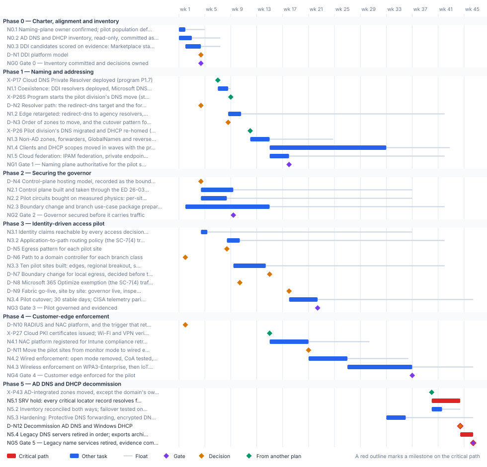

<!-- Generated by scripts/project_plans/build.py from data/project-plans/network-access.yaml. Edit the YAML, not this page. -->

# Network & Access Modernization: Naming Plane, Governed Transport and Edge Enforcement {.unnumbered}

::: {.callout-note}
## A sample plan, not a commitment
This is an illustrative plan built from the workbook's books, in the form a project manager would baseline: a work breakdown, a schedule network, a computed critical path, decision points, gates and risks. The durations are illustrative, sized to the books' roadmap weeks. Replace them with the agency's own estimates, then baseline the result. The plan names roles, not people, and no specific agency.
:::

## Plan at a glance

| | |
|---|---|
| **Plan type** | Project: Project Phases 0 to 5, from naming-plane ownership to the decommission of AD DNS and DHCP |
| **Built from** | Books 08 and 09 |
| **Sponsor** | Executive sponsor and CIO |
| **Plan manager** | Network and access project lead, with the DNS/DDI team lead and the network engineering lead |
| **Duration** | 46 weeks (227 working days), computed from the network |
| **Work** | 22 tasks, 6 gates, 12 decision points, 5 milestones from other plans |
| **Critical path** | 4 of 45 items; 1 more within 5 days of it |
| **Calendar** | Week 1 = the program's Phase 0 approval; five working days a week |

: Plan at a glance {.striped}

This plan builds the [Network & Access Modernization](../projects/network-access-charter.md) project from [Book 08](../books/b08-ddi/index.md) (DNS, DHCP and IPAM) and [Book 09](../books/b09-network/index.md) (transport, TIC 3.0 and network access control). It follows the project's own phases, as [Book 09, Chapter 09](../books/b09-network/09-who-owns-the-network.md#the-charters-plan-in-one-table) assigns them: naming and addressing first, then a governed-transport pilot behind a secured governor, then enforcement at the customer edge, and last [Book 08's gated decommission](../books/b08-ddi/10-migration-sequence.md#phase-5-decommission-ad-dns-and-dhcp) of AD DNS and DHCP. It runs inside the [program master schedule](program-master-schedule.md): it takes the cloud resolver from the program's P1.7, follows the pilot division's DNS move (P2.6) and the program's move of the AD-integrated zones (P4.3), and uses the device certificates from P2.7. Its success measures are the charter's, at pilot scale.

## Schedule

{fig-alt="Gantt chart of the Network &amp; Access Modernization plan over 46 weeks, grouped by phase. Critical-path tasks are red bars, other tasks are blue bars with a grey line showing their float, gates are violet diamonds, decisions are amber diamonds and milestones from other plans are green diamonds. The tables below give every date and float."}

## Critical path

The computed path is short, and it sits at the end. It starts with the program's move of the AD-integrated zones (P4.3, week 39), then runs through the 30-day SRV hold, the decommission decision and the ordered retirement of the legacy DNS servers to Gate 5 in week 46, two weeks before the program's G5. Book 08 makes that tail a set of gates, not dates, so it can't be compressed: the 30 clean days count only from the last zone move. Most earlier work carries float against this plan's finish, but one program date binds it much sooner. Coexistence (N1.1) must be in place when the program starts moving the pilot division's DNS (the start of P2.6, end of week 8), and it finishes with two days to spare, so the cloud resolver from P1.7 and coexistence are tracked as near-critical, and the DDI platform decision (D-N1) has about three weeks of float. The pilot's own chain runs through the naming plane: the fabric goes live only after Gate 1, which follows the pilot-division move, so a slip in P2.6 moves the pilot cutover and Gate 3 week for week. The NAC chain carries about nine weeks of float once the program's device certificates (P2.7) arrive.

The critical path, in order. Each item has zero total float: a day lost on any of them is a day lost at the finish.

| # | ID | Item | Owner or approver | When |
|---|---|---|---|---|
| 1 | N5.1 | SRV hold: every critical locator record resolves from every VNet and site, every 15 minutes, for 30 clean days | DNS/DDI team | wk 40–44 |
| 2 | D-N12 | Decommission AD DNS and Windows DHCP | Sponsor and CIO | end of wk 44 |
| 3 | N5.4 | Legacy DNS servers retired in order; exports archived; records officer confirms disposition; 7-day burn-in | AD administrators | wk 44–46 |
| 4 | NG5 | Gate 5 — Legacy name services retired, evidence complete | DNS/DDI team | end of wk 46 |

: The critical path {.striped .hover}

**Near-critical.** These items have 5 working days of float or less. Track them weekly: once their float is spent, they join the critical path.

| ID | Item | Float | When |
|---|---|---|---|
| N1.1 | Coexistence: DDI resolvers deployed, Microsoft DNS and DHCP synchronized read-only, forwarding both ways with one path per namespace | 2 d | wk 7–8 |

: Near-critical items {.striped .hover}

## Decision points

Each decision is a zero-duration milestone in the network. *Decide by* is its late finish: the last week it can be made without moving the plan's finish. A decision with zero float sits on the critical path, so the meeting that makes it should be booked before the plan is baselined. Decision rights follow [Book 01, Chapter 09](../books/b01-transformation-arc/09-who-leads-the-transformation.md#decision-rights-across-the-program).

| ID | Decision | Decides | Needed by | Decide by | Float | Options | If it's late |
|---|---|---|---|---|---|---|---|
| D-N1 | DDI platform model | Sponsor and CIO | NG0 | end of wk 7 | 15 d | SaaS policy plane; agency-operated DDI inside the boundary; cloud-native services managed as code (enough on its own for a single-cloud agency with no divisional delegation) | Coexistence can't be deployed, and the pilot division's DNS move (program P2.6) has nothing to move onto |
| D-N3 | Order of zones to move, and the cutover pattern for each | DNS/DDI team | N1.3 | end of wk 21 | 66 d | Per zone: split horizon, subdomain delegation, or progressive migration with conditional forwarding. AD locator records stay where domain controllers can register them, and move last | Authority can't move zone by zone; the pilot division's zones wait |
| D-N10 | RADIUS and NAC platform, and the trigger that retires NPS (D3) | Sponsor and CIO | N4.1 | end of wk 24 | 112 d | NPS through the hybrid-joined phase only; an on-premises NAC platform reading Intune compliance; a cloud-delivered NAC or RADIUS service with the right FedRAMP authorization; VPN or ZTNA federated to Entra ID for remote access | Enforcement can't be designed, and Entra-joined devices can't be admitted before cloud-native cutover removes the AD objects NPS relies on |
| D-N11 | Move the pilot sites from monitor mode to wired enforcement | Network engineering | N4.2 | end of wk 30 | 47 d | Enforce on workstation ports; stay in monitor mode until the baseline's exceptions are closed | Wired and wireless enforcement wait, and devices are still admitted before they authenticate |
| D-N4 | Control-plane hosting model, recorded as the boundary disposition | Sponsor and CIO | N2.1 | end of wk 31 | 138 d | An on-premises control plane; Cisco Catalyst SD-WAN for Government, cloud-hosted and FedRAMP Certified at Class C (Moderate). A hosted controller doesn't remove the directive's obligations | The control plane can't be built or hardened, and the pilot waits |
| D-N5 | Egress pattern for each pilot site | Network engineering | N3.3, D-N7 | end of wk 36 | 143 d | A, hairpin; C, governed local breakout (the program's reference pattern); D, agent-delivered SASE. Never B, bare local breakout | Pilot sites can't be built, and the boundary change can't name its enforcement points |
| D-N6 | Path to a domain controller for each branch class | Network engineering | N3.3 | end of wk 36 | 175 d | A private path (MPLS, IPsec or the SD-WAN overlay); a ZTNA connector that publishes the domain controllers (single sign-on only); a Kerberos KDC proxy | Pilot branches on local breakout lose sign-in, Group Policy and password change while cloud applications keep working |
| D-N2 | Resolver path: the redirect-dns target and the forwarding chain order (Decisions 1 and 2) | DNS/DDI team | N1.2 | end of wk 39 | 178 d | A DDI resolver at the branch; a forwarding proxy in a regional hub. Never a client loopback stub, and any SASE resolver is a forwarding target of the agency resolver, never the redirect target | Branch edges can't be retargeted; Protective DNS, logging and response policy stay off the branch path |
| D-N7 | Boundary change for local egress, decided before the first production cutover | Authorizing official | D-N9 | end of wk 41 | 135 d | Approve the significant change through reauthorization or ongoing authorization; refuse, and the sites stay on their current path | No production cutover can start: the boundary change comes first |
| D-N8 | Microsoft 365 Optimize exemption (the SC-7(4) traffic-flow exception) | Authorizing official | N3.4 | end of wk 41 | 158 d | Grant it for a stated duration and review cadence, on named and compensating controls; refuse it | Optimize traffic stays on the inspected path at the pilot sites, and the cutover waits |
| D-N9 | Fabric go-live, site by site: governor live, inspecting and logging | System owner | N3.4 | end of wk 41 | 120 d | Turn on the site's new egress; hold the site on its current path | Pilot traffic stays on the old path, and the 30-day stability clock doesn't start |
| D-N12 | Decommission AD DNS and Windows DHCP | Sponsor and CIO | N5.4 | end of wk 44 | **0 (critical)** | Decommission once all five gates pass, including 90 days of parallel operation; hold the legacy servers. Never on a date alone | Legacy DNS servers and their DnsAdmins exposure stay in service into the program's AD retirement phase |

: Decision points, by decide-by date {.striped .hover}

## Gates

Each gate is the next phase's entry condition. The approver signs it against the criteria, from evidence in the repository.

| Gate | When | Approver | Criteria |
|---|---|---|---|
| [Gate 0 — Inventory committed and decisions owned](../books/b08-ddi/08-reference-architecture.md#decision-4-ad-dns-inventory-before-retirement) | end of wk 4 | DNS/DDI team | AD DNS inventory dated, committed and reviewed (Decision 4); every branch's redirect-dns target read from the running configuration; platform model decided; one named decider for every row of the DNS and network matrices |
| [Gate 1 — Naming plane authoritative for the pilot scope](../books/b08-ddi/10-migration-sequence.md#phase-4-cloud-federation) | end of wk 17 | DNS/DDI team | Every name class in the validation matrix resolves correctly from on-premises, each cloud and the branch path; no private endpoint name returns a public address; OCSP and CRL endpoints resolve from every origin; every branch's redirect-dns target is an agency resolver; resolution-path consistency baselined |
| [Gate 2 — Governor secured before it carries traffic](../books/b09-network/08-reference-architecture.md#decision-4-bring-the-governor-under-control-before-it-carries-traffic) | end of wk 9 | CISO and ISSO | Controller and edges under vulnerability management on BOD 26-04 windows, privileged-access control and off-box logging; every edge in the fleet inventory with its software version and support date; an ED 26-03-style inventory, log collection and patch sequence executable within a day; SD-WAN syslog reaching CISA through CLAW |
| [Gate 3 — Pilot governed and evidenced](../books/b09-network/09-who-owns-the-network.md#an-owner-for-each-step) | end of wk 22 | CISO | Pilot sites stable for 30 days with the control layer live, inspecting and logging to the SIEM; boundary change decided before cutover; SC-7(4) memo signed and site register current; CISA telemetry parity confirmed per site before any legacy circuit ends; one path decision emitted as a claim; the VPN path documented as residual |
| [Gate 4 — Customer edge enforced for the pilot](../books/b09-network/07-network-access-control.md#inventory-profiling-and-logs) | end of wk 36 | CISO and ISSO | Monitor-mode baseline report filed; wired and wireless enforcement live at the pilot sites; the three minimum detections alerting the SOC; RADIUS accounting, Intune compliance reports and DHCP audit logs kept for assessors; every MAB exception dated |
| [Gate 5 — Legacy name services retired, evidence complete](../books/b08-ddi/11-operating-the-control-plane.md#sample-evidence-checklist) | end of wk 46 | DNS/DDI team | Gates 3 and 4 passed; Chapter 11's evidence checklist complete, the five decisions checked first; no client impact through the burn-in; logs searchable for six months and retrievable for a year; DnsAdmins and delegated roles reviewed; only the domain's own zones left on AD DNS, reached by forwarding, until the last domain controllers go |

: Gates {.striped .hover}

## Links to other plans

- **X-P17, Cloud DNS Private Resolver deployed (program P1.7),** is P1.7 in the [Program master schedule](program-master-schedule.md) plan (Sync and DNS Private Resolver designs; resolver deployed (M-018, M-019)), end of wk 6. This plan waits for it; it can slip 2 d before it moves this plan. Coexistence has no cloud resolver to forward to, and Phase 1 waits.
- **X-P26S, Program starts the pilot division's DNS move (start of P2.6),** is the start of P2.6 in the [Program master schedule](program-master-schedule.md) plan (Division DNS migrated, DHCP re-homed, hybrid resolution validated (M-027)), end of wk 8. This plan must finish N1.1 by then: a margin of 2 d. The pilot division's zones and scopes have no coexistence to move through, and the program's pilot slips.
- **X-P26, Pilot division's DNS migrated and DHCP re-homed (program P2.6),** is P2.6 in the [Program master schedule](program-master-schedule.md) plan (Division DNS migrated, DHCP re-homed, hybrid resolution validated (M-027)), end of wk 11. This plan waits for it; it can slip 49 d before it moves this plan. The cutover loop hasn't been proven on a division, so the remaining zone moves wait.
- **X-P27, Cloud PKI certificates issued; Wi-Fi and VPN verified (program P2.7),** is P2.7 in the [Program master schedule](program-master-schedule.md) plan (Cloud PKI certificates issued; Wi-Fi and VPN verified (M-028)), end of wk 14. This plan waits for it; it can slip 47 d before it moves this plan. Monitor mode has no device certificates to authenticate, and the NAC rollout waits.
- **X-P43, AD-integrated zones moved, except the domain's own (program P4.3),** is P4.3 in the [Program master schedule](program-master-schedule.md) plan (AD-integrated DNS zones moved, except the domain's own zones), end of wk 39. This plan waits for it; it can slip 0 before it moves this plan. The 30-day SRV hold and the decommission gates can't start.

## Work breakdown and schedule

Every row, by phase. *Float* is total float in working days; **bold** rows are on the critical path. Each row links to the chapter it comes from.

### Phase 0 — Charter, alignment and inventory

| ID | Item | Type | Owner or approver | Days | Predecessors | When | Float |
|---|---|---|---|---|---|---|---|
| N0.1 | [Naming-plane owner confirmed; pilot population defined; remote-access paths and residual VPN use inventoried](../books/b09-network/09-who-owns-the-network.md#the-charters-plan-in-one-table) | Task | Sponsor and CIO | 5 | — | wk 1 | 15 d |
| N0.2 | [AD DNS and DHCP inventory, read-only, committed as JSON; DnsAdmins emptied of non-domain-administrators](../books/b08-ddi/10-migration-sequence.md#phase-1-inventory-and-baseline) | Task | AD administrators | 10 | — | wk 1–2 | 22 d |
| N0.3 | [DDI candidates scored on evidence: Marketplace status, policy-plane coverage, the five decisions, vendor questions in writing](../books/b08-ddi/12-selection-cost-and-residual-risk.md#selection-criteria) | Task | DNS/DDI team | 12 | N0.1 | wk 2–4 | 15 d |
| D-N1 | [DDI platform model](../books/b08-ddi/12-selection-cost-and-residual-risk.md#comparing-the-platform-models) | Decision | Sponsor and CIO | — | N0.3 | end of wk 4 | 15 d |
| NG0 | [Gate 0 — Inventory committed and decisions owned](../books/b08-ddi/08-reference-architecture.md#decision-4-ad-dns-inventory-before-retirement) | Gate | DNS/DDI team | — | N0.2, D-N1 | end of wk 4 | 15 d |

: Phase 0 — Charter, alignment and inventory {.striped .hover}

### Phase 1 — Naming and addressing

| ID | Item | Type | Owner or approver | Days | Predecessors | When | Float |
|---|---|---|---|---|---|---|---|
| X-P17 | [Cloud DNS Private Resolver deployed (program P1.7)](program-master-schedule.md) | External | Platform teams (program) | — | — | end of wk 6 | 2 d |
| N1.1 | [Coexistence: DDI resolvers deployed, Microsoft DNS and DHCP synchronized read-only, forwarding both ways with one path per namespace](../books/b08-ddi/10-migration-sequence.md#phase-2-deploy-coexistence) | Task | DNS/DDI team | 8 | NG0, X-P17 | wk 7–8 | 2 d |
| X-P26S | [Program starts the pilot division's DNS move (start of P2.6)](program-master-schedule.md) | External | Platform teams (program) | — | N1.1 | end of wk 8 | fixed date |
| D-N2 | [Resolver path: the redirect-dns target and the forwarding chain order (Decisions 1 and 2)](../books/b08-ddi/08-reference-architecture.md#decision-1-the-redirect-dns-destination) | Decision | DNS/DDI team | — | NG0 | end of wk 4 | 178 d |
| N1.2 | [Edge retargeted: redirect-dns to agency resolvers, SASE DNS as a forwarding target, order verified in the running configuration](../books/b08-ddi/10-migration-sequence.md#retargeting-the-edge) | Task | Network engineering | 10 | D-N2, N1.1 | wk 8–10 | 157 d |
| D-N3 | [Order of zones to move, and the cutover pattern for each](../books/b08-ddi/10-migration-sequence.md#three-cutover-patterns) | Decision | DNS/DDI team | — | N1.1 | end of wk 8 | 66 d |
| X-P26 | [Pilot division's DNS migrated and DHCP re-homed (program P2.6)](program-master-schedule.md) | External | Platform teams (program) | — | — | end of wk 11 | 49 d |
| N1.3 | [Non-AD zones, forwarders, GlobalNames and reverse zones moved through the cutover loop](../books/b08-ddi/10-migration-sequence.md#zones-and-records) | Task | DNS/DDI team | 15 | D-N3, X-P26 | wk 12–14 | 49 d |
| N1.4 | [Clients and DHCP scopes moved in waves with the program's divisions (option 6, VNet DNS settings)](../books/b08-ddi/10-migration-sequence.md#moving-clients-in-waves) | Task | DNS/DDI team | 90 | N1.3 | wk 15–32 | 49 d |
| N1.5 | [Cloud federation: IPAM federation, private endpoint zones published once, validation matrix run from every origin](../books/b08-ddi/10-migration-sequence.md#phase-4-cloud-federation) | Task | Cloud platform teams | 15 | N1.3 | wk 15–17 | 120 d |
| NG1 | [Gate 1 — Naming plane authoritative for the pilot scope](../books/b08-ddi/10-migration-sequence.md#phase-4-cloud-federation) | Gate | DNS/DDI team | — | N1.2, N1.5 | end of wk 17 | 120 d |

: Phase 1 — Naming and addressing {.striped .hover}

### Phase 2 — Securing the governor

| ID | Item | Type | Owner or approver | Days | Predecessors | When | Float |
|---|---|---|---|---|---|---|---|
| D-N4 | [Control-plane hosting model, recorded as the boundary disposition](../books/b09-network/11-field-office-wan-transformation.md#risks-and-mitigations) | Decision | Sponsor and CIO | — | NG0 | end of wk 4 | 138 d |
| N2.1 | [Control plane built and taken through the ED 26-03 sequence: inventory, off-box logs, patch, hunt, harden, syslog to CISA through CLAW](../books/b09-network/05-sd-wan-sase-and-governed-transport.md#securing-the-controller-and-the-edges) | Task | Network engineering | 25 | D-N4 | wk 4–9 | 138 d |
| N2.2 | [Pilot circuits bought on measured physics: per-site latency and loss recorded, diversity, static addressing confirmed with carriers](../books/b09-network/13-sequencing-cost-and-evidence.md#the-decision-sequence) | Task | Network engineering | 20 | NG0 | wk 4–8 | 143 d |
| N2.3 | [Boundary change and branch use-case package prepared as a significant change, with the evidence the authorization package needs](../books/b09-network/13-sequencing-cost-and-evidence.md#evidence-for-the-boundary-change) | Task | System owner | 65 | N0.1 | wk 2–14 | 135 d |
| NG2 | [Gate 2 — Governor secured before it carries traffic](../books/b09-network/08-reference-architecture.md#decision-4-bring-the-governor-under-control-before-it-carries-traffic) | Gate | CISO and ISSO | — | N2.1 | end of wk 9 | 138 d |

: Phase 2 — Securing the governor {.striped .hover}

### Phase 3 — Identity-driven access pilot

| ID | Item | Type | Owner or approver | Days | Predecessors | When | Float |
|---|---|---|---|---|---|---|---|
| N3.1 | [Identity claims reachable by every access decision point; gaps listed](../books/b09-network/09-who-owns-the-network.md#the-charters-plan-in-one-table) | Task | Identity engineering | 5 | NG0 | wk 4–5 | 158 d |
| N3.2 | [Application-to-path routing policy (the SC-7(4) traffic-flow policy), site register and architecture review determination](../books/b09-network/12-microsoft-365-traffic.md#the-three-instruments) | Task | System owner | 10 | N2.2 | wk 8–10 | 158 d |
| D-N5 | [Egress pattern for each pilot site](../books/b09-network/08-reference-architecture.md#decision-3-choose-the-egress-pattern-per-site-and-change-the-boundary-first) | Decision | Network engineering | — | N2.2 | end of wk 8 | 143 d |
| D-N6 | [Path to a domain controller for each branch class](../books/b09-network/06-legacy-protocols-on-re-routed-paths.md#ways-to-provide-the-path) | Decision | Network engineering | — | N0.1 | end of wk 1 | 175 d |
| N3.3 | [Ten pilot sites built: edges, regional breakout, security service edge, deterministic egress, a monitored path to a domain controller](../books/b09-network/11-field-office-wan-transformation.md#implementation-roadmap) | Task | Network engineering | 25 | NG2, D-N5, D-N6, N3.1 | wk 9–14 | 138 d |
| D-N7 | [Boundary change for local egress, decided before the first production cutover](../books/b09-network/13-sequencing-cost-and-evidence.md#the-decision-sequence) | Decision | Authorizing official | — | N2.3, N3.2, D-N5 | end of wk 14 | 135 d |
| D-N8 | [Microsoft 365 Optimize exemption (the SC-7(4) traffic-flow exception)](../books/b09-network/12-microsoft-365-traffic.md#the-sc-74-documented-traffic-flow-exception) | Decision | Authorizing official | — | N3.2 | end of wk 10 | 158 d |
| D-N9 | [Fabric go-live, site by site: governor live, inspecting and logging](../books/b09-network/09-who-owns-the-network.md#an-owner-for-each-step) | Decision | System owner | — | N3.3, D-N7, NG1, NG2 | end of wk 17 | 120 d |
| N3.4 | [Pilot cutover; 30 stable days; CISA telemetry parity confirmed per site; one path decision emitted as a claim](../books/b09-network/05-sd-wan-sase-and-governed-transport.md#the-evidence-the-fabric-must-emit) | Task | Network engineering | 22 | D-N9, D-N8 | wk 18–22 | 120 d |
| NG3 | [Gate 3 — Pilot governed and evidenced](../books/b09-network/09-who-owns-the-network.md#an-owner-for-each-step) | Gate | CISO | — | N3.4 | end of wk 22 | 120 d |

: Phase 3 — Identity-driven access pilot {.striped .hover}

### Phase 4 — Customer-edge enforcement

| ID | Item | Type | Owner or approver | Days | Predecessors | When | Float |
|---|---|---|---|---|---|---|---|
| D-N10 | [RADIUS and NAC platform, and the trigger that retires NPS (D3)](../books/b09-network/07-network-access-control.md#what-can-replace-it) | Decision | Sponsor and CIO | — | N0.1 | end of wk 1 | 112 d |
| X-P27 | [Cloud PKI certificates issued; Wi-Fi and VPN verified (program P2.7)](program-master-schedule.md) | External | Platform teams (program) | — | — | end of wk 14 | 47 d |
| N4.1 | [NAC platform registered for Intune compliance retrieval; policy tiers built; monitor mode on pilot ports with a baseline report](../books/b09-network/07-network-access-control.md#posture-comes-from-intune-not-from-a-probe) | Task | Network engineering | 30 | D-N10, X-P27 | wk 15–20 | 47 d |
| D-N11 | [Move the pilot sites from monitor mode to wired enforcement](../books/b09-network/07-network-access-control.md#rolling-it-out) | Decision | Network engineering | — | N4.1 | end of wk 20 | 47 d |
| N4.2 | [Wired enforcement: open mode removed, CoA tested, captive portal up, IoT devices registered in IPAM, detections routed to the SOC](../books/b09-network/07-network-access-control.md#rolling-it-out) | Task | Network engineering | 30 | D-N11 | wk 21–26 | 47 d |
| N4.3 | [Wireless enforcement on WPA3-Enterprise, then IoT segmentation and a rogue-device tabletop](../books/b09-network/07-network-access-control.md#rolling-it-out) | Task | Network engineering | 50 | N4.2 | wk 27–36 | 47 d |
| NG4 | [Gate 4 — Customer edge enforced for the pilot](../books/b09-network/07-network-access-control.md#inventory-profiling-and-logs) | Gate | CISO and ISSO | — | N4.3 | end of wk 36 | 47 d |

: Phase 4 — Customer-edge enforcement {.striped .hover}

### Phase 5 — AD DNS and DHCP decommission

| ID | Item | Type | Owner or approver | Days | Predecessors | When | Float |
|---|---|---|---|---|---|---|---|
| X-P43 | [AD-integrated zones moved, except the domain's own (program P4.3)](program-master-schedule.md) | External | Platform teams (program) | — | — | end of wk 39 | 0 |
| N5.1 | **[SRV hold: every critical locator record resolves from every VNet and site, every 15 minutes, for 30 clean days](../books/b08-ddi/11-operating-the-control-plane.md#srv-record-monitoring)** | Task | DNS/DDI team | 22 | X-P43 | wk 40–44 | 0 |
| N5.2 | [Inventory reconciled both ways; failover tested on the new resolvers and DHCP; query logs show the old servers idle](../books/b08-ddi/10-migration-sequence.md#phase-5-decommission-ad-dns-and-dhcp) | Task | DNS/DDI team | 8 | X-P43, N1.4 | wk 40–41 | 14 d |
| N5.3 | [Hardening: Protective DNS forwarding, encrypted DNS, DNSSEC signing and validation where required, monitoring dashboards](../books/b08-ddi/10-migration-sequence.md#phase-6-policy-and-compliance-hardening) | Task | DNS/DDI team | 15 | N1.4 | wk 33–35 | 52 d |
| D-N12 | **[Decommission AD DNS and Windows DHCP](../books/b08-ddi/10-migration-sequence.md#phase-5-decommission-ad-dns-and-dhcp)** | Decision | Sponsor and CIO | — | N5.1, N5.2 | end of wk 44 | 0 |
| N5.4 | **[Legacy DNS servers retired in order; exports archived; records officer confirms disposition; 7-day burn-in](../books/b08-ddi/10-migration-sequence.md#phase-5-decommission-ad-dns-and-dhcp)** | Task | AD administrators | 10 | D-N12 | wk 44–46 | 0 |
| NG5 | **[Gate 5 — Legacy name services retired, evidence complete](../books/b08-ddi/11-operating-the-control-plane.md#sample-evidence-checklist)** | Gate | DNS/DDI team | — | N5.3, N5.4, NG3, NG4 | end of wk 46 | 0 |

: Phase 5 — AD DNS and DHCP decommission {.striped .hover}

## Responsibility

Who owns what in this plan. Each row has one owner; consulted and informed parties follow the [decision matrix](../books/b01-transformation-arc/09-who-leads-the-transformation.md#decision-rights-across-the-program).

| Owner or approver | Tasks | Decisions | Gates |
|---|---|---|---|
| DNS/DDI team | 7 | 2 | 3 |
| Network engineering | 8 | 3 | — |
| Platform teams (program) | 5 | — | — |
| Sponsor and CIO | 1 | 4 | — |
| System owner | 2 | 1 | — |
| AD administrators | 2 | — | — |
| Authorizing official | — | 2 | — |
| CISO and ISSO | — | — | 2 |
| CISO | — | — | 1 |
| Cloud platform teams | 1 | — | — |
| Identity engineering | 1 | — | — |

: Ownership {.striped .hover}

## Assumptions

- The SD-WAN platform is the program's platform, Cisco Catalyst SD-WAN, bought on an existing contract vehicle. A new acquisition takes several quarters before a device ships ([Book 09, Chapter 10](../books/b09-network/10-the-long-interim.md#why-the-target-is-years-away)) and would move Phase 2 week for week.
- The pilot is [Book 09, Chapter 11](../books/b09-network/11-field-office-wan-transformation.md#implementation-roadmap)'s ten-site pilot. The office waves that follow, keyed to circuit renewal dates over months 18 to 48, are outside this plan.
- The tenant is GCC-Moderate, so Microsoft 365 informed network routing isn't available and path selection rests on the SD-WAN's own measurements ([Book 09, Chapter 12](../books/b09-network/12-microsoft-365-traffic.md#whats-different-for-gcc-moderate-tenants)).
- Book 08's 90 days of parallel operation are counted from coexistence (N1.1). Counted from the last zone move instead (program P4.3), they end near week 52, past the program's G5.
- Durations are illustrative. The NAC rollout follows [Book 09, Chapter 07](../books/b09-network/07-network-access-control.md#rolling-it-out)'s four phases over roughly 90 to 180 days.

## Schedule risks

| Risk | Effect on the schedule | Response |
|---|---|---|
| Accreditation of branch breakout slips | No production cutover can start; Gate 3 slips week for week | Start the boundary-change package in week 2 (N2.3); fall back to hub-only breakout (Book 09, Chapter 11) |
| The control plane is hit by another directive-class flaw | Gate 2 reopens and the pilot halts until the governor is secured again | Keep the ED 26-03 sequence executable within a day and patch inside BOD 26-04 windows (Book 09, Chapters 05 and 08) |
| Replacement telemetry to CISA lags the cutover | No legacy circuit can end; Gate 3 waits on telemetry parity | Start CLAW onboarding with the control plane (N2.1); gate each circuit's termination on confirmed parity (Book 09, Chapter 11) |
| Locator records are lost to an early decommission | Forest-wide authentication and domain-join failures | Decommission through gates, never on a date; hold 30 clean SRV days and archive the exports first (Book 08, Chapter 10) |
| M-26-14, M-26-15 and BOD 26-04 draw on the same staff | Every network task stretches; the pilot slips | Name the competing mandates in the plan and staff for them (Book 09, Chapter 10) |

: Schedule risks {.striped .hover}

## Baseline and change control

- **Baseline** the plan when its first gate is approved: the YAML file, as merged, is the baseline.
- **Report** weekly, green, yellow or red, against the baseline ([Book 01, Chapter 12](../books/b01-transformation-arc/12-migration-roadmap.md#phase-3-general-rollout-weeks-1736)). Report float, not percent complete: a task's float says how much slip the plan can still absorb.
- **Change** the plan only through a reviewed pull request that edits the YAML and regenerates this page, so every change to a date or a dependency has an author, a reviewer and a reason.
- **Re-baseline** at each gate, after the approver signs it, and whenever a critical-path decision is made late.

## Download and adapt

| File | Use it for |
|---|---|
| [network-access.xml](files/network-access.xml) | Microsoft Project (open the XML file; it keeps the dependencies, milestones and owners). The dates start on a placeholder Monday: change the project start date. |
| [network-access.csv](files/network-access.csv) | Excel or any other scheduling tool: every row with its dependencies, early and late dates and float |
| [network-access.yaml](https://github.com/WhalerMike/modernization-workbook/blob/main/data/project-plans/network-access.yaml) | The source. Edit the durations, owners and dependencies, then run `python scripts/project_plans/build.py` to recompute the critical path and regenerate this page, the chart and the downloads. |

: Downloads {.striped}

