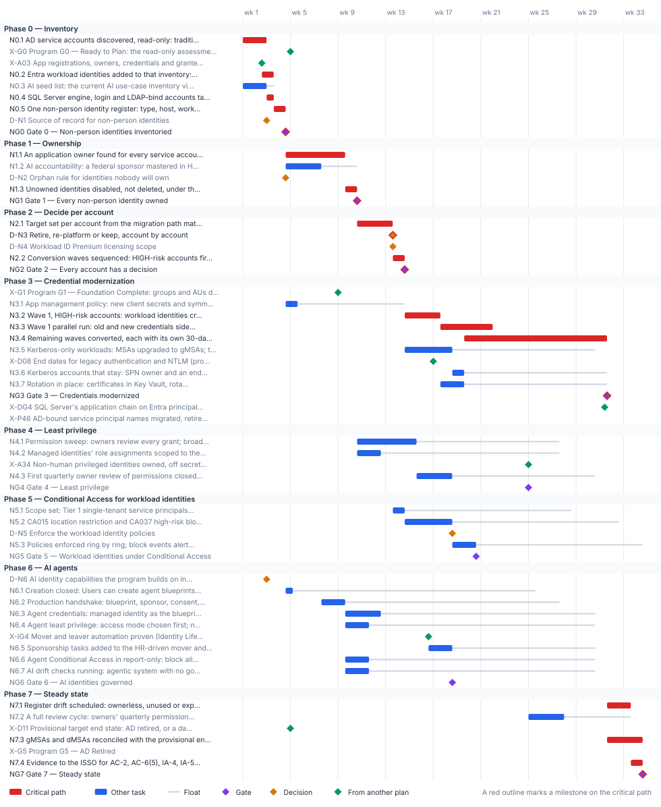

<!-- Generated by scripts/project_plans/build.py from data/project-plans/non-person-identity.yaml. Edit the YAML, not this page. -->

# Non-Person Identity Modernization: Service Accounts, Workload Identities and AI Agents {.unnumbered}

::: {.callout-note}
## A sample plan, not a commitment
This is an illustrative plan built from the workbook's books, in the form a project manager would baseline: a work breakdown, a schedule network, a computed critical path, decision points, gates and risks. The durations are illustrative, sized to the books' roadmap weeks. Replace them with the agency's own estimates, then baseline the result. The plan names roles, not people, and no specific agency.
:::

## Plan at a glance

| | |
|---|---|
| **Plan type** | Project: Inventory, ownership, a decision per account, credential modernization, least privilege, Conditional Access for workload identities, AI agents and steady state |
| **Built from** | Books 02, 04, 06 and 17 |
| **Sponsor** | Executive sponsor and CIO; CISO |
| **Plan manager** | Project lead, with the identity engineering, application owner, AI governance and evidence leads |
| **Duration** | 34 weeks (168 working days), computed from the network |
| **Work** | 34 tasks, 8 gates, 6 decision points, 10 milestones from other plans |
| **Critical path** | 20 of 58 items; 2 more within 5 days of it |
| **Calendar** | Week 1 = the program's Phase 0 approval; five working days a week |

: Plan at a glance {.striped}

This plan runs the [non-person identity track](../books/guides/attribute-driven-migration.md#non-person-identity-track) of the Attribute-Driven Migration companion guide: every identity that isn't a person, from an AD service account with a password that never expires to an AI agent with a sponsor. Its source of truth isn't HR. It is the owning application's record, the application registration and, for AI, the AI use-case inventory. The design comes from [Book 02, Chapter 09](../books/b02-identity/09-building-the-entra-target.md#modernizing-service-accounts) (the migration path matrix, workload identity federation, Conditional Access for workload identities, service principal governance and the discovery function) and [Chapter 10](../books/b02-identity/10-migrating-and-governing.md#phase-4-service-account-modernization) (Phase 4, the conversion gate, and [Phase 10](../books/b02-identity/10-migrating-and-governing.md#phase-10-steady-state-governance), steady state). The application controls come from [Book 04, Chapter 05](../books/b04-access/05-applications-and-workload-identities.md), and the AI work from [Book 17](../books/b17-ai-identity/index.md). SQL Server's engine and application accounts are handed to the [Data Platform plan](data-platform.md), which follows [Book 06](../books/b06-data-platform/index.md). The plan runs inside the [program master schedule](program-master-schedule.md): the discovery is part of the read-only assessment the program commits at G0, conversion waits for the program's G1, the Kerberos dispositions feed the program's SPN retirement (P4.6), and the last gMSAs and dMSAs have to be gone or islanded before AD is retired (G5). Phases 4 to 6 run beside credential modernization, not after it, so their gates fall before Gate 3.

## Schedule

{fig-alt="Gantt chart of the Non-Person Identity Modernization plan over 34 weeks, grouped by phase. Critical-path tasks are red bars, other tasks are blue bars with a grey line showing their float, gates are violet diamonds, decisions are amber diamonds and milestones from other plans are green diamonds. The tables below give every date and float."}

## Critical path

The computed path starts in week 1 with the AD discovery and the [Privileged Access plan](privileged-access.md)'s app registration inventory (A0.3), which this plan extends rather than repeats. The register and Gate 0 land at the end of week 4, with the program's G0; the AD discovery reaches the program's assessment with ten working days to spare. From there the path runs through ownership. An application owner has to be found for every service account, and two human owners named on every app registration, before anything is touched, so the owner search, not the scripting, sets the pace to Gate 1 in week 10. Then come the target for each account, the disposition decision (D-N3, end of week 13), the wave plan and Gate 2 in week 14, and conversion: the high-risk wave, its 30-day parallel run, and the remaining waves with their own parallel runs, to Gate 3 in week 31. The register's drift checks, the gMSA and dMSA reconciliation, the evidence hand-off and Gate 7 follow, in week 34.

Conversion doesn't wait on the program: the program's G1 (week 8) has 28 working days of float against it. The Kerberos accounts that stay need the program's legacy-authentication end dates (D08, week 16) only for their own end dates, so D08 sits off the path. Gate 3 lands 57 working days before the program finishes retiring AD-bound service principal names (P4.6, week 42), and the islanded Kerberos list is what P4.6 works from. The reconciliation uses the provisional end state set at G0 (D11); when the program confirms or revises it (D09, week 36), the island list is re-run inside the 72-day margin before G5 in week 48. Least privilege, Conditional Access for workload identities and the AI phase carry float. Least privilege waits on the Privileged Access plan's sweep of privileged non-human identities (A3.4, week 24), and the AI phase on the [Identity Lifecycle](identity-lifecycle.md) plan's mover and leaver automation (its Gate 4, week 16), because the sponsor tasks ride on the HR-driven workflows.

The critical path, in order. Each item has zero total float: a day lost on any of them is a day lost at the finish.

| # | ID | Item | Owner or approver | When |
|---|---|---|---|---|
| 1 | N0.1 | AD service accounts discovered, read-only: traditional accounts, MSAs, gMSAs and dMSAs, classified by type and risk with a suggested target | Identity engineering | wk 1–2 |
| 2 | N0.2 | Entra workload identities added to that inventory: managed identities, federated credentials, consent grants; ownerless and secret-holding apps flagged | Identity engineering | wk 2–3 |
| 3 | N0.4 | SQL Server engine, login and LDAP-bind accounts tagged and handed to the Data Platform plan | Identity engineering | wk 3 |
| 4 | N0.5 | One non-person identity register: type, host, workload location, risk and candidate target for every identity | Identity engineering | wk 3–4 |
| 5 | NG0 | Gate 0 — Non-person identities inventoried | ISSO | end of wk 4 |
| 6 | N1.1 | An application owner found for every service account; two human owners on every app registration and service principal; serviceManagementReference set | Application owners | wk 4–9 |
| 7 | N1.3 | Unowned identities disabled, not deleted, under the orphan rule; each a retirement candidate with a 30-day claim window | Identity governance officer | wk 9–10 |
| 8 | NG1 | Gate 1 — Every non-person identity owned | CISO | end of wk 10 |
| 9 | N2.1 | Target set per account from the migration path matrix: app registration, managed identity, gMSA or dMSA, or retirement | Identity engineering, with application owners | wk 10–13 |
| 10 | D-N3 | Retire, re-platform or keep, account by account | Application owners | end of wk 13 |
| 11 | N2.2 | Conversion waves sequenced: HIGH-risk accounts first (password never expires, over-privileged); rollback recorded per wave | Identity engineering | wk 13–14 |
| 12 | NG2 | Gate 2 — Every account has a decision | ISSO | end of wk 14 |
| 13 | N3.2 | Wave 1, HIGH-risk accounts: workload identities created (managed identity, then federated credential, then certificate); federated token exchange tested | Identity engineering, with application owners | wk 14–17 |
| 14 | N3.3 | Wave 1 parallel run: old and new credentials side by side for 30 days, then the legacy accounts disabled | Application owners | wk 17–21 |
| 15 | N3.4 | Remaining waves converted, each with its own 30-day parallel run before the legacy account is disabled | Identity engineering, with application owners | wk 19–31 |
| 16 | NG3 | Gate 3 — Credentials modernized | ISSO | end of wk 31 |
| 17 | N7.1 | Register drift scheduled: ownerless, unused or expiring registrations, passwords that never expire, credentials added outside the pipeline | Identity engineering | wk 31–33 |
| 18 | N7.3 | gMSAs and dMSAs reconciled with the provisional end state: moved to a workload identity, or listed for the Kerberos island with an end-of-life date | Identity engineering | wk 31–34 |
| 19 | N7.4 | Evidence to the ISSO for AC-2, AC-6(5), IA-4, IA-5 and IA-9, and for M-25-21; the annual inventory vintage comparison scheduled | Identity governance officer | wk 33–34 |
| 20 | NG7 | Gate 7 — Steady state | ISSO | end of wk 34 |

: The critical path {.striped .hover}

**Near-critical.** These items have 5 working days of float or less. Track them weekly: once their float is spent, they join the critical path.

| ID | Item | Float | When |
|---|---|---|---|
| N0.3 | AI seed list: the current AI use-case inventory vintage loaded; agentic, purchased and no-ATO entries matched to agent identities and service principals | 3 d | wk 1–2 |
| D-N4 | Workload ID Premium licensing scope | 5 d | end of wk 13 |

: Near-critical items {.striped .hover}

## Decision points

Each decision is a zero-duration milestone in the network. *Decide by* is its late finish: the last week it can be made without moving the plan's finish. A decision with zero float sits on the critical path, so the meeting that makes it should be booked before the plan is baselined. Decision rights follow [Book 01, Chapter 09](../books/b01-transformation-arc/09-who-leads-the-transformation.md#decision-rights-across-the-program).

| ID | Decision | Decides | Needed by | Decide by | Float | Options | If it's late |
|---|---|---|---|---|---|---|---|
| D-N1 | Source of record for non-person identities | CIO | NG0 | end of wk 4 | 8 d | The owning workload's record (the system inventory or CMDB entry and the application registration) and, for AI, the AI use-case inventory, with the register keyed to them; a separate identity register kept by the identity team | The register has nothing to reconcile against, and owners and lifecycle have nothing to hang from |
| D-N2 | Orphan rule for identities nobody will own | CISO | N1.3 | end of wk 9 | 25 d | Disable once the identity governance officer confirms the finding, then 30 days for the office to name an owner or retire it (Book 04's rule, applied at once to agents because they can act); retire at once; keep running on a dated exception | Unowned accounts can't be disposed of, and Gate 1 can't pass |
| D-N3 | Retire, re-platform or keep, account by account | Application owners | N2.2 | end of wk 13 | **0 (critical)** | Retire (unused or unowned); re-platform to a managed identity, a gMSA or dMSA, or an app registration with a federated credential or certificate; keep on Kerberos with an SPN, islanded with an end date the authorizing official accepts | The conversion waves can't be built, and the program's SPN retirement (P4.6) has no list to work from |
| D-N4 | Workload ID Premium licensing scope | CISO | NG2, N4.3, N5.1 | end of wk 14 | 5 d | License for the single-tenant service principals classified Tier 1 (Book 04's position); license more widely; don't license, and rely on app management policies and owner reviews, with no workload Conditional Access | Workload Conditional Access can't be created or changed, and privileged service principal reviews aren't available |
| D-N6 | AI identity capabilities the program builds on in the agency's cloud | CIO, with the Chief AI Officer | N6.2 | end of wk 25 | 113 d | Agent identities where generally available in the agency's cloud, with GCC's documented subset; service principals and managed identities under the same governance where agent identities aren't available; preview capabilities as watch items | Agents are created with no decided identity type, and the production handshake can't be defined |
| D-N5 | Enforce the workload identity policies | CISO | N5.3 | end of wk 32 | 70 d | Enforce; extend report-only; enforce with named exclusions, each recorded with its owner and end date | Tier 1 workloads stay reachable from anywhere with a stolen credential, and Gate 5 can't pass |

: Decision points, by decide-by date {.striped .hover}

## Gates

Each gate is the next phase's entry condition. The approver signs it against the criteria, from evidence in the repository.

| Gate | When | Approver | Criteria |
|---|---|---|---|
| [Gate 0 — Non-person identities inventoried](../books/b02-identity/10-migrating-and-governing.md#phase-4-service-account-modernization) | end of wk 4 | ISSO | Every AD service account, MSA, gMSA and dMSA, every app registration, service principal and managed identity, and every AI use case in the current vintage in one register with type, risk and candidate target; HIGH-risk accounts listed; stale leads confirmed against sign-in logs, not retired on a guess; SQL Server accounts handed to the Data Platform plan |
| [Gate 1 — Every non-person identity owned](../books/b02-identity/09-building-the-entra-target.md#governing-service-principals) | end of wk 10 | CISO | Every service account has a named application owner; every app registration and service principal has two human owners and a service-management reference; every AI identity has a federal sponsor, a sponsoring group, a technical owner and a matching inventory record; every unowned identity is disabled pending retirement or carries a dated exception |
| [Gate 2 — Every account has a decision](../books/b02-identity/10-migrating-and-governing.md#phase-4-service-account-modernization) | end of wk 14 | ISSO | Every account in the register has a disposition (retire, re-platform, or keep with an end date) and a target from the matrix; HIGH-risk accounts in the first wave; every kept Kerberos account has an SPN owner; waves and their rollback recorded |
| [Gate 3 — Credentials modernized](../books/b02-identity/10-migrating-and-governing.md#phase-4-service-account-modernization) | end of wk 31 | ISSO | Every HIGH-risk account converted or retired; no account with a password that never expires; new identities authenticate without stored secrets where the host allows, otherwise with a certificate on the rotation schedule; no client secret in production outside a dated exception; legacy accounts disabled after a clean 30-day parallel run with no service disruption; every remaining Kerberos account islanded with an owner and end date |
| [Gate 4 — Least privilege](../books/b02-identity/09-building-the-entra-target.md#governing-service-principals) | end of wk 24 | CISO | No service principal holds a broad tenant-wide permission without a recorded justification; managed identities' role assignments scoped to resources; privileged non-human identities closed in the Privileged Access plan; the first quarterly review cycle closed with its findings acted on |
| [Gate 5 — Workload identities under Conditional Access](../books/b04-access/05-applications-and-workload-identities.md#conditional-access-for-workload-identities) | end of wk 20 | CISO | Every Tier 1 single-tenant service principal assigned directly to the enforced location and risk policies; report-only results reviewed before enforcement; every out-of-scope identity (managed identities, multitenant and SaaS apps) recorded with the control that covers it instead |
| [Gate 6 — AI identities governed](../books/b17-ai-identity/10-evidence-and-authorization.md#the-evidence-an-authorizing-official-needs) | end of wk 18 | CISO | Every AI system in the current inventory vintage classified by kind of identity; every agent identity created through the handshake with a sponsor, a technical owner and a matching inventory record; no production blueprint with a client secret; no AI identity with a standing privileged role; sponsor mover and leaver tasks live; agent block policies in report-only with results reviewed; no open P1 AI drift finding |
| [Gate 7 — Steady state](../books/guides/attribute-driven-migration.md#non-person-identity-track) | end of wk 34 | ISSO | Every service account and service principal has an owner and sponsor, a reason and a target; each is retired, re-platformed to a managed identity or gMSA, or a certificate or federated workload identity; none holds a password that never expires and none is orphaned; drift checks and review cycles running; every remaining gMSA and dMSA moved or in the dated Kerberos island |

: Gates {.striped .hover}

## Links to other plans

- **X-G0, Program G0 — Ready to Plan: the read-only assessment committed,** is G0 in the [Program master schedule](program-master-schedule.md) plan (G0 — Ready to Plan), end of wk 4. This plan must finish N0.1 by then: a margin of 10 d. The program's assessment goes to G0 without the service account picture, and Phase 1 is sized without it.
- **X-A03, App registrations, owners, credentials and granted permissions inventoried (Privileged Access plan, A0.3),** is A0.3 in the [Privileged Access & Administrative Identity](privileged-access.md) plan (App registrations, owners, credentials and granted permissions inventoried, read-only; automation on the protected permissions found), end of wk 2. This plan waits for it; it can slip 0 before it moves this plan. The Entra side of the register has no app registration inventory to start from.
- **X-G1, Program G1 — Foundation Complete: groups and AUs drift-clean, Conditional Access baseline enforced,** is G1 in the [Program master schedule](program-master-schedule.md) plan (G1 — Foundation Complete), end of wk 8. This plan waits for it; it can slip 28 d before it moves this plan. Conversion has no group and policy foundation to land on (Book 02 puts service accounts after group migration).
- **X-D08, End dates for legacy authentication and NTLM (program D08),** is D08 in the [Program master schedule](program-master-schedule.md) plan (End dates for legacy authentication and NTLM), end of wk 16. This plan waits for it; it can slip 68 d before it moves this plan. Kerberos accounts that stay can't be given end dates, so the islanded list can't be handed to the program.
- **X-DG4, SQL Server's application chain on Entra principals (Data Platform plan, Gate 4),** is DG4 in the [Data Platform Identity Transformation](data-platform.md) plan (Gate 4 — Application chain on Entra principals), end of wk 31. Shown for reference.
- **X-P46, AD-bound service principal names migrated, retired or islanded (program P4.6),** is P4.6 in the [Program master schedule](program-master-schedule.md) plan (AD-bound service principal names migrated, retired or islanded, app by app), end of wk 42. This plan must finish NG3 by then: a margin of 57 d. The program measures AD authentication for G4 while converted workloads still hold AD credentials.
- **X-A34, Non-human privileged identities owned, off secrets, over-consented apps swept (Privileged Access plan, A3.4),** is A3.4 in the [Privileged Access & Administrative Identity](privileged-access.md) plan (Non-human privileged identities: two named owners each, credentials off secrets, over-consented apps swept), end of wk 24. This plan waits for it; it can slip 28 d before it moves this plan. Privileged service principals are outside this plan's sweep, so the least-privilege gate can't pass.
- **X-IG4, Mover and leaver automation proven (Identity Lifecycle plan, Gate 4),** is IG4 in the [Identity Lifecycle & Provisioning](identity-lifecycle.md) plan (Gate 4 — Lifecycle automated), end of wk 16. This plan waits for it; it can slip 60 d before it moves this plan. The sponsor's mover and leaver events have no HR-driven workflow to ride on.
- **X-D11, Provisional target end state: AD retired, or a dated Kerberos island (program D11),** is D11 in the [Program master schedule](program-master-schedule.md) plan (Provisional target end state: AD retired, or a dated Kerberos island), end of wk 4. This plan waits for it; it can slip 133 d before it moves this plan. The gMSA and dMSA reconciliation has no target to reconcile against.
- **X-G5, Program G5 — AD Retired,** is G5 in the [Program master schedule](program-master-schedule.md) plan (G5 — AD Retired), end of wk 48. This plan must finish N7.3 by then: a margin of 72 d. A workload still running under a gMSA loses its credential when the last domain controller is demoted.

Other plans that take a date from this one. *Waits for it*: that plan can't move until this item finishes, and its float says how far this item can slip before it moves that plan. *Must finish by it*: that plan's work has to be done before this item, and the margin says by how much.

| This plan's item | When | Linked plan | Relationship | Float or margin |
|---|---|---|---|---|
| NG0  Gate 0 — Non-person identities inventoried | end of wk 4 | [Attribute-Driven Migration](attribute-driven-migration.md) (X-NG0) | Must finish A0.1 by it | 10 d margin |
| start of N1.2  AI accountability: a federal sponsor mastered in HR, a small sponsoring group, a technical owner who isn't the sponsor, and a matching inventory record | wk 4–7 | [Attribute-Driven Migration](attribute-driven-migration.md) (X-N12) | Must finish A5.4 by it | 2 d margin |

: Plans that take a date from this one {.striped .hover}

## Work breakdown and schedule

Every row, by phase. *Float* is total float in working days; **bold** rows are on the critical path. Each row links to the chapter it comes from.

### Phase 0 — Inventory

| ID | Item | Type | Owner or approver | Days | Predecessors | When | Float |
|---|---|---|---|---|---|---|---|
| N0.1 | **[AD service accounts discovered, read-only: traditional accounts, MSAs, gMSAs and dMSAs, classified by type and risk with a suggested target](../books/b02-identity/09-building-the-entra-target.md#discovering-service-accounts)** | Task | Identity engineering | 10 | — | wk 1–2 | 0 |
| X-G0 | [Program G0 — Ready to Plan: the read-only assessment committed](program-master-schedule.md) | External | Steward (program) | — | N0.1 | end of wk 4 | fixed date |
| X-A03 | [App registrations, owners, credentials and granted permissions inventoried (Privileged Access plan, A0.3)](privileged-access.md) | External | Identity engineering (Privileged Access plan) | — | — | end of wk 2 | 0 |
| N0.2 | **[Entra workload identities added to that inventory: managed identities, federated credentials, consent grants; ownerless and secret-holding apps flagged](../books/b04-access/05-applications-and-workload-identities.md#a-read-only-inventory-to-start-from)** | Task | Identity engineering | 5 | X-A03 | wk 2–3 | 0 |
| N0.3 | [AI seed list: the current AI use-case inventory vintage loaded; agentic, purchased and no-ATO entries matched to agent identities and service principals](../books/b17-ai-identity/03-the-inventory-as-an-identity-source.md#using-the-inventory-as-the-seed-list) | Task | Identity engineering, with the Chief AI Officer's staff | 10 | — | wk 1–2 | 3 d |
| N0.4 | **[SQL Server engine, login and LDAP-bind accounts tagged and handed to the Data Platform plan](../books/b06-data-platform/09-what-arc-provides-to-sql-server.md#the-managed-identity-and-the-service-account)** | Task | Identity engineering | 3 | N0.1 | wk 3 | 0 |
| N0.5 | **[One non-person identity register: type, host, workload location, risk and candidate target for every identity](../books/guides/attribute-driven-migration.md#non-person-identity-track)** | Task | Identity engineering | 5 | N0.1, N0.2, N0.3, N0.4 | wk 3–4 | 0 |
| D-N1 | [Source of record for non-person identities](../books/guides/attribute-driven-migration.md#non-person-identity-track) | Decision | CIO | — | N0.1 | end of wk 2 | 8 d |
| NG0 | **[Gate 0 — Non-person identities inventoried](../books/b02-identity/10-migrating-and-governing.md#phase-4-service-account-modernization)** | Gate | ISSO | — | N0.5, D-N1 | end of wk 4 | 0 |

: Phase 0 — Inventory {.striped .hover}

### Phase 1 — Ownership

| ID | Item | Type | Owner or approver | Days | Predecessors | When | Float |
|---|---|---|---|---|---|---|---|
| N1.1 | **[An application owner found for every service account; two human owners on every app registration and service principal; serviceManagementReference set](../books/b04-access/05-applications-and-workload-identities.md#ownership)** | Task | Application owners | 25 | NG0 | wk 4–9 | 0 |
| N1.2 | [AI accountability: a federal sponsor mastered in HR, a small sponsoring group, a technical owner who isn't the sponsor, and a matching inventory record](../books/b17-ai-identity/05-owners-sponsors-and-lifecycle.md#the-programs-rule-two-named-humans-and-a-record) | Task | Sponsoring offices, with the identity governance officer | 15 | NG0 | wk 4–7 | 15 d |
| D-N2 | [Orphan rule for identities nobody will own](../books/b04-access/06-who-decides-access.md#ownership-changes-and-orphaned-apps) | Decision | CISO | — | NG0 | end of wk 4 | 25 d |
| N1.3 | **[Unowned identities disabled, not deleted, under the orphan rule; each a retirement candidate with a 30-day claim window](../books/guides/attribute-driven-migration.md#service-accounts-msas-gmsas-and-dmsas)** | Task | Identity governance officer | 5 | N1.1, D-N2 | wk 9–10 | 0 |
| NG1 | **[Gate 1 — Every non-person identity owned](../books/b02-identity/09-building-the-entra-target.md#governing-service-principals)** | Gate | CISO | — | N1.2, N1.3 | end of wk 10 | 0 |

: Phase 1 — Ownership {.striped .hover}

### Phase 2 — Decide per account

| ID | Item | Type | Owner or approver | Days | Predecessors | When | Float |
|---|---|---|---|---|---|---|---|
| N2.1 | **[Target set per account from the migration path matrix: app registration, managed identity, gMSA or dMSA, or retirement](../books/b02-identity/09-building-the-entra-target.md#the-migration-path-matrix)** | Task | Identity engineering, with application owners | 15 | NG1 | wk 10–13 | 0 |
| D-N3 | **[Retire, re-platform or keep, account by account](../books/guides/attribute-driven-migration.md#non-person-identity-track)** | Decision | Application owners | — | N2.1 | end of wk 13 | 0 |
| D-N4 | [Workload ID Premium licensing scope](../books/b04-access/05-applications-and-workload-identities.md#what-workload-id-premium-adds) | Decision | CISO | — | N2.1 | end of wk 13 | 5 d |
| N2.2 | **[Conversion waves sequenced: HIGH-risk accounts first (password never expires, over-privileged); rollback recorded per wave](../books/b02-identity/10-migrating-and-governing.md#phase-4-service-account-modernization)** | Task | Identity engineering | 5 | D-N3 | wk 13–14 | 0 |
| NG2 | **[Gate 2 — Every account has a decision](../books/b02-identity/10-migrating-and-governing.md#phase-4-service-account-modernization)** | Gate | ISSO | — | N2.2, D-N4 | end of wk 14 | 0 |

: Phase 2 — Decide per account {.striped .hover}

### Phase 3 — Credential modernization

| ID | Item | Type | Owner or approver | Days | Predecessors | When | Float |
|---|---|---|---|---|---|---|---|
| X-G1 | [Program G1 — Foundation Complete: groups and AUs drift-clean, Conditional Access baseline enforced](program-master-schedule.md) | External | Steward (program) | — | — | end of wk 8 | 28 d |
| N3.1 | [App management policy: new client secrets and symmetric keys blocked, certificates capped at 180 days for new apps; app instance property lock on owned apps](../books/b04-access/05-applications-and-workload-identities.md#enforcing-the-order-with-app-management-policies) | Task | Identity engineering | 5 | NG0 | wk 4–5 | 45 d |
| N3.2 | **[Wave 1, HIGH-risk accounts: workload identities created (managed identity, then federated credential, then certificate); federated token exchange tested](../books/b02-identity/09-building-the-entra-target.md#workload-identity-federation)** | Task | Identity engineering, with application owners | 15 | NG2, X-G1, N3.1 | wk 14–17 | 0 |
| N3.3 | **[Wave 1 parallel run: old and new credentials side by side for 30 days, then the legacy accounts disabled](../books/b02-identity/10-migrating-and-governing.md#phase-4-service-account-modernization)** | Task | Application owners | 22 | N3.2 | wk 17–21 | 0 |
| N3.4 | **[Remaining waves converted, each with its own 30-day parallel run before the legacy account is disabled](../books/b02-identity/10-migrating-and-governing.md#phase-4-service-account-modernization)** | Task | Identity engineering, with application owners | 60 | N3.3 (SS) +10 d | wk 19–31 | 0 |
| N3.5 | [Kerberos-only workloads: MSAs upgraded to gMSAs; traditional accounts, IIS application pools and scheduled tasks moved to a gMSA or a dMSA](../books/b02-identity/09-building-the-entra-target.md#the-migration-path-matrix) | Task | Server infrastructure | 20 | NG2, X-G1 | wk 14–18 | 60 d |
| X-D08 | [End dates for legacy authentication and NTLM (program D08)](program-master-schedule.md) | External | Authorizing official (program) | — | — | end of wk 16 | 68 d |
| N3.6 | [Kerberos accounts that stay: SPN owner and an end date within D08 recorded; the islanded list handed to the program's SPN retirement](../books/b02-identity/10-migrating-and-governing.md#what-still-needs-ad-after-phase-10) | Task | Identity engineering | 5 | N3.5, X-D08 | wk 18–19 | 60 d |
| N3.7 | [Rotation in place: certificates in Key Vault, rotated by the pipeline, raised before expiry and approved by the owner](../books/b04-access/05-applications-and-workload-identities.md#governing-app-registrations) | Task | Identity engineering | 10 | N3.2 | wk 17–19 | 60 d |
| NG3 | **[Gate 3 — Credentials modernized](../books/b02-identity/10-migrating-and-governing.md#phase-4-service-account-modernization)** | Gate | ISSO | — | N3.4, N3.6, N3.7 | end of wk 31 | 0 |
| X-DG4 | [SQL Server's application chain on Entra principals (Data Platform plan, Gate 4)](data-platform.md) | External | ISSO (Data Platform plan) | — | — | end of wk 31 | fixed date |
| X-P46 | [AD-bound service principal names migrated, retired or islanded (program P4.6)](program-master-schedule.md) | External | Application owners (program) | — | NG3 | end of wk 42 | fixed date |

: Phase 3 — Credential modernization {.striped .hover}

### Phase 4 — Least privilege

| ID | Item | Type | Owner or approver | Days | Predecessors | When | Float |
|---|---|---|---|---|---|---|---|
| N4.1 | [Permission sweep: owners review every grant; broad permissions such as Directory.ReadWrite.All replaced with application-specific roles and scopes](../books/b02-identity/09-building-the-entra-target.md#governing-service-principals) | Task | Application owners | 25 | NG1 | wk 10–15 | 60 d |
| N4.2 | [Managed identities' role assignments scoped to the resource and put on the app registrations' review cadence](../books/b04-access/05-applications-and-workload-identities.md#managed-identities) | Task | Identity engineering | 10 | NG1 | wk 10–12 | 75 d |
| X-A34 | [Non-human privileged identities owned, off secrets, over-consented apps swept (Privileged Access plan, A3.4)](privileged-access.md) | External | Identity governance officer (Privileged Access plan) | — | — | end of wk 24 | 28 d |
| N4.3 | [First quarterly owner review of permissions closed; access reviews for service principals in privileged roles](../books/guides/attribute-driven-migration.md#service-principals-managed-identities-and-workload-identities) | Task | Identity governance officer | 15 | N4.1, N4.2, D-N4 | wk 15–18 | 60 d |
| NG4 | [Gate 4 — Least privilege](../books/b02-identity/09-building-the-entra-target.md#governing-service-principals) | Gate | CISO | — | N4.3, X-A34 | end of wk 24 | 28 d |

: Phase 4 — Least privilege {.striped .hover}

### Phase 5 — Conditional Access for workload identities

| ID | Item | Type | Owner or approver | Days | Predecessors | When | Float |
|---|---|---|---|---|---|---|---|
| N5.1 | [Scope set: Tier 1 single-tenant service principals assigned directly, never through a group; workload egress ranges named; managed identities and multitenant apps recorded as out of scope](../books/b02-identity/09-building-the-entra-target.md#conditional-access-for-workload-identities) | Task | Identity engineering | 5 | D-N4, X-G1, NG1 | wk 13–14 | 70 d |
| N5.2 | [CA015 location restriction and CA037 high-risk block in report-only; service principal sign-in logs read](../books/b04-access/07-the-conditional-access-policy-library.md#wave-4-risk-and-workload-identities) | Task | Identity engineering | 20 | N5.1 | wk 14–18 | 70 d |
| D-N5 | [Enforce the workload identity policies](../books/b04-access/05-applications-and-workload-identities.md#conditional-access-for-workload-identities) | Decision | CISO | — | N5.2 | end of wk 18 | 70 d |
| N5.3 | [Policies enforced ring by ring; block events alerted to security operations](../books/b04-access/07-the-conditional-access-policy-library.md#wave-4-risk-and-workload-identities) | Task | Identity engineering | 10 | D-N5 | wk 18–20 | 70 d |
| NG5 | [Gate 5 — Workload identities under Conditional Access](../books/b04-access/05-applications-and-workload-identities.md#conditional-access-for-workload-identities) | Gate | CISO | — | N5.3 | end of wk 20 | 70 d |

: Phase 5 — Conditional Access for workload identities {.striped .hover}

### Phase 6 — AI agents

| ID | Item | Type | Owner or approver | Days | Predecessors | When | Float |
|---|---|---|---|---|---|---|---|
| D-N6 | [AI identity capabilities the program builds on in the agency's cloud](../books/b17-ai-identity/04-kinds-of-ai-identity.md#release-stage-licensing-and-government-clouds) | Decision | CIO, with the Chief AI Officer | — | N0.3 | end of wk 2 | 113 d |
| N6.1 | [Creation closed: Users can create agent blueprints set to No; agent app registrations routed to the blueprint path; consent baseline applied to agents](../books/b17-ai-identity/06-credentials-and-least-privilege.md#admin-consent-and-the-scuba-consent-baseline) | Task | Identity engineering | 3 | NG0 | wk 4–5 | 102 d |
| N6.2 | [Production handshake: blueprint, sponsor, consent, Conditional Access coverage and placement confirmed; access through expiring access packages](../books/b17-ai-identity/05-owners-sponsors-and-lifecycle.md#creation) | Task | Identity engineering | 10 | D-N6, N6.1, N1.2 | wk 7–9 | 90 d |
| N6.3 | [Agent credentials: managed identity as the blueprint credential, else federation, else a certificate; no secret on a production blueprint](../books/b17-ai-identity/06-credentials-and-least-privilege.md#no-stored-secrets) | Task | Identity engineering, with technical owners | 15 | N6.2, N3.1 | wk 9–12 | 90 d |
| N6.4 | [Agent least privilege: access mode chosen first; narrow inheritance, never allAllowed for app roles; no standing privileged role](../books/b17-ai-identity/06-credentials-and-least-privilege.md#privileged-roles-for-ai-none-standing) | Task | Identity engineering | 10 | N6.2 | wk 9–11 | 95 d |
| X-IG4 | [Mover and leaver automation proven (Identity Lifecycle plan, Gate 4)](identity-lifecycle.md) | External | ISSO (Identity Lifecycle plan) | — | — | end of wk 16 | 60 d |
| N6.5 | [Sponsorship tasks added to the HR-driven mover and leaver workflows; ten-business-day confirmation; human workflows kept off agents' user accounts](../books/b17-ai-identity/05-owners-sponsors-and-lifecycle.md#when-the-sponsor-moves-or-leaves) | Task | Identity engineering | 10 | N6.2, X-IG4 | wk 16–18 | 60 d |
| N6.6 | [Agent Conditional Access in report-only: block all agent identities except those approved by attribute; block high-risk agents (preview, watch item)](../books/b17-ai-identity/06-credentials-and-least-privilege.md#the-token-subject-decides-which-policy-applies) | Task | Identity engineering | 10 | N6.2 | wk 9–11 | 95 d |
| N6.7 | [AI drift checks running: agentic system with no governed identity, shadow AI identity, no accountable human, credential added outside the pipeline](../books/b17-ai-identity/07-monitoring-drift-and-shadow-ai.md#drift-comparing-what-was-declared-with-what-is-observed) | Task | Security operations | 10 | N6.2 | wk 9–11 | 95 d |
| NG6 | [Gate 6 — AI identities governed](../books/b17-ai-identity/10-evidence-and-authorization.md#the-evidence-an-authorizing-official-needs) | Gate | CISO | — | N6.3, N6.4, N6.5, N6.6, N6.7 | end of wk 18 | 60 d |

: Phase 6 — AI agents {.striped .hover}

### Phase 7 — Steady state

| ID | Item | Type | Owner or approver | Days | Predecessors | When | Float |
|---|---|---|---|---|---|---|---|
| N7.1 | **[Register drift scheduled: ownerless, unused or expiring registrations, passwords that never expire, credentials added outside the pipeline](../books/b02-identity/10-migrating-and-governing.md#git-based-drift-detection)** | Task | Identity engineering | 10 | NG3 | wk 31–33 | 0 |
| N7.2 | [A full review cycle: owners' quarterly permission review, sponsors' attestation, expiry-based recertification of agent access](../books/b17-ai-identity/05-owners-sponsors-and-lifecycle.md#recertification-expiry-is-the-review) | Task | Identity governance officer | 15 | NG4, NG6 | wk 25–27 | 28 d |
| X-D11 | [Provisional target end state: AD retired, or a dated Kerberos island (program D11)](program-master-schedule.md) | External | Executive sponsor and CIO (program) | — | — | end of wk 4 | 133 d |
| N7.3 | **[gMSAs and dMSAs reconciled with the provisional end state: moved to a workload identity, or listed for the Kerberos island with an end-of-life date](../books/guides/attribute-driven-migration.md#service-accounts-msas-gmsas-and-dmsas)** | Task | Identity engineering | 15 | X-D11, NG3 | wk 31–34 | 0 |
| X-G5 | [Program G5 — AD Retired](program-master-schedule.md) | External | Executive sponsor and CIO (program) | — | N7.3 | end of wk 48 | fixed date |
| N7.4 | **[Evidence to the ISSO for AC-2, AC-6(5), IA-4, IA-5 and IA-9, and for M-25-21; the annual inventory vintage comparison scheduled](../books/guides/attribute-driven-migration.md#federal-requirements)** | Task | Identity governance officer | 5 | N7.1, N7.2 | wk 33–34 | 0 |
| NG7 | **[Gate 7 — Steady state](../books/guides/attribute-driven-migration.md#non-person-identity-track)** | Gate | ISSO | — | N7.3, N7.4, NG5 | end of wk 34 | 0 |

: Phase 7 — Steady state {.striped .hover}

## Responsibility

Who owns what in this plan. Each row has one owner; consulted and informed parties follow the [decision matrix](../books/b01-transformation-arc/09-who-leads-the-transformation.md#decision-rights-across-the-program).

| Owner or approver | Tasks | Decisions | Gates |
|---|---|---|---|
| Identity engineering | 19 | — | — |
| CISO | — | 3 | 4 |
| Application owners | 3 | 1 | — |
| ISSO | — | — | 4 |
| Identity governance officer | 4 | — | — |
| Identity engineering, with application owners | 3 | — | — |
| Executive sponsor and CIO (program) | 2 | — | — |
| Steward (program) | 2 | — | — |
| Application owners (program) | 1 | — | — |
| Authorizing official (program) | 1 | — | — |
| CIO | — | 1 | — |
| CIO, with the Chief AI Officer | — | 1 | — |
| ISSO (Data Platform plan) | 1 | — | — |
| ISSO (Identity Lifecycle plan) | 1 | — | — |
| Identity engineering (Privileged Access plan) | 1 | — | — |
| Identity engineering, with technical owners | 1 | — | — |
| Identity engineering, with the Chief AI Officer's staff | 1 | — | — |
| Identity governance officer (Privileged Access plan) | 1 | — | — |
| Security operations | 1 | — | — |
| Server infrastructure | 1 | — | — |
| Sponsoring offices, with the identity governance officer | 1 | — | — |

: Ownership {.striped .hover}

## Assumptions

- SQL Server's engine accounts, logins and application connection strings are in the [Data Platform plan](data-platform.md); this plan inventories them and hands them over ([Book 06, Chapter 09](../books/b06-data-platform/09-what-arc-provides-to-sql-server.md#the-managed-identity-and-the-service-account)).
- Privileged non-human identities (service principals in directory roles or holding protected permissions) are swept in the [Privileged Access plan](privileged-access.md) (A3.4); this plan covers the rest and doesn't repeat that sweep ([Book 04, Chapter 05](../books/b04-access/05-applications-and-workload-identities.md#governing-app-registrations)).
- Workload ID Premium is licensed for the Tier 1 single-tenant service principals, as Book 04 sets out; without it, workload Conditional Access can't be created or changed ([Book 04, Chapter 05](../books/b04-access/05-applications-and-workload-identities.md#what-workload-id-premium-adds)).
- The AI identity capabilities used are those generally available in the agency's own cloud; agent Conditional Access and agent risk stay in report-only as watch items while they're in preview ([Book 17, Chapter 04](../books/b17-ai-identity/04-kinds-of-ai-identity.md#release-stage-licensing-and-government-clouds); [Chapter 06](../books/b17-ai-identity/06-credentials-and-least-privilege.md#conditional-access-and-risk-policies)).
- Book 02 sizes service account conversion at six to eight weeks; this sample runs it longer, in waves, because each wave needs its own 30-day parallel run ([Book 02, Chapter 10](../books/b02-identity/10-migrating-and-governing.md#phase-4-service-account-modernization)). Durations are illustrative.

## Schedule risks

| Risk | Effect on the schedule | Response |
|---|---|---|
| Nobody will own a large share of the service accounts | Gate 1 waits, and every later phase with it | Treat an account nobody will own as a retirement candidate: disable it under the orphan rule and give the office 30 days to claim it (D-N2; [Book 04, Chapter 06](../books/b04-access/06-who-decides-access.md#ownership-changes-and-orphaned-apps)) |
| A stale account is retired on a guess | A quarterly or annual job fails; the wave is rolled back | Confirm stale leads against domain controller and Entra ID sign-in logs before retiring anything, and disable before deleting ([Book 02, Chapter 09](../books/b02-identity/09-building-the-entra-target.md#discovering-service-accounts)) |
| A federated credential's subject is wrong | It's accepted at creation and fails only at token exchange, during cutover | Test each federated credential's token exchange before the parallel run starts ([Book 02, Chapter 09](../books/b02-identity/09-building-the-entra-target.md#workload-identity-federation)) |
| Workload Conditional Access is assigned through a group | The policy reports as configured but isn't enforced for the service principal | Assign each service principal to the policy directly, and read the service principal sign-in logs in report-only ([Book 04, Chapter 05](../books/b04-access/05-applications-and-workload-identities.md#conditional-access-for-workload-identities)) |
| An AI agent's sponsor leaves and the transfer isn't confirmed | The agent keeps running with nobody accountable for it | Add the sponsorship tasks to the HR-driven mover and leaver workflows, and treat an unconfirmed transfer after ten business days as an orphaned agent ([Book 17, Chapter 05](../books/b17-ai-identity/05-owners-sponsors-and-lifecycle.md#when-the-sponsor-moves-or-leaves)) |
| A gMSA is left behind when AD is retired | The workload loses its credential at domain controller demotion | Reconcile every gMSA and dMSA with the target end state (N7.3) before G5; a gMSA works only while AD is authoritative ([companion guide](../books/guides/attribute-driven-migration.md#service-accounts-msas-gmsas-and-dmsas)) |

: Schedule risks {.striped .hover}

## Baseline and change control

- **Baseline** the plan when its first gate is approved: the YAML file, as merged, is the baseline.
- **Report** weekly, green, yellow or red, against the baseline ([Book 01, Chapter 12](../books/b01-transformation-arc/12-migration-roadmap.md#phase-3-general-rollout-weeks-1736)). Report float, not percent complete: a task's float says how much slip the plan can still absorb.
- **Change** the plan only through a reviewed pull request that edits the YAML and regenerates this page, so every change to a date or a dependency has an author, a reviewer and a reason.
- **Re-baseline** at each gate, after the approver signs it, and whenever a critical-path decision is made late.

## Download and adapt

| File | Use it for |
|---|---|
| [non-person-identity.xml](files/non-person-identity.xml) | Microsoft Project desktop (open the XML file; it keeps the dependencies, milestones and owners). The dates start on a placeholder Monday: change the project start date. |
| [non-person-identity.csv](files/non-person-identity.csv) | Excel or any other scheduling tool: every row with its dependencies, early and late dates and float |
| [non-person-identity-azure-boards.csv](files/non-person-identity-azure-boards.csv) | Azure DevOps Boards: an Epic per phase and a Feature per task, gate and decision, with dates and tags (see below) |
| [non-person-identity-dependencies.csv](files/non-person-identity-dependencies.csv) · [add-azure-boards-links.ps1](files/add-azure-boards-links.ps1) | The plan's predecessor links, and a script that adds them in Azure Boards after the import |
| [non-person-identity-jira.csv](files/non-person-identity-jira.csv) | Jira: an Epic per phase and a Task per task, gate and decision, with dates, labels and Blocks links (see below) |
| [non-person-identity.yaml](https://github.com/WhalerMike/modernization-workbook/blob/main/data/project-plans/non-person-identity.yaml) | The source. Edit the durations, owners and dependencies, then run `python scripts/project_plans/build.py` to recompute the critical path and regenerate this page, the chart and the downloads. |

: Downloads {.striped}

::: {.callout-tip}
## Importing this plan into Azure DevOps Boards
1. In the project, select **Boards** > **Queries** > **Import work items**, choose [non-person-identity-azure-boards.csv](files/non-person-identity-azure-boards.csv), check the results and select **Save items**. It creates one Epic per phase with a Feature under it for each task, gate and decision, with start and target dates, which is what Delivery Plans show. Epic and Feature exist in the Agile, Scrum and CMMI processes; in the Basic process, change *Feature* to *Issue* in the file first.
2. The import can't create dependency links or assign people. To add the predecessor links, sign in with `az login`, add the CLI extension with `az extension add --name azure-devops`, and run `./add-azure-boards-links.ps1 -Organization https://dev.azure.com/<org> -Project <project> -Plan non-person-identity` beside [non-person-identity-dependencies.csv](files/non-person-identity-dependencies.csv). It finds the imported items by their `fmw-id-` tags and links each one to its predecessors.
3. Assign people in Boards: each item carries its owner role as an *Owner - …* tag, and critical-path items carry *Critical path*. Azure Boards links don't hold lag or start-to-start timing; each item's description keeps them.

The dates count from the plan's placeholder start; shift them when you set the real start. The script hasn't been run against a live organization yet: test it on a scratch project first.
:::

::: {.callout-tip}
## Importing this plan into Jira
1. Run the CSV importer (in Jira Cloud, **Settings** > **System** > **External system import** > **CSV**) with [non-person-identity-jira.csv](files/non-person-identity-jira.csv). On the second step, set **Date format in import file** to `yyyy-MM-dd`.
2. Map the columns: *Work item ID* to Work item ID, *Work type* to Work type, *Parent* to Parent, *Summary*, *Description* and every *Labels* column to their fields, *Start date* to the Start date field, *Due date* to Due date, and every *Blocks* column to the **Blocks** link type. Each phase becomes an Epic with a Task under it for each task, gate and decision; each Blocks column makes that row's item block the item it names, which carries the plan's dependencies.
3. Assign people in Jira: each item carries its owner role as an `owner-…` label, and critical-path items carry `critical-path`. Jira links don't hold lag or start-to-start timing; each description keeps them.

Test the import on a scratch project with a few rows first: the importer doesn't remove duplicate links and Jira has no bulk delete for them. If the Blocks links don't come through on your site, import the items first and add the links from the plan's dependency list in a second pass, as Atlassian recommends. The dates count from the plan's placeholder start.
:::

::: {.callout-tip}
## Opening this plan in Project or Planner
- **Microsoft Project desktop** opens the XML file directly, with every dependency, milestone and owner.
- **Microsoft Planner** has no file import of its own: it doesn't read XML, CSV or Excel. To bring this plan into a Planner premium plan, open the XML file in Project desktop, save it as an `.mpp` file, and import that through the Project Power App. Tasks, durations, dependencies and milestones come across; resources and baselines don't, so assign owners again in Planner.
- **Without Project desktop**, the CSV can feed a Power Automate flow that creates the tasks one by one, but dependencies in a premium plan need Microsoft's Project schedule APIs, so that's a build, not an import.
- **In a government cloud tenant**, check that premium plans are available before relying on Planner for this schedule: Microsoft notes that converting a basic plan to a premium plan isn't available in GCC.

Project for the web was retired on August 1, 2025, and Project Online on September 30, 2026; Planner is their successor. Project desktop is unaffected.
:::

