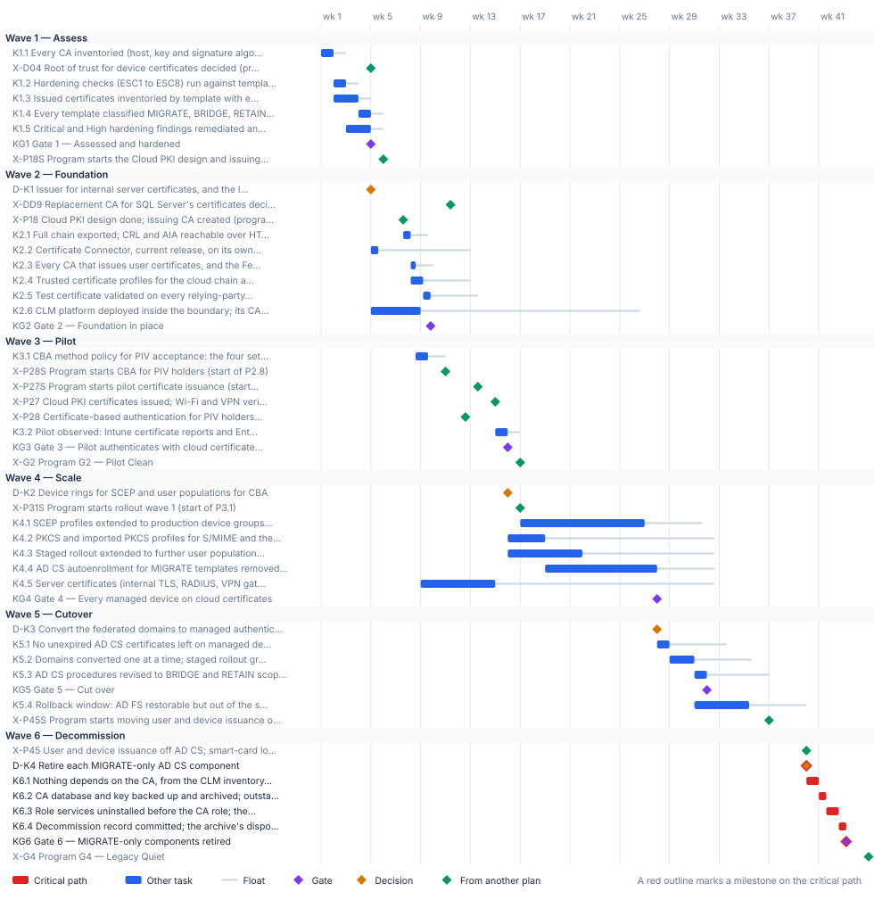

<!-- Generated by scripts/project_plans/build.py from data/project-plans/pki-certificates.yaml. Edit the YAML, not this page. -->

# PKI and Certificates: Hardening, Cloud PKI and the Lifecycle Platform {.unnumbered}

::: {.callout-note}
## A sample plan, not a commitment
This is an illustrative plan built from the workbook's books, in the form a project manager would baseline: a work breakdown, a schedule network, a computed critical path, decision points, gates and risks. The durations are illustrative, sized to the books' roadmap weeks. Replace them with the agency's own estimates, then baseline the result. The plan names roles, not people, and no specific agency.
:::

## Plan at a glance

| | |
|---|---|
| **Plan type** | Project: Book 07's six waves, from the AD CS assessment and hardening gate to the decommissioning of MIGRATE-only components |
| **Built from** | Book 07 |
| **Sponsor** | Executive sponsor and CIO; CISO |
| **Plan manager** | PKI lead, with the identity, endpoint engineering and CLM platform leads |
| **Duration** | 43 weeks (211 working days), computed from the network |
| **Work** | 26 tasks, 6 gates, 4 decision points, 13 milestones from other plans |
| **Critical path** | 6 of 49 items; 8 more within 5 days of it |
| **Calendar** | Week 1 = the program's Phase 0 approval; five working days a week |

: Plan at a glance {.striped}

This plan schedules [Book 07](../books/b07-pki/index.md)'s move of the certificate estate: AD CS assessed and hardened, a cloud chain beside it, device and user certificates moved to Microsoft Cloud PKI and Entra certificate-based authentication (CBA), server certificates put under one lifecycle platform, and the AD CS components that only migrating workloads used retired. Its phases are the six waves of [Chapter 07's migration playbook](../books/b07-pki/07-coexistence-and-migration.md#the-migration-playbook), with each wave's exit gate as written there, and its roles are [Chapter 05](../books/b07-pki/05-who-owns-the-certificate-estate.md)'s.

The waves' weeks already line up with the [program master schedule](program-master-schedule.md), so the plan doesn't restate the program's own certificate tasks; it meets them as linked milestones. The program decides the root of trust (D04), creates the Cloud PKI issuing CA (P1.8), issues the pilot's certificates (P2.7), turns on CBA for PIV holders (P2.8) and moves user and device issuance off AD CS (P4.5). This plan's assessment and hardening gate must pass before the program's root signs a cloud issuing CA, its foundation must be in place before pilot issuance, and its cutover must finish before P4.5 starts. The PIV card itself stays with the credentialing office and the Federal PKI ([Chapter 09](../books/b07-pki/09-federal-workforce-credentials.md)); the binding that ties each card to its user is the [Attribute-Driven Migration plan](attribute-driven-migration.md)'s.

## Schedule

{fig-alt="Gantt chart of the PKI and Certificates plan over 43 weeks, grouped by phase. Critical-path tasks are red bars, other tasks are blue bars with a grey line showing their float, gates are violet diamonds, decisions are amber diamonds and milestones from other plans are green diamonds. The tables below give every date and float."}

## Critical path

The computed path is short, and the program sets it. Decommissioning can't start until the program has moved user and device issuance off AD CS (P4.5, end of week 39) and the 30-day AD FS rollback window (K5.4) has closed; from there each MIGRATE-only CA is retired in Chapter 08's order to Gate 6 in week 43, nine working days before the program's G4. Every earlier wave carries float or margin, and the margins are what to watch. The tightest come first: the inventory, hardening and classification have five days of float against the start of the program's P1.8, because under BYOCA the root mustn't sign a cloud issuing CA before its hierarchy passes the hardening gate, so a Critical finding that takes longer than two weeks to fix moves a program date. The PIV acceptance settings (K3.1) have seven days of margin before the program turns on CBA for PIV holders, and the pilot observation and Gate 3 have five before the program's G2. Scale and cutover follow the program's rollout waves and finish in week 31, five weeks before P4.5 starts.

The critical path, in order. Each item has zero total float: a day lost on any of them is a day lost at the finish.

| # | ID | Item | Owner or approver | When |
|---|---|---|---|---|
| 1 | D-K4 | Retire each MIGRATE-only AD CS component | Executive sponsor and CIO | end of wk 39 |
| 2 | K6.1 | Nothing depends on the CA, from the CLM inventory and the CA database; issuance stopped; events 4886 and 4888 read for a week | PKI and CA administrators | wk 40 |
| 3 | K6.2 | CA database and key backed up and archived; outstanding certificates revoked; the final CRL published to outlive them | PKI and CA administrators | wk 41 |
| 4 | K6.3 | Role services uninstalled before the CA role; the CA removed from the Entra trust store, Intune profiles and NTAuth | PKI and CA administrators | wk 41–42 |
| 5 | K6.4 | Decommission record committed; the archive's disposition set under the records schedule | Records officer | wk 42–43 |
| 6 | KG6 | Gate 6 — MIGRATE-only components retired | CISO and ISSO | end of wk 43 |

: The critical path {.striped .hover}

**Near-critical.** These items have 5 working days of float or less. Track them weekly: once their float is spent, they join the critical path.

| ID | Item | Float | When |
|---|---|---|---|
| K1.1 | Every CA inventoried (host, key and signature algorithms, validity, root or issuing); every template's configuration and permissions exported | 5 d | wk 1 |
| K1.2 | Hardening checks (ESC1 to ESC8) run against templates, CA settings and PKI object ACLs; CA auditing on | 5 d | wk 2 |
| K1.3 | Issued certificates inventoried by template with expiry; every relying party and the chains and CRLs it uses; strong-mapping sweep on every domain controller | 5 d | wk 2–3 |
| K1.5 | Critical and High hardening findings remediated and re-tested | 5 d | wk 3–4 |
| K1.4 | Every template classified MIGRATE, BRIDGE, RETAIN or RETIRE against the template migration matrix | 5 d | wk 4 |
| KG1 | Gate 1 — Assessed and hardened | 5 d | end of wk 4 |
| K3.2 | Pilot observed: Intune certificate reports and Entra sign-in logs read; binding and authentication level confirmed; failures to the troubleshooting runbook | 5 d | wk 15 |
| KG3 | Gate 3 — Pilot authenticates with cloud certificates and CBA | 5 d | end of wk 15 |

: Near-critical items {.striped .hover}

## Decision points

Each decision is a zero-duration milestone in the network. *Decide by* is its late finish: the last week it can be made without moving the plan's finish. A decision with zero float sits on the critical path, so the meeting that makes it should be booked before the plan is baselined. Decision rights follow [Book 01, Chapter 09](../books/b01-transformation-arc/09-who-leads-the-transformation.md#decision-rights-across-the-program).

| ID | Decision | Decides | Needed by | Decide by | Float | Options | If it's late |
|---|---|---|---|---|---|---|---|
| D-K1 | Issuer for internal server certificates, and the lifecycle platform's edition | Executive sponsor and CIO | X-DD9, K2.6 | end of wk 11 | 32 d | Retained AD CS through the CLM platform, moving to a standalone issuing CA under the same root when the forest retires, and a public CA for names the internet trusts (Book 07's position); Certificate Manager, Self-Hosted, inside the boundary until a certificate-management package is FedRAMP authorized | Server certificates keep renewing by hand, and the Data Platform plan's replacement-CA decision (D-D9) has no issuer to name |
| D-K2 | Device rings for SCEP and user populations for CBA | Endpoint engineering, with identity engineering | K4.1 | end of wk 21 | 28 d | Follow the program's rollout waves; by site, region or device tier. Dynamic groups built from governed attributes | Production profiles can't be assigned, and Wave 4 waits |
| D-K3 | Convert the federated domains to managed authentication, and in what order | Executive sponsor and CIO | K5.2 | end of wk 33 | 28 d | A test domain or the domain with the fewest users first, then the rest; hold a domain on federation as a dated exception | AD FS stays in the sign-in path with certificate authentication on, and Gate 5 waits |
| D-K4 | Retire each MIGRATE-only AD CS component | Executive sponsor and CIO | K6.1 | end of wk 39 | **0 (critical)** | Retire, starting with the CA with the fewest dependents, once nothing depends on it; keep it as a dated exception under the hardening baseline | NDES, CES/CEP and MIGRATE-only issuing CAs stay in service into the program's AD retirement |

: Decision points, by decide-by date {.striped .hover}

## Gates

A gate opens the work that names it as a predecessor, which is usually the next phase but not always. The approver signs it against the criteria, from evidence in the repository.

| Gate | When | Approver | Criteria |
|---|---|---|---|
| [Gate 1 — Assessed and hardened](../books/b07-pki/07-coexistence-and-migration.md#the-migration-playbook) | end of wk 4 | CISO and ISSO | Assessment approved by the PKI and CA administrators and the CISO and ISSO; no unclassified templates; every Critical and High finding remediated and re-tested (Chapter 03's migration gate); assessment record committed to the evidence repository |
| [Gate 2 — Foundation in place](../books/b07-pki/07-coexistence-and-migration.md#the-migration-playbook) | end of wk 9 | CISO and ISSO | Issuing CA active; trusted certificate profiles successful on at least 99% of managed devices; connector healthy; test certificate validated by every relying-party type; every CRL reachable from all three locations; the wave's rollback rehearsed in a test scope |
| [Gate 3 — Pilot authenticates with cloud certificates and CBA](../books/b07-pki/07-coexistence-and-migration.md#the-migration-playbook) | end of wk 15 | CISO and ISSO | At least 95% issuance success on pilot devices; no authentication failures caused by certificate configuration; pilot users on CBA at the intended authentication level; every pilot relying party accepts the cloud chain; AD CS autoenrollment still on for pilot devices |
| [Gate 4 — Every managed device on cloud certificates](../books/b07-pki/07-coexistence-and-migration.md#the-migration-playbook) | end of wk 27 | CISO and ISSO | Every managed device holds cloud-issued certificates for its MIGRATE use cases; every user intended for CBA on it; AD CS autoenrollment for MIGRATE templates removed on every migrated ring; server certificates renewing through the CLM platform |
| [Gate 5 — Cut over](../books/b07-pki/07-coexistence-and-migration.md#the-migration-playbook) | end of wk 31 | CISO and ISSO | All target domains managed; AD FS certificate authentication off; CBA working for all users; no AD CS certificates on managed endpoints for MIGRATE templates; BRIDGE and RETAIN templates documented and running |
| [Gate 6 — MIGRATE-only components retired](../books/b07-pki/07-coexistence-and-migration.md#the-migration-playbook) | end of wk 43 | CISO and ISSO | MIGRATE-only AD CS components retired or archived; offline root retained and documented, with the CA that signed the cloud issuing CA under BYOCA; no orphaned autoenrollment GPOs; HTTP CDP and AIA kept until the last certificate expires; decommission record in the evidence repository |

: Gates {.striped .hover}

## Links to other plans

- **X-D04, Root of trust for device certificates decided (program D04),** is D04 in the [Program master schedule](program-master-schedule.md) plan (Root of trust for device certificates), end of wk 4. This plan must finish K1.1 by then: a margin of 15 d. The root of trust is chosen without the CA inventory, so BYOCA can't be weighed against the hierarchy that exists.
- **X-P18S, Program starts the Cloud PKI design and issuing CA (start of P1.8),** is the start of P1.8 in the [Program master schedule](program-master-schedule.md) plan (Cloud PKI design; issuing CA created (M-020)), end of wk 5. This plan must finish KG1 by then: a margin of 5 d. Under BYOCA, the root would sign a cloud issuing CA before its hierarchy passed the hardening gate.
- **X-DD9, Replacement CA for SQL Server's certificates decided (Data Platform D-D9),** is D-D9 in the [Data Platform Identity Transformation](data-platform.md) plan (Replacement CA and the AD CS decommission date for SQL Server's certificates), end of wk 11. This plan must finish D-K1 by then: a margin of 32 d. SQL Server's certificates are given an issuer before the PKI plan has named one.
- **X-P18, Cloud PKI design done; issuing CA created (program P1.8),** is P1.8 in the [Program master schedule](program-master-schedule.md) plan (Cloud PKI design; issuing CA created (M-020)), end of wk 7. This plan waits for it; it can slip 7 d before it moves this plan. There's no cloud chain to export or deploy, and the foundation waits.
- **X-P28S, Program starts CBA for PIV holders (start of P2.8),** is the start of P2.8 in the [Program master schedule](program-master-schedule.md) plan (Certificate-based authentication for PIV holders (M-029)), end of wk 10. This plan must finish K3.1 by then: a margin of 7 d. Pilot PIV holders are turned on for CBA before the method policy and bindings are set.
- **X-P27S, Program starts pilot certificate issuance (start of P2.7),** is the start of P2.7 in the [Program master schedule](program-master-schedule.md) plan (Cloud PKI certificates issued; Wi-Fi and VPN verified (M-028)), end of wk 13. This plan must finish KG2 by then: a margin of 19 d. Pilot devices receive certificates no relying party has been shown to accept.
- **X-P27, Cloud PKI certificates issued; Wi-Fi and VPN verified (program P2.7),** is P2.7 in the [Program master schedule](program-master-schedule.md) plan (Cloud PKI certificates issued; Wi-Fi and VPN verified (M-028)), end of wk 14. This plan waits for it; it can slip 5 d before it moves this plan. The pilot has nothing to observe, and Gate 3 waits.
- **X-P28, Certificate-based authentication for PIV holders (program P2.8),** is P2.8 in the [Program master schedule](program-master-schedule.md) plan (Certificate-based authentication for PIV holders (M-029)), end of wk 12. This plan waits for it; it can slip 17 d before it moves this plan. Pilot users aren't on CBA, and Gate 3 waits.
- **X-G2, Program G2 — Pilot Clean,** is G2 in the [Program master schedule](program-master-schedule.md) plan (G2 — Pilot Clean), end of wk 16. This plan must finish KG3 by then: a margin of 5 d. The program's pilot closes without the certificate pilot's evidence.
- **X-P31S, Program starts rollout wave 1 (start of P3.1),** is the start of P3.1 in the [Program master schedule](program-master-schedule.md) plan (Wave 1, first region, about 25% (M-032)), end of wk 16. This plan waits for it; it can slip 23 d before it moves this plan. The device rings have no divisions to follow.
- **X-P45S, Program starts moving user and device issuance off AD CS (start of P4.5),** is the start of P4.5 in the [Program master schedule](program-master-schedule.md) plan (User and device issuance off AD CS; smart-card logon GPO retired), end of wk 36. This plan must finish KG5 by then: a margin of 25 d. The program retires smart-card logon and AD CS issuance before the cutover has proved the cloud path.
- **X-P45, User and device issuance off AD CS; smart-card logon GPO retired (program P4.5),** is P4.5 in the [Program master schedule](program-master-schedule.md) plan (User and device issuance off AD CS; smart-card logon GPO retired), end of wk 39. This plan waits for it; it can slip 0 before it moves this plan. MIGRATE-only components still issue, and decommissioning can't start.
- **X-G4, Program G4 — Legacy Quiet,** is G4 in the [Program master schedule](program-master-schedule.md) plan (G4 — Legacy Quiet), end of wk 44. This plan must finish KG6 by then: a margin of 9 d. The program reaches Legacy Quiet with MIGRATE-only CAs still running.

## Work breakdown and schedule

Every row, by phase. *Float* is total float in working days; **bold** rows are on the critical path. Each row links to the chapter it comes from.

### Wave 1 — Assess

| ID | Item | Type | Owner or approver | Days | Predecessors | When | Float |
|---|---|---|---|---|---|---|---|
| K1.1 | [Every CA inventoried (host, key and signature algorithms, validity, root or issuing); every template's configuration and permissions exported](../books/b07-pki/02-what-ad-cs-holds-up.md#what-the-certificate-inventory-collects) | Task | PKI and CA administrators | 5 | — | wk 1 | 5 d |
| X-D04 | [Root of trust for device certificates decided (program D04)](program-master-schedule.md) | External | Program office (program) | — | K1.1 | end of wk 4 | fixed date |
| K1.2 | [Hardening checks (ESC1 to ESC8) run against templates, CA settings and PKI object ACLs; CA auditing on](../books/b07-pki/03-hardening-what-stays.md#the-esc-taxonomy) | Task | PKI and CA administrators | 5 | K1.1 | wk 2 | 5 d |
| K1.3 | [Issued certificates inventoried by template with expiry; every relying party and the chains and CRLs it uses; strong-mapping sweep on every domain controller](../books/b07-pki/07-coexistence-and-migration.md#the-migration-playbook) | Task | PKI and CA administrators | 10 | K1.1 | wk 2–3 | 5 d |
| K1.4 | [Every template classified MIGRATE, BRIDGE, RETAIN or RETIRE against the template migration matrix](../books/b07-pki/appendix-b-template-migration-matrix.md) | Task | PKI and CA administrators | 5 | K1.3 | wk 4 | 5 d |
| K1.5 | [Critical and High hardening findings remediated and re-tested](../books/b07-pki/03-hardening-what-stays.md#the-migration-gate) | Task | PKI and CA administrators | 10 | K1.2 | wk 3–4 | 5 d |
| KG1 | [Gate 1 — Assessed and hardened](../books/b07-pki/07-coexistence-and-migration.md#the-migration-playbook) | Gate | CISO and ISSO | — | K1.4, K1.5 | end of wk 4 | 5 d |
| X-P18S | [Program starts the Cloud PKI design and issuing CA (start of P1.8)](program-master-schedule.md) | External | Platform teams (program) | — | KG1 | end of wk 5 | fixed date |

: Wave 1 — Assess {.striped .hover}

### Wave 2 — Foundation

| ID | Item | Type | Owner or approver | Days | Predecessors | When | Float |
|---|---|---|---|---|---|---|---|
| D-K1 | [Issuer for internal server certificates, and the lifecycle platform's edition](../books/b07-pki/04-the-target-pki.md#the-issuer-decision-for-internal-server-certificates) | Decision | Executive sponsor and CIO | — | K1.4 | end of wk 4 | 32 d |
| X-DD9 | [Replacement CA for SQL Server's certificates decided (Data Platform D-D9)](data-platform.md) | External | CIO and data leadership (Data Platform Identity Transformation plan) | — | D-K1 | end of wk 11 | fixed date |
| X-P18 | [Cloud PKI design done; issuing CA created (program P1.8)](program-master-schedule.md) | External | Platform teams (program) | — | — | end of wk 7 | 7 d |
| K2.1 | [Full chain exported; CRL and AIA reachable over HTTP from where relying parties sit; LDAP-only AIA replaced; root CRL on a published schedule](../books/b07-pki/07-coexistence-and-migration.md#crl-availability) | Task | PKI and CA administrators | 3 | X-P18 | wk 7–8 | 7 d |
| K2.2 | [Certificate Connector, current release, on its own servers wherever AD CS still serves SCEP or PKCS](../books/b07-pki/06-device-and-user-certificates.md#keep-the-connector-current) | Task | Endpoint engineering | 3 | KG1 | wk 5 | 37 d |
| K2.3 | [Every CA that issues user certificates, and the Federal PKI chain for PIV, uploaded to the Entra trust store with its CRL URL](../books/b07-pki/06-device-and-user-certificates.md#the-trust-store) | Task | Identity engineering | 2 | K2.1 | wk 8 | 7 d |
| K2.4 | [Trusted certificate profiles for the cloud chain and the federal root on managed devices; the chain to domain-joined relying parties; NTAuth only for logon issuers](../books/b07-pki/06-device-and-user-certificates.md#the-trusted-certificate-profile-comes-first) | Task | Endpoint engineering | 5 | K2.1 | wk 8–9 | 19 d |
| K2.5 | [Test certificate validated on every relying-party type; each CRL and AIA URL checked from inside, from the internet and in a test CBA sign-in](../books/b07-pki/07-coexistence-and-migration.md#the-migration-playbook) | Task | PKI and CA administrators | 3 | K2.2, K2.3, K2.4 | wk 9 | 19 d |
| K2.6 | [CLM platform deployed inside the boundary; its CA account scoped under the ESC7 review; Microsoft CA integration connected](../books/b07-pki/04-the-target-pki.md#certificate-lifecycle-management) | Task | CLM platform owner | 20 | D-K1 | wk 5–8 | 88 d |
| KG2 | [Gate 2 — Foundation in place](../books/b07-pki/07-coexistence-and-migration.md#the-migration-playbook) | Gate | CISO and ISSO | — | K2.5 | end of wk 9 | 19 d |

: Wave 2 — Foundation {.striped .hover}

### Wave 3 — Pilot

| ID | Item | Type | Owner or approver | Days | Predecessors | When | Float |
|---|---|---|---|---|---|---|---|
| K3.1 | [CBA method policy for PIV acceptance: the four settings, high-affinity bindings, the authentication strength, staged rollout for pilot users within its limits](../books/b07-pki/09-federal-workforce-credentials.md#how-entra-cba-uses-the-piv-authentication-certificate) | Task | Identity engineering | 5 | K2.3 | wk 8–9 | 7 d |
| X-P28S | [Program starts CBA for PIV holders (start of P2.8)](program-master-schedule.md) | External | Platform teams (program) | — | K3.1 | end of wk 10 | fixed date |
| X-P27S | [Program starts pilot certificate issuance (start of P2.7)](program-master-schedule.md) | External | Platform teams (program) | — | KG2 | end of wk 13 | fixed date |
| X-P27 | [Cloud PKI certificates issued; Wi-Fi and VPN verified (program P2.7)](program-master-schedule.md) | External | Platform teams (program) | — | — | end of wk 14 | 5 d |
| X-P28 | [Certificate-based authentication for PIV holders (program P2.8)](program-master-schedule.md) | External | Platform teams (program) | — | — | end of wk 12 | 17 d |
| K3.2 | [Pilot observed: Intune certificate reports and Entra sign-in logs read; binding and authentication level confirmed; failures to the troubleshooting runbook](../books/b07-pki/08-lifecycle-monitoring-and-decommissioning.md#monitoring) | Task | Endpoint engineering | 5 | X-P27, X-P28 | wk 15 | 5 d |
| KG3 | [Gate 3 — Pilot authenticates with cloud certificates and CBA](../books/b07-pki/07-coexistence-and-migration.md#the-migration-playbook) | Gate | CISO and ISSO | — | K3.2 | end of wk 15 | 5 d |
| X-G2 | [Program G2 — Pilot Clean](program-master-schedule.md) | External | Steward and executive sponsor (co-signed; program) | — | KG3 | end of wk 16 | fixed date |

: Wave 3 — Pilot {.striped .hover}

### Wave 4 — Scale

| ID | Item | Type | Owner or approver | Days | Predecessors | When | Float |
|---|---|---|---|---|---|---|---|
| D-K2 | [Device rings for SCEP and user populations for CBA](../books/b07-pki/07-coexistence-and-migration.md#the-migration-playbook) | Decision | Endpoint engineering, with identity engineering | — | KG3 | end of wk 15 | 28 d |
| X-P31S | [Program starts rollout wave 1 (start of P3.1)](program-master-schedule.md) | External | Platform teams (program) | — | — | end of wk 16 | 23 d |
| K4.1 | [SCEP profiles extended to production device groups, ring by ring, with the program's waves](../books/b07-pki/06-device-and-user-certificates.md#scep-profiles) | Task | Endpoint engineering | 50 | D-K2, X-P31S | wk 17–26 | 23 d |
| K4.2 | [PKCS and imported PKCS profiles for S/MIME and the remaining application certificates](../books/b07-pki/06-device-and-user-certificates.md#pkcs-and-imported-pkcs-profiles) | Task | Endpoint engineering | 15 | KG3 | wk 16–18 | 68 d |
| K4.3 | [Staged rollout extended to further user populations as sign-in data supports, within the 10-group limit](../books/b07-pki/06-device-and-user-certificates.md#staged-rollout) | Task | Identity engineering | 30 | KG3 | wk 16–21 | 53 d |
| K4.4 | [AD CS autoenrollment for MIGRATE templates removed on each ring once its devices hold valid cloud certificates](../books/b07-pki/07-coexistence-and-migration.md#renewal-while-two-issuers-overlap) | Task | PKI and CA administrators | 45 | K4.1 (SS) +10 d | wk 19–27 | 23 d |
| K4.5 | [Server certificates (internal TLS, RADIUS, VPN gateways, SQL Server) discovered and enrolled for automated renewal; renewal owner recorded per class](../books/b07-pki/08-lifecycle-monitoring-and-decommissioning.md#inventory-and-renewal-through-cyberark-certificate-manager) | Task | Server and network teams | 30 | K2.6 | wk 9–14 | 88 d |
| KG4 | [Gate 4 — Every managed device on cloud certificates](../books/b07-pki/07-coexistence-and-migration.md#the-migration-playbook) | Gate | CISO and ISSO | — | K4.1, K4.2, K4.3, K4.4, K4.5 | end of wk 27 | 23 d |

: Wave 4 — Scale {.striped .hover}

### Wave 5 — Cutover

| ID | Item | Type | Owner or approver | Days | Predecessors | When | Float |
|---|---|---|---|---|---|---|---|
| D-K3 | [Convert the federated domains to managed authentication, and in what order](../books/b07-pki/07-coexistence-and-migration.md#the-migration-playbook) | Decision | Executive sponsor and CIO | — | KG4 | end of wk 27 | 28 d |
| K5.1 | [No unexpired AD CS certificates left on managed devices for MIGRATE use cases; federation settings recorded; AD FS backed up with Rapid Restore](../books/b07-pki/07-coexistence-and-migration.md#the-migration-playbook) | Task | Identity engineering | 5 | KG4 | wk 28 | 23 d |
| K5.2 | [Domains converted one at a time; staged rollout groups removed; AD FS certificate authentication off](../books/b07-pki/06-device-and-user-certificates.md#migrating-from-ad-fs-certificate-authentication) | Task | Identity engineering | 10 | K5.1, D-K3 | wk 29–30 | 23 d |
| K5.3 | [AD CS procedures revised to BRIDGE and RETAIN scope only: domain controllers, LDAPS, NPS, server TLS](../books/b07-pki/04-the-target-pki.md#ad-cs-retained-for-what-only-it-can-do) | Task | PKI and CA administrators | 5 | K5.2 | wk 31 | 25 d |
| KG5 | [Gate 5 — Cut over](../books/b07-pki/07-coexistence-and-migration.md#the-migration-playbook) | Gate | CISO and ISSO | — | K5.3 | end of wk 31 | 25 d |
| K5.4 | [Rollback window: AD FS restorable but out of the sign-in path for 30 days; application use watched in Connect Health and the sign-in logs](../books/b07-pki/07-coexistence-and-migration.md#rollback-rules-that-hold-across-waves) | Task | Identity engineering | 22 | K5.2 | wk 31–35 | 23 d |
| X-P45S | [Program starts moving user and device issuance off AD CS (start of P4.5)](program-master-schedule.md) | External | Platform teams (program) | — | KG5 | end of wk 36 | fixed date |

: Wave 5 — Cutover {.striped .hover}

### Wave 6 — Decommission

| ID | Item | Type | Owner or approver | Days | Predecessors | When | Float |
|---|---|---|---|---|---|---|---|
| X-P45 | [User and device issuance off AD CS; smart-card logon GPO retired (program P4.5)](program-master-schedule.md) | External | Platform teams (program) | — | — | end of wk 39 | 0 |
| D-K4 | **[Retire each MIGRATE-only AD CS component](../books/b07-pki/08-lifecycle-monitoring-and-decommissioning.md#decommissioning-ad-cs)** | Decision | Executive sponsor and CIO | — | K5.4, X-P45 | end of wk 39 | 0 |
| K6.1 | **[Nothing depends on the CA, from the CLM inventory and the CA database; issuance stopped; events 4886 and 4888 read for a week](../books/b07-pki/08-lifecycle-monitoring-and-decommissioning.md#decommissioning-ad-cs)** | Task | PKI and CA administrators | 5 | D-K4 | wk 40 | 0 |
| K6.2 | **[CA database and key backed up and archived; outstanding certificates revoked; the final CRL published to outlive them](../books/b07-pki/08-lifecycle-monitoring-and-decommissioning.md#decommissioning-ad-cs)** | Task | PKI and CA administrators | 3 | K6.1 | wk 41 | 0 |
| K6.3 | **[Role services uninstalled before the CA role; the CA removed from the Entra trust store, Intune profiles and NTAuth](../books/b07-pki/08-lifecycle-monitoring-and-decommissioning.md#decommissioning-ad-cs)** | Task | PKI and CA administrators | 5 | K6.2 | wk 41–42 | 0 |
| K6.4 | **[Decommission record committed; the archive's disposition set under the records schedule](../books/b07-pki/08-lifecycle-monitoring-and-decommissioning.md#the-evidence-an-assessor-reads)** | Task | Records officer | 3 | K6.3 | wk 42–43 | 0 |
| KG6 | **[Gate 6 — MIGRATE-only components retired](../books/b07-pki/07-coexistence-and-migration.md#the-migration-playbook)** | Gate | CISO and ISSO | — | K6.4 | end of wk 43 | 0 |
| X-G4 | [Program G4 — Legacy Quiet](program-master-schedule.md) | External | Steward (backup: executive sponsor; program) | — | KG6 | end of wk 44 | fixed date |

: Wave 6 — Decommission {.striped .hover}

## Responsibility

Who owns what in this plan. Each row has one owner; consulted and informed parties follow the [decision matrix](../books/b01-transformation-arc/09-who-leads-the-transformation.md#decision-rights-across-the-program).

| Owner or approver | Tasks | Decisions | Gates |
|---|---|---|---|
| PKI and CA administrators | 12 | — | — |
| Platform teams (program) | 9 | — | — |
| CISO and ISSO | — | — | 6 |
| Identity engineering | 6 | — | — |
| Endpoint engineering | 5 | — | — |
| Executive sponsor and CIO | — | 3 | — |
| CIO and data leadership (Data Platform Identity Transformation plan) | 1 | — | — |
| CLM platform owner | 1 | — | — |
| Endpoint engineering, with identity engineering | — | 1 | — |
| Program office (program) | 1 | — | — |
| Records officer | 1 | — | — |
| Server and network teams | 1 | — | — |
| Steward (backup: executive sponsor; program) | 1 | — | — |
| Steward and executive sponsor (co-signed; program) | 1 | — | — |

: Ownership {.striped .hover}

## Assumptions

- The agency has an established AD CS hierarchy with an offline root, so the target is Book 07's recommended BYOCA model: the cloud issuing CA signed by the offline root ([Chapter 04](../books/b07-pki/04-the-target-pki.md#the-programs-recommendation)). The program confirms it at D04. With a Cloud PKI root instead, every relying party needs the new root, and Wave 2 grows.
- A single forest. Durations are Chapter 07's planning figures for a single-forest estate; scale them to the Wave 1 inventory.
- The tenant is GCC-Moderate. GCC tenants use the commercial Intune service, so Cloud PKI availability follows it; the Cloud PKI license (the add-on or the Intune Suite) is confirmed in Wave 2's entry gate ([Chapter 04](../books/b07-pki/04-the-target-pki.md#cloud-availability)).
- The lifecycle platform is CyberArk Certificate Manager, Self-Hosted, inside the agency's boundary, because no certificate-management package is FedRAMP authorized as of October 20, 2026 ([Chapter 04](../books/b07-pki/04-the-target-pki.md#certificate-lifecycle-management); decision WD-029).
- Federated domains run on AD FS today. If they're already managed, Wave 5 is only the confirmation that no AD CS certificates remain for migrating use cases, and the rollback window doesn't apply.
- Platforms in scope are Windows, iOS/iPadOS and Android; macOS is out of scope for the workbook.

## Schedule risks

| Risk | Effect on the schedule | Response |
|---|---|---|
| Wave 1 finds a Critical ESC finding that takes longer to fix than planned | Gate 1 slips, and under BYOCA the program's root can't sign the cloud issuing CA (P1.8) | Run the read-only checks in week 2 (K1.2) and fix Critical and High findings first; re-baseline with the program at G0 if a finding needs a template rebuild |
| A relying party rejects the cloud chain during the pilot | Gate 3 fails; the program's G2 waits | Validate a test certificate on every relying-party type in Wave 2 (K2.5); keep AD CS autoenrollment on for pilot devices so removing the SCEP assignment rolls back |
| A CRL or AIA location can't be reached from where relying parties or Entra ID sit | CBA sign-ins and Wi-Fi authentication fail at scale | Check every CRL from inside the network, the internet and a test CBA sign-in (K2.5); monitor CRL freshness (Chapter 08) |
| Staged rollout's 10-group limit can't hold every population | Wave 4 stretches while users wait for CBA | Cut over domain by domain in Wave 5 rather than stretching staged rollout (Chapter 07) |
| An issuing CA is revoked or retired while a BRIDGE or RETAIN workload still depends on it | Every certificate under it fails validation | Retire only after the CLM inventory and the CA database show no dependents; keep the root, and under BYOCA the CA that signed the cloud issuing CA (Chapter 07, Wave 6) |

: Schedule risks {.striped .hover}

## Baseline and change control

- **Baseline** the plan when its first gate is approved: the YAML file, as merged, is the baseline.
- **Report** weekly, green, yellow or red, against the baseline ([Book 01, Chapter 12](../books/b01-transformation-arc/12-migration-roadmap.md#phase-3-general-rollout-weeks-1736)). Report float, not percent complete: a task's float says how much slip the plan can still absorb.
- **Change** the plan only through a reviewed pull request that edits the YAML and regenerates this page, so every change to a date or a dependency has an author, a reviewer and a reason.
- **Re-baseline** at each gate, after the approver signs it, and whenever a critical-path decision is made late.

## Download and adapt

| File | Use it for |
|---|---|
| [pki-certificates.xml](files/pki-certificates.xml) | Microsoft Project desktop (open the XML file; it keeps the dependencies, milestones and owners). The dates start on a placeholder Monday: change the project start date. |
| [pki-certificates.csv](files/pki-certificates.csv) | Excel or any other scheduling tool: every row with its dependencies, early and late dates and float |
| [pki-certificates-azure-boards.csv](files/pki-certificates-azure-boards.csv) | Azure DevOps Boards: an Epic per phase and a Feature per task, gate and decision, with dates and tags (see below) |
| [pki-certificates-dependencies.csv](files/pki-certificates-dependencies.csv) · [add-azure-boards-links.ps1](files/add-azure-boards-links.ps1) | The plan's predecessor links, and a script that adds them in Azure Boards after the import |
| [pki-certificates-jira.csv](files/pki-certificates-jira.csv) | Jira: an Epic per phase and a Task per task, gate and decision, with dates, labels and Blocks links (see below) |
| [pki-certificates.yaml](https://github.com/WhalerMike/modernization-workbook/blob/main/data/project-plans/pki-certificates.yaml) | The source. Edit the durations, owners and dependencies, then run `python scripts/project_plans/build.py` to recompute the critical path and regenerate this page, the chart and the downloads. |

: Downloads {.striped}

::: {.callout-tip}
## Importing this plan into Azure DevOps Boards
1. In the project, select **Boards** > **Queries** > **Import work items**, choose [pki-certificates-azure-boards.csv](files/pki-certificates-azure-boards.csv), check the results and select **Save items**. It creates one Epic per phase with a Feature under it for each task, gate and decision, with start and target dates, which is what Delivery Plans show. Epic and Feature exist in the Agile, Scrum and CMMI processes; in the Basic process, change *Feature* to *Issue* in the file first.
2. The import can't create dependency links or assign people. To add the predecessor links, sign in with `az login`, add the CLI extension with `az extension add --name azure-devops`, and run `./add-azure-boards-links.ps1 -Organization https://dev.azure.com/<org> -Project <project> -Plan pki-certificates` beside [pki-certificates-dependencies.csv](files/pki-certificates-dependencies.csv). It finds the imported items by their `fmw-id-` tags and links each one to its predecessors.
3. Assign people in Boards: each item carries its owner role as an *Owner - …* tag, and critical-path items carry *Critical path*. Azure Boards links don't hold lag or start-to-start timing; each item's description keeps them.

The dates count from the plan's placeholder start; shift them when you set the real start. The script hasn't been run against a live organization yet: test it on a scratch project first.
:::

::: {.callout-tip}
## Importing this plan into Jira
1. Run the CSV importer (in Jira Cloud, **Settings** > **System** > **External system import** > **CSV**) with [pki-certificates-jira.csv](files/pki-certificates-jira.csv). On the second step, set **Date format in import file** to `yyyy-MM-dd`.
2. Map the columns: *Work item ID* to Work item ID, *Work type* to Work type, *Parent* to Parent, *Summary*, *Description* and every *Labels* column to their fields, *Start date* to the Start date field, *Due date* to Due date, and every *Blocks* column to the **Blocks** link type. Each phase becomes an Epic with a Task under it for each task, gate and decision; each Blocks column makes that row's item block the item it names, which carries the plan's dependencies.
3. Assign people in Jira: each item carries its owner role as an `owner-…` label, and critical-path items carry `critical-path`. Jira links don't hold lag or start-to-start timing; each description keeps them.

Test the import on a scratch project with a few rows first: the importer doesn't remove duplicate links and Jira has no bulk delete for them. If the Blocks links don't come through on your site, import the items first and add the links from the plan's dependency list in a second pass, as Atlassian recommends. The dates count from the plan's placeholder start.
:::

::: {.callout-tip}
## Opening this plan in Project or Planner
- **Microsoft Project desktop** opens the XML file directly, with every dependency, milestone and owner.
- **Microsoft Planner** has no file import of its own: it doesn't read XML, CSV or Excel. To bring this plan into a Planner premium plan, open the XML file in Project desktop, save it as an `.mpp` file, and import that through the Project Power App. Tasks, durations, dependencies and milestones come across; resources and baselines don't, so assign owners again in Planner.
- **Without Project desktop**, the CSV can feed a Power Automate flow that creates the tasks one by one, but dependencies in a premium plan need Microsoft's Project schedule APIs, so that's a build, not an import.
- **In a government cloud tenant**, check that premium plans are available before relying on Planner for this schedule: Microsoft notes that converting a basic plan to a premium plan isn't available in GCC.

Project for the web was retired on August 1, 2025, and Project Online on September 30, 2026; Planner is their successor. Project desktop is unaffected.
:::

