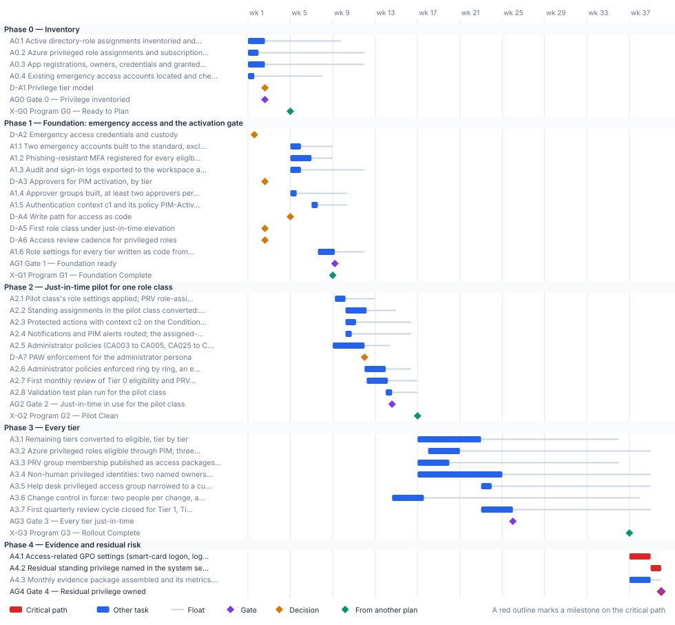

<!-- Generated by scripts/project_plans/build.py from data/project-plans/privileged-access.yaml. Edit the YAML, not this page. -->

# Privileged Access & Administrative Identity: Just-in-Time by Tier {.unnumbered}

::: {.callout-note}
## A sample plan, not a commitment
This is an illustrative plan built from the workbook's books, in the form a project manager would baseline: a work breakdown, a schedule network, a computed critical path, decision points, gates and risks. The durations are illustrative, sized to the books' roadmap weeks. Replace them with the agency's own estimates, then baseline the result. The plan names roles, not people, and no specific agency.
:::

## Plan at a glance

| | |
|---|---|
| **Plan type** | Project: Inventory, foundation, a just-in-time pilot, every tier, and the evidence and residual risk |
| **Built from** | Book 04 |
| **Sponsor** | Executive sponsor and CIO; CISO |
| **Plan manager** | Project lead, with the four domain leads: privileged roles, non-human identity, break-glass and separation of duties |
| **Duration** | 39 weeks (195 working days), computed from the network |
| **Work** | 28 tasks, 5 gates, 7 decision points, 4 milestones from other plans |
| **Critical path** | 3 of 44 items; 1 more within 5 days of it |
| **Calendar** | Week 1 = the program's Phase 0 approval; five working days a week |

: Plan at a glance {.striped}

This plan builds the privileged half of [Book 04](../books/b04-access/index.md): the privilege tiers in [Chapter 04](../books/b04-access/04-privileged-roles-and-tiers.md), the administrator policies in the [Conditional Access library](../books/b04-access/07-the-conditional-access-policy-library.md#wave-2-administrators), PIM self-request with approval in [Chapter 08](../books/b04-access/08-pim-self-request-with-approval.md) and [Appendix B](../books/b04-access/appendix-b-pim-role-settings.md), the reviews in [Chapter 09](../books/b04-access/09-access-governance.md), and the repository and evidence in [Chapter 10](../books/b04-access/10-access-as-code-and-evidence.md). It follows the [charter](https://github.com/WhalerMike/modernization-workbook/blob/main/docs/projects/privileged-access-charter.md): inventory, elevate just-in-time for one role class, reduce, govern the exceptions, evidence. It feeds the [program master schedule](program-master-schedule.md): the emergency access accounts and phishing-resistant registration it builds are G1 criteria, and its pilot is the program's PIM milestone in Phase 2.

## Schedule

{fig-alt="Gantt chart of the Privileged Access &amp; Administrative Identity plan over 39 weeks, grouped by phase. Critical-path tasks are red bars, other tasks are blue bars with a grey line showing their float, gates are violet diamonds, decisions are amber diamonds and milestones from other plans are green diamonds. The tables below give every date and float."}

## Critical path

This project runs ahead of the program, as [Book 00, Chapter 06](../books/b00-orientation/06-the-project-portfolio.md#why-this-order) intends, so what binds it early is the program's gates, not its own finish. The program's G1 (end of week 8) needs the emergency access accounts and phishing-resistant registration for administrators: they're done with ten working days to spare. The program's G2 (end of week 16) needs just-in-time elevation in use for the pilot class, this plan's Gate 2: it lands with twelve days to spare. Those margins, shown under *Links to other plans*, are the numbers to track; the float on the early decisions is measured to this plan's finish and overstates their slack. Read them against G1: the tier model, the break-glass custody and the approvers have to be settled by week 4.

The computed critical path is the tail: the program's G3, then retiring the access-related Group Policy settings the library has replaced, then naming the residual standing privilege in the system security plan and taking it to the authorizing official. Inside the foundation, the order is fixed. Emergency access comes first, then the activation policy, then the role settings, because switching on approval before the emergency accounts exist is the one sequence that locks the agency out.

The critical path, in order. Each item has zero total float: a day lost on any of them is a day lost at the finish.

| # | ID | Item | Owner or approver | When |
|---|---|---|---|---|
| 1 | A4.1 | Access-related GPO settings (smart-card logon, logon rights) retired where the library policy is enforced | Identity engineering | wk 37–38 |
| 2 | A4.2 | Residual standing privilege named in the system security plan; residual risk to the authorizing official | ISSO | wk 39 |
| 3 | AG4 | Gate 4 — Residual privilege owned | CISO | end of wk 39 |

: The critical path {.striped .hover}

**Near-critical.** These items have 5 working days of float or less. Track them weekly: once their float is spent, they join the critical path.

| ID | Item | Float | When |
|---|---|---|---|
| A4.3 | Monthly evidence package assembled and its metrics signed off | 5 d | wk 37–38 |

: Near-critical items {.striped .hover}

## Decision points

Each decision is a zero-duration milestone in the network. *Decide by* is its late finish: the last week it can be made without moving the plan's finish. A decision with zero float sits on the critical path, so the meeting that makes it should be booked before the plan is baselined. Decision rights follow [Book 01, Chapter 09](../books/b01-transformation-arc/09-who-leads-the-transformation.md#decision-rights-across-the-program).

| ID | Decision | Decides | Needed by | Decide by | Float | Options | If it's late |
|---|---|---|---|---|---|---|---|
| D-A2 | Emergency access credentials and custody | CISO | A1.1 | end of wk 7 | 32 d | Passkey (FIDO2) security keys or certificate-based authentication, different from the normal administrator methods; in either case retrieved only under dual custody by two senior administrators | Step 0 can't close, so no role can be made eligible and no approval switched on |
| D-A1 | Privilege tier model | CISO | AG0, D-A3, D-A6 | end of wk 9 | 36 d | The program's four tiers as published (T0 control plane, T1 management plane, T2 scoped operations, read-only); the same boundaries with hour counts adapted to the agency's role inventory | No role's settings can be written, and the PIM build waits |
| D-A3 | Approvers for PIM activation, by tier | CISO | A1.4 | end of wk 9 | 36 d | The security office as PIM-Approvers-T0, outside the Tier 0 population; a governed group outside the Tier 1 population as PIM-Approvers-T1; for each Tier 2 role, approval or a documented risk acceptance | Approval can't be switched on without the lockout risk, and the role settings wait |
| D-A4 | Write path for access as code | Identity engineering | A1.6 | end of wk 10 | 27 d | Microsoft365DSC for every object class (the program's reference); Terraform azuread for the classes it covers, with Graph PowerShell for PIM role settings, access reviews and Lifecycle Workflows | Role settings can't be held as code, and the drift baseline waits |
| D-A5 | First role class under just-in-time elevation | CISO | A2.1 | end of wk 11 | 47 d | Tier 0 control-plane roles; Tier 1 management-plane roles | The pilot has no scope, and the program's Phase 2 PIM milestone waits |
| D-A7 | PAW enforcement for the administrator persona | CISO | A2.6 | end of wk 14 | 12 d | Enforce CA004 and CA025 for every administrator; enforce with a time-bound exclusion group for administrators whose PAW isn't issued; keep report-only and fix the causes first | Privileged roles stay usable from any device, and the pilot gate waits |
| D-A6 | Access review cadence for privileged roles | CISO | A2.7 | end of wk 14 | 62 d | Monthly for Tier 0 and quarterly for every other privileged role (the program's design); another organization-defined frequency, which AC-6(7) leaves to the agency | Reviews can't be scheduled, and the pilot gate's first-review criterion fails |

: Decision points, by decide-by date {.striped .hover}

## Gates

Each gate is the next phase's entry condition. The approver signs it against the criteria, from evidence in the repository.

| Gate | When | Approver | Criteria |
|---|---|---|---|
| [Gate 0 — Privilege inventoried](../books/b04-access/04-privileged-roles-and-tiers.md#the-programs-privilege-tiers) | end of wk 2 | CISO | Standing administrative privilege inventoried and classified by tier; app registrations listed with their owners and credentials; emergency access accounts located; tier model approved |
| [Gate 1 — Foundation ready](../books/b04-access/08-pim-self-request-with-approval.md#build) | end of wk 9 | CISO | Emergency access accounts tested; PIM-Activation-c1 On; an approver group named on every role that requires approval; role settings in the repository and reviewed; logs exported beyond 30 days |
| [Gate 2 — Just-in-time in use for the pilot class](../books/b04-access/08-pim-self-request-with-approval.md#assessment-evidence) | end of wk 14 | CISO | Every human assignment in the pilot class eligible; only the emergency accounts and documented service principals standing; validation tests pass; the first review closed with removals applied; every elevation evidenced in the workspace |
| [Gate 3 — Every tier just-in-time](../books/b04-access/10-access-as-code-and-evidence.md#drift-detection-and-closure) | end of wk 25 | CISO | Every human privileged assignment eligible; requester and approver distinct for Tier 0 changes; non-human privileged identities in scope have two named owners; reviews running on the approved cadence; a Tier 0 drift handled as an incident |
| [Gate 4 — Residual privilege owned](../books/b04-access/10-access-as-code-and-evidence.md#what-the-assessor-reads) | end of wk 39 | CISO | Residual standing privilege named with a rationale and accepted by the authorizing official; evidence for every elevation in the period; exception register current; the replaced access-related GPO settings retired |

: Gates {.striped .hover}

## Links to other plans

- **X-G0, Program G0 — Ready to Plan,** is G0 in the [Program master schedule](program-master-schedule.md) plan (G0 — Ready to Plan), end of wk 4. This plan waits for it; it can slip 10 d before it moves this plan. The foundation work can't start.
- **X-G1, Program G1 — Foundation Complete,** is G1 in the [Program master schedule](program-master-schedule.md) plan (G1 — Foundation Complete), end of wk 8. This plan must finish A1.1, A1.2 by then: a margin of 10 d. Later work in this plan waits for it. The pilot can't start.
- **X-G2, Program G2 — Pilot Clean,** is G2 in the [Program master schedule](program-master-schedule.md) plan (G2 — Pilot Clean), end of wk 16. This plan must finish AG2 by then: a margin of 12 d. Later work in this plan waits for it. The remaining tiers can't start.
- **X-G3, Program G3 — Rollout Complete,** is G3 in the [Program master schedule](program-master-schedule.md) plan (G3 — Rollout Complete), end of wk 36. This plan waits for it; it can slip 0 before it moves this plan. The access-related Group Policy can't be retired.

## Work breakdown and schedule

Every row, by phase. *Float* is total float in working days; **bold** rows are on the critical path. Each row links to the chapter it comes from.

### Phase 0 — Inventory

| ID | Item | Type | Owner or approver | Days | Predecessors | When | Float |
|---|---|---|---|---|---|---|---|
| A0.1 | [Active directory-role assignments inventoried and classified by tier](../books/b04-access/04-privileged-roles-and-tiers.md#the-programs-privilege-tiers) | Task | Identity engineering | 8 | — | wk 1–2 | 36 d |
| A0.2 | [Azure privileged role assignments and subscription owners inventoried](../books/b04-access/04-privileged-roles-and-tiers.md#azure-rbac) | Task | Identity engineering | 5 | — | wk 1 | 50 d |
| A0.3 | [App registrations, owners, credentials and granted permissions inventoried, read-only; automation on the protected permissions found](../books/b04-access/05-applications-and-workload-identities.md#a-read-only-inventory-to-start-from) | Task | Identity engineering | 8 | — | wk 1–2 | 47 d |
| A0.4 | [Existing emergency access accounts located and checked against the standard](../books/b04-access/04-privileged-roles-and-tiers.md#emergency-access-accounts) | Task | Identity engineering | 3 | — | wk 1 | 32 d |
| D-A1 | [Privilege tier model](../books/b04-access/04-privileged-roles-and-tiers.md#the-programs-privilege-tiers) | Decision | CISO | — | A0.1 | end of wk 2 | 36 d |
| AG0 | [Gate 0 — Privilege inventoried](../books/b04-access/04-privileged-roles-and-tiers.md#the-programs-privilege-tiers) | Gate | CISO | — | A0.1, A0.2, A0.3, A0.4, D-A1 | end of wk 2 | 47 d |
| X-G0 | [Program G0 — Ready to Plan](program-master-schedule.md) | External | Steward | — | — | end of wk 4 | 10 d |

: Phase 0 — Inventory {.striped .hover}

### Phase 1 — Foundation: emergency access and the activation gate

| ID | Item | Type | Owner or approver | Days | Predecessors | When | Float |
|---|---|---|---|---|---|---|---|
| D-A2 | [Emergency access credentials and custody](../books/b04-access/06-who-decides-access.md#emergency-access) | Decision | CISO | — | A0.4 | end of wk 1 | 32 d |
| A1.1 | [Two emergency accounts built to the standard, excluded by one group, alerted and tested](../books/b04-access/08-pim-self-request-with-approval.md#step-0-establish-emergency-access-accounts-first) | Task | Identity engineering | 5 | D-A2, X-G0 | wk 5 | 15 d |
| A1.2 | [Phishing-resistant MFA registered for every eligible administrator](../books/b04-access/08-pim-self-request-with-approval.md#prerequisites) | Task | Identity engineering | 10 | X-G0 | wk 5–6 | 10 d |
| A1.3 | [Audit and sign-in logs exported to the workspace at 365-day retention](../books/b04-access/08-pim-self-request-with-approval.md#step-9-export-audit-records-for-retention) | Task | Identity engineering | 5 | X-G0 | wk 5 | 30 d |
| D-A3 | [Approvers for PIM activation, by tier](../books/b04-access/08-pim-self-request-with-approval.md#approver-design-and-separation-of-duties) | Decision | CISO | — | D-A1 | end of wk 2 | 36 d |
| A1.4 | [Approver groups built, at least two approvers per tier](../books/b04-access/08-pim-self-request-with-approval.md#step-1-build-the-approver-groups) | Task | Identity engineering | 3 | D-A3, X-G0 | wk 5 | 24 d |
| A1.5 | [Authentication context c1 and its policy PIM-Activation-c1 built and turned On](../books/b04-access/08-pim-self-request-with-approval.md#step-2-build-the-authentication-context-and-its-policy) | Task | Identity engineering | 3 | A1.1, A1.2 | wk 7 | 14 d |
| D-A4 | [Write path for access as code](../books/b04-access/10-access-as-code-and-evidence.md#coverage-and-the-programs-choice) | Decision | Identity engineering | — | X-G0 | end of wk 4 | 27 d |
| D-A5 | [First role class under just-in-time elevation](../books/b00-orientation/06-the-project-portfolio.md#privileged-access-administrative-identity) | Decision | CISO | — | AG0 | end of wk 2 | 47 d |
| D-A6 | [Access review cadence for privileged roles](../books/b04-access/08-pim-self-request-with-approval.md#step-8-access-reviews-of-eligibility) | Decision | CISO | — | D-A1 | end of wk 2 | 62 d |
| A1.6 | [Role settings for every tier written as code from Appendix B and reviewed](../books/b04-access/appendix-b-pim-role-settings.md#settings-common-to-every-role) | Task | Identity engineering | 8 | D-A4, A1.4, A1.5 | wk 7–9 | 14 d |
| AG1 | [Gate 1 — Foundation ready](../books/b04-access/08-pim-self-request-with-approval.md#build) | Gate | CISO | — | A1.6, A1.3 | end of wk 9 | 14 d |
| X-G1 | [Program G1 — Foundation Complete](program-master-schedule.md) | External | Steward | — | A1.1, A1.2 | end of wk 8 | fixed date |

: Phase 1 — Foundation: emergency access and the activation gate {.striped .hover}

### Phase 2 — Just-in-time pilot for one role class

| ID | Item | Type | Owner or approver | Days | Predecessors | When | Float |
|---|---|---|---|---|---|---|---|
| A2.1 | [Pilot class's role settings applied; PRV role-assignable groups hold the eligible assignments](../books/b04-access/04-privileged-roles-and-tiers.md#how-a-role-reaches-a-person) | Task | Identity engineering | 5 | AG1, X-G1, D-A5 | wk 9–10 | 14 d |
| A2.2 | [Standing assignments in the pilot class converted: eligible first, activation confirmed, active removed](../books/b04-access/08-pim-self-request-with-approval.md#step-5-convert-standing-assignments-to-eligible) | Task | Identity engineering | 10 | A2.1 | wk 10–12 | 14 d |
| A2.3 | [Protected actions with context c2 on the Conditional Access permissions](../books/b04-access/08-pim-self-request-with-approval.md#step-6-close-the-loop-with-protected-actions) | Task | Identity engineering | 5 | A2.1, A0.3 | wk 10–11 | 26 d |
| A2.4 | [Notifications and PIM alerts routed; the assigned-outside-PIM alert reaches the SIEM](../books/b04-access/08-pim-self-request-with-approval.md#step-7-notifications-and-pim-alerts) | Task | Security operations | 3 | A2.1 | wk 10 | 28 d |
| A2.5 | [Administrator policies (CA003 to CA005, CA025 to CA027) in report-only, then piloted on the identity team](../books/b04-access/07-the-conditional-access-policy-library.md#wave-2-administrators) | Task | Identity engineering | 15 | X-G1 | wk 9–11 | 12 d |
| D-A7 | [PAW enforcement for the administrator persona](../books/b04-access/04-privileged-roles-and-tiers.md#privileged-access-workstations) | Decision | CISO | — | A2.5 | end of wk 11 | 12 d |
| A2.6 | [Administrator policies enforced ring by ring, an emergency sign-in tested before and after](../books/b04-access/07-the-conditional-access-policy-library.md#rollout-from-report-only-to-enforcement) | Task | Identity engineering | 10 | D-A7 | wk 12–13 | 12 d |
| A2.7 | [First monthly review of Tier 0 eligibility and PRV-T0 membership closed](../books/b04-access/09-access-governance.md#cadence) | Task | Identity governance officer | 10 | A2.2, D-A6 | wk 12–14 | 14 d |
| A2.8 | [Validation test plan run for the pilot class](../books/b04-access/08-pim-self-request-with-approval.md#validation-test-plan) | Task | ISSO | 3 | A2.2, A2.3, A2.4, A2.6 | wk 14 | 12 d |
| AG2 | [Gate 2 — Just-in-time in use for the pilot class](../books/b04-access/08-pim-self-request-with-approval.md#assessment-evidence) | Gate | CISO | — | A2.7, A2.8 | end of wk 14 | 12 d |
| X-G2 | [Program G2 — Pilot Clean](program-master-schedule.md) | External | Steward and executive sponsor | — | AG2 | end of wk 16 | fixed date |

: Phase 2 — Just-in-time pilot for one role class {.striped .hover}

### Phase 3 — Every tier

| ID | Item | Type | Owner or approver | Days | Predecessors | When | Float |
|---|---|---|---|---|---|---|---|
| A3.1 | [Remaining tiers converted to eligible, tier by tier](../books/b04-access/08-pim-self-request-with-approval.md#settings-by-tier) | Task | Identity engineering | 30 | AG2, X-G2 | wk 17–22 | 65 d |
| A3.2 | [Azure privileged roles eligible through PIM; three subscription owners at most](../books/b04-access/04-privileged-roles-and-tiers.md#azure-rbac) | Task | Identity engineering | 15 | A3.1 (SS) +5 d | wk 18–20 | 90 d |
| A3.3 | [PRV group membership published as access packages with approval, expiry and review](../books/b04-access/04-privileged-roles-and-tiers.md#layer-1-who-may-ever-hold-the-role) | Task | Identity engineering | 15 | AG2, X-G2 | wk 17–19 | 80 d |
| A3.4 | [Non-human privileged identities: two named owners each, credentials off secrets, over-consented apps swept](../books/b04-access/05-applications-and-workload-identities.md#governing-app-registrations) | Task | Identity governance officer | 40 | AG2, X-G2 | wk 17–24 | 70 d |
| A3.5 | [Help desk privileged access group narrowed to a custom assignment role](../books/b04-access/06-who-decides-access.md#what-each-entra-role-can-actually-do) | Task | Identity governance officer | 5 | A3.1 | wk 23 | 75 d |
| A3.6 | [Change control in force: two people per change, a security approver for Tier 0 objects, drift every six hours](../books/b04-access/10-access-as-code-and-evidence.md#change-control) | Task | Identity engineering | 15 | AG2 | wk 14–17 | 102 d |
| A3.7 | [First quarterly review cycle closed for Tier 1, Tier 2 and read-only roles](../books/b04-access/appendix-b-pim-role-settings.md#review-cadence-by-tier) | Task | Identity governance officer | 15 | A3.1, A3.3 | wk 23–25 | 65 d |
| AG3 | [Gate 3 — Every tier just-in-time](../books/b04-access/10-access-as-code-and-evidence.md#drift-detection-and-closure) | Gate | CISO | — | A3.2, A3.4, A3.5, A3.6, A3.7 | end of wk 25 | 65 d |
| X-G3 | [Program G3 — Rollout Complete](program-master-schedule.md) | External | Executive sponsor and steering committee | — | — | end of wk 36 | 0 |

: Phase 3 — Every tier {.striped .hover}

### Phase 4 — Evidence and residual risk

| ID | Item | Type | Owner or approver | Days | Predecessors | When | Float |
|---|---|---|---|---|---|---|---|
| A4.1 | **[Access-related GPO settings (smart-card logon, logon rights) retired where the library policy is enforced](../books/b04-access/07-the-conditional-access-policy-library.md#retiring-group-policy-with-the-library)** | Task | Identity engineering | 10 | X-G3, A2.6 | wk 37–38 | 0 |
| A4.2 | **[Residual standing privilege named in the system security plan; residual risk to the authorizing official](../books/b04-access/08-pim-self-request-with-approval.md#step-5-convert-standing-assignments-to-eligible)** | Task | ISSO | 5 | AG3, A4.1 | wk 39 | 0 |
| A4.3 | [Monthly evidence package assembled and its metrics signed off](../books/b04-access/10-access-as-code-and-evidence.md#the-evidence-package-for-a-period) | Task | Identity governance officer | 10 | A3.6, X-G3 | wk 37–38 | 5 d |
| AG4 | **[Gate 4 — Residual privilege owned](../books/b04-access/10-access-as-code-and-evidence.md#what-the-assessor-reads)** | Gate | CISO | — | A4.2, A4.3 | end of wk 39 | 0 |

: Phase 4 — Evidence and residual risk {.striped .hover}

## Responsibility

Who owns what in this plan. Each row has one owner; consulted and informed parties follow the [decision matrix](../books/b01-transformation-arc/09-who-leads-the-transformation.md#decision-rights-across-the-program).

| Owner or approver | Tasks | Decisions | Gates |
|---|---|---|---|
| Identity engineering | 20 | 1 | — |
| CISO | — | 6 | 5 |
| Identity governance officer | 5 | — | — |
| ISSO | 2 | — | — |
| Steward | 2 | — | — |
| Executive sponsor and steering committee | 1 | — | — |
| Security operations | 1 | — | — |
| Steward and executive sponsor | 1 | — | — |

: Ownership {.striped .hover}

## Assumptions

- Every user with an eligible or time-bound assignment, every approver and every reviewer is licensed for Microsoft Entra ID P2 or Entra ID Governance ([Chapter 08](../books/b04-access/08-pim-self-request-with-approval.md#prerequisites)).
- Privileged access workstations are built by the endpoint project as Tier 0 devices with their own compliance policy ([Book 05, Chapter 08](../books/b05-devices/08-gpo-to-intune-policy-migration.md#cp-002-tier-0-privileged-access-workstation-strict)) and labeled through the device role attribute.
- The tier boundaries are the program's design; the hour counts and review cadences are a starting posture the agency adapts ([Chapter 04](../books/b04-access/04-privileged-roles-and-tiers.md#the-programs-privilege-tiers)).
- Two standing exceptions remain by design: the emergency access accounts and service principals that can't perform an activation ([Chapter 08](../books/b04-access/08-pim-self-request-with-approval.md#step-5-convert-standing-assignments-to-eligible)).
- Durations are illustrative. Replace them with the agency's own estimates once the role inventory is in.

## Schedule risks

| Risk | Effect on the schedule | Response |
|---|---|---|
| Approval is switched on before the emergency access accounts exist | The documented tenant lockout: no active administrator can approve or recover | Build and test the emergency accounts first (Step 0), and name the approver group on every role ([Chapter 08](../books/b04-access/08-pim-self-request-with-approval.md#step-0-establish-emergency-access-accounts-first)) |
| The P2 or Governance subscription lapses | Eligible assignments and PIM settings are removed; time-bound active assignments become permanent | Treat license expiry as a configuration-management event; keep the role inventory exported as code so it can be restored ([Chapter 08](../books/b04-access/08-pim-self-request-with-approval.md#prerequisites)) |
| Approver groups can't cover real operating hours | Requests expire after 24 hours; operators push back on just-in-time for critical roles | Size each approver group for the agency's hours; make the emergency procedure, not a workaround, the answer when approvers are unavailable ([Chapter 08](../books/b04-access/08-pim-self-request-with-approval.md#the-24-hour-window)) |
| Automation breaks when protected actions are turned on | Azure PowerShell fails on protected actions; the pilot slips while scripts are rewritten | Inventory the automation that touches those permissions in Phase 0, and move it to Microsoft Graph PowerShell first ([Chapter 08](../books/b04-access/08-pim-self-request-with-approval.md#step-6-close-the-loop-with-protected-actions)) |

: Schedule risks {.striped .hover}

## Baseline and change control

- **Baseline** the plan when its first gate is approved: the YAML file, as merged, is the baseline.
- **Report** weekly, green, yellow or red, against the baseline ([Book 01, Chapter 12](../books/b01-transformation-arc/12-migration-roadmap.md#phase-3-general-rollout-weeks-1736)). Report float, not percent complete: a task's float says how much slip the plan can still absorb.
- **Change** the plan only through a reviewed pull request that edits the YAML and regenerates this page, so every change to a date or a dependency has an author, a reviewer and a reason.
- **Re-baseline** at each gate, after the approver signs it, and whenever a critical-path decision is made late.

## Download and adapt

| File | Use it for |
|---|---|
| [privileged-access.xml](files/privileged-access.xml) | Microsoft Project desktop (open the XML file; it keeps the dependencies, milestones and owners). The dates start on a placeholder Monday: change the project start date. |
| [privileged-access.csv](files/privileged-access.csv) | Excel or any other scheduling tool: every row with its dependencies, early and late dates and float |
| [privileged-access-azure-boards.csv](files/privileged-access-azure-boards.csv) | Azure DevOps Boards: an Epic per phase and a Feature per task, gate and decision, with dates and tags (see below) |
| [privileged-access-dependencies.csv](files/privileged-access-dependencies.csv) · [add-azure-boards-links.ps1](files/add-azure-boards-links.ps1) | The plan's predecessor links, and a script that adds them in Azure Boards after the import |
| [privileged-access-jira.csv](files/privileged-access-jira.csv) | Jira: an Epic per phase and a Task per task, gate and decision, with dates, labels and Blocks links (see below) |
| [privileged-access.yaml](https://github.com/WhalerMike/modernization-workbook/blob/main/data/project-plans/privileged-access.yaml) | The source. Edit the durations, owners and dependencies, then run `python scripts/project_plans/build.py` to recompute the critical path and regenerate this page, the chart and the downloads. |

: Downloads {.striped}

::: {.callout-tip}
## Importing this plan into Azure DevOps Boards
1. In the project, select **Boards** > **Queries** > **Import work items**, choose [privileged-access-azure-boards.csv](files/privileged-access-azure-boards.csv), check the results and select **Save items**. It creates one Epic per phase with a Feature under it for each task, gate and decision, with start and target dates, which is what Delivery Plans show. Epic and Feature exist in the Agile, Scrum and CMMI processes; in the Basic process, change *Feature* to *Issue* in the file first.
2. The import can't create dependency links or assign people. To add the predecessor links, sign in with `az login`, add the CLI extension with `az extension add --name azure-devops`, and run `./add-azure-boards-links.ps1 -Organization https://dev.azure.com/<org> -Project <project> -Plan privileged-access` beside [privileged-access-dependencies.csv](files/privileged-access-dependencies.csv). It finds the imported items by their `fmw-id-` tags and links each one to its predecessors.
3. Assign people in Boards: each item carries its owner role as an *Owner - …* tag, and critical-path items carry *Critical path*. Azure Boards links don't hold lag or start-to-start timing; each item's description keeps them.

The dates count from the plan's placeholder start; shift them when you set the real start. The script hasn't been run against a live organization yet: test it on a scratch project first.
:::

::: {.callout-tip}
## Importing this plan into Jira
1. Run the CSV importer (in Jira Cloud, **Settings** > **System** > **External system import** > **CSV**) with [privileged-access-jira.csv](files/privileged-access-jira.csv). On the second step, set **Date format in import file** to `yyyy-MM-dd`.
2. Map the columns: *Work item ID* to Work item ID, *Work type* to Work type, *Parent* to Parent, *Summary*, *Description* and every *Labels* column to their fields, *Start date* to the Start date field, *Due date* to Due date, and every *Blocks* column to the **Blocks** link type. Each phase becomes an Epic with a Task under it for each task, gate and decision; each Blocks column makes that row's item block the item it names, which carries the plan's dependencies.
3. Assign people in Jira: each item carries its owner role as an `owner-…` label, and critical-path items carry `critical-path`. Jira links don't hold lag or start-to-start timing; each description keeps them.

Test the import on a scratch project with a few rows first: the importer doesn't remove duplicate links and Jira has no bulk delete for them. If the Blocks links don't come through on your site, import the items first and add the links from the plan's dependency list in a second pass, as Atlassian recommends. The dates count from the plan's placeholder start.
:::

::: {.callout-tip}
## Opening this plan in Project or Planner
- **Microsoft Project desktop** opens the XML file directly, with every dependency, milestone and owner.
- **Microsoft Planner** has no file import of its own: it doesn't read XML, CSV or Excel. To bring this plan into a Planner premium plan, open the XML file in Project desktop, save it as an `.mpp` file, and import that through the Project Power App. Tasks, durations, dependencies and milestones come across; resources and baselines don't, so assign owners again in Planner.
- **Without Project desktop**, the CSV can feed a Power Automate flow that creates the tasks one by one, but dependencies in a premium plan need Microsoft's Project schedule APIs, so that's a build, not an import.
- **In a government cloud tenant**, check that premium plans are available before relying on Planner for this schedule: Microsoft notes that converting a basic plan to a premium plan isn't available in GCC.

Project for the web was retired on August 1, 2025, and Project Online on September 30, 2026; Planner is their successor. Project desktop is unaffected.
:::

