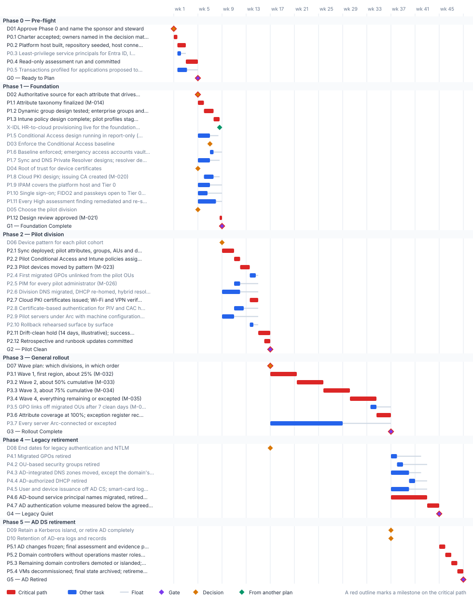

<!-- Generated by scripts/project_plans/build.py from data/project-plans/program-master-schedule.yaml. Edit the YAML, not this page. -->

# Program Master Schedule: Phases 0 to 5 and Gates G0 to G5 {.unnumbered}

::: {.callout-note}
## A sample plan, not a commitment
This is an illustrative plan built from the workbook's books, in the form a project manager would baseline: a work breakdown, a schedule network, a computed critical path, decision points, gates and risks. The durations are illustrative, sized to the books' roadmap weeks. Replace them with the agency's own estimates, then baseline the result. The plan names roles, not people, and no specific agency.
:::

## Plan at a glance

| | |
|---|---|
| **Plan type** | Program: Phases 0 to 5 (Phase 6 is steady state) |
| **Built from** | Books 00 and 01 |
| **Sponsor** | Executive sponsor and CIO |
| **Plan manager** | Steward (program office) |
| **Duration** | 48 weeks (240 working days), computed from the network |
| **Work** | 47 tasks, 6 gates, 11 decision points, 1 milestone from other plans |
| **Critical path** | 34 of 65 items; 5 more within 5 days of it |
| **Calendar** | Week 1 = the week Phase 0 is approved; five working days a week |

: Plan at a glance {.striped}

This is the program's top-level schedule: every phase, every gate and the decisions leadership has to make between them, as one network. It is the schedule the [complementary projects](index.md#the-plans) roll up to, and the one the steering committee tracks. It restates [Book 01, Chapter 12](../books/b01-transformation-arc/12-migration-roadmap.md) and [Book 00, Chapters 05](../books/b00-orientation/05-the-program-plan.md) and [09](../books/b00-orientation/09-design-pilot-and-rollout.md) as tasks with durations and dependencies, so the critical path is computed rather than asserted.

## Schedule

{fig-alt="Gantt chart of the Program master schedule plan over 48 weeks, grouped by phase. Critical-path tasks are red bars, other tasks are blue bars with a grey line showing their float, gates are violet diamonds, decisions are amber diamonds and milestones from other plans are green diamonds. The tables below give every date and float."}

## Critical path

The computed path matches the one [Book 00, Chapter 05](../books/b00-orientation/05-the-program-plan.md#the-critical-path) traces: assessment, then the attribute taxonomy, dynamic groups and Intune design, then pilot devices, each rollout wave in turn, and the application-by-application retirement of AD-bound service principal names. Every week lost on it moves every later gate. The provisional target end state (D11) is decided with the assessment's results, so it sits on the path at G0: it needs the sponsor and CIO in the room in week 4. Conditional Access, DNS, PKI and Arc work carry float: a slip there moves nothing until the float is used up, which is why they're tracked by float, not by date.

The critical path, in order. Each item has zero total float: a day lost on any of them is a day lost at the finish.

| # | ID | Item | Owner or approver | When |
|---|---|---|---|---|
| 1 | D01 | Approve Phase 0 and name the sponsor and steward | Executive sponsor and CIO | wk 1 |
| 2 | P0.1 | Charter accepted; owners named in the decision matrix | Program office | wk 1 |
| 3 | P0.2 | Platform host built, repository seeded, host connected through Arc | Platform teams | wk 1–2 |
| 4 | P0.4 | Read-only assessment run and committed | Program office | wk 3–4 |
| 5 | D11 | Provisional target end state: AD retired, or a dated Kerberos island | Executive sponsor and CIO | end of wk 4 |
| 6 | G0 | G0 — Ready to Plan | Steward (backup: executive sponsor) | end of wk 4 |
| 7 | D02 | Authoritative source for each attribute that drives access | HR | end of wk 4 |
| 8 | P1.1 | Attribute taxonomy finalized (M-014) | Platform teams | wk 5 |
| 9 | P1.2 | Dynamic group design tested; enterprise groups and administrative units built (M-015) | Platform teams | wk 6–7 |
| 10 | P1.3 | Intune policy design complete; pilot profiles staged (M-016) | Platform teams | wk 7–8 |
| 11 | P1.12 | Design review approved (M-021) | Steward | wk 8 |
| 12 | G1 | G1 — Foundation Complete | Steward | end of wk 8 |
| 13 | P2.1 | Sync deployed; pilot attributes, groups, AUs and delegated roles live (M-022) | Platform teams | wk 9–10 |
| 14 | P2.2 | Pilot Conditional Access and Intune policies assigned (M-024, M-025) | Platform teams | wk 11 |
| 15 | P2.3 | Pilot devices moved by pattern (M-023) | Platform teams | wk 12–13 |
| 16 | P2.7 | Cloud PKI certificates issued; Wi-Fi and VPN verified (M-028) | Platform teams | wk 13–14 |
| 17 | P2.11 | Drift-clean hold (14 days, illustrative); success criteria met (M-031) | Program office | wk 15–16 |
| 18 | P2.12 | Retrospective and runbook updates committed | Program office | wk 16 |
| 19 | G2 | G2 — Pilot Clean | Steward and executive sponsor (co-signed) | end of wk 16 |
| 20 | D07 | Wave plan: which divisions, in which order | Executive sponsor and steering committee | end of wk 16 |
| 21 | P3.1 | Wave 1, first region, about 25% (M-032) | Platform teams | wk 17–21 |
| 22 | P3.2 | Wave 2, about 50% cumulative (M-033) | Platform teams | wk 21–25 |
| 23 | P3.3 | Wave 3, about 75% cumulative (M-034) | Platform teams | wk 25–30 |
| 24 | P3.4 | Wave 4, everything remaining or excepted (M-035) | Platform teams | wk 30–34 |
| 25 | P3.6 | Attribute coverage at 100%; exception register reconciled (M-037) | Program office | wk 34–36 |
| 26 | G3 | G3 — Rollout Complete | Executive sponsor and steering committee | end of wk 36 |
| 27 | P4.6 | AD-bound service principal names migrated, retired or islanded, app by app | App owners | wk 37–42 |
| 28 | P4.7 | AD authentication volume measured below the agreed threshold | Program office | wk 43–44 |
| 29 | G4 | G4 — Legacy Quiet | Steward (backup: executive sponsor) | end of wk 44 |
| 30 | P5.1 | AD changes frozen; final assessment and evidence packet | Program office | wk 45 |
| 31 | P5.2 | Domain controllers without operations master roles demoted | Platform teams | wk 46 |
| 32 | P5.3 | Remaining domain controllers demoted or islanded; domain zones moved or retired | Platform teams | wk 47 |
| 33 | P5.4 | VMs decommissioned; final state archived; retirement record committed | Platform teams | wk 48 |
| 34 | G5 | G5 — AD Retired | Executive sponsor and CIO | end of wk 48 |

: The critical path {.striped .hover}

**Near-critical.** These items have 5 working days of float or less. Track them weekly: once their float is spent, they join the critical path.

| ID | Item | Float | When |
|---|---|---|---|
| P2.4 | First migrated GPOs unlinked from the pilot OUs | 2 d | wk 13–14 |
| P0.3 | Least-privilege service principals for Entra ID, Intune and Arc | 4 d | wk 1–2 |
| P2.10 | Rollback rehearsed surface by surface | 4 d | wk 13–14 |
| P1.11 | Every High assessment finding remediated and re-scanned | 5 d | wk 5–7 |
| P1.8 | Cloud PKI design; issuing CA created (M-020) | 5 d | wk 6–7 |

: Near-critical items {.striped .hover}

## Decision points

Each decision is a zero-duration milestone in the network. *Decide by* is its late finish: the last week it can be made without moving the plan's finish. A decision with zero float sits on the critical path, so the meeting that makes it should be booked before the plan is baselined. Decision rights follow [Book 01, Chapter 09](../books/b01-transformation-arc/09-who-leads-the-transformation.md#decision-rights-across-the-program).

| ID | Decision | Decides | Needed by | Decide by | Float | Options | If it's late |
|---|---|---|---|---|---|---|---|
| D01 | Approve Phase 0 and name the sponsor and steward | Executive sponsor and CIO | P0.1 | end of wk 1 | **0 (critical)** | Approve the four-week pre-flight; defer | Nothing starts; the external clocks keep running |
| D02 | Authoritative source for each attribute that drives access | HR | P1.1 | end of wk 4 | **0 (critical)** | HR system per attribute; a named alternative with a dated exception | The taxonomy can't be approved, and the whole critical path waits |
| D11 | Provisional target end state: AD retired, or a dated Kerberos island | Executive sponsor and CIO | G0, D09 | end of wk 4 | **0 (critical)** | AD retired completely; a Kerberos island for named workloads, with an end date | G0 can't pass: owners and budgets plan without a stated goal |
| D04 | Root of trust for device certificates | Program office | P1.8 | end of wk 6 | 10 d | Cloud PKI root; bring-your-own CA | The PKI design and the pilot certificates wait |
| D03 | Enforce the Conditional Access baseline | CISO | P1.6 | end of wk 8 | 7 d | Enforce; extend report-only; enforce with dated exceptions | G1 can't pass: the baseline must be enforced |
| D05 | Choose the pilot division | Program office | P1.12 | end of wk 8 | 18 d | IT (tolerates disruption best); another division plus volunteers | Pilot groups can't be built; G1 fails its pilot-readiness criterion |
| D06 | Device pattern for each pilot cohort | Program office | P2.3 | end of wk 11 | 15 d | New devices Entra joined; existing devices reset and re-enrolled; hybrid joined only with a cut date | Pilot devices can't move; the critical path waits |
| D07 | Wave plan: which divisions, in which order | Executive sponsor and steering committee | P3.1 | end of wk 16 | **0 (critical)** | By region, lowest risk first; by department | Wave 1 can't start; the critical path waits |
| D08 | End dates for legacy authentication and NTLM | Authorizing official | P4.6 | end of wk 36 | 100 d | A dated end per protocol; a dated, risk-accepted exception per application | Application owners have no date to plan against; SPN retirement slips |
| D09 | Confirm or revise the target end state set at G0 (D11) | Executive sponsor and CIO | P5.2 | end of wk 45 | 45 d | Confirm the G0 target; revise it with what Phase 4 left: retire completely, or keep a documented island with an end-of-life date | The demotion sequence can't be planned |
| D10 | Retention of AD-era logs and records | Records officer | P5.4 | end of wk 47 | 55 d | Retention schedule and archive location approved | Domain controllers can't be decommissioned: their logs can't be recovered afterward |

: Decision points, by decide-by date {.striped .hover}

## Gates

Each gate is the next phase's entry condition. The approver signs it against the criteria, from evidence in the repository.

| Gate | When | Approver | Criteria |
|---|---|---|---|
| [G0 — Ready to Plan](../books/b01-transformation-arc/12-migration-roadmap.md#gates-rollback-and-authority) | end of wk 4 | Steward (backup: executive sponsor) | Platform host operational; assessment committed; no open priority-one findings; provisional target end state recorded; no-new-AD-dependency rule in force |
| [G1 — Foundation Complete](../books/b00-orientation/09-design-pilot-and-rollout.md#gate-g1-foundation-complete) | end of wk 8 | Steward | Designs approved; groups and AUs drift-clean; baseline Conditional Access enforced; emergency access tested; Tier 0 in IPAM; HR feed live for the foundation scope; High findings closed |
| [G2 — Pilot Clean](../books/b00-orientation/09-design-pilot-and-rollout.md#gate-g2-pilot-clean) | end of wk 16 | Steward and executive sponsor (co-signed) | Zero drift for the hold period; no AD-only users and no hybrid-joined PC without a cut date; no unresolved rollback trigger; retrospective committed |
| [G3 — Rollout Complete](../books/b01-transformation-arc/12-migration-roadmap.md#phase-3-general-rollout-weeks-1736) | end of wk 36 | Executive sponsor and steering committee | Every division past its exit gate; every HR-listed employee with valid attributes; every PC cloud-joined and every server Arc-connected, or excepted; zero cross-division drift |
| [G4 — Legacy Quiet](../books/b01-transformation-arc/12-migration-roadmap.md#phase-4-legacy-retirement-weeks-3744) | end of wk 44 | Steward (backup: executive sponsor) | Only the minimum GPOs; no AD security groups in use; every zone but the domain's moved; user and device issuance off AD CS; every SPN migrated, retired or islanded; AD authentication below threshold |
| [G5 — AD Retired](../books/b01-transformation-arc/12-migration-roadmap.md#phase-5-ad-ds-retirement-weeks-4548) | end of wk 48 | Executive sponsor and CIO | Domain controllers decommissioned or a dated Kerberos island; evidence packet in the repository and the SIEM; no production dependency on AD authentication |

: Gates {.striped .hover}

## Links to other plans

- **X-IDL, HR-to-cloud provisioning live for the foundation scope,** is IG3 in the [Identity Lifecycle & Provisioning](identity-lifecycle.md) plan (Gate 3 — HR feed live for the foundation scope), end of wk 8. This plan waits for it; it can slip 2 d before it moves this plan. G1 fails its HR-feed criterion and waits.

Other plans that take a date from this one. *Waits for it*: that plan can't move until this item finishes, and its float says how far this item can slip before it moves that plan. *Must finish by it*: that plan's work has to be done before this item, and the margin says by how much.

| This plan's item | When | Linked plan | Relationship | Float or margin |
|---|---|---|---|---|
| P0.2  Platform host built, repository seeded, host connected through Arc | wk 1–2 | [Continuous Monitoring & Evidence Fabric](continuous-monitoring.md) (X-P02) | Waits for it | 8 d |
| G0 — Ready to Plan | end of wk 4 | [Continuous Monitoring & Evidence Fabric](continuous-monitoring.md) (X-G0) | Reference only | — |
| G0 — Ready to Plan | end of wk 4 | [Privileged Access & Administrative Identity](privileged-access.md) (X-G0) | Waits for it | 10 d |
| G0 — Ready to Plan | end of wk 4 | [Supply Chain & SBOM](supply-chain-sbom.md) (X-G0) | Waits for it | 3 d |
| P1.7  Sync and DNS Private Resolver designs; resolver deployed (M-018, M-019) | wk 5–6 | [Network & Access Modernization](network-access.md) (X-P17) | Waits for it | 2 d |
| P1.2  Dynamic group design tested; enterprise groups and administrative units built (M-015) | wk 6–7 | [Continuous Monitoring & Evidence Fabric](continuous-monitoring.md) (X-P12) | Waits for it | 0 |
| G1 — Foundation Complete | end of wk 8 | [Continuous Monitoring & Evidence Fabric](continuous-monitoring.md) (X-G1) | Must finish M4.1 by it | 4 d margin |
| G1 — Foundation Complete | end of wk 8 | [Data Platform Identity Transformation](data-platform.md) (X-G1) | Waits for it | 94 d |
| G1 — Foundation Complete | end of wk 8 | [Endpoint & Device Modernization](endpoint-device.md) (X-G1) | Must finish E1.3 by it | 1 d margin |
| D06  Device pattern for each pilot cohort | end of wk 8 | [Endpoint & Device Modernization](endpoint-device.md) (X-D06) | Waits for it | 2 d |
| G1 — Foundation Complete | end of wk 8 | [Privileged Access & Administrative Identity](privileged-access.md) (X-G1) | Must finish A1.1, A1.2 by it | 10 d margin |
| G1 — Foundation Complete | end of wk 8 | [Supply Chain & SBOM](supply-chain-sbom.md) (X-G1) | Waits for it | 13 d |
| P2.9  Pilot servers under Arc with machine configuration (M-030) | wk 9–10 | [Data Platform Identity Transformation](data-platform.md) (X-ARC) | Waits for it | 0 |
| start of P2.6  Division DNS migrated, DHCP re-homed, hybrid resolution validated (M-027) | wk 9–11 | [Network & Access Modernization](network-access.md) (X-P26S) | Must finish N1.1 by it | 2 d margin |
| P2.6  Division DNS migrated, DHCP re-homed, hybrid resolution validated (M-027) | wk 9–11 | [Network & Access Modernization](network-access.md) (X-P26) | Waits for it | 49 d |
| P2.3  Pilot devices moved by pattern (M-023) | wk 12–13 | [Continuous Monitoring & Evidence Fabric](continuous-monitoring.md) (X-P23) | Waits for it | 4 d |
| P2.7  Cloud PKI certificates issued; Wi-Fi and VPN verified (M-028) | wk 13–14 | [Network & Access Modernization](network-access.md) (X-P27) | Waits for it | 47 d |
| start of P2.11  Drift-clean hold (14 days, illustrative); success criteria met (M-031) | wk 15–16 | [Continuous Monitoring & Evidence Fabric](continuous-monitoring.md) (X-HOLD) | Must finish M5.3 by it | 4 d margin |
| G2 — Pilot Clean | end of wk 16 | [Continuous Monitoring & Evidence Fabric](continuous-monitoring.md) (X-G2) | Waits for it | 26 d |
| D08  End dates for legacy authentication and NTLM | end of wk 16 | [Data Platform Identity Transformation](data-platform.md) (X-D08) | Waits for it | 57 d |
| G2 — Pilot Clean | end of wk 16 | [Endpoint & Device Modernization](endpoint-device.md) (X-G2) | Must finish EG2 by it | 2 d margin |
| D08  End dates for legacy authentication and NTLM | end of wk 16 | [Endpoint & Device Modernization](endpoint-device.md) (X-D08) | Waits for it | 119 d |
| G2 — Pilot Clean | end of wk 16 | [Privileged Access & Administrative Identity](privileged-access.md) (X-G2) | Must finish AG2 by it | 12 d margin |
| G3 — Rollout Complete | end of wk 36 | [Endpoint & Device Modernization](endpoint-device.md) (X-G3) | Waits for it | 19 d |
| G3 — Rollout Complete | end of wk 36 | [Privileged Access & Administrative Identity](privileged-access.md) (X-G3) | Waits for it | 0 |
| P4.3  AD-integrated DNS zones moved, except the domain's own zones | wk 37–39 | [Network & Access Modernization](network-access.md) (X-P43) | Waits for it | 0 |
| P4.6  AD-bound service principal names migrated, retired or islanded, app by app | wk 37–42 | [Data Platform Identity Transformation](data-platform.md) (X-P46) | Must finish DG4 by it | 58 d margin |

: Plans that take a date from this one {.striped .hover}

## Work breakdown and schedule

Every row, by phase. *Float* is total float in working days; **bold** rows are on the critical path. Each row links to the chapter it comes from.

### Phase 0 — Pre-flight

| ID | Item | Type | Owner or approver | Days | Predecessors | When | Float |
|---|---|---|---|---|---|---|---|
| D01 | **[Approve Phase 0 and name the sponsor and steward](../start-here.md)** | Decision | Executive sponsor and CIO | — | — | wk 1 | 0 |
| P0.1 | **[Charter accepted; owners named in the decision matrix](../books/b00-orientation/03-the-charter.md)** | Task | Program office | 3 | D01 | wk 1 | 0 |
| P0.2 | **[Platform host built, repository seeded, host connected through Arc](../books/b01-transformation-arc/03-platform-foundation.md)** | Task | Platform teams | 7 | P0.1 | wk 1–2 | 0 |
| P0.3 | [Least-privilege service principals for Entra ID, Intune and Arc](../books/b01-transformation-arc/12-migration-roadmap.md#phase-0-pre-flight-weeks-14) | Task | Platform teams | 3 | P0.1 | wk 1–2 | 4 d |
| P0.4 | **[Read-only assessment run and committed](../books/b00-orientation/08-pre-flight-and-assessment.md)** | Task | Program office | 10 | P0.2, P0.3 | wk 3–4 | 0 |
| P0.5 | [Transactions profiled for applications proposed to move from their data](../books/b01-transformation-arc/10-analyzing-the-estate.md#profiling-transactions-before-separation) | Task | App owners | 8 | P0.1 | wk 1–3 | 9 d |
| P0.6 | [Change process asks whether each change adds an AD dependency; exceptions to the AO](../books/b13-governance/04-change-control-and-provenance.md#no-new-dependencies-on-active-directory) | Task | Program office | 3 | P0.1 | wk 1–2 | 14 d |
| D11 | **[Provisional target end state: AD retired, or a dated Kerberos island](../books/b01-transformation-arc/12-migration-roadmap.md#phase-0-pre-flight-weeks-14)** | Decision | Executive sponsor and CIO | — | P0.4 | end of wk 4 | 0 |
| G0 | **[G0 — Ready to Plan](../books/b01-transformation-arc/12-migration-roadmap.md#gates-rollback-and-authority)** | Gate | Steward (backup: executive sponsor) | — | P0.4, P0.5, P0.6, D11 | end of wk 4 | 0 |

: Phase 0 — Pre-flight {.striped .hover}

### Phase 1 — Foundation

| ID | Item | Type | Owner or approver | Days | Predecessors | When | Float |
|---|---|---|---|---|---|---|---|
| D02 | **[Authoritative source for each attribute that drives access](../books/b01-transformation-arc/09-who-leads-the-transformation.md#decision-rights-across-the-program)** | Decision | HR | — | G0 | end of wk 4 | 0 |
| P1.1 | **[Attribute taxonomy finalized (M-014)](../books/b00-orientation/09-design-pilot-and-rollout.md#design-milestones)** | Task | Platform teams | 5 | D02 | wk 5 | 0 |
| P1.2 | **[Dynamic group design tested; enterprise groups and administrative units built (M-015)](../books/b00-orientation/09-design-pilot-and-rollout.md#design-milestones)** | Task | Platform teams | 8 | P1.1 | wk 6–7 | 0 |
| P1.3 | **[Intune policy design complete; pilot profiles staged (M-016)](../books/b00-orientation/09-design-pilot-and-rollout.md#design-milestones)** | Task | Platform teams | 5 | P1.2 | wk 7–8 | 0 |
| X-IDL | [HR-to-cloud provisioning live for the foundation scope](identity-lifecycle.md) | External | Identity Lifecycle project | — | — | end of wk 8 | 2 d |
| P1.5 | [Conditional Access design running in report-only (M-017)](../books/b00-orientation/09-design-pilot-and-rollout.md#design-milestones) | Task | CISO | 10 | G0 | wk 5–6 | 7 d |
| D03 | [Enforce the Conditional Access baseline](../books/b01-transformation-arc/12-migration-roadmap.md#phase-1-foundation-weeks-58) | Decision | CISO | — | P1.5 | end of wk 6 | 7 d |
| P1.6 | [Baseline enforced; emergency access accounts vaulted and tested](../books/b01-transformation-arc/12-migration-roadmap.md#phase-1-foundation-weeks-58) | Task | Platform teams | 3 | D03 | wk 7 | 7 d |
| P1.7 | [Sync and DNS Private Resolver designs; resolver deployed (M-018, M-019)](../books/b00-orientation/09-design-pilot-and-rollout.md#design-milestones) | Task | Platform teams | 10 | G0 | wk 5–6 | 8 d |
| D04 | [Root of trust for device certificates](../books/b07-pki/index.md) | Decision | Program office | — | G0 | end of wk 4 | 10 d |
| P1.8 | [Cloud PKI design; issuing CA created (M-020)](../books/b00-orientation/09-design-pilot-and-rollout.md#design-milestones) | Task | Platform teams | 8 | D04, P1.1 | wk 6–7 | 5 d |
| P1.9 | [IPAM covers the platform host and Tier 0](../books/b08-ddi/10-migration-sequence.md) | Task | Platform teams | 10 | G0 | wk 5–6 | 10 d |
| P1.10 | [Single sign-on; FIDO2 and passkeys open to Tier 0 administrators](../books/b04-access/index.md) | Task | Platform teams | 8 | G0 | wk 5–6 | 12 d |
| P1.11 | [Every High assessment finding remediated and re-scanned](../books/b00-orientation/09-design-pilot-and-rollout.md#foundation-build-and-pre-pilot-readiness) | Task | Platform teams | 15 | G0 | wk 5–7 | 5 d |
| D05 | [Choose the pilot division](../books/b00-orientation/09-design-pilot-and-rollout.md#scope) | Decision | Program office | — | G0 | end of wk 4 | 18 d |
| P1.12 | **[Design review approved (M-021)](../books/b00-orientation/09-design-pilot-and-rollout.md#design-milestones)** | Task | Steward | 2 | P1.3, P1.7, P1.8, D05 | wk 8 | 0 |
| G1 | **[G1 — Foundation Complete](../books/b00-orientation/09-design-pilot-and-rollout.md#gate-g1-foundation-complete)** | Gate | Steward | — | P1.12, X-IDL, P1.6, P1.9, P1.10, P1.11 | end of wk 8 | 0 |

: Phase 1 — Foundation {.striped .hover}

### Phase 2 — Pilot division

| ID | Item | Type | Owner or approver | Days | Predecessors | When | Float |
|---|---|---|---|---|---|---|---|
| D06 | [Device pattern for each pilot cohort](../books/b05-devices/02-the-hybrid-join-trap.md) | Decision | Program office | — | G1 | end of wk 8 | 15 d |
| P2.1 | **[Sync deployed; pilot attributes, groups, AUs and delegated roles live (M-022)](../books/b00-orientation/09-design-pilot-and-rollout.md#milestones)** | Task | Platform teams | 10 | G1 | wk 9–10 | 0 |
| P2.2 | **[Pilot Conditional Access and Intune policies assigned (M-024, M-025)](../books/b00-orientation/09-design-pilot-and-rollout.md#milestones)** | Task | Platform teams | 5 | P2.1 | wk 11 | 0 |
| P2.3 | **[Pilot devices moved by pattern (M-023)](../books/b00-orientation/09-design-pilot-and-rollout.md#milestones)** | Task | Platform teams | 8 | P2.2, D06 | wk 12–13 | 0 |
| P2.4 | [First migrated GPOs unlinked from the pilot OUs](../books/b05-devices/07-the-gpo-sunset-program.md) | Task | Platform teams | 5 | P2.3 | wk 13–14 | 2 d |
| P2.5 | [PIM for every pilot administrator (M-026)](../books/b00-orientation/09-design-pilot-and-rollout.md#milestones) | Task | Platform teams | 5 | P2.1 | wk 11 | 15 d |
| P2.6 | [Division DNS migrated, DHCP re-homed, hybrid resolution validated (M-027)](../books/b08-ddi/10-migration-sequence.md) | Task | Platform teams | 15 | G1 | wk 9–11 | 15 d |
| P2.7 | **[Cloud PKI certificates issued; Wi-Fi and VPN verified (M-028)](../books/b00-orientation/09-design-pilot-and-rollout.md#milestones)** | Task | Platform teams | 7 | P2.3 | wk 13–14 | 0 |
| P2.8 | [Certificate-based authentication for PIV and CAC holders (M-029)](../books/b00-orientation/09-design-pilot-and-rollout.md#milestones) | Task | Platform teams | 8 | P2.1 | wk 11–12 | 12 d |
| P2.9 | [Pilot servers under Arc with machine configuration (M-030)](../books/b05-devices/09-servers-under-azure-arc.md) | Task | Platform teams | 10 | G1 | wk 9–10 | 20 d |
| P2.10 | [Rollback rehearsed surface by surface](../books/b00-orientation/09-design-pilot-and-rollout.md#rollback-surface-by-surface) | Task | Platform teams | 3 | P2.3 | wk 13–14 | 4 d |
| P2.11 | **[Drift-clean hold (14 days, illustrative); success criteria met (M-031)](../books/b00-orientation/09-design-pilot-and-rollout.md#gate-g2-pilot-clean)** | Task | Program office | 10 | P2.4, P2.5, P2.6, P2.7, P2.8, P2.9, P2.10 | wk 15–16 | 0 |
| P2.12 | **[Retrospective and runbook updates committed](../books/b00-orientation/09-design-pilot-and-rollout.md#gate-g2-pilot-clean)** | Task | Program office | 5 | P2.11 (SS) +5 d | wk 16 | 0 |
| G2 | **[G2 — Pilot Clean](../books/b00-orientation/09-design-pilot-and-rollout.md#gate-g2-pilot-clean)** | Gate | Steward and executive sponsor (co-signed) | — | P2.11, P2.12 | end of wk 16 | 0 |

: Phase 2 — Pilot division {.striped .hover}

### Phase 3 — General rollout

| ID | Item | Type | Owner or approver | Days | Predecessors | When | Float |
|---|---|---|---|---|---|---|---|
| D07 | **[Wave plan: which divisions, in which order](../books/b00-orientation/09-design-pilot-and-rollout.md#waves-defined-by-attribute-values)** | Decision | Executive sponsor and steering committee | — | G2 | end of wk 16 | 0 |
| P3.1 | **[Wave 1, first region, about 25% (M-032)](../books/b00-orientation/09-design-pilot-and-rollout.md#milestones-1)** | Task | Platform teams | 22 | D07 | wk 17–21 | 0 |
| P3.2 | **[Wave 2, about 50% cumulative (M-033)](../books/b00-orientation/09-design-pilot-and-rollout.md#milestones-1)** | Task | Platform teams | 22 | P3.1 | wk 21–25 | 0 |
| P3.3 | **[Wave 3, about 75% cumulative (M-034)](../books/b00-orientation/09-design-pilot-and-rollout.md#milestones-1)** | Task | Platform teams | 22 | P3.2 | wk 25–30 | 0 |
| P3.4 | **[Wave 4, everything remaining or excepted (M-035)](../books/b00-orientation/09-design-pilot-and-rollout.md#milestones-1)** | Task | Platform teams | 22 | P3.3 | wk 30–34 | 0 |
| P3.5 | [GPO links off migrated OUs after 7 clean days (M-036)](../books/b00-orientation/09-design-pilot-and-rollout.md#milestones-1) | Task | Platform teams | 5 | P3.4 (SS) +17 d | wk 33–34 | 12 d |
| P3.6 | **[Attribute coverage at 100%; exception register reconciled (M-037)](../books/b00-orientation/09-design-pilot-and-rollout.md#gate-g3-rollout-complete)** | Task | Program office | 12 | P3.4 | wk 34–36 | 0 |
| P3.7 | [Every server Arc-connected or excepted](../books/b05-devices/09-servers-under-azure-arc.md) | Task | Platform teams | 60 | G2 | wk 17–28 | 40 d |
| G3 | **[G3 — Rollout Complete](../books/b01-transformation-arc/12-migration-roadmap.md#phase-3-general-rollout-weeks-1736)** | Gate | Executive sponsor and steering committee | — | P3.5, P3.6, P3.7 | end of wk 36 | 0 |

: Phase 3 — General rollout {.striped .hover}

### Phase 4 — Legacy retirement

| ID | Item | Type | Owner or approver | Days | Predecessors | When | Float |
|---|---|---|---|---|---|---|---|
| D08 | [End dates for legacy authentication and NTLM](../books/b01-transformation-arc/09-who-leads-the-transformation.md#decision-rights-across-the-program) | Decision | Authorizing official | — | G2 | end of wk 16 | 100 d |
| P4.1 | [Migrated GPOs retired](../books/b01-transformation-arc/12-migration-roadmap.md#phase-4-legacy-retirement-weeks-3744) | Task | Platform teams | 5 | G3 | wk 37 | 20 d |
| P4.2 | [OU-based security groups retired](../books/b01-transformation-arc/12-migration-roadmap.md#phase-4-legacy-retirement-weeks-3744) | Task | Platform teams | 5 | P4.1 | wk 38 | 20 d |
| P4.3 | [AD-integrated DNS zones moved, except the domain's own zones](../books/b08-ddi/10-migration-sequence.md) | Task | Platform teams | 15 | G3 | wk 37–39 | 10 d |
| P4.4 | [AD-authorized DHCP retired](../books/b01-transformation-arc/12-migration-roadmap.md#phase-4-legacy-retirement-weeks-3744) | Task | Platform teams | 5 | P4.3 | wk 40 | 10 d |
| P4.5 | [User and device issuance off AD CS; smart-card logon GPO retired](../books/b07-pki/07-coexistence-and-migration.md) | Task | Platform teams | 15 | G3 | wk 37–39 | 15 d |
| P4.6 | **[AD-bound service principal names migrated, retired or islanded, app by app](../books/b01-transformation-arc/12-migration-roadmap.md#phase-4-legacy-retirement-weeks-3744)** | Task | App owners | 30 | G3, D08 | wk 37–42 | 0 |
| P4.7 | **[AD authentication volume measured below the agreed threshold](../books/b01-transformation-arc/12-migration-roadmap.md#phase-4-legacy-retirement-weeks-3744)** | Task | Program office | 10 | P4.6, P4.2, P4.4, P4.5 | wk 43–44 | 0 |
| G4 | **[G4 — Legacy Quiet](../books/b01-transformation-arc/12-migration-roadmap.md#phase-4-legacy-retirement-weeks-3744)** | Gate | Steward (backup: executive sponsor) | — | P4.7 | end of wk 44 | 0 |

: Phase 4 — Legacy retirement {.striped .hover}

### Phase 5 — AD DS retirement

| ID | Item | Type | Owner or approver | Days | Predecessors | When | Float |
|---|---|---|---|---|---|---|---|
| D09 | [Confirm or revise the target end state set at G0 (D11)](../books/b01-transformation-arc/12-migration-roadmap.md#phase-5-ad-ds-retirement-weeks-4548) | Decision | Executive sponsor and CIO | — | G3, D11 | end of wk 36 | 45 d |
| D10 | [Retention of AD-era logs and records](../books/b01-transformation-arc/09-who-leads-the-transformation.md#decision-rights-across-the-program) | Decision | Records officer | — | G3 | end of wk 36 | 55 d |
| P5.1 | **[AD changes frozen; final assessment and evidence packet](../books/b01-transformation-arc/12-migration-roadmap.md#phase-5-ad-ds-retirement-weeks-4548)** | Task | Program office | 5 | G4 | wk 45 | 0 |
| P5.2 | **[Domain controllers without operations master roles demoted](../books/b01-transformation-arc/12-migration-roadmap.md#phase-5-ad-ds-retirement-weeks-4548)** | Task | Platform teams | 5 | P5.1, D09 | wk 46 | 0 |
| P5.3 | **[Remaining domain controllers demoted or islanded; domain zones moved or retired](../books/b01-transformation-arc/12-migration-roadmap.md#phase-5-ad-ds-retirement-weeks-4548)** | Task | Platform teams | 5 | P5.2 | wk 47 | 0 |
| P5.4 | **[VMs decommissioned; final state archived; retirement record committed](../books/b01-transformation-arc/12-migration-roadmap.md#phase-5-ad-ds-retirement-weeks-4548)** | Task | Platform teams | 5 | P5.3, D10 | wk 48 | 0 |
| G5 | **[G5 — AD Retired](../books/b01-transformation-arc/12-migration-roadmap.md#phase-5-ad-ds-retirement-weeks-4548)** | Gate | Executive sponsor and CIO | — | P5.4 | end of wk 48 | 0 |

: Phase 5 — AD DS retirement {.striped .hover}

## Responsibility

Who owns what in this plan. Each row has one owner; consulted and informed parties follow the [decision matrix](../books/b01-transformation-arc/09-who-leads-the-transformation.md#decision-rights-across-the-program).

| Owner or approver | Tasks | Decisions | Gates |
|---|---|---|---|
| Platform teams | 35 | — | — |
| Program office | 8 | 3 | — |
| Executive sponsor and CIO | — | 3 | 1 |
| App owners | 2 | — | — |
| CISO | 1 | 1 | — |
| Executive sponsor and steering committee | — | 1 | 1 |
| Steward | 1 | — | 1 |
| Steward (backup: executive sponsor) | — | — | 2 |
| Authorizing official | — | 1 | — |
| HR | — | 1 | — |
| Identity Lifecycle project | 1 | — | — |
| Records officer | — | 1 | — |
| Steward and executive sponsor (co-signed) | — | — | 1 |

: Ownership {.striped .hover}

## Assumptions

- One pilot division, then four waves of about a quarter of the estate each ([Book 00, Chapter 09](../books/b00-orientation/09-design-pilot-and-rollout.md#waves-defined-by-attribute-values)).
- Durations are illustrative and sized to the roadmap's weeks; replace them with the agency's own estimates from the Phase 0 assessment.
- The schedule assumes Phase 0 is approved without waiting for a vendor decision ([Start Here](../start-here.md)).
- The HR-to-cloud feed for the foundation scope comes from the [Identity Lifecycle plan](identity-lifecycle.md); its privacy basis is that plan's longest task.
- The source of authority for contractors is decided in the Identity Lifecycle plan (D-I3), which onboards contractor populations as their divisions move.

## Schedule risks

| Risk | Effect on the schedule | Response |
|---|---|---|
| The assessment finds more than the plan assumed | Every gate moves; the assessment is on the critical path | Run the read-only assessment in week 1; size Phase 1 from what it finds, and re-baseline at G0 |
| Report-only Conditional Access shows unexpected impact | Uses the CA track's float; G1 slips only if more than the float is used | Start report-only in week 5, not week 7; read the sign-in logs weekly |
| The privacy basis for the HR feed isn't ready | G1's HR-feed criterion fails | Start the PIA update and the SORN routine-use check in Phase 0 (Identity Lifecycle plan) |
| Applications can't leave AD-bound service principal names on time | G4 slips week for week | Set the legacy-authentication end date early (D08) so application owners plan against it |

: Schedule risks {.striped .hover}

## Baseline and change control

- **Baseline** the plan when its first gate is approved: the YAML file, as merged, is the baseline.
- **Report** weekly, green, yellow or red, against the baseline ([Book 01, Chapter 12](../books/b01-transformation-arc/12-migration-roadmap.md#phase-3-general-rollout-weeks-1736)). Report float, not percent complete: a task's float says how much slip the plan can still absorb.
- **Change** the plan only through a reviewed pull request that edits the YAML and regenerates this page, so every change to a date or a dependency has an author, a reviewer and a reason.
- **Re-baseline** at each gate, after the approver signs it, and whenever a critical-path decision is made late.

## Download and adapt

| File | Use it for |
|---|---|
| [program-master-schedule.xml](files/program-master-schedule.xml) | Microsoft Project desktop (open the XML file; it keeps the dependencies, milestones and owners). The dates start on a placeholder Monday: change the project start date. |
| [program-master-schedule.csv](files/program-master-schedule.csv) | Excel or any other scheduling tool: every row with its dependencies, early and late dates and float |
| [program-master-schedule-azure-boards.csv](files/program-master-schedule-azure-boards.csv) | Azure DevOps Boards: an Epic per phase and a Feature per task, gate and decision, with dates and tags (see below) |
| [program-master-schedule-dependencies.csv](files/program-master-schedule-dependencies.csv) · [add-azure-boards-links.ps1](files/add-azure-boards-links.ps1) | The plan's predecessor links, and a script that adds them in Azure Boards after the import |
| [program-master-schedule-jira.csv](files/program-master-schedule-jira.csv) | Jira: an Epic per phase and a Task per task, gate and decision, with dates, labels and Blocks links (see below) |
| [program-master-schedule.yaml](https://github.com/WhalerMike/modernization-workbook/blob/main/data/project-plans/program-master-schedule.yaml) | The source. Edit the durations, owners and dependencies, then run `python scripts/project_plans/build.py` to recompute the critical path and regenerate this page, the chart and the downloads. |

: Downloads {.striped}

::: {.callout-tip}
## Importing this plan into Azure DevOps Boards
1. In the project, select **Boards** > **Queries** > **Import work items**, choose [program-master-schedule-azure-boards.csv](files/program-master-schedule-azure-boards.csv), check the results and select **Save items**. It creates one Epic per phase with a Feature under it for each task, gate and decision, with start and target dates, which is what Delivery Plans show. Epic and Feature exist in the Agile, Scrum and CMMI processes; in the Basic process, change *Feature* to *Issue* in the file first.
2. The import can't create dependency links or assign people. To add the predecessor links, sign in with `az login`, add the CLI extension with `az extension add --name azure-devops`, and run `./add-azure-boards-links.ps1 -Organization https://dev.azure.com/<org> -Project <project> -Plan program-master-schedule` beside [program-master-schedule-dependencies.csv](files/program-master-schedule-dependencies.csv). It finds the imported items by their `fmw-id-` tags and links each one to its predecessors.
3. Assign people in Boards: each item carries its owner role as an *Owner - …* tag, and critical-path items carry *Critical path*. Azure Boards links don't hold lag or start-to-start timing; each item's description keeps them.

The dates count from the plan's placeholder start; shift them when you set the real start. The script hasn't been run against a live organization yet: test it on a scratch project first.
:::

::: {.callout-tip}
## Importing this plan into Jira
1. Run the CSV importer (in Jira Cloud, **Settings** > **System** > **External system import** > **CSV**) with [program-master-schedule-jira.csv](files/program-master-schedule-jira.csv). On the second step, set **Date format in import file** to `yyyy-MM-dd`.
2. Map the columns: *Work item ID* to Work item ID, *Work type* to Work type, *Parent* to Parent, *Summary*, *Description* and every *Labels* column to their fields, *Start date* to the Start date field, *Due date* to Due date, and every *Blocks* column to the **Blocks** link type. Each phase becomes an Epic with a Task under it for each task, gate and decision; each Blocks column makes that row's item block the item it names, which carries the plan's dependencies.
3. Assign people in Jira: each item carries its owner role as an `owner-…` label, and critical-path items carry `critical-path`. Jira links don't hold lag or start-to-start timing; each description keeps them.

Test the import on a scratch project with a few rows first: the importer doesn't remove duplicate links and Jira has no bulk delete for them. If the Blocks links don't come through on your site, import the items first and add the links from the plan's dependency list in a second pass, as Atlassian recommends. The dates count from the plan's placeholder start.
:::

::: {.callout-tip}
## Opening this plan in Project or Planner
- **Microsoft Project desktop** opens the XML file directly, with every dependency, milestone and owner.
- **Microsoft Planner** has no file import of its own: it doesn't read XML, CSV or Excel. To bring this plan into a Planner premium plan, open the XML file in Project desktop, save it as an `.mpp` file, and import that through the Project Power App. Tasks, durations, dependencies and milestones come across; resources and baselines don't, so assign owners again in Planner.
- **Without Project desktop**, the CSV can feed a Power Automate flow that creates the tasks one by one, but dependencies in a premium plan need Microsoft's Project schedule APIs, so that's a build, not an import.
- **In a government cloud tenant**, check that premium plans are available before relying on Planner for this schedule: Microsoft notes that converting a basic plan to a premium plan isn't available in GCC.

Project for the web was retired on August 1, 2025, and Project Online on September 30, 2026; Planner is their successor. Project desktop is unaffected.
:::

