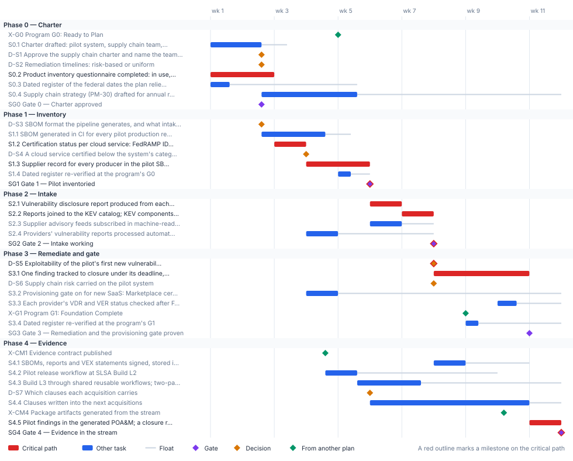

<!-- Generated by scripts/project_plans/build.py from data/project-plans/supply-chain-sbom.yaml. Edit the YAML, not this page. -->

# Supply Chain & Software Bill of Materials: From Inventory to Proof {.unnumbered}

::: {.callout-note}
## A sample plan, not a commitment
This is an illustrative plan built from the workbook's books, in the form a project manager would baseline: a work breakdown, a schedule network, a computed critical path, decision points, gates and risks. The durations are illustrative, sized to the books' roadmap weeks. Replace them with the agency's own estimates, then baseline the result. The plan names roles, not people, and no specific agency.
:::

## Plan at a glance

| | |
|---|---|
| **Plan type** | Project: Book 14, Chapter 07's five steps, at pilot scale |
| **Built from** | Book 14 |
| **Sponsor** | CISO, who owns the supply chain strategy; the CIO approves the charter |
| **Plan manager** | Supply chain risk lead, with the contracting officer for contract terms |
| **Duration** | 11 weeks (55 working days), computed from the network |
| **Work** | 21 tasks, 5 gates, 7 decision points, 4 milestones from other plans |
| **Critical path** | 11 of 37 items; 11 more within 5 days of it |
| **Calendar** | Week 1 = the program's Phase 0 approval; five working days a week |

: Plan at a glance {.striped}

This plan builds the supply chain discipline [Book 14, Chapter 07](../books/b14-compliance/07-supply-chain-risk-management.md) describes: inventory before remediation, an SBOM for each pilot release, vulnerability intake joined to the KEV catalog and the BOD 26-04 queue, exploitability decided by people, and new cloud services gated on a recorded certification status. It follows the chapter's [five steps](../books/b14-compliance/07-supply-chain-risk-management.md#who-owns-what), one gate each. [Book 00, Chapter 06](../books/b00-orientation/06-the-project-portfolio.md#supply-chain-software-bill-of-materials) places this project last because it is the most independent of the identity chain and reports through the evidence fabric, so its evidence step waits on the [Continuous Monitoring plan](continuous-monitoring.md). Under OMB M-26-05 an SBOM is an agency choice made through contract terms, and the plan treats it that way.

## Schedule

{fig-alt="Gantt chart of the Supply Chain &amp; SBOM plan over 11 weeks, grouped by phase. Critical-path tasks are red bars, other tasks are blue bars with a grey line showing their float, gates are violet diamonds, decisions are amber diamonds and milestones from other plans are green diamonds. The tables below give every date and float."}

## Critical path

The computed path runs from the product inventory questionnaire through the certification status of each cloud service, the supplier records, the SBOM-backed inventory gate, the vulnerability report and its join to the KEV catalog, the first exploitability decision, one finding tracked to closure under its deadline, and that finding reported in the POA&M the evidence fabric generates. The questionnaire, not the SBOM pipeline, starts the path: supplier records can't be completed until every in-boundary cloud service has a recorded status. The SBOM work and the build-provenance work carry float.

Two links reach outside the plan. The Continuous Monitoring plan's Gate 4 (package artifacts generated from the stream, end of week 10) is needed before the pilot's findings can appear in a generated POA&M; it has 4 days of margin, so a slip there of more than 4 days moves this plan's finish. Against the program, the questionnaire ends in week 2, two weeks before G0, and the plan finishes in week 11, five weeks before G2. The contract clauses are the task to watch: they ride the agency's next acquisitions, which this plan can't schedule, and their 5 days of float is a placeholder for the contracting officer's real dates.

The critical path, in order. Each item has zero total float: a day lost on any of them is a day lost at the finish.

| # | ID | Item | Owner or approver | When |
|---|---|---|---|---|
| 1 | S0.2 | Product inventory questionnaire completed: in use, product and offering, FedRAMP status, surface | Program office | wk 1–2 |
| 2 | S1.2 | Certification status per cloud service: FedRAMP ID, status, class, date checked; scope disposition | Supply chain risk lead | wk 3 |
| 3 | S1.3 | Supplier record for every producer in the pilot SBOM and every in-boundary cloud service | Supply chain risk lead | wk 4–5 |
| 4 | SG1 | Gate 1 — Pilot inventoried | CISO | end of wk 5 |
| 5 | S2.1 | Vulnerability disclosure report produced from each pilot SBOM | Engineering teams | wk 6 |
| 6 | S2.2 | Reports joined to the KEV catalog; KEV components sent to the BOD 26-04 queue the same day | Engineering teams | wk 7 |
| 7 | SG2 | Gate 2 — Intake working | CISO | end of wk 7 |
| 8 | D-S5 | Exploitability of the pilot's first new vulnerability (VEX status) | Owning application team, reviewed by security | end of wk 7 |
| 9 | S3.1 | One finding tracked to closure under its deadline, closed on re-test evidence | System owner | wk 8–10 |
| 10 | S4.5 | Pilot findings in the generated POA&M; a closure record per SR control naming what closes it | ISSO | wk 11 |
| 11 | SG4 | Gate 4 — Evidence in the stream | CISO | end of wk 11 |

: The critical path {.striped .hover}

**Near-critical.** These items have 5 working days of float or less. Track them weekly: once their float is spent, they join the critical path.

| ID | Item | Float | When |
|---|---|---|---|
| S1.4 | Dated register re-verified at the program's G0 | 3 d | wk 5 |
| S0.1 | Charter drafted: pilot system, supply chain team, risk-acceptance owner, risk-based timelines | 4 d | wk 1–2 |
| D-S1 | Approve the supply chain charter and name the team (SR-2(1)) | 4 d | end of wk 2 |
| D-S2 | Remediation timelines: risk-based or uniform | 4 d | end of wk 2 |
| SG0 | Gate 0 — Charter approved | 4 d | end of wk 2 |
| D-S3 | SBOM format the pipeline generates, and what intake accepts | 4 d | end of wk 2 |
| S1.1 | SBOM generated in CI for every pilot production release, with the CISA 2026 minimum elements | 4 d | wk 2–4 |
| S2.3 | Supplier advisory feeds subscribed in machine-readable form where they exist | 5 d | wk 6 |
| D-S7 | Which clauses each acquisition carries | 5 d | end of wk 5 |
| S4.4 | Clauses written into the next acquisitions | 5 d | wk 6–10 |
| SG3 | Gate 3 — Remediation and the provisioning gate proven | 5 d | end of wk 10 |

: Near-critical items {.striped .hover}

## Decision points

Each decision is a zero-duration milestone in the network. *Decide by* is its late finish: the last week it can be made without moving the plan's finish. A decision with zero float sits on the critical path, so the meeting that makes it should be booked before the plan is baselined. Decision rights follow [Book 01, Chapter 09](../books/b01-transformation-arc/09-who-leads-the-transformation.md#decision-rights-across-the-program).

| ID | Decision | Decides | Needed by | Decide by | Float | Options | If it's late |
|---|---|---|---|---|---|---|---|
| D-S1 | Approve the supply chain charter and name the team (SR-2(1)) | CIO | S0.4, SG0 | end of wk 3 | 4 d | A dedicated supply chain program office; matrixed representatives from information security, procurement, risk management, engineering, software development, IT, legal and HR | Supplier records and reviews have no owner; Phase 1 waits |
| D-S2 | Remediation timelines: risk-based or uniform | CISO | SG0, S2.2 | end of wk 3 | 4 d | Risk-based, from BOD 26-04's four questions (publicly exposed, in the KEV catalog, exploitation automatable, partial or total control); one uniform calendar for every finding | Intake can't set a deadline per finding; Phase 2 waits |
| D-S3 | SBOM format the pipeline generates, and what intake accepts | Engineering teams that build and release software | S1.1 | end of wk 3 | 4 d | SPDX 3.0 (ISO/IEC 5962:2021); CycloneDX 1.7 (ECMA-424); intake accepts any widely used format and normalizes it | The pipeline can't be built; the pilot SBOM waits |
| D-S7 | Which clauses each acquisition carries | Contracting officer, advised by the supply chain team | S4.4 | end of wk 6 | 5 d | An SBOM on request; for a cloud platform, an SBOM of the runtime production environment; a supplier notification agreement (SR-8); the secure-development attestation form; utilization and pricing disclosure (M-26-10) | The next acquisitions go out without them; SR-5 and SR-8 stay open |
| D-S5 | Exploitability of the pilot's first new vulnerability (VEX status) | Owning application team, reviewed by security | S3.1, D-S6, S4.1 | end of wk 7 | **0 (critical)** | Not affected, with a justification; affected, with an action statement; fixed; under investigation | No signed statement; the finding can't move to remediation or closure |
| D-S4 | A cloud service certified below the system's categorization | Authorizing official | S3.2 | end of wk 10 | 35 d | Decide the certification package supports this use, and record the decision; find an offering certified at the matching class | The flagged service can't pass the provisioning gate; its system's authorization waits |
| D-S6 | Supply chain risk carried on the pilot system | Authorizing official | SG3 | end of wk 11 | 20 d | An open POA&M item with an owner, milestones and a deadline; a governed exception with an in-date acceptance and an expiry | A finding that misses its deadline has no disposition; Gate 3 waits |

: Decision points, by decide-by date {.striped .hover}

## Gates

Each gate is the next phase's entry condition. The approver signs it against the criteria, from evidence in the repository.

| Gate | When | Approver | Criteria |
|---|---|---|---|
| [Gate 0 — Charter approved](../books/b14-compliance/07-supply-chain-risk-management.md#who-owns-what) | end of wk 2 | CIO | Pilot system chosen; supply chain team named; the authorizing official recorded as the owner of supply chain risk acceptance; risk-based timelines agreed |
| [Gate 1 — Pilot inventoried](../books/b14-compliance/07-supply-chain-risk-management.md#who-owns-what) | end of wk 5 | CISO | SBOMs generated for the pilot's production releases; every supplier and cloud service recorded with its certification status and the date checked |
| [Gate 2 — Intake working](../books/b14-compliance/07-supply-chain-risk-management.md#who-owns-what) | end of wk 7 | CISO | SBOMs joined to the KEV catalog and the BOD 26-04 queue; supplier advisory feeds subscribed in machine-readable form where they exist; provider reports land in the same queue |
| [Gate 3 — Remediation and the provisioning gate proven](../books/b14-compliance/07-supply-chain-risk-management.md#who-owns-what) | end of wk 10 | CISO | At least one finding tracked to closure on its risk-based deadline, with re-test evidence; new SaaS provisioning gated on a recorded status for the pilot |
| [Gate 4 — Evidence in the stream](../books/b14-compliance/07-supply-chain-risk-management.md#who-owns-what) | end of wk 11 | CISO | SBOMs, reports and statements signed and stored; Build L2 reached, then L3; contract clauses in the next acquisitions; residual supply chain risk owned by the authorizing official |

: Gates {.striped .hover}

## Links to other plans

- **X-G0, Program G0: Ready to Plan,** is G0 in the [Program master schedule](program-master-schedule.md) plan (G0 — Ready to Plan), end of wk 4. This plan waits for it; it can slip 3 d before it moves this plan. The questionnaire should land before it; its answers feed the program's planning.
- **X-G1, Program G1: Foundation Complete,** is G1 in the [Program master schedule](program-master-schedule.md) plan (G1 — Foundation Complete), end of wk 8. This plan waits for it; it can slip 13 d before it moves this plan. The register's G1 re-verification moves with it.
- **X-CM1, Evidence contract published,** is MG1 in the [Continuous Monitoring & Evidence Fabric](continuous-monitoring.md) plan (Gate 1 — Evidence contract published), end of wk 4. This plan waits for it; it can slip 27 d before it moves this plan. Supply chain records have no contract to emit to.
- **X-CM4, Package artifacts generated from the stream,** is MG4 in the [Continuous Monitoring & Evidence Fabric](continuous-monitoring.md) plan (Gate 4 — Drift loop running; package from the stream), end of wk 10. This plan waits for it; it can slip 4 d before it moves this plan. Supply chain findings can't appear in a generated POA&M; Gate 4 waits.

## Work breakdown and schedule

Every row, by phase. *Float* is total float in working days; **bold** rows are on the critical path. Each row links to the chapter it comes from.

### Phase 0 — Charter

| ID | Item | Type | Owner or approver | Days | Predecessors | When | Float |
|---|---|---|---|---|---|---|---|
| X-G0 | [Program G0: Ready to Plan](../books/b14-compliance/appendix-b-product-inventory-questionnaire.md#why-the-questionnaire-comes-first) | External | Steward | — | — | end of wk 4 | 3 d |
| S0.1 | [Charter drafted: pilot system, supply chain team, risk-acceptance owner, risk-based timelines](../books/b14-compliance/07-supply-chain-risk-management.md#who-owns-what) | Task | CISO | 8 | — | wk 1–2 | 4 d |
| D-S1 | [Approve the supply chain charter and name the team (SR-2(1))](../books/b14-compliance/10-who-owns-compliance.md#the-supply-chain-risk-lead) | Decision | CIO | — | S0.1 | end of wk 2 | 4 d |
| D-S2 | [Remediation timelines: risk-based or uniform](../books/b14-compliance/02-the-federal-clock.md#bod-26-04-risk-based-remediation) | Decision | CISO | — | S0.1 | end of wk 2 | 4 d |
| S0.2 | **[Product inventory questionnaire completed: in use, product and offering, FedRAMP status, surface](../books/b14-compliance/appendix-b-product-inventory-questionnaire.md#how-to-complete-it)** | Task | Program office | 10 | — | wk 1–2 | 0 |
| S0.3 | [Dated register of the federal dates the plan relies on, each with its source and last-checked day](../books/b14-compliance/02-the-federal-clock.md#how-the-program-keeps-the-clock) | Task | Program office | 3 | — | wk 1 | 20 d |
| S0.4 | [Supply chain strategy (PM-30) drafted for annual review; senior procurement executive consulted](../books/b14-compliance/07-supply-chain-risk-management.md#who-owns-what) | Task | CISO | 15 | D-S1 | wk 2–5 | 32 d |
| SG0 | [Gate 0 — Charter approved](../books/b14-compliance/07-supply-chain-risk-management.md#who-owns-what) | Gate | CIO | — | D-S1, D-S2 | end of wk 2 | 4 d |

: Phase 0 — Charter {.striped .hover}

### Phase 1 — Inventory

| ID | Item | Type | Owner or approver | Days | Predecessors | When | Float |
|---|---|---|---|---|---|---|---|
| D-S3 | [SBOM format the pipeline generates, and what intake accepts](../books/b14-compliance/07-supply-chain-risk-management.md#formats) | Decision | Engineering teams that build and release software | — | SG0 | end of wk 2 | 4 d |
| S1.1 | [SBOM generated in CI for every pilot production release, with the CISA 2026 minimum elements](../books/b14-compliance/07-supply-chain-risk-management.md#what-an-sbom-must-contain) | Task | Engineering teams | 10 | D-S3 | wk 2–4 | 4 d |
| S1.2 | **[Certification status per cloud service: FedRAMP ID, status, class, date checked; scope disposition](../books/b14-compliance/appendix-b-product-inventory-questionnaire.md#recording-fedramp-status)** | Task | Supply chain risk lead | 5 | S0.2 | wk 3 | 0 |
| D-S4 | [A cloud service certified below the system's categorization](../books/b14-compliance/appendix-b-product-inventory-questionnaire.md#the-scope-rule-for-cloud-dependencies) | Decision | Authorizing official | — | S1.2 | end of wk 3 | 35 d |
| S1.3 | **[Supplier record for every producer in the pilot SBOM and every in-boundary cloud service](../books/b14-compliance/07-supply-chain-risk-management.md#supplier-disclosure)** | Task | Supply chain risk lead | 10 | S1.1 (SS) +3 d, S1.2 | wk 4–5 | 0 |
| S1.4 | [Dated register re-verified at the program's G0](../books/b14-compliance/02-the-federal-clock.md#how-the-program-keeps-the-clock) | Task | Program office | 2 | X-G0, S0.3 | wk 5 | 3 d |
| SG1 | **[Gate 1 — Pilot inventoried](../books/b14-compliance/07-supply-chain-risk-management.md#who-owns-what)** | Gate | CISO | — | S1.1, S1.3, S1.4 | end of wk 5 | 0 |

: Phase 1 — Inventory {.striped .hover}

### Phase 2 — Intake

| ID | Item | Type | Owner or approver | Days | Predecessors | When | Float |
|---|---|---|---|---|---|---|---|
| S2.1 | **[Vulnerability disclosure report produced from each pilot SBOM](../books/b14-compliance/07-supply-chain-risk-management.md#vulnerability-disclosure-report)** | Task | Engineering teams | 5 | SG1 | wk 6 | 0 |
| S2.2 | **[Reports joined to the KEV catalog; KEV components sent to the BOD 26-04 queue the same day](../books/b14-compliance/07-supply-chain-risk-management.md#exploitability-statements)** | Task | Engineering teams | 5 | S2.1, D-S2 | wk 7 | 0 |
| S2.3 | [Supplier advisory feeds subscribed in machine-readable form where they exist](../books/b14-compliance/07-supply-chain-risk-management.md#supplier-disclosure) | Task | Supply chain risk lead | 5 | S1.3 | wk 6 | 5 d |
| S2.4 | [Providers' vulnerability reports processed automatically into the same queue](../books/b14-compliance/07-supply-chain-risk-management.md#fedramp-what-binds-cloud-providers) | Task | ISSO | 5 | S1.2 | wk 4 | 15 d |
| SG2 | **[Gate 2 — Intake working](../books/b14-compliance/07-supply-chain-risk-management.md#who-owns-what)** | Gate | CISO | — | S2.2, S2.3, S2.4 | end of wk 7 | 0 |

: Phase 2 — Intake {.striped .hover}

### Phase 3 — Remediate and gate

| ID | Item | Type | Owner or approver | Days | Predecessors | When | Float |
|---|---|---|---|---|---|---|---|
| D-S5 | **[Exploitability of the pilot's first new vulnerability (VEX status)](../books/b14-compliance/07-supply-chain-risk-management.md#exploitability-statements)** | Decision | Owning application team, reviewed by security | — | S2.2 | end of wk 7 | 0 |
| S3.1 | **[One finding tracked to closure under its deadline, closed on re-test evidence](../books/b14-compliance/04-closure-with-proof.md#no-closure-counts-without-its-proof)** | Task | System owner | 15 | D-S5, SG2 | wk 8–10 | 0 |
| D-S6 | [Supply chain risk carried on the pilot system](../books/b14-compliance/10-who-owns-compliance.md#the-responsibility-matrix) | Decision | Authorizing official | — | D-S5 | end of wk 7 | 20 d |
| S3.2 | [Provisioning gate on for new SaaS: Marketplace certification and the agency's authorization of the using system](../books/b14-compliance/07-supply-chain-risk-management.md#fedramp-what-binds-cloud-providers) | Task | Supply chain risk lead | 5 | S1.2, D-S4 | wk 4 | 35 d |
| S3.3 | [Each provider's VDR and VER status checked after FedRAMP's corrective-action window closes](../books/b14-compliance/02-the-federal-clock.md#the-dates-still-ahead) | Task | ISSO | 3 | S0.2 (SS) +45 d, S2.4 | wk 10 | 7 d |
| X-G1 | [Program G1: Foundation Complete](../books/b14-compliance/02-the-federal-clock.md#how-the-program-keeps-the-clock) | External | Steward | — | — | end of wk 8 | 13 d |
| S3.4 | [Dated register re-verified at the program's G1](../books/b14-compliance/02-the-federal-clock.md#how-the-program-keeps-the-clock) | Task | Program office | 2 | X-G1, S1.4 | wk 9 | 13 d |
| SG3 | [Gate 3 — Remediation and the provisioning gate proven](../books/b14-compliance/07-supply-chain-risk-management.md#who-owns-what) | Gate | CISO | — | S3.1, D-S6, S3.2, S3.3, S3.4 | end of wk 10 | 5 d |

: Phase 3 — Remediate and gate {.striped .hover}

### Phase 4 — Evidence

| ID | Item | Type | Owner or approver | Days | Predecessors | When | Float |
|---|---|---|---|---|---|---|---|
| X-CM1 | [Evidence contract published](../books/b13-governance/12-governance-at-scale.md#phases-and-success-measures) | External | Continuous Monitoring project | — | — | end of wk 4 | 27 d |
| S4.1 | [SBOMs, reports and VEX statements signed, stored immutably and emitted in the contract's shape](../books/b14-compliance/07-supply-chain-risk-management.md#the-evidence-pipeline) | Task | Engineering teams | 5 | SG2, X-CM1, D-S5 | wk 8 | 10 d |
| S4.2 | [Pilot release workflow at SLSA Build L2](../books/b14-compliance/07-supply-chain-risk-management.md#build-provenance) | Task | Engineering teams | 5 | S1.1 | wk 4–5 | 22 d |
| S4.3 | [Build L3 through shared reusable workflows; two-party review on protected branches](../books/b14-compliance/07-supply-chain-risk-management.md#build-provenance) | Task | Engineering teams | 10 | S4.2 | wk 5–7 | 22 d |
| D-S7 | [Which clauses each acquisition carries](../books/b14-compliance/07-supply-chain-risk-management.md#the-closure-record) | Decision | Contracting officer, advised by the supply chain team | — | S1.3 | end of wk 5 | 5 d |
| S4.4 | [Clauses written into the next acquisitions](../books/b14-compliance/07-supply-chain-risk-management.md#supplier-disclosure) | Task | Contracting officer | 25 | D-S7 | wk 6–10 | 5 d |
| X-CM4 | [Package artifacts generated from the stream](../books/b13-governance/12-governance-at-scale.md#phases-and-success-measures) | External | Continuous Monitoring project | — | — | end of wk 10 | 4 d |
| S4.5 | **[Pilot findings in the generated POA&M; a closure record per SR control naming what closes it](../books/b14-compliance/07-supply-chain-risk-management.md#the-closure-record)** | Task | ISSO | 5 | S4.1, S3.1, X-CM4 | wk 11 | 0 |
| SG4 | **[Gate 4 — Evidence in the stream](../books/b14-compliance/07-supply-chain-risk-management.md#who-owns-what)** | Gate | CISO | — | S4.3, S4.4, S4.5, S0.4, SG3 | end of wk 11 | 0 |

: Phase 4 — Evidence {.striped .hover}

## Responsibility

Who owns what in this plan. Each row has one owner; consulted and informed parties follow the [decision matrix](../books/b01-transformation-arc/09-who-leads-the-transformation.md#decision-rights-across-the-program).

| Owner or approver | Tasks | Decisions | Gates |
|---|---|---|---|
| CISO | 2 | 1 | 4 |
| Engineering teams | 6 | — | — |
| Program office | 4 | — | — |
| Supply chain risk lead | 4 | — | — |
| ISSO | 3 | — | — |
| Authorizing official | — | 2 | — |
| CIO | — | 1 | 1 |
| Continuous Monitoring project | 2 | — | — |
| Steward | 2 | — | — |
| Contracting officer | 1 | — | — |
| Contracting officer, advised by the supply chain team | — | 1 | — |
| Engineering teams that build and release software | — | 1 | — |
| Owning application team, reviewed by security | — | 1 | — |
| System owner | 1 | — | — |

: Ownership {.striped .hover}

## Assumptions

- The pilot is one system and its production releases; scale-out is rollout work ([Book 00, Chapter 06](../books/b00-orientation/06-the-project-portfolio.md#how-the-projects-fit-the-program)).
- BOD 26-04's Phase III timelines are already in force when the plan starts (December 7, 2026), and FedRAMP's 2026 rules took mandatory effect on January 1, 2027 ([Book 14, Chapter 02](../books/b14-compliance/02-the-federal-clock.md#the-dates-still-ahead)).
- SBOMs and attestations are agency choices under M-26-05; the software and hardware inventory is not ([Book 14, Chapter 07](../books/b14-compliance/07-supply-chain-risk-management.md#the-federal-position-in-october-2026)).
- Certification status is read from the FedRAMP Marketplace at the time of each decision, not carried from the questionnaire ([Book 14, Appendix B](../books/b14-compliance/appendix-b-product-inventory-questionnaire.md#recording-fedramp-status)).
- Durations are illustrative. Hardware tamper, counterfeit and disposal controls (SR-9 to SR-12) run through procurement and property processes, outside this plan.

## Schedule risks

| Risk | Effect on the schedule | Response |
|---|---|---|
| A supplier or cloud service has no machine-readable advisory feed | Every advisory costs analyst time; intake lags | Record it in the supplier record and weigh it in the SR-6 review (Book 14, Chapter 07) |
| A cloud service is certified below the system's categorization, or isn't certified yet | The provisioning gate holds it; the system's authorization waits | Decide early (D-S4); plan as though an in-process certification may not arrive on time (Book 14, Appendix B) |
| A provider isn't following FedRAMP's VDR and VER rules after March 7, 2027 | Its certification is revoked; the agency's use of it becomes an open finding | Check each provider's status once the corrective-action window closes (S3.3) |
| The evidence fabric's Gate 4 slips | Findings can't reach a generated POA&M; the plan's finish moves after 4 days | Track the Continuous Monitoring plan's Gate 4 weekly; keep the pilot's records in the contract's shape meanwhile |

: Schedule risks {.striped .hover}

## Baseline and change control

- **Baseline** the plan when its first gate is approved: the YAML file, as merged, is the baseline.
- **Report** weekly, green, yellow or red, against the baseline ([Book 01, Chapter 12](../books/b01-transformation-arc/12-migration-roadmap.md#phase-3-general-rollout-weeks-1736)). Report float, not percent complete: a task's float says how much slip the plan can still absorb.
- **Change** the plan only through a reviewed pull request that edits the YAML and regenerates this page, so every change to a date or a dependency has an author, a reviewer and a reason.
- **Re-baseline** at each gate, after the approver signs it, and whenever a critical-path decision is made late.

## Download and adapt

| File | Use it for |
|---|---|
| [supply-chain-sbom.xml](files/supply-chain-sbom.xml) | Microsoft Project (open the XML file; it keeps the dependencies, milestones and owners). The dates start on a placeholder Monday: change the project start date. |
| [supply-chain-sbom.csv](files/supply-chain-sbom.csv) | Excel or any other scheduling tool: every row with its dependencies, early and late dates and float |
| [supply-chain-sbom.yaml](https://github.com/WhalerMike/modernization-workbook/blob/main/data/project-plans/supply-chain-sbom.yaml) | The source. Edit the durations, owners and dependencies, then run `python scripts/project_plans/build.py` to recompute the critical path and regenerate this page, the chart and the downloads. |

: Downloads {.striped}

