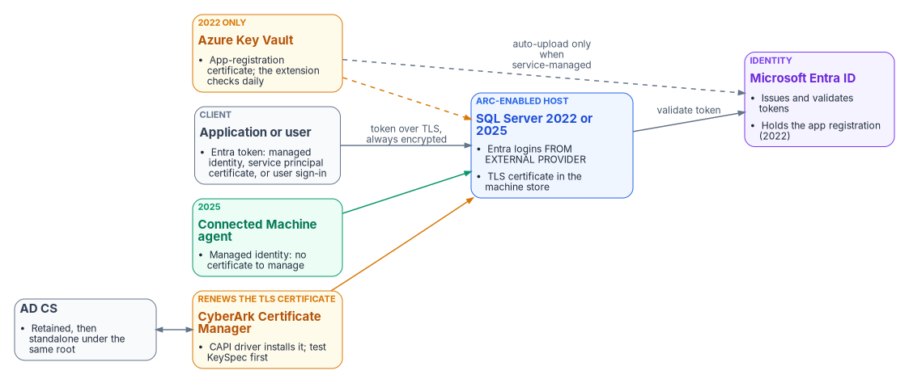
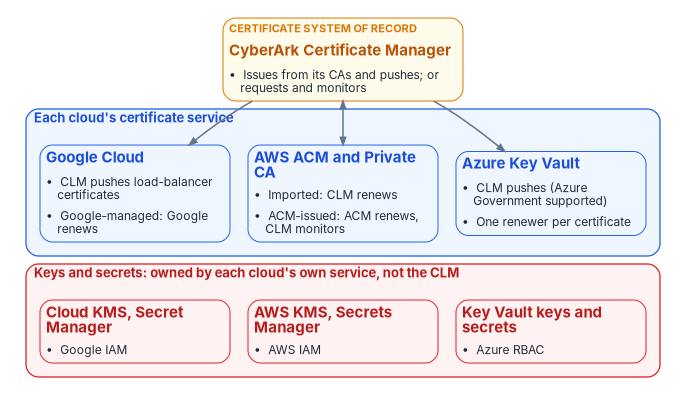
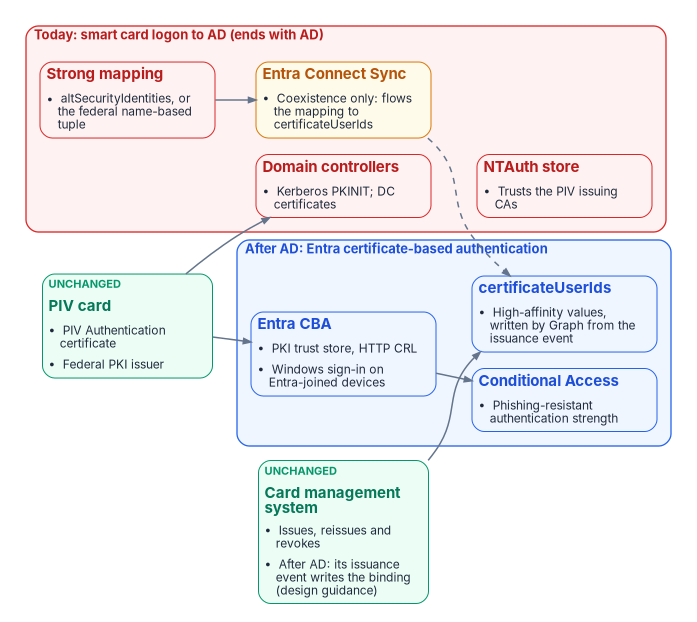
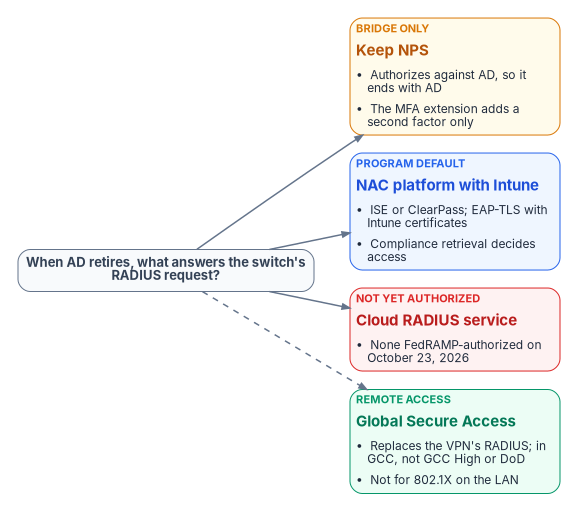

# Certificates, Tokens and Keys Across the Hybrid Estate {.unnumbered}

Active Directory does more credential work than its name suggests. It trusts the PIV card's issuer, maps each card to an account, hands out Kerberos tickets to SQL Server, autoenrolls the certificates domain controllers and servers carry, and answers the network's RADIUS questions through NPS. As the estate moves to Entra ID, Intune and Azure Arc, each of those jobs needs a new owner, and some of the new owners are not obvious. This explainer follows four paths (SQL Server, the clouds' key vaults, the PIV card, and network access) through three stages: **today**, with AD at the center; **coexistence**, with AD and the cloud running side by side; and **after AD**. A fifth part brings the results together into one table of who issues and who renews each credential.

It builds on [Book 07 — PKI & Certificates](../books/b07-pki/index.md), which decides the issuers and makes CyberArk Certificate Manager (the CLM) the system of record for every certificate Intune and the PIV system don't manage, and on [Book 07, Appendix C](../books/b07-pki/appendix-c-anatomy-of-the-clm-platform.md), which describes the platform itself.

## Watch or download



| Edition | File |
|---|---|
| Deck | [Research_Hybrid_Credentials.pptx](https://github.com/WhalerMike/modernization-workbook/releases/download/edition-2026.10/Research_Hybrid_Credentials.pptx) |
| Narrated, self-running (about 11 minutes, captions) | [Research_Hybrid_Credentials_Narrated.pptx](https://github.com/WhalerMike/modernization-workbook/releases/download/edition-2026.10/Research_Hybrid_Credentials_Narrated.pptx) |
| Narration script and caption track | [Script](https://github.com/WhalerMike/modernization-workbook/blob/main/presentations/research-hybrid-credentials/Research_Hybrid_Credentials_Narration_Script.md) · [Captions](https://github.com/WhalerMike/modernization-workbook/blob/main/presentations/research-hybrid-credentials/Research_Hybrid_Credentials_Narrated.vtt) |

## The answer in brief

- **Tokens replace Kerberos; certificates don't go away.** SQL Server 2022 and later accept Entra ID tokens on premises through Azure Arc, and every Entra-authenticated connection is encrypted, so the server's TLS certificate becomes mandatory, not optional. The CLM keeps renewing it. SQL Server 2022 also needs an app-registration certificate, which Key Vault and the Arc extension can rotate on their own; SQL Server 2025 replaces it with a managed identity and leaves no certificate to manage.
- **The clouds' key vaults are not coordinated by default; the program has to decide one renewer per certificate.** The CLM pushes certificates into Azure Key Vault (including Azure Government), into AWS Certificate Manager and to Google Cloud load balancers. Each cloud can also issue and renew its own certificates. Keys and secrets stay with each cloud's own key and secret services; the CLM manages certificates only.
- **The PIV card doesn't change; AD's side of it disappears.** The card, its Federal PKI issuer and the card management system stay. What retires with AD is the NTAuth store, domain controller certificates, Kerberos smart card logon and AD's certificate mapping. Entra certificate-based authentication takes over, including Windows sign-in on Entra-joined devices, and the card-to-account binding moves to the `certificateUserIds` attribute.
- **There's no Entra RADIUS.** NPS authorizes against AD, so it ends with AD. The switch's RADIUS questions move to a network access control (NAC) platform, such as Cisco ISE or Aruba ClearPass, that admits Intune devices by certificate and checks their compliance with Intune. No cloud RADIUS service was FedRAMP-authorized on October 23, 2026. Global Secure Access replaces the VPN's RADIUS for remote access, but not 802.1X on the campus network.
- **This research changes five things in the books**, listed under [What this changed in the books](#what-this-changed-in-the-books).

## Path 1: SQL Server with Entra ID

SQL Server 2022 introduced Entra ID authentication for SQL Server on Windows and Linux on premises, through Azure Arc: the host needs the Connected Machine agent and the Azure extension for SQL Server.[^sqlov] Users and applications sign in with an Entra token instead of Kerberos. Three credentials surround the server, and each has a different owner.

{fig-alt="Diagram. A client sends an Entra token over TLS to SQL Server 2022 or 2025 on an Arc-enabled host, which validates it with Microsoft Entra ID. CyberArk Certificate Manager, fed by AD CS, installs the TLS certificate. For SQL Server 2022 only, Azure Key Vault holds the app-registration certificate, which the extension checks daily and uploads to Entra only when service-managed. For SQL Server 2025, the Connected Machine agent provides a managed identity with no certificate to manage."}

**The TLS certificate.** "Connections authenticated by Microsoft Entra ID are always encrypted"; a server with only its self-signed fallback certificate forces clients to set `TrustServerCertificate`, which gives up checking who the server is.[^sqltut][^sqlenc] So once Entra logins start, a CA-issued TLS certificate is required on every instance. It needs the Server Authentication EKU, every name clients use in its SAN, read access to its key for the service account, and a key with `KeySpec` set to `AT_KEYEXCHANGE`: Microsoft says certificates from a Key Storage Provider "use KeySpec = 0 and aren't compatible with SQL Server".[^sqlcert] The CLM installs the certificate through its CAPI driver over WinRM and can give the service account read access to the key.[^capiobj] Its documentation doesn't say whether the driver generates a legacy CSP key or a KSP key, so a CLM-renewed certificate should be proved to show `KeySpec = 1` before rollout (design guidance).

**The SQL Server 2022 app-registration certificate.** In SQL Server 2022, the instance's own Entra identity is an app registration with a certificate held in Key Vault; "the Azure Arc agent downloads the certificate to the SQL Server instance host".[^sqltut] Microsoft's automation tutorial says those certificates "aren't rotated automatically", but its newer rotation page says the extension "can automatically rotate certificates" when both the certificate and the app registration are **service-managed** and the Arc server's managed identity holds the Key Vault **Sign** permission. Key Vault then renews at 80% of the lifetime, by default. For a **customer-managed** certificate, the owner creates the new version and uploads it to the app registration; the extension checks daily and installs it within about 24 hours.[^sqlauto][^sqlrot] No CLM driver uploads a certificate to an app registration, so the CLM can watch this certificate but shouldn't be its renewer.

**The SQL Server 2025 managed identity.** SQL Server 2025 can use the Arc server's managed identity for inbound and outbound Entra authentication, and Microsoft recommends it. It needs SQL Server 2025 on Windows Server, Arc-enabled, with access to the public cloud.[^sqlmi] With it, there is no app-registration certificate at all; the agent manages the credential behind the identity. Applications on Arc-enabled servers can use that identity too, from `localhost:40342`, if they're in the local Administrators or "Hybrid Agent Extension Applications" group.[^arcmi] Applications off Azure and off Arc use a service principal with a certificate ([Book 04, Chapter 05](../books/b04-access/05-applications-and-workload-identities.md)).

**For contrast, Azure SQL Database and Managed Instance** use Microsoft's own TLS certificate, so the program owns only the client trust stores that must trust Microsoft's published roots.[^azsqlroot]

**What the program does (design guidance):** move to SQL Server 2025 with the managed identity, so the app-registration certificate disappears. Where 2022 remains, use the service-managed pattern and record it as a Key Vault-renewed certificate that the CLM monitors. The CLM renews every SQL Server TLS certificate, from retained AD CS during coexistence and from a standalone AD CS issuing CA under the same root after AD ([Book 07, Chapter 04](../books/b07-pki/04-the-target-pki.md)).

| Stage | How users and apps sign in | TLS certificate | Instance identity |
|---|---|---|---|
| Today | Windows authentication (Kerberos or NTLM); TLS optional | AD CS autoenrollment, manual, or the CLM where onboarded; or the self-signed fallback | Service account (gMSA or domain account) |
| Coexistence | Windows logins and Entra logins side by side on Arc-enabled 2022 and 2025 | Mandatory; retained AD CS through the CLM | 2022: app-registration certificate in Key Vault (Key Vault and the extension, or the app owner); 2025: managed identity (Arc agent) |
| After AD | Entra logins only; apps by managed identity or service principal certificate | Standalone AD CS under the same root, through the CLM | 2025 managed identity |

## Path 2: the clouds' key vaults

Each cloud has its own certificate service, and each can issue and renew certificates on its own. They aren't coordinated with one another or with the CLM unless the program makes them so. The rule the program needs is simple: **each certificate has exactly one renewer**, recorded in the CLM's policy folder for it (design guidance).

{fig-alt="Diagram. CyberArk Certificate Manager, the certificate system of record, sits above three cloud certificate services: Google Cloud (CLM pushes load-balancer certificates; Google-managed certificates are renewed by Google), AWS ACM and Private CA (imported certificates: the CLM renews; ACM-issued: ACM renews and the CLM monitors), and Azure Key Vault (the CLM pushes, Azure Government supported; one renewer per certificate). Below, a red band shows keys and secrets owned by each cloud's own service under its own access control, not the CLM."}

**Azure Key Vault.** A Key Vault certificate is one object with an addressable key and secret of the same name.[^kvcert] Key Vault renews automatically only for its partner CAs (DigiCert and GlobalSign, in public cloud and Azure Government) and for self-signed certificates; for any other CA, "Key Vault doesn't enroll or renew the certificate", and the workflow is a signing request merged back in.[^kvcert][^kvcsr][^kvrenew] The CLM's Azure Key Vault driver stores certificates, keys and chains in a vault, and its `Environment` setting can be `AzureUSGovernment`.[^akvschema] In Azure Government the vault endpoint is `vault.usgovcloudapi.net`, not `vault.azure.net`.[^azgov] For certificates the CLM pushes, Key Vault's own renewal action stays off, so there is one renewer. The driver authenticates with its own app-registration certificate, which the CLM should inventory with its own owner.[^azcred]

**AWS.** AWS Certificate Manager (ACM) renews the certificates it issues, but not imported certificates: "ACM does not provide managed renewal for imported certificates".[^acmrenew][^acmimport] The CLM can work either way. Its ACM driver requests certificates from ACM and AWS Private CA, and CyberArk advises leaving ACM's renewal on and widening the CLM's renewal window.[^vacm] Its AWS application driver pushes CLM-issued certificates to load balancers, CloudFront and ACM.[^vaws] So: an ACM-issued certificate is renewed by ACM and monitored by the CLM; a CLM-issued certificate imported into ACM is renewed by the CLM. ACM, AWS Private CA, KMS and Secrets Manager all run in AWS GovCloud (US).[^govacm][^govpca] The CLM's AWS driver pages don't mention the GovCloud regions or partition, so that is a vendor question.

**Google Cloud.** Certificate Manager can issue and renew Google-managed certificates, including through Google's CA Service.[^gcm] The CLM's Google Cloud load balancer driver writes classic SSL certificate resources to load balancers, and a CA Service driver lets the CLM request from Google's private CAs.[^gclb][^gcas] Google-managed certificates stay Google-renewed and outside the CLM's renewal scope.

**Keys and secrets are a different job.** CyberArk Certificate Manager manages certificates (and SSH keys); none of its driver pages manage Key Vault keys or secrets, AWS KMS keys or Secrets Manager secrets, or Google Cloud KMS keys or Secret Manager secrets. Those stay with each cloud's service under its own access control. CyberArk sells separate secrets products, Secrets Manager (formerly Conjur) and Secrets Hub, which syncs secrets into the clouds' own secret stores; choosing one is a separate decision.[^cysm][^cyshub]

The three stages don't change this path much: the cloud services were never AD-dependent. What changes is the CA behind the CLM's issued certificates, which moves from retained AD CS to the standalone issuing CA after AD.

## Path 3: PIV from AD to Entra

The PIV card is the credential that changes least. What changes is the relying party, the system that checks the card.

{fig-alt="Diagram. The PIV card and the card management system are marked unchanged. A red group, today's smart card logon to AD that ends with AD, holds domain controllers with Kerberos PKINIT and DC certificates, the NTAuth store, strong mapping, and Entra Connect Sync, which in coexistence only flows the mapping to certificateUserIds. A blue group, after AD, holds Entra certificate-based authentication with its PKI trust store and HTTP CRL and Windows sign-in on Entra-joined devices, certificateUserIds with high-affinity values written by Graph from the issuance event, and Conditional Access with phishing-resistant authentication strength."}

**Today.** For AD to accept a smart card from a non-Microsoft CA, the issuing CA must be in the forest's NTAuth store, every domain controller that authenticates smart cards needs its own domain controller certificate, and the CRL must be online.[^sc3p] Since the February 2025 update, domain controllers deny a certificate that can't be "strongly mapped", and the option to fall back ended with the September 9, 2025 update. Microsoft's SID extension protects only certificates from AD CS; "Environments that have non-Microsoft CA deployments will not be protected using the new SID extension".[^kb5014754] PIV certificates therefore need a strong `altSecurityIdentities` mapping, which IDManagement.gov recommends,[^idmscl] or the government-specific policy Microsoft added in its September 2024 update: "Allow name-based strong mappings for certificates", which accepts a name-based mapping for certificates from a named issuing CA that carry a named policy OID. Microsoft's example uses a Federal PKI policy OID.[^govmap] [Book 07, Chapter 06](../books/b07-pki/06-device-and-user-certificates.md) covers the first; this research adds the second.

**Coexistence.** Entra certificate-based authentication (CBA) checks the card against a PKI trust store of up to 250 CAs, loaded by a Privileged Authentication Administrator, and an HTTP CRL; with no CRL URL set, "an attempt to authenticate by using a revoked certificate doesn't fail".[^cbacfg] Windows sign-in with the card on hybrid-joined and Entra-joined devices is supported, for users with managed (not federated) authentication.[^cbasc] Entra finds the user by the `certificateUserIds` attribute or the UPN. For synced users, "Only Microsoft Entra Connect can be used to update certificateUserIds", typically by flowing AD's `altSecurityIdentities`; Microsoft documents no equivalent for Cloud Sync.[^cuid] Only CBA used as multifactor counts as phishing-resistant MFA.[^authstr]

A point to settle: IDManagement.gov's Entra CBA guide says "Select the Low affinity binding here", while Microsoft says administrators "should exclusively use high-affinity bindings".[^idmcba][^cbacfg] Book 07 requires high affinity: a value tied to one certificate, such as its issuer and serial number or its subject key identifier, so that another certificate with the same name can't sign in as the user.

**After AD.** The NTAuth store, domain controller certificates, Kerberos smart card logon, AD's mapping and the Connect Sync rule all go. The card, its issuer, the card management system, the Entra trust store and `certificateUserIds` stay. The binding then has to be written in the cloud. The program's design is that the card management system's issuance event writes the high-affinity value through Microsoft Graph, because that event is the only place the certificate's serial number exists before the card is first used ([Book 03, Chapter 09](../books/b03-hr-identity/09-credentials-and-certificates.md); design guidance). HR data alone can't supply it: HR knows the person, not the certificate. Microsoft doesn't document HR-driven provisioning writing this attribute.

IDManagement.gov treats Windows Hello for Business as "an alternative authenticator for use cases where using PIV is impractical", and allows enrollment that requires the PIV card first.[^idmwhfb] PIV stays the primary credential.

## Path 4: RADIUS, 802.1X and network access control

When a laptop plugs into a switch port or joins the wireless network, the switch or access point asks a RADIUS server whether to let it on (802.1X). Today that server is usually NPS, and NPS depends on AD.

{fig-alt="Diagram. The question: when AD retires, what answers the switch's RADIUS request? Four options. Keep NPS: bridge only, it authorizes against AD so it ends with AD, and the MFA extension adds a second factor only. NAC platform with Intune: the program default, ISE or ClearPass with EAP-TLS and Intune certificates, compliance retrieval decides access. Cloud RADIUS service: not yet authorized, none FedRAMP-authorized on October 23, 2026. Global Secure Access, for remote access: replaces the VPN's RADIUS in GCC, not GCC High or DoD, and is not for 802.1X on the LAN."}

**Why NPS ends with AD.** NPS reads users' dial-in properties from AD as part of authorization, so its computer account must be added to each domain's RAS servers group (Microsoft's page calls it "the RAS and NPSs group"); only an NPS *proxy*, which "does not perform authorization", can run without domain membership.[^npsplan][^npsproxy] Entra-joined devices "don't support RADIUS authentication using an on-premises computer object and certificate", so they need certificates pushed by Intune or user credentials.[^joinplan] The NPS extension for Entra multifactor authentication adds a second factor after NPS has done the primary authentication against AD; it doesn't replace AD. It also carries a credential no book listed: its setup script "Creates a self-signed certificate", valid for two years, and renewing it means rerunning the script on every NPS server.[^npsmfa]

**Microsoft doesn't offer a RADIUS service in Entra ID.** Its architecture guidance reaches RADIUS only through NPS and the extension, and recommends moving VPNs to SAML federation with Entra.[^authradius] The only direct statement found is an answer on Microsoft Q&A, a community forum: "Entra ID does not have a native RADIUS feature".[^qaradius]

**What replaces it: a NAC platform that checks Intune.** Intune's compliance retrieval service lets NAC partners, including Cisco ISE 3.1 and later and Aruba ClearPass with the Intune extension v6 and later, ask Intune whether a device is compliant. It requires certificate-based authentication with the Intune device ID in the certificate's SAN, as a URI the NAC vendor defines.[^nac] The device authenticates with EAP-TLS using its Intune certificate, the NAC looks it up in Intune, and the NAC tells the switch to admit, restrict or block it.

{fig-alt="Diagram, top to bottom. Cloud PKI or AD CS issues device certificates, which Intune renews, to an Intune-managed device carrying a SCEP or PKCS certificate with the Intune device ID in the SAN. The device and the switch or access point use EAP-TLS. The switch sends RADIUS to the NAC platform, Cisco ISE patched or ClearPass v6 and later, which sends change of authorization back and looks the device up by device ID in Intune compliance retrieval. CyberArk Certificate Manager supplies the NAC server certificate by Adaptable driver or manual CSR. A dashed line runs from the switch to NPS and the MFA extension, the bridge today, which needs AD and has its own two-year self-signed certificate."}

Two details matter. First, Cisco ISE releases before 3.1 Patch 10, 3.2 Patch 7, 3.3 Patch 4 and 3.4 Patch 1 fail certificate logins when Intune certificates carry a second URI, which they do once the SID extension is added for Microsoft's strong mapping, so ISE must be on a fixed patch.[^fn74227][^ise31] Second, the NAC platform's own server certificate is not managed by Intune, and the CLM has no driver for ISE or ClearPass.[^sysreq] ISE's documented path is a signing request and import, so the CLM renews it through an Adaptable driver that calls ISE's import, or manually.[^ise34] HPE Aruba's ClearPass pages couldn't be read for this research, so the ClearPass details rest on Microsoft's partner listing.

**Cloud RADIUS and Global Secure Access.** On the FedRAMP Marketplace data of October 23, 2026, no cloud RADIUS service is authorized; the only RADIUS-first listing is at *Initial Implementation*.[^fr] Microsoft's Global Secure Access gives remote users private-app access "without requiring a VPN", which removes the VPN's RADIUS dependency, but it's an access service, not an 802.1X server for the campus network, and it is available in GCC but not yet in GCC High or DoD.[^gsaov][^gsalim]

| Stage | What admits a device to the network | Device certificate | RADIUS server certificate |
|---|---|---|---|
| Today | NPS against AD (EAP-TLS or PEAP); VPN through NPS and the MFA extension | AD CS autoenrollment, mapped to the AD computer account | AD CS, renewed by the CLM; plus the extension's self-signed certificate (admin reruns the script every two years) |
| Coexistence | Intune devices by EAP-TLS to a NAC platform with compliance retrieval; hybrid devices still through NPS | Intune SCEP or PKCS with the device ID URI (Cloud PKI or AD CS); Intune renews | NAC server: retained AD CS, renewed by the CLM through an Adaptable driver or manually |
| After AD | The NAC platform for the LAN; Global Secure Access or a federated VPN for remote access | Cloud PKI through Intune | Standalone AD CS under the same root, renewed by the CLM |

## Path 5: who issues and who renews

The table brings the four paths together. Each cell is *issuer / renewer*. The PIV row barely changes; the domain controller and NPS rows end with AD.

| Credential | Today | Coexistence | After AD |
|---|---|---|---|
| SQL Server TLS certificate | AD CS or self-signed fallback / autoenrollment, manual or CLM | Retained AD CS / **CLM** (prove KeySpec first) | Standalone AD CS / **CLM** |
| SQL Server 2022 app-registration certificate | None (no Entra logins) | Key Vault or a chosen CA / **Key Vault and the Arc extension** (service-managed) or **app owner** (customer-managed) | Gone with SQL Server 2025's managed identity |
| SQL Server 2025 managed identity | None | Azure / **Arc agent** | Azure / **Arc agent** |
| App service principal certificates | AD CS or self-signed / app owner | Trusted CA / **app owner**; the CLM can place it in Key Vault | Same; Entra's app policy caps lifetimes ([Book 04, Chapter 05](../books/b04-access/05-applications-and-workload-identities.md)) |
| Cloud certificates: Azure Key Vault | Partner CA, self-signed, or CLM push / **Key Vault** or **CLM** | Same; one renewer each | Same |
| Cloud certificates: AWS ACM | ACM / **ACM**; imported / **CLM** | Same | Same |
| Cloud certificates: Google Cloud | Google-managed / **Google**; load balancer via CLM / **CLM** | Same | Same |
| PIV Authentication certificate | Federal PKI issuer / **card management system** | Same | Same |
| PIV binding | AD `altSecurityIdentities` or UPN / AD administrators | `certificateUserIds` / **Entra Connect Sync** | `certificateUserIds` / **issuance event through Graph** (design guidance) |
| Domain controller certificates | AD CS / **autoenrollment** (CLM watches) | Same | Gone |
| Intune device certificates | AD CS through the connector / **Intune** | Cloud PKI or AD CS / **Intune** | Cloud PKI / **Intune** |
| NPS server certificate | AD CS / **CLM** | Same while NPS remains | Gone with NPS |
| NPS MFA extension certificate | Self-signed / **NPS administrator** (two years) | Same, or a CLM-issued replacement (design guidance) | Gone with NPS |
| NAC server certificates | AD CS / manual | Retained AD CS / **CLM** (Adaptable driver or manual) | Standalone AD CS / **CLM** |
| The CLM's own Key Vault driver credential | CLM / **CLM** | Same | Same |

## What this changed in the books

- [Book 06, Chapter 10](../books/b06-data-platform/10-arc-deployment-sequencing.md): the SQL Server 2022 Key Vault certificate is rotated automatically when service-managed; only the customer-managed pattern needs the owner.
- [Book 06, Chapter 22](../books/b06-data-platform/22-where-sql-server-touches-adcs.md) and [Book 04, Chapter 05](../books/b04-access/05-applications-and-workload-identities.md): Entra ID doesn't renew certificate credentials; Key Vault and the Arc extension, or the owner, do. Book 06 Chapter 22 also adds the KeySpec test, and Book 04 Chapter 05 notes that managed identities work on Arc-enabled servers too.
- [Book 07, Chapter 06](../books/b07-pki/06-device-and-user-certificates.md): the federal name-based strong-mapping option, and why the program uses high affinity where the federal CBA guide suggests low.
- [Book 09, Chapter 07](../books/b09-network/07-network-access-control.md): the NPS extension's own two-year certificate, and the NAC server certificate path narrowed to an Adaptable driver or manual signing request.

## Status and review

**In review.** Every claim was checked against primary sources (Microsoft Learn and Microsoft Support, CyberArk's 26.1 documentation, AWS and Google Cloud documentation, IDManagement.gov, Cisco, and FedRAMP Marketplace data) on October 23, 2026. Inferences and design guidance are labeled. What couldn't be verified is listed in the deck's backup section, including whether the CLM's CAPI driver makes SQL-compatible keys, Cloud Sync and `certificateUserIds`, the CLM drivers in AWS GovCloud and Google government regions, and Aruba ClearPass's documentation. To move this explainer to **Proved**, test the KeySpec gate and the issuance-event write in a lab or pilot and record the evidence here. Comments and corrections are welcome as [issues on GitHub](https://github.com/WhalerMike/modernization-workbook/issues).

Related: [Book 07 — PKI & Certificates](../books/b07-pki/index.md), [Book 06 — Data Platform](../books/b06-data-platform/index.md), [Book 09 — Network](../books/b09-network/index.md), and the research implementation guide [Certificate Lifecycle on CyberArk Certificate Manager](cyberark-certificate-lifecycle.md).

[^sqlov]: Microsoft Learn, "Microsoft Entra authentication for SQL Server" (updated November 6, 2025), <https://learn.microsoft.com/en-us/sql/relational-databases/security/authentication-access/azure-ad-authentication-sql-server-overview>, accessed October 23, 2026.
[^sqltut]: Microsoft Learn, "Tutorial: Set up Microsoft Entra authentication for SQL Server enabled by Azure Arc" (updated November 18, 2025), <https://learn.microsoft.com/en-us/sql/sql-server/azure-arc/entra-authentication-setup-tutorial>, accessed October 23, 2026.
[^sqlenc]: Microsoft Learn, "Configure SQL Server Database Engine for encrypting connections" (updated December 2, 2025), <https://learn.microsoft.com/en-us/sql/database-engine/configure-windows/configure-sql-server-encryption>, accessed October 23, 2026.
[^sqlcert]: Microsoft Learn, "Certificate requirements for SQL Server" (updated March 3, 2026), <https://learn.microsoft.com/en-us/sql/database-engine/configure-windows/certificate-requirements>, accessed October 23, 2026.
[^capiobj]: CyberArk Certificate Manager, Self-Hosted 26.1, "CAPI application object settings", <https://docs.venafi.com/Docs/current/TopNav/Content/Drivers/r-CAPI-AppObjSettings-tpp.php>, accessed October 23, 2026; it documents key generation on the device or an HSM, but not the choice between a CSP and a KSP.
[^sqlauto]: Microsoft Learn, "Tutorial: Using automation to set up the Microsoft Entra admin for SQL Server" (updated June 19, 2026), <https://learn.microsoft.com/en-us/sql/relational-databases/security/authentication-access/azure-ad-authentication-sql-server-automation-setup-tutorial>, accessed October 23, 2026.
[^sqlrot]: Microsoft Learn, "Rotate certificates" (SQL Server enabled by Azure Arc; updated June 23, 2026), <https://learn.microsoft.com/en-us/sql/sql-server/azure-arc/rotate-certificates>, accessed October 23, 2026.
[^sqlmi]: Microsoft Learn, "Managed identity for SQL Server enabled by Azure Arc" (updated November 18, 2025), <https://learn.microsoft.com/en-us/sql/sql-server/azure-arc/managed-identity>, accessed October 23, 2026.
[^arcmi]: Microsoft Learn, "Access Azure resources by using managed identity on Azure Arc-enabled servers" (updated February 5, 2026), <https://learn.microsoft.com/en-us/azure/azure-arc/servers/managed-identity-authentication>, accessed October 23, 2026.
[^azsqlroot]: Microsoft Learn, "Understanding the changes in the Root CA change for Azure SQL Database & SQL Managed Instance", <https://learn.microsoft.com/azure/azure-sql/updates/ssl-root-certificate-expiring>, accessed October 23, 2026.
[^kvcert]: Microsoft Learn, "About Azure Key Vault certificates" (updated July 10, 2026), <https://learn.microsoft.com/en-us/azure/key-vault/certificates/about-certificates>, accessed October 23, 2026.
[^kvcsr]: Microsoft Learn, "Create and merge a certificate signing request in Key Vault" (updated July 8, 2026), <https://learn.microsoft.com/en-us/azure/key-vault/certificates/create-certificate-signing-request>, accessed October 23, 2026.
[^kvrenew]: Microsoft Learn, "Renew your Azure Key Vault certificates", <https://learn.microsoft.com/en-us/azure/key-vault/certificates/overview-renew-certificate>, accessed October 23, 2026.
[^akvschema]: CyberArk Certificate Manager, Self-Hosted 26.1, Web SDK schema reference, "Azure Key Vault" (the `Environment` attribute), <https://docs.venafi.com/Docs/current/TopNav/Content/SDK/WebSDK/SchemaReference/r-SDK-AzureKeyVault.php>, accessed October 23, 2026.
[^azgov]: Microsoft Learn, "Compare Azure Government and global Azure", <https://learn.microsoft.com/en-us/azure/azure-government/compare-azure-government-global-azure>, accessed October 23, 2026.
[^azcred]: CyberArk Certificate Manager, Self-Hosted 26.1, "Creating a certificate credential for Azure", <https://docs.venafi.com/Docs/current/TopNav/Content/Azure/t-Azure-create-cert-credential.php>, accessed October 23, 2026.
[^acmrenew]: AWS, "Managed certificate renewal in AWS Certificate Manager", <https://docs.aws.amazon.com/acm/latest/userguide/managed-renewal.html>, accessed October 23, 2026.
[^acmimport]: AWS, "Import certificates into AWS Certificate Manager", <https://docs.aws.amazon.com/acm/latest/userguide/import-certificate.html>, accessed October 23, 2026.
[^vacm]: CyberArk Certificate Manager, Self-Hosted 26.1, "Amazon AWS Certificate Manager CA template", <https://docs.venafi.com/Docs/current/TopNav/Content/Drivers/cco-Amazon-AWSCertMngr-CATemplate-about.php>, accessed October 23, 2026.
[^vaws]: CyberArk Certificate Manager, Self-Hosted 26.1, "Amazon AWS application driver", <https://docs.venafi.com/Docs/current/TopNav/Content/Drivers/r-drivers-Amazon-AWS-about.php>, accessed October 23, 2026.
[^govacm]: AWS GovCloud (US) User Guide, "AWS Certificate Manager", <https://docs.aws.amazon.com/govcloud-us/latest/UserGuide/govcloud-acm.html>, accessed October 23, 2026.
[^govpca]: AWS GovCloud (US) User Guide, "AWS Private Certificate Authority", <https://docs.aws.amazon.com/govcloud-us/latest/UserGuide/govcloud-acmpca.html>, accessed October 23, 2026.
[^gcm]: Google Cloud, "Certificate Manager overview" (updated October 20, 2026), <https://cloud.google.com/certificate-manager/docs/overview>, accessed October 23, 2026.
[^gclb]: CyberArk Certificate Manager, Self-Hosted 26.1, "Google Cloud Load Balancer", <https://docs.venafi.com/Docs/current/TopNav/Content/Drivers/cco-drivers-GoogleCloudLoadBalancer.php>, accessed October 23, 2026.
[^gcas]: CyberArk Certificate Manager, Self-Hosted 26.1, "Google Cloud CA Service configuration", <https://docs.venafi.com/Docs/current/TopNav/Content/Drivers/cco-drivers-GoogleCloud-CA-Service-configuration.php>, accessed October 23, 2026.
[^cysm]: CyberArk documentation, "Secrets Manager - Self-Hosted", <https://docs.cyberark.com/conjur-enterprise/latest/en/content/resources/_topnav/cc_home.htm>, accessed October 23, 2026.
[^cyshub]: CyberArk documentation, "Secrets Hub", <https://docs.cyberark.com/secrets-hub-privilege-cloud/latest/en/>, accessed October 23, 2026.
[^sc3p]: Microsoft Learn, "Guidelines for enabling smart card logon with third-party certification authorities" (updated February 12, 2026), <https://learn.microsoft.com/en-us/troubleshoot/windows-server/certificates-and-public-key-infrastructure-pki/enabling-smart-card-logon-third-party-certification-authorities>, accessed October 23, 2026.
[^kb5014754]: Microsoft Support, "KB5014754: Certificate-based authentication changes on Windows domain controllers", <https://support.microsoft.com/en-us/topic/kb5014754-certificate-based-authentication-changes-on-windows-domain-controllers-ad2c23b0-15d8-4340-a468-4d4f3b188f16>, accessed October 23, 2026.
[^idmscl]: IDManagement.gov, "Network Smart Card Logon for Windows", <https://www.idmanagement.gov/implement/scl-windows/>, accessed October 23, 2026.
[^govmap]: Microsoft Public Sector Blog, "Enable strong name-based mapping in government scenarios", <https://techcommunity.microsoft.com/blog/publicsectorblog/enable-strong-name-based-mapping-in-government-scenarios/4240402>, accessed October 23, 2026; KB5014754 points to it.
[^cbacfg]: Microsoft Learn, "How to configure Microsoft Entra certificate-based authentication" (updated August 15, 2025), <https://learn.microsoft.com/en-us/entra/identity/authentication/how-to-certificate-based-authentication>, accessed October 23, 2026.
[^cbasc]: Microsoft Learn, "Windows smart card sign-in using Microsoft Entra certificate-based authentication" (updated March 4, 2025), <https://learn.microsoft.com/en-us/entra/identity/authentication/concept-certificate-based-authentication-smartcard>, accessed October 23, 2026.
[^cuid]: Microsoft Learn, "Mapping to the certificateUserIds attribute in Microsoft Entra ID" (updated April 21, 2025), <https://learn.microsoft.com/en-us/entra/identity/authentication/concept-certificate-based-authentication-certificateuserids>, accessed October 23, 2026.
[^authstr]: Microsoft Learn, "Overview of Microsoft Entra authentication strengths" (updated October 24, 2025), <https://learn.microsoft.com/en-us/entra/identity/authentication/concept-authentication-strengths>, accessed October 23, 2026.
[^idmcba]: IDManagement.gov, "Certificate-Based Authentication on Microsoft Entra ID Guide", version 2.0 (March 17, 2026), <https://www.idmanagement.gov/implement/cba-azure/>, accessed October 23, 2026.
[^idmwhfb]: IDManagement.gov, "Windows Hello for Business" guide, version 1.3 (August 31, 2026), <https://www.idmanagement.gov/implement/whfb/>, accessed October 23, 2026.
[^npsplan]: Microsoft Learn, "Plan NPS as a RADIUS server" (updated March 11, 2025), <https://learn.microsoft.com/en-us/windows-server/networking/technologies/nps/nps-plan-server>, accessed October 23, 2026.
[^npsproxy]: Microsoft Learn, "Plan NPS as a RADIUS proxy", <https://learn.microsoft.com/windows-server/networking/technologies/nps/nps-plan-proxy>, accessed October 23, 2026.
[^joinplan]: Microsoft Learn, "Plan your Microsoft Entra join deployment" (updated June 17, 2026), <https://learn.microsoft.com/en-us/entra/identity/devices/device-join-plan>, accessed October 23, 2026.
[^npsmfa]: Microsoft Learn, "Integrate your existing NPS infrastructure with Microsoft Entra multifactor authentication", <https://learn.microsoft.com/en-us/entra/identity/authentication/howto-mfa-nps-extension>, accessed October 23, 2026.
[^authradius]: Microsoft Learn, "RADIUS authentication with Microsoft Entra ID", <https://learn.microsoft.com/entra/architecture/auth-radius>, accessed October 23, 2026.
[^qaradius]: Microsoft Q&A, "RADIUS feature in Entra ID" (accepted community answer, not product documentation), <https://learn.microsoft.com/answers/a/2026920>, accessed October 23, 2026.
[^nac]: Microsoft Learn, "Network access control (NAC) integration with Intune" (updated April 15, 2026), <https://learn.microsoft.com/en-us/mem/intune/protect/network-access-control-integrate>, accessed October 23, 2026.
[^fn74227]: Cisco, Field Notice FN74227 (January 8, 2025), <https://www.cisco.com/c/en/us/support/docs/field-notices/742/fn74227.html>, accessed October 23, 2026.
[^ise31]: Cisco, "Cisco ISE Administrator Guide, Release 3.1: Secure Wired Access" (MDM API version 3), <https://www.cisco.com/c/en/us/td/docs/security/ise/3-1/admin_guide/b_ise_admin_3_1/b_ISE_admin_31_secure_wired_access.html>, accessed October 23, 2026.
[^sysreq]: CyberArk Certificate Manager, Self-Hosted 26.1, "System requirements" (supported CA and provisioning drivers), <https://docs.venafi.com/Docs/current/TopNav/Content/Install/r-install-SysReq-ALLVenProducts.php>, accessed October 23, 2026.
[^ise34]: Cisco, "Cisco ISE Administrator Guide, Release 3.4: Basic Setup" (system certificates), <https://www.cisco.com/c/en/us/td/docs/security/ise/3-4/admin_guide/b_ise_admin_3_4/b_ISE_admin_basic_setup.html>, accessed October 23, 2026.
[^fr]: FedRAMP Marketplace data, <https://www.fedramp.gov/marketplace/products.json> (last change October 23, 2026, 781 products), searched for RADIUS, 802.1X and NAC offerings, accessed October 23, 2026.
[^gsaov]: Microsoft Learn, "What is Global Secure Access?" (updated April 15, 2026), <https://learn.microsoft.com/en-us/entra/global-secure-access/overview-what-is-global-secure-access>, accessed October 23, 2026.
[^gsalim]: Microsoft Learn, "Known limitations for Global Secure Access", <https://learn.microsoft.com/entra/global-secure-access/reference-current-known-limitations>, accessed October 23, 2026.
