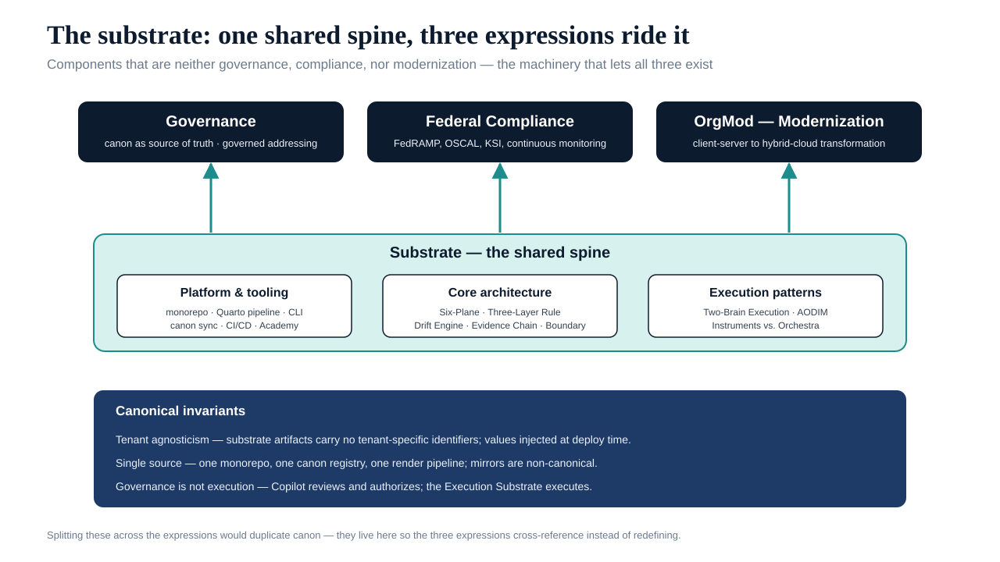
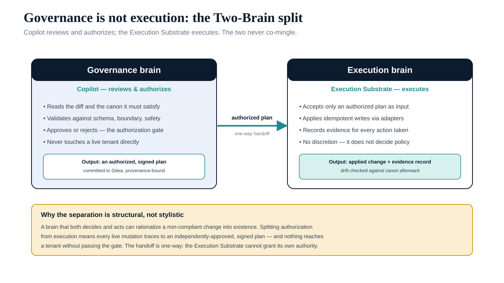

# Substrate {.unnumbered}

The **shared spine that governance, Federal Compliance, and OrgMod ride on.** These components aren't
governance, compliance, *or* modernization — they're the machinery that lets
all three exist: the monorepo, the render pipeline, the architecture
abstractions, and the execution patterns that distinguish governance from
execution.

Splitting these across the three expressions would duplicate canon. They live
here so the governance, Federal Compliance, and OrgMod pages cross-reference them instead of
redefining them.

{#fig-index-image-01 fig-alt="Diagram showing the substrate as a shared spine. Three expression boxes at the top — Governance (canon as source of truth, governed addressing), Federal Compliance (compliance: FedRAMP, OSCAL, KSI, continuous monitoring), and OrgMod (modernization: client-server to hybrid-cloud transformation) — all fed by upward arrows from a central teal Substrate band containing three sub-category cards: Platform and tooling (monorepo, Quarto pipeline, CLI, canon sync, CI/CD, Academy), Core architecture (Six-Plane, Three-Layer Rule, Drift Engine, Evidence Chain, Boundary), and Execution patterns (Two-Brain Execution, Instruments vs. Orchestra). A navy footer band lists the three canonical invariants. Engineering blueprint style, navy and teal on white, no human figures, 16:9 landscape." width="100%"}

## Sub-categories

| Section | Scope | Pages |
|---|---|---|
| [Platform & tooling](platform-tooling/index.html) | Azure Arc policy library · Active Directory survey script · Group Policy migration triage and obsolete-object audit scripts | 4 |
| [Core architecture](core-architecture/index.html) | Active-passive replication of the Git substrate · disaster recovery playbook | 2 |
| [Execution patterns](execution-patterns/index.html) | CLI and operations guide · operations runbook | 2 |

## Canonical invariants

- **Tenant agnosticism:** substrate artifacts carry no tenant-specific
  identifiers. Values are injected at deployment time.
- **Single source:** there is one monorepo, one canon registry, one render
  pipeline. Mirrors and derived copies are non-canonical.
- **Governance ≠ execution:** Copilot reviews and authorizes; the Execution
  Substrate executes. The two never co-mingle.

{#fig-index-image-02 fig-alt="Two-Brain split diagram. Left panel 'Governance brain — Copilot reviews and authorizes': reads the diff and the canon it must satisfy, validates against schema/boundary/safety, approves or rejects at the authorization gate, never touches a live tenant; output is an authorized, signed plan committed to Gitea. A one-way teal 'authorized plan' handoff arrow points to the right panel 'Execution brain — Execution Substrate executes': accepts only an authorized plan, applies idempotent writes via adapters, records evidence for every action, has no policy discretion; output is applied change plus evidence record, drift-checked afterward. An amber footer explains the separation is structural: nothing reaches a tenant without passing the gate. Engineering blueprint style, navy and teal on white, no human figures, 16:9 landscape." width="100%"}
