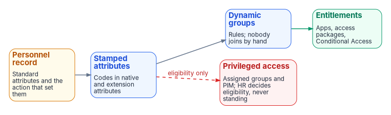

# Attribute-Driven Migration, Module 3: Keep Dynamic Rules as Code {.unnumbered}

**Learning path:** [Building the Attribute-Driven Migration](index.md) · Module 3 of 9 · 50 minutes · Guide [Gate 4](../../books/guides/attribute-driven-migration-implementation.md#gate-4-the-dynamic-group-library-and-administrative-units) · Workbook [Chapter 04](../../books/b19-developer-workbook/04-dynamic-rules-as-code.md)

**Watch:** the narrated deck for this module: [Deck](https://github.com/WhalerMike/modernization-workbook/releases/download/edition-2026.11.5/Training_ADM_Module_3.pptx) · [▶ Watch](../../presentations/watch.html?v=Training_ADM_Module_3_Narrated) (about 14 minutes, captions) · [MP4](https://github.com/WhalerMike/modernization-workbook/releases/download/videos-2026-10-23/Training_ADM_Module_3_Narrated.mp4) · [Script](https://github.com/WhalerMike/modernization-workbook/blob/main/presentations/training-adm-module-3/Training_ADM_Module_3_Narration_Script.md) · [Captions](https://github.com/WhalerMike/modernization-workbook/blob/main/presentations/training-adm-module-3/Training_ADM_Module_3_Narrated.vtt).

**Also:** the chapter's narrated tour, about 11 minutes: [▶ Watch](../../presentations/watch.html?v=DW_ADM_04_Dynamic_Rules_Narrated).

## Unit 1: Introduction

*5 minutes, with the objectives and prerequisites*

Gate 4 replaces "who sits under the Finance branch" with "who carries the Finance code." A dynamic rule is access policy: one edit can remove hundreds of people at once. So the guide asks for every rule on codes, with guards, tested against named users and shadowed before it grants anything. In this module you keep the rules as files in Git, with tests and a linter, and you see what Learn's incident samples do when a group was paused on purpose.

**The federal requirement.** A rule change is a configuration change, and its review is the evidence. From [Chapter 04's table](../../books/b19-developer-workbook/04-dynamic-rules-as-code.md#federal-requirements-and-evidence):

| Requirement | KSI | Evidence the ISSO keeps |
|---|---|---|
| AC-2; AC-3: the guards keep disabled accounts and guests out | KSI-IAM-ELP | The rule library and its fixture, in the repository |
| CM-3; CM-4 Impact Analyses: every rule passes its tests, and each change's adds and removes are listed | KSI-CMT-VTD; KSI-CMT-LMC | The pull request, with `out/check-results.json` |
| CM-3(2) Testing, Validation, and Documentation of Changes: a broken rule fails the check | KSI-CMT-VTD | The pull request's check run |
| CM-3: the incident pause records each state first, and the resume touches only what it paused (Lab 2) | KSI-CMT-LMC | `drill-manifest.json`, with the incident or drill record |
| AC-6: the session asks only for what creating groups and evaluating rules need (Lab 2) | KSI-IAM-ELP | The Entra sign-in and audit logs |

: Chapter 04's requirements, KSIs and evidence for this module {.striped .hover}

Key Security Indicators are FedRAMP 20x indicators for cloud service providers. The agency authorizes its own system and lines this evidence up with what its providers report against them; it doesn't report KSIs itself ([Book 00, Appendix B](../../books/b00-orientation/appendix-b-engagement-archetype.md)). Which output supports which control is the program's reading *(design guidance)*.

### Learning objectives

In this module, you'll:

- Describe what Learn's pause and resume samples do well, and what they leave to you.
- Write a rule as one file with an owner and tests.
- Explain the guards the linter enforces, and why it works on the parsed rule.
- Run the pull request check and read its shadow diff.
- Explain how the pause manifest keeps a resume from turning on a group paused on purpose.

### Prerequisites

- [Module 2](02-a-validation-kit-check.md), for how the VK-DG checks Gate 4 names are built.
- Optional: [Microsoft Automation, Module 2](../ms-automation-entra.md), for groups and membership through Graph.
- PowerShell 7.1 or later and Pester 5, and Git for Windows: step 3 compares the library with a git commit.

## Unit 2: The gate and what Learn's samples leave to you

*8 minutes*

Every governed rule uses one of two patterns, requires `accountEnabled`, excludes guests, and reads codes, never display names. Learn's dynamic membership processing samples (pause [all](https://learn.microsoft.com/entra/identity/users/scripts/powershell-pause-all-dynamic-membership), [all except some](https://learn.microsoft.com/entra/identity/users/scripts/powershell-pause-all-except-dynamic-membership) or [specific](https://learn.microsoft.com/entra/identity/users/scripts/powershell-pause-specific-dynamic-membership) collections; resume the [noncritical](https://learn.microsoft.com/entra/identity/users/scripts/powershell-resume-noncritical-dynamic-membership) or [specific critical](https://learn.microsoft.com/entra/identity/users/scripts/powershell-resume-specific-critical-dynamic-membership) ones) pause and resume groups in an incident, but record nothing about what they paused, and resume a group that was held for review. Read:

- The guide's [Gate 4](../../books/guides/attribute-driven-migration-implementation.md#gate-4-the-dynamic-group-library-and-administrative-units), steps 1 to 6.
- [Chapter 04: where the rules sit](../../books/b19-developer-workbook/04-dynamic-rules-as-code.md#where-the-rules-sit).
- [Chapter 04: what Learn's samples leave to you](../../books/b19-developer-workbook/04-dynamic-rules-as-code.md#what-they-leave-to-you).

{#fig-ch10-derivation-chain fig-alt="Left to right: an amber personnel record box (standard attributes and the action that set them), stamped attributes (codes in native and extension attributes), dynamic groups (rules; nobody joins by hand), and a green entitlements box (apps, access packages, Conditional Access). A dashed red arrow labelled eligibility only goes from stamped attributes to a privileged access box (assigned groups and PIM; HR decides eligibility, never standing)."}

## Unit 3: The library, the linter, the shadow diff and the pause

*10 minutes*

Each group is a JSON file with an owner, a `critical` flag and tests that name members of a fictional population. The linter applies eleven rules on the parsed rule, because a guard inside an `-or` protects nothing. The pull request check lints, tests and lists each changed rule's adds and removes. The pause manifest records every collection's state before an incident pause. Read:

- [One file per group](../../books/b19-developer-workbook/04-dynamic-rules-as-code.md#one-file-per-group).
- [Lint](../../books/b19-developer-workbook/04-dynamic-rules-as-code.md#lint).
- [The shadow diff](../../books/b19-developer-workbook/04-dynamic-rules-as-code.md#the-shadow-diff).
- [The pause manifest](../../books/b19-developer-workbook/04-dynamic-rules-as-code.md#the-pause-manifest).

## Unit 4: Exercise: Lab 1 (fixtures, no tenant)

*20 minutes*

<!-- labs:begin lab-1-commands (generated by scripts/generate_labs.py; not part of the reviewed page) -->

::: {.callout-note #lab-1-commands collapse="false" title="Every command in Lab 1"}
Every command in this lab, in order. Each step below says what it does and what to look for.

```powershell
Set-Location C:\FMWLabs\attribute-driven-migration-code\dynamic-rules

$Run = "C:\FMWLabs\results\attribute-driven-migration-03-dynamic-rules-as-code\lab1\$(Get-Date -AsUTC -Format 'yyyy-MM-ddTHHmmssZ')"
New-Item -ItemType Directory -Path $Run -Force | Out-Null
$Run

# Step 1: Lint Book 03's rule table
Import-Module ./powershell/DynamicRules.psm1
Get-Content ./tests/fixtures/book03-patterns.json -Raw | ConvertFrom-Json |
    ForEach-Object { Test-DrRule -Rule $_.membershipRule -Kind $_.kind -Group $_.pattern } |
    ForEach-Object { "$($_.Severity) $($_.Rule) $($_.Group): $($_.Issue)" }

# Step 2: Evaluate a rule against the population
$pop = Get-Content ./tests/fixtures/population.json -Raw | ConvertFrom-Json
Get-DrMembers -Population $pop -Rule '(user.accountEnabled -eq true) -and (user.userType -eq "Member") -and (user.extensionAttribute10 -eq "FIN-LED")'

# Step 3: Run the pull request check
Copy-Item -Recurse ./rules "$Run\rules"
git -C $Run init -q
git -C $Run add rules
git -C $Run -c user.name=lab -c user.email=lab@example.invalid commit -q -m "Rules as unzipped"
pwsh ./powershell/Invoke-DrLibraryCheck.ps1 -Library "$Run\rules" -BaseRef HEAD -OutputPath "$Run\check"
$LASTEXITCODE

# Step 4: Break a rule on purpose
$f = "$Run\rules\fin-led-not-contractors.json"
(Get-Content -Raw $f).Replace(' -and (user.extensionAttribute11 -ne null)', '') | Set-Content -NoNewline $f

# Step 4: Break a rule on purpose
pwsh ./powershell/Invoke-DrLibraryCheck.ps1 -Library "$Run\rules" -BaseRef HEAD -OutputPath "$Run\check-broken"
$LASTEXITCODE

# Step 4: Break a rule on purpose
(Get-Content -Raw $f).Replace('-ne \"CTR\")"', '-ne \"CTR\") -and (user.extensionAttribute11 -ne null)"') | Set-Content -NoNewline $f
git -C $Run status --short rules

# Step 5: Run the tests
Invoke-Pester ./tests

# Step 6: List your runs
Get-ChildItem C:\FMWLabs\results\attribute-driven-migration-03-dynamic-rules-as-code\lab1 -Name
```

:::

<!-- labs:end -->

You lint Book 03's rule table, evaluate a rule, run the pull request check and break a rule on purpose. These are the steps of [Chapter 04, Lab 1](../../books/b19-developer-workbook/04-dynamic-rules-as-code.md#lab-1-fixtures-no-tenant), which explains each result.

Every step runs in PowerShell 7, so you can follow it top to bottom in one window. Open **PowerShell 7** from the Start menu, then go to the kit's folder, where you unzipped it under [Get the code](index.md#get-the-code):

```powershell
Set-Location C:\FMWLabs\attribute-driven-migration-code\dynamic-rules
```

Then make this run's results folder. Its name is the date and time you start, in UTC, so each run keeps its own results and running the lab again never overwrites them:

```powershell
$Run = "C:\FMWLabs\results\attribute-driven-migration-03-dynamic-rules-as-code\lab1\$(Get-Date -AsUTC -Format 'yyyy-MM-ddTHHmmssZ')"
New-Item -ItemType Directory -Path $Run -Force | Out-Null
$Run
```

Expected output, where `<run>` is your start time, such as `2026-11-25T143005Z`:

```text
C:\FMWLabs\results\attribute-driven-migration-03-dynamic-rules-as-code\lab1\<run>
```

The run's date is only the folder's name. The rules and the population fixture stay the same, so every run's results match this page. The results folder sits outside the kit, so unzipping a newer copy of the kit never touches it.

Prefer Git Bash? Every step, the run folder included, needs PowerShell 7: type `pwsh` to start it. Steps 3 and 4 also need Git for Windows (`git --version` prints its version). In a clone of the repository, use the `examples` folder of the same name.

1. **Lint Book 03's rule table.**

   ```powershell
   Import-Module ./powershell/DynamicRules.psm1
   Get-Content ./tests/fixtures/book03-patterns.json -Raw | ConvertFrom-Json |
       ForEach-Object { Test-DrRule -Rule $_.membershipRule -Kind $_.kind -Group $_.pattern } |
       ForEach-Object { "$($_.Severity) $($_.Rule) $($_.Group): $($_.Issue)" }
   ```

   Expected output:

   ```text
   Finding DR-05 Legal employer: Rule reads a display-name attribute instead of a coded slot
   Info DR-03 Direct reports: Direct reports rule: Learn says it cannot be combined with other rules, so it carries no guards; the group must not grant access on its own
   ```

   Two rows: `DR-05` flags a display-name attribute instead of a coded slot.

2. **Evaluate a rule against the population.**

   ```powershell
   $pop = Get-Content ./tests/fixtures/population.json -Raw | ConvertFrom-Json
   Get-DrMembers -Population $pop -Rule '(user.accountEnabled -eq true) -and (user.userType -eq "Member") -and (user.extensionAttribute10 -eq "FIN-LED")'
   ```

   Expected output:

   ```text
   u01
   u02
   u06
   u08
   u09
   ```

   The guards keep out `u04` (disabled) and `u05` (a guest).

3. **Run the pull request check.** The check compares the rules with a git commit, and the zip has no history, so the first four commands copy the rules into this run's folder, make that folder a git repository and commit the rules as they are. The check reads the copy and writes its results to `$Run\check`; the last command prints its exit code.

   ```powershell
   Copy-Item -Recurse ./rules "$Run\rules"
   git -C $Run init -q
   git -C $Run add rules
   git -C $Run -c user.name=lab -c user.email=lab@example.invalid commit -q -m "Rules as unzipped"
   pwsh ./powershell/Invoke-DrLibraryCheck.ps1 -Library "$Run\rules" -BaseRef HEAD -OutputPath "$Run\check"
   $LASTEXITCODE
   ```

   Expected output (the check prints a blank line first):

   ```text
   6 rule(s); 0 finding(s), 0 warning(s); 0 changed file(s)
   0
   ```

   Exit code 0: the check passed.

4. **Break a rule on purpose.** This deletes the empty-slot clause from one rule in your copy:

   ```powershell
   $f = "$Run\rules\fin-led-not-contractors.json"
   (Get-Content -Raw $f).Replace(' -and (user.extensionAttribute11 -ne null)', '') | Set-Content -NoNewline $f
   ```

   Run the check again:

   ```powershell
   pwsh ./powershell/Invoke-DrLibraryCheck.ps1 -Library "$Run\rules" -BaseRef HEAD -OutputPath "$Run\check-broken"
   $LASTEXITCODE
   ```

   Expected: a table with two rows, `Info DR-10` and `Finding DR-11` (its text wraps to fit your window), then these last three lines:

   ```text
   fin-led-not-contractors.json (changed): adds u06; removes
   6 rule(s); 1 finding(s), 0 warning(s); 1 changed file(s)
   2
   ```

   Exit code 2. The linter notes `DR-10`, the test for `u06` fails (`DR-11`), and the shadow diff shows the change adds `u06`. Put the clause back:

   ```powershell
   (Get-Content -Raw $f).Replace('-ne \"CTR\")"', '-ne \"CTR\") -and (user.extensionAttribute11 -ne null)"') | Set-Content -NoNewline $f
   git -C $Run status --short rules
   ```

   Expected: no output from `git status`; the copy is as you committed it.

5. **Run the tests.**

   ```powershell
   Invoke-Pester ./tests
   ```

   Expected: a `[+]` line for the test file, with its time, then `Tests completed in` and the time it took, then this last line:

   ```text
   Tests Passed: 56, Failed: 0, Skipped: 1, Inconclusive: 0, NotRun: 0
   ```

   The skipped test compares the rule table with Book 03's page, which is in a clone of the repository, not in the zip; in a clone, all 57 pass.

6. **List your runs.** Nothing to clean up: the kit's folder is as you unzipped it, and this run's results, its copy of the rules and its git history stay in `$Run`. List every run you've made of this lab:

   ```powershell
   Get-ChildItem C:\FMWLabs\results\attribute-driven-migration-03-dynamic-rules-as-code\lab1 -Name
   ```

   Expected output: one line per run, oldest first, the last one this run:

   ```text
   <run>
   ```

**Check your work:** for any rule change, you can say which guard it needs, whom it adds and removes, and what an incident pause would do to it.

## Unit 5: Exercise: Lab 2 (your test tenant)

*Not timed. Not run by the authors.*

Sign in to the right cloud with the least you need, create the library's groups paused, compare the offline evaluator with Graph's beta evaluator for every test, turn processing on and shadow-diff live with VK-DG-04, and drill an incident pause and resume. Follow [Chapter 04, Lab 2](../../books/b19-developer-workbook/04-dynamic-rules-as-code.md#lab-2-test-tenant).

- **You need:** a test tenant, never production, with fictional users whose slots match the population fixture, and a Groups Administrator for the delegated session.
- **Back it out:** step 6 deletes the test groups, then lists every dynamic group and unit that isn't on, to confirm nothing is left paused that the record didn't pause before.

## Unit 6: Knowledge check

*5 minutes*

1. Learn's resume sample runs after an incident. What happens to a group that was paused for review before the incident?
   a. It stays paused.
   b. It's turned on with the rest.
   c. The sample asks first.

2. Why does the linter work on the parsed rule, not on its text?
   a. Parsing is faster.
   b. A guard inside an `-or` protects nothing, and a text search can't tell the difference.
   c. Learn requires it.

3. You delete `-and (user.extensionAttribute11 -ne null)` from a rule. What does the pull request check show?
   a. Exit 0, because the rule still parses.
   b. Exit 2: DR-10, a failed test for `u06`, and the shadow diff `adds u06`.
   c. Exit 1, because the file changed.

4. An incident responder resumes collections from the pause manifest. Which ones can it resume?
   a. Every paused collection in the tenant.
   b. Only collections this manifest paused; it refuses any other ID.
   c. Only critical collections.

::: {.callout-tip collapse="true"}
## Check your answers
1. **b.** See [what Learn's samples leave to you](../../books/b19-developer-workbook/04-dynamic-rules-as-code.md#what-they-leave-to-you).
2. **b.** See [Lint](../../books/b19-developer-workbook/04-dynamic-rules-as-code.md#lint).
3. **b.** See [the shadow diff](../../books/b19-developer-workbook/04-dynamic-rules-as-code.md#the-shadow-diff) and step 4 of the lab.
4. **b.** Critical collections can be resumed at once by ID; the rest wait. See [the pause manifest](../../books/b19-developer-workbook/04-dynamic-rules-as-code.md#the-pause-manifest).
:::

## Unit 7: Summary

*2 minutes*

You kept the rules as reviewed files with tests, linted them for the guards, saw whom a one-clause change adds, and saw why an incident pause needs a record of what was paused before.

**Evidence an ISSO keeps from this module:** the rule library and its commits, each pull request's check run and `check-results.json`; in Lab 2, the Entra audit log for the paused creation, the evaluator comparison, VK-DG-04's shadow diff and the drill manifest. Gate 4's own evidence, VK-DG-01 to 07 and the restriction decision per unit, is in the guide's [Gate 4](../../books/guides/attribute-driven-migration-implementation.md#gate-4-the-dynamic-group-library-and-administrative-units). Before shipping a rule change, work through the [Chapter 04 checklist](../../books/b19-developer-workbook/04-dynamic-rules-as-code.md#checklist).

::: {.callout-tip}
## Continue the path
[Previous: Module 2](02-a-validation-kit-check.md) · [Learning path](index.md) · [Next: Module 4, Move Group Policy as code →](04-group-policy-as-code.md)
:::
