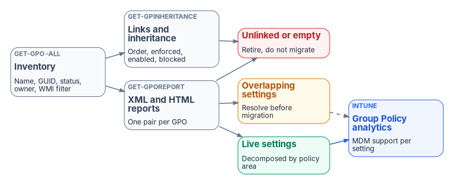

# Attribute-Driven Migration, Module 4: Move Group Policy as Code {.unnumbered}

**Learning path:** [Building the Attribute-Driven Migration](index.md) · Module 4 of 10 · 50 minutes · Guide [Gate 0](../../books/guides/attribute-driven-migration-implementation.md#gate-0-read-the-ou-tree), [Gate 5](../../books/guides/attribute-driven-migration-implementation.md#gate-5-personas-and-targeting-conventions) and [Gate 8](../../books/guides/attribute-driven-migration-implementation.md#gate-8-cut-over-and-retire-the-ou-tree) · Workbook [Chapter 06](../../books/b19-developer-workbook/06-group-policy-as-code.md)

**Watch:** the narrated deck for this module: [Deck](https://github.com/WhalerMike/modernization-workbook/releases/download/edition-2026.11.5/Training_ADM_Module_4.pptx) · [▶ Watch](../../presentations/watch.html?v=Training_ADM_Module_4_Narrated) (about 15 minutes, captions) · [MP4](https://github.com/WhalerMike/modernization-workbook/releases/download/videos-2026-10-23/Training_ADM_Module_4_Narrated.mp4) · [Script](https://github.com/WhalerMike/modernization-workbook/blob/main/presentations/training-adm-module-4/Training_ADM_Module_4_Narration_Script.md) · [Captions](https://github.com/WhalerMike/modernization-workbook/blob/main/presentations/training-adm-module-4/Training_ADM_Module_4_Narrated.vtt).

**Also:** the chapter's narrated tour, about 11 minutes: [▶ Watch](../../presentations/watch.html?v=DW_ADM_06_Group_Policy_as_Code_Narrated).

## Unit 1: Introduction

*5 minutes, with the objectives and prerequisites*

The OU tree scoped Group Policy, and Group Policy inheritance retires with it. Gate 0 splits every GPO by track, and its Validate step runs VK-INT-07 to show which GPOs Group Policy analytics has imported and how ready they are. Gate 5 moves each user-configuration setting to exactly one owner (computer settings go through the Intune guide's Gate 3, which is where this module's device settings land). Gate 8 cuts over by disabling GPO links, never deleting them. This module is the code between those gates: a plan per setting, a library of reviewed files, and a sync that creates only what a dry run showed.

**The federal requirement.** Moving Group Policy to Intune changes the baseline of every device, so the plan, the library and the sync record are configuration-management evidence. From [Chapter 06's table](../../books/b19-developer-workbook/06-group-policy-as-code.md#federal-requirements-and-evidence):

| Requirement | KSI | Evidence the ISSO keeps |
|---|---|---|
| CM-2 Baseline Configuration; CA-7: every in-scope GPO imported and ready, or listed | KSI-MLA-EVC | VK-INT-07's `Results/ValidationResults.json` |
| CM-2; CM-6: each GPO setting has a disposition, and conflicts are shown | KSI-SVC-ACM | The move plan, saved with the pull request |
| CM-3; CM-6: one owner and one decision record per setting | KSI-CMT-VTD | The library in Git, and the decision records |
| CM-3; AC-6: the sync shows what it would create, then writes only that, with read-only scope for the dry run | KSI-CMT-LMC; KSI-CMT-RMV; KSI-IAM-ELP | `out/sync-record.json` |
| CM-3; CA-7: a library that differs from the tenant stops the release | KSI-MLA-EVC; KSI-CMT-VTD | The run log and the pull request |
| SA-11; SR-3: Microsoft's sample is pinned and its behaviour tested | KSI-SCR-MIT; KSI-CMT-VTD | `snapshot.json` and `MicrosoftSamples.Tests.ps1` |

: Chapter 06's requirements, KSIs and evidence for this module {.striped .hover}

Key Security Indicators are FedRAMP 20x indicators for cloud service providers. The agency authorizes its own system and lines this evidence up with what its providers report against them; it doesn't report KSIs itself ([Book 00, Appendix B](../../books/b00-orientation/appendix-b-engagement-archetype.md)). Which output supports which control is the program's reading *(design guidance)*.

### Learning objectives

In this module, you'll:

- Explain what VK-INT-07 checks per GPO, and what the move plan adds per setting.
- Name the plan's dispositions, and what happens to a `Conflict`.
- Describe a library file: the policy body Graph receives, and the record around it.
- Run the dry run and the apply, and read the sync record.
- Explain why a `Drift` stops the release, and why the sync never sends PATCH or DELETE.

### Prerequisites

- [Module 2](02-a-validation-kit-check.md), for how VK-INT-07 is built.
- Optional: [Microsoft Automation, Module 3](../ms-automation-intune.md), for the settings catalog and Intune's v1.0 and beta APIs.
- PowerShell 7.1 or later and Pester 5.

## Unit 2: The gate and the move plan

*8 minutes*

The operator side is already written: Book 05 runs the GPO sunset, and the Intune track guide turns it into steps. VK-INT-07 works per GPO. `Get-GpcMovePlan` works per setting and gives each one a disposition. Microsoft's import sample creates a policy with one POST and never looks at the tenant first. Read:

- The guide's [Gate 0, step 5 and its Validate step](../../books/guides/attribute-driven-migration-implementation.md#gate-0-read-the-ou-tree), and [Gate 5, step 5](../../books/guides/attribute-driven-migration-implementation.md#gate-5-personas-and-targeting-conventions).
- [Chapter 06: where this sits](../../books/b19-developer-workbook/06-group-policy-as-code.md#where-this-sits), for the two rules that shape the code: one owning policy per setting, and build unassigned.
- [Chapter 06: what Microsoft's samples leave to you](../../books/b19-developer-workbook/06-group-policy-as-code.md#what-it-leaves-to-you).
- [Read: the gate and the move plan](../../books/b19-developer-workbook/06-group-policy-as-code.md#read-the-gate-and-the-move-plan).

{#fig-ch08-gpo-analysis fig-alt="Left to right. A slate card, Get-GPO -All, Inventory, records name, GUID, status, owner and WMI filter. It feeds two slate cards: Get-GPOReport, XML and HTML reports, one pair per GPO; and Get-GPInheritance, Links and inheritance, with order, enforced, enabled and blocked. Both feed a red card, Unlinked or empty, retire, do not migrate. The reports also feed an amber card, Overlapping settings, resolve before migration, and a green card, Live settings, decomposed by policy area. A blue arrow leads from live settings to a blue card, Intune, Group Policy analytics, MDM support per setting. A dashed arrow also runs from overlapping settings to Group Policy analytics."}

## Unit 3: The library, the linter and the sync

*8 minutes*

Each policy is a file: the body Graph receives, exactly as reviewed, with its owner, its source GPOs and a decision record per setting. The sync reads the tenant, normalizes both sides and gives each policy one action: `Create`, `NoChange`, `Drift` or `Duplicate`. It asks for `Read.All` for a dry run and `ReadWrite.All` only with `-Apply`. Read:

- [Write: one file per policy](../../books/b19-developer-workbook/06-group-policy-as-code.md#write-one-file-per-policy).
- [Lint](../../books/b19-developer-workbook/06-group-policy-as-code.md#lint).
- [Diff, then create](../../books/b19-developer-workbook/06-group-policy-as-code.md#diff-then-create).

## Unit 4: Exercise: Lab 1 (fixtures, no tenant)

*22 minutes*

<!-- labs:begin lab-1-commands (generated by scripts/generate_labs.py; not part of the reviewed page) -->

::: {.callout-note #lab-1-commands collapse="false" title="Every command in Lab 1"}
Every command in this lab, in order. Each step below says what it does and what to look for.

```powershell
Set-Location C:\FMWLabs\attribute-driven-migration-code\group-policy-as-code

$Run = "C:\FMWLabs\results\attribute-driven-migration-04-group-policy-as-code\lab1\$(Get-Date -AsUTC -Format 'yyyy-MM-ddTHHmmssZ')"
New-Item -ItemType Directory -Path $Run -Force | Out-Null
$Run

# Step 1: Run the gate
Set-Location C:\FMWLabs\attribute-driven-migration-code\validation-kit
Import-Module ./powershell/ValidationKit/ValidationKit.psd1
$ctx = Get-VkRunContext -FixturePath ./tests/fixtures/fail -AsOf '2026-10-29T00:00:00Z' -IncludeBeta
(Invoke-VkCheck -CheckId VK-INT-07 -Context $ctx).Details | Format-Table Severity, Object, Issue

# Step 2: Run Microsoft's import sample twice against the fake Graph
Set-Location C:\FMWLabs\attribute-driven-migration-code\group-policy-as-code
Import-Module ./powershell/GroupPolicyAsCode.psm1
. ./tests/MicrosoftSampleHarness.ps1
(Get-Content ./policies/fmp-sc-201-error-reporting-and-dumps.json -Raw | ConvertFrom-Json).policy |
    ConvertTo-Json -Depth 20 | Set-Content "$Run\sc-201.json"
$g = New-GpcFixtureInvoke -Path ./tests/fixtures/tenant.json
Invoke-MicrosoftSample -Name Import -Graph $g -Answers "$Run\sc-201.json" | Out-Null
Invoke-MicrosoftSample -Name Import -Graph $g -Answers "$Run\sc-201.json" | Out-Null
$g.Policies | ForEach-Object { $_['name'] }
$g.Calls | Format-Table Method, Uri

# Step 3: Build the move plan
$plan = Get-GpcMovePlan -Invoke (New-GpcFixtureInvoke -Path ./tests/fixtures/tenant.json).Invoke
$plan | Format-Table Gpo, Setting, Scope, Disposition

# Step 4: Lint the library against the plan
Test-GpcLibrary -Library (Read-GpcLibrary -Path ./policies) -Plan $plan |
    ForEach-Object { "$($_.Severity) $($_.Rule) $($_.File): $($_.Issue)" }

# Step 5: Run the dry run, then apply
pwsh ./powershell/Invoke-GpcSync.ps1 -FixturePath ./tests/fixtures/tenant.json -WithPlan -OutputPath "$Run\sync"
$LASTEXITCODE
pwsh ./powershell/Invoke-GpcSync.ps1 -FixturePath ./tests/fixtures/tenant.json -Apply -OutputPath "$Run\sync"
$LASTEXITCODE

# Step 5: Run the dry run, then apply
Get-Content "$Run\sync\sync-record.json" -Raw | ConvertFrom-Json | Format-List Scopes, Created
pwsh ./powershell/Invoke-GpcSync.ps1 -FixturePath ./tests/fixtures/tenant.json -WithPlan -Cloud usgov 2>&1
$LASTEXITCODE

# Step 6: Break something on purpose
Copy-Item -Recurse ./policies "$Run\policies"
$f = "$Run\policies\fmp-sc-202-sign-in-and-power.json"
(Get-Content -Raw $f).Replace('power_allowhibernate_0', 'power_allowhibernate_1') | Set-Content -NoNewline $f
pwsh ./powershell/Invoke-GpcSync.ps1 -FixturePath ./tests/fixtures/tenant.json -WithPlan -LibraryPath "$Run\policies" -OutputPath "$Run\sync-broken"
$LASTEXITCODE

# Step 6: Break something on purpose
pwsh ./powershell/Invoke-GpcSync.ps1 -FixturePath ./tests/fixtures/tenant.json -Apply -LibraryPath "$Run\policies" -OutputPath "$Run\sync-broken"
$LASTEXITCODE

# Step 7: Run the tests
Invoke-Pester ./tests

# Step 8: List your runs
Get-ChildItem C:\FMWLabs\results\attribute-driven-migration-04-group-policy-as-code\lab1 -Name
```

:::

<!-- labs:end -->

You run the gate, run Microsoft's sample twice, build the plan, lint the library, sync it, and break it on purpose. These are the steps of [Chapter 06, Lab 1](../../books/b19-developer-workbook/06-group-policy-as-code.md#lab-1-fixtures-no-tenant), which explains each result.

Every step runs in PowerShell 7, so you can follow it top to bottom in one window. Open **PowerShell 7** from the Start menu, then go to the kit's folder, where you unzipped it under [Get the code](index.md#get-the-code):

```powershell
Set-Location C:\FMWLabs\attribute-driven-migration-code\group-policy-as-code
```

Then make this run's results folder. Its name is the date and time you start, in UTC, so each run keeps its own results and running the lab again never overwrites them:

```powershell
$Run = "C:\FMWLabs\results\attribute-driven-migration-04-group-policy-as-code\lab1\$(Get-Date -AsUTC -Format 'yyyy-MM-ddTHHmmssZ')"
New-Item -ItemType Directory -Path $Run -Force | Out-Null
$Run
```

Expected output, where `<run>` is your start time, such as `2026-11-25T143005Z`:

```text
C:\FMWLabs\results\attribute-driven-migration-04-group-policy-as-code\lab1\<run>
```

The run's date is only the folder's name. The data's date is `-AsOf`, which stays the same, so every run's results match this page. The results folder sits outside the kit, so unzipping a newer copy of the kit never touches it.

Step 1 runs in the validation kit's folder, and step 2 comes back; each starts with its `Set-Location`. Prefer Git Bash? Every step, the run folder included, needs PowerShell 7: type `pwsh` to start it. In a clone of the repository, use the `examples` folders of the same names.

1. **Run the gate.** Run VK-INT-07 on the validation kit's fail fixture:

   ```powershell
   Set-Location C:\FMWLabs\attribute-driven-migration-code\validation-kit
   Import-Module ./powershell/ValidationKit/ValidationKit.psd1
   $ctx = Get-VkRunContext -FixturePath ./tests/fixtures/fail -AsOf '2026-10-29T00:00:00Z' -IncludeBeta
   (Invoke-VkCheck -CheckId VK-INT-07 -Context $ctx).Details | Format-Table Severity, Object, Issue
   ```

   Expected output:

   ```text
   Severity Object                   Issue
   -------- ------                   -----
   Info     FMP-Workstation-Baseline Imported GPO
   Finding  Workstation-Drive-Maps   Targeted in AD, migration readiness 'partial': settings Intune can't take over
   Finding  Workstation-Scripts      Targeted in AD, migration readiness 'error': settings Intune can't take over
   Warn     Workstation-Empty        Targeted in AD, readiness notApplicable: confirm where its settings go
   Finding  Workstation-Printers     In scope, but not imported into Group Policy analytics
   ```

2. **Run Microsoft's import sample twice against the fake Graph.**

   ```powershell
   Set-Location C:\FMWLabs\attribute-driven-migration-code\group-policy-as-code
   Import-Module ./powershell/GroupPolicyAsCode.psm1
   . ./tests/MicrosoftSampleHarness.ps1
   (Get-Content ./policies/fmp-sc-201-error-reporting-and-dumps.json -Raw | ConvertFrom-Json).policy |
       ConvertTo-Json -Depth 20 | Set-Content "$Run\sc-201.json"
   $g = New-GpcFixtureInvoke -Path ./tests/fixtures/tenant.json
   Invoke-MicrosoftSample -Name Import -Graph $g -Answers "$Run\sc-201.json" | Out-Null
   Invoke-MicrosoftSample -Name Import -Graph $g -Answers "$Run\sc-201.json" | Out-Null
   $g.Policies | ForEach-Object { $_['name'] }
   $g.Calls | Format-Table Method, Uri
   ```

   Expected output:

   ```text
   FMP-SC-202-Sign-in-and-power
   Contoso kiosk lockdown (portal)
   FMP-SC-201-Error-reporting-and-dumps
   FMP-SC-201-Error-reporting-and-dumps

   Method Uri
   ------ ---
   POST   https://graph.microsoft.com/beta/deviceManagement/configurationPolicies
   POST   https://graph.microsoft.com/beta/deviceManagement/configurationPolicies
   ```

   `FMP-SC-201-Error-reporting-and-dumps` is listed twice, and the calls are two `POST`s with no `GET`. The sample never looked.

3. **Build the move plan.**

   ```powershell
   $plan = Get-GpcMovePlan -Invoke (New-GpcFixtureInvoke -Path ./tests/fixtures/tenant.json).Invoke
   $plan | Format-Table Gpo, Setting, Scope, Disposition
   ```

   Expected output:

   ```text
   Gpo                      Setting                                                              Scope  Disposition
   ---                      -------                                                              -----  -----------
   FMP-Workstation-Baseline Disable Windows Error Reporting                                      device Candidate
   FMP-Workstation-Baseline Allow crash dump                                                     device Candidate
   FMP-Workstation-Baseline Allow live dump                                                      device Candidate
   FMP-Workstation-Baseline Sign-in and lock last interactive user automatically after a restart device Candidate
   FMP-Workstation-Baseline Allow hibernate                                                      device Conflict
   FMP-Workstation-Baseline Inbound rule: Contoso line-of-business app                           device EndpointSecurity
   FMP-Workstation-Baseline Configure Windows NTP Client                                         device NotSupported
   FMP-Workstation-Baseline Turn off Internet Explorer 11 First Run                              user   Deprecated
   Workstation-Power        Allow hibernate                                                      device Conflict
   Workstation-Power        Prohibit access to Control Panel and PC settings                     user   Candidate
   Workstation-Drive-Maps   Drive map H: to the home share on fs01.contoso.example               user   NotSupported
   ```

   Eleven rows from three GPOs. Five are `Candidate`. `Allow hibernate` is a `Conflict` on two rows, the firewall rule is `EndpointSecurity`, two rows are `NotSupported` and one is `Deprecated`.

4. **Lint the library against the plan.**

   ```powershell
   Test-GpcLibrary -Library (Read-GpcLibrary -Path ./policies) -Plan $plan |
       ForEach-Object { "$($_.Severity) $($_.Rule) $($_.File): $($_.Issue)" }
   ```

   Expected output:

   ```text
   Info GPC-08 fmp-sc-202-sign-in-and-power.json: Setting device_vendor_msft_policy_config_power_allowhibernate has conflicting GPO values (FMP-Workstation-Baseline=Disabled; Workstation-Power=Enabled); decision DR-0105 picks the value
   ```

   One row: the hibernate setting has conflicting GPO values, and decision `DR-0105` picks the value. (`DR-0105` is a decision record, not a dynamic-rule lint rule like Module 3's `DR-05`.)

5. **Run the dry run, then apply.** Both write their record to `$Run\sync`, and each `$LASTEXITCODE` prints the exit code of the command before it.

   ```powershell
   pwsh ./powershell/Invoke-GpcSync.ps1 -FixturePath ./tests/fixtures/tenant.json -WithPlan -OutputPath "$Run\sync"
   $LASTEXITCODE
   pwsh ./powershell/Invoke-GpcSync.ps1 -FixturePath ./tests/fixtures/tenant.json -Apply -OutputPath "$Run\sync"
   $LASTEXITCODE
   ```

   Expected output:

   ```text
   DryRun against https://graph.microsoft.com (2 library file(s))

   Severity Rule   File                              Issue
   -------- ----   ----                              -----
   Info     GPC-08 fmp-sc-202-sign-in-and-power.json Setting device_vendor_msft_policy_config_power_allowhibernate has conflicting GPO values (FMP-Workstation-Baseline=Disabled; Workstation-Power=Enabled); decision DR-0105 picks the value


   Create          FMP-SC-201-Error-reporting-and-dumps
   NoChange        FMP-SC-202-Sign-in-and-power
   0
   Apply against https://graph.microsoft.com (2 library file(s))
   Created         FMP-SC-201-Error-reporting-and-dumps
   NoChange        FMP-SC-202-Sign-in-and-power
   0
   ```

   Both exit 0. Read the record, then ask for a cloud name the script doesn't know (`2>&1` prints its error in line with the rest):

   ```powershell
   Get-Content "$Run\sync\sync-record.json" -Raw | ConvertFrom-Json | Format-List Scopes, Created
   pwsh ./powershell/Invoke-GpcSync.ps1 -FixturePath ./tests/fixtures/tenant.json -WithPlan -Cloud usgov 2>&1
   $LASTEXITCODE
   ```

   Expected output:

   ```text
   Scopes  : {DeviceManagementConfiguration.ReadWrite.All}
   Created : {00000000-0000-4000-9000-000000000001}

   Invoke-GpcSync.ps1: Cannot validate argument on parameter 'Cloud'. The argument "usgov" does not belong to the set "gcc,global" specified by the ValidateSet attribute. Supply an argument that is in the set and then try the command again.
   1
   ```

   Exit 1, because `usgov` isn't one of `gcc,global`.

6. **Break something on purpose.** The first three commands copy the library into this run's folder and change the hibernate value in one file of the copy; then run the dry run on the copy:

   ```powershell
   Copy-Item -Recurse ./policies "$Run\policies"
   $f = "$Run\policies\fmp-sc-202-sign-in-and-power.json"
   (Get-Content -Raw $f).Replace('power_allowhibernate_0', 'power_allowhibernate_1') | Set-Content -NoNewline $f
   pwsh ./powershell/Invoke-GpcSync.ps1 -FixturePath ./tests/fixtures/tenant.json -WithPlan -LibraryPath "$Run\policies" -OutputPath "$Run\sync-broken"
   $LASTEXITCODE
   ```

   Expected: the same `DryRun` line and table as the dry run in step 5, then:

   ```text
   Create          FMP-SC-201-Error-reporting-and-dumps
   Drift           FMP-SC-202-Sign-in-and-power: changes device_vendor_msft_policy_config_power_allowhibernate
   2
   ```

   Exit 2. Run it with `-Apply`:

   ```powershell
   pwsh ./powershell/Invoke-GpcSync.ps1 -FixturePath ./tests/fixtures/tenant.json -Apply -LibraryPath "$Run\policies" -OutputPath "$Run\sync-broken"
   $LASTEXITCODE
   ```

   Expected output:

   ```text
   Apply against https://graph.microsoft.com (2 library file(s))
   Create          FMP-SC-201-Error-reporting-and-dumps
   Drift           FMP-SC-202-Sign-in-and-power: changes device_vendor_msft_policy_config_power_allowhibernate
   2
   ```

   Still exit 2, and nothing is created, not even SC-201: the line says `Create`, not `Created`. The kit's own library is unchanged.

7. **Run the tests.**

   ```powershell
   Invoke-Pester ./tests
   ```

   Expected: a `[+]` line for each of the two test files, with its time, then `Tests completed in` and the time it took, then this last line:

   ```text
   Tests Passed: 46, Failed: 0, Skipped: 0, Inconclusive: 0, NotRun: 0
   ```

8. **List your runs.** Nothing to clean up: the kit's folder is as you unzipped it, and this run's results stay in `$Run`. List every run you've made of this lab:

   ```powershell
   Get-ChildItem C:\FMWLabs\results\attribute-driven-migration-04-group-policy-as-code\lab1 -Name
   ```

   Expected output: one line per run, oldest first, the last one this run:

   ```text
   <run>
   ```

**Check your work:** for any GPO setting, you can say its disposition, which library file owns it and which decision record picks its value, and what the sync would do with it.

## Unit 5: Exercise: Lab 2 (your test tenant)

*Not timed. Not run by the authors.*

Import a test GPO into Group Policy analytics, run VK-INT-07 live as a read-only operator, build the move plan live, dry-run and apply as a Policy and Profile Manager, compare the result with what Group Policy analytics' Migrate builds, and drill drift by changing a value in the admin center. Follow [Chapter 06, Lab 2](../../books/b19-developer-workbook/06-group-policy-as-code.md#lab-2-test-tenant).

<!-- labs:begin module-lab-2-commands (generated by scripts/generate_labs.py; not part of the reviewed page) -->

::: {.callout-note #module-lab-2-commands collapse="false" title="The Lab 2 commands, against your test environment"}
Every command in [Chapter 06, Lab 2](../../books/b19-developer-workbook/06-group-policy-as-code.md#lab-2-test-tenant), in order, against your test environment, never production.

Replace each `<placeholder>` with your test environment's value.

The chapter's steps say what each command does and what to look for.

```powershell
# Step 1: Import a test GPO into Group Policy analytics
New-Item -ItemType Directory -Force ./out/gpa | Out-Null
Get-GPOReport -Name '<test-gpo-name>' -ReportType Xml -Path ./out/gpa/test-gpo.xml
(Get-Item ./out/gpa/test-gpo.xml).Length -lt 4MB
Connect-MgGraph -Environment Global -TenantId <test-tenant-id> -Scopes DeviceManagementConfiguration.ReadWrite.All -NoWelcome
$file = @{ ouDistinguishedName = '<ou-distinguished-name>'; content = [Convert]::ToBase64String([IO.File]::ReadAllBytes("$PWD/out/gpa/test-gpo.xml")); roleScopeTagIds = @('<scope-tag-id>') }
Invoke-MgGraphRequest -Method POST -Uri '/beta/deviceManagement/groupPolicyMigrationReports/createMigrationReport' -Body (@{ groupPolicyObjectFile = $file } | ConvertTo-Json -Depth 5) -ContentType 'application/json'
(Invoke-MgGraphRequest -Method GET -Uri '/beta/deviceManagement/groupPolicyMigrationReports').value | Select-Object displayName, migrationReadiness

# Step 2: Run the gate live
pwsh -File ../validation-kit/Invoke-ValidationKit.ps1 -OutputPath ./out/vk -Track INT -CheckId VK-INT-07 -IncludeBeta

# Step 3: Build the move plan live
Import-Module ./powershell/GroupPolicyAsCode.psm1
Connect-MgGraph -Environment Global -Scopes DeviceManagementConfiguration.Read.All
$invoke = { param($Method, $Uri, $Body, $Headers) Invoke-MgGraphRequest -Method $Method -Uri $Uri -Body $Body -Headers $Headers }
Get-GpcMovePlan -Invoke $invoke | Export-Csv ./out/plan.csv
$planIds = (Import-Csv ./out/plan.csv).DefinitionId
(Read-GpcLibrary -Path ./policies).Policy.settings.settingInstance.settingDefinitionId | Where-Object { $_ -notin $planIds }

# Step 4: Dry run
pwsh ./powershell/Invoke-GpcSync.ps1 -Cloud gcc -TenantId <test-tenant-id> -WithPlan

# Step 5: Apply
pwsh ./powershell/Invoke-GpcSync.ps1 -Cloud gcc -TenantId <test-tenant-id> -Apply -OutputPath ./out/apply
pwsh ./powershell/Invoke-GpcSync.ps1 -Cloud gcc -TenantId <test-tenant-id> -WithPlan

# Step 6: Compare with Migrate
$both = Get-GpcTenantPolicy -Invoke $invoke -Name '<synced-policy-name>', 'Lab-Migrate-compare'
$synced = $both | Where-Object Name -EQ '<synced-policy-name>'
$migrated = $both | Where-Object Name -EQ 'Lab-Migrate-compare'
Compare-Object @($synced.Settings | ForEach-Object { ConvertTo-GpcCanonical $_.settingInstance }) @($migrated.Settings | ForEach-Object { ConvertTo-GpcCanonical $_.settingInstance })

# Step 7: Drill drift
pwsh ./powershell/Invoke-GpcSync.ps1 -Cloud gcc -TenantId <test-tenant-id> -WithPlan

# Step 8: Back it out
Connect-MgGraph -Environment Global -Scopes DeviceManagementConfiguration.ReadWrite.All
$ids = @((Get-Content ./out/apply/sync-record.json -Raw | ConvertFrom-Json).Created) + @($migrated.Id)
foreach ($id in $ids) { Invoke-MgGraphRequest -Method DELETE -Uri "/beta/deviceManagement/configurationPolicies/$id" }

# Step 8: Back it out
pwsh ./powershell/Invoke-GpcSync.ps1 -Cloud gcc -TenantId <test-tenant-id> -WithPlan
```
:::

<!-- labs:end -->

- **You need:** a test tenant with Intune licenses and a test GPO export, never production.
- **Back it out:** step 8 deletes the created policies by the IDs in `out/apply/sync-record.json`, and the Migrate comparison policy; then delete the imported GPO, as the chapter's clean-up does.

## Unit 6: Knowledge check

*5 minutes*

1. Microsoft's import sample runs twice with the same file. What happens?
   a. The second run finds the policy and does nothing.
   b. Two policies with the same name are created, because the sample never reads the tenant.
   c. The second run updates the first policy.

2. Two GPOs set the same Intune setting to different values. What disposition does the plan give it?
   a. `Candidate`.
   b. `Conflict`, and a decision record picks the value.
   c. `NotSupported`.

3. One library file differs from the tenant's copy, and you run the sync with `-Apply`. What does it create?
   a. Only the policies marked `Create`.
   b. Nothing: it exits 2 and writes nothing while any policy is `Drift`.
   c. It updates the drifted policy.

4. Which permission does a dry run ask for?
   a. `DeviceManagementConfiguration.Read.All`; `ReadWrite.All` only with `-Apply`.
   b. `DeviceManagementConfiguration.ReadWrite.All`, always.
   c. None.

::: {.callout-tip collapse="true"}
## Check your answers
1. **b.** See [what Microsoft's samples leave to you](../../books/b19-developer-workbook/06-group-policy-as-code.md#what-it-leaves-to-you) and step 2 of the lab.
2. **b.** See [Read: the gate and the move plan](../../books/b19-developer-workbook/06-group-policy-as-code.md#read-the-gate-and-the-move-plan) and steps 3 and 4 of the lab.
3. **b.** See [Diff, then create](../../books/b19-developer-workbook/06-group-policy-as-code.md#diff-then-create) and step 6 of the lab.
4. **a.** See [what Microsoft's samples leave to you](../../books/b19-developer-workbook/06-group-policy-as-code.md#what-it-leaves-to-you) and [Diff, then create](../../books/b19-developer-workbook/06-group-policy-as-code.md#diff-then-create).
:::

## Unit 7: Summary

*2 minutes*

You read Group Policy analytics into a plan per setting, kept the policies as reviewed files, and saw the sync create only what its dry run showed, and nothing at all when the library and the tenant disagree.

**Evidence an ISSO keeps from this module:** VK-INT-07's run, the move plan with each pull request, the library and its decision records in Git, `sync-record.json` with its scopes, file hashes and created IDs, and in Lab 2 the Intune audit log for the import, the creation and the drift drill. At deployment, Chapter 10 adds the GPO link states before and after, for Gates 5 and 8 ([evidence the ISSO keeps](../../books/b19-developer-workbook/10-deploying-to-test-and-production.md#evidence-the-isso-keeps)). Before shipping, work through the [Chapter 06 checklist](../../books/b19-developer-workbook/06-group-policy-as-code.md#checklist).

::: {.callout-tip}
## Continue the path
[Previous: Module 3](03-dynamic-rules-as-code.md) · [Learning path](index.md) · [Next: Module 5, Build machine configuration packages →](05-machine-configuration.md)
:::
