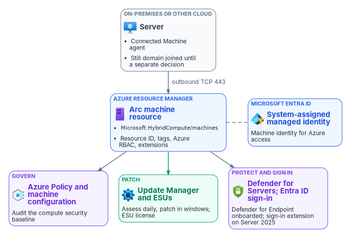

# Attribute-Driven Migration, Module 5: Build Machine Configuration Packages {.unnumbered}

**Learning path:** [Building the Attribute-Driven Migration](index.md) · Module 5 of 9 · 45 minutes · Guide [Gate 5](../../books/guides/attribute-driven-migration-implementation.md#gate-5-personas-and-targeting-conventions) · Workbook [Chapter 07](../../books/b19-developer-workbook/07-machine-configuration-packages.md)

**Watch:** the narrated deck for this module: [Deck](https://github.com/WhalerMike/modernization-workbook/releases/download/edition-2026.11.5/Training_ADM_Module_5.pptx) · [▶ Watch](../../presentations/watch.html?v=Training_ADM_Module_5_Narrated) (about 14 minutes, captions) · [MP4](https://github.com/WhalerMike/modernization-workbook/releases/download/videos-2026-10-23/Training_ADM_Module_5_Narrated.mp4) · [Script](https://github.com/WhalerMike/modernization-workbook/blob/main/presentations/training-adm-module-5/Training_ADM_Module_5_Narration_Script.md) · [Captions](https://github.com/WhalerMike/modernization-workbook/blob/main/presentations/training-adm-module-5/Training_ADM_Module_5_Narrated.vtt).

**Also:** the chapter's narrated tour, about 11 minutes: [▶ Watch](../../presentations/watch.html?v=DW_ADM_07_Machine_Configuration_Narrated).

## Unit 1: Introduction

*5 minutes, with the objectives and prerequisites*

Gate 5 sets the conventions the server track builds on: once connected, an Arc server is an Azure resource whose tags are its attributes. The Arc track and the Ansible guide add the rule that each setting has one owning tool. For the settings machine configuration owns, the code is a DSC configuration and Azure Policy delivers it. Learn's cmdlets build a package and a definition. They don't make the same bytes twice, and they write your user name and computer name into what the machines download. In this module you follow Learn's steps, then run the build that checks between them.

**The federal requirement.** A package is the server baseline in a file, so what was built, from what, and what shipped is the evidence. From [Chapter 07's table](../../books/b19-developer-workbook/07-machine-configuration-packages.md#federal-requirements-and-evidence):

| Requirement | KSI | Evidence the ISSO keeps |
|---|---|---|
| SR-3; SA-10 Developer Configuration Management: the build uses pinned module versions | KSI-SCR-MIT | The repository: `RequiredModules.psd1` |
| SA-11; CM-3(2): the package check refuses build-host data | KSI-CMT-VTD | The check output |
| SA-10; SI-7; CM-2: the same commit gives the same cleaned MOF hash, and the hashes identify what shipped | KSI-SVC-VRI; KSI-CMT-LMC | `provenance.json`, in the evidence store |
| CM-6; SI-7: the definition carries the package's `contentHash`, and Arc servers are a stated choice | KSI-SVC-ACM; KSI-SVC-VRI | The published definition |
| CM-3; CM-6: a version that didn't rise, a mode in the wrong case and an enforcing definition with no owner filter are refused | KSI-CMT-VTD | The pull request's check run |
| SI-7: the published blob is the built package, byte for byte (Lab 2) | KSI-SVC-VRI | The change record |
| AC-6; IA-5: machines read the package with their own identity, and no SAS goes in the definition (Lab 2) | KSI-IAM-ELP; KSI-IAM-SNU | The Azure role assignment record |

: Chapter 07's requirements, KSIs and evidence for this module {.striped .hover}

Key Security Indicators are FedRAMP 20x indicators for cloud service providers. The agency authorizes its own system and lines this evidence up with what its providers report against them; it doesn't report KSIs itself ([Book 00, Appendix B](../../books/b00-orientation/appendix-b-engagement-archetype.md)). Which output supports which control is the program's reading *(design guidance)*.

### Learning objectives

In this module, you'll:

- Describe a package, a policy definition and a guest assignment, and the three assignment types.
- Explain what Learn's cmdlets leave to you, and why each gap matters in a federal pipeline.
- Explain the release registry, and what MC-POL-06 and MC-POL-08 refuse.
- Run the checked build, and compare two builds' hashes.
- Explain why `IncludeArcMachines` has to be set for Arc-enabled servers.

### Prerequisites

- [Module 4](04-group-policy-as-code.md), for one owning policy per setting, and Chapter 07's rule of one owning tool per setting.
- Windows with PowerShell 7.1.3 or later and Pester 5.

## Unit 2: Where machine configuration sits

*8 minutes*

A package says what the machine should look like. A definition points at it by URI and hash. Assigning the definition creates a guest assignment on each machine in scope. The assignment type, `Audit`, `ApplyAndMonitor` or `ApplyAndAutoCorrect`, is case sensitive. Read:

- The guide's [Gate 5, step 7](../../books/guides/attribute-driven-migration-implementation.md#gate-5-personas-and-targeting-conventions): the server convention.
- [Chapter 07: where machine configuration sits](../../books/b19-developer-workbook/07-machine-configuration-packages.md#where-machine-configuration-sits).
- [Chapter 07: what Learn's cmdlets leave to you](../../books/b19-developer-workbook/07-machine-configuration-packages.md#what-it-leaves-to-you).

{#fig-ch09-arc-management-plane fig-alt="Left to right. A slate card for the on-premises or other-cloud server running the Connected Machine agent, still domain joined until a separate decision. An arrow labeled outbound TCP 443 leads to a blue card for the Azure Arc machine resource, Microsoft.HybridCompute/machines, holding resource ID, tags, Azure RBAC and extensions. Below it, a blue card for the system-assigned managed identity in Microsoft Entra ID, connected by a dashed line. From the resource, three arrows lead to three cards on the right: a violet card, Govern, Azure Policy and machine configuration audit the security baseline; a green card, Patch, Azure Update Manager and Extended Security Updates; and a violet card, Protect and sign in, Defender for Servers onboards Defender for Endpoint, and the Entra ID sign-in extension on Windows Server 2025."}

## Unit 3: The registry, the cleaner and the checks

*8 minutes*

The release registry is the reviewed record of what is in production: one fixed policy ID per configuration, its mode, the last published version, the identity and the owner tag. The cleaner rewrites the MOF into one canonical form. The package check applies seven rules, the definition check nine. Read:

- [The release registry](../../books/b19-developer-workbook/07-machine-configuration-packages.md#the-release-registry).
- [Clean the MOF](../../books/b19-developer-workbook/07-machine-configuration-packages.md#clean-the-mof).
- [Check the package](../../books/b19-developer-workbook/07-machine-configuration-packages.md#check-the-package) and [check the definition](../../books/b19-developer-workbook/07-machine-configuration-packages.md#check-the-definition).

## Unit 4: Exercise: Lab 1 (offline, no subscription)

*17 minutes*

<!-- labs:begin lab-1-commands (generated by scripts/generate_labs.py; not part of the reviewed page) -->

::: {.callout-note #lab-1-commands collapse="false" title="Every command in Lab 1"}
Every command in this lab, in order. Each step below says what it does and what to look for.

```powershell
Set-Location C:\FMWLabs\attribute-driven-migration-code\machine-configuration

$Run = "C:\FMWLabs\results\attribute-driven-migration-05-machine-configuration\lab1\$(Get-Date -AsUTC -Format 'yyyy-MM-ddTHHmmssZ')"
New-Item -ItemType Directory -Path $Run -Force | Out-Null
$Run

# Step 1: Save the pinned modules
New-Item -ItemType Directory -Path "$Run\mcmods" -Force | Out-Null
Save-Module GuestConfiguration -RequiredVersion 4.12.0 -Path "$Run\mcmods"
Save-Module PSDesiredStateConfiguration -RequiredVersion 2.0.7 -Path "$Run\mcmods"
Save-Module PSDscResources -RequiredVersion 2.12.0.0 -Path "$Run\mcmods"
$env:PSModulePath = "$Run\mcmods;" + $env:PSModulePath
Import-Module PSDesiredStateConfiguration -RequiredVersion 2.0.7
Get-ChildItem "$Run\mcmods" -Name

# Step 2: Follow Learn's steps by hand
. ./configurations/TlsServerProtocols.ps1
TlsServerProtocols -OutputPath "$Run\lab\compiled" | Out-Null
New-GuestConfigurationPackage -Name TlsServerProtocols -Configuration "$Run\lab\compiled\localhost.mof" -Type Audit -Path "$Run\lab\p1" -Force | Out-Null
New-GuestConfigurationPackage -Name TlsServerProtocols -Configuration "$Run\lab\compiled\localhost.mof" -Type Audit -Path "$Run\lab\p2" -Force | Out-Null
(Get-FileHash "$Run\lab\p1\TlsServerProtocols.zip").Hash -eq (Get-FileHash "$Run\lab\p2\TlsServerProtocols.zip").Hash

# Step 2: Follow Learn's steps by hand
Select-String -Path "$Run\lab\compiled\localhost.mof" -Pattern '@GeneratedBy|@GenerationHost|SourceInfo'

# Step 3: See what the checks say about Learn's output
Import-Module ./powershell/McPipeline.psm1
Test-McPackage -Path "$Run\lab\p1\TlsServerProtocols.zip" -Name TlsServerProtocols -ExpectedType Audit |
    ForEach-Object { "$($_.Severity) $($_.Rule) $($_.Issue)" }

# Step 4: Run Microsoft's pinned sample with the current module
Set-Location C:\FMWLabs\attribute-driven-migration-code\third_party\guest-configuration-samples\package-samples\.example-project
$env:PSModulePath = "$PWD\Modules;" + $env:PSModulePath
New-GuestConfigurationPackage -Name AdministratorsGroupMembers -Configuration ./AdministratorsGroupMembers.mof -Path "$Run\ms" -Force | Select-Object Name
Get-Command Test-GuestConfigurationPackage -ErrorAction SilentlyContinue
Set-Location C:\FMWLabs\attribute-driven-migration-code\machine-configuration

# Step 4: Run Microsoft's pinned sample with the current module
Test-McMofText -Text (Get-Content ../third_party/guest-configuration-samples/package-samples/.example-project/AdministratorsGroupMembers.mof -Raw)

# Step 5: Run the checked build
pwsh ./powershell/Invoke-McBuild.ps1 -Name TlsServerProtocols -Version 1.0.0 -ContentUri https://stcontosomc.blob.core.windows.net/machine-configuration -ModulePath "$Run\mcmods" -OutputPath "$Run\out"
$LASTEXITCODE

# Step 5: Run the checked build
Select-String -Path "$Run\out\TlsServerProtocols_1.0.0\policy\TlsServerProtocols_1.0.0_AuditIfNotExists.json" -Pattern 'contentHash|IncludeArcMachines' | ForEach-Object { $_.Line.Trim() }

# Step 5: Run the checked build
pwsh ./powershell/Invoke-McBuild.ps1 -Name TlsServerProtocols -Version 1.0.0 -ContentUri https://stcontosomc.blob.core.windows.net/machine-configuration -ModulePath "$Run\mcmods" -OutputPath "$Run\out2" | Out-Null
foreach ($o in 'out', 'out2') { $p = Get-Content "$Run\$o\TlsServerProtocols_1.0.0\provenance.json" -Raw | ConvertFrom-Json; '{0}  mof {1}' -f $o, $p.mof.sha256 }
$a = Get-Content "$Run\out\TlsServerProtocols_1.0.0\provenance.json" -Raw | ConvertFrom-Json
$b = Get-Content "$Run\out2\TlsServerProtocols_1.0.0\provenance.json" -Raw | ConvertFrom-Json
$a.package.sha256 -eq $b.package.sha256

# Step 6: Break the registry on purpose
(Get-Content -Raw ./config/releases.json).Replace('"published": "0.0.0"', '"published": "1.0.0"') | Set-Content -NoNewline "$Run\releases.json"
pwsh ./powershell/Invoke-McBuild.ps1 -Name TlsServerProtocols -Version 1.0.0 -Registry "$Run\releases.json" -ContentUri https://stcontosomc.blob.core.windows.net/machine-configuration -ModulePath "$Run\mcmods" -OutputPath "$Run\out-registry"
$LASTEXITCODE

# Step 6: Break the registry on purpose
(Get-Content -Raw "$Run\releases.json").Replace('"mode": "Audit"', '"mode": "applyAndAutoCorrect"') | Set-Content -NoNewline "$Run\releases.json"
pwsh ./powershell/Invoke-McBuild.ps1 -Name TlsServerProtocols -Version 1.0.0 -Registry "$Run\releases.json" -ContentUri https://stcontosomc.blob.core.windows.net/machine-configuration -ModulePath "$Run\mcmods" -OutputPath "$Run\out-registry" 2>&1
$LASTEXITCODE

# Step 6: Break the registry on purpose
(Get-Content -Raw "$Run\releases.json").Replace('"mode": "applyAndAutoCorrect"', '"mode": "ApplyAndAutoCorrect"') -replace ',\r?\n\s*"owner_tag": \{[^}]*\}', '' | Set-Content -NoNewline "$Run\releases.json"
pwsh ./powershell/Invoke-McBuild.ps1 -Name TlsServerProtocols -Version 1.0.0 -Registry "$Run\releases.json" -ContentUri https://stcontosomc.blob.core.windows.net/machine-configuration -ModulePath "$Run\mcmods" -OutputPath "$Run\out-registry"
$LASTEXITCODE

# Step 7: Run the tests
$env:MC_MODULE_PATH = "$Run\mcmods"
Invoke-Pester ./tests

# Step 8: List your runs
Get-ChildItem C:\FMWLabs\results\attribute-driven-migration-05-machine-configuration\lab1 -Name
```

:::

<!-- labs:end -->

You follow Learn's steps by hand, check what they produce, run the checked build twice, and refuse three bad registry entries. Nothing here signs in, uploads or installs the machine configuration agent; step 1 downloads three pinned modules from the PowerShell Gallery into this run's folder. These are the steps of [Chapter 07, Lab 1](../../books/b19-developer-workbook/07-machine-configuration-packages.md#lab-1-offline-no-subscription), which explains each result.

Every step runs in PowerShell 7 on Windows, so you can follow it top to bottom in one window. Open **PowerShell 7** from the Start menu, then go to the kit's folder, where you unzipped it under [Get the code](index.md#get-the-code):

```powershell
Set-Location C:\FMWLabs\attribute-driven-migration-code\machine-configuration
```

Then make this run's results folder. Its name is the date and time you start, in UTC, so each run keeps its own results and running the lab again never overwrites them:

```powershell
$Run = "C:\FMWLabs\results\attribute-driven-migration-05-machine-configuration\lab1\$(Get-Date -AsUTC -Format 'yyyy-MM-ddTHHmmssZ')"
New-Item -ItemType Directory -Path $Run -Force | Out-Null
$Run
```

Expected output, where `<run>` is your start time, such as `2026-11-25T143005Z`:

```text
C:\FMWLabs\results\attribute-driven-migration-05-machine-configuration\lab1\<run>
```

The run's date is only the folder's name. The configuration and the registry don't change, so every run's checks match this page. The results folder sits outside the kit, so unzipping a newer copy of the kit never touches it.

Prefer Git Bash? Every step, the run folder included, needs PowerShell 7 on Windows: type `pwsh` to start it. In a clone of the repository, use the `examples` folder of the same name.

1. **Save the pinned modules** to this run's folder rather than installing them:

   ```powershell
   New-Item -ItemType Directory -Path "$Run\mcmods" -Force | Out-Null
   Save-Module GuestConfiguration -RequiredVersion 4.12.0 -Path "$Run\mcmods"
   Save-Module PSDesiredStateConfiguration -RequiredVersion 2.0.7 -Path "$Run\mcmods"
   Save-Module PSDscResources -RequiredVersion 2.12.0.0 -Path "$Run\mcmods"
   $env:PSModulePath = "$Run\mcmods;" + $env:PSModulePath
   Import-Module PSDesiredStateConfiguration -RequiredVersion 2.0.7
   Get-ChildItem "$Run\mcmods" -Name
   ```

   Expected output:

   ```text
   GuestConfiguration
   PSDesiredStateConfiguration
   PSDscResources
   ```

2. **Follow Learn's steps by hand.** Compile the configuration and package it twice from the same MOF; the last command compares the two packages' hashes:

   ```powershell
   . ./configurations/TlsServerProtocols.ps1
   TlsServerProtocols -OutputPath "$Run\lab\compiled" | Out-Null
   New-GuestConfigurationPackage -Name TlsServerProtocols -Configuration "$Run\lab\compiled\localhost.mof" -Type Audit -Path "$Run\lab\p1" -Force | Out-Null
   New-GuestConfigurationPackage -Name TlsServerProtocols -Configuration "$Run\lab\compiled\localhost.mof" -Type Audit -Path "$Run\lab\p2" -Force | Out-Null
   (Get-FileHash "$Run\lab\p1\TlsServerProtocols.zip").Hash -eq (Get-FileHash "$Run\lab\p2\TlsServerProtocols.zip").Hash
   ```

   Expected output:

   ```text
   False
   ```

   Two packages from one MOF, with two different hashes.

   Now look inside the MOF:

   ```powershell
   Select-String -Path "$Run\lab\compiled\localhost.mof" -Pattern '@GeneratedBy|@GenerationHost|SourceInfo'
   ```

   Expected: four lines, each starting with the MOF's path and line number. Lines 3 and 5 show your user name (`@GeneratedBy`) and your computer's name (`@GenerationHost`), and lines 10 and 27 show the full path of the configuration script in every `SourceInfo`. They differ on every computer, which is why they aren't printed here.

3. **See what the checks say about Learn's output.**

   ```powershell
   Import-Module ./powershell/McPipeline.psm1
   Test-McPackage -Path "$Run\lab\p1\TlsServerProtocols.zip" -Name TlsServerProtocols -ExpectedType Audit |
       ForEach-Object { "$($_.Severity) $($_.Rule) $($_.Issue)" }
   ```

   Expected output:

   ```text
   Warn MC-PKG-07 Package name carries no version; Learn advises a version in the name, such as Name_1.0.0
   Finding MC-PKG-04 MOF carries build-host data (user, host or date); clean it with ConvertTo-McCleanMof
   Finding MC-PKG-04 MOF SourceInfo holds an absolute build path
   ```

   Three rows: two `MC-PKG-04` findings (build-host data, absolute path) and the `MC-PKG-07` warning (no version in the name).

4. **Run Microsoft's pinned sample with the current module.** The first command goes to the sample's folder and the last comes back:

   ```powershell
   Set-Location C:\FMWLabs\attribute-driven-migration-code\third_party\guest-configuration-samples\package-samples\.example-project
   $env:PSModulePath = "$PWD\Modules;" + $env:PSModulePath
   New-GuestConfigurationPackage -Name AdministratorsGroupMembers -Configuration ./AdministratorsGroupMembers.mof -Path "$Run\ms" -Force | Select-Object Name
   Get-Command Test-GuestConfigurationPackage -ErrorAction SilentlyContinue
   Set-Location C:\FMWLabs\attribute-driven-migration-code\machine-configuration
   ```

   Expected output:

   ```text
   Name : AdministratorsGroupMembers
   ```

   The package builds, and `Get-Command` prints nothing: the cmdlet was renamed.

   Now check Microsoft's published MOF:

   ```powershell
   Test-McMofText -Text (Get-Content ../third_party/guest-configuration-samples/package-samples/.example-project/AdministratorsGroupMembers.mof -Raw)
   ```

   Expected: no output. Microsoft's published MOF carries no build-host data, the form the cleaner produces.

5. **Run the checked build** into this run's folder.

   ```powershell
   pwsh ./powershell/Invoke-McBuild.ps1 -Name TlsServerProtocols -Version 1.0.0 -ContentUri https://stcontosomc.blob.core.windows.net/machine-configuration -ModulePath "$Run\mcmods" -OutputPath "$Run\out"
   $LASTEXITCODE
   ```

   Expected: a table with one information row, `MC-POL-09`: `IncludeArcMachines` defaults to false (its text wraps to fit your window). Then a line that starts `TlsServerProtocols_1.0.0: package` and the first 12 characters of this build's package hash, and ends `policy TlsServerProtocols_1.0.0_AuditIfNotExists.json; 0 finding(s), 0 warning(s), 1 info`, then the exit code:

   ```text
   0
   ```

   Each build's package hash is different, because the package records when it was built.

   Find `contentHash` and that parameter in the definition:

   ```powershell
   Select-String -Path "$Run\out\TlsServerProtocols_1.0.0\policy\TlsServerProtocols_1.0.0_AuditIfNotExists.json" -Pattern 'contentHash|IncludeArcMachines' | ForEach-Object { $_.Line.Trim() }
   ```

   Expected: three lines, `"contentHash": "` followed by this build's package hash, then `"IncludeArcMachines": {` and `"value": "[parameters('IncludeArcMachines')]",`.

   Build again into `out2`, and compare the two `provenance.json` files:

   ```powershell
   pwsh ./powershell/Invoke-McBuild.ps1 -Name TlsServerProtocols -Version 1.0.0 -ContentUri https://stcontosomc.blob.core.windows.net/machine-configuration -ModulePath "$Run\mcmods" -OutputPath "$Run\out2" | Out-Null
   foreach ($o in 'out', 'out2') { $p = Get-Content "$Run\$o\TlsServerProtocols_1.0.0\provenance.json" -Raw | ConvertFrom-Json; '{0}  mof {1}' -f $o, $p.mof.sha256 }
   $a = Get-Content "$Run\out\TlsServerProtocols_1.0.0\provenance.json" -Raw | ConvertFrom-Json
   $b = Get-Content "$Run\out2\TlsServerProtocols_1.0.0\provenance.json" -Raw | ConvertFrom-Json
   $a.package.sha256 -eq $b.package.sha256
   ```

   Expected output:

   ```text
   out  mof ec00dacc30bdff11f1a0711521ee11c426a2c1ef5abfe4d925e66d9da92d0663
   out2  mof ec00dacc30bdff11f1a0711521ee11c426a2c1ef5abfe4d925e66d9da92d0663
   False
   ```

   The `mof` hashes match, and the package hashes don't.

6. **Break the registry on purpose.** The first command writes a copy of the registry with `published` raised to `1.0.0`; the build reads the copy and writes to `$Run\out-registry`:

   ```powershell
   (Get-Content -Raw ./config/releases.json).Replace('"published": "0.0.0"', '"published": "1.0.0"') | Set-Content -NoNewline "$Run\releases.json"
   pwsh ./powershell/Invoke-McBuild.ps1 -Name TlsServerProtocols -Version 1.0.0 -Registry "$Run\releases.json" -ContentUri https://stcontosomc.blob.core.windows.net/machine-configuration -ModulePath "$Run\mcmods" -OutputPath "$Run\out-registry"
   $LASTEXITCODE
   ```

   Expected: a table with a `Finding` row, `MC-POL-06 Version 1.0.0 is not greater than the published 1.0.0`, and the `MC-POL-09` information row; then a line that starts `TlsServerProtocols_1.0.0: package` and ends `1 finding(s), 0 warning(s), 1 info`, then the exit code:

   ```text
   2
   ```

   Now give the mode the wrong case:

   ```powershell
   (Get-Content -Raw "$Run\releases.json").Replace('"mode": "Audit"', '"mode": "applyAndAutoCorrect"') | Set-Content -NoNewline "$Run\releases.json"
   pwsh ./powershell/Invoke-McBuild.ps1 -Name TlsServerProtocols -Version 1.0.0 -Registry "$Run\releases.json" -ContentUri https://stcontosomc.blob.core.windows.net/machine-configuration -ModulePath "$Run\mcmods" -OutputPath "$Run\out-registry" 2>&1
   $LASTEXITCODE
   ```

   Expected output:

   ```text
   Exception: Release entry 'TlsServerProtocols' has mode 'applyAndAutoCorrect'; expected one of Audit, ApplyAndMonitor, ApplyAndAutoCorrect (case sensitive)
   1
   ```

   Exit 1, because the mode is case sensitive.

   Fix the case, remove `owner_tag`, and build again:

   ```powershell
   (Get-Content -Raw "$Run\releases.json").Replace('"mode": "applyAndAutoCorrect"', '"mode": "ApplyAndAutoCorrect"') -replace ',\r?\n\s*"owner_tag": \{[^}]*\}', '' | Set-Content -NoNewline "$Run\releases.json"
   pwsh ./powershell/Invoke-McBuild.ps1 -Name TlsServerProtocols -Version 1.0.0 -Registry "$Run\releases.json" -ContentUri https://stcontosomc.blob.core.windows.net/machine-configuration -ModulePath "$Run\mcmods" -OutputPath "$Run\out-registry"
   $LASTEXITCODE
   ```

   Expected: a table with two `Finding` rows, `MC-POL-06` (the copy still publishes 1.0.0) and `MC-POL-08`: an enforcing definition with no owner tag filter, and the `MC-POL-09` information row; then a line that starts `TlsServerProtocols_1.0.0: package` and ends `policy TlsServerProtocols_1.0.0_DeployIfNotExists.json; 2 finding(s), 0 warning(s), 1 info`, then the exit code:

   ```text
   2
   ```

7. **Run the tests.**

   ```powershell
   $env:MC_MODULE_PATH = "$Run\mcmods"
   Invoke-Pester ./tests
   ```

   Expected: `Starting discovery in 2 files.`, the discovery and run times, then this last line:

   ```text
   Tests Passed: 65, Failed: 0, Skipped: 0, Inconclusive: 0, NotRun: 0
   ```

Without `MC_MODULE_PATH`, the 16 tests that need the saved modules are skipped.

8. **List your runs.** Nothing to clean up: the kit's folder is as you unzipped it, and this run's modules, packages and builds stay in `$Run`. List every run you've made of this lab:

   ```powershell
   Get-ChildItem C:\FMWLabs\results\attribute-driven-migration-05-machine-configuration\lab1 -Name
   ```

   Expected output: one line per run, oldest first, the last one this run:

   ```text
   <run>
   ```

**Check your work:** for any package and definition, you can say whether it was built from the reviewed source, whether it matches what the registry allows, and which hash proves what shipped.

## Unit 5: Exercise: Lab 2 (your test subscription)

*Not timed. Not run by the authors.*

Test the package on a disposable server, publish the exact bytes Lab 1 built to a storage account with anonymous access off, grant the machines read with their own identity, publish the definition under the registry's policy ID, assign it with `IncludeArcMachines` set to `true`, and read each machine's compliance against the hash in `provenance.json`. Follow [Chapter 07, Lab 2](../../books/b19-developer-workbook/07-machine-configuration-packages.md#lab-2-test-subscription-and-a-disposable-server).

- **You need:** a test subscription and a server you can rebuild, never production. Learn says local testing installs the agent and needs elevation, and remediation changes the machine it runs on.
- **Back it out:** step 8 deletes the assignment, the definition, the blob and the role assignment, then rebuilds the disposable server.

## Unit 6: Knowledge check

*5 minutes*

1. You run `New-GuestConfigurationPackage` twice on the same MOF. What do you get?
   a. Two identical packages.
   b. Two packages with different hashes, so a rebuilt package won't match the reviewed definition.
   c. An error on the second run.

2. What does MC-PKG-04 refuse?
   a. A package over 100 MB.
   b. A MOF that still carries build-host data, such as the user name, host name or full path.
   c. A package with no version in its name.

3. The registry's `mode` is `applyAndAutoCorrect`. What happens?
   a. The build accepts it.
   b. The build exits 1: the assignment type is case sensitive.
   c. The build lowers it to `Audit`.

4. You assign a definition to an Arc-enabled server and leave `IncludeArcMachines` at its default. What happens?
   a. The server is evaluated as usual.
   b. Nothing happens, and nothing says so; the build's MC-POL-09 row reminds you.
   c. The assignment fails.

::: {.callout-tip collapse="true"}
## Check your answers
1. **b.** See [what Learn's cmdlets leave to you](../../books/b19-developer-workbook/07-machine-configuration-packages.md#what-it-leaves-to-you) and step 2 of the lab.
2. **b.** See [check the package](../../books/b19-developer-workbook/07-machine-configuration-packages.md#check-the-package) and step 3 of the lab.
3. **b.** See [where machine configuration sits](../../books/b19-developer-workbook/07-machine-configuration-packages.md#where-machine-configuration-sits) and step 6 of the lab.
4. **b.** See step 5 of [Chapter 07, Lab 1](../../books/b19-developer-workbook/07-machine-configuration-packages.md#lab-1-offline-no-subscription) and step 6 of [Lab 2](../../books/b19-developer-workbook/07-machine-configuration-packages.md#lab-2-test-subscription-and-a-disposable-server).
:::

## Unit 7: Summary

*2 minutes*

You followed Learn's procedure, saw where its outputs fall short, and ran the build that makes the same MOF every time, checks the package and definition, and refuses what the registry doesn't allow.

**Evidence an ISSO keeps from this module:** both `provenance.json` files and `findings.json` in the evidence store, the registry and its pull requests, and in Lab 2 the published blob's hash, the role assignment, the definition's activity log entry and each machine's compliance against the recorded hash. Before shipping, work through the [Chapter 07 checklist](../../books/b19-developer-workbook/07-machine-configuration-packages.md#checklist).

::: {.callout-tip}
## Continue the path
[Previous: Module 4](04-group-policy-as-code.md) · [Learning path](index.md) · [Next: Module 6, Onboard servers with Ansible beside Arc →](06-ansible-beside-arc.md)
:::
