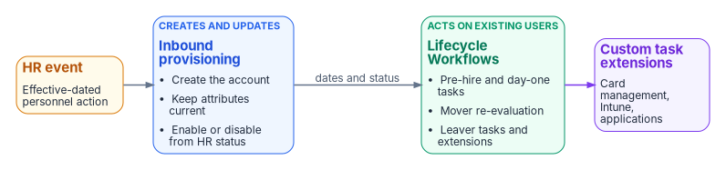

# Attribute-Driven Migration, Module 7: Extend Lifecycle Workflows {.unnumbered}

**Learning path:** [Building the Attribute-Driven Migration](index.md) · Module 7 of 9 · 50 minutes · Guide [Gate 7](../../books/guides/attribute-driven-migration-implementation.md#gate-7-prove-a-mover-across-the-tracks) and [Gate 8](../../books/guides/attribute-driven-migration-implementation.md#gate-8-cut-over-and-retire-the-ou-tree) · Workbook [Chapter 05](../../books/b19-developer-workbook/05-lifecycle-workflows-custom-extensions.md)

**Watch:** the narrated deck for this module: [Deck](https://github.com/WhalerMike/modernization-workbook/releases/download/edition-2026.11.5/Training_ADM_Module_7.pptx) · [▶ Watch](../../presentations/watch.html?v=Training_ADM_Module_7_Narrated) (about 14 minutes, captions) · [MP4](https://github.com/WhalerMike/modernization-workbook/releases/download/videos-2026-10-23/Training_ADM_Module_7_Narrated.mp4) · [Script](https://github.com/WhalerMike/modernization-workbook/blob/main/presentations/training-adm-module-7/Training_ADM_Module_7_Narration_Script.md) · [Captions](https://github.com/WhalerMike/modernization-workbook/blob/main/presentations/training-adm-module-7/Training_ADM_Module_7_Narrated.vtt).

**Also:** the chapter's narrated tour, about 12 minutes: [▶ Watch](../../presentations/watch.html?v=DW_ADM_05_Lifecycle_Extensions_Narrated).

## Unit 1: Introduction

*5 minutes, with the objectives and prerequisites*

Gate 7 proves one personnel action changes access only through the attributes, with the mover workflow's run history as evidence. Gate 8 puts leaver automation first in every wave and sizes Lifecycle Workflows for the agency. The built-in tasks cover the account. The rest of a leaver, such as the PIV credential, the devices and the servers, goes through a custom task extension that calls a Logic App. Learn's definition calls back on beta, and always says it completed. In this module you see what that costs a leaver, and run the definition that fixes it.

This module comes after Modules 4 to 6 because the path follows the gates: Chapter 05 serves Gates 7 and 8, after the Gate 5 work.

**The federal requirement.** A custom task extension carries the part of a leaver the built-in tasks don't, so its evidence is account and credential removal. From [Chapter 05's table](../../books/b19-developer-workbook/05-lifecycle-workflows-custom-extensions.md#federal-requirements-and-evidence):

| Requirement | KSI | Evidence the ISSO keeps |
|---|---|---|
| AC-2; PS-4 Personnel Termination: the callback reports what really happened, at once, and a repeat delivery has one effect | KSI-IAM-AAM | The task processing result in Lifecycle Workflows |
| CM-3(2): the program's definition passes, and retries that reach the timeout are refused | KSI-CMT-VTD | The pull request's check run |
| CM-2; CM-6; AC-3: the deployment pieces are built from the reviewed registry, SAS off and proof-of-possession on | KSI-CMT-RMV; KSI-IAM-SNU | The repository and the deployment record |
| CM-6; PS-4; AC-2: the extension read back matches the registry, and the leaver blocks before the custom task | KSI-MLA-EVC; KSI-IAM-AAM | The check output, filed with the change |
| AC-6: the callback identity holds no tenant-wide Lifecycle Workflows permission | KSI-IAM-ELP; KSI-IAM-SNU | The extension's `authorizedApps`, and the check output |
| AU-12 Audit Record Generation; AC-2: an on-demand run completes, and run history holds no personal data (Lab 2) | KSI-MLA-LET | The Logic App run history and the task processing result |

: Chapter 05's requirements, KSIs and evidence for this module {.striped .hover}

Key Security Indicators are FedRAMP 20x indicators for cloud service providers. The agency authorizes its own system and lines this evidence up with what its providers report against them; it doesn't report KSIs itself ([Book 00, Appendix B](../../books/b00-orientation/appendix-b-engagement-archetype.md)). Which output supports which control is the program's reading *(design guidance)*.

### Learning objectives

In this module, you'll:

- Describe where custom task extensions sit in Book 03's leaver, and the three rules this chapter builds in code.
- Explain what Learn's Logic App definition leaves to you.
- Run a definition for a cloud, through transient failures and repeat deliveries, and read what Lifecycle Workflows records.
- Build the deployment pieces from the registry.
- Check a workflow read-back for the leaver order.

### Prerequisites

- [Module 1](01-the-hr-middleware.md): provisioning creates and updates accounts; Lifecycle Workflows act on accounts that exist.
- Python 3.10 or later, and PowerShell 7.

## Unit 2: Where the extensions sit, and what Learn's definition leaves to you

*8 minutes*

One parameterized Logic App per integration, not one per component. Block first: *Disable user account* and *Revoke all refresh tokens for user* before the custom task. Custom tasks are idempotent and retry with a bound. Learn's definition resumes the task with a managed identity and no secret, which the program keeps; it also hard-codes the worldwide Graph host, calls back on beta, uses the callback path unchecked, and always reports completed. Read:

- The guide's [Gate 7](../../books/guides/attribute-driven-migration-implementation.md#gate-7-prove-a-mover-across-the-tracks) and [Gate 8, steps 2 and 5](../../books/guides/attribute-driven-migration-implementation.md#gate-8-cut-over-and-retire-the-ou-tree).
- [Chapter 05: where the extensions sit](../../books/b19-developer-workbook/05-lifecycle-workflows-custom-extensions.md#where-the-extensions-sit).
- [Chapter 05: what Learn's definition leaves to you](../../books/b19-developer-workbook/05-lifecycle-workflows-custom-extensions.md#what-it-leaves-to-you).

{#fig-ch08-provisioning-and-workflows fig-alt="Left to right: an amber HR event box (effective-dated personnel action); a blue inbound provisioning box (create the account, keep attributes current, enable or disable from HR status); an arrow labelled dates and status to a green Lifecycle Workflows box (pre-hire and day-one tasks, mover re-evaluation, leaver tasks and extensions); and a violet custom task extensions box (card management, Intune, applications)."}

## Unit 3: The registry, the tool, authorization and the leaver order

*8 minutes*

The registry holds one entry per integration, and the builder refuses settings outside Learn's ranges. `lcwext.py` lints, runs, builds and checks. The builder writes Learn's proof-of-possession policy with SAS off. `check-workflow` requires the block before the custom task. Read:

- [The registry](../../books/b19-developer-workbook/05-lifecycle-workflows-custom-extensions.md#the-registry).
- [Lint, run, build, check](../../books/b19-developer-workbook/05-lifecycle-workflows-custom-extensions.md#lint-run-build-check).
- [Authorization, built and checked](../../books/b19-developer-workbook/05-lifecycle-workflows-custom-extensions.md#authorization-built-and-checked).
- [The leaver order](../../books/b19-developer-workbook/05-lifecycle-workflows-custom-extensions.md#the-leaver-order).

## Unit 4: Exercise: Lab 1 (fixtures, no tenant)

*22 minutes*

<!-- labs:begin lab-1-commands (generated by scripts/generate_labs.py; not part of the reviewed page) -->

::: {.callout-note #lab-1-commands collapse="false" title="Every command in Lab 1"}
Every command in this lab, in order. Each step below says what it does and what to look for.

```powershell
Set-Location C:\FMWLabs\attribute-driven-migration-code\lifecycle-extensions

$Run = "C:\FMWLabs\results\attribute-driven-migration-07-lifecycle-workflows-extensions\lab1\$(Get-Date -AsUTC -Format 'yyyy-MM-ddTHHmmssZ')"
New-Item -ItemType Directory -Path $Run -Force | Out-Null
$Run

# Step 1: Extract and lint Learn's definition
python tools/lcwext.py learn-sample --out "$Run\learn-sample.workflow.json"
python tools/lcwext.py lint "$Run\learn-sample.workflow.json" --timeout PT1H
$LASTEXITCODE

# Step 2: Run Learn's definition for a GCC tenant
python tools/lcwext.py run "$Run\learn-sample.workflow.json" tests/fixtures/trigger-leaver.json --cloud GCC

# Step 3: Lint the program's definition
python tools/lcwext.py lint logicapp/integration.workflow.json --timeout PT1H
python tools/lcwext.py lint logicapp/integration.workflow.json --timeout PT15M
$LASTEXITCODE

# Step 4: Run it for GCC through two transient failures
python tools/lcwext.py run logicapp/integration.workflow.json tests/fixtures/trigger-leaver.json --cloud GCC --fail 503,503
python tools/lcwext.py run logicapp/integration.workflow.json tests/fixtures/trigger-leaver.json --cloud GCC --fail 503,503,503,503,503
python tools/lcwext.py run logicapp/integration.workflow.json tests/fixtures/trigger-leaver.json --cloud GCC --deliveries 2

# Step 5: Build the deployment pieces
python tools/lcwext.py build config/integrations.json --name cms-revocation --tenant-id 6e3a1f2b-8c4d-4e5f-9a0b-1c2d3e4f5a6b --out "$Run\build"

# Step 5: Build the deployment pieces
(Get-Content -Raw config/integrations.json).Replace('"azureCloud": "AzureCloud"', '"azureCloud": "AzureOther"') | Set-Content -NoNewline "$Run\integrations-other.json"
python tools/lcwext.py build "$Run\integrations-other.json" --name cms-revocation --tenant-id 6e3a1f2b-8c4d-4e5f-9a0b-1c2d3e4f5a6b --out "$Run\build-other" 2>&1
$LASTEXITCODE

# Step 6: Check the read-backs
python tools/lcwext.py check-extension config/integrations.json --name cms-revocation tests/fixtures/extension-get.json
python tools/lcwext.py check-workflow config/integrations.json --name cms-revocation --extension-id c1d2e3f4-a5b6-4c7d-8e9f-0a1b2c3d4e01 tests/fixtures/workflow-get-leaver.json

# Step 6: Check the read-backs
(Get-Content -Raw tests/fixtures/workflow-get-leaver.json).Replace('"executionSequence": 3, "displayName": "CMS', '"executionSequence": 0, "displayName": "CMS') | Set-Content -NoNewline "$Run\workflow-seq0.json"
python tools/lcwext.py check-workflow config/integrations.json --name cms-revocation --extension-id c1d2e3f4-a5b6-4c7d-8e9f-0a1b2c3d4e01 "$Run\workflow-seq0.json"
$LASTEXITCODE

# Step 7: Run the tests
python -m unittest discover -s tests -v

# Step 8: List your runs
Get-ChildItem C:\FMWLabs\results\attribute-driven-migration-07-lifecycle-workflows-extensions\lab1 -Name
```

:::

<!-- labs:end -->

You lint and run Learn's definition and the program's, build the deployment pieces, and check the read-backs. Nothing signs in. These are the steps of [Chapter 05, Lab 1](../../books/b19-developer-workbook/05-lifecycle-workflows-custom-extensions.md#lab-1-fixtures-no-tenant), which explains each result.

Every step runs in PowerShell 7, the Python commands included, so you can follow it top to bottom in one window. Open **PowerShell 7** from the Start menu, then go to the kit's folder, where you unzipped it under [Get the code](index.md#get-the-code):

```powershell
Set-Location C:\FMWLabs\attribute-driven-migration-code\lifecycle-extensions
```

Then make this run's results folder. Its name is the date and time you start, in UTC, so each run keeps its own results and running the lab again never overwrites them:

```powershell
$Run = "C:\FMWLabs\results\attribute-driven-migration-07-lifecycle-workflows-extensions\lab1\$(Get-Date -AsUTC -Format 'yyyy-MM-ddTHHmmssZ')"
New-Item -ItemType Directory -Path $Run -Force | Out-Null
$Run
```

Expected output, where `<run>` is your start time, such as `2026-11-25T143005Z`:

```text
C:\FMWLabs\results\attribute-driven-migration-07-lifecycle-workflows-extensions\lab1\<run>
```

The run's date is only the folder's name. The fixtures don't change, so every run's results match this page. The results folder sits outside the kit, so unzipping a newer copy of the kit never touches it.

Prefer Git Bash? Go to the folder with `cd /c/FMWLabs/attribute-driven-migration-code/lifecycle-extensions`, make the run folder with `Run=/c/FMWLabs/results/attribute-driven-migration-07-lifecycle-workflows-extensions/lab1/$(date -u +%Y-%m-%dT%H%M%SZ); mkdir -p "$Run"`, and the `python` commands run the same there; the lines with `$LASTEXITCODE`, `Get-Content` or `Get-ChildItem` need PowerShell 7 (type `pwsh` to start it). In a clone of the repository, use the `examples` folder of the same name.

1. **Extract and lint Learn's definition.** The first command writes Learn's definition to this run's folder; the last prints the lint's exit code.

   ```powershell
   python tools/lcwext.py learn-sample --out "$Run\learn-sample.workflow.json"
   python tools/lcwext.py lint "$Run\learn-sample.workflow.json" --timeout PT1H
   $LASTEXITCODE
   ```

   Expected output:

   ```text
   wrote C:\FMWLabs\results\attribute-driven-migration-07-lifecycle-workflows-extensions\lab1\<run>\learn-sample.workflow.json
   LX-03  Finding HTTP               hard-codes graph.microsoft.com; take the Graph host from a parameter checked against the tenant's cloud
   LX-04  Finding HTTP               calls back on /beta; resume is in v1.0
   LX-06  Finding HTTP               uses callbackUriPath without checking it first
   LX-07  Finding HTTP               no callback when the work fails; Lifecycle Workflows waits out the whole timeout
   LX-08  Finding HTTP               always reports 'Completed', whatever happened
   LX-10  Warn    manual             trigger outputs (the subject's name, UPN and email) show in run history; secure them
   LX-10  Warn    HTTP               inputs or outputs not secured in run history
   LX-11  Warn    HTTP               no explicit retryPolicy; the Default policy applies (up to 4 retries)
   8 result(s); findings
   2
   ```

   Eight results and exit 2. Five are findings: `LX-03`, `LX-04`, `LX-06`, `LX-07` and `LX-08`. Two `LX-10` warnings are for run history, and one `LX-11` warning for the implicit retry policy.

2. **Run Learn's definition for a GCC tenant.**

   ```powershell
   python tools/lcwext.py run "$Run\learn-sample.workflow.json" tests/fixtures/trigger-leaver.json --cloud GCC
   ```

   Expected output:

   ```text
   run 1: Succeeded
     POST https://graph.microsoft.com/beta/identityGovernance/lifecycleWorkflows/workflows/0d6f5b1c-3a2e-4f7d-9c1b-1e2a3b4c5d01/tasks/7a1e2b3c-4d5e-4f60-8a9b-0c1d2e3f4a01/taskProcessingResults/9b8c7d6e-5f4a-4b3c-9d2e-1f0a9b8c7d01/resume  audience=https://graph.microsoft.com  operationStatus=Completed
   downstream: 0 call(s), 0 effect(s)
   Lifecycle Workflows task: completed
   ```

   The one `POST` goes to `https://graph.microsoft.com/beta/...`.

3. **Lint the program's definition**, then with a 15-minute timeout:

   ```powershell
   python tools/lcwext.py lint logicapp/integration.workflow.json --timeout PT1H
   python tools/lcwext.py lint logicapp/integration.workflow.json --timeout PT15M
   $LASTEXITCODE
   ```

   Expected output:

   ```text
   0 result(s); no findings
   LX-11  Finding retryPolicy        worst-case retry waits (960s) reach the callback timeout PT15M
   1 result(s); findings
   2
   ```

   No findings at one hour; at 15 minutes, `LX-11` and exit 2.

4. **Run it for GCC through two transient failures**, then five, then with two deliveries:

   ```powershell
   python tools/lcwext.py run logicapp/integration.workflow.json tests/fixtures/trigger-leaver.json --cloud GCC --fail 503,503
   python tools/lcwext.py run logicapp/integration.workflow.json tests/fixtures/trigger-leaver.json --cloud GCC --fail 503,503,503,503,503
   python tools/lcwext.py run logicapp/integration.workflow.json tests/fixtures/trigger-leaver.json --cloud GCC --deliveries 2
   ```

   Expected output:

   ```text
   run 1: Succeeded
     POST https://graph.microsoft.com/v1.0/identityGovernance/lifecycleWorkflows/workflows/0d6f5b1c-3a2e-4f7d-9c1b-1e2a3b4c5d01/tasks/7a1e2b3c-4d5e-4f60-8a9b-0c1d2e3f4a01/taskProcessingResults/9b8c7d6e-5f4a-4b3c-9d2e-1f0a9b8c7d01/resume  audience=https://graph.microsoft.com  operationStatus=completed
   downstream: 3 call(s), 1 effect(s)
   Lifecycle Workflows task: completed
   run 1: Succeeded
     POST https://graph.microsoft.com/v1.0/identityGovernance/lifecycleWorkflows/workflows/0d6f5b1c-3a2e-4f7d-9c1b-1e2a3b4c5d01/tasks/7a1e2b3c-4d5e-4f60-8a9b-0c1d2e3f4a01/taskProcessingResults/9b8c7d6e-5f4a-4b3c-9d2e-1f0a9b8c7d01/resume  audience=https://graph.microsoft.com  operationStatus=failed
   downstream: 5 call(s), 0 effect(s)
   Lifecycle Workflows task: failed
   run 1: Succeeded
   run 2: Failed
     POST https://graph.microsoft.com/v1.0/identityGovernance/lifecycleWorkflows/workflows/0d6f5b1c-3a2e-4f7d-9c1b-1e2a3b4c5d01/tasks/7a1e2b3c-4d5e-4f60-8a9b-0c1d2e3f4a01/taskProcessingResults/9b8c7d6e-5f4a-4b3c-9d2e-1f0a9b8c7d01/resume  audience=https://graph.microsoft.com  operationStatus=completed
     POST https://graph.microsoft.com/v1.0/identityGovernance/lifecycleWorkflows/workflows/0d6f5b1c-3a2e-4f7d-9c1b-1e2a3b4c5d01/tasks/7a1e2b3c-4d5e-4f60-8a9b-0c1d2e3f4a01/taskProcessingResults/9b8c7d6e-5f4a-4b3c-9d2e-1f0a9b8c7d01/resume  audience=https://graph.microsoft.com  operationStatus=completed
   downstream: 2 call(s), 1 effect(s)
   Lifecycle Workflows task: completed
   ```

   The callbacks go to `https://graph.microsoft.com/v1.0/...`. With five failures the task fails at once, not at the end of the wait. With two deliveries the work is done once.

5. **Build the deployment pieces** into this run's folder.

   ```powershell
   python tools/lcwext.py build config/integrations.json --name cms-revocation --tenant-id 6e3a1f2b-8c4d-4e5f-9a0b-1c2d3e4f5a6b --out "$Run\build"
   ```

   Expected output:

   ```text
   wrote C:\FMWLabs\results\attribute-driven-migration-07-lifecycle-workflows-extensions\lab1\<run>\build\arm-cms-revocation.json
   wrote C:\FMWLabs\results\attribute-driven-migration-07-lifecycle-workflows-extensions\lab1\<run>\build\extension-cms-revocation.json
   ```

   Now copy the registry into this run's folder, set the Logic App's cloud in the copy to one Learn gives no policy values for, and build from the copy (`2>&1` prints its error in line with the rest):

   ```powershell
   (Get-Content -Raw config/integrations.json).Replace('"azureCloud": "AzureCloud"', '"azureCloud": "AzureOther"') | Set-Content -NoNewline "$Run\integrations-other.json"
   python tools/lcwext.py build "$Run\integrations-other.json" --name cms-revocation --tenant-id 6e3a1f2b-8c4d-4e5f-9a0b-1c2d3e4f5a6b --out "$Run\build-other" 2>&1
   $LASTEXITCODE
   ```

   Expected output:

   ```text
   error: cms-revocation: Learn documents the PoP policy only for Azure commercial; no values for AzureOther (research gap), so nothing is built
   1
   ```

   The build exits 1 and writes nothing.

6. **Check the read-backs.**

   ```powershell
   python tools/lcwext.py check-extension config/integrations.json --name cms-revocation tests/fixtures/extension-get.json
   python tools/lcwext.py check-workflow config/integrations.json --name cms-revocation --extension-id c1d2e3f4-a5b6-4c7d-8e9f-0a1b2c3d4e01 tests/fixtures/workflow-get-leaver.json
   ```

   Expected output:

   ```text
   0 result(s); no findings
   0 result(s); no findings
   ```

   Now move the custom task to the front of a copy of the workflow, and check the copy:

   ```powershell
   (Get-Content -Raw tests/fixtures/workflow-get-leaver.json).Replace('"executionSequence": 3, "displayName": "CMS', '"executionSequence": 0, "displayName": "CMS') | Set-Content -NoNewline "$Run\workflow-seq0.json"
   python tools/lcwext.py check-workflow config/integrations.json --name cms-revocation --extension-id c1d2e3f4-a5b6-4c7d-8e9f-0a1b2c3d4e01 "$Run\workflow-seq0.json"
   $LASTEXITCODE
   ```

   Expected output:

   ```text
   WX-03  Finding tasks              'Disable user account' doesn't run before the custom task (Book 03: block first)
   WX-03  Finding tasks              'Revoke all refresh tokens for user' doesn't run before the custom task (Book 03: block first)
   2 result(s); findings
   2
   ```

7. **Run the tests.**

   ```powershell
   python -m unittest discover -s tests -v
   ```

   Expected: one `... ok` line for each test, then the last lines are `Ran 54 tests` with the time it took, and `OK`.

8. **List your runs.** Nothing to clean up: the kit's folder is as you unzipped it, and this run's results stay in `$Run`. List every run you've made of this lab:

   ```powershell
   Get-ChildItem C:\FMWLabs\results\attribute-driven-migration-07-lifecycle-workflows-extensions\lab1 -Name
   ```

   Expected output: one line per run, oldest first, the last one this run:

   ```text
   <run>
   ```

**Check your work:** for any run of the extension, you can say where its callback goes, what Lifecycle Workflows records, and whether the leaver was blocked first.

## Unit 5: Exercise: Lab 2 (your test tenant)

*Not timed. Not run by the authors.*

Create the extension and its Logic App in the admin center, record what the admin center made and check it against the registry, replace the definition with the program's, build an on-demand test leaver workflow that blocks first, run it for one fictional user, and drill the failure path. Follow [Chapter 05, Lab 2](../../books/b19-developer-workbook/05-lifecycle-workflows-custom-extensions.md#lab-2-test-tenant).

<!-- labs:begin module-lab-2-commands (generated by scripts/generate_labs.py; not part of the reviewed page) -->

::: {.callout-note #module-lab-2-commands collapse="false" title="The Lab 2 commands, against your test environment"}
Every command in [Chapter 05, Lab 2](../../books/b19-developer-workbook/05-lifecycle-workflows-custom-extensions.md#lab-2-test-tenant), in order, against your test environment, never production.

Replace each `<placeholder>` with your test environment's value.

The chapter's steps say what each command does and what to look for.

```powershell
# Step 2: Record what the admin center made
Connect-MgGraph -Scopes 'LifecycleWorkflows.ReadWrite.All', 'Application.Read.All' -Environment Global
Invoke-MgGraphRequest -Method GET -Uri '/v1.0/identityGovernance/lifecycleWorkflows/customTaskExtensions/<extension-id>' -OutputType Json |
    Set-Content tests/fixtures/extension-get.json
python tools/lcwext.py check-extension config/integrations.json --name cms-revocation tests/fixtures/extension-get.json

# Step 2: Record what the admin center made
az rest --method get --url '/subscriptions/<subscription-id>/resourceGroups/<resource-group>/providers/Microsoft.Logic/workflows/la-lcw-cms-revocation?api-version=2016-06-01' --query properties.accessControl
python -c "import json; print(json.dumps(json.load(open('out/arm-cms-revocation.json'))['resources'][0]['properties']['accessControl'], indent=2))"
(Invoke-MgGraphRequest -Method GET -Uri "/v1.0/servicePrincipals(appId='ce79fdc4-cd1d-4ea5-8139-e74d7dbe0bb7')").displayName

# Step 4: Build a test workflow
Invoke-MgGraphRequest -Method GET -Uri '/v1.0/identityGovernance/lifecycleWorkflows/workflows/<workflow-id>?$expand=tasks' -OutputType Json |
    Set-Content workflow-get-test.json
python tools/lcwext.py check-workflow config/integrations.json --name cms-revocation --extension-id <extension-id> workflow-get-test.json
python -c "import json; p = 'config/integrations.json'; c = json.load(open(p)); c['integrations'][0]['workflows'].append({'workflowId': '<workflow-id>', 'scenario': 'leaver', 'operation': 'revoke'}); json.dump(c, open(p, 'w'), indent=2)"
python tools/lcwext.py build config/integrations.json --name cms-revocation --tenant-id <tenant-id>
```

Steps with no command, done in the portal or by hand as the chapter's step says:

- **Step 1:** Create the extension and its Logic App in the admin center
- **Step 3:** Replace the definition with the program's
- **Step 5:** Run it on demand for one fictional user
- **Step 6:** Drill the failure path
- **Step 7:** Back it out
:::

<!-- labs:end -->

- **You need:** a test tenant with Microsoft Entra ID Governance licenses and a test Azure subscription, never production; Lifecycle Workflows Administrator, and Logic App Contributor, Contributor or Owner on the resource group.
- **Back it out:** step 7 removes the custom task and the workflow, then the extension, the Logic App, the resource group, the role assignments and the test users.

## Unit 6: Knowledge check

*5 minutes*

1. Learn's definition runs for a GCC leaver. What does Lifecycle Workflows record?
   a. Completed, though nothing downstream was called.
   b. Failed, at the end of the wait.
   c. Failed at once.

2. The downstream system fails five times in a row. What does the program's definition do?
   a. It retries until the wait ends.
   b. It calls back `failed`, so the task fails at once.
   c. It calls back `completed`.

3. What does WX-03 report?
   a. The custom task runs before *Disable user account* or *Revoke all refresh tokens for user*.
   b. The extension uses a bearer token.
   c. The workflow isn't in the registry.

::: {.callout-tip collapse="true"}
## Check your answers
1. **a.** See [what Learn's definition leaves to you](../../books/b19-developer-workbook/05-lifecycle-workflows-custom-extensions.md#what-it-leaves-to-you) and step 2 of the lab.
2. **b.** See step 4 of [Chapter 05, Lab 1](../../books/b19-developer-workbook/05-lifecycle-workflows-custom-extensions.md#lab-1-fixtures-no-tenant).
3. **a.** See [the leaver order](../../books/b19-developer-workbook/05-lifecycle-workflows-custom-extensions.md#the-leaver-order) and step 6 of the lab.
:::

## Unit 7: Summary

*2 minutes*

You ran a custom task extension's definition for the right cloud, through failures and repeat deliveries, built its deployment pieces from a reviewed registry, and checked that the leaver blocks before the custom task runs.

**Evidence an ISSO keeps from this module:** the registry and the built ARM and extension files in the repository, the check output filed with the change, and in Lab 2 the task processing results, the Logic App run history, the drill record and the activity logs. Gate 7's evidence, the mover workflow's run history joined on the key, is in the guide's [Gate 7](../../books/guides/attribute-driven-migration-implementation.md#gate-7-prove-a-mover-across-the-tracks). Before shipping, work through the [Chapter 05 checklist](../../books/b19-developer-workbook/05-lifecycle-workflows-custom-extensions.md#checklist).

::: {.callout-tip}
## Continue the path
[Previous: Module 6](06-ansible-beside-arc.md) · [Learning path](index.md) · [Next: Module 8, Run the drift pipeline and hand over the evidence →](08-drift-and-evidence.md)
:::
