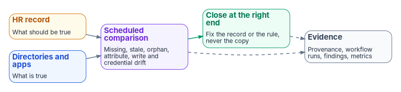

# Attribute-Driven Migration, Module 8: Run the Drift Pipeline and Hand Over the Evidence {.unnumbered}

**Learning path:** [Building the Attribute-Driven Migration](index.md) · Module 8 of 9 · 55 minutes · Guide [Gate 9](../../books/guides/attribute-driven-migration-implementation.md#gate-9-keep-the-attributes-true) · Workbook [Chapter 09](../../books/b19-developer-workbook/09-drift-pipelines-and-evidence.md)

**Watch:** the narrated deck for this module: [Deck](https://github.com/WhalerMike/modernization-workbook/releases/download/edition-2026.11.5/Training_ADM_Module_8.pptx) · [▶ Watch](../../presentations/watch.html?v=Training_ADM_Module_8_Narrated) (about 14 minutes, captions) · [MP4](https://github.com/WhalerMike/modernization-workbook/releases/download/videos-2026-10-23/Training_ADM_Module_8_Narrated.mp4) · [Script](https://github.com/WhalerMike/modernization-workbook/blob/main/presentations/training-adm-module-8/Training_ADM_Module_8_Narration_Script.md) · [Captions](https://github.com/WhalerMike/modernization-workbook/blob/main/presentations/training-adm-module-8/Training_ADM_Module_8_Narrated.vtt).

**Also:** the chapter's narrated tour, about 11 minutes: [▶ Watch](../../presentations/watch.html?v=DW_ADM_09_Drift_Pipelines_Evidence_Narrated).

## Unit 1: Introduction

*5 minutes, with the objectives and prerequisites*

Without Gate 9, everything slowly decays. Its Validate step runs the HR, dynamic group and sync checks on the drift cadence, and its evidence is each cycle's run folder, the findings queue and the metrics for continuous monitoring. Each validation kit check compares the tenant with the program's record. The pipeline adds the second comparison: this run against the last. In this module you run it on two days of fixture runs, read what changed, and hand over a package the ISSO can check with `sha256sum` and nothing else.

**The federal requirement.** This chapter turns the other chapters' outputs into continuous monitoring. From [Chapter 09's table](../../books/b19-developer-workbook/09-drift-pipelines-and-evidence.md#federal-requirements-and-evidence):

| Requirement | KSI | Evidence the ISSO keeps |
|---|---|---|
| CA-7; CM-2: the first run is a packaged baseline | KSI-MLA-EVC | `drift-report.json` and `EVIDENCE-MANIFEST.json`, in the immutable evidence container |
| CA-7; SI-4 System Monitoring: each run says what is new, resolved, changed and unverified, and a failed read never resolves a finding | KSI-MLA-EVC; KSI-MLA-RVL | The evidence package |
| CA-7; AU-6: each finding is opened or closed by fingerprint, with object IDs and no names | KSI-MLA-RVL | The issue tracker |
| AU-9 Protection of Audit Information; SI-7; CM-3: the package hashes every file, carries the other kits' provenance and chains to the day before | KSI-SVC-VRI; KSI-CMT-LMC | `EVIDENCE-MANIFEST.json`, `SHA256SUMS` and `provenance/` |
| SI-7; AU-9: an edit after packaging and runs out of order are refused | KSI-SVC-VRI | The test results |
| SA-10; AC-6: every action is pinned, and the job that reads the tenant can't write to the tracker | KSI-SCR-MIT; KSI-IAM-ELP | The workflow file in Git |
| IA-5: the pipeline signs in with a federated credential, and no secret is stored (Lab 2) | KSI-IAM-SNU | The app registration and the Entra audit log |

: Chapter 09's requirements, KSIs and evidence for this module {.striped .hover}

Key Security Indicators are FedRAMP 20x indicators for cloud service providers. The agency authorizes its own system and lines this evidence up with what its providers report against them; it doesn't report KSIs itself ([Book 00, Appendix B](../../books/b00-orientation/appendix-b-engagement-archetype.md)). Which output supports which control is the program's reading *(design guidance)*.

### Learning objectives

In this module, you'll:

- Explain what the pipeline adds to the validation kit's own comparison.
- Describe what Learn's sample workflows leave to you.
- Compare two runs and read new, resolved, changed, detail only, unchanged and unverified.
- Explain why a failed read is unverified, not resolved.
- Package and verify a run, and explain how the packages form a chain.

### Prerequisites

- [Module 2](02-a-validation-kit-check.md): the pipeline reads the kit's runs and their manifests. [Modules 1, 3 and 5](01-the-hr-middleware.md) produce the provenance it packages.
- Python 3.10 or later with PyYAML and pytest, and PowerShell 7.

## Unit 2: Where the pipeline sits

*8 minutes*

Drift is measured against a versioned record, not a snapshot. No closure counts unless it carries its proof. A finding that was there yesterday and is still there today isn't new, but it is still open. Learn's sample workflows sign in with OpenID Connect and no secret, but have no schedule, pin actions by tag, and one doesn't parse. Read:

- The guide's [Gate 9](../../books/guides/attribute-driven-migration-implementation.md#gate-9-keep-the-attributes-true).
- [Chapter 09: where the pipeline sits](../../books/b19-developer-workbook/09-drift-pipelines-and-evidence.md#where-the-pipeline-sits).
- [Chapter 09: what Learn's sample leaves to you](../../books/b19-developer-workbook/09-drift-pipelines-and-evidence.md#what-it-leaves-to-you).

{#fig-ch11-drift-evidence-loop fig-alt="An amber HR record box (what should be true) and a blue directories and apps box (what is true) both feed a violet scheduled comparison box (missing, stale, orphan, attribute, write and credential drift). It feeds a green close-at-the-right-end box (fix the record or the rule, never the copy). Dashed lines from both go to a grey evidence box (provenance, workflow runs, findings, metrics)."}

## Unit 3: Compare, findings and the package

*10 minutes*

The comparison refuses a run edited after the kit wrote it, runs from different clouds or tenants, and a "current" run that isn't later. Findings go to the tracker with object IDs and fingerprints, not names. The package hashes every file, carries the other kits' provenance and the previous package's manifest hash, so a missing day shows as a break in the chain. Read:

- [Compare](../../books/b19-developer-workbook/09-drift-pipelines-and-evidence.md#compare).
- [Findings without names](../../books/b19-developer-workbook/09-drift-pipelines-and-evidence.md#findings-without-names).
- [The evidence package](../../books/b19-developer-workbook/09-drift-pipelines-and-evidence.md#the-evidence-package).

## Unit 4: Exercise: Lab 1 (fixtures, no tenant)

*25 minutes*

<!-- labs:begin lab-1-commands (generated by scripts/generate_labs.py; not part of the reviewed page) -->

::: {.callout-note #lab-1-commands collapse="false" title="Every command in Lab 1"}
Every command in this lab, in order. Each step below says what it does and what to look for.

```powershell
Set-Location C:\FMWLabs\attribute-driven-migration-code\drift-pipeline

$Run = "C:\FMWLabs\results\attribute-driven-migration-08-drift-and-evidence\lab1\$(Get-Date -AsUTC -Format 'yyyy-MM-ddTHHmmssZ')"
New-Item -ItemType Directory -Path $Run -Force | Out-Null
$Run

# Step 1: Check Learn's sample workflows offline
python python/workflow_lint.py --learn-samples
$LASTEXITCODE

# Step 2: Check the pipeline's own workflow
python python/workflow_lint.py workflow/drift-pipeline.yml

# Step 3: Print a cloud's hosts
python python/drift_pipeline.py cloud --name gcc
python python/drift_pipeline.py cloud --name usgov 2>&1
$LASTEXITCODE

# Step 4: Record a baseline and package it
$Prev = 'tests/fixtures/runs/previous/2026-10-28-0617-fixture-runner-fixture'
$Curr = 'tests/fixtures/runs/current/2026-10-29-0617-fixture-runner-fixture'
$P = '--provenance', 'hcm-entra=tests/fixtures/provenance/hcm-entra/provenance.json', '--provenance', 'machine-configuration=tests/fixtures/provenance/machine-configuration/provenance.json', '--provenance', 'dynamic-rules=tests/fixtures/provenance/dynamic-rules/check-results.json'
python python/drift_pipeline.py compare --current $Prev --out "$Run\day1"
$LASTEXITCODE
python python/drift_pipeline.py package --kit-run $Prev --diff "$Run\day1\drift-report.json" @P --out "$Run\evidence"

# Step 5: Compare the next day
python python/drift_pipeline.py compare --previous $Prev --current $Curr --out "$Run\day2"
$LASTEXITCODE
Get-Content "$Run\day2\drift-summary.md"

# Step 6: Draft the findings
python python/drift_pipeline.py issues --diff "$Run\day2\drift-report.json" --out "$Run\day2\issues.json"
@(Select-String -Path "$Run\day2\issues.json" -Pattern 'gina@contoso.example' -SimpleMatch).Count
@(Select-String -Path "$Run\day2\issues.json" -Pattern '00000000-0000-4000-8000-000000000011' -SimpleMatch).Count

# Step 7: Package and verify the second run, chained to the first
python python/drift_pipeline.py package --kit-run $Curr --diff "$Run\day2\drift-report.json" @P --previous-manifest "$Run\evidence\2026-10-28-0617-fixture-runner-fixture\EVIDENCE-MANIFEST.json" --out "$Run\evidence"
$Pkg = "$Run\evidence\2026-10-29-0617-fixture-runner-fixture"
python python/drift_pipeline.py verify $Pkg
Get-Content "$Pkg\SHA256SUMS" | ForEach-Object { $h, $f = $_ -split '  \*?', 2; if ((Get-FileHash -Algorithm SHA256 (Join-Path $Pkg $f)).Hash -ne $h) { "FAILED $f" } }

# Step 7: Package and verify the second run, chained to the first
python -c "import json,sys; m = json.load(open(sys.argv[1])); print(m['previous']['evidence_manifest_sha256']); print(m['tenant_id'])" "$Pkg\EVIDENCE-MANIFEST.json"

# Step 8: Break it on purpose
Add-Content "$Pkg\drift\drift-summary.md" 'edited after packaging'
python python/drift_pipeline.py verify $Pkg 2>&1
$LASTEXITCODE
python python/drift_pipeline.py compare --previous $Curr --current $Prev --out "$Run\swapped" 2>&1
$LASTEXITCODE

# Step 9: Run the tests
python -m pytest -q -p no:cacheprovider tests

# Step 10: List your runs
Get-ChildItem C:\FMWLabs\results\attribute-driven-migration-08-drift-and-evidence\lab1 -Name
```

:::

<!-- labs:end -->

You lint the workflows, print a cloud's hosts, record a baseline, compare the next day, draft the findings, package and verify the chain, and break it on purpose. These are the steps of [Chapter 09, Lab 1](../../books/b19-developer-workbook/09-drift-pipelines-and-evidence.md#lab-1-fixtures-no-tenant), which explains each result.

Every step runs in PowerShell 7, the Python commands included, so you can follow it top to bottom in one window. Open **PowerShell 7** from the Start menu, then go to the kit's folder, where you unzipped it under [Get the code](index.md#get-the-code):

```powershell
Set-Location C:\FMWLabs\attribute-driven-migration-code\drift-pipeline
```

Then make this run's results folder. Its name is the date and time you start, in UTC, so each run keeps its own results and running the lab again never overwrites them:

```powershell
$Run = "C:\FMWLabs\results\attribute-driven-migration-08-drift-and-evidence\lab1\$(Get-Date -AsUTC -Format 'yyyy-MM-ddTHHmmssZ')"
New-Item -ItemType Directory -Path $Run -Force | Out-Null
$Run
```

Expected output, where `<run>` is your start time, such as `2026-11-25T143005Z`:

```text
C:\FMWLabs\results\attribute-driven-migration-08-drift-and-evidence\lab1\<run>
```

The run's date is only the folder's name. The fixture runs keep their own dates, so every run's results match this page. The results folder sits outside the kit, so unzipping a newer copy of the kit never touches it.

Prefer Git Bash? Go to the folder with `cd /c/FMWLabs/attribute-driven-migration-code/drift-pipeline`, make the run folder with `Run=/c/FMWLabs/results/attribute-driven-migration-08-drift-and-evidence/lab1/$(date -u +%Y-%m-%dT%H%M%SZ); mkdir -p "$Run"`, and the `python` commands of steps 1 to 3 and 9 run the same there; the rest use PowerShell variables and commands (type `pwsh` to start PowerShell 7). In a clone of the repository, use the `examples` folder of the same name.

1. **Check Learn's sample workflows offline.** The second command prints the exit code.

   ```powershell
   python python/workflow_lint.py --learn-samples
   $LASTEXITCODE
   ```

   Expected output:

   ```text
   Learn sample 1: 5 finding(s), 4 warning(s)
     Finding WF-02  on: No schedule trigger (triggers: push): drift checks must run without a person
     Warn    WF-03  permissions: No workflow-level permissions block: a job without its own block gets the repository's default token permissions
     Warn    WF-11  concurrency: No concurrency group: a slow run and the next scheduled run can overlap and compare against each other
     Warn    WF-10  jobs.test: The job that signs in names no environment: the token's subject then depends on the branch or event, and a federated credential matches one subject exactly
     Warn    WF-11  jobs.test: No timeout-minutes
     Finding WF-05  jobs.test.steps[0]: azure/login@v2 isn't pinned to a full commit SHA
     Finding WF-08  jobs.test.steps[0]: azure/login@v2: an older major version than the pinned release (v3)
     Finding WF-05  jobs.test.steps[1]: azure/cli@v2 isn't pinned to a full commit SHA
     Finding WF-09  jobs.test.steps[1]: azcliversion: latest; the tool version changes under the evidence without a review
   Learn sample 2: 7 finding(s), 4 warning(s)
     Finding WF-02  on: No schedule trigger (triggers: push): drift checks must run without a person
     Warn    WF-03  permissions: No workflow-level permissions block: a job without its own block gets the repository's default token permissions
     Warn    WF-11  concurrency: No concurrency group: a slow run and the next scheduled run can overlap and compare against each other
     Warn    WF-10  jobs.test: The job that signs in names no environment: the token's subject then depends on the branch or event, and a federated credential matches one subject exactly
     Warn    WF-11  jobs.test: No timeout-minutes
     Finding WF-05  jobs.test.steps[0]: azure/login@v2 isn't pinned to a full commit SHA
     Finding WF-08  jobs.test.steps[0]: azure/login@v2: an older major version than the pinned release (v3)
     Finding WF-05  jobs.test.steps[1]: azure/cli@v2 isn't pinned to a full commit SHA
     Finding WF-09  jobs.test.steps[1]: azcliversion: latest; the tool version changes under the evidence without a review
     Finding WF-05  jobs.test.steps[2]: azure/powershell@v2 isn't pinned to a full commit SHA
     Finding WF-09  jobs.test.steps[2]: azPSVersion: latest; the tool version changes under the evidence without a review
   Learn sample 3: 1 finding(s), 0 warning(s)
     Finding WF-01  file: Not valid YAML (mapping values are not allowed here); a workflow file that doesn't parse can't run
   2
   ```

   Exit 2: sample 1 has 5 findings and 4 warnings, sample 2 has 7 findings and 4 warnings, and sample 3 doesn't parse.

2. **Check the pipeline's own workflow.**

   ```powershell
   python python/workflow_lint.py workflow/drift-pipeline.yml
   ```

   Expected output:

   ```text
   workflow\drift-pipeline.yml: 0 finding(s), 0 warning(s)
   ```

3. **Print a cloud's hosts**, then ask for a name the pipeline doesn't know (`2>&1` prints its error in line with the rest):

   ```powershell
   python python/drift_pipeline.py cloud --name gcc
   python python/drift_pipeline.py cloud --name usgov 2>&1
   $LASTEXITCODE
   ```

   Expected output:

   ```text
   {
     "audience": "api://AzureADTokenExchange",
     "authority": "https://login.microsoftonline.com",
     "azure_environment": "AzureCloud",
     "graph": "https://graph.microsoft.com",
     "mg_environment": "Global",
     "name": "gcc"
   }
   error: unknown cloud 'usgov'; expected one of gcc
   1
   ```

4. **Record a baseline and package it.** The first three commands name the two fixture runs and the other kits' provenance files; the rest write to this run's folder.

   ```powershell
   $Prev = 'tests/fixtures/runs/previous/2026-10-28-0617-fixture-runner-fixture'
   $Curr = 'tests/fixtures/runs/current/2026-10-29-0617-fixture-runner-fixture'
   $P = '--provenance', 'hcm-entra=tests/fixtures/provenance/hcm-entra/provenance.json', '--provenance', 'machine-configuration=tests/fixtures/provenance/machine-configuration/provenance.json', '--provenance', 'dynamic-rules=tests/fixtures/provenance/dynamic-rules/check-results.json'
   python python/drift_pipeline.py compare --current $Prev --out "$Run\day1"
   $LASTEXITCODE
   python python/drift_pipeline.py package --kit-run $Prev --diff "$Run\day1\drift-report.json" @P --out "$Run\evidence"
   ```

   Expected output:

   ```text
   {"baseline": true, "counts": {"changed": 0, "detail_only": 0, "new": 10, "resolved": 0, "unchanged": 0, "unverified": 0}, "drift": true}
   2
   {"evidence_manifest_sha256": "6d9fffbc86009c18673ea37a3a5ed3805541331a8e921955380c1b1143374cd1", "package": "2026-10-28-0617-fixture-runner-fixture"}
   ```

   The compare exits 2: a baseline reports every finding as new.

5. **Compare the next day.**

   ```powershell
   python python/drift_pipeline.py compare --previous $Prev --current $Curr --out "$Run\day2"
   $LASTEXITCODE
   Get-Content "$Run\day2\drift-summary.md"
   ```

   Expected output:

   ```text
   {"baseline": false, "counts": {"changed": 1, "detail_only": 1, "new": 3, "resolved": 1, "unchanged": 6, "unverified": 2}, "drift": true}
   2
   # Drift report

   Current run **2026-10-29-0617-fixture-runner-fixture** (gcc, Fixture); previous run **2026-10-28-0617-fixture-runner-fixture**.

   New 3, resolved 1, changed 1, detail only 1, unchanged 6, unverified checks 2.

   | Check | Before | After |
   |---|---|---|
   | VK-CA-01 | Pass | Fail |
   | VK-NPI-03 | Fail | Error |
   | VK-PIV-01 | Pass | not run |

   Object names are in drift-report.json, which goes to the evidence store, not to the issue tracker.
   ```

   VK-NPI-03's finding is unverified, not resolved: its read failed.

6. **Draft the findings**, then count the lines that hold a name and an object ID:

   ```powershell
   python python/drift_pipeline.py issues --diff "$Run\day2\drift-report.json" --out "$Run\day2\issues.json"
   @(Select-String -Path "$Run\day2\issues.json" -Pattern 'gina@contoso.example' -SimpleMatch).Count
   @(Select-String -Path "$Run\day2\issues.json" -Pattern '00000000-0000-4000-8000-000000000011' -SimpleMatch).Count
   ```

   Expected output:

   ```text
   {"close": 2, "comment": 0, "open": 6}
   0
   1
   ```

   The address isn't in the drafted issues (`0` lines); the object ID is (`1`).

7. **Package and verify the second run, chained to the first.** The last command checks every file in the package against its `SHA256SUMS` and prints only the files that don't match.

   ```powershell
   python python/drift_pipeline.py package --kit-run $Curr --diff "$Run\day2\drift-report.json" @P --previous-manifest "$Run\evidence\2026-10-28-0617-fixture-runner-fixture\EVIDENCE-MANIFEST.json" --out "$Run\evidence"
   $Pkg = "$Run\evidence\2026-10-29-0617-fixture-runner-fixture"
   python python/drift_pipeline.py verify $Pkg
   Get-Content "$Pkg\SHA256SUMS" | ForEach-Object { $h, $f = $_ -split '  \*?', 2; if ((Get-FileHash -Algorithm SHA256 (Join-Path $Pkg $f)).Hash -ne $h) { "FAILED $f" } }
   ```

   Expected output:

   ```text
   {"evidence_manifest_sha256": "0932f0a3cd710c19bdfce05ff4f7595bf2d8d5e3b652921223d12fa49aada6ee", "package": "2026-10-29-0617-fixture-runner-fixture"}
   {"evidence_manifest_sha256": "0932f0a3cd710c19bdfce05ff4f7595bf2d8d5e3b652921223d12fa49aada6ee", "files": 16, "run_id": "2026-10-29-0617-fixture-runner-fixture"}
   ```

   `verify` reports `"files": 16`, and the hash check prints nothing: every file matches.

   Read two fields of the manifest:

   ```powershell
   python -c "import json,sys; m = json.load(open(sys.argv[1])); print(m['previous']['evidence_manifest_sha256']); print(m['tenant_id'])" "$Pkg\EVIDENCE-MANIFEST.json"
   ```

   Expected output:

   ```text
   6d9fffbc86009c18673ea37a3a5ed3805541331a8e921955380c1b1143374cd1
   11111111-1111-4111-8111-111111111111
   ```

   The day 1 hash, and the fixture tenant's placeholder.

8. **Break it on purpose.** Append a line to the packaged summary and verify again, then swap the runs:

   ```powershell
   Add-Content "$Pkg\drift\drift-summary.md" 'edited after packaging'
   python python/drift_pipeline.py verify $Pkg 2>&1
   $LASTEXITCODE
   python python/drift_pipeline.py compare --previous $Curr --current $Prev --out "$Run\swapped" 2>&1
   $LASTEXITCODE
   ```

   Expected output:

   ```text
   error: C:\FMWLabs\results\attribute-driven-migration-08-drift-and-evidence\lab1\<run>\evidence\2026-10-29-0617-fixture-runner-fixture: drift/drift-summary.md doesn't match its SHA-256
   1
   error: the current run (2026-10-28T06:17:00Z) isn't later than the previous one (2026-10-29T06:17:00Z)
   1
   ```

9. **Run the tests.** They take about two minutes.

   ```powershell
   python -m pytest -q -p no:cacheprovider tests
   ```

   Expected: two lines of dots, then a last line that starts `133 passed, 1 skipped` and gives the time it took. The skipped test file needs the HR lifecycle kit, which isn't in this zip; in a clone of the repository it runs.

10. **List your runs.** Nothing to clean up: the kit's folder is as you unzipped it, and this run's results stay in `$Run`. List every run you've made of this lab:

    ```powershell
    Get-ChildItem C:\FMWLabs\results\attribute-driven-migration-08-drift-and-evidence\lab1 -Name
    ```

    Expected output: one line per run, oldest first, the last one this run:

    ```text
    <run>
    ```

**Check your work:** given two runs, you can say what is new, resolved, changed or unverified, and given a package, you can show it is unedited and chained to the day before.

## Unit 5: Exercise: Lab 2 (your test tenant)

*Not timed. Not run by the authors.*

Register an app that trusts a private test repository through a federated credential, grant it only the reads, make an evidence container with an unlocked retention policy, set up the repository's environment, run the workflow by hand for a baseline, make one real change and run it again, and let the schedule run. Follow [Chapter 09, Lab 2](../../books/b19-developer-workbook/09-drift-pipelines-and-evidence.md#lab-2-test-tenant-and-test-subscription).

- **You need:** a test tenant and a test subscription, never production, and a private test repository, `contoso-example/estate-checks`, holding the validation kit and this example.
- **Back it out:** step 8 deletes the federated credential and the app. Leave the test retention policy unlocked: Learn says an unlocked policy is for testing and can be deleted.

## Unit 6: Knowledge check

*5 minutes*

1. Yesterday VK-NPI-03 had a finding. Today its read failed with a 403. What does the comparison report?
   a. Resolved.
   b. Unverified, not resolved: a failed read is never a fix.
   c. Unchanged.

2. What goes into a drafted issue for a finding?
   a. The user principal name, so the owner is obvious.
   b. The check, severity, object ID, issue and fingerprint, without the name.
   c. The full drift report.

3. How does the ISSO check a package without the program's code?
   a. By reading the drift summary.
   b. With `sha256sum -c SHA256SUMS` in the package's folder.
   c. By re-running the validation kit.

4. What shows that a day's package is missing?
   a. Nothing; each package stands alone.
   b. A break in the chain: each manifest records the previous package's manifest hash.
   c. The issue tracker.

::: {.callout-tip collapse="true"}
## Check your answers
1. **b.** See [Compare](../../books/b19-developer-workbook/09-drift-pipelines-and-evidence.md#compare) and step 5 of the lab.
2. **b.** See [findings without names](../../books/b19-developer-workbook/09-drift-pipelines-and-evidence.md#findings-without-names) and step 6 of the lab.
3. **b.** See [the evidence package](../../books/b19-developer-workbook/09-drift-pipelines-and-evidence.md#the-evidence-package) and step 7 of the lab.
4. **b.** See [the evidence package](../../books/b19-developer-workbook/09-drift-pipelines-and-evidence.md#the-evidence-package) and step 7 of the lab.
:::

## Unit 7: Summary

*2 minutes*

You compared two days of kit runs without letting a failed read close a finding, drafted findings without names, and packaged and verified a chain of evidence the ISSO can check with `sha256sum` alone.

**Evidence an ISSO keeps from this module:** each day's package, with its kit run, drift report, other kits' provenance, `EVIDENCE-MANIFEST.json` and `SHA256SUMS`, in a container whose retention is locked in production; the findings in the tracker by fingerprint; and the workflow file and the pipeline app's registration. Gate 9 adds the scan schedule, the limits register and the metrics for continuous monitoring, in the guide's [Gate 9](../../books/guides/attribute-driven-migration-implementation.md#gate-9-keep-the-attributes-true). Before shipping, work through the [Chapter 09 checklist](../../books/b19-developer-workbook/09-drift-pipelines-and-evidence.md#checklist).

::: {.callout-tip}
## Continue the path
[Previous: Module 7](07-lifecycle-workflows-extensions.md) · [Learning path](index.md) · [Next: Module 9, Deploy to test, then production →](09-deploying-to-test-and-production.md)
:::
