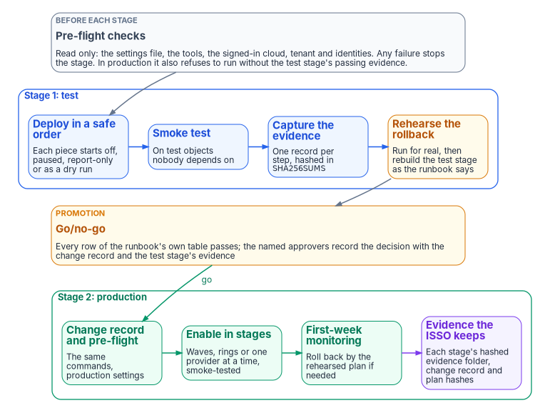

# Attribute-Driven Migration, Module 9: Deploy to Test, then Production {.unnumbered}

**Learning path:** [Building the Attribute-Driven Migration](index.md) · Module 9 of 10 · 50 minutes · Gates 2 to 5 and 7 to 9, through the [step-to-gate map](../../books/b19-developer-workbook/10-deploying-to-test-and-production.md#step-to-gate-map) · Workbook [Chapter 10](../../books/b19-developer-workbook/10-deploying-to-test-and-production.md)

**Watch:** the narrated deck for this module: [Deck](https://github.com/WhalerMike/modernization-workbook/releases/download/edition-2026.11.5/Training_ADM_Module_9.pptx) · [▶ Watch](../../presentations/watch.html?v=Training_ADM_Module_9_Narrated) (about 14 minutes, captions) · [MP4](https://github.com/WhalerMike/modernization-workbook/releases/download/videos-2026-10-23/Training_ADM_Module_9_Narrated.mp4) · [Script](https://github.com/WhalerMike/modernization-workbook/blob/main/presentations/training-adm-module-9/Training_ADM_Module_9_Narration_Script.md) · [Captions](https://github.com/WhalerMike/modernization-workbook/blob/main/presentations/training-adm-module-9/Training_ADM_Module_9_Narrated.vtt).

::: {.callout-important}
## Chapter 10 is approved, not run against a live tenant
Chapter 10 is approved, but **nobody has run its runbook against a live tenant, subscription or forest.** Its five deploy scripts are tested against fixtures, and their dry-run output is real. Every other result in the chapter is an expectation, not an observation. This module's Lab 1 runs only the dry runs.
:::

## Unit 1: Introduction

*5 minutes, with the objectives and prerequisites*

Each chapter's Lab 2 changes the smallest thing it can, by hand, and backs it out. That proves one kit in isolation. A deployment runs all nine kits in a safe order, reads every value from one settings file per stage, records every change with its rollback, and ends with a go or no-go record that production's pre-flight check verifies. The order is the guide's: prove the attributes first, build groups and workflows paused or disabled, target by attribute, cut over by wave, then keep the attributes true. In this module you dry-run the scripts that enforce it.

**The federal requirement.** Every runbook step has a requirements table, and every step leaves an evidence record that names its controls and KSIs. From [Chapter 10](../../books/b19-developer-workbook/10-deploying-to-test-and-production.md#requirements-ksis-and-evidence):

| Requirement | KSI | Evidence the ISSO keeps |
|---|---|---|
| CM-3(2): the settings, kits, identities and cloud are checked before any change ([pre-flight](../../books/b19-developer-workbook/10-deploying-to-test-and-production.md#pre-flight-checks)) | KSI-CMT-VTD, KSI-CMT-LMC | `preflight.json`, dry and live, and its evidence record |
| IA-5 for non-user accounts; AC-6: no secret in the settings file, and three certificate identities with only what each step needs | KSI-IAM-SNU, KSI-IAM-ELP | `preflight.json` rows PF-02 and PF-05; the identities' grants in the change record |
| CM-4(2) Verification of Controls; CA-7: after the change, the gates' checks are read again and the answer is go or no-go (step 9) | KSI-CMT-LMC, KSI-CMT-VTD, KSI-MLA-EVC | `smoke/smoke-report.json` and the after run of the validation kit |
| AU-9; SI-7: one evidence package with a SHA-256 per file, verified (step 10) | KSI-MLA-OSM, KSI-SVC-VRI | The package, its `SHA256SUMS` and the verify output |
| CM-3: every change recorded with its rollback, written newest first and, in the test stage, run (step 11) | KSI-CMT-LMC, KSI-CMT-RVP | `deploy-record.json`, the rollback scripts and their transcripts |

: Chapter 10's requirements, KSIs and evidence for this module {.striped .hover}

KSIs are FedRAMP 20x indicators for cloud service providers. The agency authorizes its own system and lines its evidence up with what its providers report against them; it doesn't report KSIs itself ([Book 00, Appendix B](../../books/b00-orientation/appendix-b-engagement-archetype.md)). Chapter 10 uses only KSI IDs this workbook already maps to the same controls.

### Learning objectives

In this module, you'll:

- Explain the four ways a deployment differs from a chapter's Lab 2.
- Describe the settings file, the placeholders and the three identities.
- Run the pre-flight check, and say which checks it runs dry and which live.
- Record changes and read the rollback plan they produce.
- Explain why a fixture smoke test can never promote, and what production's pre-flight check verifies.

### Prerequisites

- Modules 1 to 8, or at least their Lab 1s: this module doesn't teach the kits again.
- Python 3.10 or later with pytest, and PowerShell 7.

## Unit 2: What the runbook adds

*10 minutes*

One settings file per stage, with no secrets, so the same commands run against test and production. Three identities with a certificate each, plus one named delegated step where Learn allows nothing else. Every change recorded, and the rollback written from the record. A go or no-go record before production, then waves. Read:

- [Chapter 10: what this runbook adds to the chapters](../../books/b19-developer-workbook/10-deploying-to-test-and-production.md#what-this-runbook-adds-to-the-chapters).
- [Before you start](../../books/b19-developer-workbook/10-deploying-to-test-and-production.md#before-you-start), including [the identities and what each may do](../../books/b19-developer-workbook/10-deploying-to-test-and-production.md#the-identities-and-what-each-may-do).
- [One environment settings file](../../books/b19-developer-workbook/10-deploying-to-test-and-production.md#one-environment-settings-file).

## Unit 3: The stages and the promotion

*8 minutes*

The live test stage deploys every component in an order where nothing grants access before it has been checked, and drills the rollback. Production needs a live, passing test smoke report and evidence check whose hashes are in its settings file, and the CISO's and identity engineering's approvals. Then it runs in waves, leaver first, with a week of drift monitoring. Read:

- [Stage 1: live test](../../books/b19-developer-workbook/10-deploying-to-test-and-production.md#stage-1-live-test), its order table.
- [Promotion go/no-go criteria](../../books/b19-developer-workbook/10-deploying-to-test-and-production.md#promotion-go-no-go-criteria).
- [Stage 2: production](../../books/b19-developer-workbook/10-deploying-to-test-and-production.md#stage-2-production) and [evidence the ISSO keeps](../../books/b19-developer-workbook/10-deploying-to-test-and-production.md#evidence-the-isso-keeps).

{#fig-deploy-test-to-production fig-alt="Flow diagram. At the top, a slate card, Pre-flight checks, run before each stage: read only, it checks the settings file, the tools, and the signed-in cloud, tenant and identities. Any failure stops the stage, and in production it also refuses to run without the test stage's passing evidence. An arrow leads into a blue box, Stage 1: test, holding four cards left to right joined by arrows: deploy in a safe order, where each piece starts off, paused, report-only or as a dry run; smoke test, on test objects nobody depends on; capture the evidence, one record per step hashed in SHA256SUMS; and, in amber, rehearse the rollback, run for real and then rebuild the test stage as the runbook says. An arrow leads to an amber card, Promotion: go/no-go. Every row of the runbook's own table passes, and the named approvers record the decision with the change record and the test stage's evidence. A green arrow labeled go leads into a green box, Stage 2: production, holding four cards left to right: change record and pre-flight, with the same commands and production settings; enable in stages, by waves, rings or one provider at a time, each smoke-tested; first-week monitoring, rolling back by the rehearsed plan if needed; and, in violet, evidence the ISSO keeps: each stage's hashed evidence folder, the change record and the plan hashes."}

## Unit 4: Exercise: Lab 1 (fixtures, no tenant)

*20 minutes*

<!-- labs:begin lab-1-commands (generated by scripts/generate_labs.py; not part of the reviewed page) -->

::: {.callout-note #lab-1-commands collapse="false" title="Every command in Lab 1"}
Every command in this lab, in order. Each step below says what it does and what to look for.

```powershell
Set-Location C:\FMWLabs\attribute-driven-migration-code\drift-pipeline

$Run = "C:\FMWLabs\results\attribute-driven-migration-09-deploying-to-test-and-production\lab1\$(Get-Date -AsUTC -Format 'yyyy-MM-ddTHHmmssZ')"
New-Item -ItemType Directory -Path $Run -Force | Out-Null
$Run

# Step 1: Copy the two stages' settings into this run's folder
Copy-Item deploy/tests/fixtures/test.json, deploy/tests/fixtures/production.json $Run
foreach ($s in "$Run\test.json", "$Run\production.json") { (Get-Content -Raw $s).Replace('"../../../out/deploy-evidence"', '"deploy-evidence"') | Set-Content -NoNewline $s }
$S = "$Run\test.json"

# Step 2: Run the test stage's pre-flight check
python deploy/preflight.py --settings $S --other "$Run\production.json"

# Step 3: Record four changes the way the stage steps do, then write the rollback
python deploy/rollback.py add --settings $S --kind provisioning-job --id API2AAD.00000000000000000000000000000000.44444444-4444-4444-8444-444444444401
python deploy/rollback.py add --settings $S --kind dynamic-group --id 88888888-8888-4888-8888-888888888801 --name "FIN ledger employees"
python deploy/rollback.py add --settings $S --kind gpo-link-created --id FMP-Workstation-Baseline --name "OU=ADM-Test,DC=test,DC=contoso,DC=example"
python deploy/rollback.py add --settings $S --kind policy-assignment --id adm-mc-tls-audit --name /subscriptions/22222222-2222-4222-8222-222222222201/resourceGroups/rg-adm-test
python deploy/rollback.py plan --settings $S

# Step 4: Run the smoke test
$E = "$Run\deploy-evidence\test\CHG-TEST-0101"
python deploy/smoke_test.py --settings $S --fixture --kit-run tests/fixtures/runs/current/2026-10-29-0617-fixture-runner-fixture --hcm-provenance tests/fixtures/provenance/hcm-entra/provenance.json --dynamic-rules tests/fixtures/provenance/dynamic-rules/check-results.json --mc-provenance tests/fixtures/provenance/machine-configuration/provenance.json --mc-mode Audit --deploy-record "$E\deploy-record.json" --out "$E\smoke"
$LASTEXITCODE

# Step 5: Check the stage's evidence
python deploy/evidence.py check --settings $S
$LASTEXITCODE
Get-Content "$E\evidence\SHA256SUMS" | ForEach-Object { $h, $f = $_ -split '  \*?', 2; '{0}: {1}' -f $f, $(if ((Get-FileHash -Algorithm SHA256 (Join-Path "$E\evidence" $f)).Hash -eq $h) { 'OK' } else { 'FAILED' }) }

# Step 6: Ask production's pre-flight check to promote
python deploy/preflight.py --settings "$Run\production.json" --other $S --test-smoke-report "$E\smoke\smoke-report.json" --test-evidence-check "$E\evidence-check.json"

# Step 7: Run the deploy scripts' tests
python -m pytest -q -p no:cacheprovider deploy/tests

# Step 8: List your runs
Get-ChildItem C:\FMWLabs\results\attribute-driven-migration-09-deploying-to-test-and-production\lab1 -Name
```

:::

<!-- labs:end -->

You dry-run the five deploy scripts against the kits' fixtures. Nothing signs in and nothing is called. These are the commands of [Chapter 10: try the scripts against fixtures first](../../books/b19-developer-workbook/10-deploying-to-test-and-production.md#try-the-scripts-against-fixtures-first), which shows the full output.

Every step runs in PowerShell 7, the Python commands included, so you can follow it top to bottom in one window. Open **PowerShell 7** from the Start menu, then go to the kit's folder, where you unzipped it under [Get the code](index.md#get-the-code):

```powershell
Set-Location C:\FMWLabs\attribute-driven-migration-code\drift-pipeline
```

Then make this run's results folder. Its name is the date and time you start, in UTC, so each run keeps its own results and running the lab again never overwrites them:

```powershell
$Run = "C:\FMWLabs\results\attribute-driven-migration-09-deploying-to-test-and-production\lab1\$(Get-Date -AsUTC -Format 'yyyy-MM-ddTHHmmssZ')"
New-Item -ItemType Directory -Path $Run -Force | Out-Null
$Run
```

Expected output, where `<run>` is your start time, such as `2026-11-25T143005Z`:

```text
C:\FMWLabs\results\attribute-driven-migration-09-deploying-to-test-and-production\lab1\<run>
```

The run's date is only the folder's name. The fixtures keep their own dates. The results folder sits outside the kit, so unzipping a newer copy of the kit never touches it.

Prefer Git Bash? Every step uses PowerShell variables or commands, so type `pwsh` to start PowerShell 7 and follow the steps there. In a clone of the repository, use the `examples` folder of the same name.

1. **Copy the two stages' settings into this run's folder.** The fixture settings keep the stage's evidence in the kit's `out` folder; the copies keep it in `$Run\deploy-evidence` instead.

   ```powershell
   Copy-Item deploy/tests/fixtures/test.json, deploy/tests/fixtures/production.json $Run
   foreach ($s in "$Run\test.json", "$Run\production.json") { (Get-Content -Raw $s).Replace('"../../../out/deploy-evidence"', '"deploy-evidence"') | Set-Content -NoNewline $s }
   $S = "$Run\test.json"
   ```

2. **Run the test stage's pre-flight check.**

   ```powershell
   python deploy/preflight.py --settings $S --other "$Run\production.json"
   ```

   Expected output:

   ```text
   PASS PF-01  settings schema adm-deploy-settings/1, environment test
   PASS PF-02  no secret in the settings file
   PASS PF-03  no placeholder left
   PASS PF-04  cloud gcc: Graph https://graph.microsoft.com, Azure AzureCloud, Graph PowerShell Global, Arc playbook playbooks/06_arc_onboarding_role.yml
   PASS PF-05  certificate files are PEM paths outside the repository
   PASS PF-06  9 kits present
   PASS PF-07  machine configuration TlsServerProtocols: registry mode Audit, policy ID ca593085-dfcb-425d-ac9c-12870a55bbaa, published 0.0.0
   PASS PF-08  Lifecycle Workflows integrations in the registry: cms-revocation
   PASS PF-09  test and production use different tenants, subscriptions and identities
   PASS PF-10  test stage: no promotion record needed
   DRY  PF-16  would check that the deploy certificate file exists: /etc/adm/certs/adm-deploy-test.pem
   DRY  PF-16  would check that the provisioning certificate file exists: /etc/adm/certs/adm-provisioning-test.pem
   DRY  PF-11  would run: az cloud show --query name -o tsv  (expect AzureCloud)
   DRY  PF-12  would run: az account show --query tenantId -o tsv  (expect 11111111-1111-4111-8111-111111111111)
   DRY  PF-13  would run: az account show --query id -o tsv  (expect 22222222-2222-4222-8222-222222222201)
   DRY  PF-14  would run: az account show --query user.name -o tsv  (expect 33333333-3333-4333-8333-333333333301)
   DRY  PF-15  would run: pwsh -NoProfile -Command $m = @('Microsoft.Graph.Authentication','Az.Accounts','Az.Resources','Az.Storage','GuestConfiguration','GroupPolicy') | Where-Object { -not (Get-Module -ListAvailable -Name $_) }; if ($m) { 'missing: ' + ($m -join ', '); exit 1 } else { 'all present' }
   preflight: 0 failed, 0 warning(s); dry run (nothing signed in, nothing called)
   evidence 001-preflight.json: preflight pass
   ```

   `PASS` on `PF-01` to `PF-10`, and the live probes printed as `DRY`.

3. **Record four changes the way the stage steps do, then write the rollback.**

   ```powershell
   python deploy/rollback.py add --settings $S --kind provisioning-job --id API2AAD.00000000000000000000000000000000.44444444-4444-4444-8444-444444444401
   python deploy/rollback.py add --settings $S --kind dynamic-group --id 88888888-8888-4888-8888-888888888801 --name "FIN ledger employees"
   python deploy/rollback.py add --settings $S --kind gpo-link-created --id FMP-Workstation-Baseline --name "OU=ADM-Test,DC=test,DC=contoso,DC=example"
   python deploy/rollback.py add --settings $S --kind policy-assignment --id adm-mc-tls-audit --name /subscriptions/22222222-2222-4222-8222-222222222201/resourceGroups/rg-adm-test
   python deploy/rollback.py plan --settings $S
   ```

   Expected output:

   ```text
   recorded provisioning-job API2AAD.00000000000000000000000000000000.44444444-4444-4444-8444-444444444401 in ../../results/attribute-driven-migration-09-deploying-to-test-and-production/lab1/<run>/deploy-evidence/test/CHG-TEST-0101/deploy-record.json; evidence 002-hr.json
   recorded dynamic-group 88888888-8888-4888-8888-888888888801 in ../../results/attribute-driven-migration-09-deploying-to-test-and-production/lab1/<run>/deploy-evidence/test/CHG-TEST-0101/deploy-record.json; evidence 003-rules.json
   recorded gpo-link-created FMP-Workstation-Baseline in ../../results/attribute-driven-migration-09-deploying-to-test-and-production/lab1/<run>/deploy-evidence/test/CHG-TEST-0101/deploy-record.json; evidence 004-gpo.json
   recorded policy-assignment adm-mc-tls-audit in ../../results/attribute-driven-migration-09-deploying-to-test-and-production/lab1/<run>/deploy-evidence/test/CHG-TEST-0101/deploy-record.json; evidence 005-mc.json
   [4] policy-assignment  cloud  Remove-AzPolicyAssignment -Name 'adm-mc-tls-audit' -Scope '/subscriptions/22222222-2222-4222-8222-222222222201/resourceGroups/rg-adm-test'
   [3] gpo-link-created   ad     Set-GPLink -Name 'FMP-Workstation-Baseline' -Target 'OU=ADM-Test,DC=test,DC=contoso,DC=example' -LinkEnabled No -Domain 'test.contoso.example'
   [2] dynamic-group      cloud  Remove-MgGroup -GroupId '88888888-8888-4888-8888-888888888801'
   [1] provisioning-job   cloud  Invoke-MgGraphRequest -Method POST -Uri '/v1.0/servicePrincipals/44444444-4444-4444-8444-444444444401/synchronization/jobs/API2AAD.00000000000000000000000000000000.44444444-4444-4444-8444-444444444401/pause'
   rollback plan: 4 step(s), newest first: 3 cloud, 1 ad
   wrote ../../results/attribute-driven-migration-09-deploying-to-test-and-production/lab1/<run>/deploy-evidence/test/CHG-TEST-0101/rollback-cloud.ps1
   wrote ../../results/attribute-driven-migration-09-deploying-to-test-and-production/lab1/<run>/deploy-evidence/test/CHG-TEST-0101/rollback-ad.ps1
   wrote ../../results/attribute-driven-migration-09-deploying-to-test-and-production/lab1/<run>/deploy-evidence/test/CHG-TEST-0101/rollback-manual.md
   evidence 006-rollback.json: rollback plan recorded
   nothing was run: review the scripts, then run them in a signed-in session
   ```

   Each `add` records its change and writes an evidence record; the plan lists the four undo steps newest first and writes the rollback scripts. The paths are relative to the kit's folder.

4. **Run the smoke test** on the fixture validation kit run and the other kits' fixture provenance:

   ```powershell
   $E = "$Run\deploy-evidence\test\CHG-TEST-0101"
   python deploy/smoke_test.py --settings $S --fixture --kit-run tests/fixtures/runs/current/2026-10-29-0617-fixture-runner-fixture --hcm-provenance tests/fixtures/provenance/hcm-entra/provenance.json --dynamic-rules tests/fixtures/provenance/dynamic-rules/check-results.json --mc-provenance tests/fixtures/provenance/machine-configuration/provenance.json --mc-mode Audit --deploy-record "$E\deploy-record.json" --out "$E\smoke"
   $LASTEXITCODE
   ```

   Expected output, these lines first:

   ```text
   PASS SM-01  kit run 2026-10-29-0617-fixture-runner-fixture matches its own manifest (read-only)
   PASS SM-02  fixture mode: run mode Fixture, tenant not compared
   PASS SM-04  run cloud gcc; settings gcc
   FAIL SM-05  VK-HR-01 Fail (2 finding(s))
   FAIL SM-05  VK-DG-01 Fail (2 finding(s))
   FAIL SM-05  VK-CA-01 Fail (1 finding(s))
   FAIL SM-06  checks that ended in Error: VK-NPI-03
   PASS SM-07  run not held by the mass-disable guard
   FAIL SM-08  9 ready, 9 quarantined (limit 0)
   PASS SM-09  rule library: 6 rules, 0 finding(s)
   PASS SM-10  machine configuration TlsServerProtocols 1.0.0: 0 finding(s)
   PASS SM-11  package mode Audit; this stage expects Audit
   PASS SM-12  4 change(s) recorded for test/CHG-TEST-0101
   PASS SM-13  every change has a rollback
   evidence 007-smoke.json: smoke fail, controls CA-7, CM-4(2)
   ```

   Then a line that starts `smoke test: NO-GO (5 failed) for test/CHG-TEST-0101, fixture mode; report sha256` and ends with the report's hash, and the exit code, `2`. The fixtures carry findings on purpose. The report's hash changes with each run, because the report records when it ran.

5. **Check the stage's evidence**, then check every record against its `SHA256SUMS`:

   ```powershell
   python deploy/evidence.py check --settings $S
   $LASTEXITCODE
   Get-Content "$E\evidence\SHA256SUMS" | ForEach-Object { $h, $f = $_ -split '  \*?', 2; '{0}: {1}' -f $f, $(if ((Get-FileHash -Algorithm SHA256 (Join-Path "$E\evidence" $f)).Hash -eq $h) { 'OK' } else { 'FAILED' }) }
   ```

   Expected output, these lines first:

   ```text
   OK   R-PF-1   preflight  KSI-CMT-VTD, KSI-CMT-LMC                 001-preflight.json
   OK   R-PF-2   preflight  KSI-IAM-SNU, KSI-IAM-ELP                 001-preflight.json
   MISS R-BL-1   baseline   KSI-CMT-RMV, KSI-MLA-EVC, KSI-SVC-ACM    -  (no evidence record for this step)
   MISS R-BL-2   baseline   KSI-IAM-ELP                              -  (no evidence record for this step)
   MISS R-HR-1   hr         KSI-IAM-AAM                              002-hr.json  (only 'recorded' entries: the step has no passing record)
   MISS R-HR-2   hr         KSI-CMT-VTD, KSI-PIY-GIV                 002-hr.json  (only 'recorded' entries: the step has no passing record)
   MISS R-DG-1   rules      KSI-IAM-AAM, KSI-IAM-ELP, KSI-CMT-VTD    003-rules.json  (only 'recorded' entries: the step has no passing record)
   MISS R-LCW-1  lcw        KSI-IAM-AAM                              -  (no evidence record for this step)
   MISS R-GPO-1  gpo        KSI-CMT-LMC, KSI-CMT-RMV, KSI-SVC-ACM    004-gpo.json  (only 'recorded' entries: the step has no passing record)
   MISS R-GPO-2  gpo        KSI-PIY-GIV                              004-gpo.json  (only 'recorded' entries: the step has no passing record)
   MISS R-MC-1   mc         KSI-CMT-RMV, KSI-SVC-ACM, KSI-MLA-EVC    005-mc.json  (only 'recorded' entries: the step has no passing record)
   MISS R-MC-2   mc         KSI-SVC-VRI                              005-mc.json  (only 'recorded' entries: the step has no passing record)
   MISS R-ARC-1  arc        KSI-PIY-GIV, KSI-IAM-ELP, KSI-CMT-VTD    -  (no evidence record for this step)
   MISS R-DR-1   drift      KSI-MLA-EVC, KSI-MLA-LET, KSI-IAM-SNU    -  (no evidence record for this step)
   MISS R-SM-1   smoke      KSI-CMT-LMC, KSI-CMT-VTD, KSI-MLA-EVC    007-smoke.json  (the latest pass/fail record (007-smoke.json) failed; a record came from fixture mode, which proves nothing about the stage)
   MISS R-EV-1   package    KSI-MLA-OSM, KSI-SVC-VRI                 -  (no evidence record for this step)
   MISS R-RB-1   rollback   KSI-CMT-LMC, KSI-CMT-RVP                 006-rollback.json  (only 'recorded' entries: the step has no passing record)
   ```

   Then a line that starts `evidence check: 2 of 17 requirement rows evidenced for test/CHG-TEST-0101; FAIL; evidence-check.json sha256` and ends with that file's hash, which changes with each run, then the exit code and the hash check:

   ```text
   2
   001-preflight.json: OK
   002-hr.json: OK
   003-rules.json: OK
   004-gpo.json: OK
   005-mc.json: OK
   006-rollback.json: OK
   007-smoke.json: OK
   ```

   `OK` only for `R-PF-1` and `R-PF-2`, and every record matches its hash. A `recorded` change proves it was written down, not that the step worked.

6. **Ask production's pre-flight check to promote** on that report and that check:

   ```powershell
   python deploy/preflight.py --settings "$Run\production.json" --other $S --test-smoke-report "$E\smoke\smoke-report.json" --test-evidence-check "$E\evidence-check.json"
   ```

   Expected output:

   ```text
   PASS PF-01  settings schema adm-deploy-settings/1, environment production
   PASS PF-02  no secret in the settings file
   PASS PF-03  no placeholder left
   PASS PF-04  cloud gcc: Graph https://graph.microsoft.com, Azure AzureCloud, Graph PowerShell Global, Arc playbook playbooks/06_arc_onboarding_role.yml
   PASS PF-05  certificate files are PEM paths outside the repository
   PASS PF-06  9 kits present
   PASS PF-07  machine configuration TlsServerProtocols: registry mode Audit, policy ID ca593085-dfcb-425d-ac9c-12870a55bbaa, published 0.0.0
   PASS PF-08  Lifecycle Workflows integrations in the registry: cms-revocation
   PASS PF-09  production and test use different tenants, subscriptions and identities
   FAIL PF-10  the test smoke report's SHA-256 isn't the one in promotion.test_smoke_report_sha256; the test smoke report is test/fail, not test/pass; the test smoke report ran in fixture mode; promotion needs a live test run; the test evidence check's SHA-256 isn't the one in promotion.test_evidence_check_sha256; the test evidence check is test/fail: 15 requirement row(s) without passing evidence
   SKIP PF-11  live probes not run: fix the failures above first
   preflight: 1 failed, 0 warning(s); dry run (nothing signed in, nothing called)
   evidence 001-preflight.json: preflight fail
   ```

   `PASS PF-09`, then `FAIL PF-10`: the hashes aren't the ones in `promotion`, the smoke report failed and ran in fixture mode, and the evidence check failed.

7. **Run the deploy scripts' tests.**

   ```powershell
   python -m pytest -q -p no:cacheprovider deploy/tests
   ```

   Expected: a line of dots, then a last line that starts `44 passed` and gives the time it took.

8. **List your runs.** Nothing to clean up: the kit's folder is as you unzipped it, and this run's settings and evidence stay in `$Run`. List every run you've made of this lab:

   ```powershell
   Get-ChildItem C:\FMWLabs\results\attribute-driven-migration-09-deploying-to-test-and-production\lab1 -Name
   ```

   Expected output: one line per run, oldest first, the last one this run:

   ```text
   <run>
   ```

**Check your work:** for a stage, you can say which evidence rows are proved, why a fixture run can never promote, and what production's pre-flight check needs before it passes.

## Unit 5: Exercise: Lab 2 (the live test stage)

*Not timed. Not run by anyone yet.*

Load the test stage's settings, sign in as the deploy identity, run the pre-flight check dry and live, then follow the twelve steps of [Stage 1: live test](../../books/b19-developer-workbook/10-deploying-to-test-and-production.md#stage-1-live-test): baseline evidence, the HR middleware, dynamic rules, Lifecycle Workflows created disabled, Group Policy as code, machine configuration in audit, Ansible in check mode, the drift pipeline, the smoke test, the evidence package, the rollback drill and the evidence check.

<!-- labs:begin module-lab-2-commands (generated by scripts/generate_labs.py; not part of the reviewed page) -->

::: {.callout-note #module-lab-2-commands collapse="false" title="The Lab 2 commands, against your test environment"}
Every command in [Stage 1: live test](../../books/b19-developer-workbook/10-deploying-to-test-and-production.md#stage-1-live-test), in order, against your test environment, never production.

Replace each `<placeholder>` with your test environment's value.

The chapter's steps say what each command does and what to look for.

In PowerShell 7:

```powershell
Set-Location "$env:ADM_EXAMPLES/validation-kit"
./Invoke-ValidationKit.ps1 -OutputPath "$env:ADM_EVIDENCE_DIR/vk-before" -Track HR, DG, CA, ARC -InputPath $env:ADM_VK_INPUTS -Cloud $env:ADM_VK_CLOUD -TenantId $env:ADM_TENANT_ID -ClientId $env:ADM_READER_CLIENT_ID -CertificateThumbprint $env:ADM_READER_CERT_THUMBPRINT -Option @{ Subscriptions = @($env:ADM_SUBSCRIPTION_ID) }
Import-Module "$env:ADM_EXAMPLES/ms-automation/powershell/FmwGraph.psm1"
Connect-FmwGraph -Cloud $env:ADM_CLOUD -TenantId $env:ADM_TENANT_ID -ClientId $env:ADM_READER_CLIENT_ID -CertificateThumbprint $env:ADM_READER_CERT_THUMBPRINT
Invoke-FmwEntraTask -Task ca-export -OutDirectory "$env:ADM_EVIDENCE_DIR/ca-before"

Get-ChildItem "$env:ADM_EVIDENCE_DIR/ca-before" -File | Get-FileHash -Algorithm SHA256 | Select-Object Hash, @{ n = 'File'; e = { Split-Path $_.Path -Leaf } } | Export-Csv "$env:ADM_EVIDENCE_DIR/ca-before-sha256.csv" -NoTypeInformation
$manifest = (Get-ChildItem "$env:ADM_EVIDENCE_DIR/vk-before" -Recurse -Filter ValidationManifest.json | Select-Object -First 1).FullName
python "$env:ADM_DEPLOY/evidence.py" add --settings $env:ADM_SETTINGS --step baseline --command "Invoke-ValidationKit.ps1 (vk-before); Invoke-FmwEntraTask ca-export (ca-before)" --result pass --file $manifest --file "$env:ADM_EVIDENCE_DIR/ca-before-sha256.csv"
```

In a POSIX shell (Git Bash on Windows):

```bash
cd "$ADM_EXAMPLES/hcm-entra"
cp config/settings.example.json config/settings.json
python -c "import json, os; p = 'config/settings.json'; s = json.load(open(p)); s['endpoint'] = os.environ['ADM_PROV_ENDPOINT']; json.dump(s, open(p, 'w'), indent=2)"
python python/hcm_to_scim.py --extract "$ADM_HR_EXTRACT" --as-of "$(date -u +%F)" --settings config/settings.json --out "$ADM_EVIDENCE_DIR/hr-dryrun"
python "$ADM_DEPLOY/smoke_test.py" --settings "$ADM_SETTINGS" --hcm-provenance "$ADM_EVIDENCE_DIR/hr-dryrun/provenance.json" --out "$ADM_EVIDENCE_DIR/smoke-hr-dryrun" --step hr

# After the steps
python "$ADM_DEPLOY/rollback.py" add --settings "$ADM_SETTINGS" --kind provisioning-job --id "$ADM_PROV_JOB_ID"

# After the steps
az cloud set --name "$ADM_AZ_CLOUD"
az login --service-principal --username "$ADM_PROVISIONING_CLIENT_ID" --certificate "$ADM_PROVISIONING_CERT_PEM" --tenant "$ADM_TENANT_ID" --allow-no-subscriptions --output none
export HCM_ENTRA_BEARER_TOKEN="$(az account get-access-token --resource "$ADM_GRAPH" --query accessToken --output tsv)"
head -n 6 "$ADM_HR_EXTRACT" > "$ADM_EVIDENCE_DIR/hr-first-five.csv"
python python/hcm_to_scim.py --extract "$ADM_EVIDENCE_DIR/hr-first-five.csv" --as-of "$(date -u +%F)" --settings config/settings.json --out "$ADM_EVIDENCE_DIR/hr-first-five" --apply
python "$ADM_DEPLOY/rollback.py" add --settings "$ADM_SETTINGS" --kind hr-batch --id "$ADM_EVIDENCE_DIR/hr-first-five/provenance.json"
unset HCM_ENTRA_BEARER_TOKEN
cat "$ADM_EVIDENCE_DIR/hr-first-five/apply-results.json"
```

In PowerShell 7:

```powershell
# After the steps
Invoke-MgGraphRequest -Method GET -Uri "/v1.0/auditLogs/provisioning?`$filter=jobId eq '$env:ADM_PROV_JOB_ID'&`$top=50" -OutputType Json | Set-Content "$env:ADM_EVIDENCE_DIR/hr-first-five-provisioning-log.json"
```

In a POSIX shell (Git Bash on Windows):

```bash
# After the steps
az login --service-principal --username "$ADM_PROVISIONING_CLIENT_ID" --certificate "$ADM_PROVISIONING_CERT_PEM" --tenant "$ADM_TENANT_ID" --allow-no-subscriptions --output none
export HCM_ENTRA_BEARER_TOKEN="$(az account get-access-token --resource "$ADM_GRAPH" --query accessToken --output tsv)"
python python/hcm_to_scim.py --extract "$ADM_HR_EXTRACT" --as-of "$(date -u +%F)" --settings config/settings.json --out "$ADM_EVIDENCE_DIR/hr-full" --apply
python "$ADM_DEPLOY/rollback.py" add --settings "$ADM_SETTINGS" --kind hr-batch --id "$ADM_EVIDENCE_DIR/hr-full/provenance.json"
unset HCM_ENTRA_BEARER_TOKEN

# After the steps
python "$ADM_DEPLOY/evidence.py" add --settings "$ADM_SETTINGS" --step hr --command "hcm_to_scim.py --apply (hr-first-five, hr-full)" --result pass \
  --file "$ADM_EVIDENCE_DIR/hr-first-five/apply-results.json" --file "$ADM_EVIDENCE_DIR/hr-full/apply-results.json" \
  --file "$ADM_EVIDENCE_DIR/hr-full/provenance.json" --file "$ADM_EVIDENCE_DIR/hr-first-five-provisioning-log.json"
```

In PowerShell 7:

```powershell
# After the steps
Set-Location "$env:ADM_EXAMPLES/dynamic-rules"
pwsh ./powershell/Invoke-DrLibraryCheck.ps1 -BaseRef HEAD
Copy-Item ./out/check-results.json "$env:ADM_EVIDENCE_DIR/dr-check-results.json"

# After the steps
Connect-MgGraph -Scopes 'Group.ReadWrite.All', 'User.Read.All' -Environment $env:ADM_MG_ENV -TenantId $env:ADM_TENANT_ID -LoginHint $env:ADM_GROUPS_ADMIN_UPN -NoWelcome
Import-Module ./powershell/DynamicRules.psm1
$lib = Get-DrLibrary -Path ./rules
foreach ($r in $lib) {
    $g = New-MgGroup -DisplayName $r.displayName -MailNickname $r.mailNickname -MailEnabled:$false -SecurityEnabled `
        -GroupTypes @('DynamicMembership') -MembershipRule $r.membershipRule -MembershipRuleProcessingState 'Paused'
    python "$env:ADM_DEPLOY/rollback.py" add --settings $env:ADM_SETTINGS --kind dynamic-group --id $g.Id --name $g.DisplayName
}

# After the steps
$memberIds = Get-Content $env:ADM_DR_MEMBER_MAP -Raw | ConvertFrom-Json -AsHashtable
$bad = foreach ($r in $lib) { foreach ($test in $r.tests) {
    $body = @{ memberId = $memberIds[$test.member]; membershipRule = $r.membershipRule } | ConvertTo-Json
    $got = (Invoke-MgGraphRequest -Method POST -Uri '/beta/groups/evaluateDynamicMembership' -Body $body -ContentType 'application/json').membershipRuleEvaluationResult
    if ($got -ne $test.expected) { "$($r.file) $($test.member): Graph says $got, expected $($test.expected)" }
} }
@($bad) | Set-Content "$env:ADM_EVIDENCE_DIR/dr-evaluate-differences.txt"
"$(@($bad).Count) difference(s)"

# After the steps
$ids = ((Get-Content "$env:ADM_EVIDENCE_DIR/deploy-record.json" -Raw | ConvertFrom-Json).entries | Where-Object kind -EQ 'dynamic-group').id
foreach ($id in $ids) { Update-MgGroup -GroupId $id -MembershipRuleProcessingState 'On' }
Disconnect-MgGraph

# After the steps
python "$env:ADM_DEPLOY/evidence.py" add --settings $env:ADM_SETTINGS --step rules --command "Invoke-DrLibraryCheck.ps1; evaluateDynamicMembership" --result $(if (@($bad).Count -eq 0) { 'pass' } else { 'fail' }) --file "$env:ADM_EVIDENCE_DIR/dr-check-results.json" --file "$env:ADM_EVIDENCE_DIR/dr-evaluate-differences.txt"

# After the steps
Set-Location "$env:ADM_EXAMPLES/lifecycle-extensions"
$wf = (Invoke-MgGraphRequest -Method GET -Uri "/v1.0/identityGovernance/lifecycleWorkflows/workflows?`$filter=displayName eq '$env:ADM_LCW_WORKFLOW_NAME'").value[0]
python "$env:ADM_DEPLOY/rollback.py" add --settings $env:ADM_SETTINGS --kind lcw-workflow --id $wf.id --name $env:ADM_LCW_WORKFLOW_NAME
Invoke-MgGraphRequest -Method GET -Uri "/v1.0/identityGovernance/lifecycleWorkflows/workflows/$($wf.id)?`$expand=tasks" -OutputType Json | Set-Content "$env:ADM_EVIDENCE_DIR/lcw-workflow.json"
python tools/lcwext.py check-workflow config/integrations.json --name cms-revocation --extension-id $env:ADM_LCW_EXTENSION_ID "$env:ADM_EVIDENCE_DIR/lcw-workflow.json"
"isEnabled=$($wf.isEnabled) isSchedulingEnabled=$($wf.isSchedulingEnabled)"

# After the steps
Update-MgIdentityGovernanceLifecycleWorkflow -WorkflowId $wf.id -BodyParameter @{ isEnabled = $true; isSchedulingEnabled = $false }
Invoke-MgGraphRequest -Method POST -Uri "/v1.0/identityGovernance/lifecycleWorkflows/workflows/$($wf.id)/activate" -Body (@{ subjects = @(@{ id = $env:ADM_LCW_TEST_USER_ID }) } | ConvertTo-Json -Depth 4) -ContentType 'application/json'
Start-Sleep -Seconds 600
Invoke-MgGraphRequest -Method GET -Uri "/v1.0/identityGovernance/lifecycleWorkflows/workflows/$($wf.id)/userProcessingResults" -OutputType Json | Set-Content "$env:ADM_EVIDENCE_DIR/lcw-run.json"

# After the steps
$done = ((Get-Content "$env:ADM_EVIDENCE_DIR/lcw-run.json" -Raw | ConvertFrom-Json).value | Where-Object { $_.processingStatus -eq 'completed' }).Count -ge 1
python "$env:ADM_DEPLOY/evidence.py" add --settings $env:ADM_SETTINGS --step lcw --command "lcwext check-workflow; workflow activate" --result $(if ($done) { 'pass' } else { 'fail' }) --file "$env:ADM_EVIDENCE_DIR/lcw-workflow.json" --file "$env:ADM_EVIDENCE_DIR/lcw-run.json"

# After the steps
Import-Module GroupPolicy
foreach ($g in $env:ADM_GPO_NAMES -split ',') {
    Import-GPO -BackupGpoName $g -Path $env:ADM_GPO_BACKUP_PATH -TargetName $g -CreateIfNeeded -Domain $env:ADM_AD_DOMAIN -WhatIf
    New-GPLink -Name $g -Target $env:ADM_TARGET_OU -LinkEnabled Yes -Domain $env:ADM_AD_DOMAIN -WhatIf
}

# After the steps
foreach ($g in $env:ADM_GPO_NAMES -split ',') {
    Import-GPO -BackupGpoName $g -Path $env:ADM_GPO_BACKUP_PATH -TargetName $g -CreateIfNeeded -Domain $env:ADM_AD_DOMAIN
    New-GPLink -Name $g -Target $env:ADM_TARGET_OU -LinkEnabled Yes -Domain $env:ADM_AD_DOMAIN
    python "$env:ADM_DEPLOY/rollback.py" add --settings $env:ADM_SETTINGS --kind gpo-link-created --id $g --name $env:ADM_TARGET_OU
}

# After the steps
Set-Location "$env:ADM_EXAMPLES/group-policy-as-code"
pwsh ./powershell/Invoke-GpcSync.ps1 -Cloud $env:ADM_VK_CLOUD -TenantId $env:ADM_TENANT_ID -ClientId $env:ADM_DEPLOY_CLIENT_ID -CertificateThumbprint $env:ADM_DEPLOY_CERT_THUMBPRINT -WithPlan
pwsh ./powershell/Invoke-GpcSync.ps1 -Cloud $env:ADM_VK_CLOUD -TenantId $env:ADM_TENANT_ID -ClientId $env:ADM_DEPLOY_CLIENT_ID -CertificateThumbprint $env:ADM_DEPLOY_CERT_THUMBPRINT -Apply -OutputPath "$env:ADM_EVIDENCE_DIR/gpc-apply"
foreach ($id in (Get-Content "$env:ADM_EVIDENCE_DIR/gpc-apply/sync-record.json" -Raw | ConvertFrom-Json).Created) {
    python "$env:ADM_DEPLOY/rollback.py" add --settings $env:ADM_SETTINGS --kind intune-policy --id $id
}

# After the steps
foreach ($g in $env:ADM_GPO_NAMES -split ',') {
    Set-GPLink -Name $g -Target $env:ADM_TARGET_OU -LinkEnabled No -Domain $env:ADM_AD_DOMAIN
    python "$env:ADM_DEPLOY/rollback.py" add --settings $env:ADM_SETTINGS --kind gpo-link-disabled --id $g --name $env:ADM_TARGET_OU
}

# After the steps
Get-GPInheritance -Target $env:ADM_TARGET_OU -Domain $env:ADM_AD_DOMAIN | Select-Object -ExpandProperty GpoLinks | Select-Object DisplayName, Enabled, Target | ConvertTo-Json | Set-Content "$env:ADM_EVIDENCE_DIR/gpo-links-after.json"
python "$env:ADM_DEPLOY/evidence.py" add --settings $env:ADM_SETTINGS --step gpo --command "Invoke-GpcSync -Apply; Set-GPLink -LinkEnabled No" --result pass --file "$env:ADM_EVIDENCE_DIR/gpc-apply/sync-record.json" --file "$env:ADM_EVIDENCE_DIR/gpo-links-after.json"

# After the steps
Set-Location "$env:ADM_EXAMPLES/machine-configuration"
pwsh ./powershell/Invoke-McBuild.ps1 -Name $env:ADM_MC_NAME -Version 1.0.0 -ContentUri $env:ADM_MC_CONTENT_URI -ModulePath ./mcmods -OutputPath "$env:ADM_EVIDENCE_DIR/mc"
$ctx = New-AzStorageContext -StorageAccountName $env:ADM_MC_STORAGE -UseConnectedAccount
Set-AzStorageBlobContent -Container $env:ADM_MC_CONTAINER -File "$env:ADM_EVIDENCE_DIR/mc/$($env:ADM_MC_NAME)_1.0.0/$($env:ADM_MC_NAME)_1.0.0.zip" -Blob "$($env:ADM_MC_NAME)_1.0.0.zip" -Context $ctx
$policyId = (Get-Content ./config/releases.json -Raw | ConvertFrom-Json).configurations.$($env:ADM_MC_NAME).policyId
$def = New-AzPolicyDefinition -Name $policyId -Policy (Get-ChildItem "$env:ADM_EVIDENCE_DIR/mc/$($env:ADM_MC_NAME)_1.0.0/policy/*.json")[0].FullName
python "$env:ADM_DEPLOY/rollback.py" add --settings $env:ADM_SETTINGS --kind policy-definition --id $policyId

# After the steps
$scope = "/subscriptions/$env:ADM_SUBSCRIPTION_ID/resourceGroups/$env:ADM_RESOURCE_GROUP"
$serverPrincipal = az connectedmachine show --name $env:ADM_ARC_SERVER --resource-group $env:ADM_RESOURCE_GROUP --query identity.principalId -o tsv
$storageId = az storage account show --name $env:ADM_MC_STORAGE --resource-group $env:ADM_RESOURCE_GROUP --query id -o tsv
$raId = az role assignment create --assignee-object-id $serverPrincipal --assignee-principal-type ServicePrincipal --role 'Storage Blob Data Reader' --scope $storageId --query id -o tsv
python "$env:ADM_DEPLOY/rollback.py" add --settings $env:ADM_SETTINGS --kind role-assignment --id $raId
Update-AzTag -ResourceId (az connectedmachine show --name $env:ADM_ARC_SERVER --resource-group $env:ADM_RESOURCE_GROUP --query id -o tsv) -Tag @{ ConfigOwner = 'ArcMachineConfiguration' } -Operation Merge
New-AzPolicyAssignment -Name 'adm-mc-audit' -PolicyDefinition $def -Scope $scope -PolicyParameterObject @{ IncludeArcMachines = 'true' }

# After the steps
Start-AzPolicyComplianceScan -ResourceGroupName $env:ADM_RESOURCE_GROUP
Get-AzPolicyState -ResourceGroupName $env:ADM_RESOURCE_GROUP -PolicyAssignmentName 'adm-mc-audit' | Select-Object ResourceId, ComplianceState | ConvertTo-Json | Set-Content "$env:ADM_EVIDENCE_DIR/mc-audit-state.json"

# After the steps
Remove-AzPolicyAssignment -Name 'adm-mc-audit' -Scope $scope
python -c "import json, os; p = 'config/releases.json'; r = json.load(open(p)); r['configurations'][os.environ['ADM_MC_NAME']]['mode'] = 'ApplyAndMonitor'; json.dump(r, open(p, 'w'), indent=2)"
pwsh ./powershell/Invoke-McBuild.ps1 -Name $env:ADM_MC_NAME -Version 1.1.0 -ContentUri $env:ADM_MC_CONTENT_URI -ModulePath ./mcmods -OutputPath "$env:ADM_EVIDENCE_DIR/mc"
Set-AzStorageBlobContent -Container $env:ADM_MC_CONTAINER -File "$env:ADM_EVIDENCE_DIR/mc/$($env:ADM_MC_NAME)_1.1.0/$($env:ADM_MC_NAME)_1.1.0.zip" -Blob "$($env:ADM_MC_NAME)_1.1.0.zip" -Context $ctx
$policyFile = (Get-ChildItem "$env:ADM_EVIDENCE_DIR/mc/$($env:ADM_MC_NAME)_1.1.0/policy/*.json")[0].FullName
$def = New-AzPolicyDefinition -Name $policyId -Policy $policyFile
New-AzPolicyAssignment -Name 'adm-mc-apply' -PolicyDefinition $def -Scope $scope -PolicyParameterObject @{ IncludeArcMachines = 'true' } -IdentityType SystemAssigned -Location $env:ADM_LOCATION | Out-Null
python "$env:ADM_DEPLOY/rollback.py" add --settings $env:ADM_SETTINGS --kind policy-assignment --id adm-mc-apply --name $scope
$paPrincipal = az policy assignment show --name adm-mc-apply --scope $scope --query identity.principalId -o tsv
$paId = az policy assignment show --name adm-mc-apply --scope $scope --query id -o tsv
foreach ($roleId in (Get-Content $policyFile -Raw | ConvertFrom-Json).properties.policyRule.then.details.roleDefinitionIds) {
    $raId = az role assignment create --assignee-object-id $paPrincipal --assignee-principal-type ServicePrincipal --role ($roleId -split '/')[-1] --scope $scope --query id -o tsv
    python "$env:ADM_DEPLOY/rollback.py" add --settings $env:ADM_SETTINGS --kind role-assignment --id $raId
}
Start-Sleep -Seconds 300
Start-AzPolicyRemediation -Name 'adm-mc-apply-remediation' -PolicyAssignmentId $paId

# After the steps
python "$env:ADM_DEPLOY/evidence.py" add --settings $env:ADM_SETTINGS --step mc --command "Invoke-McBuild 1.0.0 (Audit) and 1.1.0 (ApplyAndMonitor); assignments; remediation" --result pass --file "$env:ADM_EVIDENCE_DIR/mc/$($env:ADM_MC_NAME)_1.0.0/provenance.json" --file "$env:ADM_EVIDENCE_DIR/mc/$($env:ADM_MC_NAME)_1.1.0/provenance.json" --file "$env:ADM_EVIDENCE_DIR/mc-audit-state.json"
```

In a POSIX shell (Git Bash on Windows):

```bash
# After the steps
NODE_PRINCIPAL="$(az connectedmachine show --name "$(hostname)" --resource-group "$ADM_RESOURCE_GROUP" --query identity.principalId -o tsv)"
RA_ID="$(az role assignment create --assignee "$NODE_PRINCIPAL" --role "Azure Connected Machine Onboarding" --scope "/subscriptions/$ADM_SUBSCRIPTION_ID/resourceGroups/$ADM_RESOURCE_GROUP" --query id -o tsv)"
python "$ADM_DEPLOY/rollback.py" add --settings "$ADM_SETTINGS" --kind role-assignment --id "$RA_ID"

# After the steps
cd "$ADM_EXAMPLES/ansible"
export CMDB_CSV="$ADM_CMDB_CSV"
sed -i "s/^arc_tenant_id: .*/arc_tenant_id: \"$ADM_TENANT_ID\"/; s/^arc_subscription_id: .*/arc_subscription_id: \"$ADM_SUBSCRIPTION_ID\"/; s/^arc_cloud: .*/arc_cloud: $ADM_AZ_CLOUD/" inventory/group_vars/all.yml
ansible-playbook playbooks/05_arc_wave_plan.yml -e onboarding_wave="$ADM_ARC_WAVE" | tee "$ADM_EVIDENCE_DIR/arc-plan.txt"
ansible-playbook "$ADM_ARC_PLAYBOOK" -e onboarding_wave="$ADM_ARC_WAVE" | tee "$ADM_EVIDENCE_DIR/arc-check-mode.txt"

# After the steps
ansible-playbook "$ADM_ARC_PLAYBOOK" -e onboarding_wave="$ADM_ARC_WAVE" -e confirm_change=true | tee "$ADM_EVIDENCE_DIR/arc-connect.txt"
for h in $(python -c "import csv, os; print(' '.join(r['name'] for r in csv.DictReader(open(os.environ['CMDB_CSV'])) if r.get('arc_wave') == os.environ['ADM_ARC_WAVE']))"); do
  python "$ADM_DEPLOY/rollback.py" add --settings "$ADM_SETTINGS" --kind arc-server --id "$h"
done

# After the steps
python "$ADM_DEPLOY/evidence.py" add --settings "$ADM_SETTINGS" --step arc --command "05_arc_wave_plan; $ADM_ARC_PLAYBOOK (check mode, then confirm_change=true)" --result pass \
  --file "$ADM_EVIDENCE_DIR/arc-plan.txt" --file "$ADM_EVIDENCE_DIR/arc-check-mode.txt" --file "$ADM_EVIDENCE_DIR/arc-connect.txt"

# After the steps
APP_OBJECT_ID="$(az ad app show --id "$ADM_READER_CLIENT_ID" --query id -o tsv)"
AUDIENCE="$(python "$ADM_EXAMPLES/drift-pipeline/python/drift_pipeline.py" cloud --name "$ADM_CLOUD" | python -c "import json, sys; print(json.load(sys.stdin)['audience'])")"
cat > "$ADM_EVIDENCE_DIR/credential.json" <<EOF
{
  "name": "$ADM_DRIFT_ENV",
  "issuer": "https://token.actions.githubusercontent.com",
  "subject": "repo:$ADM_DRIFT_REPO:environment:$ADM_DRIFT_ENV",
  "audiences": ["$AUDIENCE"]
}
EOF
az ad app federated-credential create --id "$APP_OBJECT_ID" --parameters "$ADM_EVIDENCE_DIR/credential.json"
python "$ADM_DEPLOY/rollback.py" add --settings "$ADM_SETTINGS" --kind federated-credential --id "$ADM_DRIFT_ENV" --name "$APP_OBJECT_ID"

# After the steps
az storage container create --account-name "$ADM_EVIDENCE_ACCOUNT" --name "$ADM_EVIDENCE_CONTAINER" --auth-mode login
az storage container immutability-policy create --resource-group "$ADM_RESOURCE_GROUP" --account-name "$ADM_EVIDENCE_ACCOUNT" --container-name "$ADM_EVIDENCE_CONTAINER" --period 365
python "$ADM_DEPLOY/rollback.py" add --settings "$ADM_SETTINGS" --kind retention-policy --id "$ADM_EVIDENCE_CONTAINER" --name "$ADM_EVIDENCE_ACCOUNT"

# After the steps
mkdir -p .github/workflows
cp examples/drift-pipeline/workflow/drift-pipeline.yml .github/workflows/drift.yml
python examples/drift-pipeline/python/workflow_lint.py .github/workflows/drift.yml | tee "$ADM_EVIDENCE_DIR/workflow-lint.txt"

# After the steps
python "$ADM_DEPLOY/evidence.py" add --settings "$ADM_SETTINGS" --step drift --command "federated credential; evidence container; workflow_lint; first run" --result pass \
  --file "$ADM_EVIDENCE_DIR/credential.json" --file "$ADM_EVIDENCE_DIR/workflow-lint.txt"
```

In PowerShell 7:

```powershell
# After the steps
Set-Location "$env:ADM_EXAMPLES/validation-kit"
./Invoke-ValidationKit.ps1 -OutputPath "$env:ADM_EVIDENCE_DIR/vk-after" -Track HR, DG, CA, ARC -InputPath $env:ADM_VK_INPUTS -Cloud $env:ADM_VK_CLOUD -TenantId $env:ADM_TENANT_ID -ClientId $env:ADM_READER_CLIENT_ID -CertificateThumbprint $env:ADM_READER_CERT_THUMBPRINT -Option @{ Subscriptions = @($env:ADM_SUBSCRIPTION_ID) }
$run = (Get-ChildItem "$env:ADM_EVIDENCE_DIR/vk-after" -Directory | Sort-Object Name | Select-Object -Last 1).FullName
python "$env:ADM_DEPLOY/smoke_test.py" --settings $env:ADM_SETTINGS --kit-run $run `
    --hcm-provenance "$env:ADM_EVIDENCE_DIR/hr-full/provenance.json" --dynamic-rules "$env:ADM_EVIDENCE_DIR/dr-check-results.json" `
    --mc-provenance "$env:ADM_EVIDENCE_DIR/mc/$($env:ADM_MC_NAME)_$($env:ADM_MC_VERSION)/provenance.json" --mc-mode ApplyAndMonitor `
    --deploy-record "$env:ADM_EVIDENCE_DIR/deploy-record.json" --out "$env:ADM_EVIDENCE_DIR/smoke"

# After the steps
Set-Location "$env:ADM_EXAMPLES/validation-kit"
Connect-MgGraph -Scopes 'Group.Read.All', 'User.Read.All', 'Device.Read.All' -Environment $env:ADM_MG_ENV -TenantId $env:ADM_TENANT_ID -LoginHint $env:ADM_GROUPS_ADMIN_UPN -NoWelcome
Get-MgContext | Select-Object Account, AuthType, TenantId
./Invoke-ValidationKit.ps1 -OutputPath "$env:ADM_EVIDENCE_DIR/vk-dg03-delegated" -CheckId VK-DG-03 -InputPath $env:ADM_VK_INPUTS -Cloud $env:ADM_VK_CLOUD -TenantId $env:ADM_TENANT_ID -SkipConnect
$dg03run = (Get-ChildItem "$env:ADM_EVIDENCE_DIR/vk-dg03-delegated" -Directory | Sort-Object Name | Select-Object -Last 1).FullName
$dg03 = Get-Content "$dg03run/Results/ValidationResults.json" -Raw | ConvertFrom-Json | Where-Object CheckId -EQ 'VK-DG-03'
"$($dg03.CheckId) $($dg03.Status) ($($dg03.Count) finding(s))"
Disconnect-MgGraph

# After the steps
python "$env:ADM_DEPLOY/evidence.py" add --settings $env:ADM_SETTINGS --step smoke --command "Invoke-ValidationKit.ps1 -CheckId VK-DG-03, delegated as the Groups Administrator (vk-dg03-delegated)" --result $(if ($dg03.Status -eq 'Pass') { 'pass' } else { 'fail' }) --file "$dg03run/ValidationManifest.json" --file "$dg03run/Results/ValidationResults.json"
```

In a POSIX shell (Git Bash on Windows):

```bash
# After the steps
cd "$ADM_EXAMPLES/drift-pipeline"
RUN="$(ls -d "$ADM_EVIDENCE_DIR"/vk-after/*/ | tail -n 1)"
python python/drift_pipeline.py compare --current "$RUN" --out "$ADM_EVIDENCE_DIR/drift"
python python/drift_pipeline.py package --kit-run "$RUN" --diff "$ADM_EVIDENCE_DIR/drift/drift-report.json" \
  --provenance hcm-entra="$ADM_EVIDENCE_DIR/hr-full/provenance.json" \
  --provenance machine-configuration="$ADM_EVIDENCE_DIR/mc/${ADM_MC_NAME}_${ADM_MC_VERSION}/provenance.json" \
  --provenance dynamic-rules="$ADM_EVIDENCE_DIR/dr-check-results.json" --out "$ADM_EVIDENCE_DIR/package"
PKG="$(ls -d "$ADM_EVIDENCE_DIR"/package/*/ | tail -n 1)"
python python/drift_pipeline.py verify "$PKG" | tee "$ADM_EVIDENCE_DIR/package-verify.txt"
python "$ADM_DEPLOY/evidence.py" add --settings "$ADM_SETTINGS" --step package --command "drift_pipeline.py package; verify" --result pass \
  --file "${PKG}EVIDENCE-MANIFEST.json" --file "${PKG}SHA256SUMS" --file "$ADM_EVIDENCE_DIR/package-verify.txt"

# After the steps
python "$ADM_DEPLOY/rollback.py" plan --settings "$ADM_SETTINGS"
```

In PowerShell 7:

```powershell
# After the steps
pwsh -File "$env:ADM_EVIDENCE_DIR/rollback-cloud.ps1" *>&1 | Tee-Object "$env:ADM_EVIDENCE_DIR/rollback-cloud.log"

# After the steps
powershell -File "$env:ADM_EVIDENCE_DIR/rollback-ad.ps1" *>&1 | Tee-Object "$env:ADM_EVIDENCE_DIR/rollback-ad.log"

# After the steps
python "$env:ADM_DEPLOY/evidence.py" add --settings $env:ADM_SETTINGS --step rollback --command "rollback-cloud.ps1; rollback-ad.ps1; rollback-manual.md" --result pass --file "$env:ADM_EVIDENCE_DIR/rollback-cloud.log" --file "$env:ADM_EVIDENCE_DIR/rollback-ad.log" --file "$env:ADM_EVIDENCE_DIR/deploy-record.json"
```

In a POSIX shell (Git Bash on Windows):

```bash
# After the steps
python "$ADM_DEPLOY/evidence.py" check --settings "$ADM_SETTINGS"
(cd "$ADM_EVIDENCE_DIR/evidence" && sha256sum -c SHA256SUMS)
```
:::

<!-- labs:end -->

- **You need:** an Entra test tenant, an Azure test subscription with Arc-enabled test servers, and a test AD forest, never production; the three identities and the objects listed in [made before the runbook starts](../../books/b19-developer-workbook/10-deploying-to-test-and-production.md#made-before-the-runbook-starts).
- **One check by hand:** the smoke test reads an app-only run of the validation kit, and VK-DG-03 is delegated only, so the smoke test lets it end unverified. That is a documented exception: at the first live run, the Groups Administrator signs in and runs VK-DG-03 by hand, as [step 9b](../../books/b19-developer-workbook/10-deploying-to-test-and-production.md#step-9-smoke-test) shows, and its result is a `smoke` evidence record. A failed hand check holds promotion.
- **Back it out:** [step 11](../../books/b19-developer-workbook/10-deploying-to-test-and-production.md#step-11-roll-back) runs the rollback written from the record, newest first, and the validation kit afterwards should match the baseline.

## Unit 6: Knowledge check

*5 minutes*

1. The smoke test runs on fixtures with `--fixture`. Can its report promote to production?
   a. Yes, if it says GO.
   b. No: production's pre-flight check needs a live, passing test run, and a fixture record proves nothing about the stage.
   c. Yes, with the CISO's approval.

2. `rollback.py add` writes an evidence record for a step. Why does the evidence check still mark that row missing?
   a. The record is `recorded`: it proves the change was written down, not that the step worked.
   b. The record has no hash.
   c. The rollback hasn't run yet.

3. Why does the runbook use three identities instead of one?
   a. Graph limits each app to a few permissions.
   b. One identity that can do everything is one credential that can break everything.
   c. Each stage needs its own.

4. What does production's pre-flight check compare the test smoke report against?
   a. Nothing: it reads the report's result.
   b. The SHA-256 recorded in `promotion.test_smoke_report_sha256`, and the report's result, mode and stage.
   c. The validation kit's last run.

::: {.callout-tip collapse="true"}
## Check your answers
1. **b.** See [promotion go/no-go criteria](../../books/b19-developer-workbook/10-deploying-to-test-and-production.md#promotion-go-no-go-criteria) and steps 4 and 6 of the lab.
2. **a.** See [try the scripts against fixtures first](../../books/b19-developer-workbook/10-deploying-to-test-and-production.md#try-the-scripts-against-fixtures-first) and step 5 of the lab.
3. **b.** The chapter marks it as design guidance. See [the identities and what each may do](../../books/b19-developer-workbook/10-deploying-to-test-and-production.md#the-identities-and-what-each-may-do).
4. **b.** See [promotion go/no-go criteria](../../books/b19-developer-workbook/10-deploying-to-test-and-production.md#promotion-go-no-go-criteria), criteria 1 and 2.
:::

## Unit 7: Summary

*2 minutes*

You dry-ran the runbook's own scripts: a pre-flight check, changes recorded with their rollback, a smoke test that says no-go on fixtures, an evidence check against the requirement rows, and a production pre-flight that refuses to promote without a live, passing test stage.

**Evidence an ISSO keeps from this module:** for each stage, the settings file and its hash, `preflight.json`, the validation kit runs before and after, each kit's outputs, `smoke-report.json`, the evidence package and its verify result, `deploy-record.json` and the rollback scripts, and the `evidence/` folder with `evidence-check.json`; for production, the promotion record and seven days of chained drift packages per wave. The full table is [evidence the ISSO keeps](../../books/b19-developer-workbook/10-deploying-to-test-and-production.md#evidence-the-isso-keeps). Before you run a stage, work through the [Chapter 10 checklist](../../books/b19-developer-workbook/10-deploying-to-test-and-production.md#checklist).

::: {.callout-tip}
## Continue the path
[Previous: Module 8](08-drift-and-evidence.md) · [Learning path](index.md) · [Next: Module 10, Prove AD is retired →](10-proving-ad-is-retired.md)
:::
