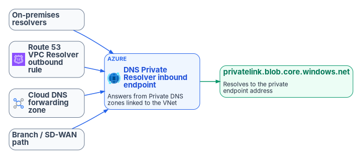

# Module 4: Private Link, DNS and Key Vault {.unnumbered}

*Part of the [Azure Security Engineering learning path](index.md). Guide [Step 7](../../books/guides/azure-security-implementation.md#step-7-private-link-and-dns) and [Step 8](../../books/guides/azure-security-implementation.md#step-8-managed-identities-and-key-vault). About 50 minutes, plus the lab.*

**Watch:** the narrated deck for this module (about 11 minutes, captions): [▶ Watch](../../presentations/watch.html?v=Training_AZS_Module_4_Narrated) · [MP4](https://github.com/WhalerMike/modernization-workbook/releases/download/videos-2026-10-23/Training_AZS_Module_4_Narrated.mp4) · [Deck source](https://github.com/WhalerMike/modernization-workbook/tree/main/presentations/training-azs-module-4) · [Script](https://github.com/WhalerMike/modernization-workbook/blob/main/presentations/training-azs-module-4/Training_AZS_Module_4_Narration_Script.md) · [Captions](https://github.com/WhalerMike/modernization-workbook/blob/main/presentations/training-azs-module-4/Training_AZS_Module_4_Narrated.vtt). The deck files join the next edition.

## Introduction (3 minutes) {#azs-m4-introduction}

A private endpoint gives a PaaS resource an address inside the agency's network; DNS decides whether anyone uses it. And the secrets and keys a workload needs belong in a vault that only its managed identity and eligible administrators can use. This module takes PaaS off the internet, starting with Key Vault, and puts the vault itself behind RBAC, purge protection and an audit log.

**The federal requirement.** The full table is the guide's [Federal requirements and KSIs](../../books/guides/azure-security-implementation.md#requirements).

| Requirement | KSI | Evidence |
|---|---|---|
| Step 7: SC-7 (boundary protection), AC-4 (information flow enforcement) | KSI-CNA-ULN (cites AC-4(21), SC-7) | Zones, endpoints, the public-access state |
| Step 8: SC-12 (cryptographic key establishment and management), SC-28 (protection of information at rest), IA-5 (authenticator management) | KSI-SVC-ASM (cites SC-12, IA-5(2)), KSI-IAM-SNU | Vault posture, rotation policies, AuditEvent |

KSIs are FedRAMP 20x indicators written for cloud service providers; the agency lines its own evidence up with them. The steps *support* these controls, and the assessor decides whether each is satisfied.

## Learning objectives (1 minute) {#azs-m4-objectives}

After this module, you'll be able to:

- name the three things private-endpoint name resolution needs, and where the zones live;
- explain what a private DNS zone group does, and how policy does it at scale;
- prove a vault resolves to a private address inside the network and refuses requests from outside;
- check a vault's RBAC, purge protection, firewall and public access in one command;
- read the audit log for an allowed and a denied secret read, and say why disabling a suspected key comes last.

## Prerequisites (1 minute) {#azs-m4-prerequisites}

- [Module 3](03-the-edge-and-the-egress.md): the hub and its routes.
- The [service account guide, Migration C](../../books/guides/service-account-migration.md#migration-c), for the managed identities a workload uses. Step 8 relies on it and covers the vault only.
- [Book 08](../../books/b08-ddi/index.md), which owns the agency's DNS authority. Skim its index.

## Unit 1: Private Link and DNS (13 minutes) {#azs-m4-unit-1}

Read the guide's [Step 7](../../books/guides/azure-security-implementation.md#step-7-private-link-and-dns). Points to take away:

- **Name resolution is where private endpoints fail.** The zone must exist, be linked to the virtual network and hold the record, and on-premises DNS must forward to Azure.
- **Zones once, centrally.** Each `privatelink` zone is created in the connectivity subscription and linked to the hub. A private DNS zone group registers the A record with the endpoint and removes it with the endpoint.
- **At scale, policy does it.** The Cloud Adoption Framework pattern denies `privatelink` zones in workload subscriptions, denies PaaS with public endpoints, and uses a `deployIfNotExists` policy to add the zone group in the central zone; the policy's managed identity needs Private DNS Zone Contributor on the zones.
- **Public access off** once the private path works; for Key Vault, the firewall's default action is deny.
- **The exfiltration path.** Traffic to a private endpoint can bypass the firewall; where inspection is required, Learn's troubleshooting route sends the endpoint's /32 through it.

{#fig-ch07-private-endpoint-forwarding fig-alt="On-premises resolvers, a Route 53 VPC Resolver outbound rule, a Cloud DNS forwarding zone and the branch SD-WAN path all forward the service's public zone, such as blob.core.windows.net, to the Azure DNS Private Resolver inbound endpoint, which answers from the Private DNS zone privatelink.blob.core.windows.net linked to its virtual network with the private endpoint address."}

## Unit 2: Key Vault (12 minutes) {#azs-m4-unit-2}

Read the guide's [Step 8](../../books/guides/azure-security-implementation.md#step-8-managed-identities-and-key-vault). Learn recommends one vault per application, region and environment; RBAC, not legacy access policies; PIM for administrators; soft delete and purge protection; autorotation; audit logging, Defender for Key Vault and alerts; private endpoints with public access disabled; and tested backups. Points to take away:

- **Purge protection can't be turned off** once it's on; that is the point, and it is never an exclusion.
- **Roles at the vault, not the subscription.** The workload's managed identity gets a data-plane role such as Key Vault Secrets User at the vault's scope; administrators get Key Vault Administrator as an eligible PIM assignment.
- **Rotation by policy.** The guide's rotation policy file is an example; the agency's key management policy sets the periods.
- **A suspected compromise.** Rotate and migrate dependents before disabling the old key, because disabling it takes dependent services offline.

## Unit 3: Where agencies are (4 minutes) {#azs-m4-unit-3}

Read the Private Link and Key Vault rows of the guide's [availability table](../../books/guides/azure-security-implementation.md#gov-availability). In commercial Azure, which a GCC tenant uses, the zone names are the ones the guide's commands use, such as `privatelink.vaultcore.azure.net`.

On other clouds, the guide's [comparison](../../books/guides/azure-security-implementation.md#other-clouds) names Google Cloud's Private Service Connect and OCI private endpoints, a private IP in a VCN subnet for an Oracle service; AWS PrivateLink isn't compared there.

**Watch.** The guide's narrated deck covers this module in slides 13 and 14, *Private Link works only if DNS does* and *vaults behind RBAC, with purge protection*. [▶ Watch the guide's video](../../presentations/watch.html?v=Guide_Azure_Security_Narrated), or read  in the [script](https://github.com/WhalerMike/modernization-workbook/blob/main/presentations/guide-azure-security/Guide_Azure_Security_Narration_Script.md).

## Exercise: Lab 1, fixtures, no subscription {#azs-m4-lab-1}

Run the Lab 1 of this chapter of [*Building Azure Security*](../../project-plans/developer-workbooks/azure-security/index.md), in order. Each is a list of exact commands, run from `examples/azure-security` in PowerShell 7 with Pester 5, against a fictional estate with no subscription, with the output each step prints. They aren't repeated here.

<!-- labs:begin module-lab-1-commands (generated by scripts/generate_labs.py; not part of the reviewed page) -->

::: {.callout-note #module-lab-1-commands collapse="false" title="The Lab 1 commands, on the fixtures"}
Every command in [Chapter 07, Private Link, DNS and Key Vault: Lab 1](../../project-plans/developer-workbooks/azure-security/07-private-link-dns-and-key-vault.md#lab-1-fixtures-no-subscription), in order, on the kit's fixtures, with no tenant.

The chapter's steps say what each command does and what to look for.

```powershell
Set-Location C:\FMWLabs\azure-security-code\azure-security

$Run = "C:\FMWLabs\results\azure-security-07\lab1\$(Get-Date -AsUTC -Format 'yyyy-MM-ddTHHmmssZ')"
New-Item -ItemType Directory -Path $Run -Force | Out-Null
$Run

# Step 1: Run the private-access check
./Invoke-AzsCheck.ps1 -Area private -SettingsPath tests/fixtures/settings.lab.json -FixturePath tests/fixtures/week1 -AsOf 2026-11-09T12:00:00Z -OutputPath "$Run/week1/private"

# Step 2: Read each vault
Import-Module ./powershell/AzureSecurity/AzureSecurity.psm1
(Read-AzsJson -Path "$Run/week1/private/private.json") | Where-Object kind -EQ vault | ForEach-Object { "{0,-13} rbac: {1,-5} purge: {2,-5} firewall: {3,-5} public: {4,-8} endpoints: {5} audit: {6,-5} posture: {7}" -f $_.name, $_.rbac, $_.purgeProtection, $_.defaultAction, $_.publicNetworkAccess, $_.privateEndpoints, $_.auditToWorkspace, $_.posture }

# Step 3: Read each private endpoint and the zone it registers in
(Read-AzsJson -Path "$Run/week1/private/private.json") | Where-Object kind -EQ private-endpoint | ForEach-Object { "{0,-20} {1,-22} {2}" -f $_.name, $_.target, ($_.zones -join ', ') }

# Step 4: Read the findings
Import-Csv "$Run/week1/private/findings.csv" | ForEach-Object { "{0} {1,-7} {2}: {3}" -f $_.rule, $_.severity, $_.name, $_.detail }

# Step 5: Run this chapter's tests
Invoke-Pester -Path tests/Areas.Tests.ps1 -FullNameFilter 'Private*' -Output None -PassThru | Select-Object PassedCount, FailedCount

# After the steps
Get-ChildItem C:\FMWLabs\results\azure-security-07\lab1 -Name
```
:::

<!-- labs:end -->

- [Chapter 07, Private Link, DNS and Key Vault: Lab 1](../../project-plans/developer-workbooks/azure-security/07-private-link-dns-and-key-vault.md#lab-1-fixtures-no-subscription): zones, endpoints and zone groups, and every vault's posture.

Then come back for the Lab 2, which runs the guide's own checks in a test subscription; each chapter's Lab 2 runs the kit there too.

## Exercise: Lab 2, a test subscription {#azs-m4-lab-2}
*Not timed. Not run by the authors. Never production.*

<!-- labs:begin lab-2-commands (generated by scripts/generate_labs.py; not part of the reviewed page) -->

::: {.callout-note #lab-2-commands collapse="false" title="Every command in Lab 2"}
Every command in this lab, in order. Each step below says what it does and what to look for.

```powershell
# Step 1: Resolve the vault from the test VM
nslookup <vault>.vault.azure.net

# Step 2: Resolve and call it from your own machine, outside the network
nslookup <vault>.vault.azure.net
az keyvault secret show --vault-name <vault> --name <secret-name> --query name

# Step 3: Check the private endpoint's zone group
az network private-endpoint dns-zone-group list --endpoint-name <pe-name> --resource-group <rg> -o table

# Step 4: Rerun Module 1's public PaaS query
az graph query -q "Resources | where isnotempty(properties.publicNetworkAccess) and tostring(properties.publicNetworkAccess) !~ 'Disabled' | project id, type, publicNetworkAccess = tostring(properties.publicNetworkAccess), owner = tostring(tags['owner'])" --first 1000 -o table

# Step 5: Check the vault's posture
az keyvault show --name <vault> --query "{rbac:properties.enableRbacAuthorization, purge:properties.enablePurgeProtection, net:properties.networkAcls.defaultAction, pna:properties.publicNetworkAccess}"

# Step 6: Export the key's rotation policy
az keyvault key rotation-policy show --vault-name <vault> --name <key>

# Step 7: On the test VM, read the secret as its managed identity
az login --identity
az keyvault secret show --vault-name <vault> --name <secret-name> --query name
az logout

# Step 8: On the test VM, read the secret as yourself
az login
az keyvault secret show --vault-name <vault> --name <secret-name> --query name
az logout

# Step 9: Find both reads in the audit log
az extension add --name log-analytics
az monitor log-analytics query --workspace <workspace-guid> --analytics-query "AzureDiagnostics | where ResourceProvider == 'MICROSOFT.KEYVAULT' and TimeGenerated > ago(1h) | project TimeGenerated, OperationName, ResultSignature, CallerIPAddress" -o table
```

:::

<!-- labs:end -->

You run the guide's Step 7 and Step 8 checks in a test subscription where someone has applied those steps to a test vault. You read a secret twice: once as the test VM's managed identity, which has a role on the vault, and once as yourself, without one. Nothing in Azure changes.

- **You need:** a test subscription, never production, with a key vault on RBAC with purge protection, a private endpoint, public access disabled and its AuditEvent diagnostic setting, holding a test secret and a key with a rotation policy; a Windows test VM in a virtual network linked to `privatelink.vaultcore.azure.net`, with Azure CLI and a managed identity that has Key Vault Secrets User on the vault; your own account with Reader on the subscription, Log Analytics Reader on the workspace, and no data-plane role on the vault; Azure CLI on your Windows machine with PowerShell 7, signed in as Module 1's step 1 shows.
- **You'll replace:** `<vault>`, `<rg>`, `<pe-name>`, `<secret-name>` (the test secret), `<key>` and `<workspace-guid>` (the workspace's *Workspace ID*).
- **Not run by the authors.** The expected results are the ones the guide's **Validate** steps state.

1. **Resolve the vault from the test VM.** Sign in to the test VM and run this in its PowerShell.

    ```powershell
    nslookup <vault>.vault.azure.net
    ```

    Expected result, from the guide's Validate: a private address, through `privatelink.vaultcore.azure.net`.

2. **Resolve and call it from your own machine, outside the network.**

    ```powershell
    nslookup <vault>.vault.azure.net
    az keyvault secret show --vault-name <vault> --name <secret-name> --query name
    ```

    Expected result, from the guide's Validate: the public frontend's address, which refuses the request.

3. **Check the private endpoint's zone group.**

    ```powershell
    az network private-endpoint dns-zone-group list --endpoint-name <pe-name> --resource-group <rg> -o table
    ```

4. **Rerun Module 1's public PaaS query.**

    ```powershell
    az graph query -q "Resources | where isnotempty(properties.publicNetworkAccess) and tostring(properties.publicNetworkAccess) !~ 'Disabled' | project id, type, publicNetworkAccess = tostring(properties.publicNetworkAccess), owner = tostring(tags['owner'])" --first 1000 -o table
    ```

    Expected result, from the guide's Validate: the vault and the other resources in scope don't appear, because they show `Disabled`.

5. **Check the vault's posture.**

    ```powershell
    az keyvault show --name <vault> --query "{rbac:properties.enableRbacAuthorization, purge:properties.enablePurgeProtection, net:properties.networkAcls.defaultAction, pna:properties.publicNetworkAccess}"
    ```

    Expected result, from the guide's Validate: `true`, `true`, `Deny` and, where public access is off, `Disabled`.

6. **Export the key's rotation policy.**

    ```powershell
    az keyvault key rotation-policy show --vault-name <vault> --name <key>
    ```

7. **On the test VM, read the secret as its managed identity.**

    ```powershell
    az login --identity
    az keyvault secret show --vault-name <vault> --name <secret-name> --query name
    az logout
    ```

    The secret's name comes back: the identity's role allows the read.

8. **On the test VM, read the secret as yourself.** Your account has no data-plane role on the vault.

    ```powershell
    az login
    az keyvault secret show --vault-name <vault> --name <secret-name> --query name
    az logout
    ```

    The request is refused as forbidden: the network allows it, and RBAC doesn't.

9. **Find both reads in the audit log.** Back on your own machine. The guide's Step 8 diagnostic setting writes to the workspace's `AzureDiagnostics` table, which Learn's [Monitor Azure Key Vault](https://learn.microsoft.com/azure/key-vault/general/monitor-key-vault) queries filter by `ResourceProvider`; `ResultSignature` holds the HTTP status, such as `OK` or `Forbidden`.

    ```powershell
    az extension add --name log-analytics
    az monitor log-analytics query --workspace <workspace-guid> --analytics-query "AzureDiagnostics | where ResourceProvider == 'MICROSOFT.KEYVAULT' and TimeGenerated > ago(1h) | project TimeGenerated, OperationName, ResultSignature, CallerIPAddress" -o table
    ```

    Expected result, from the guide's Validate: a row for the managed identity's read, and a row for your read, denied.

10. **Back it out.** Both `az logout` commands signed out of the test VM; nothing in Azure changed.

## Knowledge check (5 minutes) {#azs-m4-check}

1. A private endpoint exists, but clients still reach the vault's public address. Where does the guide say to look first?
    a. The vault's RBAC roles.
    b. Name resolution: the zone, its link to the virtual network, the record, and on-premises forwarding.
    c. The firewall's IDPS mode.

2. Where are the `privatelink` zones created?
    a. In each workload subscription, next to the endpoint.
    b. Once, centrally, in the connectivity subscription, linked to the hub; policy denies them in workload subscriptions.
    c. In the on-premises DNS.

3. Can purge protection be excluded for a vault that needs to be deleted quickly?
    a. Yes, by an exemption with an expiry.
    b. No: it can't be turned off once on, and the guide never excludes a vault from it.
    c. Yes, by switching the vault to access policies.

4. A key is suspected compromised. What comes first?
    a. Disable the key immediately.
    b. Rotate and migrate dependents, then disable the old key, because disabling it first takes dependent services offline.
    c. Delete the vault.

5. In the lab, the network allowed your read from the test VM. Why was it refused?
    a. The firewall denied it.
    b. Your account has no data-plane role on the vault: RBAC refused it.
    c. Purge protection blocks reads.

::: {.callout-tip collapse="true"}
## Check your answers
1. **b.** See Unit 1 and the guide's [Step 7](../../books/guides/azure-security-implementation.md#step-7-private-link-and-dns).
2. **b.** See Unit 1.
3. **b.** See Unit 2 and the guide's [Step 8](../../books/guides/azure-security-implementation.md#step-8-managed-identities-and-key-vault).
4. **b.** See Unit 2 and the guide's [dangers](../../books/guides/azure-security-implementation.md#dangers).
5. **b.** See the lab's step 8 and the guide's [Validate (Step 8)](../../books/guides/azure-security-implementation.md#step-8-managed-identities-and-key-vault).
:::

## Summary (2 minutes) {#azs-m4-summary}

You proved the vault resolves privately inside the network and refuses requests from outside, checked its RBAC, purge protection, firewall and rotation policy, and found an allowed and a denied read in its audit log. **Evidence an ISSO keeps from this module:** zones, links, endpoints and zone groups; the policy compliance for the private DNS and public-access policies; the two `nslookup` results and the refused public request; the vault properties export, role assignments at vault scope and rotation policies; the AuditEvent rows; and the restore test when it runs.

::: {.callout-tip}
## Continue the path
[← Previous: Module 3](03-the-edge-and-the-egress.md) · [Learning path](index.md) · [Next: Module 5, Policy, drift and evidence →](05-policy-drift-and-evidence.md)
:::
