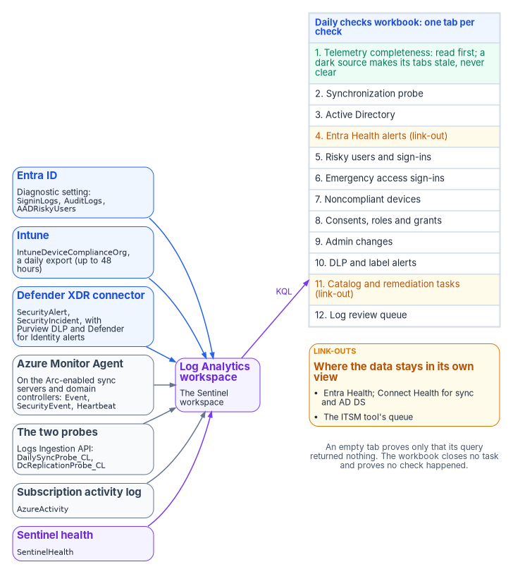

# Module 1: One workbook, one tab per daily check {.unnumbered}

*Part of the [Daily Checks Dashboard learning path](index.md). Guide [Step 1](../../books/guides/daily-checks-dashboard-implementation.md#step-1) and [Step 2](../../books/guides/daily-checks-dashboard-implementation.md#step-2). About 40 minutes, plus Lab 2.*

**Watch:** the narrated deck for this module (about 6 minutes, captions): [▶ Watch](../../presentations/watch.html?v=Training_DC_Module_1_Narrated) · [MP4](https://github.com/WhalerMike/modernization-workbook/releases/download/videos-2026-10-23/Training_DC_Module_1_Narrated.mp4) · [Deck source](https://github.com/WhalerMike/modernization-workbook/tree/main/presentations/training-dc-module-1) · [Script](https://github.com/WhalerMike/modernization-workbook/blob/main/presentations/training-dc-module-1/Training_DC_Module_1_Narration_Script.md) · [Captions](https://github.com/WhalerMike/modernization-workbook/blob/main/presentations/training-dc-module-1/Training_DC_Module_1_Narrated.vtt). The deck files join the next edition.

## Introduction (3 minutes) {#dc-m1-intro}

Each morning the operator runbook asks for twelve checks: synchronization (with the synchronization servers' own errors and backup), telemetry completeness, the domain controllers, Entra Health, risky users and sign-ins, emergency access sign-ins, noncompliant devices, ungoverned grants, request-driven admin changes, DLP and label alerts, catalog tasks, and the log review queue. Most of their data is already in the Sentinel workspace. In this module you see which checks a workbook can show and from which table, which ones it can only link to, and how the workbook is kept as a reviewed file rather than something edited in the portal.

**The federal requirement.** The full table is the guide's [Federal requirements and KSIs, by step](../../books/guides/daily-checks-dashboard-implementation.md#requirements).

| Requirement | KSI | Evidence |
|---|---|---|
| CA-7, SI-4: the monitoring each check does is visible, and each tab's tables answer | KSI-MLA-EVC, KSI-MLA-LET | The reachability record (Module 2) |
| CM-2, CM-3: the template is the reviewed build and carries no IDs | KSI-SVC-ACM, KSI-CMT-LMC | The validation record and the template's SHA-256 |

The steps support these controls and provide evidence for them; the assessor decides whether each is satisfied. KSIs are FedRAMP 20x indicators for cloud service providers: the agency lines its own evidence up with them and doesn't report KSIs itself.

## Learning objectives (1 minute) {#dc-m1-objectives}

After this module, you'll be able to:

- name the dashboard options in Azure and say why the design is one workbook;
- say, for each daily check, its table or its link-out, and how well it fits;
- give each source's GCC availability;
- build the template from the manifest and validate a portal export.

## Unit 1: Dashboards in Azure and Microsoft 365 (6 minutes) {#dc-m1-options}

Read the guide's [Dashboards in Azure and Microsoft 365](../../books/guides/daily-checks-dashboard-implementation.md#options). Microsoft's guidance compares workbooks, portal dashboards, Dashboards with Grafana (a preview), Azure Managed Grafana and Power BI; workbooks read the widest set of Azure data and can be managed as ARM templates. Microsoft 365 has built-in views in each admin center, but no single custom dashboard: a view across them needs their logs in Log Analytics. So the design is one workbook in the Sentinel workspace, and a link out where a check's data stays in another portal.

## Unit 2: The twelve tabs and where each lives (10 minutes) {#dc-m1-tabs}

Read the guide's [What each daily check can show, and from where](../../books/guides/daily-checks-dashboard-implementation.md#tabs) and [GCC availability](../../books/guides/daily-checks-dashboard-implementation.md#availability). Ten tabs query tables; two (Entra Health and the ITSM task queue) link out. Three of the ten are partial: the grants and admin changes tabs list changes but the match to a ticket stays in the ITSM tool (consents and Entra role assignments on grants, everything else request-driven on admin changes, never both), and the log review tab shows the queue while the review stays a recorded procedure. The synchronization servers and domain controllers send their event logs and heartbeats through the Azure Monitor Agent, not to a file share, and each server has its own row, so one that stops sending is flagged. Each source's GCC availability is from Learn; Entra Health monitoring and Connect Health are *not yet specified*, so their tabs are link-outs.

{#fig-daily-checks-sources-and-tabs fig-alt="A left-to-right diagram. Seven source cards on the left feed the Log Analytics workspace, the Sentinel workspace: Entra ID, through a diagnostic setting, with SigninLogs, AuditLogs and AADRiskyUsers; Intune, with IntuneDeviceComplianceOrg, a daily export that can take up to 48 hours; the Defender XDR connector, with SecurityAlert and SecurityIncident, including Purview DLP and Defender for Identity alerts; the Azure Monitor Agent on the Arc-enabled synchronization servers and domain controllers, with Event, SecurityEvent and Heartbeat; the two probes, through the Logs Ingestion API, with DailySyncProbe_CL and DcReplicationProbe_CL; the subscription activity log, with AzureActivity; and Sentinel health, with SentinelHealth. An arrow labeled KQL leads from the workspace to the Daily checks workbook, one tab per check, in twelve rows: 1, telemetry completeness, highlighted green, read first, because a dark source makes its tabs stale, never clear; 2, synchronization probe; 3, Active Directory; 4, Entra Health alerts, a link-out; 5, risky users and sign-ins; 6, emergency access sign-ins; 7, noncompliant devices; 8, consents, roles and grants; 9, admin changes; 10, DLP and label alerts; 11, catalog and remediation tasks, a link-out; and 12, log review queue. An amber card lists the link-outs, where the data stays in its own view: Entra Health, Connect Health for sync and AD DS, and the ITSM tool's queue. A note says an empty tab proves only that its query returned nothing, and the workbook closes no task and proves no check happened."}

## Unit 3: The template as code (8 minutes) {#dc-m1-template}

Read the guide's [Step 2](../../books/guides/daily-checks-dashboard-implementation.md#step-2) and [Chapter 02](../../project-plans/developer-workbooks/daily-checks/02-the-workbook-template-and-its-validator.md)'s *The code*. The template is built from the manifest and one KQL file per query. Its validator runs ten checks; the ones that matter most in practice are DC-V-04 (a widened look-back), DC-V-05 (a query on another workspace), DC-V-06 (the banner) and DC-V-10 (IDs an export embeds, which Learn says to mask).

## Exercise: Lab 1, fixtures, no tenant {#dc-m1-lab-1}
*About 15 minutes per chapter. No tenant: it runs on a laptop.*

Follow these as written; their commands are listed below:

<!-- labs:begin module-lab-1-commands (generated by scripts/generate_labs.py; not part of the reviewed page) -->

::: {.callout-note #module-lab-1-commands collapse="false" title="The Lab 1 commands, on the fixtures"}
Every command in the 2 chapters' labs, chapter by chapter, in order, on the kit's fixtures, with no tenant.

The chapter's steps say what each command does and what to look for.

**[Chapter 01, Lab 1](../../project-plans/developer-workbooks/daily-checks/01-the-daily-checks-and-where-each-lives.md#lab-1-fixtures-no-tenant)**

```powershell
Set-Location C:\FMWLabs\daily-checks-workbook-code\daily-checks-workbook

$Run = "C:\FMWLabs\results\daily-checks-01\lab1\$(Get-Date -AsUTC -Format 'yyyy-MM-ddTHHmmssZ')"
New-Item -ItemType Directory -Path $Run -Force | Out-Null
$Run

# Step 1: List the tabs
./Show-DcManifest.ps1

# Step 2: Open a link-out tab
./Show-DcManifest.ps1 -Id entra-health

# Step 3: Open a partial tab
./Show-DcManifest.ps1 -Id grants

# Step 4: Open the Active Directory tab
./Show-DcManifest.ps1 -Id active-directory

# Step 5: Count the tabs by fit
Import-Module ./powershell/DailyChecks/DailyChecks.psm1
Get-DcTab | Group-Object Fit | Sort-Object Name | Select-Object Name, Count

# Step 6: Read the emergency access query
Get-Content queries/emergency-access-1.kql

# Step 7: List the expected tables and their freshness limits
(Get-DcManifest).expectedTables | ForEach-Object { [pscustomobject]$_ } | Format-Table table, slaMinutes

# Step 8: Run this chapter's tests
Invoke-Pester -Path tests/DailyChecks.Tests.ps1 -FullNameFilter 'Chapter 01*' -Output None -PassThru | Select-Object PassedCount, FailedCount

# After the steps
Get-ChildItem C:\FMWLabs\results\daily-checks-01\lab1 -Name
```

**[Chapter 02, Lab 1](../../project-plans/developer-workbooks/daily-checks/02-the-workbook-template-and-its-validator.md#lab-1-fixtures-no-tenant)**

```powershell
Set-Location C:\FMWLabs\daily-checks-workbook-code\daily-checks-workbook

$Run = "C:\FMWLabs\results\daily-checks-02\lab1\$(Get-Date -AsUTC -Format 'yyyy-MM-ddTHHmmssZ')"
New-Item -ItemType Directory -Path $Run -Force | Out-Null
$Run

# Step 1: Confirm the committed template is the build of the manifest and the queries
./New-DcWorkbookTemplate.ps1 -Check

# Step 2: Validate it
./Test-DcWorkbook.ps1

# Step 3: Validate a copy exported after someone edited the workbook in the portal
./Test-DcWorkbook.ps1 -TemplatePath tests/fixtures/exported/edited.workbook.json

# Step 4: See what the export carried into its fallbackResourceIds
Import-Module ./powershell/DailyChecks/DailyChecks.psm1
(Read-DcJson -Path tests/fixtures/exported/edited.workbook.json).fallbackResourceIds

# Step 5: Record a validation of the kit's template
./Test-DcWorkbook.ps1 -OutputPath "$Run/validate" -AsOf 2026-11-16T07:05:00Z
(Test-DcRunFolder -Path "$Run/validate").Detail

# Step 6: Run this chapter's tests
Invoke-Pester -Path tests/DailyChecks.Tests.ps1 -FullNameFilter 'Chapter 02*' -Output None -PassThru | Select-Object PassedCount, FailedCount

# After the steps
Get-ChildItem C:\FMWLabs\results\daily-checks-02\lab1 -Name
```
:::

<!-- labs:end -->

- [Chapter 01, Lab 1](../../project-plans/developer-workbooks/daily-checks/01-the-daily-checks-and-where-each-lives.md#lab-1-fixtures-no-tenant): the twelve tabs, a link-out tab, a partial tab, the Active Directory tab, the emergency access query and the freshness limits.
- [Chapter 02, Lab 1](../../project-plans/developer-workbooks/daily-checks/02-the-workbook-template-and-its-validator.md#lab-1-fixtures-no-tenant): the template is the build, it validates, and an edited export fails four checks.

## Exercise: Lab 2, a test workspace {#dc-m1-lab-2}
*Not timed. Not run by the authors. Never production.*

<!-- labs:begin module-lab-2-commands (generated by scripts/generate_labs.py; not part of the reviewed page) -->

::: {.callout-note #module-lab-2-commands collapse="false" title="The Lab 2 commands, against your test environment"}
Every command in the 2 chapters' labs, chapter by chapter, in order, against your test environment, never production.

Replace each `<placeholder>` with your test environment's value.

The chapter's steps say what each command does and what to look for.

**[Chapter 01, Lab 2](../../project-plans/developer-workbooks/daily-checks/01-the-daily-checks-and-where-each-lives.md#lab-2-a-test-workspace)**

```powershell
# Step 1: Sign in to commercial Azure
az cloud set --name AzureCloud
az login --tenant <tenant-id>

# Step 2: List the workspace's tables, and the manifest's tables the workspace doesn't have
Import-Module ./powershell/DailyChecks/DailyChecks.psm1
$have = az monitor log-analytics workspace table list --resource-group <workspace-resource-group> --workspace-name <workspace-name> --query "[].name" -o tsv
(Get-DcManifest).tabs | ForEach-Object { $_.tables } | Sort-Object -Unique | Where-Object { $_ -notin $have }

# Step 3: Back it out
az logout
```

**[Chapter 02, Lab 2](../../project-plans/developer-workbooks/daily-checks/02-the-workbook-template-and-its-validator.md#lab-2-a-test-workspace)**

```powershell
# Step 1: Open the template in the portal
az cloud set --name AzureCloud
az login --tenant <tenant-id>
az account set --subscription <subscription-id>
az deployment group create --name daily-checks-lab --resource-group <resource-group> --template-file deploy/main.json --parameters "workbookDisplayName=Daily checks (lab)" workbookSourceId=<workspace-resource-id> serializedData=@workbook/daily-checks.workbook.json --query properties.outputs.workbookId.value -o tsv

# Step 2: Save, edit, export
$wb = az rest --method get --url "https://management.azure.com<workbook-id>?api-version=2023-06-01&canFetchContent=true" | Out-String | ConvertFrom-Json
([regex]'ago\(1d\)').Replace($wb.properties.serializedData, 'ago(30d)', 1) | Set-Content <downloads-folder>/daily-checks-edited.json
az deployment group create --name daily-checks-lab --resource-group <resource-group> --template-file deploy/main.json --parameters "workbookDisplayName=Daily checks (lab)" workbookSourceId=<workspace-resource-id> serializedData=@<downloads-folder>/daily-checks-edited.json -o none
(az rest --method get --url "https://management.azure.com<workbook-id>?api-version=2023-06-01&canFetchContent=true" | Out-String | ConvertFrom-Json).properties.serializedData | Set-Content <downloads-folder>/daily-checks-export.json
Remove-Item <downloads-folder>/daily-checks-edited.json

# Step 3: Validate the export
./Test-DcWorkbook.ps1 -TemplatePath <downloads-folder>/daily-checks-export.json

# Step 4: Back it out
Remove-Item <downloads-folder>/daily-checks-export.json
```
:::

<!-- labs:end -->

- [Chapter 01, Lab 2](../../project-plans/developer-workbooks/daily-checks/01-the-daily-checks-and-where-each-lives.md#lab-2-a-test-workspace): list which of the manifest's tables the test workspace has.
- [Chapter 02, Lab 2](../../project-plans/developer-workbooks/daily-checks/02-the-workbook-template-and-its-validator.md#lab-2-a-test-workspace): open the template in the portal, save a test copy, edit it, export it and validate the export; then delete the copy.

## Knowledge check (5 minutes) {#dc-m1-check}

1. Why is the design one Azure Monitor workbook rather than Dashboards with Grafana?
    a. Grafana can't read Log Analytics.
    b. Dashboards with Grafana is a preview, and the workbook reads the same data and can be kept as an ARM template.
    c. Workbooks are the only option in commercial Azure.

2. Entra Health monitoring alerts are a daily check. What does their tab show?
    a. A query over `SigninLogs`.
    b. A link out to the Microsoft Entra admin center, because the alerts aren't in Log Analytics and their GCC availability is not yet specified.
    c. Nothing; the check is dropped.

3. The grants tab lists a consent from yesterday. Is the grant governed?
    a. Yes, because it appears on the tab.
    b. Not known from the tab: the match to a ticket happens in the ITSM tool, and a grant with no ticket opens a finding.
    c. No, every listed grant is ungoverned.

4. An export from the portal has the workspace's path in `fallbackResourceIds`. Which check fails?
    a. DC-V-10: the template carries a subscription path; the deployment plan fills IDs per environment.
    b. DC-V-02.
    c. None; the portal adds it.

5. A password reset appears in yesterday's audit log. Which tab lists it, and what does the operator do?
    a. The grants tab; it is closed there.
    b. The admin changes tab; the operator matches it to its ticket in the ITSM tool, and a reset with no ticket opens a finding.
    c. Neither; resets aren't logged.

6. Why is the devices tab's freshness limit 48 hours?
    a. To hide late data.
    b. Intune exports compliance once every 24 hours, and it can take up to 48 hours to arrive.
    c. Because devices check in every two days.

::: {.callout-tip collapse="true"}
## Check your answers
1. **b.** See Unit 1 and the guide's [options table](../../books/guides/daily-checks-dashboard-implementation.md#options).
2. **b.** See Unit 2 and the guide's [availability table](../../books/guides/daily-checks-dashboard-implementation.md#availability).
3. **b.** See Unit 2 and the guide's [tab table](../../books/guides/daily-checks-dashboard-implementation.md#tabs).
4. **a.** See Unit 3 and [Chapter 02](../../project-plans/developer-workbooks/daily-checks/02-the-workbook-template-and-its-validator.md).
5. **b.** See Unit 2 and the guide's [tab table](../../books/guides/daily-checks-dashboard-implementation.md#tabs).
6. **b.** See Unit 2 and the guide's [Step 1](../../books/guides/daily-checks-dashboard-implementation.md#step-1).
:::

## Summary (2 minutes) {#dc-m1-summary}

You placed every daily check on a tab or a link-out, gave each source its GCC availability, and kept the workbook as a reviewed template that a validator checks. **Evidence an ISSO keeps from this module:** the validation record (`results.json` and the template's SHA-256), recorded in Module 2.

::: {.callout-tip}
## Continue the path
[Learning path](index.md) · [Next: Module 2, Reading it, deploying it and keeping the evidence →](02-reading-deploying-and-the-evidence.md)
:::
