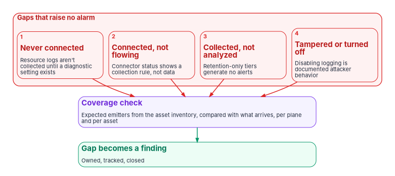

# Module 2: Reading it, deploying it and keeping the evidence {.unnumbered}

*Part of the [Daily Checks Dashboard learning path](index.md). Guide [Steps 3](../../books/guides/daily-checks-dashboard-implementation.md#step-3) to [6](../../books/guides/daily-checks-dashboard-implementation.md#step-6). About 40 minutes, plus Lab 2.*

**Watch:** the narrated deck for this module (about 5 minutes, captions): [▶ Watch](../../presentations/watch.html?v=Training_DC_Module_2_Narrated) · [MP4](https://github.com/WhalerMike/modernization-workbook/releases/download/videos-2026-10-23/Training_DC_Module_2_Narrated.mp4) · [Deck source](https://github.com/WhalerMike/modernization-workbook/tree/main/presentations/training-dc-module-2) · [Script](https://github.com/WhalerMike/modernization-workbook/blob/main/presentations/training-dc-module-2/Training_DC_Module_2_Narration_Script.md) · [Captions](https://github.com/WhalerMike/modernization-workbook/blob/main/presentations/training-dc-module-2/Training_DC_Module_2_Narrated.vtt). The deck files join the next edition.

## Introduction (3 minutes) {#dc-m2-intro}

A dashboard's most dangerous state isn't red. It is green over a source that stopped arriving. In this module you read the workbook the way an operator should, telemetry first, then deploy it the way a change should go, previewed and approved, and keep the evidence the way an assessor needs it: the checks' own records, never the picture.

**The federal requirement.** The full table is the guide's [Federal requirements and KSIs, by step](../../books/guides/daily-checks-dashboard-implementation.md#requirements).

| Requirement | KSI | Evidence |
|---|---|---|
| CM-3, CM-4: the deployment previewed with what-if and approved by hash | KSI-CMT-LMC, KSI-CMT-RVP | `plan.json`, `whatif.json`, the change record |
| CA-7, SI-4: each tab's tables answer, with their age | KSI-MLA-EVC, KSI-MLA-LET | `reach.json` |
| CA-7, AU-9: the records hashed and chained | KSI-MLA-EVC, KSI-MLA-OSM | `records/`, `SHA256SUMS` |

The steps support these controls; the assessor decides whether each is satisfied. KSIs are framed as in Module 1.

## Learning objectives (1 minute) {#dc-m2-objectives}

After this module, you'll be able to:

- read each tab as ATTENTION, CLEAR, STALE, NO DATA or LINK-OUT;
- explain why an empty queue over a stale source is STALE;
- run the reachability check and read its result;
- deploy by an approved hash, and roll back;
- say what is, and isn't, evidence.

## Unit 1: Reading the workbook (10 minutes) {#dc-m2-reading}

Read the guide's [Step 5](../../books/guides/daily-checks-dashboard-implementation.md#step-5) and [Chapter 03](../../project-plans/developer-workbooks/daily-checks/03-what-each-tab-would-show.md)'s *The code*. Telemetry completeness comes first, because every other tab depends on its sources. A tab with no rows has only proved its query returned nothing: if its source has gone quiet, the renderer shows STALE, and so should the operator's reading. A missed probe shows yesterday's verdict, so its tab is STALE too. A synchronization server or domain controller that stops sending isn't an empty list: it is a row with an old heartbeat, flagged. The replication probe needs Enterprise Admins or equivalent to read replication, so it runs only on a Tier 0 host, or not at all ([Chapter 04](../../project-plans/developer-workbooks/daily-checks/04-deploying-to-test-and-production.md#the-replication-probe-where-the-tier-0-owner-approves-it)). Each finding becomes a task; the workbook never closes one.

{#fig-ch01-silent-gaps fig-alt="Four numbered red cards in a row across the top, grouped as gaps that raise no alarm. One, never connected: resource logs aren't collected until a diagnostic setting exists, so the source never sends anything. Two, connected but not flowing: a connector status can show a collection rule exists while no data arrives. Three, collected but not analyzed: data in a retention-only tier generates no alerts. Four, tampered or turned off: disabling or altering logging is documented attacker behavior. All four point down to one violet card, coverage check: expected emitters from the asset inventory, compared with what actually arrives, per plane and per asset. Below it, a green card: the gap becomes a finding, owned, tracked and closed."}

## Unit 2: Deploying it (10 minutes) {#dc-m2-deploying}

Read the guide's [Steps 3](../../books/guides/daily-checks-dashboard-implementation.md#step-3) and [4](../../books/guides/daily-checks-dashboard-implementation.md#step-4), then skim [Chapter 04](../../project-plans/developer-workbooks/daily-checks/04-deploying-to-test-and-production.md). What-if previews the change and makes none; it needs the same deployment rights as the deployment. The plan's SHA-256 is what a second person approves, and the kit deploys nothing else; it refuses a plan with a Delete. The deployer holds Workbook Contributor and deployment rights on the resource group only, for the window. Rollback is a redeploy of the previous approved plan, or a delete that removes a view and nothing else.

## Unit 3: The evidence (6 minutes) {#dc-m2-evidence}

Read the guide's [Step 6](../../books/guides/daily-checks-dashboard-implementation.md#step-6) and [Dangers](../../books/guides/daily-checks-dashboard-implementation.md#dangers). The kit records the validation, preflight, plan, deployment, reachability check and rollback plan, each hashed and chained. It refuses a render: "A rendered view is not evidence." The stage's go/no-go counts only live records.

## Exercise: Lab 1, fixtures, no tenant {#dc-m2-lab-1}
*About 15 minutes. No tenant: it runs on a laptop.*

<!-- labs:begin module-lab-1-commands (generated by scripts/generate_labs.py; not part of the reviewed page) -->

::: {.callout-note #module-lab-1-commands collapse="false" title="The Lab 1 commands, on the fixtures"}
Every command in [Chapter 03, Lab 1](../../project-plans/developer-workbooks/daily-checks/03-what-each-tab-would-show.md#lab-1-fixtures-no-tenant), in order, on the kit's fixtures, with no tenant.

The chapter's steps say what each command does and what to look for.

```powershell
Set-Location C:\FMWLabs\daily-checks-workbook-code\daily-checks-workbook

$Run = "C:\FMWLabs\results\daily-checks-03\lab1\$(Get-Date -AsUTC -Format 'yyyy-MM-ddTHHmmssZ')"
New-Item -ItemType Directory -Path $Run -Force | Out-Null
$Run

# Step 1: Render the morning of November 16
./Invoke-DcRender.ps1 -FixturePath tests/fixtures/day1 -AsOf 2026-11-16T07:30:00Z -OutputPath "$Run/day1"

# Step 2: Look at what the risk tab's query returned
Get-Content tests/fixtures/day1/risk.json

# Step 3: Render the next morning
./Invoke-DcRender.ps1 -FixturePath tests/fixtures/day2 -AsOf 2026-11-17T07:30:00Z -OutputPath "$Run/day2"

# Step 4: Run the replication probe on day 1's saved repadmin output
./Invoke-DcReplicationProbe.ps1 -SettingsPath tests/fixtures/settings.lab.json -InputPath tests/fixtures/repl/showrepl-day1.csv -OutputPath "$Run/probe" -AsOf 2026-11-16T06:00:00Z

# Step 5: Check each table's reachability on day 1
./deploy/Test-DcReachability.ps1 -SettingsPath tests/fixtures/settings.lab.json -FixturePath tests/fixtures/reach-day1.json -OutputPath "$Run/reach" -AsOf 2026-11-16T07:30:00Z

# Step 6: Try to record the render as evidence
try { ./Invoke-DcEvidence.ps1 -EvidencePath "$Run/evidence" -RunPath "$Run/day1" -AsOf 2026-11-16T07:31:00Z } catch { $_.Exception.Message }

# Step 7: Record the reachability check and the probe instead
./Invoke-DcEvidence.ps1 -EvidencePath "$Run/evidence" -RunPath "$Run/reach" -AsOf 2026-11-16T07:32:00Z
./Invoke-DcEvidence.ps1 -EvidencePath "$Run/evidence" -RunPath "$Run/probe" -AsOf 2026-11-16T07:33:00Z

# Step 8: Run this chapter's tests
Invoke-Pester -Path tests/DailyChecks.Tests.ps1 -FullNameFilter 'Chapter 03*', 'Evidence*' -Output None -PassThru | Select-Object PassedCount, FailedCount

# After the steps
Get-ChildItem C:\FMWLabs\results\daily-checks-03\lab1 -Name
```
:::

<!-- labs:end -->

- [Chapter 03, Lab 1](../../project-plans/developer-workbooks/daily-checks/03-what-each-tab-would-show.md#lab-1-fixtures-no-tenant): the morning SigninLogs stopped and a domain controller went silent, and the next morning; the replication probe on saved `repadmin` output; the reachability check; and the refused render.
- [Chapter 04](../../project-plans/developer-workbooks/daily-checks/04-deploying-to-test-and-production.md), step 4: read the fixture-mode plan output, the one **Create** and the SHA-256 to approve.

## Exercise: Lab 2, a test workspace {#dc-m2-lab-2}
*Not timed. Not run by the authors. Never production.*

<!-- labs:begin module-lab-2-commands (generated by scripts/generate_labs.py; not part of the reviewed page) -->

::: {.callout-note #module-lab-2-commands collapse="false" title="The Lab 2 commands, against your test environment"}
Every command in [Chapter 03, Lab 2](../../project-plans/developer-workbooks/daily-checks/03-what-each-tab-would-show.md#lab-2-a-test-workspace), in order, against your test environment, never production.

Replace each `<placeholder>` with your test environment's value.

The chapter's steps say what each command does and what to look for.

```powershell
# Step 1: Sign in to commercial Azure and add the query extension
az cloud set --name AzureCloud
az login --tenant <tenant-id>
az extension add --name log-analytics

# Step 2: Run the reachability check
./deploy/Test-DcReachability.ps1 -SettingsPath <settings-file> -OutputPath <output-folder>/reach

# Step 3: Back it out
az logout
Remove-Item -Recurse -Force <output-folder>/reach
```
:::

<!-- labs:end -->

- [Chapter 03, Lab 2](../../project-plans/developer-workbooks/daily-checks/03-what-each-tab-would-show.md#lab-2-a-test-workspace): the reachability check against the test workspace.
- Then, with a change record, Chapter 04's Stage 1 in the test subscription.

## Knowledge check (5 minutes) {#dc-m2-check}

1. On the morning `SigninLogs` stopped, the risk tab returns no rows. What does it show?
    a. CLEAR: no risky users.
    b. STALE: its source is past its 60-minute limit, so the empty queue proves nothing.
    c. NO DATA.

2. What does `az deployment group what-if` change?
    a. Nothing: it predicts the changes, with the same permissions a deployment needs.
    b. It deploys in a test mode.
    c. It creates the resource group.

3. The plan's what-if shows a Delete. What does the kit do?
    a. Deploys, because the hash was approved.
    b. Refuses the plan: the workbook deployment never deletes.
    c. Asks for confirmation.

4. Which of these does the kit record as evidence?
    a. The rendered view of the workbook.
    b. The reachability check, with each table's age and its controls.
    c. A screenshot of the telemetry tab.

5. What does deleting the workbook during a rollback remove?
    a. The log data behind it.
    b. A view only: no log data, alert rule or task changes.
    c. The alert rules.

::: {.callout-tip collapse="true"}
## Check your answers
1. **b.** See Unit 1 and [Chapter 03](../../project-plans/developer-workbooks/daily-checks/03-what-each-tab-would-show.md).
2. **a.** See Unit 2 and the guide's [Step 3](../../books/guides/daily-checks-dashboard-implementation.md#step-3).
3. **b.** See Unit 2 and the guide's [Step 3](../../books/guides/daily-checks-dashboard-implementation.md#step-3).
4. **b.** See Unit 3 and the guide's [Step 6](../../books/guides/daily-checks-dashboard-implementation.md#step-6).
5. **b.** See Unit 2 and the guide's [Step 4](../../books/guides/daily-checks-dashboard-implementation.md#step-4).
:::

## Summary (2 minutes) {#dc-m2-summary}

You read the workbook telemetry first, deployed it previewed and approved by hash, and kept the checks' records as the evidence. **Evidence an ISSO keeps from this module:** the evidence folder with the preflight, validation, plan, deployment, reachability and rollback records, `records.csv` and `SHA256SUMS`, and the change record with the approved SHA-256. No render or screenshot.

::: {.callout-tip}
## Continue the path
[← Module 1, One workbook, one tab per daily check](01-one-workbook-one-tab-per-check.md) · [Learning path](index.md)
:::
