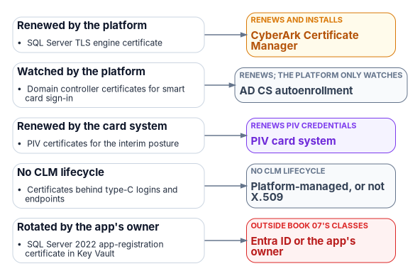

# Data Platform, Module 8: AD CS Dependencies {.unnumbered}

**Learning path:** [Data Platform and SQL Server Identity](index.md) · Module 8 of 10 · 40 minutes · Runbook [R10](../../books/b06-data-platform/r10-certificate-discovery-for-adcs.md) · Workbook [Chapter 08](../../project-plans/developer-workbooks/sql-server-identity/08-ad-cs-dependencies.md)

**Watch:** the narrated deck for this module: [Deck](https://github.com/WhalerMike/modernization-workbook/tree/main/presentations/training-dp-module-8) · [▶ Watch](../../presentations/watch.html?v=Training_DP_Module_8_Narrated) (about 11 minutes, captions) · [MP4](https://github.com/WhalerMike/modernization-workbook/releases/download/videos-2026-10-23/Training_DP_Module_8_Narrated.mp4) · [Script](https://github.com/WhalerMike/modernization-workbook/blob/main/presentations/training-dp-module-8/Training_DP_Module_8_Narration_Script.md) · [Captions](https://github.com/WhalerMike/modernization-workbook/blob/main/presentations/training-dp-module-8/Training_DP_Module_8_Narrated.vtt).

## Unit 1: Introduction

*3 minutes, with the objectives and prerequisites*

SQL Server depends on certificates that most teams planning an AD CS decommission never see: the TLS certificate the engine presents, the certificates behind certificate-mapped logins and endpoints, and the domain controller certificates that certificate-based sign-in needs. Book 07, *PKI & Certificates*, owns the decision about which issuer serves which certificate. This module doesn't restate it. It feeds it: before any CA date is set, you hand the PKI owner a list of every certificate SQL Server depends on, with its class, issuer, expiry and the action each needs.

**The federal requirement.** [Chapter 08's federal requirements and evidence table](../../project-plans/developer-workbooks/sql-server-identity/08-ad-cs-dependencies.md#federal-requirements-and-evidence) maps the dependency list and R10's reads to NIST SP 800-53 SC-8, SC-12 and SC-17, and to KSI-SVC-SIN and KSI-SVC-ASM. Runbook R10's [dependency table](../../books/b06-data-platform/r10-certificate-discovery-for-adcs.md#step-2-map-the-audit-to-sql-servers-three-dependencies) notes that SC-8 and SC-8(1) are in the NIST SP 800-53B moderate baseline, and that every Microsoft Entra-authenticated connection to SQL Server needs encryption. Each table's KSI column names the FedRAMP 20x Key Security Indicators to line your evidence up with; your cloud providers report against them, the agency doesn't. The list supports these controls; the assessor decides whether each one is in place.

### Learning objectives

In this module, you'll:

- Name the three places SQL Server can depend on AD CS-issued certificates, and the issuer Book 07 assigns to each.
- Explain why an expiring TLS certificate breaks clients and an expiring signing certificate doesn't lock anyone out.
- Run the kit's certificate dependency list over fixtures and read its class, issuer, expiry and action for each row.
- Say why certificate-mapped (type C) logins aren't migrated to Entra logins.

### Prerequisites

- [Module 7](07-the-application-chain.md): an endpoint that authenticates with `NTLM` or `NEGOTIATE` is also an NTLM source for [Module 6](06-ntlm-and-the-spns.md).

## Unit 2: Three places SQL Server touches AD CS

*7 minutes*

Book 06, Chapter 22, *Where SQL Server Touches AD CS*, names three dependencies. The TLS certificate encrypts client connections, and Entra-authenticated connections are always encrypted, so the Entra target depends on it more, not less. Certificate-mapped type C logins carry permissions for signed modules and can't be used to connect; certificates of the same kind secure Service Broker and mirroring endpoints. Certificate-based sign-in is the program's interim posture for connections that can't reach Entra authentication but can negotiate Kerberos, and it usually depends on AD CS through the domain controllers' certificates rather than the PIV card. Read:

- Book 06, Chapter 22: [SQL Server TLS certificates](../../books/b06-data-platform/22-where-sql-server-touches-adcs.md#sql-server-tls-certificates), [certificate-mapped SQL Server logins](../../books/b06-data-platform/22-where-sql-server-touches-adcs.md#certificate-mapped-sql-server-logins) and [certificate-based sign-in as the NTLM interim posture](../../books/b06-data-platform/22-where-sql-server-touches-adcs.md#certificate-based-sign-in-as-the-ntlm-interim-posture).
- Runbook R10: [Step 2, map the audit to SQL Server's three dependencies](../../books/b06-data-platform/r10-certificate-discovery-for-adcs.md#step-2-map-the-audit-to-sql-servers-three-dependencies), including its correction of the type C row.
- [Chapter 08: what Microsoft gives you](../../project-plans/developer-workbooks/sql-server-identity/08-ad-cs-dependencies.md#what-microsoft-gives-you).

## Unit 3: The issuer decision and the order

*7 minutes*

Book 07, *PKI & Certificates*, gives each class of certificate one issuer and one renewal engine. SQL Server's TLS certificate comes from the retained AD CS hierarchy, requested and renewed through the CLM platform; Microsoft Cloud PKI issues only to Intune-enrolled devices, which excludes Windows Server. Domain controller certificates stay on AD CS autoenrollment until the last domain controller retires, so the interim posture keeps what it depends on. The kit turns each certificate's `use` into a class and an action, marks it `yes` when its issuer is one of your enterprise CAs, and warns inside a 90-day window. Read:

- Book 06, Chapter 22: [the sequencing dependency](../../books/b06-data-platform/22-where-sql-server-touches-adcs.md#the-sequencing-dependency) and [certificates in this book and the CLM platform](../../books/b06-data-platform/22-where-sql-server-touches-adcs.md#certificates-and-the-clm-platform).
- Book 07, Chapter 04: [the issuer decision for internal server certificates](../../books/b07-pki/04-the-target-pki.md#the-issuer-decision-for-internal-server-certificates).
- Runbook R10: [Step 3, order the CA-migration dependencies](../../books/b06-data-platform/r10-certificate-discovery-for-adcs.md#step-3-order-the-ca-migration-dependencies) and [the sequencing finding](../../books/b06-data-platform/r10-certificate-discovery-for-adcs.md#the-sequencing-finding).
- [Chapter 08: what it leaves to you](../../project-plans/developer-workbooks/sql-server-identity/08-ad-cs-dependencies.md#what-it-leaves-to-you) and [the code](../../project-plans/developer-workbooks/sql-server-identity/08-ad-cs-dependencies.md#the-code).

{fig-alt="Five certificate classes, each with the engine that renews it: the SQL Server TLS engine certificate goes to CyberArk Certificate Manager, which renews and installs it; domain controller certificates for smart card sign-in go to AD CS autoenrollment, which renews them while the platform only watches; PIV certificates for the interim posture go to the PIV card system, which renews PIV credentials; certificates behind type C logins and endpoints are platform-managed or not X.509, with no CLM lifecycle; and the SQL Server 2022 app-registration certificate in Key Vault goes to the app's owner or Key Vault, outside Book 07's classes."}

## Unit 4: Exercise: Lab 1 (fixtures, no tenant)

*16 minutes*

<!-- labs:begin lab-1-commands (generated by scripts/generate_labs.py; not part of the reviewed page) -->

::: {.callout-note #lab-1-commands collapse="false" title="Every command in Lab 1"}
Every command in this lab, in order. Each step below says what it does and what to look for.

```powershell
Set-Location C:\FMWLabs\sql-server-identity-code\sql-server-identity

$Run = "C:\FMWLabs\results\data-platform-08-ad-cs-dependencies\lab1\$(Get-Date -AsUTC -Format 'yyyy-MM-ddTHHmmssZ')"
New-Item -ItemType Directory -Path $Run -Force | Out-Null
$Run

# Step 1: List the certificates
./Invoke-SqlCertDependency.ps1 -CertsPath tests/fixtures/certs/certs.json -OutputPath "$Run\certs"

# Step 2: Read the action for each
Import-Csv "$Run\certs\certificates.csv" | Select-Object Instance, Class, Issuer, Action | Format-List

# Step 3: Widen the window
Import-Module ./powershell/SqlIdentity/SqlIdentity.psd1
Get-SqlCertificateDependency -Certs (Read-SqlJson tests/fixtures/certs/certs.json) -WarningDays 365 | Format-Table Instance, Class, ExpiresInDays, Warning -AutoSize

# Step 4: Open the manifest
Get-Content "$Run\certs\manifest.json"

# Step 5: Run this chapter's tests
Invoke-Pester -Path tests/SqlIdentity.Tests.ps1 -FullNameFilter 'Chapter 08*' -Output None -PassThru | Select-Object PassedCount, FailedCount | Format-Table

# Step 6: List your runs
Get-ChildItem C:\FMWLabs\results\data-platform-08-ad-cs-dependencies\lab1 -Name
```

:::

<!-- labs:end -->

You run the workbook chapter's Lab 1 on the kit's fictional estate. [Chapter 08, Lab 1](../../project-plans/developer-workbooks/sql-server-identity/08-ad-cs-dependencies.md#lab-1-fixtures-no-tenant) explains each result in more depth.

Every step runs in PowerShell 7, so you can follow it top to bottom in one window. Open **PowerShell 7** from the Start menu, maximize the window (a narrow window wraps or cuts the widest table columns), then go to the kit's folder, where you unzipped it under [Get the code](index.md#get-the-code):

```powershell
Set-Location C:\FMWLabs\sql-server-identity-code\sql-server-identity
```

Then make this run's results folder. Its name is the date and time you start, in UTC, so each run keeps its own results and running the lab again never overwrites them:

```powershell
$Run = "C:\FMWLabs\results\data-platform-08-ad-cs-dependencies\lab1\$(Get-Date -AsUTC -Format 'yyyy-MM-ddTHHmmssZ')"
New-Item -ItemType Directory -Path $Run -Force | Out-Null
$Run
```

Expected output, where `<run>` is your start time, such as `2026-11-25T143005Z`:

```text
C:\FMWLabs\results\data-platform-08-ad-cs-dependencies\lab1\<run>
```

The run's date is only the folder's name. The data's dates are the fixtures' own, so every run's output matches this page. The results folder sits outside the kit, so unzipping a newer copy of the kit never touches it. The kit prints the folders it writes with forward slashes (`C:/FMWLabs/results/...`), which Windows reads the same way.

Prefer Git Bash? Go to the folder with `cd /c/FMWLabs/sql-server-identity-code/sql-server-identity`, then type `pwsh` to start PowerShell 7 and make the run folder there, as above: every step is a PowerShell command, and a `$Run` made in Git Bash wouldn't reach PowerShell. In a clone of the repository, use the `examples` folder of the same name.

1. **List the certificates.** Four of the five came from the fictional enterprise CA; two expire inside 90 days:

   ```powershell
   ./Invoke-SqlCertDependency.ps1 -CertsPath tests/fixtures/certs/certs.json -OutputPath "$Run\certs"
   ```

   ```text
   Instance Class                                    ADCS ExpiresInDays Warning
   -------- -----                                    ---- ------------- -------
   SQLPRD01 TLS for client connections               yes             72 expires within 90 days
   SQLPRD06 TLS for client connections               no             481
   SQLPRD02 Certificate-mapped login                 yes             41 expires within 90 days
   SQLPRD02 Certificate-mapped endpoint              yes            254
   SQLFCI04 Certificate-based sign-in (NTLM interim) yes            100

   Wrote 2 files and manifest.json to C:/FMWLabs/results/data-platform-08-ad-cs-dependencies/lab1/<run>/certs
   Evidence for CERTS (Find the AD CS certificates SQL Server depends on): SC-8, SC-12, SC-17; KSI-SVC-SIN, KSI-SVC-ASM
   Blocking an AD CS decommission: 4 of 5
   ```

   The SQLPRD01 TLS row matters most: in 72 days every client that validates the certificate refuses to connect, and Entra connections always validate. The SQLPRD02 login row expires sooner, but signing doesn't check expiry; the reason to replace it is its issuer.

2. **Read the action for each:**

   ```powershell
   Import-Csv "$Run\certs\certificates.csv" | Select-Object Instance, Class, Issuer, Action | Format-List
   ```

   ```text
   Instance : SQLPRD01
   Class    : TLS for client connections
   Issuer   : CONTOSO-ISSUING-CA01
   Action   : Retained AD CS issues it through the CLM platform (Book 07, Ch 04); move it before this CA is retired

   Instance : SQLPRD06
   Class    : TLS for client connections
   Issuer   : Federal Bridge Test Issuer (fictional)
   Action   : Not AD CS: track it in the certificate lifecycle platform

   Instance : SQLPRD02
   Class    : Certificate-mapped login
   Issuer   : CONTOSO-ISSUING-CA01
   Action   : Not renewed by the CLM platform: replace or re-map before this CA is retired (Chapter 22)

   Instance : SQLPRD02
   Class    : Certificate-mapped endpoint
   Issuer   : CONTOSO-ISSUING-CA01
   Action   : Not renewed by the CLM platform: replace or re-map before this CA is retired (Chapter 22)

   Instance : SQLFCI04
   Class    : Certificate-based sign-in (NTLM interim)
   Issuer   : CONTOSO-ISSUING-CA01
   Action   : NTLM interim: it also depends on the domain controllers certificates; retire it with the interim posture
   ```

3. **Widen the window.** The 90 days is a default in `config/thresholds.json`; a parameter changes it for one run:

   ```powershell
   Import-Module ./powershell/SqlIdentity/SqlIdentity.psd1
   Get-SqlCertificateDependency -Certs (Read-SqlJson tests/fixtures/certs/certs.json) -WarningDays 365 | Format-Table Instance, Class, ExpiresInDays, Warning -AutoSize
   ```

   ```text
   Instance Class                                    ExpiresInDays Warning
   -------- -----                                    ------------- -------
   SQLPRD01 TLS for client connections                          72 expires within 365 days
   SQLPRD06 TLS for client connections                         481
   SQLPRD02 Certificate-mapped login                            41 expires within 365 days
   SQLPRD02 Certificate-mapped endpoint                        254 expires within 365 days
   SQLFCI04 Certificate-based sign-in (NTLM interim)           100 expires within 365 days
   ```

4. **Open the manifest:**

   ```powershell
   Get-Content "$Run\certs\manifest.json"
   ```

   ```text
   {
     "step": "CERTS",
     "title": "Find the AD CS certificates SQL Server depends on",
     "mode": "read-only",
     "asOf": "2026-11-20",
     "controls": [
       "SC-8",
       "SC-12",
       "SC-17"
     ],
     "ksis": [
       "KSI-SVC-SIN",
       "KSI-SVC-ASM"
     ],
     "files": [
       {
         "file": "certificates.csv",
         "sha256": "daeb5397c44c213e7b106f47eb57416578a4b27e28e3a71e49c17a50b5f622b1"
       },
       {
         "file": "certificates.json",
         "sha256": "e44433e5c534443c6bcffeaad45ce0acda5fa343613b791dd35eccd2bda34a84"
       }
     ]
   }
   ```

5. **Run this chapter's tests:**

   ```powershell
   Invoke-Pester -Path tests/SqlIdentity.Tests.ps1 -FullNameFilter 'Chapter 08*' -Output None -PassThru | Select-Object PassedCount, FailedCount | Format-Table
   ```

   ```text
   PassedCount FailedCount
   ----------- -----------
             3           0
   ```

6. **List your runs.** Nothing to clean up: the kit's folder is as you unzipped it, and this run's results stay in `$Run`. List every run you've made of this lab:

   ```powershell
   Get-ChildItem C:\FMWLabs\results\data-platform-08-ad-cs-dependencies\lab1 -Name
   ```

   Expected output: one line per run, oldest first, the last one this run:

   ```text
   <run>
   ```

**Check your work:** you can say which of the five fictional certificates block an AD CS decommission, why the SQLPRD01 TLS row matters most, and what action each class needs.

## Unit 5: Exercise: Lab 2 (your test instance)

*Not timed. Not run by the authors.*

Run R10's reads on one test instance and its host: the configured TLS thumbprint, the host's certificates, the certificate-mapped logins and the endpoints. Save them by hand in the fixture's shape and run the dependency list on them. Every step reads; nothing is issued, bound, changed or restarted. Follow [Chapter 08, Lab 2](../../project-plans/developer-workbooks/sql-server-identity/08-ad-cs-dependencies.md#lab-2-a-test-instance).

- **You need:** one test instance and its host, never production; PowerShell 7 with the SqlServer module on the host; a Windows sign-in as a test reader whose login holds `VIEW SERVER PERFORMANCE STATE`, `VIEW SERVER SECURITY STATE` and `VIEW ANY DEFINITION` on SQL Server 2022 and later (`VIEW SERVER STATE` on earlier versions), never `sysadmin`; and the name of each issuing CA of your enterprise AD CS.
- **Back it out:** nothing on the instance or host changed; step 7 deletes the `lab2` folder, or you keep the saved reads inside your boundary as the R10 evidence.

## Unit 6: Knowledge check

*5 minutes*

1. The SQLPRD01 TLS certificate, issued by the fictional enterprise CA, expires in 72 days. Why does it matter most?
   a. SQL Server stops the moment the certificate expires.
   b. Clients that validate the certificate refuse to connect, and every Entra connection validates.
   c. The Entra logins on SQLPRD01 are mapped to it.

2. The certificate behind SQLPRD02's certificate-mapped login expires sooner, in 41 days. Why replace it?
   a. Because of its issuer: signing doesn't check expiry, but the certificate came from the enterprise CA that will be retired.
   b. Because the login can't connect once the certificate expires.
   c. Because type C logins must move to Entra logins before cutover.

3. Which issuer does Book 07, *PKI & Certificates*, give SQL Server's TLS certificate?
   a. Microsoft Cloud PKI, through Intune.
   b. The retained AD CS hierarchy, requested and renewed through the CLM platform.
   c. A self-signed certificate from `CREATE CERTIFICATE`.

4. The run ends with "Blocking an AD CS decommission: 4 of 5". What does it count?
   a. Certificates inside the 90-day window.
   b. The rows an enterprise AD CS CA issued, each needing its action before that CA is retired.
   c. Instances with no TLS certificate configured.

::: {.callout-tip collapse="true"}
## Check your answers
1. **b.** See step 1 of [Chapter 08, Lab 1](../../project-plans/developer-workbooks/sql-server-identity/08-ad-cs-dependencies.md#lab-1-fixtures-no-tenant) and Book 06, [Chapter 22: SQL Server TLS certificates](../../books/b06-data-platform/22-where-sql-server-touches-adcs.md#sql-server-tls-certificates).
2. **a.** See step 1 of [Chapter 08, Lab 1](../../project-plans/developer-workbooks/sql-server-identity/08-ad-cs-dependencies.md#lab-1-fixtures-no-tenant) and Runbook R10, [Step 2](../../books/b06-data-platform/r10-certificate-discovery-for-adcs.md#step-2-map-the-audit-to-sql-servers-three-dependencies).
3. **b.** See Book 07, [Chapter 04: the issuer decision for internal server certificates](../../books/b07-pki/04-the-target-pki.md#the-issuer-decision-for-internal-server-certificates) and Book 06, [Chapter 22: certificates in this book and the CLM platform](../../books/b06-data-platform/22-where-sql-server-touches-adcs.md#certificates-and-the-clm-platform).
4. **b.** See [Chapter 08: the code](../../project-plans/developer-workbooks/sql-server-identity/08-ad-cs-dependencies.md#the-code).
:::

## Unit 7: Summary

*2 minutes*

You listed the certificates SQL Server depends on, by class, issuer and expiry, and read the action each class needs before its issuing CA is retired. The list goes to the owners of Book 07, *PKI & Certificates*, before any CA date is set; the issuer decision stays theirs.

**Evidence an ISSO keeps from this module:** `certificates.csv` and `manifest.json` per instance, which records the step, its controls and KSIs, and the SHA-256 of each file; and R10's saved reads (`certs.json`) with the date and the reader (Chapter 08). Before shipping, work through the [Chapter 08 checklist](../../project-plans/developer-workbooks/sql-server-identity/08-ad-cs-dependencies.md#checklist).

::: {.callout-tip}
## Continue the path
[Previous: Module 7](07-the-application-chain.md) · [Learning path](index.md) · [Next: Module 9, Closure, drift and evidence →](09-closure-drift-and-evidence.md)
:::
