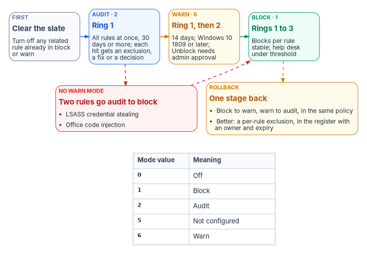

# Module 2: Prevention and Attack Surface Reduction {.unnumbered}

*Part of the [Defender XDR learning path](index.md). Guide [Step 3](../../books/guides/defender-xdr-implementation.md#step-3-endpoint-prevention) and [Step 4](../../books/guides/defender-xdr-implementation.md#step-4-attack-surface-reduction). About 50 minutes, plus Lab 1 and Lab 2.*

**Watch:** the narrated deck for this module (about 13 minutes, captions): [▶ Watch](../../presentations/watch.html?v=Training_XDR_Module_2_Narrated) · [MP4](https://github.com/WhalerMike/modernization-workbook/releases/download/videos-2026-10-23/Training_XDR_Module_2_Narrated.mp4) · [Deck source](https://github.com/WhalerMike/modernization-workbook/tree/main/presentations/training-xdr-module-2) · [Script](https://github.com/WhalerMike/modernization-workbook/blob/main/presentations/training-xdr-module-2/Training_XDR_Module_2_Narration_Script.md) · [Captions](https://github.com/WhalerMike/modernization-workbook/blob/main/presentations/training-xdr-module-2/Training_XDR_Module_2_Narrated.vtt). The deck files join the next edition.

## Introduction (3 minutes) {#xdr-m2-introduction}

A setting in a policy protects nothing until it is enforced on the device, and enforcing it all at once breaks the applications nobody listed. In this module you learn the order of the prevention settings, which ones have an audit mode, how Attack Surface Reduction moves through audit, warn and block ring by ring, and how to prove each setting on the device rather than trusting a report.

**The federal requirement.** The full table is the guide's [Requirements and KSIs](../../books/guides/defender-xdr-implementation.md#requirements-and-ksis).

| Gate | Requirement it supports | KSI | Evidence |
|---|---|---|---|
| G3 | NIST SP 800-53 SI-3 (malicious code protection), SC-7 (host firewall), CM-6 (configuration settings), SI-7 (tamper protection) | KSI-SVC-ACM, KSI-CNA-EIS, KSI-MLA-EVC | Policy exports, device checks, audit results |
| G4 | CM-7 (least functionality), CM-6, SI-3 | KSI-SVC-ACM, KSI-MLA-EVC | Rule-by-ring matrix, per-rule tests |

The guide's closure map counts Gates 3 and 4 as the **endpoint hardening** row: prevention baselines and Attack Surface Reduction by staged rings, evidenced by policy and endpoint telemetry.

## Learning objectives (1 minute) {#xdr-m2-objectives}

After this module, you'll be able to:

- name the prevention settings that have an audit mode and the ones that don't;
- move network protection and controlled folder access from audit to block ring by ring, with exit criteria and backout triggers;
- run every Attack Surface Reduction rule through audit and warn into block, and name the two rules that skip warn;
- record per-rule exclusions, and prefer an exclusion to a step back;
- verify each setting on the device and read the fleet's audit and block events.

## Prerequisites (1 minute) {#xdr-m2-prerequisites}

- [Module 1](01-architecture-access-and-onboarding.md): the devices in the ring are onboarded.
- [Devices, Chapter 08](../../books/b05-devices/08-gpo-to-intune-policy-migration.md#endpoint-security-policies), policies ES-001 (antivirus), ES-003 (firewall) and ES-005 (Attack Surface Reduction): the setting values live there, not in the guide. Skim them.

## Unit 1: Prevention through audit (10 minutes) {#xdr-m2-unit-1}

Read the guide's [Step 3](../../books/guides/defender-xdr-implementation.md#step-3-endpoint-prevention). Antivirus, firewall and tamper protection carry the policy library's values and have no audit mode; they go to ring 1 with backout triggers set before the change. Network protection and controlled folder access both have an audit mode (value 2): network protection logs the connections it would block, controlled folder access logs untrusted writes to protected folders. Network protection needs Defender Antivirus in active mode, behavior monitoring and cloud protection; on Windows Server 2019 and later it also needs `AllowNetworkProtectionOnWinServer`, and on high-UDP roles such as domain controllers, DNS, file and SQL Server, `AllowDatagramProcessingOnWinServer` set to false.

The pilot runs on rings 0 and 1 for at least two weeks with both in audit *(risk-based recommended)*. Read the audit events weekly and add allowed applications before enforcing. Then enforce ring by ring, each ring with its exit criteria; a blocked critical application with no allow path, or help-desk volume over the agreed threshold, is a backout trigger. Rollback sets the mode back to audit in the same Intune policy. Tamper protection is turned off only from the console that set it; on a device, only troubleshooting mode lifts it, and only for a while.

## Unit 2: Attack Surface Reduction, audit, warn, block (12 minutes) {#xdr-m2-unit-2}

Read the guide's [Step 4](../../books/guides/defender-xdr-implementation.md#step-4-attack-surface-reduction). Before auditing, turn off any related rule already in block or warn. Then every rule goes into audit at once on ring 1, which Learn recommends, for at least 30 days *(risk-based recommended)*. For each rule with audit hits, decide an exclusion or a fix before warn.

Warn shows the user the block with a way to proceed. It needs Windows 10 1809 or later and a recent Defender platform and engine, and on older Windows a warn rule acts as block. Two rules don't support warn and go straight from audit to block: *Block credential stealing from the Windows local security authority subsystem* and *Block Office applications from injecting code into other processes*. Warn isn't a safety valve: since platform 4.18.26060, **Unblock** needs administrator approval, so brief the help desk first, and turn a persistent need into a per-rule exclusion. Microsoft's own position is that standard protection rules can go to block without extensive testing; the program runs all three stages anyway.

Rule modes are `0` off, `1` block, `2` audit, `5` not configured and `6` warn. Rollback sets a rule back one stage, and Microsoft's advice is that an exclusion is better than a step back.

{#fig-xdr-asr-audit-warn-block fig-alt="Four stages run left to right, joined by arrows. First, a slate card: turn off any related rule already in block or warn. Second, a blue card for audit, mode 2, on ring 1: all rules at once for 30 days or more, and each hit gets an exclusion, a fix or a decision. Third, an amber card for warn, mode 6, on ring 1 then ring 2: 14 days, Windows 10 1809 or later, and Unblock needs administrator approval. Fourth, a green card for block, mode 1, on rings 1 to 3: blocks per rule stable and help desk volume under the threshold. A red dashed arrow leaves the audit card for a red card labeled no warn mode, which says two rules go from audit straight to block: LSASS credential stealing and Office code injection. A second red dashed arrow runs from that card to the block card. An amber dashed arrow runs from the block card to an amber rollback card: one stage back, block to warn or warn to audit, in the same policy, and better still a per-rule exclusion recorded in the register with an owner and an expiry. Below, a table lists the rule mode values: 0 off, 1 block, 2 audit, 5 not configured, 6 warn."}

## Unit 3: Exclusions, and what the server report doesn't prove (6 minutes) {#xdr-m2-unit-3}

Read the guide's Step 4 sections *Exclusions* and *Telemetry*. Per-rule exclusions go in the policy's **ASR only per rule exclusions**, a file path rather than a folder where you can; each goes in the register with an owner and an expiry. Configure a rule in Intune or Group Policy, never both: Group Policy wins by default, and the Intune value silently loses. On Windows Server, Microsoft lists a known issue where a rule shows as compliant without being enforced, so trust the device-side check and the events, not the compliance report. Read the guide's [dangers](../../books/guides/defender-xdr-implementation.md#dangers) table for these and the other traps.

## Exercise: Lab 1, fixtures, no tenant (30 minutes) {#xdr-m2-lab-1}

Run the developer workbook's [Chapter 03, Prevention Through Audit](../../project-plans/developer-workbooks/defender-xdr/03-prevention-through-audit.md#lab-1-fixtures-no-tenant) and [Chapter 04, Attack Surface Reduction: Audit, Warn, Block](../../project-plans/developer-workbooks/defender-xdr/04-attack-surface-reduction-audit-warn-block.md#lab-1-fixtures-no-tenant). They have the exact commands and the output each gave, and the commands are also listed below. Work in `examples/defender-xdr`, in PowerShell 7 with Pester 5, from the [defender-xdr-code.zip](../../../downloads/defender-xdr-code.zip) download or a clone of the repository. Nothing signs in: the estate is the fictional `contoso.example`.

<!-- labs:begin module-lab-1-commands (generated by scripts/generate_labs.py; not part of the reviewed page) -->

::: {.callout-note #module-lab-1-commands collapse="false" title="The Lab 1 commands, on the fixtures"}
Every command in the 2 chapters' labs, chapter by chapter, in order, on the kit's fixtures, with no tenant.

The chapter's steps say what each command does and what to look for.

**[Chapter 03, Prevention Through Audit](../../project-plans/developer-workbooks/defender-xdr/03-prevention-through-audit.md#lab-1-fixtures-no-tenant)**

```powershell
Set-Location C:\FMWLabs\defender-xdr-code\defender-xdr

$Run = "C:\FMWLabs\results\defender-xdr-03\lab1\$(Get-Date -AsUTC -Format 'yyyy-MM-ddTHHmmssZ')"
New-Item -ItemType Directory -Path $Run -Force | Out-Null
$Run

# Step 1: Read the plan the devices are checked against
Get-Content tests/fixtures/inputs/prevention-plan.json

# Step 2: Run the prevention check
./Invoke-XdrPrevention.ps1 -SettingsPath tests/fixtures/settings.lab.json -FixturePath tests/fixtures/graph -OutputPath "$Run/prevention" -AsOf 2026-11-16T12:00:00Z

# Step 3: Read every check on one device
Import-Csv "$Run/prevention/device-checks.csv" | Where-Object DeviceName -EQ 'SRV-FILE01' | Format-Table Check, Expected, Actual, Status -AutoSize

# Step 4: Read the week's events
Import-Csv "$Run/prevention/events.csv" | Format-Table -AutoSize

# After the steps
Get-ChildItem C:\FMWLabs\results\defender-xdr-03\lab1 -Name
```

**[Chapter 04, Attack Surface Reduction: Audit, Warn, Block](../../project-plans/developer-workbooks/defender-xdr/04-attack-surface-reduction-audit-warn-block.md#lab-1-fixtures-no-tenant)**

```powershell
Set-Location C:\FMWLabs\defender-xdr-code\defender-xdr

$Run = "C:\FMWLabs\results\defender-xdr-04\lab1\$(Get-Date -AsUTC -Format 'yyyy-MM-ddTHHmmssZ')"
New-Item -ItemType Directory -Path $Run -Force | Out-Null
$Run

# Step 1: Read the rules the program deploys, and which skip warn
(Get-Content config/asr-rules.json | ConvertFrom-Json).rules | Format-Table id, supportsWarn, actionTypePrefix -AutoSize

# Step 2: Run the ASR check
./Invoke-XdrAsr.ps1 -SettingsPath tests/fixtures/settings.lab.json -FixturePath tests/fixtures/graph -OutputPath "$Run/asr" -AsOf 2026-11-16T12:00:00Z

# Step 3: Read why the ring 2 rule is held
Import-Csv "$Run/asr/readiness.csv" | Where-Object { $_.Ring -eq 'ring2' -and $_.OpenHits -ne '0' } | Format-List Rule, AuditHits, OpenHits, Note

# Step 4: Print the value that moves ring 1
Get-Content "$Run/asr/oma-uri/ring1-next.txt"

# Step 5: Read the matrix
Import-Csv "$Run/asr/matrix.csv" | Format-Table Rule, Warn, ring0, ring1, ring2, ring3, servers -AutoSize | Out-String -Width 250

# After the steps
Get-ChildItem C:\FMWLabs\results\defender-xdr-04\lab1 -Name
```
:::

<!-- labs:end -->

- **What you'll see:** the prevention check finds tamper protection off, network protection off and a file server with datagram processing on; the ASR check says which rules each ring can move, holds one with an audit hit nobody decided, refuses a rule planned in warn that doesn't support it, and prints the OMA-URI value that moves ring 1.
- **What to look for:** each finding names the device, rule, incident or group, and the run folder's manifest records the call and its permission. Compare what you see with this module's units.
- **Back-out:** nothing to delete. Each lab leaves the kit's folder as you unzipped it and keeps its results in a dated run folder under `C:\FMWLabs\results`, so you can run it again and compare.

## Exercise: Lab 2, a test tenant {#xdr-m2-lab-2}
*Not timed. Not run by the authors. Never production.*

<!-- labs:begin lab-2-commands (generated by scripts/generate_labs.py; not part of the reviewed page) -->

::: {.callout-note #lab-2-commands collapse="false" title="Every command in Lab 2"}
Every command in this lab, in order. Each step below says what it does and what to look for.

```powershell
# Step 1: Tamper and real-time protection
Get-MpComputerStatus | Select-Object IsTamperProtected, RealTimeProtectionEnabled

# Step 2: Network protection and controlled folder access modes
Get-MpPreference | Select-Object EnableNetworkProtection, AllowNetworkProtectionOnWinServer, AllowDatagramProcessingOnWinServer, EnableControlledFolderAccess

# Step 3: Firewall profiles as enforced
Get-NetFirewallProfile -PolicyStore ActiveStore | Select-Object Name, Enabled, DefaultInboundAction, DefaultOutboundAction

# Step 5: Each Attack Surface Reduction rule and its mode
$p = Get-MpPreference;0..([math]::Min($p.AttackSurfaceReductionRules_Ids.Count,$p.AttackSurfaceReductionRules_Actions.Count)-1) | % {[pscustomobject]@{Id=$p.AttackSurfaceReductionRules_Ids[$_];Action=$p.AttackSurfaceReductionRules_Actions[$_]}} | Format-Table -AutoSize

# Step 6: The fleet's prevention events, last 7 days
Connect-MgGraph -Environment <graph-environment> -Scopes ThreatHunting.Read.All
$q = 'DeviceEvents | where Timestamp > ago(7d) | where ActionType in ("ExploitGuardNetworkProtectionAudited","ExploitGuardNetworkProtectionBlocked","ControlledFolderAccessViolationAudited","ControlledFolderAccessViolationBlocked","TamperingAttempt") | summarize Events = count(), Devices = dcount(DeviceId) by ActionType'
Start-MgSecurityHuntingQuery -BodyParameter @{ Query = $q } | ConvertTo-Json -Depth 5 | Out-File <evidence-folder>/g3-prevention-events.json

# Step 7: The fleet's Attack Surface Reduction events by rule, last 30 days
$q = 'DeviceEvents | where Timestamp > ago(30d) | where ActionType startswith "Asr" | summarize EventCount=count() by ActionType'
Start-MgSecurityHuntingQuery -BodyParameter @{ Query = $q } | ConvertTo-Json -Depth 5 | Out-File <evidence-folder>/g4-asr-events.json

# Step 8: Detail for one rule
$q = 'DeviceEvents | where (ActionType startswith "AsrOfficechild") | extend RuleId=extractjson("$Ruleid", AdditionalFields, typeof(string)) | project DeviceName, FileName, FolderPath, ProcessCommandLine, InitiatingProcessFileName, InitiatingProcessCommandLine'
Start-MgSecurityHuntingQuery -BodyParameter @{ Query = $q } | ConvertTo-Json -Depth 5 | Out-File <evidence-folder>/g4-asr-officechild.json

# Step 9: Step one rule back on the test device
Add-MpPreference -AttackSurfaceReductionRules_Ids <rule GUID> -AttackSurfaceReductionRules_Actions AuditMode
```

:::

<!-- labs:end -->

You check each prevention setting and each Attack Surface Reduction rule on a ring 0 test device, trigger Learn's network protection test, and read the fleet's audit and block events. The steps read; the last one changes one rule on one device, the way the guide's rollback does.

- **You need:** Module 1's test tenant and `<pilot-device>`, in a ring 0 device group with the antivirus, firewall and Attack Surface Reduction policies assigned (network protection and controlled folder access in audit or block, as your ring's stage sets them); a browser other than Microsoft Edge on the device; the reader account from Module 1.
- **You'll replace:** `<graph-environment>`, `<pilot-device>`, `<evidence-folder>` as in Module 1, and `<rule GUID>` (one rule's GUID from the table in [Devices, ES-005](../../books/b05-devices/08-gpo-to-intune-policy-migration.md#es-005-attack-surface-reduction)).

1. **Tamper and real-time protection.** On `<pilot-device>`, in an elevated PowerShell session:

    ```powershell
    Get-MpComputerStatus | Select-Object IsTamperProtected, RealTimeProtectionEnabled
    ```

    Expected result: both `True`, which means enabled.

2. **Network protection and controlled folder access modes.**

    ```powershell
    Get-MpPreference | Select-Object EnableNetworkProtection, AllowNetworkProtectionOnWinServer, AllowDatagramProcessingOnWinServer, EnableControlledFolderAccess
    ```

    Expected result: `EnableNetworkProtection` is `2` in audit or `1` in block (`0` is off); `EnableControlledFolderAccess` is `2` in audit or `1` in block, matching the ring's stage.

3. **Firewall profiles as enforced.**

    ```powershell
    Get-NetFirewallProfile -PolicyStore ActiveStore | Select-Object Name, Enabled, DefaultInboundAction, DefaultOutboundAction
    ```

    Expected result: each profile shows the values ES-003 sets.

4. **The network protection test.** On `<pilot-device>`:
    1. Open a browser other than Microsoft Edge.
    2. Go to Learn's test site, `https://smartscreentestratings2.net`.

    Expected result: in block mode the connection is blocked with a notification (event 1126); in audit mode it isn't blocked, and the event is 1125.

5. **Each Attack Surface Reduction rule and its mode,** with Learn's command:

    ```powershell
    $p = Get-MpPreference;0..([math]::Min($p.AttackSurfaceReductionRules_Ids.Count,$p.AttackSurfaceReductionRules_Actions.Count)-1) | % {[pscustomobject]@{Id=$p.AttackSurfaceReductionRules_Ids[$_];Action=$p.AttackSurfaceReductionRules_Actions[$_]}} | Format-Table -AutoSize
    ```

    Expected result: one row per rule, its action `2` (audit), `6` (warn) or `1` (block) as the ring's stage sets it. On a server, this is the check to trust, not the compliance report.

6. **The fleet's prevention events, last 7 days.** On your workstation:

    ```powershell
    Connect-MgGraph -Environment <graph-environment> -Scopes ThreatHunting.Read.All
    $q = 'DeviceEvents | where Timestamp > ago(7d) | where ActionType in ("ExploitGuardNetworkProtectionAudited","ExploitGuardNetworkProtectionBlocked","ControlledFolderAccessViolationAudited","ControlledFolderAccessViolationBlocked","TamperingAttempt") | summarize Events = count(), Devices = dcount(DeviceId) by ActionType'
    Start-MgSecurityHuntingQuery -BodyParameter @{ Query = $q } | ConvertTo-Json -Depth 5 | Out-File <evidence-folder>/g3-prevention-events.json
    ```

    Expected result: a count per action type; step 4's test appears as `ExploitGuardNetworkProtectionAudited` or `ExploitGuardNetworkProtectionBlocked`.

7. **The fleet's Attack Surface Reduction events by rule, last 30 days,** Learn's query:

    ```powershell
    $q = 'DeviceEvents | where Timestamp > ago(30d) | where ActionType startswith "Asr" | summarize EventCount=count() by ActionType'
    Start-MgSecurityHuntingQuery -BodyParameter @{ Query = $q } | ConvertTo-Json -Depth 5 | Out-File <evidence-folder>/g4-asr-events.json
    ```

    Expected result: one count per action type, each rule's audited and blocked types named separately (for example `AsrExecutableOfficeContentAudited`). Events are throttled to unique processes each hour.

8. **Detail for one rule,** Learn's pattern for the Office child-process rule, to decide an exclusion:

    ```powershell
    $q = 'DeviceEvents | where (ActionType startswith "AsrOfficechild") | extend RuleId=extractjson("$Ruleid", AdditionalFields, typeof(string)) | project DeviceName, FileName, FolderPath, ProcessCommandLine, InitiatingProcessFileName, InitiatingProcessCommandLine'
    Start-MgSecurityHuntingQuery -BodyParameter @{ Query = $q } | ConvertTo-Json -Depth 5 | Out-File <evidence-folder>/g4-asr-officechild.json
    ```

    Expected result: the devices, files and command lines the rule audited or blocked, which is what an exclusion decision reads.

9. **Step one rule back on the test device,** the guide's rollback for a device under investigation. On `<pilot-device>`:

    ```powershell
    Add-MpPreference -AttackSurfaceReductionRules_Ids <rule GUID> -AttackSurfaceReductionRules_Actions AuditMode
    ```

    Expected result: step 5's command now shows the rule at `2`. Intune overwrites the local value at the next policy refresh, which is the back-out: nothing else is needed.

## Knowledge check (5 minutes) {#xdr-m2-knowledge-check}

1. Which of these has an audit mode?
    a. Tamper protection.
    b. Network protection and controlled folder access.
    c. The host firewall.

2. Which two Attack Surface Reduction rules go from audit straight to block?
    a. The LSASS credential-stealing rule and the Office code-injection rule, because they don't support warn.
    b. The two Office child-process rules.
    c. None; every rule supports warn.

3. Users in the warn ring keep pressing **Unblock** for the same business application. What does the program do?
    a. Nothing: warn is meant to be bypassed.
    b. Turn the rule back to audit for everyone.
    c. Record a per-rule exclusion; since platform 4.18.26060, Unblock needs administrator approval and a persistent need belongs in an exclusion.

4. A Windows Server shows an Attack Surface Reduction rule as compliant in Intune. Is that enough evidence?
    a. Yes.
    b. No: Microsoft lists a known issue where Server OS shows compliant without enforcement; check on the server with `Get-MpPreference` and the events.
    c. Only if Group Policy also sets the rule.

5. A rule in block breaks a line-of-business application. What does Microsoft advise first?
    a. Turn the rule off.
    b. An exclusion, rather than turning the rule off or back to audit.
    c. Offboard the device.

::: {.callout-tip collapse="true"}
## Check your answers
1. **b.** See Unit 1 and the guide's [Step 3](../../books/guides/defender-xdr-implementation.md#step-3-endpoint-prevention).
2. **a.** See Unit 2.
3. **c.** See Unit 2 and the guide's [dangers](../../books/guides/defender-xdr-implementation.md#dangers).
4. **b.** See Unit 3.
5. **b.** See Unit 2 and the guide's [Step 4](../../books/guides/defender-xdr-implementation.md#step-4-attack-surface-reduction).
:::

## Summary (2 minutes) {#xdr-m2-summary}

You checked every prevention setting and every rule on a test device, triggered the network protection test, filed the fleet's audit and block events, and stepped one rule back the way the guide's rollback does. **Evidence an ISSO keeps from this module:** the antivirus, firewall and Attack Surface Reduction policy exports per ring, the weekly audit and block query results, the network protection test and tamper status, the per-rule tests, the rule-by-ring matrix with the date each rule entered block, and the exclusions with approver and expiry.

::: {.callout-tip}
## Continue the path
[← Previous: Module 1](01-architecture-access-and-onboarding.md) · [Learning path](index.md) · [Next: Module 3, Exposure and incidents →](03-exposure-and-incidents.md)
:::
