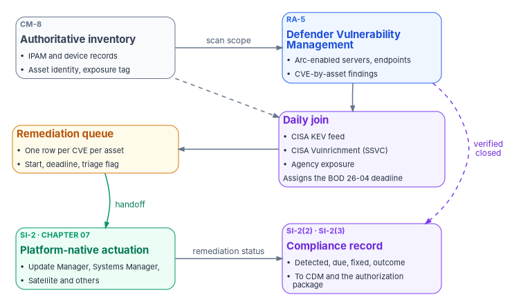

# Module 3: Exposure and incidents {.unnumbered}

*Part of the [Defender XDR learning path](index.md). Guide [Step 5](../../books/guides/defender-xdr-implementation.md#step-5-exposure-management) and [Step 6](../../books/guides/defender-xdr-implementation.md#step-6-xdr-incidents). About 35 minutes, plus Lab 1 and Lab 2.*

**Watch:** the narrated deck for this module (about 11 minutes, captions): [▶ Watch](../../presentations/watch.html?v=Training_XDR_Module_3_Narrated) · [MP4](https://github.com/WhalerMike/modernization-workbook/releases/download/videos-2026-10-23/Training_XDR_Module_3_Narrated.mp4) · [Deck source](https://github.com/WhalerMike/modernization-workbook/tree/main/presentations/training-xdr-module-3) · [Script](https://github.com/WhalerMike/modernization-workbook/blob/main/presentations/training-xdr-module-3/Training_XDR_Module_3_Narration_Script.md) · [Captions](https://github.com/WhalerMike/modernization-workbook/blob/main/presentations/training-xdr-module-3/Training_XDR_Module_3_Narrated.vtt). The deck files join the next edition.

## Introduction (3 minutes) {#xdr-m3-introduction}

Two queues decide whether the platform you built is used: the vulnerabilities waiting for an owner, and the incidents waiting for an analyst. In this module you learn what Defender adds to the vulnerability program in GCC and what it can't do there, and how the SOC triages, contains, hands off and closes every incident to a table it can show.

**The federal requirement.** The full table is the guide's [Requirements and KSIs](../../books/guides/defender-xdr-implementation.md#requirements-and-ksis).

| Gate | Requirement it supports | KSI | Evidence |
|---|---|---|---|
| G5 | NIST SP 800-53 RA-5 (vulnerability monitoring), SI-2 (flaw remediation), CM-8 | KSI-MLA-EVC, KSI-PIY-GIV | Vulnerability query output; the remediation queue |
| G6 | IR-4 (incident handling), IR-5 (monitoring), IR-6 (reporting), AU-6 | KSI-INR-RIR, KSI-INR-RPI, KSI-MLA-RVL | Incident exports with classification |

## Learning objectives (1 minute) {#xdr-m3-objectives}

After this module, you'll be able to:

- say which exposure features are available in GCC, and record the missing one as not applicable;
- prioritize vulnerabilities with the interim path, and give every device group a remediation owner;
- triage an incident to the severity table, pick its containment rung and hand it off;
- export open incidents and one incident with its alerts as evidence.

## Prerequisites (1 minute) {#xdr-m3-prerequisites}

- [Module 1](01-architecture-access-and-onboarding.md): the Graph read path.
- [Security Operations, Chapter 06](../../books/b12-security-operations/06-vulnerability-management.md), for the remediation program and its clock, and [Chapter 11](../../books/b12-security-operations/11-detection-engineering-and-response.md#the-response-ladder), for the response ladder. Skim both.

## Unit 1: Exposure without Exposure Management (8 minutes) {#xdr-m3-unit-1}

Read the guide's [Step 5](../../books/guides/defender-xdr-implementation.md#step-5-exposure-management). Microsoft Security Exposure Management, which holds attack paths, the exposure graph and critical asset management, is available in Public Cloud only, not in GCC. Defender Vulnerability Management's core and premium capabilities are available in GCC, without *report inaccuracy* and *request CVE support*; Secure Score is available with some recommendations missing. A Zero Trust Assessment test that needs Exposure Management is recorded as not applicable, not as a failure.

The interim path prioritizes by `ExposureLevel` and `IsInternetFacing` from `DeviceInfo`, by Defender Vulnerability Management's recommendations, and by the Tier 0 inventory from [Access and Privilege](../../books/b04-access/index.md) as the critical-asset list. Every device group or tag maps to a remediation owner; a vulnerability without an owner is a finding against CM-8, not just RA-5 *(risk-based recommended)*. The `DeviceTvm*` tables stay in Defender: they aren't ingested into Sentinel, so a Sentinel query that names them returns nothing.

{#fig-ch06-scan-to-record fig-alt="Three rows of two cards, read as a zigzag. Top row, left: a slate card, authoritative inventory, CM-8, IPAM and device records keyed by asset identity, with exposure tags; right: a blue card, Defender Vulnerability Management on Arc-enabled servers and endpoints, producing CVE-by-asset findings. An arrow from inventory to the Defender card is labelled scan scope. Middle row, right, below the Defender card: a violet card, daily join, combining findings with the CISA KEV catalog, CISA Vulnrichment exploitation metadata and the asset's exposure, and assigning a BOD 26-04 deadline. Middle row, left: an amber card, remediation queue, one row per CVE and asset with start date, deadline and forensic-triage flag. Bottom row, left: a green card, platform-native actuation, Chapter 07, Update Manager, Systems Manager, Satellite and others; right: a violet card, compliance record, detected, due, fixed and outcome per finding, feeding the CDM dashboard and the authorization package. Arrows run from the scanner down to the join, from the join left to the queue, from the queue down to actuation labelled handoff, from actuation across to the record labelled remediation status, and a dashed arrow from the scanner down to the record labelled verified closed."}

## Unit 2: One queue, one table (10 minutes) {#xdr-m3-unit-2}

Read the guide's [Step 6](../../books/guides/defender-xdr-implementation.md#step-6-xdr-incidents). Defender XDR correlates alerts that share attack techniques or an attacker into one incident; with Sentinel onboarded to the Defender portal there is one queue. The severity table is program design *(risk-based recommended)*:

| Incident severity | Triage within | Containment rung |
|---|---|---|
| High | 1 hour | L3 gated: the playbook prepares, a named approver releases |
| Medium | 24 hours | L2 advise: enrich and ticket |
| Low or informational | 72 hours | L1 observe |

: The program's severity table, from the guide's Step 6 {.striped .hover}

A High incident goes to the IR lead and the ISSO, with the US-CERT reporting decision made under the incident response plan. Servers and privileged or emergency accounts are never contained by a playbook; a human decides. Every incident closes with a classification and a determination, which the Graph incident record carries with `assignedTo` and comments. Containment is reversible from the Action center; an incident closed by mistake is reopened with a comment.

## Exercise: Lab 1, fixtures, no tenant (20 minutes) {#xdr-m3-lab-1}

Run the developer workbook's [Chapter 05, Exposure and Incidents](../../project-plans/developer-workbooks/defender-xdr/05-exposure-and-incidents.md#lab-1-fixtures-no-tenant). They have the exact commands and the output each gave, and the commands are also listed below. Work in `examples/defender-xdr`, in PowerShell 7 with Pester 5, from the [defender-xdr-code.zip](../../../downloads/defender-xdr-code.zip) download or a clone of the repository. Nothing signs in: the estate is the fictional `contoso.example`.

<!-- labs:begin module-lab-1-commands (generated by scripts/generate_labs.py; not part of the reviewed page) -->

::: {.callout-note #module-lab-1-commands collapse="false" title="The Lab 1 commands, on the fixtures"}
Every command in [Chapter 05, Exposure and Incidents](../../project-plans/developer-workbooks/defender-xdr/05-exposure-and-incidents.md#lab-1-fixtures-no-tenant), in order, on the kit's fixtures, with no tenant.

The chapter's steps say what each command does and what to look for.

```powershell
Set-Location C:\FMWLabs\defender-xdr-code\defender-xdr

$Run = "C:\FMWLabs\results\defender-xdr-05\lab1\$(Get-Date -AsUTC -Format 'yyyy-MM-ddTHHmmssZ')"
New-Item -ItemType Directory -Path $Run -Force | Out-Null
$Run

# Step 1: Run the exposure check
./Invoke-XdrExposure.ps1 -SettingsPath tests/fixtures/settings.lab.json -FixturePath tests/fixtures/graph -OutputPath "$Run/exposure" -AsOf 2026-11-16T12:00:00Z

# Step 2: Read the Exposure Management record
Get-Content "$Run/exposure/exposure-management.json"

# Step 3: Run the incident check
./Invoke-XdrIncidents.ps1 -SettingsPath tests/fixtures/settings.lab.json -FixturePath tests/fixtures/graph -OutputPath "$Run/incidents" -AsOf 2026-11-16T12:00:00Z

# Step 4: Read the findings as the SOC lead gets them
Import-Csv "$Run/incidents/findings.csv" | Format-Table Id, Severity, Finding, Rung -AutoSize -Wrap

# After the steps
Get-ChildItem C:\FMWLabs\results\defender-xdr-05\lab1 -Name
```
:::

<!-- labs:end -->

- **What you'll see:** the exposure check finds an exposed device with no owner and records Security Exposure Management as not applicable in GCC; the incident check finds a high-severity incident past its one-hour window and one closed without a classification.
- **What to look for:** each finding names the device, rule, incident or group, and the run folder's manifest records the call and its permission. Compare what you see with this module's units.
- **Back-out:** nothing to delete. Each lab leaves the kit's folder as you unzipped it and keeps its results in a dated run folder under `C:\FMWLabs\results`, so you can run it again and compare.

## Exercise: Lab 2, a test tenant {#xdr-m3-lab-2}
*Not timed. Not run by the authors. Never production.*

<!-- labs:begin lab-2-commands (generated by scripts/generate_labs.py; not part of the reviewed page) -->

::: {.callout-note #lab-2-commands collapse="false" title="Every command in Lab 2"}
Every command in this lab, in order. Each step below says what it does and what to look for.

```powershell
# Step 1: Connect in the tenant's cloud
Connect-MgGraph -Environment <graph-environment> -Scopes SecurityIncident.Read.All,ThreatHunting.Read.All

# Step 2: High and critical vulnerabilities by device and recommended update
$q = 'DeviceTvmSoftwareVulnerabilities | where VulnerabilitySeverityLevel in ("Critical", "High") | summarize CVEs = dcount(CveId), Devices = dcount(DeviceId) by SoftwareVendor, SoftwareName, RecommendedSecurityUpdate | order by Devices desc'
Start-MgSecurityHuntingQuery -BodyParameter @{ Query = $q } | ConvertTo-Json -Depth 5 | Out-File <evidence-folder>/g5-vulnerabilities.json

# Step 3: Exposed and internet-facing Windows devices
$q = 'DeviceInfo | where Timestamp > ago(1d) | summarize arg_max(Timestamp, *) by DeviceId | where ExposureLevel == "High" or IsInternetFacing == true | project DeviceName, ExposureLevel, IsInternetFacing, AssetValue, MachineGroup'
Start-MgSecurityHuntingQuery -BodyParameter @{ Query = $q } | ConvertTo-Json -Depth 5 | Out-File <evidence-folder>/g5-exposed-devices.json

# Step 4: Export the open incidents
Get-MgSecurityIncident -Filter "status eq 'active'" -All | Select-Object Id, DisplayName, Severity, AssignedTo, CreatedDateTime | Export-Csv <evidence-folder>/g6-open-incidents.csv -NoTypeInformation
Import-Csv <evidence-folder>/g6-open-incidents.csv | Format-Table Id, Severity, AssignedTo

# Step 5: Export one incident with its alerts
Get-MgSecurityIncident -IncidentId <incident-id> -ExpandProperty alerts | ConvertTo-Json -Depth 10 | Out-File <evidence-folder>/g6-incident-<incident-id>.json

# Step 6: Back it out
Disconnect-MgGraph
```

:::

<!-- labs:end -->

You file the vulnerability and exposure queries and export the open incidents, with one incident's alerts, for the record. Every step reads.

- **You need:** Module 1's test tenant and reader account, with Defender Vulnerability Management data from at least one onboarded device; at least one incident in the queue (Module 1's detection test raises one).
- **You'll replace:** `<graph-environment>` and `<evidence-folder>` as in Module 1, and `<incident-id>` (an incident number from step 4's output).

1. **Connect in the tenant's cloud.**

    ```powershell
    Connect-MgGraph -Environment <graph-environment> -Scopes SecurityIncident.Read.All,ThreatHunting.Read.All
    ```

2. **High and critical vulnerabilities by device and recommended update.**

    ```powershell
    $q = 'DeviceTvmSoftwareVulnerabilities | where VulnerabilitySeverityLevel in ("Critical", "High") | summarize CVEs = dcount(CveId), Devices = dcount(DeviceId) by SoftwareVendor, SoftwareName, RecommendedSecurityUpdate | order by Devices desc'
    Start-MgSecurityHuntingQuery -BodyParameter @{ Query = $q } | ConvertTo-Json -Depth 5 | Out-File <evidence-folder>/g5-vulnerabilities.json
    ```

    Expected result: rows by vendor, software and recommended update. Learn's table reference doesn't list the severity strings; the guide uses `Critical` and `High` as the portal shows them, so if the file is empty, check the values in your tenant before trusting it.

3. **Exposed and internet-facing Windows devices.**

    ```powershell
    $q = 'DeviceInfo | where Timestamp > ago(1d) | summarize arg_max(Timestamp, *) by DeviceId | where ExposureLevel == "High" or IsInternetFacing == true | project DeviceName, ExposureLevel, IsInternetFacing, AssetValue, MachineGroup'
    Start-MgSecurityHuntingQuery -BodyParameter @{ Query = $q } | ConvertTo-Json -Depth 5 | Out-File <evidence-folder>/g5-exposed-devices.json
    ```

    Expected result, as the guide states it: every row has an owner in the decision record and a ticket in the remediation queue.

4. **Export the open incidents.**

    ```powershell
    Get-MgSecurityIncident -Filter "status eq 'active'" -All | Select-Object Id, DisplayName, Severity, AssignedTo, CreatedDateTime | Export-Csv <evidence-folder>/g6-open-incidents.csv -NoTypeInformation
    Import-Csv <evidence-folder>/g6-open-incidents.csv | Format-Table Id, Severity, AssignedTo
    ```

    Expected result: every open incident has an owner in `AssignedTo`.

5. **Export one incident with its alerts.**

    ```powershell
    Get-MgSecurityIncident -IncidentId <incident-id> -ExpandProperty alerts | ConvertTo-Json -Depth 10 | Out-File <evidence-folder>/g6-incident-<incident-id>.json
    ```

    Expected result: the file shows the incident's alerts and evidence and, once it is resolved, its classification and determination.

6. **Back it out.** Nothing changed in the tenant. Disconnect:

    ```powershell
    Disconnect-MgGraph
    ```

## Knowledge check (5 minutes) {#xdr-m3-knowledge-check}

1. A GCC agency wants attack paths for its domain controllers. What does the program do?
    a. Turn on Security Exposure Management.
    b. Record Exposure Management as not applicable and use the interim path: exposure level, internet-facing devices, Defender Vulnerability Management's recommendations and the Tier 0 inventory.
    c. Move the tenant to commercial.

2. A Sentinel analytics rule queries `DeviceTvmSoftwareVulnerabilities` and never fires. Why?
    a. The `DeviceTvm*` tables stay in Defender; they aren't ingested into Sentinel.
    b. The rule runs too often.
    c. Vulnerability data is available only in commercial tenants.

3. A High incident arrives. What does the severity table set?
    a. Triage within 24 hours, L2 advise.
    b. Triage within 1 hour, L3 gated containment that a named approver releases, and a hand-off to the IR lead and the ISSO.
    c. Automatic isolation of every device in it.

4. A playbook proposes isolating a domain controller. What happens?
    a. It runs, because the incident is High.
    b. A human decides: servers and privileged or emergency accounts are never contained by a playbook.
    c. It runs, and the SOC releases it later.

::: {.callout-tip collapse="true"}
## Check your answers
1. **b.** See Unit 1 and the guide's [Step 5](../../books/guides/defender-xdr-implementation.md#step-5-exposure-management).
2. **a.** See Unit 1.
3. **b.** See Unit 2 and the guide's [Step 6](../../books/guides/defender-xdr-implementation.md#step-6-xdr-incidents).
4. **b.** See Unit 2.
:::

## Summary (2 minutes) {#xdr-m3-summary}

You filed the vulnerability and exposure queries, checked that each exposed device has an owner, and exported the open incidents and one incident with its alerts. **Evidence an ISSO keeps from this module:** the vulnerability query output and the remediation queue, the severity table and the incident response plan version, the monthly incident export with alerts, classification and timestamps, and the incidents closed outside their window with the reason.

::: {.callout-tip}
## Continue the path
[← Previous: Module 2](02-prevention-and-attack-surface-reduction.md) · [Learning path](index.md) · [Next: Module 4, Hunting, detections as code and identity signals →](04-hunting-detections-and-identity-signals.md)
:::
