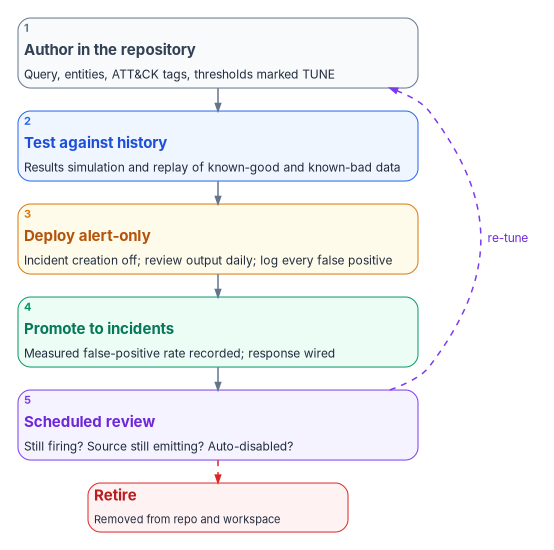

# Module 4: Hunting, detections as code and identity signals {.unnumbered}

*Part of the [Defender XDR learning path](index.md). Guide [Step 7](../../books/guides/defender-xdr-implementation.md#step-7-advanced-hunting-and-detections-as-code) and [Step 8](../../books/guides/defender-xdr-implementation.md#step-8-identity-and-cloud-app-signals). About 45 minutes, plus Lab 1 and Lab 2.*

**Watch:** the narrated deck for this module (about 12 minutes, captions): [▶ Watch](../../presentations/watch.html?v=Training_XDR_Module_4_Narrated) · [MP4](https://github.com/WhalerMike/modernization-workbook/releases/download/videos-2026-10-23/Training_XDR_Module_4_Narrated.mp4) · [Deck source](https://github.com/WhalerMike/modernization-workbook/tree/main/presentations/training-xdr-module-4) · [Script](https://github.com/WhalerMike/modernization-workbook/blob/main/presentations/training-xdr-module-4/Training_XDR_Module_4_Narration_Script.md) · [Captions](https://github.com/WhalerMike/modernization-workbook/blob/main/presentations/training-xdr-module-4/Training_XDR_Module_4_Narrated.vtt). The deck files join the next edition.

## Introduction (3 minutes) {#xdr-m4-introduction}

A detection that lives only in a portal can't be reviewed, compared or rolled back, and one that can't be shown to fire isn't a control. In this module you learn to keep custom detections as files, test each against data it must find and data it must stay quiet in, and deploy it through Microsoft Graph. Then you join the identity and cloud-app sensors to the endpoint's alerts in one query.

**The federal requirement.** The full table is the guide's [Requirements and KSIs](../../books/guides/defender-xdr-implementation.md#requirements-and-ksis).

| Gate | Requirement it supports | KSI | Evidence |
|---|---|---|---|
| G7 | NIST SP 800-53 SI-4, AU-6 (1) and (3), CM-3 for rule changes | KSI-MLA-OSM, KSI-MLA-LET, KSI-CMT-LMC | Rule repository, test outputs, deployed-rules export |
| G8 | SI-4, AU-6 (3) (correlate repositories), AC-2 (12) (account monitoring) | KSI-MLA-OSM, KSI-MLA-RVL | Correlation query output, sensor health |

## Learning objectives (1 minute) {#xdr-m4-objectives}

After this module, you'll be able to:

- write a custom detection as a repository file and say why it starts disabled;
- test a rule against a validation window, and explain the 30-day limit;
- deploy a rule through the Graph `detectionRules` API, and use the portal from the same file where the API's availability isn't specified;
- name Defender for Identity's and Defender for Cloud Apps' GCC gaps and their interim path;
- run the cross-source query that finds a user with alerts from more than one source.

## Prerequisites (1 minute) {#xdr-m4-prerequisites}

- [Module 3](03-exposure-and-incidents.md).
- [Security Operations, Chapter 11, Rule lifecycle and testing](../../books/b12-security-operations/11-detection-engineering-and-response.md#rule-lifecycle-and-testing), for author, test, alert-only, promote and review. Skim it.

## Unit 1: Detections as code (12 minutes) {#xdr-m4-unit-1}

Read the guide's [Step 7](../../books/guides/defender-xdr-implementation.md#step-7-advanced-hunting-and-detections-as-code). A rule that reads only Defender tables is written as a Defender custom detection. Its file follows Learn's example shape and starts with `status` `disabled`; automated actions such as isolate are left out, because containment stays on the response ladder. Deploying needs `CustomDetection.ReadWrite.All` and a role the API accepts: **Detection tuning (Manage)** in unified RBAC, or Security Administrator. The create quota is 10 rules a minute per application. Enabling a rule is a change to `status` in the file, reviewed and redeployed; rollback sets it back to `disabled`.

Each rule has a validation dataset: a known-bad event it must find (from the guide's [synthetic events](../../books/guides/defender-xdr-implementation.md#synthetic-events) or a ring 0 replay) and a known-good window it must stay quiet in. Advanced hunting keeps 30 days, so a validation window is at most 30 days. Schema governance *(risk-based recommended)*: each rule file names the tables and columns it reads, and the weekly review runs each rule's query and fails it when a column is renamed.

{#fig-ch11-rule-lifecycle fig-alt="Top to bottom, five numbered cards joined by arrows. 1, slate: author in the repository, with the query, entities, ATT&CK tags and thresholds marked TUNE. 2, blue: test against history, with results simulation and replay of known-good and known-bad data. 3, amber: deploy alert-only, with incident creation off, output reviewed daily and every false positive logged. 4, green: promote to incidents, with the measured false-positive rate recorded and the response wired. 5, violet: scheduled review, asking whether the rule still fires, whether its source still emits and whether it was auto-disabled. A dashed violet arrow from review loops back to authoring, labeled re-tune. A dashed red arrow leads from review to a red card: retire, removed from the repository and the workspace."}

## Unit 2: Identity and cloud-app signals (10 minutes) {#xdr-m4-unit-2}

Read the guide's [Step 8](../../books/guides/defender-xdr-implementation.md#step-8-identity-and-cloud-app-signals). Defender for Identity's sensors on domain controllers, AD FS, AD CS and Entra Connect servers, and Defender for Cloud Apps' connectors, put identity and SaaS behavior into the same incidents as the endpoint. Sensors reach `<workspace>sensorapi.atp.gcc.azure.com` in GCC, or the `AzureAdvancedThreatProtection` service tag. Pilot on one domain controller per domain first; domain controllers remain Tier 0 until retired.

The gaps: Defender for Cloud Apps lists App Governance's predefined policy alerts and threat-detection alerts as roadmap items for GCC, and its behaviors in `BehaviorInfo` aren't available for GCC. The interim path for OAuth-app abuse is the application detections in Sentinel that [Security Operations](../../books/b12-security-operations/index.md) describes. Defender for Identity says new features reach GCC within 90 days of commercial release, and previews may not be supported there.

## Exercise: Lab 1, fixtures, no tenant (30 minutes) {#xdr-m4-lab-1}

Run the developer workbook's [Chapter 06, Detections as Code](../../project-plans/developer-workbooks/defender-xdr/06-detections-as-code.md#lab-1-fixtures-no-tenant) and [Chapter 07, Identity Signals and Automation Boundaries](../../project-plans/developer-workbooks/defender-xdr/07-identity-signals-and-automation-boundaries.md#lab-1-fixtures-no-tenant). They have the exact commands and the output each gave; this module doesn't repeat them. Work in `examples/defender-xdr`, in PowerShell 7 with Pester 5, from the [defender-xdr-code.zip](../../../downloads/defender-xdr-code.zip) download or a clone of the repository. Nothing signs in: the estate is the fictional `contoso.example`.

- **What you'll see:** the detection check holds a rule with automated isolation, tests each rule over its known-bad and known-good windows, and plans a create and an update by its SHA-256; the signals check puts an emergency access account at the top of the cross-source list.
- **What to look for:** each finding names the device, rule, incident or group, and the run folder's manifest records the call and its permission. Compare what you see with this module's units.
- **Back-out:** each lab ends by deleting `out`.

## Exercise: Lab 2, a test tenant {#xdr-m4-lab-2}
*Not timed. Not run by the authors. Never production.*

<!-- labs:begin lab-2-commands (generated by scripts/generate_labs.py; not part of the reviewed page) -->

::: {.callout-note #lab-2-commands collapse="false" title="Every command in Lab 2"}
Every command in this lab, in order. Each step below says what it does and what to look for.

```powershell
# Step 1: Connect with the detection permissions
Connect-MgGraph -Environment <graph-environment> -Scopes ThreatHunting.Read.All,CustomDetection.ReadWrite.All

# Step 2: Write the rule file
@'
{
  "@odata.type": "#microsoft.graph.security.detectionRule",
  "id": "contoso-office-encoded-powershell",
  "displayName": "Suspicious encoded PowerShell from Office",
  "description": "Encoded PowerShell launched by an Office application.",
  "status": "disabled",
  "queryCondition": {
    "queryText": "DeviceProcessEvents | where InitiatingProcessFileName in~ ('winword.exe','excel.exe','outlook.exe') | where FileName == 'powershell.exe' | where ProcessCommandLine has '-enc'"
  },
  "schedule": { "frequency": "PT1H" },
  "detectionAction": {
    "alertTemplate": {
      "title": "Suspicious encoded PowerShell from Office",
      "description": "An Office app launched an encoded PowerShell command.",
      "severity": "high",
      "recommendedActions": "Investigate the parent document and the user's recent email.",
      "entityMappings": { "hosts": [ { "deviceIdColumn": "DeviceId", "nameColumn": "DeviceName" } ] },
      "tactics": [ { "tactic": "Execution", "techniques": [ { "technique": "T1059.001" } ] } ]
    }
  }
}
'@ | Set-Content -Path <rule-file> -Encoding utf8

# Step 3: Test the query against the validation window
$rule = Get-Content <rule-file> -Raw | ConvertFrom-Json
Start-MgSecurityHuntingQuery -BodyParameter @{ Query = $rule.queryCondition.queryText; Timespan = 'P30D' } | ConvertTo-Json -Depth 5 | Out-File <evidence-folder>/g7-contoso-office-encoded-powershell-test.json

# Step 4: Deploy the rule, disabled, and read it back
Invoke-MgGraphRequest -Method POST -Uri 'v1.0/security/rules/detectionRules' -Body (Get-Content <rule-file> -Raw) -ContentType 'application/json'
Invoke-MgGraphRequest -Method GET -Uri 'v1.0/security/rules/detectionRules/contoso-office-encoded-powershell'

# Step 5: Export what's deployed and compare it with the repository
Invoke-MgGraphRequest -Method GET -Uri 'v1.0/security/rules/detectionRules' | ConvertTo-Json -Depth 10 | Out-File <evidence-folder>/g7-deployed-rules.json

# Step 6: Users with alerts from more than one source in 7 days
$q = 'AlertEvidence | where Timestamp > ago(7d) | where EntityType == "User" and isnotempty(AccountObjectId) | join kind=inner (AlertInfo | project AlertId, Title, Severity) on AlertId | summarize Sources = dcount(ServiceSource), SourceList = make_set(ServiceSource), Alerts = dcount(AlertId) by AccountObjectId, AccountUpn | where Sources > 1 | order by Sources desc, Alerts desc'
Start-MgSecurityHuntingQuery -BodyParameter @{ Query = $q } | ConvertTo-Json -Depth 5 | Out-File <evidence-folder>/g8-cross-source.json

# Step 7: Back it out
Disconnect-MgGraph
```

:::

<!-- labs:end -->

You write the guide's example rule as a file, test its query against 30 days, deploy it **disabled** through Graph, check what's deployed, and run the cross-source query. The deploy is the only write, and the rule never runs while disabled.

- **You need:** Module 1's test tenant, in the worldwide or GCC cloud; an account with **Detection tuning (Manage)** or Security Administrator, activated through PIM; Defender for Identity or Defender for Cloud Apps connected, for step 6 to return rows.
- **You'll replace:** `<graph-environment>` and `<evidence-folder>` as in Module 1, and `<rule-file>` (a path for the rule's JSON file, for example `C:\Detections\contoso-office-encoded-powershell.json`). `<rule-id>` is the rule's `id`, `contoso-office-encoded-powershell`.

1. **Connect with the detection permissions.**

    ```powershell
    Connect-MgGraph -Environment <graph-environment> -Scopes ThreatHunting.Read.All,CustomDetection.ReadWrite.All
    ```

2. **Write the rule file,** the guide's example in Learn's shape, with `status` `disabled`:

    ```powershell
    @'
    {
      "@odata.type": "#microsoft.graph.security.detectionRule",
      "id": "contoso-office-encoded-powershell",
      "displayName": "Suspicious encoded PowerShell from Office",
      "description": "Encoded PowerShell launched by an Office application.",
      "status": "disabled",
      "queryCondition": {
        "queryText": "DeviceProcessEvents | where InitiatingProcessFileName in~ ('winword.exe','excel.exe','outlook.exe') | where FileName == 'powershell.exe' | where ProcessCommandLine has '-enc'"
      },
      "schedule": { "frequency": "PT1H" },
      "detectionAction": {
        "alertTemplate": {
          "title": "Suspicious encoded PowerShell from Office",
          "description": "An Office app launched an encoded PowerShell command.",
          "severity": "high",
          "recommendedActions": "Investigate the parent document and the user's recent email.",
          "entityMappings": { "hosts": [ { "deviceIdColumn": "DeviceId", "nameColumn": "DeviceName" } ] },
          "tactics": [ { "tactic": "Execution", "techniques": [ { "technique": "T1059.001" } ] } ]
        }
      }
    }
    '@ | Set-Content -Path <rule-file> -Encoding utf8
    ```

3. **Test the query against the validation window.**

    ```powershell
    $rule = Get-Content <rule-file> -Raw | ConvertFrom-Json
    Start-MgSecurityHuntingQuery -BodyParameter @{ Query = $rule.queryCondition.queryText; Timespan = 'P30D' } | ConvertTo-Json -Depth 5 | Out-File <evidence-folder>/g7-contoso-office-encoded-powershell-test.json
    ```

    Expected result: the query runs over 30 days. In a quiet test tenant it returns no rows, which shows the known-good window only; a rule isn't finished until its known-bad event is shown to fire.

4. **Deploy the rule, disabled, and read it back.**

    ```powershell
    Invoke-MgGraphRequest -Method POST -Uri 'v1.0/security/rules/detectionRules' -Body (Get-Content <rule-file> -Raw) -ContentType 'application/json'
    Invoke-MgGraphRequest -Method GET -Uri 'v1.0/security/rules/detectionRules/contoso-office-encoded-powershell'
    ```

    Expected result: the rule comes back with the file's query text and `status` `disabled`.

5. **Export what's deployed and compare it with the repository.**

    ```powershell
    Invoke-MgGraphRequest -Method GET -Uri 'v1.0/security/rules/detectionRules' | ConvertTo-Json -Depth 10 | Out-File <evidence-folder>/g7-deployed-rules.json
    ```

    Expected result, as the guide states it: every rule in the repository is deployed with the same query text and status, and none is deployed that isn't in the repository.

6. **Users with alerts from more than one source in 7 days.**

    ```powershell
    $q = 'AlertEvidence | where Timestamp > ago(7d) | where EntityType == "User" and isnotempty(AccountObjectId) | join kind=inner (AlertInfo | project AlertId, Title, Severity) on AlertId | summarize Sources = dcount(ServiceSource), SourceList = make_set(ServiceSource), Alerts = dcount(AlertId) by AccountObjectId, AccountUpn | where Sources > 1 | order by Sources desc, Alerts desc'
    Start-MgSecurityHuntingQuery -BodyParameter @{ Query = $q } | ConvertTo-Json -Depth 5 | Out-File <evidence-folder>/g8-cross-source.json
    ```

    Expected result, as the guide states it: the query runs and returns rows from more than one `ServiceSource` across the fleet, showing that the identity and cloud-app sources are feeding alerts. A test tenant with few alerts may return none.

7. **Back it out.** The rule is deployed disabled, which is the guide's rollback state; leave it so, or keep it for Module 5. Disconnect:

    ```powershell
    Disconnect-MgGraph
    ```

## Knowledge check (5 minutes) {#xdr-m4-knowledge-check}

1. Why does a new rule file start with `status` `disabled`?
    a. The API rejects enabled rules.
    b. So the rule is deployed and reviewed before it runs; enabling is a reviewed change to the file.
    c. Disabled rules don't count against the quota.

2. An auditor asks for a rule's validation against the last 90 days of hunting data. What's the limit?
    a. None.
    b. 30 days: advanced hunting keeps 30 days, and `runHuntingQuery` defaults to 30.
    c. 7 days.

3. A GCC agency needs OAuth-app abuse alerts that App Governance would give. What's the interim path?
    a. Turn on App Governance's predefined policies.
    b. The application detections in Sentinel, because App Governance's alerts are on the roadmap for GCC.
    c. None is needed.

4. Which rules may set automated actions such as isolate?
    a. Every High-severity rule.
    b. None in this program: containment stays on the response ladder.
    c. Only rules on servers.

::: {.callout-tip collapse="true"}
## Check your answers
1. **b.** See Unit 1 and the guide's [Step 7](../../books/guides/defender-xdr-implementation.md#step-7-advanced-hunting-and-detections-as-code).
2. **b.** See Unit 1.
3. **b.** See Unit 2 and the guide's [Step 8](../../books/guides/defender-xdr-implementation.md#step-8-identity-and-cloud-app-signals).
4. **b.** See Unit 1.
:::

## Summary (2 minutes) {#xdr-m4-summary}

You wrote a detection as a file, tested it against a validation window, deployed it disabled through Graph, compared what's deployed with the repository, and ran the cross-source query. **Evidence an ISSO keeps from this module:** the detection repository at a tagged commit, each rule's test output, the deployed-rules export, the correlation query output and the sensors' health.

::: {.callout-tip}
## Continue the path
[← Previous: Module 3](03-exposure-and-incidents.md) · [Learning path](index.md) · [Next: Module 5, Automation, operations and evidence →](05-automation-operations-and-evidence.md)
:::
