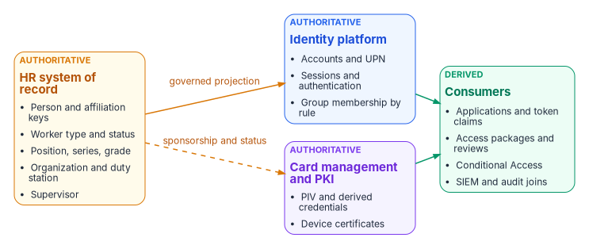

# Module 1: Name one writer for every account state {.unnumbered}

*Part of the [HR-Driven Identity learning path](index.md). Gate G1 Writers. Workbook [Chapter 01](../../project-plans/developer-workbooks/hr-driven-identity/01-the-writer-register-as-code.md). About 50 minutes.*

**Watch:** the narrated deck for this module: [Deck](https://github.com/WhalerMike/modernization-workbook/releases/download/edition-2026.11.5/Training_HR_Module_1.pptx) · [▶ Watch](../../presentations/watch.html?v=Training_HR_Module_1_Narrated) (about 13 minutes, captions) · [MP4](https://github.com/WhalerMike/modernization-workbook/releases/download/videos-2026-10-23/Training_HR_Module_1_Narrated.mp4) · [Script](https://github.com/WhalerMike/modernization-workbook/blob/main/presentations/training-hr-module-1/Training_HR_Module_1_Narration_Script.md) · [Captions](https://github.com/WhalerMike/modernization-workbook/blob/main/presentations/training-hr-module-1/Training_HR_Module_1_Narrated.vtt).

## Introduction (3 minutes)

Your agency's HR feed sets an account's `active` value. A Lifecycle Workflows leaver can disable the same account. A help desk technician can still edit a user's organization code. Each of those is a writer, and when two of them write the same value, the later one wins. A late `active` true from the pipeline undoes the workflow's disable; a help desk edit moves a person's access without HR knowing.

In this module you fix that before any other gate: you name one writer, and a backstop, for every account-state transition and HR-mastered value, and you test the directory audit log against that list.

**The federal requirement.** This gate supports NIST SP 800-53 AC-2 and IA-4 for the register, and AU-6 for reviewing writes outside the named writer. The gate's output is evidence for these controls; your organization still sets their parameters, policy and procedures, and the assessor decides whether each is satisfied. The requirements and the evidence are in the [Gate 1 requirements table](../../books/guides/hr-driven-identity-implementation.md#step-1-name-one-writer-for-every-state-and-attribute) (under **Federal requirements and evidence** in Step 1) and in the workbook chapter's [Federal requirements and evidence](../../project-plans/developer-workbooks/hr-driven-identity/01-the-writer-register-as-code.md#federal-requirements-and-evidence).

| Requirement | KSI | Evidence |
|---|---|---|
| AC-2 and IA-4, the register | KSI-IAM-ELP, KSI-IAM-JIT | The signed `config/writer-register.json` and the `check` output |
| AU-6, writes outside the named writer | KSI-MLA-RVL | The scan's `findings.json`, `writes.json` and `queries.json` |
| AU-9 and SI-7, evidence nobody edited | KSI-MLA-OSM; KSI-SVC-VRI | The scan folder's `manifest.json`, a SHA-256 per file |

KSIs are FedRAMP 20x indicators for cloud service providers: the agency authorizes its own system and lines this evidence up with what its providers report against them, and it doesn't report KSIs itself ([Book 00, Appendix B](../../books/b00-orientation/appendix-b-engagement-archetype.md)). Each KSI lists the row's control among its related SP 800-53 controls on [FedRAMP's Key Security Indicators page](https://www.fedramp.gov/2026/reference/key-security-indicators/) (read November 2, 2026); which file supports which indicator is the program's mapping *(design guidance)*. The workbook chapter's table has a row for every lab step.

## Learning objectives (1 minute)

After this module, you'll be able to:

- explain why one writer per account state comes before every other gate;
- read the lifecycle rows of the writer register and say which writer and backstop each names;
- run the register check (WR-01 to WR-09) and the audit-log scan (WS-01, WS-02 and WS-04), and read their findings;
- say what the scan can't see, and what covers it.

## Prerequisites (1 minute)

- The [learning path's prerequisites](index.md#prerequisites).
- Python 3.10 or later and pytest, and a clone of the repository ([What you need for the labs](index.md#what-you-need-for-the-labs)).

## Unit 1: Why one writer comes first (8 minutes)

Read the guide's [Step 1](../../books/guides/hr-driven-identity-implementation.md#step-1-name-one-writer-for-every-state-and-attribute). Its table of lifecycle rows is the register you'll check in the lab: who creates the account, who enables it at hire, who disables it at separation, who deletes it, and who writes the hire date, the leave date, the manager and the certificate binding.

Then read why Book 03 treats a writer as an access decision:

- [Book 03, Chapter 06, Writers](../../books/b03-hr-identity/06-canonical-attribute-schema.md#writers): whoever can write a slot decides what a rule on it grants.
- [Book 03, Chapter 04, Operating rules](../../books/b03-hr-identity/04-attribute-authority.md#operating-rules): the pipeline's `active` value and Lifecycle Workflows' tasks can both write account state.
- The workbook's [Why this gate comes first](../../project-plans/developer-workbooks/hr-driven-identity/01-the-writer-register-as-code.md#why-this-gate-comes-first), which ties the two together.

As you read, notice the row for deletion: the post-separation workflow writes it, and inbound provisioning never does.

{#fig-ch04-authority-map fig-alt="Three authoritative boxes on the left: HR system of record (person and affiliation keys, worker type and status, position, series and grade, organization and duty station, supervisor); identity platform (accounts and UPN, sessions and authentication, group membership by rule); card management and PKI (PIV and derived credentials, device certificates). HR feeds the identity platform as a governed projection and card management through sponsorship and status. The identity platform and card management feed a green consumers box: applications and token claims, access packages and reviews, Conditional Access, SIEM and audit joins."}

## Unit 2: The register and the scan (6 minutes)

Read three sections of workbook Chapter 01:

- [What it leaves to you](../../project-plans/developer-workbooks/hr-driven-identity/01-the-writer-register-as-code.md#what-it-leaves-to-you): what Learn's directoryAudits API gives you, and what you build yourself.
- [The checks](../../project-plans/developer-workbooks/hr-driven-identity/01-the-writer-register-as-code.md#the-checks): the WR rules that check the register's shape, and the WS rules that test each audit record against it.
- [What the scan doesn't see](../../project-plans/developer-workbooks/hr-driven-identity/01-the-writer-register-as-code.md#what-the-scan-doesnt-see): writes made in Active Directory for synced users.

Keep the rule table open during the lab; you'll match each finding to its rule.

## Exercise: Lab 1, fixtures, no tenant (20 minutes)

This is the workbook's [Lab 1](../../project-plans/developer-workbooks/hr-driven-identity/01-the-writer-register-as-code.md#lab-1-fixtures-no-tenant). The audit records are fictional.

<!-- labs:begin lab-1-commands (generated by scripts/generate_labs.py; not part of the reviewed page) -->

::: {.callout-note #lab-1-commands collapse="false" title="Every command in Lab 1"}
Every command in this lab, in order. Each step below says what it does and what to look for.

```powershell
Set-Location C:\FMWLabs\hr-driven-identity-code\hr-lifecycle

$Run = "C:\FMWLabs\results\hr-driven-identity-01-one-writer-per-state\lab1\$(Get-Date -AsUTC -Format 'yyyy-MM-ddTHHmmssZ')"
New-Item -ItemType Directory -Path $Run -Force | Out-Null
$Run

# Step 1
python python/graph_export.py --task writers-scan --list

# Step 2
python python/writer_register.py check --register config/writer-register.json

# Step 3
python python/writer_register.py scan --register config/writer-register.json --audit tests/fixtures/ch01/directory-audits.json --since 2026-10-01 --until 2026-10-31 --cloud gcc --out "$Run\ch01"

# Step 4
python -c "import json, sys; [print(r['Rule'], r['Severity'], r['Object'], '|', r['Issue']) for r in json.load(open(sys.argv[1]))]" "$Run\ch01\findings.json"

# Step 5
python -c "import json, sys; print(json.load(open(sys.argv[1]))[2])" "$Run\ch01\queries.json"

# Step 6
python -m pytest -q -p no:cacheprovider tests

# Step 6
Get-ChildItem C:\FMWLabs\results\hr-driven-identity-01-one-writer-per-state\lab1 -Name
```

:::

<!-- labs:end -->

Every step runs in PowerShell 7, the Python commands included, so you can follow it top to bottom in one window. Open **PowerShell 7** from the Start menu, then go to the kit's folder, where you unzipped it under [Get the code](index.md#get-the-code):

```powershell
Set-Location C:\FMWLabs\hr-driven-identity-code\hr-lifecycle
```

Then make this run's results folder. Its name is the date and time you start, in UTC, so each run keeps its own results and running the lab again never overwrites them:

```powershell
$Run = "C:\FMWLabs\results\hr-driven-identity-01-one-writer-per-state\lab1\$(Get-Date -AsUTC -Format 'yyyy-MM-ddTHHmmssZ')"
New-Item -ItemType Directory -Path $Run -Force | Out-Null
$Run
```

Expected output, where `<run>` is your start time, such as `2026-11-25T143005Z`:

```text
C:\FMWLabs\results\hr-driven-identity-01-one-writer-per-state\lab1\<run>
```

The run's date is only the folder's name. The data's dates are `--since` and `--until`, which stay the same, so every run's findings match this page. The results folder sits outside the kit, so unzipping a newer copy of the kit never touches it.

Prefer Git Bash? Go to the folder with `cd /c/FMWLabs/hr-driven-identity-code/hr-lifecycle`, make the run folder with `Run=/c/FMWLabs/results/hr-driven-identity-01-one-writer-per-state/lab1/$(date -u +%Y-%m-%dT%H%M%SZ); mkdir -p "$Run"`, and every step runs the same there. In a clone of the repository, use the `examples` folder of the same name.

1. List what the scan reads, and with what permission:

    ```powershell
    python python/graph_export.py --task writers-scan --list
    ```

    Expected output:

    ```text
    Task writers-scan: AuditLog.Read.All, Directory.Read.All
      GET /auditLogs/directoryAudits  [AuditLog.Read.All]
      GET /auditLogs/provisioning  [AuditLog.Read.All, Directory.Read.All]
    ```

2. Check the register:

    ```powershell
    python python/writer_register.py check --register config/writer-register.json
    ```

    Expected output:

    ```text
    Register: 0 Finding, 0 Warn, 0 Info
    ```

    The exit code is 0 (type `$LASTEXITCODE` to see it).

3. Scan October's audit records:

    ```powershell
    python python/writer_register.py scan --register config/writer-register.json --audit tests/fixtures/ch01/directory-audits.json --since 2026-10-01 --until 2026-10-31 --cloud gcc --out "$Run\ch01"
    ```

    Expected output:

    ```text
    Protected writes: 11 (writer 5, backstop 1, second writer 4, forbidden 1)
    Writers: 5 Finding, 1 Warn, 0 Info
    Written to C:/FMWLabs/results/hr-driven-identity-01-one-writer-per-state/lab1/<run>/ch01 (manifest.json lists every file's SHA-256)
    ```

    The exit code is 2 (`$LASTEXITCODE`), because the fixture holds findings.

4. Read the findings:

    ```powershell
    python -c "import json, sys; [print(r['Rule'], r['Severity'], r['Object'], '|', r['Issue']) for r in json.load(open(sys.argv[1]))]" "$Run\ch01\findings.json"
    ```

    Expected output:

    ```text
    WS-01 Finding casey.ng@contoso.example | disabled-at-separation written by pat.helpdesk@contoso.example, not by inbound-provisioning
    WS-01 Finding morgan.lee@contoso.example | employeeLeaveDateTime written by sam.exchange@contoso.example, not by inbound-provisioning
    WS-01 Finding drew.park@contoso.example | manager written by pat.helpdesk@contoso.example, not by inbound-provisioning
    WS-01 Finding quinn.ross@contoso.example | orgCode written by OrgCode fix-up script, not by inbound-provisioning
    WS-04 Finding blake.ito@contoso.example | deleted-at-disposition written by inbound-provisioning, which the register forbids
    WS-02 Warn jordan.diaz@contoso.example | enabled-at-hire written by the backstop (lifecycle-workflows); confirm the writer (inbound-provisioning) acted or was late
    ```

    Four WS-01 Findings (a help desk disable, an Exchange administrator's leave-date edit, a help desk manager change and a fix-up script's organization code), one WS-04 Finding (a delete by inbound provisioning, which the register forbids) and one WS-02 Warn (the backstop enabled a hire).

5. Read one saved query:

    ```powershell
    python -c "import json, sys; print(json.load(open(sys.argv[1]))[2])" "$Run\ch01\queries.json"
    ```

    Expected output:

    ```text
    {'allowed': ['inbound-provisioning', 'lifecycle-workflows'], 'graphFilter': "activityDateTime ge 2026-10-01T00:00:00Z and activityDateTime le 2026-10-31T23:59:59Z and activityDisplayName eq 'Disable account'", 'matchProperty': None, 'row': 'disabled-at-separation'}
    ```

    The third query is the `directoryAudits` filter for the `disabled-at-separation` row: `activityDisplayName eq 'Disable account'` within the window, allowed for `inbound-provisioning` and `lifecycle-workflows`. Gate 7's scheduled review runs these queries; Module 7's lab reads the scan's findings.

6. Run the tests:

    ```powershell
    python -m pytest -q -p no:cacheprovider tests
    ```

    Expected: the last line is `57 passed` and the time the run took.

    Nothing to clean up: the kit's folder is as you unzipped it, and this run's results stay in `$Run`. List every run you've made of this lab:

    ```powershell
    Get-ChildItem C:\FMWLabs\results\hr-driven-identity-01-one-writer-per-state\lab1 -Name
    ```

    Expected output: one line per run, oldest first, the last one this run:

    ```text
    <run>
    ```

## Exercise: Lab 2, your test tenant (5 minutes to read)

*Not run by the authors.* Follow the workbook's [Lab 2](../../project-plans/developer-workbooks/hr-driven-identity/01-the-writer-register-as-code.md#lab-2-test-tenant) in a worldwide or GCC test tenant, never production.

<!-- labs:begin module-lab-2-commands (generated by scripts/generate_labs.py; not part of the reviewed page) -->

::: {.callout-note #module-lab-2-commands collapse="false" title="The Lab 2 commands, against your test environment"}
Every command in [Lab 2](../../project-plans/developer-workbooks/hr-driven-identity/01-the-writer-register-as-code.md#lab-2-test-tenant), in order, against your test environment, never production.

Replace each `<placeholder>` with your test environment's value.

The chapter's steps say what each command does and what to look for.

```bash
# Step 3: Export the window
export HRLC_GRAPH_TOKEN='<graph-token>'
python python/graph_export.py --task writers-scan --cloud gcc --param since=2026-11-01T00:00:00Z --param until=2026-11-02T00:00:00Z --out exports/ch01

# Step 4: Confirm the property names
python -c "import json; [print(r['activityDateTime'], r['activityDisplayName'], t.get('userPrincipalName'), [p['displayName'] for p in t.get('modifiedProperties') or []]) for r in json.load(open('exports/ch01/directory-audits.json'))['value'] for t in r['targetResources']]"

# Step 4: Confirm the property names
cp config/writer-register.json my-register.json
python -c "import json; p='my-register.json'; d=json.load(open(p)); next(r for r in d['rows'] if r['id'] == '<row-id>')['auditProperty'] = '<audit-property-name>'; json.dump(d, open(p, 'w'), indent=2)"

# Step 5: Put the test tenant's identities in your register copy
python -c "import json; apps = {r['initiatedBy']['app']['servicePrincipalId']: r['initiatedBy']['app'].get('displayName') for r in json.load(open('exports/ch01/directory-audits.json'))['value'] if r['initiatedBy'].get('app')}; [print(k, v) for k, v in apps.items()]"

# Step 5: Put the test tenant's identities in your register copy
python -c "import json; p='my-register.json'; d=json.load(open(p)); d['writers']['inbound-provisioning']['servicePrincipalIds'] = ['<hr-provisioning-sp-id>', '<contractor-provisioning-sp-id>']; d['writers']['lifecycle-workflows']['servicePrincipalIds'] = ['<lifecycle-workflows-sp-id>']; json.dump(d, open(p, 'w'), indent=2)"
python python/writer_register.py scan --register my-register.json --audit exports/ch01/directory-audits.json --since 2026-11-01 --until 2026-11-02 --cloud gcc --out out/ch01-test

# Step 6: Back it out
rm -rf exports/ch01 out/ch01-test
```

Steps with no command, done in the portal or by hand as the chapter's step says:

- **Step 1:** Register the reader app
- **Step 2:** Make a known write
:::

<!-- labs:end -->

- **What you do:** make two known writes in the admin center, export the audit window, confirm the `modifiedProperties` names the register expects, put your tenant's service principal IDs in a copy of the register, and scan. Both admin center changes should appear as WS-01.
- **Permissions:** a reader app with a certificate, holding `AuditLog.Read.All` and `Directory.Read.All` as application permissions with admin consent, and nothing else.
- **Back-out:** restore the test users' values, remove the two permissions, delete the reader app and its certificate, and delete the export and output folders.

Lab 2 matters more here than in most modules: the property names in the register aren't documented on Learn, and a wrong name makes the scan report silence that looks clean ([Dangers](../../project-plans/developer-workbooks/hr-driven-identity/01-the-writer-register-as-code.md#dangers)).

## Knowledge check (5 minutes)

1. Your HR feed and the leaver workflow can both disable an account. What does the register record for the `disabled-at-separation` row?
    a. Both, as equal writers, so either can act first
    b. One writer, with the other recorded as its backstop
    c. Neither; account state is left to the help desk
    d. Whichever wrote it most recently in the audit log
2. The scan reports a WS-04 Finding for a deleted account. What happened?
    a. A writer the row forbids, inbound provisioning, deleted the account
    b. The backstop deleted the account before the writer did
    c. The delete failed and was retried
    d. The delete fell outside the scan's window
3. Which writes does the Entra audit-log scan not see?
    a. Writes by Lifecycle Workflows
    b. Writes by the HR provisioning app
    c. Writes made in Active Directory for synced users
    d. Writes by a help desk administrator in the admin center
4. Why must Lab 2 confirm each `auditProperty` name against a real record before the scan counts as evidence?
    a. Graph rejects a filter with an unknown property name
    b. Learn doesn't document the names, and a wrong one makes the scan report nothing for that value
    c. The names change every 30 days
    d. The register check fails until the names are confirmed

::: {.callout-tip collapse="true"}
## Check your answers
1. **b.** One writer per row, with a backstop that isn't the writer itself (WR-01, WR-06). Taught in [Step 1's lifecycle rows](../../books/guides/hr-driven-identity-implementation.md#step-1-name-one-writer-for-every-state-and-attribute) and [The checks](../../project-plans/developer-workbooks/hr-driven-identity/01-the-writer-register-as-code.md#the-checks).
2. **a.** WS-04 flags a write by a writer the row forbids; the register forbids deletion by inbound provisioning. Taught in [The checks](../../project-plans/developer-workbooks/hr-driven-identity/01-the-writer-register-as-code.md#the-checks).
3. **c.** AD writes are seen only by AD change auditing; the guide's interim path names the sync agent as a writer and reviews the OU ACLs. Taught in [What the scan doesn't see](../../project-plans/developer-workbooks/hr-driven-identity/01-the-writer-register-as-code.md#what-the-scan-doesnt-see).
4. **b.** The property names are the program's reading, not Learn's, and silence looks clean. Taught in [Verified facts](../../project-plans/developer-workbooks/hr-driven-identity/01-the-writer-register-as-code.md#verified-facts) and [Dangers](../../project-plans/developer-workbooks/hr-driven-identity/01-the-writer-register-as-code.md#dangers).
:::

## Summary (2 minutes)

You checked a writer register's shape, scanned a month of audit records against it, and read the saved query Gate 7 runs. You saw four second writers, one forbidden delete and one backstop that acted first.

**The evidence an ISSO keeps** for Gate 1: the signed register with its lifecycle rows and the versioned scope filter; the `check` output; the scan's output folder with its manifest and the saved `queries.json`; and the AD auditing settings, which this code doesn't read. The full list is in the workbook's [Federal requirements and evidence](../../project-plans/developer-workbooks/hr-driven-identity/01-the-writer-register-as-code.md#federal-requirements-and-evidence).

**Next:** [Module 2: Run contractors from their own source](02-contractor-sources.md).
