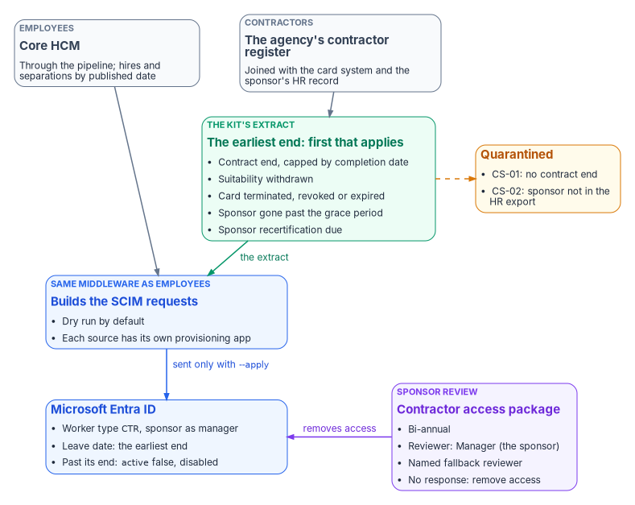

# Module 2: Run contractors from their own source {.unnumbered}

*Part of the [HR-Driven Identity learning path](index.md). Gate G2 Sources. Workbook [Chapter 02](../../project-plans/developer-workbooks/hr-driven-identity/02-contractor-sources-and-end-dates.md). About 50 minutes.*

**Watch:** the narrated deck for this module: [Deck](https://github.com/WhalerMike/modernization-workbook/releases/download/edition-2026.11.5/Training_HR_Module_2.pptx) · [▶ Watch](../../presentations/watch.html?v=Training_HR_Module_2_Narrated) (about 13 minutes, captions) · [MP4](https://github.com/WhalerMike/modernization-workbook/releases/download/videos-2026-10-23/Training_HR_Module_2_Narrated.mp4) · [Script](https://github.com/WhalerMike/modernization-workbook/blob/main/presentations/training-hr-module-2/Training_HR_Module_2_Narration_Script.md) · [Captions](https://github.com/WhalerMike/modernization-workbook/blob/main/presentations/training-hr-module-2/Training_HR_Module_2_Narrated.vtt).

## Introduction (3 minutes)

Employees come from HR. Your contractors don't: they live on COR spreadsheets, a suitability register or the PIV sponsorship records, and nobody updates the end date in a spreadsheet when a contract is cut short. That end date keeps access alive.

In this module you give contractors an end date that can't be left open. You compute each contractor's earliest end from the contract, the completion date, suitability, the card and the sponsor; send it through the same middleware as employees; and reconcile what the register, the card system and the directory say, without changing anything.

**The federal requirement.** This gate supports NIST SP 800-53 AC-2 and PS-7 (external personnel security), IA-4(4) (identify each person by status, such as contractor), and OMB M-22-09's expectation that enterprise identity draws on HR, contract management and personnel security. The gate's output is evidence for these controls; your organization still sets their parameters, policy and procedures, and the assessor decides whether each is satisfied. The requirements and evidence are in the [Gate 2 requirements table](../../books/guides/hr-driven-identity-implementation.md#step-2-bring-in-employees-and-contractors-from-their-sources) (under **Federal requirements and evidence** in Step 2) and the workbook chapter's [Federal requirements and evidence](../../project-plans/developer-workbooks/hr-driven-identity/02-contractor-sources-and-end-dates.md#federal-requirements-and-evidence).

| Requirement | KSI | Evidence |
|---|---|---|
| AC-2 and PS-7 | KSI-IAM-JIT; KSI-SCR-MON | `decisions.json`, and the reconciliation's `findings.json` with zero CR-01 |
| IA-4(4), worker type | KSI-IAM-AAM, KSI-IAM-ELP, KSI-IAM-JIT | `contractors-extract.csv` and the middleware's `provenance.json` |
| SA-9, FedRAMP use of the HR platform's cloud (Oracle Cloud Infrastructure) | KSI-SCR-MIT, KSI-SCR-MON, which the provider reports | The FedRAMP authorization the agency relies on |
| OMB M-22-09 and M-19-17; the Privacy Act | None: not SP 800-53 controls | The signed authority-per-fact table; the privacy office's determination |

KSIs are FedRAMP 20x indicators for cloud service providers: the agency authorizes its own system and lines this evidence up with what its providers report against them, and it doesn't report KSIs itself ([Book 00, Appendix B](../../books/b00-orientation/appendix-b-engagement-archetype.md)). Each KSI lists the row's control among its related SP 800-53 controls on [FedRAMP's Key Security Indicators page](https://www.fedramp.gov/2026/reference/key-security-indicators/) (read November 2, 2026); which file supports which indicator is the program's mapping *(design guidance)*. The workbook chapter's table has a row for every lab step.

## Learning objectives (1 minute)

After this module, you'll be able to:

- name the end conditions that make up a contractor's earliest end, and say why the earliest one wins;
- run the extract, read its decisions, and hand the extract to the HR middleware;
- run the read-only reconciliation and explain each CR finding;
- describe the sponsor review settings that end access when a sponsor doesn't respond.

## Prerequisites (1 minute)

- [Module 1](01-one-writer-per-state.md): inbound provisioning is the writer of the leave date and of `active`.
- Lab 1 setup from the [learning path](index.md#what-you-need-for-the-labs). This lab also calls `examples/hcm-entra` from the same clone.

## Unit 1: Contractors need their own source (7 minutes)

Read the guide's [Step 2](../../books/guides/hr-driven-identity-implementation.md#step-2-bring-in-employees-and-contractors-from-their-sources). Note its order: measure before changing anything, settle the six questions with the register's owner, then ship the contractor *leaver* before the joiner.

Then read where the design comes from:

- [Book 03, Chapter 06, Contractors and vendors](../../books/b03-hr-identity/06-canonical-attribute-schema.md#contractors-and-vendors-the-population-hrit-doesnt-cover): why contractors fall outside Federal HR 2.0's scope.
- [Book 03, Appendix A, Contractor leavers](../../books/b03-hr-identity/appendix-a-lifecycle-rules.md#contractor-leavers): the end conditions and their order.
- The [contractor evaluation's recommendation](../../evaluations/oracle-contingent-worker-contractor-source.md#part-6-recommendation): an agency-owned register now, the Oracle contingent worker as a later source swap.

## Unit 2: The earliest end and the sponsor review (7 minutes)

Read two sections of workbook Chapter 02:

- [The earliest end](../../project-plans/developer-workbooks/hr-driven-identity/02-contractor-sources-and-end-dates.md#the-earliest-end): how `extract` takes the first end that applies, the CS and CR rules, and the reconciliation's one Graph call.
- [The sponsor review](../../project-plans/developer-workbooks/hr-driven-identity/02-contractor-sources-and-end-dates.md#the-sponsor-review): the review settings block, bi-annual, with the manager as reviewer, a fallback reviewer and remove-on-no-response.

The extract doesn't send anything. The middleware from [Book 19, Chapter 01](../../books/b19-developer-workbook/01-the-hr-to-entra-middleware.md) builds the SCIM requests, and its dry run is its default.

{#fig-hr-contractor-earliest-end fig-alt="Two source boxes at the top. Employees come from Core HCM through the pipeline, with hires and separations read by published date. Contractors come from the agency's contractor register, joined with the card system and the sponsor's HR record. An arrow runs from the register to the kit's extract, labelled the earliest end, first that applies. Its conditions are contract end capped by completion date, suitability withdrawn, card terminated, revoked or expired, sponsor gone past the grace period, and sponsor recertification due. A dashed arrow runs from the extract to a Quarantined box listing CS-01, no contract end, and CS-02, sponsor not in the HR export. Arrows from Core HCM and from the extract, labelled the extract, meet at a box marked same middleware as employees: it builds the SCIM requests, runs dry by default, and gives each source its own provisioning app. An arrow labelled sent only with --apply runs from the middleware to Microsoft Entra ID, which shows worker type CTR, the sponsor as manager, the leave date set to the earliest end, and an account past its end set to active false and disabled. On the right, a sponsor review box for the contractor access package lists bi-annual, reviewer Manager (the sponsor), a named fallback reviewer, and remove access on no response. An arrow labelled removes access runs from it to Microsoft Entra ID."}

## Exercise: Lab 1, fixtures, no tenant (20 minutes)

This is the workbook's [Lab 1](../../project-plans/developer-workbooks/hr-driven-identity/02-contractor-sources-and-end-dates.md#lab-1-fixtures-no-tenant). The contractors are fictional.

<!-- labs:begin lab-1-commands (generated by scripts/generate_labs.py; not part of the reviewed page) -->

::: {.callout-note #lab-1-commands collapse="false" title="Every command in Lab 1"}
Every command in this lab, in order. Each step below says what it does and what to look for.

```powershell
Set-Location C:\FMWLabs\hr-driven-identity-code\hr-lifecycle

# Step 1
python python/graph_export.py --task contractor-reconcile --list

# Step 2
python python/contractor_source.py extract --register tests/fixtures/ch02/contractor-register.csv --cards tests/fixtures/ch02/cards.csv --sponsors tests/fixtures/ch02/hr-sponsors.csv --rules config/contractor-rules.json --as-of 2026-11-01 --out out/ch02/extract

# Step 3
python -c "import json; [print(d['PersonKey'], d['Action'], d['EarliestEnd'], d['Reason']) for d in json.load(open('out/ch02/extract/decisions.json'))]"

# Step 4
python ../hcm-entra/python/hcm_to_scim.py --extract out/ch02/extract/contractors-extract.csv --as-of 2026-11-01 --out out/ch02/scim

# Step 5
python python/contractor_source.py reconcile --register tests/fixtures/ch02/contractor-register.csv --cards tests/fixtures/ch02/cards.csv --sponsors tests/fixtures/ch02/hr-sponsors.csv --accounts tests/fixtures/ch02/contractor-users.json --rules config/contractor-rules.json --as-of 2026-11-01 --cloud gcc --out out/ch02/reconcile
python -c "import json; [print(r['Rule'], r['Severity'], r['Object'], '|', r['Issue']) for r in json.load(open('out/ch02/reconcile/findings.json'))]"

# Step 6
python python/contractor_source.py review --rules config/contractor-rules.json --out out/ch02/review

# Step 6
python -c "import json; print(json.dumps(json.load(open('out/ch02/review/assignment-policy-review.json')), indent=2))"

# Step 7
python -m pytest -q -p no:cacheprovider tests

# Step 7
Remove-Item -Recurse -Force out
```

:::

<!-- labs:end -->

Every step runs in PowerShell 7, the Python commands included, so you can follow it top to bottom in one window. Open **PowerShell 7** from the Start menu, then go to the kit's folder, where you unzipped it under [Get the code](index.md#get-the-code):

```powershell
Set-Location C:\FMWLabs\hr-driven-identity-code\hr-lifecycle
```

Prefer Git Bash? Go to the folder with `cd /c/FMWLabs/hr-driven-identity-code/hr-lifecycle`; every step runs the same there except the last command, which is `rm -rf out` in Bash. In a clone of the repository, use the `examples` folder of the same name.

1. List the reconciliation's read and permissions:

    ```powershell
    python python/graph_export.py --task contractor-reconcile --list
    ```

    Expected output:

    ```text
    Task contractor-reconcile: User-LifeCycleInfo.Read.All, User.Read.All
      GET /users  [User-LifeCycleInfo.Read.All, User.Read.All]
    ```

2. Compute the earliest ends and write the extract:

    ```powershell
    python python/contractor_source.py extract --register tests/fixtures/ch02/contractor-register.csv --cards tests/fixtures/ch02/cards.csv --sponsors tests/fixtures/ch02/hr-sponsors.csv --rules config/contractor-rules.json --as-of 2026-11-01 --out out/ch02/extract
    ```

    Expected output:

    ```text
    Contractors: 9 records: 3 active, 4 inactive (past their earliest end), 2 quarantined
    Source: 2 Finding, 1 Warn, 1 Info
    Extract written to out/ch02/extract/contractors-extract.csv; build the SCIM requests with examples/hcm-entra/python/hcm_to_scim.py
    ```

    The exit code is 2 (type `$LASTEXITCODE` to see it), because the fixture holds findings. In your unzipped folder, `examples/hcm-entra` is the `hcm-entra` folder beside `hr-lifecycle`; step 4 runs it from there.

3. Read the decisions:

    ```powershell
    python -c "import json; [print(d['PersonKey'], d['Action'], d['EarliestEnd'], d['Reason']) for d in json.load(open('out/ch02/extract/decisions.json'))]"
    ```

    Expected output:

    ```text
    900001 active 2027-01-11 contract end
    900002 inactive 2026-10-15 completion date
    900003 inactive 2026-10-20 suitability withdrawn
    900004 inactive 2026-10-30 sponsor gone past the grace period
    900005 inactive 2026-10-25 sponsor recertification due
    900006 active 2026-11-10 contract end
    900007 quarantine  no contract end
    900008 quarantine 2027-03-31 contract end
    900009 active 2027-03-01 sponsor recertification due
    ```

    Four contractors are `inactive`, each for a different reason: completion date, suitability withdrawn, sponsor gone past the grace period, and sponsor recertification due. Two are `quarantine`: 900007 has no contract end (CS-01) and 900008's sponsor isn't in the HR export (CS-02).

4. Build the SCIM requests with the middleware, from the `hcm-entra` folder beside this one (you stay in `hr-lifecycle`):

    ```powershell
    python ../hcm-entra/python/hcm_to_scim.py --extract out/ch02/extract/contractors-extract.csv --as-of 2026-11-01 --out out/ch02/scim
    ```

    Expected output:

    ```text
    {"counts": {"ready": 7}, "batches": 1, "disables": 4, "held": false, "hold_reason": ""}
    ```

    Seven records in one batch, four of them disables. Nothing is sent.

5. Reconcile the register, the cards and the directory, and read the findings:

    ```powershell
    python python/contractor_source.py reconcile --register tests/fixtures/ch02/contractor-register.csv --cards tests/fixtures/ch02/cards.csv --sponsors tests/fixtures/ch02/hr-sponsors.csv --accounts tests/fixtures/ch02/contractor-users.json --rules config/contractor-rules.json --as-of 2026-11-01 --cloud gcc --out out/ch02/reconcile
    python -c "import json; [print(r['Rule'], r['Severity'], r['Object'], '|', r['Issue']) for r in json.load(open('out/ch02/reconcile/findings.json'))]"
    ```

    Expected output:

    ```text
    Reconciliation: 7 Finding, 1 Warn, 0 Info
    Written to out/ch02/reconcile (manifest.json lists every file's SHA-256)
    CR-01 Finding bailey.ortiz@contoso.example | enabled past its earliest end 2026-10-15 (completion date)
    CR-01 Finding cameron.wu@contoso.example | enabled past its earliest end 2026-10-20 (suitability withdrawn)
    CR-01 Finding devon.hale@contoso.example | enabled past its earliest end 2026-10-30 (sponsor gone past the grace period)
    CR-01 Finding ellis.ward@contoso.example | enabled past its earliest end 2026-10-25 (sponsor recertification due)
    CR-02 Finding temp.vendor@contoso.example | enabled contractor account with no register record (orphan)
    CR-03 Finding 900011 | active card for a person the contractor source doesn't hold (contractor credential drift)
    CR-05 Finding finley.moss@contoso.example | employeeLeaveDateTime 2026-12-10 isn't the earliest end 2026-11-10; the leaver workflow fires on the wrong day
    CR-04 Warn indy.shah@contoso.example | active register record with no account
    ```

    Four CR-01 (enabled past the earliest end), one CR-02 (an orphan account), one CR-03 (an active card the source doesn't hold), one CR-05 (a leave date that isn't the earliest end) and one CR-04 Warn (a register record with no account). The four CR-01 accounts are the four disables from step 4.

6. Write the sponsor review settings:

    ```powershell
    python python/contractor_source.py review --rules config/contractor-rules.json --out out/ch02/review
    ```

    Expected output:

    ```text
    Review settings written to out/ch02/review/assignment-policy-review.json for review; nothing was sent
    ```

    Print the file:

    ```powershell
    python -c "import json; print(json.dumps(json.load(open('out/ch02/review/assignment-policy-review.json')), indent=2))"
    ```

    Expected output:

    ```text
    {
      "_target": {
        "accessPackageId": "d1000000-0000-4000-8000-000000000001",
        "apply": "merge into the contractor package's assignment policy and send the whole policy with Set-MgEntitlementManagementAssignmentPolicy after review"
      },
      "reviewSettings": {
        "expirationBehavior": "removeAccess",
        "fallbackReviewers": [
          {
            "@odata.type": "#microsoft.graph.singleUser",
            "userId": "c1000000-0000-4000-8000-000000000010"
          }
        ],
        "isEnabled": true,
        "isRecommendationEnabled": true,
        "isReviewerJustificationRequired": true,
        "isSelfReview": false,
        "primaryReviewers": [
          {
            "@odata.type": "#microsoft.graph.requestorManager",
            "managerLevel": 1
          }
        ],
        "schedule": {
          "expiration": {
            "duration": "P14D",
            "type": "afterDuration"
          },
          "recurrence": {
            "pattern": {
              "dayOfMonth": 0,
              "daysOfWeek": [],
              "interval": 6,
              "month": 0,
              "type": "absoluteMonthly"
            },
            "range": {
              "numberOfOccurrences": 0,
              "type": "noEnd"
            }
          },
          "startDateTime": "2027-01-04T14:00:00Z"
        }
      }
    }
    ```

    `expirationBehavior` is `removeAccess`, the primary reviewer is the requestor's manager at level 1, and the recurrence is `absoluteMonthly` with interval 6.

7. Run the tests:

    ```powershell
    python -m pytest -q -p no:cacheprovider tests
    ```

    Expected: the last line is `57 passed` and the time the run took.

    Then delete the `out` folder this lab wrote, so the next run starts clean:

    ```powershell
    Remove-Item -Recurse -Force out
    ```

## Exercise: Lab 2, your test tenant (5 minutes to read)

*Not run by the authors.* Follow the workbook's [Lab 2](../../project-plans/developer-workbooks/hr-driven-identity/02-contractor-sources-and-end-dates.md#lab-2-test-tenant) in a worldwide or GCC test tenant, never production.

- **What you do:** set up a contractor provisioning app, send two test contractors through the middleware's apply path, reconcile against the tenant, and apply the review settings to a test contractor package.
- **Permissions:** `SynchronizationData-User.Upload.OwnedBy` on the contractor provisioning app only, for the middleware's identity; `User.Read.All` and `User-LifeCycleInfo.Read.All` for the reader app. Updating the policy uses the cmdlet and permission the chapter names.
- **Back-out:** restore the policy's previous review settings from your read-back, pause the provisioning job (a paused job keeps its state), delete the test contractors, remove the permissions, and delete the export and output folders.

## Knowledge check (5 minutes)

1. A contractor's contract runs to January, but their sponsor recertification was due in October. Which end does `extract` use?
    a. The contract end, because it's the contractual date
    b. The earliest condition that applies: the recertification due date
    c. Whichever date the COR entered most recently
    d. None; the record is quarantined
2. What does a CR-01 finding mean?
    a. An enabled account past its earliest end
    b. An account with no register record
    c. A register record with no account
    d. An active card for a person the source doesn't hold
3. Why does the guide ship the contractor leaver before the joiner?
    a. Joiners need Entra ID Governance licenses and leavers don't
    b. The leaver closes the gap where an end date nobody updates keeps access alive
    c. Learn requires leavers first
    d. Joiners can't be sent through API-driven provisioning
4. In the sponsor review settings, what happens when the sponsor doesn't respond?
    a. No change, so access continues
    b. The review is extended for another cycle
    c. Access is removed, as the earliest-end rule says
    d. The fallback reviewer's decision is copied from the last review

::: {.callout-tip collapse="true"}
## Check your answers
1. **b.** `extract` computes every end condition that applies and takes the first. Taught in [The earliest end](../../project-plans/developer-workbooks/hr-driven-identity/02-contractor-sources-and-end-dates.md#the-earliest-end) and [Appendix A, Contractor leavers](../../books/b03-hr-identity/appendix-a-lifecycle-rules.md#contractor-leavers).
2. **a.** CR-01 is an enabled account past its earliest end; once the disables are sent, the next reconciliation shows none. Taught in [The earliest end](../../project-plans/developer-workbooks/hr-driven-identity/02-contractor-sources-and-end-dates.md#the-earliest-end).
3. **b.** A spreadsheet end date nobody updates keeps access alive; the middleware's earliest-end rule closes it. Taught in the guide's [Step 2](../../books/guides/hr-driven-identity-implementation.md#step-2-bring-in-employees-and-contractors-from-their-sources) and its [Dangers](../../books/guides/hr-driven-identity-implementation.md#dangers).
4. **c.** `expirationBehavior` is `removeAccess`, so a missed recertification ends access. Taught in [The sponsor review](../../project-plans/developer-workbooks/hr-driven-identity/02-contractor-sources-and-end-dates.md#the-sponsor-review).
:::

## Summary (2 minutes)

You computed nine contractors' earliest ends, built the SCIM requests that disable four of them, reconciled the register, the cards and the directory, and wrote the sponsor review that removes access on no response.

**The evidence an ISSO keeps** for Gate 2: both reconciliation output folders with their manifests, run before the contractor leaver ships and again after with zero CR-01; the extract and the middleware's provenance manifest; the authority-per-fact table signed by the governance body; and the privacy office's determination for the register and the card system. The full list is in the workbook's [Federal requirements and evidence](../../project-plans/developer-workbooks/hr-driven-identity/02-contractor-sources-and-end-dates.md#federal-requirements-and-evidence).

**Next:** [Module 3: Make joiners ready on day one](03-joiners-and-the-temporary-access-pass.md).
