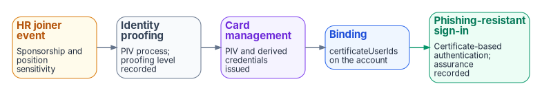

# Module 5: Check certificate-based authentication {.unnumbered}

*Part of the [HR-Driven Identity learning path](index.md). Gate G5 Credentials. Workbook [Chapter 05](../../project-plans/developer-workbooks/hr-driven-identity/05-certificate-based-authentication-checks.md). About 50 minutes.*

**Watch:** the narrated deck for this module: [Deck](https://github.com/WhalerMike/modernization-workbook/releases/download/edition-2026.11.5/Training_HR_Module_5.pptx) · [▶ Watch](../../presentations/watch.html?v=Training_HR_Module_5_Narrated) (about 13 minutes, captions) · [MP4](https://github.com/WhalerMike/modernization-workbook/releases/download/videos-2026-10-23/Training_HR_Module_5_Narrated.mp4) · [Script](https://github.com/WhalerMike/modernization-workbook/blob/main/presentations/training-hr-module-5/Training_HR_Module_5_Narration_Script.md) · [Captions](https://github.com/WhalerMike/modernization-workbook/blob/main/presentations/training-hr-module-5/Training_HR_Module_5_Narrated.vtt).

## Introduction (3 minutes)

A PIV card's revocation reaches sign-in only through the certificate revocation list. If a CA has no CRL configured, Entra doesn't check revocation for it. If a configured CRL can't be downloaded in time, certificate-based authentication fails for every card from that CA. And a CRL grows with every revocation, so a list that fits today can cross your cloud's limit next month.

In this module you measure each CRL and check the tenant's certificate-based authentication settings against the limits for your cloud, every day rather than once.

**The federal requirement.** This gate supports NIST SP 800-53 IA-2(12) (acceptance of PIV credentials) and IA-5(2) (public key-based authentication), CISA SCuBA MS.AAD.3.1v1 and MS.AAD.3.6v1 (phishing-resistant MFA, required under BOD 25-01), FIPS 201-3's issuance and termination rules, and NIST SP 800-63-4. The gate's output is evidence for these controls; your organization still sets their parameters, policy and procedures, and the assessor decides whether each is satisfied. The requirements and evidence are in the [Gate 5 requirements table](../../books/guides/hr-driven-identity-implementation.md#step-5-bind-credentials-to-hr-events) (under **Federal requirements and evidence** in Step 5) and the workbook chapter's [Federal requirements and evidence](../../project-plans/developer-workbooks/hr-driven-identity/05-certificate-based-authentication-checks.md#federal-requirements-and-evidence).

| Requirement | KSI | Evidence |
|---|---|---|
| IA-2(12) and IA-5(2) | None lists IA-2(12); KSI-IAM-APM, KSI-IAM-ELP, KSI-SVC-ASM (IA-5(2)) | The `cba-read` export, `crl-measurements.csv`, and the check's `findings.json` and `manifest.json` |
| SC-17, trusted CAs | KSI-SVC-ASM | The check's CB-11 and CB-12 rows |
| SCuBA MS.AAD.3.1v1 and MS.AAD.3.6v1 | KSI-IAM-APM, as Book 04, Chapter 10 maps it | The CB-09 and CB-10 rows beside the ScubaGear report |
| FIPS 201-3 and SP 800-63-4 | None: not SP 800-53 controls | Lab 2's refused sign-in; the mode rules in the export |

KSIs are FedRAMP 20x indicators for cloud service providers: the agency authorizes its own system and lines this evidence up with what its providers report against them, and it doesn't report KSIs itself ([Book 00, Appendix B](../../books/b00-orientation/appendix-b-engagement-archetype.md)). Each KSI lists the row's control among its related SP 800-53 controls on [FedRAMP's Key Security Indicators page](https://www.fedramp.gov/2026/reference/key-security-indicators/) (read November 2, 2026); which file supports which indicator is the program's mapping *(design guidance)*. The workbook chapter's table has a row for every lab step.

## Learning objectives (1 minute)

After this module, you'll be able to:

- state the interactive CRL limit for GCC, and the download time limit;
- measure a set of CRLs and record failures as findings;
- run the certificate-based authentication check for a named cloud and explain its findings;
- explain why a CRL under the GCC limit can still be a warning, and why the check runs every day.

## Prerequisites (1 minute)

- [Module 3](03-joiners-and-the-temporary-access-pass.md): the Temporary Access Pass bridges to the card; this gate ends the bridge.
- Some familiarity with PKI terms (issuing CA, CRL, policy OID). [Book 07, Chapter 06](../../books/b07-pki/06-device-and-user-certificates.md#entra-certificate-based-authentication) explains them for Entra.

## Unit 1: Credentials follow HR events (6 minutes)

Read the guide's [Step 5](../../books/guides/hr-driven-identity-implementation.md#step-5-bind-credentials-to-hr-events). Its step 1 gives the CRL limits per cloud; its later steps tie issuance and revocation to HR and contractor events.

Then read why revocation matters:

- [Book 03, Chapter 09, Revocation checking](../../books/b03-hr-identity/09-credentials-and-certificates.md#revocation-checking).
- [Book 03, Chapter 09, Binding the PIV certificate to the Entra user](../../books/b03-hr-identity/09-credentials-and-certificates.md#binding-the-piv-certificate-to-the-entra-user): a reissue changes the binding.

Per-user binding coverage and affinity aren't this module's: they belong to the validation kit's VK-PIV-01 and the [ADM implementation guide's Gate 6](../../books/guides/attribute-driven-migration-implementation.md#gate-6-piv-binding).

{#fig-ch09-credential-assurance fig-alt="Left to right: HR joiner event (sponsorship and position sensitivity); identity proofing (PIV process; proofing level recorded); card management (PIV and derived credentials issued); binding (certificateUserIds on the account); phishing-resistant sign-in (certificate-based authentication; assurance recorded)."}

## Unit 2: The measurement and the check (6 minutes)

Read the workbook's [Why this gate needs code](../../project-plans/developer-workbooks/hr-driven-identity/05-certificate-based-authentication-checks.md#why-this-gate-needs-code), which sets out Learn's two sets of CRL limits, then:

- [The measurement](../../project-plans/developer-workbooks/hr-driven-identity/05-certificate-based-authentication-checks.md#the-measurement): download each CRL once, record bytes, seconds and any error.
- [The check](../../project-plans/developer-workbooks/hr-driven-identity/05-certificate-based-authentication-checks.md#the-check): CB-01 to CB-13, which come from Learn, which from SCuBA and which are design guidance.

## Exercise: Lab 1, fixtures, no tenant (20 minutes)

This is the workbook's [Lab 1](../../project-plans/developer-workbooks/hr-driven-identity/05-certificate-based-authentication-checks.md#lab-1-fixtures-no-tenant). The PKI is fictional.

<!-- labs:begin lab-1-commands (generated by scripts/generate_labs.py; not part of the reviewed page) -->

::: {.callout-note #lab-1-commands collapse="false" title="Every command in Lab 1"}
Every command in this lab, in order. Each step below says what it does and what to look for.

```powershell
Set-Location C:\FMWLabs\hr-driven-identity-code\hr-lifecycle

$Run = "C:\FMWLabs\results\hr-driven-identity-05-certificate-based-authentication\lab1\$(Get-Date -AsUTC -Format 'yyyy-MM-ddTHHmmssZ')"
New-Item -ItemType Directory -Path $Run -Force | Out-Null
$Run

# Step 1
python python/graph_export.py --task cba-read --list

# Step 2
python python/cba_check.py measure --urls tests/fixtures/ch05/crl-urls.txt --out "$Run\ch05\crl-measurements.csv"

# Step 3
python python/cba_check.py check --cloud gcc --exports tests/fixtures/ch05/exports --crl tests/fixtures/ch05/crl-measurements.csv --expected config/cba-expected.json --as-of 2026-11-01 --out "$Run\ch05\check"

# Step 4
python -m pytest -q -p no:cacheprovider tests

# Step 4
Get-ChildItem C:\FMWLabs\results\hr-driven-identity-05-certificate-based-authentication\lab1 -Name
```

:::

<!-- labs:end -->

Every step runs in PowerShell 7, the Python commands included, so you can follow it top to bottom in one window. Open **PowerShell 7** from the Start menu, then go to the kit's folder, where you unzipped it under [Get the code](index.md#get-the-code):

```powershell
Set-Location C:\FMWLabs\hr-driven-identity-code\hr-lifecycle
```

Then make this run's results folder. Its name is the date and time you start, in UTC, so each run keeps its own results and running the lab again never overwrites them:

```powershell
$Run = "C:\FMWLabs\results\hr-driven-identity-05-certificate-based-authentication\lab1\$(Get-Date -AsUTC -Format 'yyyy-MM-ddTHHmmssZ')"
New-Item -ItemType Directory -Path $Run -Force | Out-Null
$Run
```

Expected output, where `<run>` is your start time, such as `2026-11-25T143005Z`:

```text
C:\FMWLabs\results\hr-driven-identity-05-certificate-based-authentication\lab1\<run>
```

The run's date is only the folder's name. The data's date is `--as-of`, which stays the same, so every run's results match this page. The results folder sits outside the kit, so unzipping a newer copy of the kit never touches it.

Prefer Git Bash? Go to the folder with `cd /c/FMWLabs/hr-driven-identity-code/hr-lifecycle`, make the run folder with `Run=/c/FMWLabs/results/hr-driven-identity-05-certificate-based-authentication/lab1/$(date -u +%Y-%m-%dT%H%M%SZ); mkdir -p "$Run"`, and every step runs the same there. In a clone of the repository, use the `examples` folder of the same name.

1. List the calls and permissions:

    ```powershell
    python python/graph_export.py --task cba-read --list
    ```

    Expected output:

    ```text
    Task cba-read: Policy.Read.All, Policy.Read.AuthenticationMethod, PublicKeyInfrastructure.Read.All
      GET /directory/publicKeyInfrastructure/certificateBasedAuthConfigurations  [PublicKeyInfrastructure.Read.All]
      GET /directory/publicKeyInfrastructure/certificateBasedAuthConfigurations/{pkiId}/certificateAuthorities  [PublicKeyInfrastructure.Read.All]
      GET /policies/authenticationMethodsPolicy/authenticationMethodConfigurations/x509Certificate  [Policy.Read.AuthenticationMethod]
      GET /policies/authenticationStrengthPolicies  [Policy.Read.AuthenticationMethod]
      GET /identity/conditionalAccess/policies  [Policy.Read.All]
    ```

    Three permissions for five GET calls.

2. Measure the fixture CRLs:

    ```powershell
    python python/cba_check.py measure --urls tests/fixtures/ch05/crl-urls.txt --out "$Run\ch05\crl-measurements.csv"
    ```

    Expected output:

    ```text
             4,096 bytes    0.000 s  tests/fixtures/ch05/crl/piv-ca1.crl
             8,192 bytes    0.000 s  tests/fixtures/ch05/crl/piv-ca2.crl
                 0 bytes    0.000 s  tests/fixtures/ch05/crl/missing.crl  FileNotFoundError
    Measured 3 CRL(s) -> C:/FMWLabs/results/hr-driven-identity-05-certificate-based-authentication/lab1/<run>/ch05/crl-measurements.csv
    ```

    The times are how long each file took to read; on a slow disk they may show `0.001 s`. The missing file is recorded, not raised.

3. Check the fictional tenant for GCC:

    ```powershell
    python python/cba_check.py check --cloud gcc --exports tests/fixtures/ch05/exports --crl tests/fixtures/ch05/crl-measurements.csv --expected config/cba-expected.json --as-of 2026-11-01 --out "$Run\ch05\check"
    ```

    Expected output:

    ```text
    Cloud gcc: interactive CRL limit 20,000,000 bytes, download within 10 s
    CBA: 5 Finding, 7 Warn, 0 Info
      CB-01 Finding: Contoso Example Legacy Intermediate: no CRL configured: Entra doesn't check revocation for this CA
      CB-04 Finding: Contoso Example PIV Issuing CA 2 (renewed): CRL took 11.4 s to download; the limit is 10 s
      CB-09 Finding: authentication mode: PIV policy OID(s) 2.16.840.1.101.3.2.1.48.11 not mapped to multifactor, and the default is single-factor
      CB-10 Finding: Conditional Access: no enabled policy for all users and all resources requires a phishing-resistant authentication strength (SCuBA MS.AAD.3.1v1)
      CB-12 Finding: Contoso Example PIV Issuing CA 2: issuing CA the card program uses isn't in the trust store
      CB-01 Warn: Contoso Example PIV Root CA: root CA with no CRL configured; Learn asks for a CRL on each CA; confirm the root's revocation path
      CB-02 Warn: Contoso Example PIV Issuing CA 2 (renewed): CRL endpoint https://pki.contoso.example/crl/piv-ca2.crl isn't HTTP; Learn recommends HTTP
      CB-05 Warn: Contoso Example PIV Issuing CA 2 (renewed): CRL is 18,500,000 bytes, over 80% of the gcc interactive limit
      CB-08 Warn: CRL validation: CBA doesn't require a CRL from every CA (crlValidationConfiguration isn't enabled)
      CB-08 Warn: CA 5A5B5C5D5E5F60616263646566676869: exempted from CRL validation; allowed only while its CRL is fixed, with an end date
      CB-11 Warn: Contoso Example Legacy Intermediate: CA certificate expires 2026-12-15
      CB-13 Warn: username bindings: low-affinity binding fields configured (PrincipalName); align with the affinity decision (ADM Gate 6) and VK-PIV-01
    ```

    The exit code is 2 (type `$LASTEXITCODE` to see it). Find CB-04 (a CRL that took 11.4 seconds), CB-05 (a CRL of 18,500,000 bytes, over 80 percent of the GCC limit), CB-09 (a PIV policy OID not mapped to multifactor) and CB-10 (no enabled policy requires a phishing-resistant strength).

4. Run the tests:

    ```powershell
    python -m pytest -q -p no:cacheprovider tests
    ```

    Expected: the last line is `57 passed` and the time the run took.

    Nothing to clean up: the kit's folder is as you unzipped it, and this run's results stay in `$Run`. List every run you've made of this lab:

    ```powershell
    Get-ChildItem C:\FMWLabs\results\hr-driven-identity-05-certificate-based-authentication\lab1 -Name
    ```

    Expected output: one line per run, oldest first, the last one this run:

    ```text
    <run>
    ```

## Exercise: Lab 2, your test tenant (5 minutes to read)

*Not run by the authors.* Follow the workbook's [Lab 2](../../project-plans/developer-workbooks/hr-driven-identity/05-certificate-based-authentication-checks.md#lab-2-test-tenant) in a test tenant with certificate-based authentication configured for a test CA, never production.

<!-- labs:begin module-lab-2-commands (generated by scripts/generate_labs.py; not part of the reviewed page) -->

::: {.callout-note #module-lab-2-commands collapse="false" title="The Lab 2 commands, against your test environment"}
Every command in [Lab 2](../../project-plans/developer-workbooks/hr-driven-identity/05-certificate-based-authentication-checks.md#lab-2-test-tenant), in order, against your test environment, never production.

Replace each `<placeholder>` with your test environment's value.

The chapter's steps say what each command does and what to look for.

In PowerShell 7:

```powershell
# Step 1: Register the reader app
Connect-MgGraph -Environment Global -TenantId <tenant-id> -Scopes 'Application.ReadWrite.All', 'AppRoleAssignment.ReadWrite.All' -NoWelcome
$cert = New-SelfSignedCertificate -Subject 'CN=hrlc-ch05-reader' -CertStoreLocation Cert:\CurrentUser\My -KeyExportPolicy NonExportable -KeySpec Signature -NotAfter (Get-Date).AddDays(30)
$app = New-MgApplication -DisplayName 'hrlc-ch05-reader' -SignInAudience AzureADMyOrg -KeyCredentials @(@{ Type = 'AsymmetricX509Cert'; Usage = 'Verify'; Key = $cert.RawData })
$sp = New-MgServicePrincipal -AppId $app.AppId
$graph = Get-MgServicePrincipal -Filter "appId eq '00000003-0000-0000-c000-000000000000'"
foreach ($p in 'Policy.Read.All', 'Policy.Read.AuthenticationMethod', 'PublicKeyInfrastructure.Read.All') {
    $role = $graph.AppRoles | Where-Object { $_.Value -eq $p -and $_.AllowedMemberTypes -contains 'Application' }
    New-MgServicePrincipalAppRoleAssignment -ServicePrincipalId $sp.Id -PrincipalId $sp.Id -ResourceId $graph.Id -AppRoleId $role.Id
}
```

In a POSIX shell (Git Bash on Windows):

```bash
# Step 2: Export the configuration
export HRLC_GRAPH_TOKEN='<graph-token>'
curl -s -H "Authorization: Bearer $HRLC_GRAPH_TOKEN" https://graph.microsoft.com/v1.0/directory/publicKeyInfrastructure/certificateBasedAuthConfigurations
python python/graph_export.py --task cba-read --cloud gcc --param pkiId=<pki-id> --out exports/cba

# Step 2: Export the configuration
python -c "import json; print('x509 objects:', len(json.load(open('exports/cba/x509-method.json'))['value'])); [print(c['displayName'], c.get('certificateRevocationListUrl')) for c in json.load(open('exports/cba/pki-cas.json'))['value']]"

# Step 3: Measure the real CRLs
printf '%s\n' '<crl-url-1>' '<crl-url-2>' > my-crl-urls.txt
python python/cba_check.py measure --urls my-crl-urls.txt --out out/cba-test/crl-measurements.csv

# Step 4: Check
python -c "import json; d=json.load(open('config/cba-expected.json')); d['issuingCas'] = [{'displayName': '<ca-name>', 'thumbprint': '<ca-thumbprint>'}]; d['multifactorPolicyOids'] = ['<piv-policy-oid>']; json.dump(d, open('my-cba-expected.json', 'w'), indent=2)"
python python/cba_check.py check --cloud <cloud> --exports exports/cba --crl out/cba-test/crl-measurements.csv --expected my-cba-expected.json --as-of <today> --out out/cba-test/check
```

In PowerShell 7:

```powershell
# Step 5: Prove revocation
certutil -revoke <cert-serial> 1
certutil -CRL
(Get-Date).ToUniversalTime().ToString('yyyy-MM-ddTHH:mm:ssZ')

# Step 5: Prove revocation
Invoke-WebRequest -Uri '<crl-url-1>' -OutFile revoked-test.crl
certutil -dump revoked-test.crl | Select-String -Pattern 'ThisUpdate', 'NextUpdate', 'Next CRL Publish', '<cert-serial>'

# Step 5: Prove revocation
Connect-MgGraph -Environment Global -TenantId <tenant-id> -Scopes 'AuditLog.Read.All' -NoWelcome
Get-MgAuditLogSignIn -Filter "userPrincipalName eq '<test-user-upn>' and createdDateTime ge <revoked-at>" | Format-List CreatedDateTime, AppDisplayName, @{ n = 'ErrorCode'; e = { $_.Status.ErrorCode } }, @{ n = 'FailureReason'; e = { $_.Status.FailureReason } }
```

In a POSIX shell (Git Bash on Windows):

```bash
# Step 6: Back it out
rm -rf exports out my-crl-urls.txt my-cba-expected.json
```
:::

<!-- labs:end -->

- **What you do:** export the configuration, measure the real CRLs from outside the agency network, run the check with your test PKI's thumbprints and OIDs, then revoke a test certificate and confirm Entra refuses it after the next CRL publication (Learn's [certificate-based authentication FAQ](https://learn.microsoft.com/entra/identity/authentication/certificate-based-authentication-faq): a revoked certificate on the CRL fails sign-in, and the sign-in logs show why).
- **Permissions:** a reader app with a certificate holding the three application permissions from step 1, with admin consent, and nothing else.
- **Back-out:** remove the permissions, delete the reader app and its certificate, reissue the test user's certificate if you need it, and delete the export and output folders.

## Knowledge check (5 minutes)

1. What happens when an issuing CA in the trust store has no CRL configured?
    a. Entra downloads the CRL from the certificate's distribution point
    b. Entra doesn't check revocation for that CA's certificates
    c. Sign-in fails for that CA's certificates
    d. Entra uses the root CA's CRL instead
2. What's the interactive sign-in CRL size limit in GCC?
    a. 20 MB, the commercial service limit
    b. 45 MB
    c. 65 MB
    d. 150 MB
3. An 18,500,000-byte CRL raises CB-05 in GCC. Why?
    a. The CRL is over the GCC limit
    b. CB-05 warns at 80 percent of the interactive limit, and GCC's limit is 20 MB
    c. The CRL took too long to download
    d. The check skips CB-05 for root CAs
4. A configured CRL takes 11.4 seconds to download. What does the check report?
    a. A Warn, because the size is small
    b. A CB-04 Finding, because the limit is 10 seconds
    c. Nothing, because the size is under the limit
    d. A CB-02 Warn, because it should be HTTP

::: {.callout-tip collapse="true"}
## Check your answers
1. **b.** Without a configured CRL, Entra doesn't check revocation (CB-01). Taught in the guide's [Step 5](../../books/guides/hr-driven-identity-implementation.md#step-5-bind-credentials-to-hr-events) and [The check](../../project-plans/developer-workbooks/hr-driven-identity/05-certificate-based-authentication-checks.md#the-check).
2. **a.** 20 MB in the commercial service, which GCC uses. Taught in the guide's [Step 5](../../books/guides/hr-driven-identity-implementation.md#step-5-bind-credentials-to-hr-events).
3. **b.** 18,500,000 bytes is over 80 percent of 20 MB. Taught in [The check](../../project-plans/developer-workbooks/hr-driven-identity/05-certificate-based-authentication-checks.md#the-check) and the chapter's [Lab 1](../../project-plans/developer-workbooks/hr-driven-identity/05-certificate-based-authentication-checks.md#lab-1-fixtures-no-tenant).
4. **b.** A CRL must download within 10 seconds. Taught in [The check](../../project-plans/developer-workbooks/hr-driven-identity/05-certificate-based-authentication-checks.md#the-check).
:::

## Summary (2 minutes)

You measured three CRLs, checked a fictional tenant's certificate-based authentication for GCC, and saw how the GCC limit sets the CB-05 warning.

**The evidence an ISSO keeps** for Gate 5: the `cba-read` export and the check's findings and manifest, dated; each CRL measurement; the CB-09 and CB-10 rows beside the ScubaGear report; Lab 2's refused sign-in with the revocation record and the CRL that published it; and the mode rules in the export. The full list is in the workbook's [Federal requirements and evidence](../../project-plans/developer-workbooks/hr-driven-identity/05-certificate-based-authentication-checks.md#federal-requirements-and-evidence).

**Next:** [Module 6: Time separations from the logs](06-separation-timing.md).
