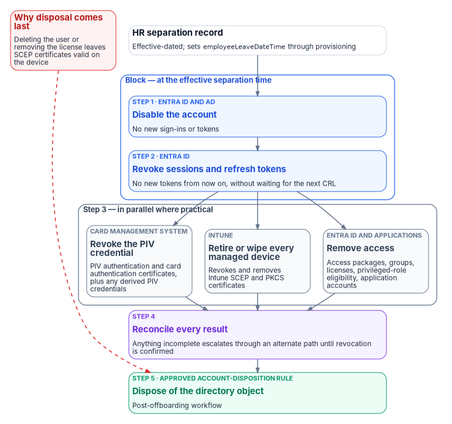

# Module 6: Time separations from the logs {.unnumbered}

*Part of the [HR-Driven Identity learning path](index.md). Gate G6 Separation. Workbook [Chapter 06](../../project-plans/developer-workbooks/hr-driven-identity/06-separation-timing.md). About 50 minutes.*

**Watch:** the narrated deck for this module: [Deck](https://github.com/WhalerMike/modernization-workbook/releases/download/edition-2026.11.5/Training_HR_Module_6.pptx) · [▶ Watch](../../presentations/watch.html?v=Training_HR_Module_6_Narrated) (about 13 minutes, captions) · [MP4](https://github.com/WhalerMike/modernization-workbook/releases/download/videos-2026-10-23/Training_HR_Module_6_Narrated.mp4) · [Script](https://github.com/WhalerMike/modernization-workbook/blob/main/presentations/training-hr-module-6/Training_HR_Module_6_Narration_Script.md) · [Captions](https://github.com/WhalerMike/modernization-workbook/blob/main/presentations/training-hr-module-6/Training_HR_Module_6_Narrated.vtt).

## Introduction (3 minutes)

When a person separates, your ISSO has to show that access was blocked within the approved interval and the credential was revoked. No Microsoft report gives that number. Lifecycle Workflows records that a run completed, the audit log records when the account was disabled, and the card system and Intune record the rest, each in its own place.

In this module you join those records per leaver, compute the two intervals, and find the separations that went wrong: late entries, a re-enable, a failed run, a card revoked too late, a delete before the devices were retired.

**The federal requirement.** This gate supports NIST SP 800-53 PS-4 (personnel termination) and AC-2(3) (disable accounts), PS-7 for contractors, FIPS 201-3's rule that a card that can't be collected is terminated within 18 hours of notification, and AC-2(13) (disable accounts for high-risk individuals). The gate's output is evidence for these controls; your organization still sets their parameters, policy and procedures, and the assessor decides whether each is satisfied. The requirements and evidence are in the [Gate 6 requirements table](../../books/guides/hr-driven-identity-implementation.md#step-6-time-separations-and-deprovisioning) (under **Federal requirements and evidence** in Step 6) and the workbook chapter's [Federal requirements and evidence](../../project-plans/developer-workbooks/hr-driven-identity/06-separation-timing.md#federal-requirements-and-evidence).

| Requirement | KSI | Evidence |
|---|---|---|
| PS-4 and AC-2(3) | KSI-IAM-ELP (PS-4); KSI-IAM-AAM (AC-2(3)); KSI-IAM-JIT, KSI-IAM-SUS (both) | `intervals.csv` and `findings.json` with the `manifest.json` |
| PS-7, contractors | KSI-SCR-MON | The contractor rows of `intervals.csv` |
| AC-2(13), high-risk individuals | KSI-IAM-AAM, KSI-IAM-SUS | The on-demand runs, logged as changes |
| CA-7, the percentiles | KSI-MLA-EVC | `summary.json` |
| FIPS 201-3, the 18-hour rule | None: not an SP 800-53 control | ST-04 rows; the notice and revocation timestamps |

KSIs are FedRAMP 20x indicators for cloud service providers: the agency authorizes its own system and lines this evidence up with what its providers report against them, and it doesn't report KSIs itself ([Book 00, Appendix B](../../books/b00-orientation/appendix-b-engagement-archetype.md)). Each KSI lists the row's control among its related SP 800-53 controls on [FedRAMP's Key Security Indicators page](https://www.fedramp.gov/2026/reference/key-security-indicators/) (read November 2, 2026); which file supports which indicator is the program's mapping *(design guidance)*. The workbook chapter's table has a row for every lab step.

## Learning objectives (1 minute)

After this module, you'll be able to:

- describe the leaver order: block first, revoke in parallel, reconcile, dispose last;
- define separation-to-block and separation-to-revocation, and say which records each reads;
- run the measurement and explain the ST findings, including the catch-up window;
- explain why the tenant schedule belongs inside the approved interval.

## Prerequisites (1 minute)

- [Module 1](01-one-writer-per-state.md): the pipeline sends `active` false no later than the leaver workflow's first run.
- [Module 3](03-joiners-and-the-temporary-access-pass.md): the leaver and post-separation workflow files.
- [Module 5](05-certificate-based-authentication.md): card revocation reaches sign-in through the CRL.

## Unit 1: The leaver sequence (7 minutes)

Read the guide's [Step 6](../../books/guides/hr-driven-identity-implementation.md#step-6-time-separations-and-deprovisioning): order the leaver as the sequence, time the leave date late in the day, coordinate the two writers, build the emergency path, catch late separations, verify the block, and dispose last.

Then read the design:

- [Book 03, Chapter 09, The canonical leaver sequence](../../books/b03-hr-identity/09-credentials-and-certificates.md#the-canonical-leaver-sequence).
- [Book 03, Chapter 08, Triggers and schedule](../../books/b03-hr-identity/08-joiner-mover-leaver.md#triggers-and-schedule): why a separation entered late misses the scheduled trigger.
- [Book 19, Chapter 05, The leaver order](../../books/b19-developer-workbook/05-lifecycle-workflows-custom-extensions.md#the-leaver-order): the custom task extension, built for the card revocation; retiring the devices in Intune follows the same pattern and is still to build.

{#fig-ch09-leaver-sequence fig-alt="A vertical flow. The HR separation record, which sets employeeLeaveDateTime through provisioning, starts the sequence. Step 1, Entra ID and AD: disable the account, so no new sign-ins or tokens. Step 2, Entra ID: revoke sessions and refresh tokens, so no new tokens are issued from then on, without waiting for the next CRL. These two steps form the block. Step 3 fans out into three parallel actions: the card management system revokes the PIV credential and any derived PIV credentials; Intune retires or wipes every managed device, which revokes and removes SCEP and PKCS certificates; and entitlements, access packages, groups, licenses, privileged-role eligibility and application access are removed. All three feed step 4: reconcile every result and escalate anything incomplete through an alternate path. Step 5: dispose of the directory object under the approved account-disposition rule. A red note, 'Why disposal comes last', points at step 5: deleting the user or removing the license leaves SCEP certificates valid on the device."}

## Unit 2: The intervals and the rules (6 minutes)

Read two sections of workbook Chapter 06:

- [The intervals](../../project-plans/developer-workbooks/hr-driven-identity/06-separation-timing.md#the-intervals): *blocked* is the later of the disable and the session revocation; *revoked* adds the card and the devices.
- [The rules](../../project-plans/developer-workbooks/hr-driven-identity/06-separation-timing.md#the-rules): ST-01 to ST-09 (separation-timing rules, not the smoke tests the Non-Person Identity runbook numbers ST-01 to ST-07), and which thresholds are samples the agency replaces.

## Exercise: Lab 1, fixtures, no tenant (20 minutes)

This is the workbook's [Lab 1](../../project-plans/developer-workbooks/hr-driven-identity/06-separation-timing.md#lab-1-fixtures-no-tenant). The leavers are fictional.

<!-- labs:begin lab-1-commands (generated by scripts/generate_labs.py; not part of the reviewed page) -->

::: {.callout-note #lab-1-commands collapse="false" title="Every command in Lab 1"}
Every command in this lab, in order. Each step below says what it does and what to look for.

```powershell
Set-Location C:\FMWLabs\hr-driven-identity-code\hr-lifecycle

$Run = "C:\FMWLabs\results\hr-driven-identity-06-separation-timing\lab1\$(Get-Date -AsUTC -Format 'yyyy-MM-ddTHHmmssZ')"
New-Item -ItemType Directory -Path $Run -Force | Out-Null
$Run

# Step 1
python python/graph_export.py --task separation-read --list

# Step 2
python python/separation_timing.py measure --separations tests/fixtures/ch06/hr-separations.csv --users tests/fixtures/ch06/leaver-users.json --audits tests/fixtures/ch06/separation-audits.json --results tests/fixtures/ch06/leaver-results.json --cards tests/fixtures/ch06/card-revocations.csv --devices tests/fixtures/ch06/device-actions.csv --role-holders tests/fixtures/ch06/role-holders.csv --config config/separation.json --as-of 2026-11-01T12:00:00Z --cloud gcc --out "$Run\ch06"

# Step 3
python -c "import json, sys; [print(r['Rule'], r['Severity'], r['Object']) for r in json.load(open(sys.argv[1]))]" "$Run\ch06\findings.json"

# Step 4
Import-Csv "$Run\ch06\intervals.csv" | Select-Object PersonNumber, separationToBlockHours, separationToRevocationHours, status | ConvertTo-Csv -UseQuotes Never

# Step 5
python -m pytest -q -p no:cacheprovider tests

# Step 5
Get-ChildItem C:\FMWLabs\results\hr-driven-identity-06-separation-timing\lab1 -Name
```

:::

<!-- labs:end -->

Every step runs in PowerShell 7, the Python commands included, so you can follow it top to bottom in one window. Open **PowerShell 7** from the Start menu, then go to the kit's folder, where you unzipped it under [Get the code](index.md#get-the-code):

```powershell
Set-Location C:\FMWLabs\hr-driven-identity-code\hr-lifecycle
```

Then make this run's results folder. Its name is the date and time you start, in UTC, so each run keeps its own results and running the lab again never overwrites them:

```powershell
$Run = "C:\FMWLabs\results\hr-driven-identity-06-separation-timing\lab1\$(Get-Date -AsUTC -Format 'yyyy-MM-ddTHHmmssZ')"
New-Item -ItemType Directory -Path $Run -Force | Out-Null
$Run
```

Expected output, where `<run>` is your start time, such as `2026-11-25T143005Z`:

```text
C:\FMWLabs\results\hr-driven-identity-06-separation-timing\lab1\<run>
```

The run's date is only the folder's name. The data's date is `--as-of`, which stays the same, so every run's results match this page. The results folder sits outside the kit, so unzipping a newer copy of the kit never touches it.

Prefer Git Bash? Go to the folder with `cd /c/FMWLabs/hr-driven-identity-code/hr-lifecycle`, make the run folder with `Run=/c/FMWLabs/results/hr-driven-identity-06-separation-timing/lab1/$(date -u +%Y-%m-%dT%H%M%SZ); mkdir -p "$Run"`, and every step runs the same there except one command: read the intervals in step 4 with `cut -d, -f1,7,8,10 "$Run/ch06/intervals.csv"`. In a clone of the repository, use the `examples` folder of the same name.

1. List the calls and permissions:

    ```powershell
    python python/graph_export.py --task separation-read --list
    ```

    Expected output:

    ```text
    Task separation-read: AuditLog.Read.All, LifecycleWorkflows-Reports.Read.All
      GET /auditLogs/directoryAudits  [AuditLog.Read.All]
      GET /identityGovernance/lifecycleWorkflows/workflows/{workflowId}/userProcessingResults  [LifecycleWorkflows-Reports.Read.All]
    ```

2. Measure the fictional leavers:

    ```powershell
    python python/separation_timing.py measure --separations tests/fixtures/ch06/hr-separations.csv --users tests/fixtures/ch06/leaver-users.json --audits tests/fixtures/ch06/separation-audits.json --results tests/fixtures/ch06/leaver-results.json --cards tests/fixtures/ch06/card-revocations.csv --devices tests/fixtures/ch06/device-actions.csv --role-holders tests/fixtures/ch06/role-holders.csv --config config/separation.json --as-of 2026-11-01T12:00:00Z --cloud gcc --out "$Run\ch06"
    ```

    Expected output:

    ```text
    Leavers: 7 separated, 1 cancelled, 1 not blocked
    Separation-to-block hours: p50 0.25, p90 5.52, max 84.68 (threshold 4)
    Separation-to-revocation hours: p50 11.0, p90 110.0, max 395.0 (threshold 24)
    Separation: 10 Finding, 2 Warn, 0 Info
    ```

    The exit code is 2 (type `$LASTEXITCODE` to see it).

3. Read the findings:

    ```powershell
    python -c "import json, sys; [print(r['Rule'], r['Severity'], r['Object']) for r in json.load(open(sys.argv[1]))]" "$Run\ch06\findings.json"
    ```

    Expected output:

    ```text
    ST-01 Finding casey.ng@contoso.example
    ST-01 Finding emery.sol@contoso.example
    ST-02 Finding drew.park@contoso.example
    ST-03 Finding drew.park@contoso.example
    ST-04 Finding casey.ng@contoso.example
    ST-05 Finding harper.vu@contoso.example
    ST-07 Finding harper.vu@contoso.example
    ST-08 Finding blake.ito@contoso.example
    ST-09 Finding emery.sol@contoso.example
    ST-09 Finding blake.ito@contoso.example
    ST-03 Warn emery.sol@contoso.example
    ST-06 Warn kai.oto@contoso.example
    ```

    Match each to the workbook's story: Casey blocked after 5.52 hours (ST-01) and the uncollected card was revoked 23 hours after notice (ST-04); Drew was entered 6.8 days late with no on-demand run and never blocked (ST-02, ST-03); Harper was re-enabled with no cancellation (ST-05) and had a failed run (ST-07); Kai holds a privileged role (ST-06); Blake was deleted before the device retire completed (ST-08).

4. Read the intervals: the person number, the two measured intervals and the status of each leaver:

    ```powershell
    Import-Csv "$Run\ch06\intervals.csv" | Select-Object PersonNumber, separationToBlockHours, separationToRevocationHours, status | ConvertTo-Csv -UseQuotes Never
    ```

    Expected output:

    ```text
    PersonNumber,separationToBlockHours,separationToRevocationHours,status
    100301,0.25,11.0,measured
    100302,5.52,21.0,measured
    100303,,,not blocked
    100304,84.68,110.0,measured
    100305,0.1,10.0,measured
    100306,0.35,9.0,measured
    100307,,,cancelled
    100308,0.1,395.0,measured
    ```

    A header and eight rows: six `measured`, one `not blocked` (100303) and one `cancelled` (100307).

5. Run the tests:

    ```powershell
    python -m pytest -q -p no:cacheprovider tests
    ```

    Expected: the last line is `57 passed` and the time the run took.

    Nothing to clean up: the kit's folder is as you unzipped it, and this run's results stay in `$Run`. List every run you've made of this lab:

    ```powershell
    Get-ChildItem C:\FMWLabs\results\hr-driven-identity-06-separation-timing\lab1 -Name
    ```

    Expected output: one line per run, oldest first, the last one this run:

    ```text
    <run>
    ```

## Exercise: Lab 2, your test tenant (5 minutes to read)

*Not run by the authors.* Follow the workbook's [Lab 2](../../project-plans/developer-workbooks/hr-driven-identity/06-separation-timing.md#lab-2-test-tenant) in a test tenant with Lifecycle Workflows licensed and a leaver workflow in Book 03's order, never production.

<!-- labs:begin module-lab-2-commands (generated by scripts/generate_labs.py; not part of the reviewed page) -->

::: {.callout-note #module-lab-2-commands collapse="false" title="The Lab 2 commands, against your test environment"}
Every command in [Lab 2](../../project-plans/developer-workbooks/hr-driven-identity/06-separation-timing.md#lab-2-test-tenant), in order, against your test environment, never production.

Replace each `<placeholder>` with your test environment's value.

The chapter's steps say what each command does and what to look for.

```bash
# Step 3: Export the logs
export HRLC_GRAPH_TOKEN='<graph-token>'
python python/graph_export.py --task separation-read --cloud gcc --param since=2026-11-01T00:00:00Z --param workflowId=<leaver-workflow-id> --out exports/separation

# Step 3: Export the logs
python -c "import json; [print(r['activityDateTime'], r['activityDisplayName'], [t.get('userPrincipalName') for t in r['targetResources']], r['initiatedBy']) for r in json.load(open('exports/separation/separation-audits.json'))['value']]"

# Step 3: Export the logs
cp config/separation.json my-separation.json

# Step 3: Export the logs
python -c "import json; p='my-separation.json'; d=json.load(open(p)); d['sessionRevokeActivity'] = '<activity-name>'; json.dump(d, open(p, 'w'), indent=2)"

# Step 4: Measure
printf '%s\n' 'PersonNumber,EffectiveDateTime,EnteredDateTime,Cancelled,CardCollected' '<person-number-1>,<effective-1>,<entered-1>,N,Y' '<person-number-2>,<effective-2>,<entered-2>,N,Y' > my-separations.csv
head -n 1 tests/fixtures/ch06/card-revocations.csv > my-card-revocations.csv
head -n 1 tests/fixtures/ch06/device-actions.csv > my-device-actions.csv
head -n 1 tests/fixtures/ch06/role-holders.csv > my-role-holders.csv
python python/separation_timing.py measure --separations my-separations.csv --users my-leaver-users.json --audits exports/separation/separation-audits.json --results exports/separation/leaver-results.json --cards my-card-revocations.csv --devices my-device-actions.csv --role-holders my-role-holders.csv --config my-separation.json --as-of <now> --cloud gcc --out out/separation-test

# Step 5: Back it out
rm -rf exports out my-separation.json my-separations.csv my-card-revocations.csv my-device-actions.csv my-role-holders.csv
```

Steps with no command, done in the portal or by hand as the chapter's step says:

- **Step 1:** Register the reader app
- **Step 2:** Make a test leaver
:::

<!-- labs:end -->

- **What you do:** make one scheduled and one on-demand test leaver, export the logs, confirm which audit activity the revoke task writes, and measure. Each test user's separation-to-block should include the wait for the tenant schedule.
- **Permissions:** a reader app with a certificate holding `AuditLog.Read.All` and `LifecycleWorkflows-Reports.Read.All`, with admin consent, and nothing else.
- **Back-out:** remove the test users' leave dates and re-enable or restore them if you need them, remove the permissions, delete the reader app and its certificate, and delete the export and output folders.

## Knowledge check (5 minutes)

1. What does the code take as the moment a leaver was *blocked*?
    a. The leaver workflow's completion time
    b. The later of the first *Disable account* and the first session revocation record
    c. The HR effective time
    d. The card system's revocation time
2. A separation is entered in HR more than three days after its effective date, and nobody runs the leaver on demand. What does the measurement report?
    a. Nothing; the scheduled trigger catches it
    b. An ST-03 Finding, because it missed the catch-up window
    c. An ST-06 Warn
    d. An ST-08 Finding
3. Why does the guide say the tenant schedule belongs inside the approved interval?
    a. The schedule controls how long logs are kept
    b. The tenant schedule can delay a scheduled leaver's run, so the wait is part of separation-to-block
    c. The schedule sets the CRL publication time
    d. On-demand runs use the schedule's interval
4. A user is deleted on October 20, and the device retire completes on October 22. Which rule flags it, and why?
    a. ST-08; the user was deleted before the devices were retired, and disposal comes last
    b. ST-05; the account was re-enabled
    c. ST-01; the block was late
    d. None; deletion order doesn't matter

::: {.callout-tip collapse="true"}
## Check your answers
1. **b.** *Blocked* is the later of the disable and the *Update StsRefreshTokenValidFrom Timestamp* record. Taught in [The intervals](../../project-plans/developer-workbooks/hr-driven-identity/06-separation-timing.md#the-intervals).
2. **b.** Past three days the scheduled trigger skips the user; ST-03 is a Finding with no on-demand run, a Warn with one. Taught in [The rules](../../project-plans/developer-workbooks/hr-driven-identity/06-separation-timing.md#the-rules) and the guide's [Step 6](../../books/guides/hr-driven-identity-implementation.md#step-6-time-separations-and-deprovisioning).
3. **b.** The interval includes the schedule, so set the threshold and the schedule together. Taught in the guide's [Step 6](../../books/guides/hr-driven-identity-implementation.md#step-6-time-separations-and-deprovisioning) and [Book 03, Triggers and schedule](../../books/b03-hr-identity/08-joiner-mover-leaver.md#triggers-and-schedule).
4. **a.** Retire or wipe devices before deleting the user. Taught in [The rules](../../project-plans/developer-workbooks/hr-driven-identity/06-separation-timing.md#the-rules) and the guide's [Step 6](../../books/guides/hr-driven-identity-implementation.md#step-6-time-separations-and-deprovisioning).
:::

## Summary (2 minutes)

You measured seven separations and a cancellation, found the ones that blocked late, never blocked, were re-enabled, failed or were deleted too early, and produced the percentiles Module 7 reports.

**The evidence an ISSO keeps** for Gate 6: `intervals.csv`, `summary.json` and `findings.json` with the manifest, per run, and the exported workflow runs, audit records, card revocations and device actions behind them; the contractor rows of the intervals; the notice and revocation timestamps for uncollected cards; and the emergency path's on-demand runs, logged as changes. The full list is in the workbook's [Federal requirements and evidence](../../project-plans/developer-workbooks/hr-driven-identity/06-separation-timing.md#federal-requirements-and-evidence).

**Next:** [Module 7: Find lifecycle drift and file the evidence](07-drift-and-evidence.md).
