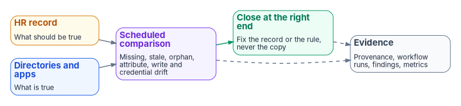

# Module 7: Find lifecycle drift and file the evidence {.unnumbered}

*Part of the [HR-Driven Identity learning path](index.md). Gate G7 Drift and evidence. Workbook [Chapter 07](../../project-plans/developer-workbooks/hr-driven-identity/07-lifecycle-drift-and-evidence.md). About 60 minutes.*

**Watch:** the narrated deck for this module: [Deck](https://github.com/WhalerMike/modernization-workbook/releases/download/edition-2026.11.5/Training_HR_Module_7.pptx) · [▶ Watch](../../presentations/watch.html?v=Training_HR_Module_7_Narrated) (about 14 minutes, captions) · [MP4](https://github.com/WhalerMike/modernization-workbook/releases/download/videos-2026-10-23/Training_HR_Module_7_Narrated.mp4) · [Script](https://github.com/WhalerMike/modernization-workbook/blob/main/presentations/training-hr-module-7/Training_HR_Module_7_Narration_Script.md) · [Captions](https://github.com/WhalerMike/modernization-workbook/blob/main/presentations/training-hr-module-7/Training_HR_Module_7_Narrated.vtt).

## Introduction (3 minutes)

The first six gates each produce a result. This gate keeps them true over time and hands the ISSO something they can check. Accounts drift from the HR record: a worker with no account, a terminated worker still enabled, an account nobody owns, a write by the wrong identity, a card still active after a separation. And Entra keeps its own logs for only 30 days, while the evidence has to outlive the accounts it describes.

In this module you write one read-only run of the lifecycle drift classes and the six metrics, package it with a hash chain, verify it, and assemble a reporting period.

**The federal requirement.** This gate supports NIST SP 800-53 CA-7 (continuous monitoring: system-level metrics), AU-6 and AU-11 with SI-12 (review and retention of audit records), and BOD 25-01 continuous reporting. The gate's output is evidence for these controls; your organization still sets their parameters, policy and procedures, and the assessor decides whether each is satisfied. The requirements and evidence are in the [Gate 7 requirements table](../../books/guides/hr-driven-identity-implementation.md#step-7-keep-the-record-true-and-file-the-evidence) (under **Federal requirements and evidence** in Step 7) and the workbook chapter's [Federal requirements and evidence](../../project-plans/developer-workbooks/hr-driven-identity/07-lifecycle-drift-and-evidence.md#federal-requirements-and-evidence).

| Requirement | KSI | Evidence |
|---|---|---|
| CA-7 | KSI-MLA-EVC | `metrics.json` per run; each period's `PERIOD-MANIFEST.json` and `period-summary.md` |
| AU-6 | KSI-MLA-RVL | LD-04 findings, with their closure at the source |
| AU-9 and SI-7, packages written once and chained | KSI-MLA-OSM; KSI-SVC-VRI | `EVIDENCE-MANIFEST.json`, `SHA256SUMS` and `hr_evidence.py verify` |
| AU-11 and SI-12 | KSI-MLA-OSM (AU-11); none lists SI-12 | The storage container's retention and immutability settings |
| BOD 25-01 continuous reporting | None: not an SP 800-53 control | The ScubaGear results beside the period |

KSIs are FedRAMP 20x indicators for cloud service providers: the agency authorizes its own system and lines this evidence up with what its providers report against them, and it doesn't report KSIs itself ([Book 00, Appendix B](../../books/b00-orientation/appendix-b-engagement-archetype.md)). Each KSI lists the row's control among its related SP 800-53 controls on [FedRAMP's Key Security Indicators page](https://www.fedramp.gov/2026/reference/key-security-indicators/) (read November 2, 2026); which file supports which indicator is the program's mapping *(design guidance)*. The workbook chapter's table has a row for every lab step.

## Learning objectives (1 minute)

After this module, you'll be able to:

- name the six lifecycle drift classes and the six metrics, and say which module's output feeds each;
- write a run from the earlier modules' outputs and read its findings;
- package runs with a hash chain, verify a package, and check it with `sha256sum`;
- assemble a period and explain why it can be incomplete even when the chain is whole.

## Prerequisites (1 minute)

- Modules [1](01-one-writer-per-state.md), [2](02-contractor-sources.md), [3](03-joiners-and-the-temporary-access-pass.md), [4](04-access-and-movers.md) and [6](06-separation-timing.md): this run reads their outputs. Step 1 of the lab rebuilds them, so you don't need to keep them.
- The drift pipeline in [Book 19, Chapter 09](../../books/b19-developer-workbook/09-drift-pipelines-and-evidence.md), which this module's packaging builds on.

## Unit 1: What the evidence has to show (6 minutes)

Read the guide's [Step 7](../../books/guides/hr-driven-identity-implementation.md#step-7-keep-the-record-true-and-file-the-evidence): run the drift classes, fix at the source, report the six metrics, prove the sole source, and keep the evidence outside the directory.

Then read the design in [Book 03, Chapter 11](../../books/b03-hr-identity/11-drift-metrics-and-evidence.md):

- [Drift between HR and the directory](../../books/b03-hr-identity/11-drift-metrics-and-evidence.md#drift-between-hr-and-the-directory): the classes and their detection signals.
- [The measured lifecycle](../../books/b03-hr-identity/11-drift-metrics-and-evidence.md#the-measured-lifecycle): the six metrics.
- [The evidence each event leaves](../../books/b03-hr-identity/11-drift-metrics-and-evidence.md#the-evidence-each-event-leaves): why the record must outlive the account.

Attribute drift isn't this module's; it belongs to the [ADM implementation guide's Gate 9](../../books/guides/attribute-driven-migration-implementation.md#gate-9-keep-the-attributes-true).

## Unit 2: The run, the classes and the metrics (7 minutes)

Read three sections of workbook Chapter 07:

- [The drift classes](../../project-plans/developer-workbooks/hr-driven-identity/07-lifecycle-drift-and-evidence.md#the-drift-classes): LD-01 to LD-06.
- [The metrics](../../project-plans/developer-workbooks/hr-driven-identity/07-lifecycle-drift-and-evidence.md#the-metrics): where each value comes from, and why a metric with no input is *not measured*, never zero.
- [The package, the chain and the period](../../project-plans/developer-workbooks/hr-driven-identity/07-lifecycle-drift-and-evidence.md#the-package-the-chain-and-the-period): `package`, `verify` and `period`.

{#fig-ch11-drift-evidence-loop fig-alt="An amber HR record box (what should be true) and a blue directories and apps box (what is true) both feed a violet scheduled comparison box (missing, stale, orphan, attribute, write and credential drift). It feeds a green close-at-the-right-end box (fix the record or the rule, never the copy). Dashed lines from both go to a grey evidence box (provenance, workflow runs, findings, metrics)."}

## Exercise: Lab 1, fixtures, no tenant (30 minutes)

This is the workbook's [Lab 1](../../project-plans/developer-workbooks/hr-driven-identity/07-lifecycle-drift-and-evidence.md#lab-1-fixtures-no-tenant).

<!-- labs:begin lab-1-commands (generated by scripts/generate_labs.py; not part of the reviewed page) -->

::: {.callout-note #lab-1-commands collapse="false" title="Every command in Lab 1"}
Every command in this lab, in order. Each step below says what it does and what to look for.

```powershell
Set-Location C:\FMWLabs\hr-driven-identity-code\hr-lifecycle

$Run = "C:\FMWLabs\results\hr-driven-identity-07-drift-and-evidence\lab1\$(Get-Date -AsUTC -Format 'yyyy-MM-ddTHHmmssZ')"
New-Item -ItemType Directory -Path $Run -Force | Out-Null
$Run

# Step 1
python python/writer_register.py scan --register config/writer-register.json --audit tests/fixtures/ch01/directory-audits.json --since 2026-10-01 --until 2026-10-31 --cloud gcc --out "$Run\ch01"
python python/contractor_source.py extract --register tests/fixtures/ch02/contractor-register.csv --cards tests/fixtures/ch02/cards.csv --sponsors tests/fixtures/ch02/hr-sponsors.csv --rules config/contractor-rules.json --as-of 2026-11-01 --out "$Run\ch02\extract"
python python/joiner_workflows.py readiness --hires tests/fixtures/ch03/hr-hires.csv --users tests/fixtures/ch03/hire-users.json --prehire-results tests/fixtures/ch03/prehire-results.json --assignments tests/fixtures/ch03/joiner-assignments.json --workflows config/workflows --as-of 2026-11-02T08:00:00Z --cloud gcc --out "$Run\ch03\readiness"
python python/access_assignment.py residual --mover tests/fixtures/ch04/mover.json --assignments tests/fixtures/ch04/mover-assignments.json --memberships tests/fixtures/ch04/mover-memberships.json --policies config/access --as-of 2026-11-01T12:00:00Z --cloud gcc --out "$Run\ch04\residual"
python python/separation_timing.py measure --separations tests/fixtures/ch06/hr-separations.csv --users tests/fixtures/ch06/leaver-users.json --audits tests/fixtures/ch06/separation-audits.json --results tests/fixtures/ch06/leaver-results.json --cards tests/fixtures/ch06/card-revocations.csv --devices tests/fixtures/ch06/device-actions.csv --role-holders tests/fixtures/ch06/role-holders.csv --config config/separation.json --as-of 2026-11-01T12:00:00Z --cloud gcc --out "$Run\ch06"

# Step 2
python python/lifecycle_drift.py run --hr tests/fixtures/ch07/hr-export.csv --contractors "$Run\ch02\extract\decisions.json" --users tests/fixtures/ch07/workforce-users.json --exceptions tests/fixtures/ch07/exceptions.csv --cards tests/fixtures/ch07/cards.csv --derivation tests/fixtures/ch07/derivation.json --writers "$Run\ch01" --readiness "$Run\ch03\readiness" --residual "$Run\ch04\residual" --timing "$Run\ch06" --config config/drift.json --since 2026-10-01 --until 2026-11-01 --cloud gcc --tenant-id 00000000-0000-4000-8000-00000000c0de --mode fixture --out "$Run\ch07\runs\2026-11-01T0600Z"

# Step 3
python -c "import json, sys; [print(r['Rule'], r['Severity'], r['Object']) for r in json.load(open(sys.argv[1]))]" "$Run\ch07\runs\2026-11-01T0600Z\lifecycle\findings.json"

# Step 4
python python/lifecycle_drift.py run --hr tests/fixtures/ch07/hr-export.csv --contractors "$Run\ch02\extract\decisions.json" --users tests/fixtures/ch07/workforce-users.json --exceptions tests/fixtures/ch07/exceptions.csv --cards tests/fixtures/ch07/cards.csv --derivation tests/fixtures/ch07/derivation.json --writers "$Run\ch01" --readiness "$Run\ch03\readiness" --residual "$Run\ch04\residual" --timing "$Run\ch06" --config config/drift.json --since 2026-11-01 --until 2026-11-02 --cloud gcc --tenant-id 00000000-0000-4000-8000-00000000c0de --mode fixture --out "$Run\ch07\runs\2026-11-02T0600Z"

# Step 5
python ../drift-pipeline/python/hr_evidence.py package --run "$Run\ch07\runs\2026-11-01T0600Z" --out "$Run\ch07\evidence"
python ../drift-pipeline/python/hr_evidence.py package --run "$Run\ch07\runs\2026-11-02T0600Z" --previous-manifest "$Run\ch07\evidence\2026-11-01T0600Z\EVIDENCE-MANIFEST.json" --out "$Run\ch07\evidence"
python ../drift-pipeline/python/hr_evidence.py verify "$Run\ch07\evidence\2026-11-02T0600Z"

# Step 5
Push-Location "$Run\ch07\evidence\2026-11-02T0600Z"
Get-Content SHA256SUMS | ForEach-Object { $hash, $file = $_ -split '  ', 2; "${file}: " + $(if ((Get-FileHash $file -Algorithm SHA256).Hash -eq $hash) { 'OK' } else { 'FAILED' }) }
Pop-Location

# Step 6
python ../drift-pipeline/python/hr_evidence.py period --evidence "$Run\ch07\evidence" --since 2026-10-01 --until 2026-11-02 --out "$Run\ch07\periods"

# Step 6
Get-Content "$Run\ch07\periods\period-2026-10-01_2026-11-02\period-summary.md"

# Step 7
python -m pytest -q -p no:cacheprovider tests
Set-Location ../drift-pipeline
python -m pytest -q -p no:cacheprovider tests/test_hr_evidence.py

# Step 7
Set-Location ../hr-lifecycle

# Step 7
Get-ChildItem C:\FMWLabs\results\hr-driven-identity-07-drift-and-evidence\lab1 -Name
```

:::

<!-- labs:end -->

Every step runs in PowerShell 7, the Python commands included, so you can follow it top to bottom in one window. Open **PowerShell 7** from the Start menu, then go to the kit's folder, where you unzipped it under [Get the code](index.md#get-the-code):

```powershell
Set-Location C:\FMWLabs\hr-driven-identity-code\hr-lifecycle
```

Then make this run's results folder. Its name is the date and time you start, in UTC, so each run keeps its own results and running the lab again never overwrites them:

```powershell
$Run = "C:\FMWLabs\results\hr-driven-identity-07-drift-and-evidence\lab1\$(Get-Date -AsUTC -Format 'yyyy-MM-ddTHHmmssZ')"
New-Item -ItemType Directory -Path $Run -Force | Out-Null
$Run
```

Expected output, where `<run>` is your start time, such as `2026-11-25T143005Z`:

```text
C:\FMWLabs\results\hr-driven-identity-07-drift-and-evidence\lab1\<run>
```

The run's date is only the folder's name. The data's dates are the `--as-of`, `--since` and `--until` values and the drift runs' names, such as `2026-11-01T0600Z`, which stay the same, so every run's findings and hashes match this page. The results folder sits outside the kit, so unzipping a newer copy of the kit never touches it.

The lab also runs the evidence packager from `drift-pipeline`, the folder beside `hr-lifecycle`, with `../drift-pipeline/...` paths, so you stay in `hr-lifecycle` until step 7. Prefer Git Bash? Go to the folder with `cd /c/FMWLabs/hr-driven-identity-code/hr-lifecycle`, make the run folder with `Run=/c/FMWLabs/results/hr-driven-identity-07-drift-and-evidence/lab1/$(date -u +%Y-%m-%dT%H%M%SZ); mkdir -p "$Run"`, and the Python commands run the same there; the others are `(cd "$Run/ch07/evidence/2026-11-02T0600Z" && sha256sum -c SHA256SUMS)` (step 5), `cat "$Run/ch07/periods/period-2026-10-01_2026-11-02/period-summary.md"` (step 6) and `cd` (step 7). In a clone of the repository, use the `examples` folders of the same names.

1. Write the module outputs the run reads: the scan from Module 1, the extract from Module 2, readiness from Module 3, the residual from Module 4 and the measurement from Module 6, one command each. They write into this run's folder, so outputs you kept from earlier modules don't matter.

    ```powershell
    python python/writer_register.py scan --register config/writer-register.json --audit tests/fixtures/ch01/directory-audits.json --since 2026-10-01 --until 2026-10-31 --cloud gcc --out "$Run\ch01"
    python python/contractor_source.py extract --register tests/fixtures/ch02/contractor-register.csv --cards tests/fixtures/ch02/cards.csv --sponsors tests/fixtures/ch02/hr-sponsors.csv --rules config/contractor-rules.json --as-of 2026-11-01 --out "$Run\ch02\extract"
    python python/joiner_workflows.py readiness --hires tests/fixtures/ch03/hr-hires.csv --users tests/fixtures/ch03/hire-users.json --prehire-results tests/fixtures/ch03/prehire-results.json --assignments tests/fixtures/ch03/joiner-assignments.json --workflows config/workflows --as-of 2026-11-02T08:00:00Z --cloud gcc --out "$Run\ch03\readiness"
    python python/access_assignment.py residual --mover tests/fixtures/ch04/mover.json --assignments tests/fixtures/ch04/mover-assignments.json --memberships tests/fixtures/ch04/mover-memberships.json --policies config/access --as-of 2026-11-01T12:00:00Z --cloud gcc --out "$Run\ch04\residual"
    python python/separation_timing.py measure --separations tests/fixtures/ch06/hr-separations.csv --users tests/fixtures/ch06/leaver-users.json --audits tests/fixtures/ch06/separation-audits.json --results tests/fixtures/ch06/leaver-results.json --cards tests/fixtures/ch06/card-revocations.csv --devices tests/fixtures/ch06/device-actions.csv --role-holders tests/fixtures/ch06/role-holders.csv --config config/separation.json --as-of 2026-11-01T12:00:00Z --cloud gcc --out "$Run\ch06"
    ```

    Expected output:

    ```text
    Protected writes: 11 (writer 5, backstop 1, second writer 4, forbidden 1)
    Writers: 5 Finding, 1 Warn, 0 Info
    Written to C:/FMWLabs/results/hr-driven-identity-07-drift-and-evidence/lab1/<run>/ch01 (manifest.json lists every file's SHA-256)
    Contractors: 9 records: 3 active, 4 inactive (past their earliest end), 2 quarantined
    Source: 2 Finding, 1 Warn, 1 Info
    Extract written to C:/FMWLabs/results/hr-driven-identity-07-drift-and-evidence/lab1/<run>/ch02/extract/contractors-extract.csv; build the SCIM requests with examples/hcm-entra/python/hcm_to_scim.py
    Day one 2026-11-02: 1 of 4 hires ready (25%)
    Readiness: 0 Finding, 3 Warn, 0 Info
    Mover jordan.diaz@contoso.example: 8 items held, 3 to the residual review
    Residual: 1 Finding, 3 Warn, 0 Info
    Written to C:/FMWLabs/results/hr-driven-identity-07-drift-and-evidence/lab1/<run>/ch04/residual (residual-review.csv goes to the manager of record)
    Leavers: 7 separated, 1 cancelled, 1 not blocked
    Separation-to-block hours: p50 0.25, p90 5.52, max 84.68 (threshold 4)
    Separation-to-revocation hours: p50 11.0, p90 110.0, max 395.0 (threshold 24)
    Separation: 10 Finding, 2 Warn, 0 Info
    ```

    Each exits 2, because each fixture holds findings.

2. Write the first run:

    ```powershell
    python python/lifecycle_drift.py run --hr tests/fixtures/ch07/hr-export.csv --contractors "$Run\ch02\extract\decisions.json" --users tests/fixtures/ch07/workforce-users.json --exceptions tests/fixtures/ch07/exceptions.csv --cards tests/fixtures/ch07/cards.csv --derivation tests/fixtures/ch07/derivation.json --writers "$Run\ch01" --readiness "$Run\ch03\readiness" --residual "$Run\ch04\residual" --timing "$Run\ch06" --config config/drift.json --since 2026-10-01 --until 2026-11-01 --cloud gcc --tenant-id 00000000-0000-4000-8000-00000000c0de --mode fixture --out "$Run\ch07\runs\2026-11-01T0600Z"
    ```

    Expected output:

    ```text
    Run 2026-11-01T0600Z: 4 chapter outputs read (readiness, residual, timing, writers)
      separationToBlockHoursP90            5.52  max 4  out of bounds
      separationToRevocationHoursP90      110.0  max 24  out of bounds
      transferToReviewHours                None  max 240  not measured
      joinerReadinessRate                  0.25  min 0.95  out of bounds
      correlationCoverage                0.5833  min 0.99  out of bounds
      derivationPurity                   0.7637  min 0.8  out of bounds
    Lifecycle drift: 14 Finding, 6 Warn, 0 Info
    Run written to C:/FMWLabs/results/hr-driven-identity-07-drift-and-evidence/lab1/<run>/ch07/runs/2026-11-01T0600Z; package it with examples/drift-pipeline/python/hr_evidence.py
    ```

3. Read the findings:

    ```powershell
    python -c "import json, sys; [print(r['Rule'], r['Severity'], r['Object']) for r in json.load(open(sys.argv[1]))]" "$Run\ch07\runs\2026-11-01T0600Z\lifecycle\findings.json"
    ```

    Expected output:

    ```text
    LD-01 Finding 100104
    LD-02 Finding drew.park@contoso.example
    LD-02 Finding harper.vu@contoso.example
    LD-02 Finding bailey.ortiz@contoso.example
    LD-03 Finding print.kiosk@contoso.example
    LD-03 Finding old.temp@contoso.example
    LD-04 Finding blake.ito@contoso.example
    LD-04 Finding casey.ng@contoso.example
    LD-04 Finding morgan.lee@contoso.example
    LD-04 Finding drew.park@contoso.example
    LD-04 Finding quinn.ross@contoso.example
    LD-05 Finding 100303
    LD-06 Finding 900002
    LD-06 Finding 900011
    LD-07 Warn correlationCoverage
    LD-07 Warn derivationPurity
    LD-07 Warn joinerReadinessRate
    LD-07 Warn separationToBlockHoursP90
    LD-07 Warn separationToRevocationHoursP90
    LD-08 Warn transferToReviewHours
    ```

    14 Findings: one LD-01, three LD-02, two LD-03, five LD-04 (Module 1's four second writers and its forbidden delete), one LD-05 and two LD-06. The six Warns are five LD-07 and one LD-08.

4. Write the next day's run, with the window `--since 2026-11-01 --until 2026-11-02` and the folder `ch07\runs\2026-11-02T0600Z` in this run's folder:

    ```powershell
    python python/lifecycle_drift.py run --hr tests/fixtures/ch07/hr-export.csv --contractors "$Run\ch02\extract\decisions.json" --users tests/fixtures/ch07/workforce-users.json --exceptions tests/fixtures/ch07/exceptions.csv --cards tests/fixtures/ch07/cards.csv --derivation tests/fixtures/ch07/derivation.json --writers "$Run\ch01" --readiness "$Run\ch03\readiness" --residual "$Run\ch04\residual" --timing "$Run\ch06" --config config/drift.json --since 2026-11-01 --until 2026-11-02 --cloud gcc --tenant-id 00000000-0000-4000-8000-00000000c0de --mode fixture --out "$Run\ch07\runs\2026-11-02T0600Z"
    ```

    Expected output:

    ```text
    Run 2026-11-02T0600Z: 4 chapter outputs read (readiness, residual, timing, writers)
      separationToBlockHoursP90            5.52  max 4  out of bounds
      separationToRevocationHoursP90      110.0  max 24  out of bounds
      transferToReviewHours                None  max 240  not measured
      joinerReadinessRate                  0.25  min 0.95  out of bounds
      correlationCoverage                0.5833  min 0.99  out of bounds
      derivationPurity                   0.7637  min 0.8  out of bounds
    Lifecycle drift: 14 Finding, 6 Warn, 0 Info
    Run written to C:/FMWLabs/results/hr-driven-identity-07-drift-and-evidence/lab1/<run>/ch07/runs/2026-11-02T0600Z; package it with examples/drift-pipeline/python/hr_evidence.py
    ```

    The same metrics and the same counts as the first run.

5. Package both, chained, and verify:

    ```powershell
    python ../drift-pipeline/python/hr_evidence.py package --run "$Run\ch07\runs\2026-11-01T0600Z" --out "$Run\ch07\evidence"
    python ../drift-pipeline/python/hr_evidence.py package --run "$Run\ch07\runs\2026-11-02T0600Z" --previous-manifest "$Run\ch07\evidence\2026-11-01T0600Z\EVIDENCE-MANIFEST.json" --out "$Run\ch07\evidence"
    python ../drift-pipeline/python/hr_evidence.py verify "$Run\ch07\evidence\2026-11-02T0600Z"
    ```

    Expected output:

    ```text
    {"evidence_manifest_sha256": "342c65f7af3d61bdaeb7b5e17147400341f1145bb88c6fbc26fbef9b3418008e", "new": 20, "open": 20, "package": "2026-11-01T0600Z", "resolved": 0}
    {"evidence_manifest_sha256": "2892017a07f7214696c1048cfa40e6ccb14927f7c7bdc85cc23cac1a8be739c9", "new": 0, "open": 20, "package": "2026-11-02T0600Z", "resolved": 0}
    {"evidence_manifest_sha256": "2892017a07f7214696c1048cfa40e6ccb14927f7c7bdc85cc23cac1a8be739c9", "files": 6, "run_id": "2026-11-02T0600Z"}
    ```

    Your hashes match these only if your fixtures are the committed ones. Then run the ISSO's check: hash each file listed in the package's `SHA256SUMS` and compare it with the listed hash. `Push-Location` and `Pop-Location` take you into the package folder and back to `hr-lifecycle`:

    ```powershell
    Push-Location "$Run\ch07\evidence\2026-11-02T0600Z"
    Get-Content SHA256SUMS | ForEach-Object { $hash, $file = $_ -split '  ', 2; "${file}: " + $(if ((Get-FileHash $file -Algorithm SHA256).Hash -eq $hash) { 'OK' } else { 'FAILED' }) }
    Pop-Location
    ```

    Expected output:

    ```text
    run/lifecycle/findings.json: OK
    run/lifecycle/manifest.json: OK
    run/lifecycle/metrics.json: OK
    run/run.json: OK
    summary.md: OK
    EVIDENCE-MANIFEST.json: OK
    ```

6. Assemble the period:

    ```powershell
    python ../drift-pipeline/python/hr_evidence.py period --evidence "$Run\ch07\evidence" --since 2026-10-01 --until 2026-11-02 --out "$Run\ch07\periods"
    ```

    Expected output:

    ```text
    {"chain_breaks": 0, "complete": false, "coverage_gaps": 0, "open_at_end": 20, "packages": 2, "period": "period-2026-10-01_2026-11-02"}
    ```

    It exits 2. Print `period-summary.md` from the period folder:

    ```powershell
    Get-Content "$Run\ch07\periods\period-2026-10-01_2026-11-02\period-summary.md"
    ```

    Expected output:

    ```text
    # HR-driven identity evidence for the period

    Period 2026-10-01T00:00:00Z to 2026-11-02T00:00:00Z; tenant 00000000-0000-4000-8000-00000000c0de (gcc, fixture); 2 package(s), chain breaks 0, coverage gaps 0, open findings at the end 20.

    | Control | Open findings | Metrics out of bounds | Metrics not measured |
    |---|---|---|---|
    | AC-2 Account Management | 6 | correlationCoverage, joinerReadinessRate | none |
    | AU-6 Audit Record Review, Analysis, and Reporting | 5 | none | none |
    | PS-4 Personnel Termination | 6 | separationToBlockHoursP90, separationToRevocationHoursP90 | none |
    | PS-5 Personnel Transfer | 0 | none | transferToReviewHours |
    | CA-7 Continuous Monitoring | 0 | separationToBlockHoursP90, separationToRevocationHoursP90, joinerReadinessRate, correlationCoverage, derivationPurity | transferToReviewHours |

    | Gate 7 criterion | From this code | Status |
    |---|---|---|
    | Lifecycle drift classes found and closed at the source | 20 open at the end; opened 0, closed 0 | not met |
    | Metrics on the ConMon cadence, within the agency's thresholds | 2 package(s); out of bounds: correlationCoverage, derivationPurity, joinerReadinessRate, separationToBlockHoursP90, separationToRevocationHoursP90; not measured: transferToReviewHours | not met |
    | Evidence kept outside the directory, unbroken | chain breaks 0, coverage gaps 0 | met |
    | Sole source proved per population (seven days of provisioning logs against the audit log) | not decided by this code (Book 03, Appendix C) | not decided by this code |

    Object keys and fingerprints only. The control mapping is the program's (design guidance); the assessor decides each control.
    ```

    The chain and coverage are whole, but drift is open and five metrics are out of bounds, so Gate 7's first two criteria are *not met*.

7. Run the tests, then the evidence packager's tests in `drift-pipeline`:

    ```powershell
    python -m pytest -q -p no:cacheprovider tests
    Set-Location ../drift-pipeline
    python -m pytest -q -p no:cacheprovider tests/test_hr_evidence.py
    ```

    Expected: the last lines are `57 passed`, then `6 passed`, each with the time the run took. (In a clone of the repository, `python -m pytest -q tests` in `examples/drift-pipeline` runs the folder's whole suite, `139 passed`. In the unzipped folder, run only the packager's tests: the zip adds a `.txt` copy beside each file, and the other suites' fixtures check their folders against manifests that don't list those copies.)

    Then go back to `hr-lifecycle`:

    ```powershell
    Set-Location ../hr-lifecycle
    ```

    Nothing to clean up: the kit's folder is as you unzipped it, and this run's results stay in `$Run`. List every run you've made of this lab:

    ```powershell
    Get-ChildItem C:\FMWLabs\results\hr-driven-identity-07-drift-and-evidence\lab1 -Name
    ```

    Expected output: one line per run, oldest first, the last one this run:

    ```text
    <run>
    ```

## Exercise: Lab 2, your test tenant (5 minutes to read)

*Not run by the authors.* Follow the workbook's [Lab 2](../../project-plans/developer-workbooks/hr-driven-identity/07-lifecycle-drift-and-evidence.md#lab-2-test-tenant) in a worldwide or GCC test tenant, never production.

- **What you do:** export the workforce users, run Modules 1 to 6's Lab 2 against the test tenant, write a run in tenant mode, schedule it in Book 19, Chapter 09's workflow with packages written to an immutable test storage container, and assemble a period.
- **Permissions:** a reader app with a certificate or a federated credential, holding only the two permissions `graph_export.py --task drift-read --list` prints, with admin consent.
- **Back-out:** remove the schedule, delete the reader app, its credential and its consent, delete the test container if you created it for the lab, and delete the local export and output folders.

## Knowledge check (5 minutes)

1. Which drift class is an enabled account for a worker HR has terminated?
    a. LD-01, missing identity
    b. LD-02, stale access
    c. LD-03, orphan account
    d. LD-05, credential drift
2. Module 4's mover review is still open, so there's no transfer-to-review value. How does the run report it?
    a. As zero hours
    b. As the previous period's value
    c. As not measured (LD-08), never as zero
    d. It leaves the metric out without a finding
3. The second package opens no new findings and closes none. Why?
    a. The chain is broken
    b. The inputs didn't change between the two runs
    c. `package` only counts findings on the first run
    d. `verify` failed
4. The period reports zero chain breaks and zero coverage gaps, but `complete` is false. Why?
    a. Drift is still open and metrics are out of bounds, so Gate 7's criteria aren't met
    b. Two packages aren't enough for a period
    c. The period must start on the first of the month
    d. `sha256sum` wasn't run
5. Why does the evidence have to be kept outside the directory?
    a. Entra's logs are kept for a short time and not retroactively, and the accounts are disposed of
    b. The directory can't store JSON
    c. Graph doesn't allow reads of old records
    d. The ISSO has no access to the directory

::: {.callout-tip collapse="true"}
## Check your answers
1. **b.** LD-02 is stale access: an enabled account for a terminated worker, or a contractor past the earliest end. Taught in [The drift classes](../../project-plans/developer-workbooks/hr-driven-identity/07-lifecycle-drift-and-evidence.md#the-drift-classes).
2. **c.** A metric with no input is not measured, never zero. Taught in [The metrics](../../project-plans/developer-workbooks/hr-driven-identity/07-lifecycle-drift-and-evidence.md#the-metrics).
3. **b.** Same inputs, so nothing opened or closed since the previous package. Taught in the chapter's [Lab 1](../../project-plans/developer-workbooks/hr-driven-identity/07-lifecycle-drift-and-evidence.md#lab-1-fixtures-no-tenant) and [The package, the chain and the period](../../project-plans/developer-workbooks/hr-driven-identity/07-lifecycle-drift-and-evidence.md#the-package-the-chain-and-the-period).
4. **a.** `period` scores Gate 7's criteria; an unbroken chain meets only the evidence criterion. Taught in [The package, the chain and the period](../../project-plans/developer-workbooks/hr-driven-identity/07-lifecycle-drift-and-evidence.md#the-package-the-chain-and-the-period).
5. **a.** Entra keeps audit logs 30 days with P1 or P2, none of it retroactive, and the record must outlive the account. Taught in [Book 03, The evidence each event leaves](../../books/b03-hr-identity/11-drift-metrics-and-evidence.md#the-evidence-each-event-leaves) and the chapter's [What the evidence has to show](../../project-plans/developer-workbooks/hr-driven-identity/07-lifecycle-drift-and-evidence.md#what-the-evidence-has-to-show).
:::

## Summary (2 minutes)

You rebuilt the earlier modules' outputs, wrote two daily runs of the lifecycle drift classes and metrics, packaged them with a hash chain, verified a package, and assembled a period that shows exactly which of Gate 7's criteria are met.

**The evidence an ISSO keeps** for Gate 7: every period's `PERIOD-MANIFEST.json`, `period-summary.md` and `SHA256SUMS`, with the approved thresholds; the packages, with each LD-04 finding's closure at the source; the storage container's retention and immutability settings, set to the records schedule; and the ScubaGear results beside the period. The full list is in the workbook's [Federal requirements and evidence](../../project-plans/developer-workbooks/hr-driven-identity/07-lifecycle-drift-and-evidence.md#federal-requirements-and-evidence), and the guide's [Evidence](../../books/guides/hr-driven-identity-implementation.md#evidence) section gathers all seven gates into one file per population.

**You've finished the path.** Go back to the [learning path](index.md), or check your agency's progress against the guide's [Checklist](../../books/guides/hr-driven-identity-implementation.md#checklist).
