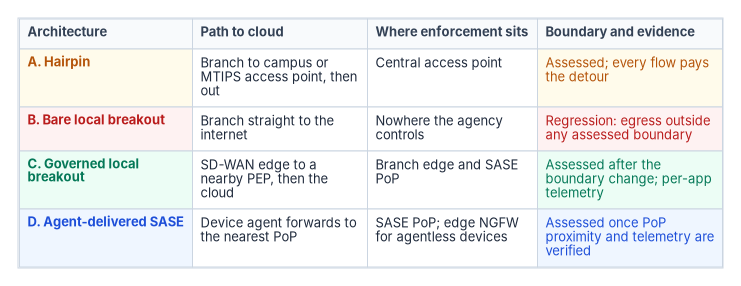

# Module 1: The governor before the traffic {.unnumbered}

*Part of the [SD-WAN governor learning path](index.md). [Book 09, Chapters 02 and 08](../../books/b09-network/02-transport-is-physics-control-is-compliance.md), and the guide's [Orientation](../../books/guides/cisco-sdwan-implementation.md#orientation-book-09s-design-on-a-catalyst-fabric). About 45 minutes, plus Lab 2.*

## Introduction (3 minutes)

A branch office that gets a fast internet circuit gets lower latency. It doesn't get boundary protection, flow control or malware protection: those come from a control layer above the circuit, and a branch that breaks out to the internet without one has gone backwards. The SD-WAN fabric is the first part of that control layer, the governor, and it is also a new, internet-facing system with authority over every branch's routing. In this module you see what the governor contributes and why it is secured first, and you read a fictional fabric's inventory the way the kit does.

**The federal requirement.** The guide's [hardening table](../../books/guides/cisco-sdwan-implementation.md#hardening) and [Book 09, Appendix B](../../books/b09-network/appendix-b-requirements-mapping.md) carry the full mapping.

| Requirement | KSI | Evidence |
|---|---|---|
| CM-8: every control component and edge in the inventory, with its release | KSI-PIY-GIV | The kit's `fleet_inventory` records |
| SI-2: the software version each component runs, ready for the gate | KSI-CMT-VTD | The same records' `software_version` |
| SC-7: an egress pattern chosen per site, never bare local breakout | KSI-CNA-ULN | The site's egress decision and its approved boundary change |
| AC-6: the collector signs in with a read-only Manager role | KSI-IAM-ELP | The role definition and the account's assignment |

KSIs are FedRAMP 20x indicators for cloud service providers. The agency lines its own evidence up with them; it doesn't report KSIs itself ([Book 00, Appendix B](../../books/b00-orientation/appendix-b-engagement-archetype.md)).

## Learning objectives (1 minute)

After this module, you'll be able to:

- say what direct internet access solves and which controls it leaves undone;
- name what the governor contributes, and why it is itself attack surface;
- name the four branch egress patterns, and the one that is never allowed;
- map the Catalyst fabric's four parts to Book 09's terms;
- choose between the hosted and on-premises control plane, and say what hosting doesn't remove.

## Prerequisites (1 minute)

- [Book 09, Chapter 02](../../books/b09-network/02-transport-is-physics-control-is-compliance.md). Read it in Unit 1.
- Python 3.10 or later with pytest, PowerShell 5.1 or 7, and the kit's folder, `examples/cisco-sdwan` (see [Get the code](index.md#get-the-code)).

## Unit 1: Transport is physics, control is compliance (10 minutes)

Read [Book 09, Chapter 02](../../books/b09-network/02-transport-is-physics-control-is-compliance.md), sections *What direct internet access solves: one thing*, *The governor: what the control layer contributes*, *The governor is itself attack surface* and *Order of operations*. Four points to take away:

- **The circuit is a transport decision.** Direct internet access fixes latency. The boundary, flow and malware protections come from the security service edge above it, not from the circuit or the SD-WAN.
- **The governor contributes three things:** encryption across every circuit, traffic-class separation with path selection, and per-application path telemetry an assessor can read.
- **The governor is attack surface.** Its controller holds agency-wide routing authority, and its edges face the internet. CISA's 2026 directives name this class of system.
- **Step zero comes first.** Bring the controller and edges under vulnerability management, privileged-access control and off-box logging before they carry production traffic. Then buy the pipe, deploy the governor, change the boundary, and only then cut over.

## Unit 2: Four egress patterns, one never allowed (8 minutes)

Read [Book 09, Chapter 08, Branch architectures](../../books/b09-network/08-reference-architecture.md#branch-architectures) and its [Decision 3](../../books/b09-network/08-reference-architecture.md#decision-3-choose-the-egress-pattern-per-site-and-change-the-boundary-first).

{#fig-nsw-ch08-branch-architectures fig-alt="A table of four branch architectures. A, hairpin, in amber: the path runs from the branch to the campus or an MTIPS access point and then out; enforcement sits at the central access point; the boundary is assessed but every flow pays the detour. B, bare local breakout, in red: the branch goes straight to the internet; enforcement sits nowhere the agency controls; it is a regression, with egress outside any assessed boundary. C, governed local breakout, in green: an SD-WAN edge sends traffic to a nearby policy enforcement point and then the cloud; enforcement sits at the branch edge and the SASE point of presence; the boundary is assessed after the boundary change and per-application telemetry exists. D, agent-delivered SASE, in blue: a device agent forwards to the nearest point of presence; enforcement sits at the SASE point of presence, with an edge firewall for agentless devices; the boundary is assessed once point-of-presence proximity and telemetry are verified."}

Choose A, C or D per site, from measured latency and the site's device mix; never B. Pattern A, the hairpin, is every office's starting state on the fabric and its fallback when the security service edge is unreachable. The authorization-boundary change for local egress is approved before the first production flow leaves locally, not after. Module 4 maps the patterns onto the fabric's policy.

## Unit 3: The Catalyst fabric, and the decision to make first (10 minutes)

Read the guide's [Orientation](../../books/guides/cisco-sdwan-implementation.md#orientation-book-09s-design-on-a-catalyst-fabric) and [The decision to make first: hosted or on-premises](../../books/guides/cisco-sdwan-implementation.md#the-decision-to-make-first-hosted-or-on-premises).

| Book 09 term | Catalyst component (former name) | What it does |
|---|---|---|
| Manager | SD-WAN Manager (vManage) | Management plane: configuration, policy, monitoring, the REST API the kit reads |
| Validator | SD-WAN Validator (vBond) | Orchestration: first-line authentication of edges |
| Controller | SD-WAN Controller (vSmart) | Control plane: routes and centralized policy to every edge |
| Branch edge, hub edge | WAN edge on IOS XE in controller mode | Data plane: tunnels, application-aware routing, local enforcement |

: The Catalyst fabric in Book 09's terms, from the guide's Orientation {.striped .hover}

The kit's records use the former names' device types (`vmanage`, `vsmart`, `vbond`, `vedge`) because Manager's API still does, and map them to Book 09's terms.

The program's choice, settled as [WD-060](../../about/decision-register.md#wd-060), is Cisco's FedRAMP-hosted control plane at Moderate by default, and on-premises for a High or isolated system, or where the authorizing official needs agency custody of forensic images. Hosting moves patching of the control plane to Cisco. It doesn't remove the gate: every 2026 advisory lists the government environment as affected, and the edges, the logs, administrator roles and single sign-on stay the agency's.

## Exercise: Lab 1, fixtures, no fabric (13 minutes) {#nsw-m1-lab-1}
You replay a fictional Manager's answers through the kit and read the fleet inventory it writes. The capture is `tests/fixtures`: the response bodies of Manager's device list and audit log, for a fictional Contoso fabric, on October 26, 2026.

<!-- labs:begin lab-1-commands (generated by scripts/generate_labs.py; not part of the reviewed page) -->

::: {.callout-note #lab-1-commands collapse="false" title="Every command in Lab 1"}
Every command in this lab, in order. Each step below says what it does and what to look for.

```powershell
Set-Location C:\FMWLabs\cisco-sdwan

$Run = "C:\FMWLabs\results\network-sd-wan-01-the-governor-before-the-traffic\lab1\$(Get-Date -AsUTC -Format 'yyyy-MM-ddTHHmmssZ')"
New-Item -ItemType Directory -Path $Run -Force | Out-Null
$Run

# Step 1: Run the kit's tests
python -m pytest -q -p no:cacheprovider tests

# Step 2: Read the device list Manager returned
$d = Get-Content -Raw tests/fixtures/devices.json | ConvertFrom-Json
$d.data | Format-Table 'host-name', 'system-ip', 'device-type', version

# Step 3: Replay the capture through the kit
python python/sdwan_evidence.py --config config/config.example.json --replay tests/fixtures --out "$Run\out"
"exit code: $LASTEXITCODE"

# Step 4: Read the run's header and the fleet inventory
Select-String -Path "$Run\out\sdwan-evidence.json" -Pattern '^  "(generated_at|status_note|gate|replayed_from)"' | ForEach-Object { $_.Line.Trim() }
$r = Get-Content -Raw "$Run\out\sdwan-evidence.json" | ConvertFrom-Json
$r.records | Where-Object record_kind -eq 'fleet_inventory' | Format-Table host_name, role, site_id, software_version, @{ n = 'controls'; e = { $_.control_refs -join ', ' } }

# Step 5: Compare the inventory with the build record
$cfg = Get-Content -Raw config/config.example.json | ConvertFrom-Json
$seen = $r.records | Where-Object record_kind -eq 'fleet_inventory' | ForEach-Object system_ip
$cfg.expected_control_components | Where-Object { $_.system_ip -notin $seen } | Format-Table system_ip, device_type

# Step 6: List your runs
Get-ChildItem C:\FMWLabs\results\network-sd-wan-01-the-governor-before-the-traffic\lab1 -Name
```

:::

<!-- labs:end -->

Every step runs in PowerShell 7, the Python commands included, so you can follow it top to bottom in one window. Open **PowerShell 7** from the Start menu, then go to the kit's folder, where you unzipped it under [Get the code](index.md#get-the-code):

```powershell
Set-Location C:\FMWLabs\cisco-sdwan
```

Then make this run's results folder. Its name is the date and time you start, in UTC, so each run keeps its own results and running the lab again never overwrites them:

```powershell
$Run = "C:\FMWLabs\results\network-sd-wan-01-the-governor-before-the-traffic\lab1\$(Get-Date -AsUTC -Format 'yyyy-MM-ddTHHmmssZ')"
New-Item -ItemType Directory -Path $Run -Force | Out-Null
$Run
```

Expected output, where `<run>` is your start time, such as `2026-11-25T143005Z`:

```text
C:\FMWLabs\results\network-sd-wan-01-the-governor-before-the-traffic\lab1\<run>
```

The run's date is only the folder's name. The data's date is the capture's own time, which stays the same, so every run's findings match this page. The results folder sits outside the kit, so unzipping a newer copy of the kit never touches it.

Prefer Git Bash? Go to the folder with `cd /c/FMWLabs/cisco-sdwan`, make the run folder with `Run=/c/FMWLabs/results/network-sd-wan-01-the-governor-before-the-traffic/lab1/$(date -u +%Y-%m-%dT%H%M%SZ); mkdir -p "$Run"`, and the `python` commands run the same there; every other command needs PowerShell 7 (type `pwsh` to start it). In a clone of the repository, use the `examples` folder of the same name.

1. **Run the kit's tests.** Every HTTP call in them is answered from the fixtures.

    ```powershell
    python -m pytest -q -p no:cacheprovider tests
    ```

    Expected output: a line of 31 dots, one per test, then `31 passed in` and the time the run took, which varies.

2. **Read the device list Manager returned.** This is the body of `GET /dataservice/device`, as saved.

    ```powershell
    $d = Get-Content -Raw tests/fixtures/devices.json | ConvertFrom-Json
    $d.data | Format-Table 'host-name', 'system-ip', 'device-type', version
    ```

    Expected output:

    ```text
    host-name           system-ip   device-type version
    ---------           ---------   ----------- -------
    sdwan-manager-01    10.255.0.1  vmanage     20.18.4.1
    sdwan-manager-02    10.255.0.2  vmanage     20.18.4.1
    sdwan-manager-03    10.255.0.3  vmanage     20.18.4.1
    sdwan-controller-01 10.255.0.11 vsmart      20.18.3.1
    sdwan-validator-01  10.255.0.21 vbond       20.15.5.2
    unknown-peer        10.255.0.99 vsmart      20.18.3.1
    fo-0101-edge        10.1.101.1  vedge       17.18.02.0.1234
    ```

    Three Managers, a Controller, a Validator, one branch edge, and a Controller called `unknown-peer`. Module 3 deals with that one.

3. **Replay the capture through the kit.** `--replay` reads the saved responses instead of signing in; nothing connects to anything.

    ```powershell
    python python/sdwan_evidence.py --config config/config.example.json --replay tests/fixtures --out "$Run\out"
    "exit code: $LASTEXITCODE"
    ```

    Expected output:

    ```text
    gate: fail  evidence: C:/FMWLabs/results/network-sd-wan-01-the-governor-before-the-traffic/lab1/<run>/out/sdwan-evidence.json  findings: C:/FMWLabs/results/network-sd-wan-01-the-governor-before-the-traffic/lab1/<run>/out/ed-26-03-gate.csv
    exit code: 2
    ```

4. **Read the run's header and the fleet inventory.** The evaluation time is the capture's own time, so a replay always gives the same output.

    ```powershell
    Select-String -Path "$Run\out\sdwan-evidence.json" -Pattern '^  "(generated_at|status_note|gate|replayed_from)"' | ForEach-Object { $_.Line.Trim() }
    $r = Get-Content -Raw "$Run\out\sdwan-evidence.json" | ConvertFrom-Json
    $r.records | Where-Object record_kind -eq 'fleet_inventory' | Format-Table host_name, role, site_id, software_version, @{ n = 'controls'; e = { $_.control_refs -join ', ' } }
    ```

    Expected output:

    ```text
    "generated_at": "2026-10-26T08:00:00Z",
    "status_note": "replay of saved Manager responses; no fabric was contacted",
    "gate": "fail",
    "replayed_from": "tests/fixtures"

    host_name           role       site_id software_version controls
    ---------           ----       ------- ---------------- --------
    sdwan-manager-01    manager    100     20.18.4.1        CM-8, SI-2
    sdwan-manager-02    manager    100     20.18.4.1        CM-8, SI-2
    sdwan-manager-03    manager    100     20.18.4.1        CM-8, SI-2
    sdwan-controller-01 controller 100     20.18.3.1        CM-8, SI-2
    sdwan-validator-01  validator  100     20.15.5.2        CM-8, SI-2
    unknown-peer        controller 0       20.18.3.1        CM-8, SI-2
    fo-0101-edge        edge       10101   17.18.02.0.1234  CM-8, SI-2
    ```

    One `fleet_inventory` record per device, in Book 09's terms, each marked as derived from `GET /dataservice/device`. The edge is inventoried but not gated: the gate covers the control components, and edges have their own IOS XE advisories.

5. **Compare the inventory with the build record.** The config's `expected_control_components` list is what the fabric was built with.

    ```powershell
    $cfg = Get-Content -Raw config/config.example.json | ConvertFrom-Json
    $seen = $r.records | Where-Object record_kind -eq 'fleet_inventory' | ForEach-Object system_ip
    $cfg.expected_control_components | Where-Object { $_.system_ip -notin $seen } | Format-Table system_ip, device_type
    ```

    Expected output:

    ```text
    system_ip   device_type
    ---------   -----------
    10.255.0.12 controller
    10.255.0.22 validator
    ```

    The build record lists two Controllers and two Validators; Manager reports one of each. The kit flags components Manager knows about that the record doesn't list. It doesn't flag the reverse, so this comparison is yours: a missing Controller or Validator is a resilience question to answer before the fabric carries traffic.

6. **List your runs.** Nothing to clean up: the kit's folder is as you unzipped it, and this run's results stay in `$Run`. List every run you've made of this lab:

    ```powershell
    Get-ChildItem C:\FMWLabs\results\network-sd-wan-01-the-governor-before-the-traffic\lab1 -Name
    ```

    Expected output: one line per run, oldest first, the last one this run:

    ```text
    <run>
    ```

## Exercise: Lab 2, a test fabric {#nsw-m1-lab-2}
*Not timed. Not run by the authors. Never production.* You need a Catalyst SD-WAN Manager in a test fabric that your host can reach over HTTPS, a Manager account with a read-only role (a copy of the `operator` role, not `netadmin`), and the fabric's build record saved as a CSV file with two columns, `system_ip` and `device_type` (`manager`, `controller` or `validator`), one row for every control component the fabric was built with. Work in `examples/cisco-sdwan`. The values you supply:

<!-- labs:begin lab-2-commands (generated by scripts/generate_labs.py; not part of the reviewed page) -->

::: {.callout-note #lab-2-commands collapse="false" title="Every command in Lab 2"}
Every command in this lab, in order, from `examples/cisco-sdwan`. Each step below says what it does and what to look for.

```powershell
# Step 1: Write a config for the test fabric
$c = Get-Content -Raw config/config.example.json | ConvertFrom-Json
$c.manager_url = 'https://<test-manager-fqdn>'
$c.controller_id = '<test-manager-fqdn>'
$c.auth_mode = '<auth-mode>'
$c.ca_bundle = '<ca-bundle-path>'
$c.management_source_cidrs = @('<management-subnet-cidr>')
$c.expected_control_components = @(Import-Csv '<build-record-csv>' | ForEach-Object { [ordered]@{ system_ip = $_.system_ip; device_type = $_.device_type } })
[IO.File]::WriteAllText("$PWD/config/config.json", ($c | ConvertTo-Json -Depth 5))
Get-Content config/config.json

# Step 2: Give the run the read-only account
$cred = Get-Credential -Message 'Read-only Manager account'
$env:SDWAN_API_USERNAME = $cred.UserName
$env:SDWAN_API_PASSWORD = $cred.GetNetworkCredential().Password

# Step 3: Run the kit against the test fabric
python python/sdwan_evidence.py --config config/config.json --out out-test
"exit code: $LASTEXITCODE"

# Step 4: Read the test fabric's inventory
$t = Get-Content -Raw out-test/sdwan-evidence.json | ConvertFrom-Json
$t.records | Where-Object record_kind -eq 'fleet_inventory' | Format-Table host_name, role, site_id, software_version, reachability

# Step 5: Clear the credentials
Remove-Item Env:SDWAN_API_USERNAME, Env:SDWAN_API_PASSWORD
Remove-Variable cred
```

:::

<!-- labs:end -->

- `<test-manager-fqdn>`: the test Manager's host name.
- `<auth-mode>`: `jwt` for Manager 20.18.1 and later, `session` for earlier releases.
- `<management-subnet-cidr>`: the management network your jump hosts sign in from, such as `10.250.10.0/24`.
- `<build-record-csv>`: the path to the build record.
- `<ca-bundle-path>`: the enterprise CA bundle that issued Manager's web certificate, or nothing between the quotes if the host already trusts it.

1. **Write a config for the test fabric.** The expected control components come from the build record, never from Manager's own list. The file is written without a byte-order mark, which Python's JSON reader refuses.

    ```powershell
    $c = Get-Content -Raw config/config.example.json | ConvertFrom-Json
    $c.manager_url = 'https://<test-manager-fqdn>'
    $c.controller_id = '<test-manager-fqdn>'
    $c.auth_mode = '<auth-mode>'
    $c.ca_bundle = '<ca-bundle-path>'
    $c.management_source_cidrs = @('<management-subnet-cidr>')
    $c.expected_control_components = @(Import-Csv '<build-record-csv>' | ForEach-Object { [ordered]@{ system_ip = $_.system_ip; device_type = $_.device_type } })
    [IO.File]::WriteAllText("$PWD/config/config.json", ($c | ConvertTo-Json -Depth 5))
    Get-Content config/config.json
    ```

    Look for your Manager's address, the mode, and one entry in `expected_control_components` for each row of the build record.

2. **Give the run the read-only account.** The credentials go into environment variables for this session only; the config refuses any key that looks like a secret.

    ```powershell
    $cred = Get-Credential -Message 'Read-only Manager account'
    $env:SDWAN_API_USERNAME = $cred.UserName
    $env:SDWAN_API_PASSWORD = $cred.GetNetworkCredential().Password
    ```

3. **Run the kit against the test fabric.** It signs in, makes only `GET` requests, and writes the same two files.

    ```powershell
    python python/sdwan_evidence.py --config config/config.json --out out-test
    "exit code: $LASTEXITCODE"
    ```

    Look for `gate: pass`, `fail` or `confirm` and an exit code of 0 or 2. An exit code of 1 is an error, with the reason on the line above it: a certificate the host doesn't trust, a wrong `auth_mode`, or an account without read access.

4. **Read the test fabric's inventory,** as in Lab 1.

    ```powershell
    $t = Get-Content -Raw out-test/sdwan-evidence.json | ConvertFrom-Json
    $t.records | Where-Object record_kind -eq 'fleet_inventory' | Format-Table host_name, role, site_id, software_version, reachability
    ```

    Every Manager, Controller, Validator and edge in the fabric should appear once, with its release. Compare the control components with your build record, as in Lab 1's Step 5.

5. **Clear the credentials.**

    ```powershell
    Remove-Item Env:SDWAN_API_USERNAME, Env:SDWAN_API_PASSWORD
    Remove-Variable cred
    ```

**What it leaves behind.** The run's sign-in and reads appear in Manager's audit log; that's expected, and Module 3 reads them. Cisco documents no JWT sign-out, so the kit asks for a 15-minute token and lets it expire; in `session` mode it signs out. `out-test` holds the test fabric's inventory: keep it where only the lab's operators can read it, and delete it when you finish the path.

## Knowledge check (5 minutes)

1. A field office gets a direct internet circuit and a router, and sends its traffic straight out. What has it gained and lost?
    a. Lower latency, and nothing lost: the circuit is encrypted.
    b. Lower latency, and the assessed boundary: it is bare local breakout, a compliance regression.
    c. Nothing: direct internet access is always slower than a hairpin.

2. What does the SD-WAN governor contribute on its own?
    a. Encryption across every circuit, path selection, and per-application path telemetry.
    b. The boundary, flow and malware protections TIC 3.0's Branch Office use case asks for.
    c. Everything a security service edge does, at lower cost.

3. The agency chooses Cisco's FedRAMP-hosted control plane. Which is still the agency's to do?
    a. Nothing: the control plane is certified, so the gate is inherited.
    b. Patching the hosted Manager, Controllers and Validators.
    c. The gate's evidence, the edges, the logs, administrator roles and single sign-on.

4. The kit's run lists every control component Manager reports. What doesn't it tell you?
    a. Which components run which release.
    b. That a Controller or Validator in the build record is missing from Manager's list.
    c. Which components aren't in the build record.

::: {.callout-tip collapse="true"}
## Check your answers
1. **b.** See Unit 2 and [Book 09, Chapter 02](../../books/b09-network/02-transport-is-physics-control-is-compliance.md#what-bare-local-breakout-breaks-the-assessed-boundary).
2. **a.** The protections come from the security service edge above it ([Chapter 02](../../books/b09-network/02-transport-is-physics-control-is-compliance.md#the-governor-what-the-control-layer-contributes)).
3. **c.** See Unit 3 and the guide's [hosted-or-on-premises decision](../../books/guides/cisco-sdwan-implementation.md#the-decision-to-make-first-hosted-or-on-premises).
4. **b.** It flags extras, not absences; Lab 1's Step 5 is the comparison you make yourself.
:::

## Summary (2 minutes)

You saw why the circuit is a transport decision and the governor a control decision, why the governor is secured first, and which egress pattern is never allowed. You mapped the Catalyst fabric to Book 09's terms and read a fictional fabric's inventory. **Evidence an ISSO keeps from this module:** the hosted-or-on-premises decision with its boundary disposition, each site's egress pattern with its approved boundary change, the read-only role definition, and the `fleet_inventory` records from a dated run.

::: {.callout-tip}
## Continue the path
[Learning path](index.md) · [Next: Module 2, Gate 0: the ED 26-03 and KEV floor →](02-gate-0-the-ed-26-03-and-kev-floor.md)
:::
