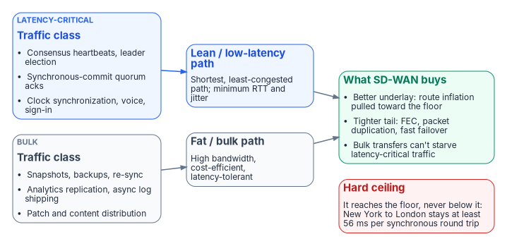

# Module 4: Path classes, change rings and the evidence {.unnumbered}

*Part of the [SD-WAN governor learning path](index.md). The guide's [Policy](../../books/guides/cisco-sdwan-implementation.md#policy-path-classes-and-lane-discipline), [TIC 3.0, SSE and Microsoft 365](../../books/guides/cisco-sdwan-implementation.md#tic-3.0-sse-and-microsoft-365), [Evidence and telemetry](../../books/guides/cisco-sdwan-implementation.md#evidence-and-telemetry) and [Control states](../../books/guides/cisco-sdwan-implementation.md#sdw-control-states). About 50 minutes, plus Lab 2.*

## Introduction (3 minutes)

With the governor secured, the fabric starts doing its job: keeping latency-critical traffic on the path built for it, sending internet-bound traffic to enforcement of equal strength on every path, and recording which path each flow took and why. Book 09's last design decision is to make the path evidence. In this module you map the path classes and egress patterns onto the fabric, see where the security service edge takes over, walk the change rings, and assemble and seal the evidence an assessor checks, including the part the kit doesn't produce.

**The federal requirement.** The guide's [Control states](../../books/guides/cisco-sdwan-implementation.md#sdw-control-states) and [evidence checklist](../../books/guides/cisco-sdwan-implementation.md#sdw-evidence-checklist) carry the full mapping.

| Requirement | KSI | Evidence |
|---|---|---|
| SC-7: the traffic-flow policy per path class, every internet path to enforcement, and SC-7(4)'s documented exceptions | KSI-CNA-ULN | The application-to-path policy, the policy-group audit for local-internet actions, and each Optimize exception with its approver and review date |
| CM-6: the fabric's configuration baseline | KSI-CMT-LMC | Policy and configuration group exports from Manager, with the release baseline |
| CA-7: the gate re-run at every ring and on Cisco's cadence | KSI-MLA-EVC | Dated gate runs, and each ring's exit record |
| AU-9: the evidence protected from change | KSI-MLA-OSM | SHA-256 hashes taken when each run was written |

## Learning objectives (1 minute)

After this module, you'll be able to:

- map the lean and bulk path classes onto SLA classes and data policy, and say why path parity matters under TIC 3.0;
- place the egress patterns on the fabric, and say what belongs to the security service edge;
- handle Microsoft 365's Optimize traffic in GCC under its own exception;
- name the four change rings and each one's exit criterion;
- assemble and seal the evidence package, and name the records the kit doesn't build.

## Prerequisites (1 minute)

- [Module 3](03-the-hunt-hardening-and-logs-off-the-box.md).
- [Book 09, Chapter 12](../../books/b09-network/12-microsoft-365-traffic.md). Skim it before Unit 2.

## Unit 1: Path classes on the fabric (8 minutes)

Read the guide's [Policy: path classes and lane discipline](../../books/guides/cisco-sdwan-implementation.md#policy-path-classes-and-lane-discipline), and [Book 09, Chapter 08, Decision 2](../../books/b09-network/08-reference-architecture.md#decision-2-classify-every-flow-and-write-the-path-policy).

{#fig-nsw-ch05-path-classes fig-alt="Latency-critical traffic (consensus heartbeats, leader election, synchronous-commit acknowledgements, clock synchronization, voice and sign-in) goes to a blue lean low-latency path; bulk traffic (snapshots, backups, re-sync, analytics replication, asynchronous log shipping, patch and content distribution) goes to a slate fat bulk path. Both lead to a green card of what SD-WAN buys: a better underlay that pulls route inflation toward the floor, a tighter tail through forward error correction, packet duplication and fast failover, and bulk transfers that can't starve latency-critical traffic. A red hard-ceiling card notes New York to London stays at least 56 ms per synchronous round trip. The figure is reused from Book 09, Chapter 05."}

- **Lean** traffic, such as voice, sign-in and interactive work, gets a custom SLA class with thresholds from the pilot's measured baseline, not Cisco's defaults.
- **Bulk** traffic, such as backups and patch and content waves, stays on the direct internet circuit and off the 5G path, with QoS so it can't queue ahead of lean traffic.
- **Path parity:** every color that can reach the internet lands on the same security service edge policy, so no path has less rigor.

The SC-7(4) traffic-flow policy is written first; the fabric's configuration is diffed against it. The program observes and records; Manager and the Controllers route and enforce. That lane discipline is why the kit only reads.

## Unit 2: Egress, the security service edge and Microsoft 365 (10 minutes)

Read the guide's [Book 09's patterns on Catalyst](../../books/guides/cisco-sdwan-implementation.md#book-09s-patterns-on-catalyst), [Microsoft 365 in GCC](../../books/guides/cisco-sdwan-implementation.md#microsoft-365-in-gcc) and [DNS](../../books/guides/cisco-sdwan-implementation.md#dns), then [Book 09, Chapter 12, The SC-7(4) documented traffic-flow exception](../../books/b09-network/12-microsoft-365-traffic.md#the-sc-74-documented-traffic-flow-exception).

- **Pattern A**, the hairpin to the regional hub and out through the hub's tunnel to the security service edge, is every office's starting state and its fallback.
- **Pattern B**, bare local breakout, never: audit the policy group for a local-internet action on every change.
- **Pattern C** sends each edge's internet traffic through tunnels to the security service edge. Which one is the agency's choice; the SD-WAN build doesn't depend on it.
- **Microsoft 365 Optimize traffic** goes direct only under its own documented SC-7(4) exception, named, with a mission need, a duration and a review cadence, and the steering log as its enforcement evidence. Informed network routing isn't available to GCC Moderate tenants, so path choice rests on the edge's own probes.
- **DNS** redirects to the agency's resolver, with CISA's Protective DNS upstream, never to a vendor resolver in its place.

**Global Secure Access** as the security service edge is its own path: [Global Secure Access as the Identity-Aware Network](../global-secure-access/index.md). From a Catalyst edge, Microsoft's remote networks carry only the Microsoft traffic profile, so a branch tunnel to it isn't a full Pattern C; the guide's [Microsoft Global Secure Access as the SSE](../../books/guides/cisco-sdwan-implementation.md#microsoft-global-secure-access-as-the-sse) explains why.

## Unit 3: Change rings and the evidence package (8 minutes)

Read the guide's [Control states, change safety and assessment mapping](../../books/guides/cisco-sdwan-implementation.md#sdw-control-states) and [Mapping to Chapter 05's evidence schema](../../books/guides/cisco-sdwan-implementation.md#mapping-to-chapter-05s-evidence-schema).

| Ring | Scope | Exit criteria |
|---|---|---|
| 0 | Control components (Gate 0) | Every gate line closed and evidenced |
| 1 | The ten-site pilot (Phase 0) | 30 days of pilot stability; paired-branch effect size measured |
| 2 | The regional hubs (Phase 1) | Hubs in production; replacement telemetry confirmed for the pilot sites |
| 3 | Office waves at MPLS renewal (Phase 2) | Per-office CLAW confirmation; failover test record per site class |

: Change rings, from the guide's change safety table {.striped .hover}

The backout triggers, settled as [WD-150](../../about/decision-register.md#wd-150): a site misses its SLA class on every path, its tunnel to the security service edge stops logging, CLAW delivery for the office stops, or a gate re-run shows a `fail` row. After every change, re-run the gate, audit the policy group for local-internet actions, and run the site's failover test.

The kit builds the first layer of Chapter 05's evidence: `fleet_inventory` records, `management_audit` records and the gate findings. It doesn't build `sdwan_decision` records, the path-selection, steering and failover evidence; those need application-route statistics and policy state the kit doesn't read. Until a collector reads them, that layer of the package comes from Manager's own exports and the SIEM, and the evidence package says so.

## Exercise: Lab 1, fixtures, no fabric (14 minutes) {#nsw-m4-lab-1}
You count what the kit's evidence holds, find what it doesn't, seal a run, prove the seal is repeatable, and use the gate as ring 0's exit criterion.

<!-- labs:begin lab-1-commands (generated by scripts/generate_labs.py; not part of the reviewed page) -->

::: {.callout-note #lab-1-commands collapse="false" title="Every command in Lab 1"}
Every command in this lab, in order. Each step below says what it does and what to look for.

```powershell
Set-Location C:\FMWLabs\cisco-sdwan

# Step 1: Replay the October capture and count its evidence records
python python/sdwan_evidence.py --config config/config.example.json --replay tests/fixtures --out out
$r = Get-Content -Raw out/sdwan-evidence.json | ConvertFrom-Json
$r.records | Group-Object record_kind -NoElement | Sort-Object Name | Format-Table Name, Count
$r.records | ForEach-Object { $_.control_refs } | Group-Object -NoElement | Sort-Object Name | Format-Table Name, Count

# Step 2: Look for the path evidence
'sdwan_decision records: {0}' -f @($r.records | Where-Object record_kind -eq 'sdwan_decision').Count

# Step 3: Seal the November run
python python/sdwan_evidence.py --config config/config.example.json --replay tests/fixtures/after-upgrade --out out-after
Get-FileHash out-after/sdwan-evidence.json, out-after/ed-26-03-gate.csv -Algorithm SHA256 | Select-Object @{ n = 'File'; e = { Split-Path $_.Path -Leaf } }, Algorithm, Hash | Export-Csv out-after/hashes.csv -NoTypeInformation
Import-Csv out-after/hashes.csv | Format-List

# Step 4: Prove the seal is repeatable
python python/sdwan_evidence.py --config config/config.example.json --replay tests/fixtures/after-upgrade --out out-again
(Get-FileHash out-after/sdwan-evidence.json).Hash -eq (Get-FileHash out-again/sdwan-evidence.json).Hash

# Step 5: Use the gate as ring 0's exit criterion
foreach ($cap in 'tests/fixtures', 'tests/fixtures/after-upgrade') { python python/sdwan_evidence.py --config config/config.example.json --replay $cap --out out-ring | Out-Null; '{0,-28} exit {1}: {2}' -f $cap, $LASTEXITCODE, $(if ($LASTEXITCODE -eq 0) { 'ring 0 exit criterion met' } else { 'hold at ring 0' }) }

# Step 6: Clean up
Remove-Item -Recurse -Force out, out-after, out-again, out-ring
```

:::

<!-- labs:end -->

Every step runs in PowerShell 7, the Python commands included, so you can follow it top to bottom in one window. Open **PowerShell 7** from the Start menu, then go to the kit's folder, where you unzipped it under [Get the code](index.md#get-the-code):

```powershell
Set-Location C:\FMWLabs\cisco-sdwan
```

Prefer Git Bash? Go to the folder with `cd /c/FMWLabs/cisco-sdwan`; the `python` commands run the same there, and every other command needs PowerShell 7 (type `pwsh` to start it). In a clone of the repository, use the `examples` folder of the same name.

1. **Replay the October capture and count its evidence records.**

    ```powershell
    python python/sdwan_evidence.py --config config/config.example.json --replay tests/fixtures --out out
    $r = Get-Content -Raw out/sdwan-evidence.json | ConvertFrom-Json
    $r.records | Group-Object record_kind -NoElement | Sort-Object Name | Format-Table Name, Count
    $r.records | ForEach-Object { $_.control_refs } | Group-Object -NoElement | Sort-Object Name | Format-Table Name, Count
    ```

    Expected output:

    ```text
    gate: fail  evidence: out/sdwan-evidence.json  findings: out/ed-26-03-gate.csv

    Name             Count
    ----             -----
    fleet_inventory      7
    management_audit     2


    Name    Count
    ----    -----
    AC-6(9)     2
    AU-6        2
    AU-9        2
    CM-8        7
    SI-2        7
    ```

    Seven inventory records and two audit records, each naming the controls it supports. The gate findings sit beside them in the same file and in the CSV.

2. **Look for the path evidence.**

    ```powershell
    'sdwan_decision records: {0}' -f @($r.records | Where-Object record_kind -eq 'sdwan_decision').Count
    ```

    Expected output:

    ```text
    sdwan_decision records: 0
    ```

    None, by design: the kit doesn't read application-route statistics or policy state. Write that gap into the evidence package rather than leaving an assessor to find it.

3. **Seal the November run.** The hashes are taken as soon as the files are written.

    ```powershell
    python python/sdwan_evidence.py --config config/config.example.json --replay tests/fixtures/after-upgrade --out out-after
    Get-FileHash out-after/sdwan-evidence.json, out-after/ed-26-03-gate.csv -Algorithm SHA256 | Select-Object @{ n = 'File'; e = { Split-Path $_.Path -Leaf } }, Algorithm, Hash | Export-Csv out-after/hashes.csv -NoTypeInformation
    Import-Csv out-after/hashes.csv | Format-List
    ```

    Expected output:

    ```text
    gate: pass  evidence: out-after/sdwan-evidence.json  findings: out-after/ed-26-03-gate.csv

    File      : sdwan-evidence.json
    Algorithm : SHA256
    Hash      : 104C78E28029B7696F5A96684DB18F40F05C9D802DDFD680FAC32CE28AE39B64

    File      : ed-26-03-gate.csv
    Algorithm : SHA256
    Hash      : 70289BB5D3C8BD914A759763AC01315F07C1C7A24B4A4CE3848852670AF29F45
    ```

    Your hashes match these if your kit matches this page: a replay writes the same bytes on Windows and Linux.

4. **Prove the seal is repeatable.** Replay the same capture into a new folder and compare.

    ```powershell
    python python/sdwan_evidence.py --config config/config.example.json --replay tests/fixtures/after-upgrade --out out-again
    (Get-FileHash out-after/sdwan-evidence.json).Hash -eq (Get-FileHash out-again/sdwan-evidence.json).Hash
    ```

    Expected output:

    ```text
    gate: pass  evidence: out-again/sdwan-evidence.json  findings: out-again/ed-26-03-gate.csv
    True
    ```

    An assessor holding the capture and the floor file can re-derive the evidence and check its hash.

5. **Use the gate as ring 0's exit criterion,** on both captures.

    ```powershell
    foreach ($cap in 'tests/fixtures', 'tests/fixtures/after-upgrade') { python python/sdwan_evidence.py --config config/config.example.json --replay $cap --out out-ring | Out-Null; '{0,-28} exit {1}: {2}' -f $cap, $LASTEXITCODE, $(if ($LASTEXITCODE -eq 0) { 'ring 0 exit criterion met' } else { 'hold at ring 0' }) }
    ```

    Expected output:

    ```text
    tests/fixtures               exit 2: hold at ring 0
    tests/fixtures/after-upgrade exit 0: ring 0 exit criterion met
    ```

    The exit code is one of ring 0's criteria, not all of them: the hunt, the hardening record and the logs off the box (Module 3) close the rest.

6. **Clean up.** Delete the four folders this lab wrote, so the next run starts clean.

    ```powershell
    Remove-Item -Recurse -Force out, out-after, out-again, out-ring
    ```

## Exercise: Lab 2, a test fabric {#nsw-m4-lab-2}
*Not timed. Not run by the authors. Never production.* You need Module 1's Lab 2 config, `config/config.json`, the read-only Manager account, and a planned change to the test fabric, such as an upgrade of one component, made by the fabric's owner through its own change process. Work in `examples/cisco-sdwan`.

<!-- labs:begin lab-2-commands (generated by scripts/generate_labs.py; not part of the reviewed page) -->

::: {.callout-note #lab-2-commands collapse="false" title="Every command in Lab 2"}
Every command in this lab, in order, from `examples/cisco-sdwan`. Each step below says what it does and what to look for.

```powershell
# Step 1: Run and seal a baseline before the change
$cred = Get-Credential -Message 'Read-only Manager account'
$env:SDWAN_API_USERNAME = $cred.UserName
$env:SDWAN_API_PASSWORD = $cred.GetNetworkCredential().Password
python python/sdwan_evidence.py --config config/config.json --out out-before
"exit code: $LASTEXITCODE"
Remove-Item Env:SDWAN_API_USERNAME, Env:SDWAN_API_PASSWORD
Get-FileHash out-before/sdwan-evidence.json, out-before/ed-26-03-gate.csv -Algorithm SHA256 | Select-Object @{ n = 'File'; e = { Split-Path $_.Path -Leaf } }, Algorithm, Hash | Export-Csv out-before/hashes.csv -NoTypeInformation

# Step 2: Run and seal again after the change
$env:SDWAN_API_USERNAME = $cred.UserName
$env:SDWAN_API_PASSWORD = $cred.GetNetworkCredential().Password
python python/sdwan_evidence.py --config config/config.json --out out-after-change
$gate = $LASTEXITCODE
"exit code: $gate"
Get-FileHash out-after-change/sdwan-evidence.json, out-after-change/ed-26-03-gate.csv -Algorithm SHA256 | Select-Object @{ n = 'File'; e = { Split-Path $_.Path -Leaf } }, Algorithm, Hash | Export-Csv out-after-change/hashes.csv -NoTypeInformation
Remove-Item Env:SDWAN_API_USERNAME, Env:SDWAN_API_PASSWORD

# Step 3: Compare the inventory before and after
$b = (Get-Content -Raw out-before/sdwan-evidence.json | ConvertFrom-Json).records | Where-Object record_kind -eq 'fleet_inventory'
$c = (Get-Content -Raw out-after-change/sdwan-evidence.json | ConvertFrom-Json).records | Where-Object record_kind -eq 'fleet_inventory'
Compare-Object $b $c -Property host_name, role, software_version | Sort-Object host_name, SideIndicator | Format-Table host_name, role, software_version, SideIndicator

# Step 4: Decide whether the change stands
Remove-Variable cred
if ($gate -ne 0) { 'Backout trigger: the gate re-run is not clean' } else { 'Gate re-run clean: record it with the change' }
```

:::

<!-- labs:end -->

1. **Run and seal a baseline before the change.**

    ```powershell
    $cred = Get-Credential -Message 'Read-only Manager account'
    $env:SDWAN_API_USERNAME = $cred.UserName
    $env:SDWAN_API_PASSWORD = $cred.GetNetworkCredential().Password
    python python/sdwan_evidence.py --config config/config.json --out out-before
    "exit code: $LASTEXITCODE"
    Remove-Item Env:SDWAN_API_USERNAME, Env:SDWAN_API_PASSWORD
    Get-FileHash out-before/sdwan-evidence.json, out-before/ed-26-03-gate.csv -Algorithm SHA256 | Select-Object @{ n = 'File'; e = { Split-Path $_.Path -Leaf } }, Algorithm, Hash | Export-Csv out-before/hashes.csv -NoTypeInformation
    ```

2. **Run and seal again after the change.** Run it once the test fabric's owner has made the planned change through the fabric's own change process. This is the post-change validation's gate re-run.

    ```powershell
    $env:SDWAN_API_USERNAME = $cred.UserName
    $env:SDWAN_API_PASSWORD = $cred.GetNetworkCredential().Password
    python python/sdwan_evidence.py --config config/config.json --out out-after-change
    $gate = $LASTEXITCODE
    "exit code: $gate"
    Get-FileHash out-after-change/sdwan-evidence.json, out-after-change/ed-26-03-gate.csv -Algorithm SHA256 | Select-Object @{ n = 'File'; e = { Split-Path $_.Path -Leaf } }, Algorithm, Hash | Export-Csv out-after-change/hashes.csv -NoTypeInformation
    Remove-Item Env:SDWAN_API_USERNAME, Env:SDWAN_API_PASSWORD
    ```

3. **Compare the inventory before and after.**

    ```powershell
    $b = (Get-Content -Raw out-before/sdwan-evidence.json | ConvertFrom-Json).records | Where-Object record_kind -eq 'fleet_inventory'
    $c = (Get-Content -Raw out-after-change/sdwan-evidence.json | ConvertFrom-Json).records | Where-Object record_kind -eq 'fleet_inventory'
    Compare-Object $b $c -Property host_name, role, software_version | Sort-Object host_name, SideIndicator | Format-Table host_name, role, software_version, SideIndicator
    ```

    Only the components you changed should appear, each once on each side (`<=` before, `=>` after). Anything else changed without a change record.

4. **Decide whether the change stands.**

    ```powershell
    Remove-Variable cred
    if ($gate -ne 0) { 'Backout trigger: the gate re-run is not clean' } else { 'Gate re-run clean: record it with the change' }
    ```

**What it leaves behind.** Sign-ins in Manager's audit log, and the `out-before` and `out-after-change` folders with their hashes: they are the change's evidence, so keep them with the change record.

## Knowledge check (5 minutes)

1. Where does bulk traffic go on a dual-circuit branch?
    a. On whichever path has the lowest latency at the moment.
    b. On the direct internet circuit only, off the 5G path, with QoS so it can't queue ahead of lean traffic.
    c. Over the hairpin to the hub, always.

2. A GCC Moderate agency wants Microsoft 365 Optimize traffic to leave the branch directly. What makes that acceptable?
    a. Microsoft's informed network routing.
    b. A documented SC-7(4) exception, with a mission need, a duration, a review cadence and the steering log as enforcement evidence.
    c. Nothing: Optimize traffic must always be inspected.

3. The gate re-run after an upgrade shows a `fail` row. What happens?
    a. It's a backout trigger.
    b. The change stands; the next scheduled run will catch it.
    c. The ring advances, because the upgrade was approved.

4. An assessor asks for path-selection evidence for one branch. Where does it come from today?
    a. The kit's `sdwan_decision` records.
    b. Manager's own exports of application-route statistics and policy state, and the SIEM, because the kit doesn't build those records.
    c. The gate CSV.

::: {.callout-tip collapse="true"}
## Check your answers
1. **b.** See Unit 1 and the guide's [Policy](../../books/guides/cisco-sdwan-implementation.md#policy-path-classes-and-lane-discipline).
2. **b.** See Unit 2 and [Book 09, Chapter 12](../../books/b09-network/12-microsoft-365-traffic.md#the-sc-74-documented-traffic-flow-exception).
3. **a.** See Unit 3; [WD-150](../../about/decision-register.md#wd-150) settles the triggers.
4. **b.** See Unit 3 and Lab 1's Step 2.
:::

## Summary (2 minutes)

You mapped the path classes and egress patterns onto the fabric, put Microsoft 365's Optimize traffic under its own exception, walked the change rings, and assembled and sealed the evidence, naming the layer the kit doesn't build. **Evidence an ISSO keeps from this module:** the SC-7(4) traffic-flow policy and each exception with its approver and review date; the policy and configuration group exports; each ring's exit record; and every run's files with the hashes taken when they were written.

::: {.callout-tip}
## Continue the path
[Learning path](index.md) · [Previous: Module 3](03-the-hunt-hardening-and-logs-off-the-box.md)
:::
