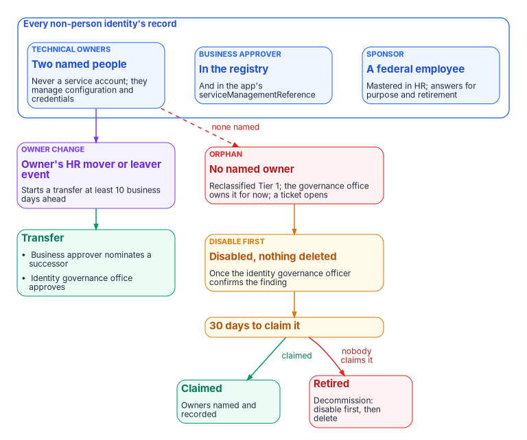

# Module 2: Owners, sponsors and the orphan rule {.unnumbered}

*Part of the [Non-Person Identity learning path](index.md). Gates G1 Inventory and G6 Lifecycle. Workbook [Chapter 02](../../project-plans/developer-workbooks/non-person-identity/02-ownership-and-the-orphan-rule.md). About 60 minutes.*

**Watch:** the narrated deck for this module: [Deck](https://github.com/WhalerMike/modernization-workbook/releases/download/edition-2026.11.5/Training_NPI_Module_2.pptx) · [▶ Watch](../../presentations/watch.html?v=Training_NPI_Module_2_Narrated) (about 14 minutes, captions) · [MP4](https://github.com/WhalerMike/modernization-workbook/releases/download/videos-2026-10-23/Training_NPI_Module_2_Narrated.mp4) · [Script](https://github.com/WhalerMike/modernization-workbook/blob/main/presentations/training-npi-module-2/Training_NPI_Module_2_Narration_Script.md) · [Captions](https://github.com/WhalerMike/modernization-workbook/blob/main/presentations/training-npi-module-2/Training_NPI_Module_2_Narrated.vtt).

**Also:** the chapter's narrated tour, about 11 minutes: [▶ Watch](../../presentations/watch.html?v=DW_NPI_02_Ownership_Orphan_Rule_Narrated).

## Introduction (3 minutes)

An owner can add a credential and act as the app. So owners are a control, not a contact list. The program wants two human owners on every app registration and service principal, a record in the system inventory, and an application owner for every Active Directory account, found before the account is touched.

An identity with no owner is an orphan. The plan's decision D-NP2 says what happens to it: disable it once the identity governance officer confirms the finding, then allow 30 days for someone to claim it or retire it. Never delete.

In this module you check ownership as code and build the orphan rule as a plan that a reviewer approves by its hash before anything changes.

**The federal requirement.** Ownership is part of Gate G1, and the orphan rule is part of Gate G6. The guide's [Validate (G1 Inventory)](../../books/guides/non-person-identity-implementation.md#step-1-inventory-every-non-person-identity) and [Validate (G6 Lifecycle)](../../books/guides/non-person-identity-implementation.md#step-6-run-the-lifecycle) steps name AC-2, AC-2(3), IA-4 and CM-8, among others. The workbook chapter's [Federal requirements and evidence](../../project-plans/developer-workbooks/non-person-identity/02-ownership-and-the-orphan-rule.md#federal-requirements-and-evidence) table has a row for every lab step.

| Requirement | KSI | Evidence |
|---|---|---|
| AC-2 Account Management (account managers) | KSI-IAM-SNU | `ownership.json`; `findings.json`, NPI-OWN-01 to -05, -08 and -09 |
| IA-4 Identifier Management; CM-8 System Component Inventory | KSI-IAM-ELP, KSI-IAM-JIT (IA-4); KSI-PIY-GIV (CM-8) | `findings.json`, NPI-OWN-06 and -07: each identity names an active record |
| AC-2(3) Disable Accounts; CM-3 Configuration Change Control | KSI-IAM-AAM (AC-2(3)); KSI-CMT-LMC, KSI-CMT-RVP (CM-3) | `orphan-plan.json` and its SHA-256; `results.json` and `manifest.json` in the apply folder |
| AC-5 Separation of Duties | KSI-IAM-JIT | `igo-confirmations.csv`; the plan hash approved by a second person |
| AC-6 Least Privilege | KSI-IAM-ELP, KSI-IAM-JIT | `Get-NpiRequiredPermission` for `ownership` and `orphan-apply` |

KSIs are FedRAMP 20x indicators for cloud service providers. The agency lines this evidence up with what its providers report against them; it doesn't report KSIs itself. Which file supports which indicator is the program's mapping *(design guidance)*.

## Learning objectives (1 minute)

After this module, you'll be able to:

- state the program's ownership rule, and which owners the code counts as valid;
- explain D-NP2, the orphan rule the program settled on, and how it differs from *Access & Privilege*'s own policy;
- run the ownership check and read its findings and its orphan plan;
- show that the write path dry-runs without `-Apply` and refuses a plan whose hash nobody approved.

## Prerequisites (1 minute)

- [Module 1](01-inventory.md): this module checks Module 1's register.
- The guide's [record each identity joins to](../../books/guides/non-person-identity-implementation.md#the-record-each-identity-joins-to): the owner and sponsor fields.

## Unit 1: Owners and sponsors in the guide (8 minutes)

Read the guide's Step 1f, under [Step 1](../../books/guides/non-person-identity-implementation.md#step-1-inventory-every-non-person-identity): two human owners, a business approver in the registry, and a sponsor who is a federal employee. Then read Step 6's [Owner change](../../books/guides/non-person-identity-implementation.md#owner-change) and [Orphans](../../books/guides/non-person-identity-implementation.md#orphans), and its table [Decommissioning: disable first, then delete](../../books/guides/non-person-identity-implementation.md#decommissioning-disable-first-then-delete).

## Unit 2: The check and the plan (14 minutes)

Read the workbook chapter in this order:

- [The rule the code holds](../../project-plans/developer-workbooks/non-person-identity/02-ownership-and-the-orphan-rule.md#the-rule-the-code-holds): Learn's two-owner advice, the program's stricter rule *(design guidance)*, D-NP2, and "disable, never delete."
- [The check](../../project-plans/developer-workbooks/non-person-identity/02-ownership-and-the-orphan-rule.md#the-check): NPI-OWN-01 to -09, and the AI sponsor fields recorded for Module 9.
- [The orphan rule as a plan](../../project-plans/developer-workbooks/non-person-identity/02-ownership-and-the-orphan-rule.md#the-orphan-rule-as-a-plan): each action, and which ones write.
- [The separate write path](../../project-plans/developer-workbooks/non-person-identity/02-ownership-and-the-orphan-rule.md#the-separate-write-path): the approved hash, the seven-day limit, the allowed bodies, and why a person, not an app, runs it.

{#fig-npi-ownership-and-orphan-rule fig-alt="A flow diagram. A blue frame labeled Every non-person identity's record holds three blue boxes. Technical owners, two named people: never a service account; they manage configuration and credentials. Business approver, in the registry: and in the app's serviceManagementReference. Sponsor, a federal employee: mastered in HR; answers for purpose and retirement. A violet arrow runs from the technical owners box to a violet box, Owner change: owner's HR mover or leaver event, which starts a transfer at least 10 business days ahead. That box leads to a green box, Transfer: the business approver nominates a successor, and the identity governance office approves. A dashed red arrow labeled none named also runs from the technical owners box to a red box, Orphan, no named owner: reclassified Tier 1; the governance office owns it for now; a ticket opens. An amber arrow leads to an amber box, Disable first, disabled, nothing deleted: once the identity governance officer confirms the finding. That leads to an amber box, 30 days to claim it. From there a green arrow labeled claimed goes to a green box, Claimed: owners named and recorded. A red arrow labeled nobody claims it goes to a red box, Retired: decommission, disable first, then delete."}

## Exercise: Lab 1, fixtures, no tenant (22 minutes)

This is the workbook's [Chapter 02, Lab 1](../../project-plans/developer-workbooks/non-person-identity/02-ownership-and-the-orphan-rule.md#lab-1-fixtures-no-tenant), which explains each result. The estate is fictional. Step 1 makes Chapter 01's register; the chapter's step 1 is this module's step 2, and so on.

<!-- labs:begin lab-1-commands (generated by scripts/generate_labs.py; not part of the reviewed page) -->

::: {.callout-note #lab-1-commands collapse="false" title="Every command in Lab 1"}
Every command in this lab, in order. Each step below says what it does and what to look for.

```powershell
Set-Location C:\FMWLabs\non-person-identity-code\non-person-identity

$Run = "C:\FMWLabs\results\non-person-identity-02-owners-and-the-orphan-rule\lab1\$(Get-Date -AsUTC -Format 'yyyy-MM-ddTHHmmssZ')"
New-Item -ItemType Directory -Path $Run -Force | Out-Null
$Run

# Step 1: Make Chapter 01's register
./Invoke-NpiInventory.ps1 -Cloud gcc -FixturePath tests/fixtures/estate.json -OutputPath "$Run\inventory"

# Step 2: Send Learn's samples to the fake
Invoke-Pester -Path tests/MicrosoftSamples.Tests.ps1 -FullNameFilter '*Chapter 02*' -Output None -PassThru |
    Select-Object PassedCount, FailedCount, NotRunCount

# Step 3: List what each task needs
Import-Module ./powershell/NpiOwnership/NpiOwnership.psm1
foreach ($t in 'ownership', 'orphan-apply') { $p = Get-NpiRequiredPermission -Task $t; "$t : " + ($p.GraphPermissions -join ', ') }

# Step 4: Check ownership and build the plan
./Invoke-NpiOwnership.ps1 -Cloud gcc -RegisterRun "$Run\inventory" -FixturePath tests/fixtures/estate.json -InputPath tests/fixtures/inputs -OutputPath "$Run\ownership"

# Step 5: Read the findings
Get-Content "$Run\ownership\findings.json" -Raw | ConvertFrom-Json | Where-Object Severity -eq 'Finding' | Group-Object Rule | Format-Table Name, Count

# Step 6: Read the plan
Get-Content "$Run\ownership\orphan-plan.json" -Raw | ConvertFrom-Json | Select-Object -ExpandProperty actions | Format-Table Action, Name, Write

# Step 7: Dry-run the plan with its approved hash
$sha = (Get-FileHash "$Run\ownership\orphan-plan.json" -Algorithm SHA256).Hash.ToLower()
./Invoke-NpiOrphanAction.ps1 -Cloud gcc -PlanPath "$Run\ownership\orphan-plan.json" -ApprovedSha256 $sha -FixturePath tests/fixtures/estate.json -OutputPath "$Run\orphan-dryrun"

# Step 8: Apply it to the fake, then try a hash nobody approved
./Invoke-NpiOrphanAction.ps1 -Cloud gcc -PlanPath "$Run\ownership\orphan-plan.json" -ApprovedSha256 $sha -FixturePath tests/fixtures/estate.json -OutputPath "$Run\orphan-apply" -Apply
try { ./Invoke-NpiOrphanAction.ps1 -Cloud gcc -PlanPath "$Run\ownership\orphan-plan.json" -ApprovedSha256 ('0' * 64) -FixturePath tests/fixtures/estate.json -OutputPath "$Run\orphan-x" } catch { $_.Exception.Message }

# Step 8: Apply it to the fake, then try a hash nobody approved
Get-Content "$Run\orphan-apply\results.json" -Raw | ConvertFrom-Json | Where-Object Action -eq 'Disable' | ForEach-Object { "$($_.Name): $($_.Detail)" }

# Step 9: Run the tests
Invoke-Pester -Path tests

# After the steps
Get-ChildItem C:\FMWLabs\results\non-person-identity-02-owners-and-the-orphan-rule\lab1 -Name
```

:::

<!-- labs:end -->

Every step runs in PowerShell 7, so you can follow it top to bottom in one window. Open **PowerShell 7** from the Start menu, then go to the kit's folder, where you unzipped it under [Get the code](index.md#get-the-code):

```powershell
Set-Location C:\FMWLabs\non-person-identity-code\non-person-identity
```

Then make this run's results folder. Its name is the date and time you start, in UTC, so each run keeps its own results and running the lab again never overwrites them:

```powershell
$Run = "C:\FMWLabs\results\non-person-identity-02-owners-and-the-orphan-rule\lab1\$(Get-Date -AsUTC -Format 'yyyy-MM-ddTHHmmssZ')"
New-Item -ItemType Directory -Path $Run -Force | Out-Null
$Run
```

Expected output, where `<run>` is your start time, such as `2026-11-25T143005Z`:

```text
C:\FMWLabs\results\non-person-identity-02-owners-and-the-orphan-rule\lab1\<run>
```

The run's date is only the folder's name. The data's dates are the fixtures' own, which stay the same, so every run's results match this page. The results folder sits outside the kit, so unzipping a newer copy of the kit never touches it.

Prefer Git Bash? Every step is PowerShell 7: type `pwsh` to start it, then run the two blocks above. In a clone of the repository, use the `examples` folder of the same name.

1. **Make Chapter 01's register:**

    ```powershell
    ./Invoke-NpiInventory.ps1 -Cloud gcc -FixturePath tests/fixtures/estate.json -OutputPath "$Run\inventory"
    ```

    Expected output, the three lines of Module 1's step 3:

    ```text
    Register: 35 identities (AD 15, Entra 20); risk HIGH 8, LOW 19, MEDIUM 8
    Findings: 8 Finding, 11 Warn, 3 Info; 3 handed to the Data Platform plan
    Written to C:\FMWLabs\results\non-person-identity-02-owners-and-the-orphan-rule\lab1\<run>\inventory (manifest.json: tenant c0ffee00-0000-4000-8000-000000000001, every request, a SHA-256 per file)
    ```

2. **Send Learn's samples to the fake:**

    ```powershell
    Invoke-Pester -Path tests/MicrosoftSamples.Tests.ps1 -FullNameFilter '*Chapter 02*' -Output None -PassThru |
        Select-Object PassedCount, FailedCount, NotRunCount
    ```

    Expected output:

    ```text
    PassedCount FailedCount NotRunCount
    ----------- ----------- -----------
             10           0          20
    ```

    The twenty not run are Chapter 01's.

3. **List what each task needs:**

    ```powershell
    Import-Module ./powershell/NpiOwnership/NpiOwnership.psm1
    foreach ($t in 'ownership', 'orphan-apply') { $p = Get-NpiRequiredPermission -Task $t; "$t : " + ($p.GraphPermissions -join ', ') }
    ```

    Expected output:

    ```text
    ownership : User.Read.All
    orphan-apply : Application.Read.All, Application.ReadWrite.All, Directory.Read.All, User.Read.All
    ```

    The check reads people only. The write task is separate.

4. **Check ownership and build the plan:**

    ```powershell
    ./Invoke-NpiOwnership.ps1 -Cloud gcc -RegisterRun "$Run\inventory" -FixturePath tests/fixtures/estate.json -InputPath tests/fixtures/inputs -OutputPath "$Run\ownership"
    ```

    Expected output:

    ```text
    Ownership: 22 identities checked; 7 orphan candidates
    Findings: 20 Finding, 3 Warn, 1 Info. AI sponsor fields recorded for Chapter 09: 2
    Orphan plan: 10 actions, 3 of them writes (1 AddOwner, 2 Disable); nothing sent
    Plan SHA-256: 1e1799d7181bd1a3dc271c645fff8a60fc741ab1ebc219bb3011cc25953bad3e
    ```

    The plan's hash is the same on every run with these inputs.

5. **Read the findings:**

    ```powershell
    Get-Content "$Run\ownership\findings.json" -Raw | ConvertFrom-Json | Where-Object Severity -eq 'Finding' | Group-Object Rule | Format-Table Name, Count
    ```

    Expected output:

    ```text
    Name       Count
    ----       -----
    NPI-OWN-01     2
    NPI-OWN-02     4
    NPI-OWN-06     6
    NPI-OWN-07     3
    NPI-OWN-08     5
    ```

    Legacy Reports and Old SAML Connector have no valid owner. Build Pipeline's second owner is a service principal, and Vendor Portal's is a guest, so each has only one.

6. **Read the plan:**

    ```powershell
    Get-Content "$Run\ownership\orphan-plan.json" -Raw | ConvertFrom-Json | Select-Object -ExpandProperty actions | Format-Table Action, Name, Write
    ```

    Expected output, ten actions:

    ```text
    Action              Name               Write
    ------              ----               -----
    Disable             svc-backup          True
    AwaitConfirmation   svc-oldftp         False
    RetirementCandidate svc-reports        False
    ClaimWindowOpen     sa-printsvc        False
    Exception           gmsa-ops$          False
    Disable             Legacy Reports      True
    AwaitConfirmation   Old SAML Connector False
    AddOwner            HR Connector        True
    NomineeRefused      Build Pipeline     False
    RecordOwner         svc-oldftp         False
    ```

    Three write: `Disable` for `svc-backup` and Legacy Reports, and `AddOwner` for HR Connector. `svc-reports` is a `RetirementCandidate`: disabled, and nobody claimed it in 30 days. The Build Pipeline claim named a guest, so it's `NomineeRefused`.

7. **Dry-run the plan with its approved hash:**

    ```powershell
    $sha = (Get-FileHash "$Run\ownership\orphan-plan.json" -Algorithm SHA256).Hash.ToLower()
    ./Invoke-NpiOrphanAction.ps1 -Cloud gcc -PlanPath "$Run\ownership\orphan-plan.json" -ApprovedSha256 $sha -FixturePath tests/fixtures/estate.json -OutputPath "$Run\orphan-dryrun"
    ```

    Expected output:

    ```text
    DryRun: 3 WouldSend
      WouldSend Disable  WRITE Disable-ADAccount -Identity ad000000-0000-4000-8000-000000000003
      WouldSend Disable  PATCH https://graph.microsoft.com/v1.0/servicePrincipals/5b000000-0000-4000-8000-000000000003
      WouldSend AddOwner POST https://graph.microsoft.com/v1.0/applications/0a000000-0000-4000-8000-000000000002/owners/$ref
    ```

8. **Apply it to the fake, then try a hash nobody approved.** The refusal is an error; `try` and `catch` print its message and keep the window going:

    ```powershell
    ./Invoke-NpiOrphanAction.ps1 -Cloud gcc -PlanPath "$Run\ownership\orphan-plan.json" -ApprovedSha256 $sha -FixturePath tests/fixtures/estate.json -OutputPath "$Run\orphan-apply" -Apply
    try { ./Invoke-NpiOrphanAction.ps1 -Cloud gcc -PlanPath "$Run\ownership\orphan-plan.json" -ApprovedSha256 ('0' * 64) -FixturePath tests/fixtures/estate.json -OutputPath "$Run\orphan-x" } catch { $_.Exception.Message }
    ```

    Expected output:

    ```text
    Apply: 3 Sent
      Sent      Disable  WRITE Disable-ADAccount -Identity ad000000-0000-4000-8000-000000000003
      Sent      Disable  PATCH https://graph.microsoft.com/v1.0/servicePrincipals/5b000000-0000-4000-8000-000000000003
      Sent      AddOwner POST https://graph.microsoft.com/v1.0/applications/0a000000-0000-4000-8000-000000000002/owners/$ref
    The plan's SHA-256 is 1e1799d7181bd1a3dc271c645fff8a60fc741ab1ebc219bb3011cc25953bad3e, not the approved 0000000000000000000000000000000000000000000000000000000000000000; refusing to run a plan nobody reviewed.
    ```

    Read what each disable asks you to record, from the apply run's results:

    ```powershell
    Get-Content "$Run\orphan-apply\results.json" -Raw | ConvertFrom-Json | Where-Object Action -eq 'Disable' | ForEach-Object { "$($_.Name): $($_.Detail)" }
    ```

    Expected output:

    ```text
    svc-backup: Record DisabledOn 2026-10-30 in the confirmations log; the claim window ends 2026-11-29
    Legacy Reports: Record DisabledOn 2026-10-30 in the confirmations log; the claim window ends 2026-11-29
    ```

9. **Run the tests:**

    ```powershell
    Invoke-Pester -Path tests
    ```

    It prints a line for each test file, with the time it took, then this last line:

    ```text
    Tests Passed: 567, Failed: 0, Skipped: 0, Inconclusive: 0, NotRun: 0
    ```

Nothing to clean up: the kit's folder is as you unzipped it, and this run's results stay in `$Run`. List every run you've made of this lab:

```powershell
Get-ChildItem C:\FMWLabs\results\non-person-identity-02-owners-and-the-orphan-rule\lab1 -Name
```

Expected output: one line per run, oldest first, the last one this run:

```text
<run>
```

## Exercise: Lab 2, your test tenant (5 minutes to read)

*Not run by the authors.* Follow the workbook's [Chapter 02, Lab 2](../../project-plans/developer-workbooks/non-person-identity/02-ownership-and-the-orphan-rule.md#lab-2-test-tenant). It has the exact commands.

- **You need:** a test tenant in the worldwide or GCC cloud and a test Active Directory domain, never production, with fictional people, and Module 1's Lab 2 run (`out/inventory-test`).
- **What you do:** make two test orphans, an app registration with no owners and a test service account; run the check with an app holding only `User.Read.All`; confirm both as the identity governance officer; have a second person approve the plan's hash; then dry-run and apply it as a person with Cloud Application Administrator.
- **Back-out:** step 6 sets the service principal's `accountEnabled` back to `true`, enables the test account, deletes both test objects and the test app's registration, and deletes the `out` folders.

## Knowledge check (5 minutes)

1. Which owners does the code count as valid?
    a. Any owner listed on the app
    b. Users who are members and enabled
    c. Users and service principals
    d. Guests with a sponsor
2. Under D-NP2, as the plan states it, what happens to a confirmed orphan?
    a. It's deleted after 30 days
    b. It's disabled once the identity governance officer confirms it, then there are 30 days to claim it or retire it
    c. Nothing until day 31
    d. It's moved to a holding OU and kept forever
3. How does the code disable an orphaned app registration's access?
    a. It deletes the app registration
    b. It deactivates the app registration on the beta endpoint
    c. It sets `accountEnabled` to false on the tenant's service principal, on v1.0
    d. It removes every owner
4. You run `Invoke-NpiOrphanAction.ps1` with an `-ApprovedSha256` that isn't the plan's hash. What happens?
    a. It sends the writes and logs a warning
    b. It refuses to run a plan nobody reviewed
    c. It recomputes the plan
    d. It sends only the disables
5. Why is the write path a person's delegated session, not an app with a standing permission?
    a. `Application.ReadWrite.All` can let an app act as other entities, and disabling is never automatic
    b. Apps can't call PATCH
    c. Delegated sessions don't need a role
    d. The fake requires it

::: {.callout-tip collapse="true"}
## Check your answers
1. **b.** Only enabled members count; guests and service principals raise warnings. Taught in [The rule the code holds](../../project-plans/developer-workbooks/non-person-identity/02-ownership-and-the-orphan-rule.md#the-rule-the-code-holds) and [The check](../../project-plans/developer-workbooks/non-person-identity/02-ownership-and-the-orphan-rule.md#the-check).
2. **b.** The program settled on D-NP2's order, the stricter: disable first, then the 30-day claim window. The guide and the code follow it; *Access & Privilege*, Chapter 06 runs the other way round. Taught in [The rule the code holds](../../project-plans/developer-workbooks/non-person-identity/02-ownership-and-the-orphan-rule.md#the-rule-the-code-holds).
3. **c.** Learn's deactivation procedure is on beta, so the code uses the v1.0 switch. Taught in [The rule the code holds](../../project-plans/developer-workbooks/non-person-identity/02-ownership-and-the-orphan-rule.md#the-rule-the-code-holds).
4. **b.** Taught in [The separate write path](../../project-plans/developer-workbooks/non-person-identity/02-ownership-and-the-orphan-rule.md#the-separate-write-path) and shown in Lab 1, step 8.
5. **a.** Taught in [The separate write path](../../project-plans/developer-workbooks/non-person-identity/02-ownership-and-the-orphan-rule.md#the-separate-write-path).
:::

## Summary (2 minutes)

You checked 22 identities for valid owners and active records, built an orphan plan of ten actions with three writes, dry-ran it, applied it to the fake, and saw the write path refuse a hash nobody approved.

**The evidence an ISSO keeps** from this module: `ownership.json`, `findings.json` and `orphan-plan.json` with its approved SHA-256; `igo-confirmations.csv`; and the dry-run and apply folders with their `results.json` and `manifest.json`, dated. Before shipping, work through the chapter's [Checklist](../../project-plans/developer-workbooks/non-person-identity/02-ownership-and-the-orphan-rule.md#checklist).

**Next:** [Module 3: Decide each identity's target](03-decide-the-target.md).
