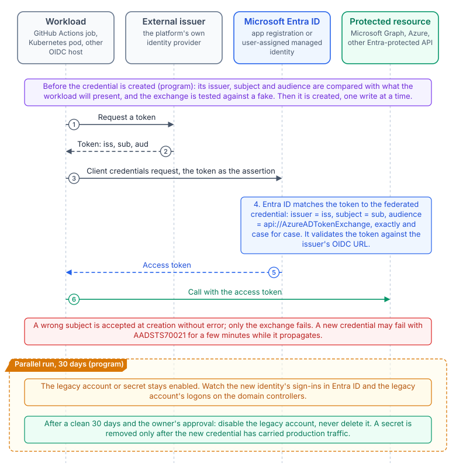

# Module 7: Convert to managed identities and federation {.unnumbered}

*Part of the [Non-Person Identity learning path](index.md). Gate G5 Conversion. Workbook [Chapter 05](../../project-plans/developer-workbooks/non-person-identity/05-workload-identity-federation-and-managed-identities.md). About 60 minutes.*

**Watch:** the narrated deck for this module: [Deck](https://github.com/WhalerMike/modernization-workbook/releases/download/edition-2026.11.5/Training_NPI_Module_7.pptx) · [▶ Watch](../../presentations/watch.html?v=Training_NPI_Module_7_Narrated) (about 15 minutes, captions) · [MP4](https://github.com/WhalerMike/modernization-workbook/releases/download/videos-2026-10-23/Training_NPI_Module_7_Narrated.mp4) · [Script](https://github.com/WhalerMike/modernization-workbook/blob/main/presentations/training-npi-module-7/Training_NPI_Module_7_Narration_Script.md) · [Captions](https://github.com/WhalerMike/modernization-workbook/blob/main/presentations/training-npi-module-7/Training_NPI_Module_7_Narrated.vtt).

**Also:** the chapter's narrated tour, about 12 minutes: [▶ Watch](../../presentations/watch.html?v=DW_NPI_05_Workload_Federation_Narrated).

## Introduction (3 minutes)

A federated credential tells Microsoft Entra ID to trust tokens from an outside issuer, such as GitHub Actions or a Kubernetes cluster. Three values must match the workload's token exactly, case for case: the issuer, the subject and the audience. And a credential with the wrong subject is created without any error. It fails only when the workload tries to exchange its token.

In this module you plan conversions in the program's order: a managed identity for an Azure-hosted workload, a federated credential where the host has an issuer, and a certificate only where neither applies. Each federated credential is checked against the claims the workload will present and tested against a fake token endpoint before it is created. Then the old and new credentials run side by side for 30 days, and the legacy account is disabled, never deleted.

**The federal requirement.** Gate G5 supports NIST SP 800-53 IA-5, IA-9 and AU-2. The gate's output is evidence for these controls; your organization still sets their parameters, policy and procedures, and the assessor decides whether each is satisfied. The guide's [Validate (G5 Conversion)](../../books/guides/non-person-identity-implementation.md#step-5-convert-with-a-parallel-run) step names them, and the workbook chapter's [Federal requirements and evidence](../../project-plans/developer-workbooks/non-person-identity/05-workload-identity-federation-and-managed-identities.md#federal-requirements-and-evidence) table has a row for every lab step.

| Requirement | KSI | Evidence |
|---|---|---|
| IA-5 and IA-5(2) Authenticator Management; IA-9 Service Identification and Authentication | KSI-IAM-SNU (IA-5); none cites IA-9 | `conversions.json`; `plan.json`; `findings.json`, NPI-WIF-01 to -09 |
| IA-9; CM-4(2) Verification of Controls | KSI-CMT-VTD, KSI-CMT-LMC (CM-4(2)) | `exchange-tests.json` |
| AC-2 Account Management; AC-2(3) Disable Accounts | KSI-IAM-SNU (AC-2); KSI-IAM-AAM (AC-2(3)) | `conversion-records.json`; `cutover-log.csv`; the apply folder's `results.json` |
| AC-6 Least Privilege; CM-5 Access Restrictions for Change | KSI-IAM-ELP, KSI-IAM-JIT (AC-6); KSI-CMT-RVP (CM-5) | The permissions for `federation` and `federation-apply` |
| CM-3 Configuration Change Control | KSI-CMT-RMV, KSI-CMT-LMC | The plan's SHA-256; the dry-run and apply folders |
| AU-2 and AU-12, the new identity's sign-ins | KSI-MLA-LET | Lab 2: the beta sign-in log entry with `clientCredentialType` `federatedIdentityCredential` |
| AU-9 and SI-7, the run's integrity | KSI-MLA-OSM (AU-9); KSI-SVC-VRI (SI-7) | `manifest.json` in each output folder |

KSIs are FedRAMP 20x indicators for cloud service providers. The agency lines this evidence up with what its providers report against them; it doesn't report KSIs itself. Which file supports which indicator is the program's mapping *(design guidance)*. The guide's [Evidence](../../books/guides/non-person-identity-implementation.md#evidence) section explains both.

## Learning objectives (1 minute)

After this module, you'll be able to:

- state the order of targets, and the finding a target out of order raises;
- name the three values a federated credential must match, and the audience Entra ID expects;
- explain why every federated credential gets a token exchange test before it's created;
- read a conversion's cutover gate and parallel run status, and say when the legacy account may be disabled.

## Prerequisites (1 minute)

- [Module 3](03-decide-the-target.md): the conversions follow the target and the wave Module 3 decides.
- [Module 4](04-credential-rules.md): a certificate target is issued and rotated under Module 4's rules.

## Unit 1: What the gate asks for (7 minutes)

Read the guide's [Step 5](../../books/guides/non-person-identity-implementation.md#step-5-convert-with-a-parallel-run): build the target, give it two human owners, run old and new for 30 days, disable the legacy account, and record the result. Then read the guide's [Step 2](../../books/guides/non-person-identity-implementation.md#step-2-decide-each-identitys-target) decision table again, and the [Dangers](../../books/guides/non-person-identity-implementation.md#dangers) row "Federation trusts too much".

## Unit 2: What a federated credential must match (10 minutes)

Read the workbook chapter in this order:

- [What the code depends on](../../project-plans/developer-workbooks/non-person-identity/05-workload-identity-federation-and-managed-identities.md#what-the-code-depends-on): the order, the three values, the limit of 20, and why a wrong subject is created without error.
- [The checks](../../project-plans/developer-workbooks/non-person-identity/05-workload-identity-federation-and-managed-identities.md#the-checks): NPI-WIF-01 to -09, what the workload presents, and the token exchange test.

## Unit 3: The plan, the parallel run and the write path (8 minutes)

- [The plan](../../project-plans/developer-workbooks/non-person-identity/05-workload-identity-federation-and-managed-identities.md#the-plan): the actions, and the evidence for a clean run *(design guidance for the thresholds)*.
- [The separate write path](../../project-plans/developer-workbooks/non-person-identity/05-workload-identity-federation-and-managed-identities.md#the-separate-write-path): the approved hash, one write at a time, never a `DELETE`, and a person with Cloud Application Administrator and Managed Identity Contributor.

{#fig-npi-federated-credential-exchange fig-alt="Sequence diagram with four participants: the workload (a GitHub Actions job, Kubernetes pod or other OIDC host), the external issuer (the platform's own identity provider), Microsoft Entra ID (an app registration or user-assigned managed identity), and the protected resource (Microsoft Graph, Azure or another Entra-protected API). A violet note says that before the credential is created, the program compares its issuer, subject and audience with what the workload will present, tests the exchange against a fake, and then creates it one write at a time. Step 1: the workload requests a token from the external issuer. Step 2: the issuer returns a token carrying iss, sub and aud. Step 3: the workload sends Entra ID a client credentials request with that token as the assertion. Step 4, a blue note over Entra ID and the resource: Entra ID matches the token to the federated credential, issuer to iss, subject to sub, and audience to api://AzureADTokenExchange, exactly and case for case, and validates the token against the issuer's OIDC URL. Step 5: Entra ID returns an access token to the workload. Step 6: the workload calls the protected resource with the access token. A red note says a wrong subject is accepted at creation without error and only the exchange fails, and that a new credential may fail with AADSTS70021 for a few minutes while it propagates. An amber frame labeled Parallel run, 30 days (program) holds two notes. First, the legacy account or secret stays enabled while the new identity's sign-ins in Entra ID and the legacy account's logons on the domain controllers are watched. Second, after a clean 30 days and the owner's approval the legacy account is disabled, never deleted, and a secret is removed only after the new credential has carried production traffic."}

## Exercise: Lab 1, fixtures, no tenant (20 minutes)

This is the workbook's [Chapter 05, Lab 1](../../project-plans/developer-workbooks/non-person-identity/05-workload-identity-federation-and-managed-identities.md#lab-1-fixtures-no-tenant), which explains each result. The tenant is fictional.

<!-- labs:begin lab-1-commands (generated by scripts/generate_labs.py; not part of the reviewed page) -->

::: {.callout-note #lab-1-commands collapse="false" title="Every command in Lab 1"}
Every command in this lab, in order. Each step below says what it does and what to look for.

```powershell
Set-Location C:\FMWLabs\non-person-identity-code\non-person-identity

$Run = "C:\FMWLabs\results\non-person-identity-07-federation-and-managed-identities\lab1\$(Get-Date -AsUTC -Format 'yyyy-MM-ddTHHmmssZ')"
New-Item -ItemType Directory -Path $Run -Force | Out-Null
$Run

# Step 1: Send Microsoft's samples to the fakes
Invoke-Pester -Path tests/NpiFederationSamples.Tests.ps1 -Output None -PassThru |
    Select-Object PassedCount, FailedCount, NotRunCount

# Step 2: List what each task needs
Import-Module ./powershell/NpiFederation/NpiFederation.psm1
foreach ($t in 'federation', 'federation-apply') { $p = Get-NpiWifRequiredPermission -Task $t; "$t : " + ($p.GraphPermissions -join ', ') + ' | ' + ($p.AzureRoles -join ', ') }

# Step 3: Build the plan
./Invoke-NpiFederation.ps1 -Cloud gcc -ConversionsPath tests/fixtures/ch05/conversions.json -CutoverLogPath tests/fixtures/ch05/cutover-log.csv -FixturePath tests/fixtures/ch05/tenant.json -OutputPath "$Run\federation"

# Step 4: Read the findings
Get-Content "$Run\federation\findings.json" -Raw | ConvertFrom-Json | Format-Table Rule, Severity, ObjectKey

# Step 5: Read the exchange tests
Get-Content "$Run\federation\exchange-tests.json" -Raw | ConvertFrom-Json | Format-Table Credential, SubjectSource, Passed

# Step 6: Read the conversions
Get-Content "$Run\federation\conversion-records.json" -Raw | ConvertFrom-Json | ForEach-Object { [pscustomobject]@{ Id = $_.ConversionId; Target = $_.TargetKind; Gate = $_.CutoverGate; Run = $_.ParallelRun.Status; Day = $_.ParallelRun.Day } } | Format-Table

# Step 7: Dry-run the plan with its approved hash
$sha = (Get-FileHash "$Run\federation\plan.json" -Algorithm SHA256).Hash.ToLower()
./Invoke-NpiFederation.ps1 -Cloud gcc -PlanPath "$Run\federation\plan.json" -ApprovedSha256 $sha -FixturePath tests/fixtures/ch05/tenant.json -OutputPath "$Run\federation-dryrun"

# Step 8: Apply it to the fake, then try a hash nobody approved
./Invoke-NpiFederation.ps1 -Cloud gcc -PlanPath "$Run\federation\plan.json" -ApprovedSha256 $sha -FixturePath tests/fixtures/ch05/tenant.json -OutputPath "$Run\federation-apply" -Apply
try { ./Invoke-NpiFederation.ps1 -Cloud gcc -PlanPath "$Run\federation\plan.json" -ApprovedSha256 ('0' * 64) -FixturePath tests/fixtures/ch05/tenant.json -OutputPath "$Run\federation-x" } catch { $_.Exception.Message }

# Step 9: Run the tests
Invoke-Pester -Path tests

# After the steps
Get-ChildItem C:\FMWLabs\results\non-person-identity-07-federation-and-managed-identities\lab1 -Name
```

:::

<!-- labs:end -->

Every step runs in PowerShell 7, so you can follow it top to bottom in one window. Open **PowerShell 7** from the Start menu, then go to the kit's folder, where you unzipped it under [Get the code](index.md#get-the-code):

```powershell
Set-Location C:\FMWLabs\non-person-identity-code\non-person-identity
```

Then make this run's results folder. Its name is the date and time you start, in UTC, so each run keeps its own results and running the lab again never overwrites them:

```powershell
$Run = "C:\FMWLabs\results\non-person-identity-07-federation-and-managed-identities\lab1\$(Get-Date -AsUTC -Format 'yyyy-MM-ddTHHmmssZ')"
New-Item -ItemType Directory -Path $Run -Force | Out-Null
$Run
```

Expected output, where `<run>` is your start time, such as `2026-11-25T143005Z`:

```text
C:\FMWLabs\results\non-person-identity-07-federation-and-managed-identities\lab1\<run>
```

The run's date is only the folder's name. The data's dates are the fixtures' own, which stay the same, so every run's results match this page. The results folder sits outside the kit, so unzipping a newer copy of the kit never touches it.

Prefer Git Bash? Every step is PowerShell 7: type `pwsh` to start it, then run the two blocks above. In a clone of the repository, use the `examples` folder of the same name.

1. **Send Microsoft's samples to the fakes:**

    ```powershell
    Invoke-Pester -Path tests/NpiFederationSamples.Tests.ps1 -Output None -PassThru |
        Select-Object PassedCount, FailedCount, NotRunCount
    ```

    Expected output:

    ```text
    PassedCount FailedCount NotRunCount
    ----------- ----------- -----------
             17           0           0
    ```

    One test creates a credential from the Graph sample, then exchanges a token with another subject: the create succeeds and the exchange fails with `AADSTS70021`.

2. **List what each task needs:**

    ```powershell
    Import-Module ./powershell/NpiFederation/NpiFederation.psm1
    foreach ($t in 'federation', 'federation-apply') { $p = Get-NpiWifRequiredPermission -Task $t; "$t : " + ($p.GraphPermissions -join ', ') + ' | ' + ($p.AzureRoles -join ', ') }
    ```

    Expected output:

    ```text
    federation : Application.Read.All, AuditLog.Read.All | Reader
    federation-apply : Application.Read.All, Application.ReadWrite.All | Managed Identity Contributor, Reader
    ```

3. **Build the plan:**

    ```powershell
    ./Invoke-NpiFederation.ps1 -Cloud gcc -ConversionsPath tests/fixtures/ch05/conversions.json -CutoverLogPath tests/fixtures/ch05/cutover-log.csv -FixturePath tests/fixtures/ch05/tenant.json -OutputPath "$Run\federation"
    ```

    Expected output:

    ```text
    Conversions: 8 in 2 wave(s); token exchange tests: 4 passed, 2 failed
    Findings: 7 Finding, 1 Warn
    Plan: 20 actions, 4 of them writes (2 CreateCredential, 1 CreateIdentity, 1 DisableLegacy); nothing sent
    Parallel runs: conv-01 ReadyToDisableLegacy; conv-02 AwaitingCutover; conv-03 AwaitingCutover; conv-04 AwaitingCutover; conv-05 AwaitingCutover; conv-06 AwaitingCutover; conv-07 ParallelRunning; conv-08 LegacyStillInUse
    Plan SHA-256: 5ec0a52c70dc49ac6904c6923ac9b292e3c312d38594b6210cc9178c9f188bf2
    ```

    The plan's hash is the same on every run with these inputs.

4. **Read the findings:**

    ```powershell
    Get-Content "$Run\federation\findings.json" -Raw | ConvertFrom-Json | Format-Table Rule, Severity, ObjectKey
    ```

    Expected output, eight rows:

    ```text
    Rule       Severity ObjectKey
    ----       -------- ---------
    NPI-WIF-03 Finding  conv-02/payroll-prod
    NPI-WIF-02 Finding  conv-02/payroll-prod
    NPI-WIF-08 Finding  conv-02/payroll-prod
    NPI-WIF-07 Warn     conv-02/payroll-test
    NPI-WIF-04 Finding  conv-03/github-intranet-tag
    NPI-WIF-08 Finding  conv-03/github-intranet-tag
    NPI-WIF-01 Finding  conv-06
    NPI-WIF-09 Finding  conv-08
    ```

    `payroll-prod` has an issuer with a trailing slash and the environment `Production` where the workflow's is `production`: NPI-WIF-03, NPI-WIF-02 and a failed exchange, NPI-WIF-08. `github-intranet-tag` has an audience with a leading space: NPI-WIF-04 and NPI-WIF-08. `conv-06` gives an Azure Functions app a certificate when a managed identity is available: NPI-WIF-01. `conv-08`'s secret still signs in after cutover: NPI-WIF-09.

5. **Read the exchange tests:**

    ```powershell
    Get-Content "$Run\federation\exchange-tests.json" -Raw | ConvertFrom-Json | Format-Table Credential, SubjectSource, Passed
    ```

    Expected output, six tests:

    ```text
    Credential          SubjectSource Passed
    ----------          ------------- ------
    payroll-prod        derived        False
    github-main         derived         True
    github-intranet     derived         True
    github-intranet-tag derived        False
    aks-webfront        derived         True
    gh-reports          derived         True
    ```

    `payroll-prod` and `github-intranet-tag` fail, and the other four pass.

6. **Read the conversions:**

    ```powershell
    Get-Content "$Run\federation\conversion-records.json" -Raw | ConvertFrom-Json | ForEach-Object { [pscustomobject]@{ Id = $_.ConversionId; Target = $_.TargetKind; Gate = $_.CutoverGate; Run = $_.ParallelRun.Status; Day = $_.ParallelRun.Day } } | Format-Table
    ```

    Expected output:

    ```text
    Id      Target              Gate     Run                  Day
    --      ------              ----     ---                  ---
    conv-01 managedIdentity     Ready    ReadyToDisableLegacy  40
    conv-02 federatedCredential Blocked  AwaitingCutover
    conv-03 federatedCredential Blocked  AwaitingCutover
    conv-04 managedIdentity     NotReady AwaitingCutover
    conv-05 certificate         NotReady AwaitingCutover
    conv-06 certificate         Blocked  AwaitingCutover
    conv-07 managedIdentity     Ready    ParallelRunning       15
    conv-08 federatedCredential Ready    LegacyStillInUse      59
    ```

    `conv-01` is `ReadyToDisableLegacy` on day 40, `conv-07` `ParallelRunning` on day 15 and `conv-08` `LegacyStillInUse` on day 59. The other five are `AwaitingCutover`.

7. **Dry-run the plan with its approved hash:**

    ```powershell
    $sha = (Get-FileHash "$Run\federation\plan.json" -Algorithm SHA256).Hash.ToLower()
    ./Invoke-NpiFederation.ps1 -Cloud gcc -PlanPath "$Run\federation\plan.json" -ApprovedSha256 $sha -FixturePath tests/fixtures/ch05/tenant.json -OutputPath "$Run\federation-dryrun"
    ```

    Expected output:

    ```text
    DryRun: 4 WouldSend
      WouldSend DisableLegacy    WRITE Disable-ADAccount -Identity ad000000-0000-4000-8000-000000000001
      WouldSend CreateCredential POST  https://graph.microsoft.com/v1.0/applications/0a000000-0000-4000-8000-000000000004/federatedIdentityCredentials
      WouldSend CreateIdentity   PUT   https://management.azure.com/subscriptions/11111111-1111-4111-8111-111111111111/resourceGroups/rg-identity/providers/Microsoft.ManagedIdentity/userAssignedIdentities/id-webfront?api-version=2024-11-30
      WouldSend CreateCredential PUT   https://management.azure.com/subscriptions/11111111-1111-4111-8111-111111111111/resourceGroups/rg-identity/providers/Microsoft.ManagedIdentity/userAssignedIdentities/id-webfront/federatedIdentityCredentials/aks-webfront?api-version=2024-11-30
    ```

    `Disable-ADAccount` for `conv-01`'s legacy account, one `POST` of an application's federated credential, then a `PUT` of the identity `id-webfront` before a `PUT` of its credential.

8. **Apply it to the fake, then try a hash nobody approved.** The refusal is an error; `try` and `catch` print its message and keep the window going:

    ```powershell
    ./Invoke-NpiFederation.ps1 -Cloud gcc -PlanPath "$Run\federation\plan.json" -ApprovedSha256 $sha -FixturePath tests/fixtures/ch05/tenant.json -OutputPath "$Run\federation-apply" -Apply
    try { ./Invoke-NpiFederation.ps1 -Cloud gcc -PlanPath "$Run\federation\plan.json" -ApprovedSha256 ('0' * 64) -FixturePath tests/fixtures/ch05/tenant.json -OutputPath "$Run\federation-x" } catch { $_.Exception.Message }
    ```

    Expected output, the same four in the same order, then the refusal:

    ```text
    Apply: 4 Sent
      Sent      DisableLegacy    WRITE Disable-ADAccount -Identity ad000000-0000-4000-8000-000000000001
      Sent      CreateCredential POST  https://graph.microsoft.com/v1.0/applications/0a000000-0000-4000-8000-000000000004/federatedIdentityCredentials
      Sent      CreateIdentity   PUT   https://management.azure.com/subscriptions/11111111-1111-4111-8111-111111111111/resourceGroups/rg-identity/providers/Microsoft.ManagedIdentity/userAssignedIdentities/id-webfront?api-version=2024-11-30
      Sent      CreateCredential PUT   https://management.azure.com/subscriptions/11111111-1111-4111-8111-111111111111/resourceGroups/rg-identity/providers/Microsoft.ManagedIdentity/userAssignedIdentities/id-webfront/federatedIdentityCredentials/aks-webfront?api-version=2024-11-30
    The plan's SHA-256 is 5ec0a52c70dc49ac6904c6923ac9b292e3c312d38594b6210cc9178c9f188bf2, not the approved 0000000000000000000000000000000000000000000000000000000000000000; refusing to run a plan nobody reviewed.
    ```

9. **Run the tests:**

    ```powershell
    Invoke-Pester -Path tests
    ```

    It prints a line for each test file, with the time it took, then this last line:

    ```text
    Tests Passed: 550, Failed: 0, Skipped: 0, Inconclusive: 0, NotRun: 0
    ```

Nothing to clean up: the kit's folder is as you unzipped it, and this run's results stay in `$Run`. List every run you've made of this lab:

```powershell
Get-ChildItem C:\FMWLabs\results\non-person-identity-07-federation-and-managed-identities\lab1 -Name
```

Expected output: one line per run, oldest first, the last one this run:

```text
<run>
```

## Exercise: Lab 2, your test tenant (5 minutes to read)

*Not run by the authors.* Follow the workbook's [Chapter 05, Lab 2](../../project-plans/developer-workbooks/non-person-identity/05-workload-identity-federation-and-managed-identities.md#lab-2-test-tenant). It has the exact commands.

- **You need:** a test tenant in the worldwide or GCC cloud, a test subscription, a test Active Directory domain and a test repository, never production, with fictional names; a reader app with `Application.Read.All`, `AuditLog.Read.All` and Reader; and a person with Cloud Application Administrator and Managed Identity Contributor for the write.
- **What you do:** make a test conversion from a client secret to a federated credential, capture the real `iss` and `sub` from one workflow run, plan, apply, exchange for real, and run the parallel run through to the legacy account's disable.
- **Back-out:** step 7 enables the test account again, removes the test credentials, deletes the test identity, the test app registration and the test account by hand (this code never deletes), and deletes the `out` folders.

## Knowledge check (5 minutes)

1. A credential's subject has `Production` where the workflow presents `production`. What happens when it's created in Entra ID?
    a. Creation fails with an error
    b. It's created without error, and the token exchange fails later; the check flags it first (NPI-WIF-02)
    c. Entra ID corrects the case
    d. It works, because matching ignores case
2. What audience does Entra ID expect on a federated credential?
    a. Any value the workload sends
    b. Exactly one audience, `api://AzureADTokenExchange`
    c. `https://graph.microsoft.com`
    d. The app's client ID
3. An Azure Functions app is given a certificate. Why is that a finding?
    a. Certificates are banned
    b. The plan's order puts an Azure-hosted workload on a managed identity (NPI-WIF-01)
    c. Functions can't use certificates
    d. The certificate is too long-lived
4. `conv-01` ran 40 days with no logon by the old account, and the owner approved. What does the plan do with the legacy account?
    a. Deletes it
    b. Disables it with `Disable-ADAccount`, after review; it's never deleted by this code
    c. Leaves it enabled for another 30 days
    d. Moves it to another domain
5. What does the token exchange test in Lab 1 prove?
    a. That the workload's issuer will present those claims
    b. That a credential will match the claims you recorded, against a fake that matches as Learn describes; the real issuer's answer is Lab 2's
    c. That the token's signature is valid
    d. That the credential has propagated

::: {.callout-tip collapse="true"}
## Check your answers
1. **b.** Learn says a wrong subject is created successfully and fails only at the exchange. Taught in [What the code depends on](../../project-plans/developer-workbooks/non-person-identity/05-workload-identity-federation-and-managed-identities.md#what-the-code-depends-on) and [The checks](../../project-plans/developer-workbooks/non-person-identity/05-workload-identity-federation-and-managed-identities.md#the-checks).
2. **b.** Taught in [What the code depends on](../../project-plans/developer-workbooks/non-person-identity/05-workload-identity-federation-and-managed-identities.md#what-the-code-depends-on) and the guide's [Step 3](../../books/guides/non-person-identity-implementation.md#step-3-set-the-credential-rules), item 8.
3. **b.** Taught in [The checks](../../project-plans/developer-workbooks/non-person-identity/05-workload-identity-federation-and-managed-identities.md#the-checks) and the guide's [Step 2](../../books/guides/non-person-identity-implementation.md#step-2-decide-each-identitys-target).
4. **b.** Disable, never delete. Taught in [The plan](../../project-plans/developer-workbooks/non-person-identity/05-workload-identity-federation-and-managed-identities.md#the-plan) and the guide's [Step 5](../../books/guides/non-person-identity-implementation.md#step-5-convert-with-a-parallel-run).
5. **b.** Taught in [The checks](../../project-plans/developer-workbooks/non-person-identity/05-workload-identity-federation-and-managed-identities.md#the-checks) and the chapter's illustrative code note above [Lab 1](../../project-plans/developer-workbooks/non-person-identity/05-workload-identity-federation-and-managed-identities.md#lab-1-fixtures-no-tenant).
:::

## Summary (2 minutes)

You planned eight conversions in two waves, caught a trailing slash, a wrong case and a stray space before any credential reached the tenant, read each conversion's parallel run, and applied four approved writes to the fake, an identity before its credential. The write path refused a plan nobody reviewed.

**The evidence an ISSO keeps** for G5 from this module: `conversions.json`, `cutover-log.csv`, `plan.json` with its approved SHA-256, `findings.json`, `exchange-tests.json`, `conversion-records.json`, and the apply folder's `results.json` and `manifest.json`, dated. Before shipping, work through the chapter's [Checklist](../../project-plans/developer-workbooks/non-person-identity/05-workload-identity-federation-and-managed-identities.md#checklist).

**Next:** [Module 15: Your first gMSA](15-your-first-gmsa.md), which sets up the forest for gMSAs, then [Module 8: Convert Kerberos accounts to gMSAs and dMSAs](08-gmsa-dmsa-and-the-kerberos-island.md).
