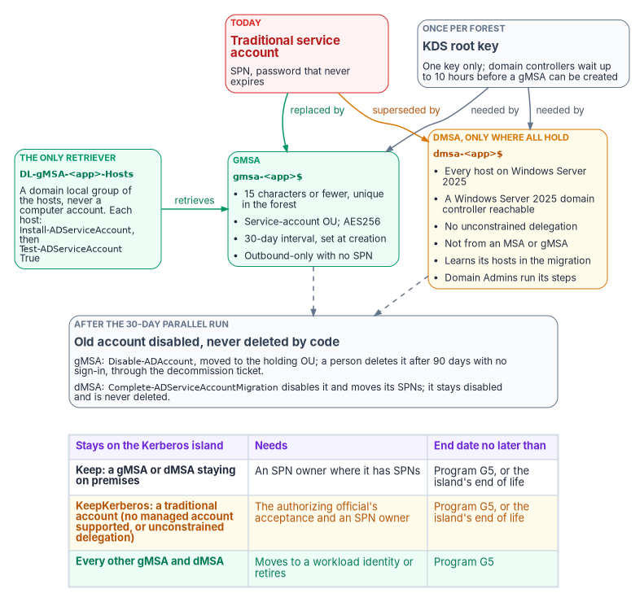

# Module 8: Convert Kerberos accounts to gMSAs and dMSAs {.unnumbered}

*Part of the [Non-Person Identity learning path](index.md). Gate G5 Conversion. Workbook [Chapter 06](../../project-plans/developer-workbooks/non-person-identity/06-gmsa-dmsa-and-the-kerberos-island.md). About 60 minutes.*

**Watch:** the narrated deck for this module: [Deck](https://github.com/WhalerMike/modernization-workbook/releases/download/edition-2026.11.5/Training_NPI_Module_8.pptx) · [▶ Watch](../../presentations/watch.html?v=Training_NPI_Module_8_Narrated) (about 20 minutes, captions) · [MP4](https://github.com/WhalerMike/modernization-workbook/releases/download/videos-2026-10-23/Training_NPI_Module_8_Narrated.mp4) · [Script](https://github.com/WhalerMike/modernization-workbook/blob/main/presentations/training-npi-module-8/Training_NPI_Module_8_Narration_Script.md) · [Captions](https://github.com/WhalerMike/modernization-workbook/blob/main/presentations/training-npi-module-8/Training_NPI_Module_8_Narrated.vtt).

**Also:** the chapter's narrated tour, about 14 minutes: [▶ Watch](../../presentations/watch.html?v=DW_NPI_06_gMSA_dMSA_Narrated).

## Introduction (3 minutes)

Some workloads can't leave Kerberos yet. A traditional service account with an SPN and a password that never expires is the riskiest of them. A gMSA gives the same workload a password that Windows changes for it. A dMSA, on a Windows Server 2025 domain, supersedes the old account and disables its password.

But a gMSA works only while Active Directory is authoritative. So converting isn't the end. Every gMSA and dMSA must either move to a workload identity, retire, or sit on a dated Kerberos island list with an end date and, where it has SPNs, an SPN owner. In this module you plan all three, and you see the write path refuse a plan nobody approved.

**The federal requirement.** The Kerberos accounts are the on-premises part of Gate G5. The guide's [Validate (G5 Conversion)](../../books/guides/non-person-identity-implementation.md#step-5-convert-with-a-parallel-run) step names IA-5, IA-9 and AU-2 for the whole gate. For the Kerberos accounts, the workbook chapter's [Federal requirements and evidence](../../project-plans/developer-workbooks/non-person-identity/06-gmsa-dmsa-and-the-kerberos-island.md#federal-requirements-and-evidence) table has a row for every lab step, and maps them to IA-5, AC-2, AC-2(1), AC-2(3), AC-5, AC-6, CM-3, CM-5 and CM-8; the rows below are its main ones.

| Requirement | KSI | Evidence |
|---|---|---|
| IA-5 Authenticator Management; CM-3 Configuration Change Control | KSI-IAM-APM, KSI-IAM-SNU; KSI-CMT-LMC | `kerberos-plan.json`, with the register's and each input's SHA-256 and the standard it was built with |
| AC-2 Account Management; IA-5 | KSI-IAM-SNU (AC-2); KSI-IAM-APM (IA-5) | `findings.json`, NPI-KRB-01 to -07, -09 and -10 |
| AC-6 Least Privilege; CM-5 Access Restrictions for Change | KSI-IAM-ELP, KSI-IAM-JIT (AC-6); KSI-CMT-RVP (CM-5) | `Get-NpiKrbRequiredRight` for the read and write tasks; `runBy` in `calls-ch06.json`; `password-retrievers.json` |
| AC-2(1) Automated System Account Management; AC-5 Separation of Duties | KSI-IAM-JIT | The `Refused` rows and `runAs` in each apply folder: the pipeline sends only its steps, a person only the dMSA steps |
| AC-2; CM-3 | KSI-IAM-SNU; KSI-CMT-LMC | `RequestId` and `ChangeRecord` on every write in `kerberos-plan.json` and `results.json` |
| CM-8 System Component Inventory; AC-2 | KSI-PIY-GIV; KSI-IAM-SNU | `island-list.csv`; `reconciliation.json` |
| CM-3; AC-2(3) Disable Accounts | KSI-CMT-LMC; KSI-IAM-AAM | `results.json` and `manifest.json` in each apply folder, each write re-read |

KSIs are FedRAMP 20x indicators for cloud service providers. The agency lines this evidence up with what its providers report against them; it doesn't report KSIs itself. Which file supports which indicator is the program's mapping *(design guidance)*. The guide's [Evidence](../../books/guides/non-person-identity-implementation.md#evidence) section explains both.

## Learning objectives (1 minute)

After this module, you'll be able to:

- name the four dispositions a Kerberos account can have, and what each one needs;
- explain why a dMSA can't be used for an MSA or an account with unconstrained delegation;
- read the plan, the island list and the reconciliation for a fictional domain;
- show that the write path runs only a plan whose SHA-256 was approved, sends each write only as the pipeline or the person it belongs to, and never deletes.

## Prerequisites (1 minute)

- [Module 1](01-inventory.md): the lab reads Chapter 01's register.
- [Module 3](03-decide-the-target.md): the matrix sends Kerberos-only accounts to a gMSA or a dMSA.
- [Module 15](15-your-first-gmsa.md): the forest's one-time setup for gMSAs (the KDS root key, the OUs, the creators group and the pipeline's gMSA), which this module's conversions assume.

## Unit 1: The gate and the end date (8 minutes)

Read the guide's [Step 5](../../books/guides/non-person-identity-implementation.md#step-5-convert-with-a-parallel-run): build the target, give it two owners, run old and new in parallel for 30 days, then disable, never delete. Then read:

- The guide's [Step 2](../../books/guides/non-person-identity-implementation.md#step-2-decide-each-identitys-target), its prerequisites for a gMSA: one KDS root key for the forest, the wait of up to 10 hours, a name unique in the forest, and a password interval set only at creation.
- The guide's [Step 3](../../books/guides/non-person-identity-implementation.md#step-3-set-the-credential-rules), its step 7 on AD-side credentials.
- The guide's [Rollback](../../books/guides/non-person-identity-implementation.md#rollback) row for Step 5.
- Optional, outside the timing: [*Service Accounts: From User Accounts to gMSAs to Microsoft Entra Workload Identities*](../../books/guides/service-account-migration.md), Migrations A and B, the same moves by hand with Learn's commands.

## Unit 2: The plan and the island (12 minutes)

Read the workbook chapter in this order:

- [The context the code depends on](../../project-plans/developer-workbooks/non-person-identity/06-gmsa-dmsa-and-the-kerberos-island.md#the-context-the-code-depends-on): what a gMSA and a dMSA are, why the chapter has an end date built in, and the program's rules *(design guidance)*, including the [managed service account standard](../../books/guides/service-account-migration.md#msa-standard) every new account follows.
- [The check and the plan](../../project-plans/developer-workbooks/non-person-identity/06-gmsa-dmsa-and-the-kerberos-island.md#the-check-and-the-plan): NPI-KRB-01 to -10, and one action per account.
- [The island list and the reconciliation](../../project-plans/developer-workbooks/non-person-identity/06-gmsa-dmsa-and-the-kerberos-island.md#the-island-list-and-the-reconciliation).
- [The separate write path](../../project-plans/developer-workbooks/non-person-identity/06-gmsa-dmsa-and-the-kerberos-island.md#the-separate-write-path): why the read holds no domain administration, why the pipeline's own gMSA sends the gMSA creations, retriever changes, disables and moves with only delegated rights, and why a person sends the dMSA steps, which need Domain Admins.

{#fig-gmsa-dmsa-and-the-kerberos-island fig-alt="Architecture diagram. At the top, a red card for today's traditional service account, which has an SPN and a password that never expires, and a slate card for the KDS root key, created once per forest. Only one key is allowed, and domain controllers wait up to 10 hours before a gMSA can be created. Arrows labeled needed by run from the KDS root key to both the gMSA and the dMSA cards. A green arrow labeled replaced by runs from the traditional account to the gMSA, and an amber arrow labeled superseded by runs to the dMSA. In the middle row, a green card for the only retriever, the group DL-gMSA-(app name)-Hosts: a domain local group of the hosts, never a computer account, where each host runs Install-ADServiceAccount and then gets True from Test-ADServiceAccount. A green arrow labeled retrieves runs from it to the green gMSA card, gmsa-(app name)$, which lists: 15 characters or fewer and unique in the forest; in the service-account OU with AES256; a 30-day password interval set at creation; outbound-only when it holds no SPN. Beside it, an amber card for the dMSA, dmsa-(app name)$, used only where all of these hold: every host runs Windows Server 2025; a Windows Server 2025 domain controller is reachable; no unconstrained delegation; not migrated from an MSA or gMSA. It learns its hosts during the migration, and Domain Admins run its steps. Dashed arrows from both cards lead to a slate card, after the 30-day parallel run, old account disabled, never deleted by code. For a gMSA, Disable-ADAccount disables it and it moves to the holding OU; a person deletes it after 90 days with no sign-in, through the decommission ticket. For a dMSA, Complete-ADServiceAccountMigration disables the old account and moves its SPNs; it stays disabled and is never deleted. At the bottom, a table of what stays on the Kerberos island, with columns for what each needs and the latest end date. Row one, Keep: a gMSA or dMSA staying on premises needs an SPN owner where it has SPNs, and ends no later than program G5 or the island's end of life. Row two, amber, KeepKerberos: a traditional account (no managed account supported, or unconstrained delegation) needs the authorizing official's acceptance and an SPN owner, and ends no later than program G5 or the island's end of life (WD-165). Row three, green: every other gMSA and dMSA moves to a workload identity or retires, no later than program G5."}

## Exercise: Lab 1, fixtures, no tenant (25 minutes)

This is the workbook's [Chapter 06, Lab 1](../../project-plans/developer-workbooks/non-person-identity/06-gmsa-dmsa-and-the-kerberos-island.md#lab-1-fixtures-no-tenant), which explains each result. Its step 1 here makes the three runs Chapter 06 reads (Chapter 01's register, Chapter 02's owners and Chapter 03's decisions), so the chapter's steps 1 to 9 are steps 2 to 10 below. Work in `examples/non-person-identity`, in PowerShell 7. The domain is fictional, and `-Apply` changes only a fake, in memory.

<!-- labs:begin lab-1-commands (generated by scripts/generate_labs.py; not part of the reviewed page) -->

::: {.callout-note #lab-1-commands collapse="false" title="Every command in Lab 1"}
Every command in this lab, in order, from `examples/non-person-identity`. Each step below says what it does and what to look for.

```powershell
# Step 1: Make the runs Chapter 06 reads
./Invoke-NpiInventory.ps1 -Cloud gcc -FixturePath tests/fixtures/estate.json -OutputPath out/inventory | Out-Null
./Invoke-NpiOwnership.ps1 -Cloud gcc -RegisterRun out/inventory -FixturePath tests/fixtures/estate.json -InputPath tests/fixtures/inputs -OutputPath out/ownership | Out-Null
./Invoke-NpiMatrix.ps1 -Cloud gcc -RegisterRun out/inventory -OwnershipRun out/ownership -InputPath tests/fixtures/ch03/inputs -FixturePath tests/fixtures/estate.json -SkuFixturePath tests/fixtures/ch03/subscribed-skus.json -OutputPath out/matrix | Out-Null

# Step 2: Run Learn's procedures against the stand-ins
Invoke-Pester -Path tests/KerberosIslandSamples.Tests.ps1 -Output None -PassThru |
    Select-Object PassedCount, FailedCount, NotRunCount

# Step 3: List what each task runs
Import-Module ./powershell/NpiKerberosIsland/NpiKerberosIsland.psm1
foreach ($t in 'kerberos-island', 'kerberos-apply') { $r = Get-NpiKrbRequiredRight -Task $t; "$t : " + ($r.Cmdlets -join ', ') }

# Step 4: Check the Kerberos accounts and build the plan
./Invoke-NpiKerberosIsland.ps1 -Cloud gcc -RegisterRun out/inventory -MatrixRun out/matrix -ProgramDatesPath tests/fixtures/ch03/inputs/program-dates.json -FixturePath tests/fixtures/estate.json -KerberosFixturePath tests/fixtures/ch06/ad-kerberos.json -InputPath tests/fixtures/ch06/inputs -OutputPath out/kerberos

# Step 5: Read the findings
Get-Content out/kerberos/findings.json -Raw | ConvertFrom-Json | Sort-Object Rule | Format-Table Rule, Severity, ObjectKey

# Step 6: Read the plan
Get-Content out/kerberos/kerberos-plan.json -Raw | ConvertFrom-Json | Select-Object -ExpandProperty actions | Format-Table Action, Account, Write, Cmdlet

# Step 7: Read the island list and the reconciliation
Import-Csv out/kerberos/island-list.csv | Format-Table Account, Type, Disposition, SpnOwnerUpn, EndDate, AoAcceptedBy, ReadyForP46
Get-Content out/kerberos/reconciliation.json -Raw | ConvertFrom-Json | Format-Table Account, Type, Planned, Destination, Outcome

# Step 8: Dry-run the plan with its approved hash, as the pipeline
$sha = (Get-FileHash out/kerberos/kerberos-plan.json -Algorithm SHA256).Hash.ToLower()
./Invoke-NpiKerberosIslandAction.ps1 -PlanPath out/kerberos/kerberos-plan.json -ApprovedSha256 $sha -RunAs Pipeline -FixturePath tests/fixtures/estate.json -KerberosFixturePath tests/fixtures/ch06/ad-kerberos.json -OutputPath out/kerberos-dryrun

# Step 9: Apply it to the fake, the pipeline's steps then a person's, then try a hash nobody approved
./Invoke-NpiKerberosIslandAction.ps1 -PlanPath out/kerberos/kerberos-plan.json -ApprovedSha256 $sha -RunAs Pipeline -FixturePath tests/fixtures/estate.json -KerberosFixturePath tests/fixtures/ch06/ad-kerberos.json -OutputPath out/kerberos-apply -Apply
./Invoke-NpiKerberosIslandAction.ps1 -PlanPath out/kerberos/kerberos-plan.json -ApprovedSha256 $sha -RunAs Person -FixturePath tests/fixtures/estate.json -KerberosFixturePath tests/fixtures/ch06/ad-kerberos.json -OutputPath out/kerberos-apply-person -Apply
./Invoke-NpiKerberosIslandAction.ps1 -PlanPath out/kerberos/kerberos-plan.json -ApprovedSha256 ('0' * 64) -RunAs Pipeline -FixturePath tests/fixtures/estate.json -KerberosFixturePath tests/fixtures/ch06/ad-kerberos.json -OutputPath out/kerberos-x

# Step 10: Run the tests
Invoke-Pester -Path tests

# After the steps
Remove-Item -Recurse -Force out
```

:::

<!-- labs:end -->

1. **Make the runs Chapter 06 reads:**

    ```powershell
    ./Invoke-NpiInventory.ps1 -Cloud gcc -FixturePath tests/fixtures/estate.json -OutputPath out/inventory | Out-Null
    ./Invoke-NpiOwnership.ps1 -Cloud gcc -RegisterRun out/inventory -FixturePath tests/fixtures/estate.json -InputPath tests/fixtures/inputs -OutputPath out/ownership | Out-Null
    ./Invoke-NpiMatrix.ps1 -Cloud gcc -RegisterRun out/inventory -OwnershipRun out/ownership -InputPath tests/fixtures/ch03/inputs -FixturePath tests/fixtures/estate.json -SkuFixturePath tests/fixtures/ch03/subscribed-skus.json -OutputPath out/matrix | Out-Null
    ```

    It prints nothing. The three folders hold the register, the owners and the owners' D-NP3 decisions, which Chapter 06 reads instead of a second list.

2. **Run Learn's procedures against the stand-ins:**

    ```powershell
    Invoke-Pester -Path tests/KerberosIslandSamples.Tests.ps1 -Output None -PassThru |
        Select-Object PassedCount, FailedCount, NotRunCount
    ```

    Expect `PassedCount 17`, `FailedCount 0`, `NotRunCount 0`.

3. **List what each task runs:**

    ```powershell
    Import-Module ./powershell/NpiKerberosIsland/NpiKerberosIsland.psm1
    foreach ($t in 'kerberos-island', 'kerberos-apply') { $r = Get-NpiKrbRequiredRight -Task $t; "$t : " + ($r.Cmdlets -join ', ') }
    ```

    ```text
    kerberos-island : Get-ADComputer, Get-ADDomainController, Get-ADObject, Get-ADServiceAccount, Get-ADUser
    kerberos-apply : Complete-ADServiceAccountMigration, Disable-ADAccount, Get-ADComputer, Get-ADDomainController, Get-ADObject, Get-ADServiceAccount, Get-ADUser, Move-ADObject, New-ADServiceAccount, Set-ADServiceAccount, Start-ADServiceAccountMigration
    ```

    The read task runs only `Get-AD*` cmdlets. No cmdlet that removes or undoes is on either list; `Move-ADObject` moves a disabled account to the holding OU.

4. **Check the Kerberos accounts and build the plan:**

    ```powershell
    ./Invoke-NpiKerberosIsland.ps1 -Cloud gcc -RegisterRun out/inventory -MatrixRun out/matrix -ProgramDatesPath tests/fixtures/ch03/inputs/program-dates.json -FixturePath tests/fixtures/estate.json -KerberosFixturePath tests/fixtures/ch06/ad-kerberos.json -InputPath tests/fixtures/ch06/inputs -OutputPath out/kerberos
    ```

    ```text
    Kerberos accounts: 9 in scope; KDS root key Ready
    Findings: 6 Finding, 1 Warn, 2 Info
    Plan: 10 actions, 5 of them writes (1 CompleteDmsaMigration, 2 CreateGmsa, 2 SetRetrievers); nothing sent
    Run by: 1 person, 4 pipeline
    Island list: 6 accounts, 4 ready for P4.6; hand-off ready: False
    Reconciliation (D11 KerberosIsland): 1 HandedOff, 4 OnIslandList, 1 Unreconciled
    Plan SHA-256: 35c1efff8a8030b9e1d784578db673302817c3ee34e6e211638c1898b7b15b61
    ```

    `-MatrixRun` is Chapter 03's run, where the dispositions come from; `-ProgramDatesPath` is the one program-dates file, which the run refuses unless its SHA-256 is the one Chapter 03's run recorded. The plan's hash is the same on every run with these inputs. `Run by` counts the writes by who sends them.

5. **Read the findings:**

    ```powershell
    Get-Content out/kerberos/findings.json -Raw | ConvertFrom-Json | Sort-Object Rule | Format-Table Rule, Severity, ObjectKey
    ```

    ```text
    Rule       Severity ObjectKey
    ----       -------- ---------
    NPI-KRB-03 Finding  gmsa-ops$
    NPI-KRB-03 Finding  gmsa-web$
    NPI-KRB-05 Finding  svc-intranet
    NPI-KRB-05 Finding  svc-webfront
    NPI-KRB-06 Finding  svc-intranet
    NPI-KRB-07 Finding  gmsa-intranet$
    NPI-KRB-08 Warn     gmsa-ops$
    NPI-KRB-09 Info     gmsa-sql$
    NPI-KRB-09 Info     svc-sqlprod
    ```

    `svc-webfront` is trusted for unconstrained delegation, which stops working once a dMSA migration completes, so in Chapter 03 its owner kept it on Kerberos (`KeepKerberos`) with the authorizing official's acceptance; NPI-KRB-05 flags it because it has no SPN owner. NPI-KRB-05 and -06 flag `svc-intranet`: Chapter 03 re-platforms it to a gMSA, but it has no SPN owner and its end date (2028) is after program G5. The kept gMSAs `gmsa-ops$` and `gmsa-web$` end August 31, 2027, after D08, which bounds no end date, and before the island's end of life, which is their bound where D11 keeps an island, as in Chapter 03 (WD-165); `gmsa-ops$` has no SPNs, so it needs no SPN owner. NPI-KRB-08 warns that `gmsa-ops$` is in Domain Admins. NPI-KRB-03 flags `gmsa-ops$` and `gmsa-web$` because AD still names computer accounts as their retrievers, where the reviewed list names each one's `DL-gMSA-<app>-Hosts` group.

6. **Read the plan:**

    ```powershell
    Get-Content out/kerberos/kerberos-plan.json -Raw | ConvertFrom-Json | Select-Object -ExpandProperty actions | Format-Table Action, Account, Write, Cmdlet
    ```

    ```text
    Action                Account      Write Cmdlet
    ------                -------      ----- ------
    Island                gmsa-ops$    False
    SetRetrievers         gmsa-ops$     True Set-ADServiceAccount
    HandedOff             gmsa-sql$    False
    Island                gmsa-web$    False
    SetRetrievers         gmsa-web$     True Set-ADServiceAccount
    CreateGmsa            msa-print01$  True New-ADServiceAccount
    CompleteDmsaMigration svc-hrsync    True Complete-ADServiceAccountMigration
    CreateGmsa            svc-intranet  True New-ADServiceAccount
    HandedOff             svc-sqlprod  False
    Island                svc-webfront False
    ```

    Five writes: `SetRetrievers` for `gmsa-ops$` and `gmsa-web$`, `CreateGmsa` for `msa-print01$` (outbound-only, since the MSA holds no SPN) and `svc-intranet`, both in the service-account OU with a 30-day interval, and `CompleteDmsaMigration` for `svc-hrsync`, whose migration started 40 days ago. Each carries its SailPoint request and ServiceNow change, or it wouldn't be planned (NPI-KRB-10). `gmsa-ops$`, `gmsa-web$` and `svc-webfront` stay on the island, as Chapter 03 decided.

7. **Read the island list and the reconciliation:**

    ```powershell
    Import-Csv out/kerberos/island-list.csv | Format-Table Account, Type, Disposition, SpnOwnerUpn, EndDate, AoAcceptedBy, ReadyForP46
    Get-Content out/kerberos/reconciliation.json -Raw | ConvertFrom-Json | Format-Table Account, Type, Planned, Destination, Outcome
    ```

    ```text
    Account        Type        Disposition  SpnOwnerUpn                   EndDate    AoAcceptedBy       ReadyForP46
    -------        ----        -----------  -----------                   -------    ------------       -----------
    dmsa-hrsync$   dMSA        Replatform   hr-apps.owner@contoso.example 2027-06-30                    True
    gmsa-intranet$ gMSA        Replatform                                 2028-12-31                    False
    gmsa-ops$      gMSA        Keep                                       2027-08-31                    True
    gmsa-print$    gMSA        Replatform   print.owner@contoso.example   2027-06-30                    True
    gmsa-web$      gMSA        Keep         erin@contoso.example          2027-08-31                    True
    svc-webfront   Traditional KeepKerberos                               2027-05-31 ao@contoso.example False

    Account        Type Planned Destination Outcome
    -------        ---- ------- ----------- -------
    dmsa-hrsync$   dMSA   False Island      OnIslandList
    gmsa-ops$      gMSA   False Island      OnIslandList
    gmsa-sql$      gMSA   False HandedOff   HandedOff
    gmsa-web$      gMSA   False Island      OnIslandList
    gmsa-intranet$ gMSA    True Island      Unreconciled
    gmsa-print$    gMSA    True Island      OnIslandList
    ```

    Six island rows, four ready for P4.6. `gmsa-intranet$` has no SPN owner and ends `2028-12-31`, so it isn't ready, and its reconciliation outcome is `Unreconciled`. `svc-webfront` carries the authorizing official's acceptance from Chapter 03, so it becomes ready once it has an SPN owner.

8. **Dry-run the plan with its approved hash, as the pipeline:**

    ```powershell
    $sha = (Get-FileHash out/kerberos/kerberos-plan.json -Algorithm SHA256).Hash.ToLower()
    ./Invoke-NpiKerberosIslandAction.ps1 -PlanPath out/kerberos/kerberos-plan.json -ApprovedSha256 $sha -RunAs Pipeline -FixturePath tests/fixtures/estate.json -KerberosFixturePath tests/fixtures/ch06/ad-kerberos.json -OutputPath out/kerberos-dryrun
    ```

    ```text
    DryRun as Pipeline: 1 Refused, 4 WouldSend
      WouldSend  pipeline SetRetrievers         gmsa-ops$       Set-ADServiceAccount
      WouldSend  pipeline SetRetrievers         gmsa-web$       Set-ADServiceAccount
      WouldSend  pipeline CreateGmsa            msa-print01$    New-ADServiceAccount
      Refused    person   CompleteDmsaMigration svc-hrsync      Complete-ADServiceAccountMigration
      WouldSend  pipeline CreateGmsa            svc-intranet    New-ADServiceAccount
    ```

    The dMSA's completion is a person's step, so the pipeline refuses it.

9. **Apply it to the fake, the pipeline's steps then a person's, then try a hash nobody approved:**

    ```powershell
    ./Invoke-NpiKerberosIslandAction.ps1 -PlanPath out/kerberos/kerberos-plan.json -ApprovedSha256 $sha -RunAs Pipeline -FixturePath tests/fixtures/estate.json -KerberosFixturePath tests/fixtures/ch06/ad-kerberos.json -OutputPath out/kerberos-apply -Apply
    ./Invoke-NpiKerberosIslandAction.ps1 -PlanPath out/kerberos/kerberos-plan.json -ApprovedSha256 $sha -RunAs Person -FixturePath tests/fixtures/estate.json -KerberosFixturePath tests/fixtures/ch06/ad-kerberos.json -OutputPath out/kerberos-apply-person -Apply
    ./Invoke-NpiKerberosIslandAction.ps1 -PlanPath out/kerberos/kerberos-plan.json -ApprovedSha256 ('0' * 64) -RunAs Pipeline -FixturePath tests/fixtures/estate.json -KerberosFixturePath tests/fixtures/ch06/ad-kerberos.json -OutputPath out/kerberos-x
    ```

    Expect `Apply as Pipeline: 1 Refused, 4 Sent`, then `Apply as Person: 4 Refused, 1 Sent`: each run sends only its own writes and re-reads each one. Then the refusal: `The plan's SHA-256 is 35c1efff…, not the approved 0000…; refusing to run a plan nobody reviewed.`

10. **Run the tests:**

    ```powershell
    Invoke-Pester -Path tests
    ```

    Expect 554 tests passed, 0 failed.

Delete `out` when you're done:

```powershell
Remove-Item -Recurse -Force out
```

## Exercise: Lab 2, your test domain (5 minutes to read)

*Not run by the authors.* Follow the workbook's [Chapter 06, Lab 2](../../project-plans/developer-workbooks/non-person-identity/06-gmsa-dmsa-and-the-kerberos-island.md#lab-2-test-domain). It has the exact commands.

- **You need:** a test Active Directory domain, never production, with at least one Windows Server 2025 domain controller, a Windows Server 2025 member server, an existing KDS root key, and Chapter 01's Lab 2 run.
- **What you do:** make a traditional test account, a test MSA and the gMSA's domain local `DL-gMSA-<app>-Hosts` group, write the three inputs (with a test request and change record, and the test domain's `ad-standard.json`), grant the read only `msKds-UseStartTime` and `msKds-CreateTime`, and run the check. Then apply the plan as a person with Domain Admins or equivalent rights in the test domain, with `-RunAs Person -TestDomain`: the dMSA steps are a person's, and in a test domain before the pipeline exists a person may also send the pipeline's gMSA step, which in production the pipeline's gMSA sends. Start the dMSA migration, and complete it after the 30-day parallel run.
- **Back-out:** step 6 runs Learn's `Undo-ADServiceAccountMigration` by hand (the code never runs it), re-enables the test account, removes the test objects by hand, and deletes the `out` folders.

## Knowledge check (5 minutes)

1. An account is kept on Kerberos (`KeepKerberos`). What must it have?
    a. A client secret in Key Vault
    b. The authorizing official's acceptance, an SPN owner and an end date no later than program G5 or the island's end of life
    c. A Conditional Access policy
    d. Nothing, until G5
2. Why would this chapter block a dMSA for `svc-webfront`, the reason its owner kept it on Kerberos?
    a. It's a SQL Server account
    b. It's trusted for unconstrained delegation, which stops working once a dMSA migration completes
    c. Its domain has no KDS root key
    d. It already has a gMSA
3. What does the write path do to the old account when a dMSA migration completes?
    a. Deletes it
    b. Moves it to another domain
    c. Nothing: `Complete-ADServiceAccountMigration` disables it and moves its SPNs to the dMSA; no delete cmdlet exists in the code
    d. Resets its password
4. You pass a hash of zeros to `Invoke-NpiKerberosIslandAction.ps1`. What happens?
    a. It runs in dry-run mode
    b. It refuses, because the plan's SHA-256 isn't the approved one
    c. It applies the plan and logs a warning
    d. It asks for confirmation
5. Why does the read task hold no domain administration?
    a. It reads only the KDS root key's start and create times, with a delegated read, plus the default read
    b. Domain administration isn't available in GCC
    c. The read runs as a gMSA
    d. Learn forbids it

::: {.callout-tip collapse="true"}
## Check your answers
1. **b.** Chapter 03's rule for an account kept on Kerberos, recorded by D08 ([WD-165](../../about/decision-register.md#wd-165)); a kept gMSA or dMSA has the same bound, and needs an SPN owner only if it has SPNs. Taught in [The context the code depends on](../../project-plans/developer-workbooks/non-person-identity/06-gmsa-dmsa-and-the-kerberos-island.md#the-context-the-code-depends-on).
2. **b.** NPI-KRB-04. Taught in [The check and the plan](../../project-plans/developer-workbooks/non-person-identity/06-gmsa-dmsa-and-the-kerberos-island.md#the-check-and-the-plan) and the chapter's [Lab 1](../../project-plans/developer-workbooks/non-person-identity/06-gmsa-dmsa-and-the-kerberos-island.md#lab-1-fixtures-no-tenant).
3. **c.** Never delete. Taught in [The check and the plan](../../project-plans/developer-workbooks/non-person-identity/06-gmsa-dmsa-and-the-kerberos-island.md#the-check-and-the-plan) and the chapter's [Dangers](../../project-plans/developer-workbooks/non-person-identity/06-gmsa-dmsa-and-the-kerberos-island.md#dangers).
4. **b.** Taught in [The separate write path](../../project-plans/developer-workbooks/non-person-identity/06-gmsa-dmsa-and-the-kerberos-island.md#the-separate-write-path).
5. **a.** Taught in [The separate write path](../../project-plans/developer-workbooks/non-person-identity/06-gmsa-dmsa-and-the-kerberos-island.md#the-separate-write-path).
:::

## Summary (2 minutes)

You checked nine Kerberos accounts in a fictional domain, read a plan with five writes, each with its request, change record and the identity that sends it, an island list and a reconciliation, applied the plan to a fake by its hash as the pipeline and as a person, and saw a plan nobody approved refused.

**The evidence an ISSO keeps** for G5 from this module: `kerberos-plan.json` with its approved SHA-256, `findings.json`, `island-list.csv`, `reconciliation.json`, and the two apply folders' `results.json` and `manifest.json`, dated; and the test result. Before shipping, work through the chapter's [Checklist](../../project-plans/developer-workbooks/non-person-identity/06-gmsa-dmsa-and-the-kerberos-island.md#checklist).

**Next:** [Module 9: Govern AI agent identities](09-ai-agent-identities.md).
