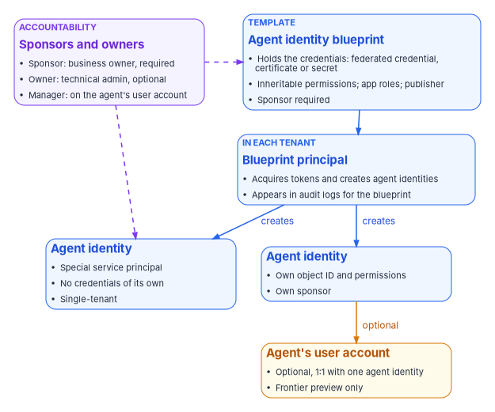

# Module 9: Govern AI agent identities {.unnumbered}

*Part of the [Non-Person Identity learning path](index.md). The guide's [AI agents](../../books/guides/non-person-identity-implementation.md#ai-agents) section. Workbook [Chapter 09](../../project-plans/developer-workbooks/non-person-identity/09-ai-agent-identities.md). About 65 minutes.*

**Watch:** the narrated deck for this module: [Deck](https://github.com/WhalerMike/modernization-workbook/releases/download/edition-2026.11.5/Training_NPI_Module_9.pptx) · [▶ Watch](../../presentations/watch.html?v=Training_NPI_Module_9_Narrated) (about 15 minutes, captions) · [MP4](https://github.com/WhalerMike/modernization-workbook/releases/download/videos-2026-10-23/Training_NPI_Module_9_Narrated.mp4) · [Script](https://github.com/WhalerMike/modernization-workbook/blob/main/presentations/training-npi-module-9/Training_NPI_Module_9_Narration_Script.md) · [Captions](https://github.com/WhalerMike/modernization-workbook/blob/main/presentations/training-npi-module-9/Training_NPI_Module_9_Narrated.vtt).

**Also:** the chapter's narrated tour, about 12 minutes: [▶ Watch](../../presentations/watch.html?v=DW_NPI_09_AI_Agent_Identities_Narrated).

## Introduction (3 minutes)

AI agents are non-person identities, and they follow every gate before this module. They add three things. An agent can act, so a sponsor who hasn't confirmed within ten business days of a handover makes it an orphan, an extra trigger on top of the program's disable-first orphan rule. A blueprint holds the credentials for every agent made from it, so one secret on it is every agent's secret. And by default the person who creates an agent becomes its sponsor and owner, so creation has to be gated.

In this module you check a fictional tenant's agents against the program's rules, and plan two report-only agent Conditional Access policies.

**The federal requirement.** The guide's [AI agents](../../books/guides/non-person-identity-implementation.md#ai-agents) section adds to the gates, and its [Evidence](../../books/guides/non-person-identity-implementation.md#evidence) table carries SCuBA MS.AAD.9.1v1 for risky agents. The workbook chapter's [Federal requirements and evidence](../../project-plans/developer-workbooks/non-person-identity/09-ai-agent-identities.md#federal-requirements-and-evidence) table has a row for every lab step.

| Requirement | KSI | Evidence |
|---|---|---|
| AC-2 Account Management; OMB M-25-21, section 3(b)(v) | KSI-IAM-SNU | `ai-identities.json`: sponsor, sponsoring group, technical owner and record for every AI identity |
| AC-2; AC-5 Separation of Duties | KSI-IAM-SNU; KSI-IAM-JIT (AC-5) | `findings.json`, NPI-AI-03 to -09 |
| IA-5(2); AC-6; AC-6(5) Privileged Accounts | KSI-IAM-SNU, KSI-SVC-ASM; KSI-IAM-ELP, KSI-IAM-JIT | `findings.json`, NPI-AI-10 to -15 |
| CM-8 System Component Inventory; AC-2(4) Automated Audit Actions | KSI-PIY-GIV (CM-8); KSI-MLA-LET, KSI-MLA-RVL (AC-2(4)) | `findings.json`, NPI-AI-21 to -23: no shadow AI identity |
| AC-3 Access Enforcement; SCuBA MS.AAD.9.1v1; CM-3 | KSI-IAM-ELP, KSI-IAM-JIT; KSI-CMT-LMC, KSI-CMT-RVP | `agent-ca-plan.json`; `results.json` and `manifest.json` from the dry run and the apply |
| SA-9 External System Services | KSI-SCR-MIT, KSI-SCR-MON | `config/agent-id-capabilities-ch09.json`; `Get-NpiAgentCapability` |

KSIs are FedRAMP 20x indicators for cloud service providers. The agency lines this evidence up with what its providers report against them; it doesn't report KSIs itself. Which file supports which indicator is the program's mapping *(design guidance)*. The guide's [Evidence](../../books/guides/non-person-identity-implementation.md#evidence) section explains both.

## Learning objectives (1 minute)

After this module, you'll be able to:

- describe a blueprint, an agent identity and a sponsor, and why the blueprint is the credential boundary;
- explain decision D-NP6 as data;
- run the AI identity check and read its findings, including the P1 drift;
- explain the ten-business-day sponsor rule and what happens to an orphaned agent;
- show that the agent Conditional Access plan is report-only and runs only by its approved hash.

## Prerequisites (1 minute)

- [Module 2](02-owners-and-the-orphan-rule.md): the lab reads Chapter 02's ownership run, which recorded the sponsor fields this chapter fills.
- [Module 6](06-conditional-access.md): Conditional Access for workload identities, report-only first.

## Unit 1: What the guide adds for agents (8 minutes)

Read the guide's [AI agents](../../books/guides/non-person-identity-implementation.md#ai-agents) section: sponsors and blueprints, gated creation, credentials, recertification by expiry, and availability by cloud. Then read:

- The guide's [Orphans](../../books/guides/non-person-identity-implementation.md#orphans): the program's disable-first rule, which Book 17 used for agents first.
- The guide's [Dangers](../../books/guides/non-person-identity-implementation.md#dangers) row "The agent built by whoever was there".

{#fig-ch04-agent-id-objects fig-alt="A diagram of Microsoft Entra Agent ID objects. A blue card labeled template, agent identity blueprint: holds the credentials, a federated credential, certificate or secret; inheritable permissions, app roles and publisher; sponsor required. An arrow leads down to a blue card labeled in each tenant, blueprint principal: acquires tokens and creates agent identities; appears in audit logs for the blueprint. Two arrows labeled creates lead to two blue agent identity cards. The first reads: special service principal; no credentials of its own; single-tenant. The second reads: own object ID and permissions; own sponsor. From the second, an amber arrow labeled optional leads to an amber card, agent's user account: optional, one to one with one agent identity; Frontier preview only. A violet card labeled accountability, sponsors and owners, lists: sponsor, business owner, required; owner, technical admin, optional; manager, on the agent's user account. Dashed violet arrows run from it to the blueprint and to an agent identity."}

## Unit 2: The rules as code (14 minutes)

Read the workbook chapter in this order:

- [What Microsoft Entra Agent ID is, and its stage](../../project-plans/developer-workbooks/non-person-identity/09-ai-agent-identities.md#what-microsoft-entra-agent-id-is-and-its-stage): which pieces are GA, which are preview, and what GCC lists.
- [Decision D-NP6 as data](../../project-plans/developer-workbooks/non-person-identity/09-ai-agent-identities.md#decision-d-np6-as-data): AgentId mode and Fallback mode.
- [The program's rules the code holds](../../project-plans/developer-workbooks/non-person-identity/09-ai-agent-identities.md#the-programs-rules-the-code-holds) *(design guidance)*.
- [The checks](../../project-plans/developer-workbooks/non-person-identity/09-ai-agent-identities.md#the-checks): NPI-AI-01 to -23, the ten business days, and standing privileged roles.
- [The agent Conditional Access plan and the separate write path](../../project-plans/developer-workbooks/non-person-identity/09-ai-agent-identities.md#the-agent-conditional-access-plan-and-the-separate-write-path).

## Exercise: Lab 1, fixtures, no tenant (25 minutes)

This is the workbook's [Chapter 09, Lab 1](../../project-plans/developer-workbooks/non-person-identity/09-ai-agent-identities.md#lab-1-fixtures-no-tenant), which explains each result. Its step 1 here makes Chapters 01 and 02's runs, so the chapter's steps 1 to 9 are steps 2 to 10 below. The tenant and its agents are fictional, and `-Apply` changes only a fake.

<!-- labs:begin lab-1-commands (generated by scripts/generate_labs.py; not part of the reviewed page) -->

::: {.callout-note #lab-1-commands collapse="false" title="Every command in Lab 1"}
Every command in this lab, in order. Each step below says what it does and what to look for.

```powershell
Set-Location C:\FMWLabs\non-person-identity-code\non-person-identity

$Run = "C:\FMWLabs\results\non-person-identity-09-ai-agent-identities\lab1\$(Get-Date -AsUTC -Format 'yyyy-MM-ddTHHmmssZ')"
New-Item -ItemType Directory -Path $Run -Force | Out-Null
$Run

# Step 1: Make Chapter 01's register and Chapter 02's ownership run
./Invoke-NpiInventory.ps1 -Cloud gcc -FixturePath tests/fixtures/estate.json -OutputPath "$Run\inventory"
./Invoke-NpiOwnership.ps1 -Cloud gcc -RegisterRun "$Run\inventory" -FixturePath tests/fixtures/estate.json -InputPath tests/fixtures/inputs -OutputPath "$Run\ownership"

# Step 2: Send Learn's samples to the fake
Invoke-Pester -Path tests/NpiAgentId.Tests.ps1 -FullNameFilter '*Learn*' -Output None -PassThru |
    Select-Object PassedCount, FailedCount, NotRunCount

# Step 3: List what each task needs
Import-Module ./powershell/NpiAgentId/NpiAgentId.psm1
foreach ($t in 'agent-id', 'agent-ca-apply') { $p = Get-NpiAgentRequiredPermission -Task $t; "$t : " + ($p.GraphPermissions -join ', ') }

# Step 4: Read D-NP6 for each cloud
'global','gcc' | ForEach-Object { $c = Get-NpiAgentCapability -Cloud $_
    [pscustomobject]@{ Cloud = $_; Mode = $c.Mode; AgentIdentities = $c.AgentIdentities.stage; AgentCA = $c.AgentConditionalAccess.stage; SponsorWorkflows = $c.SponsorWorkflows.stage } } | Format-Table

# Step 5: Check the AI identities and build the plan
./Invoke-NpiAgentId.ps1 -Cloud gcc -RegisterRun "$Run\inventory" -OwnershipRun "$Run\ownership" -FixturePath tests/fixtures/ch09/agent-estate.json -InputPath tests/fixtures/ch09/inputs -OutputPath "$Run\agent-id"

# Step 6: Read the findings
Get-Content "$Run\agent-id\findings.json" -Raw | ConvertFrom-Json | Where-Object Severity -eq 'Finding' | Group-Object Rule | Format-Table Name, Count

# Step 7: Read the sponsor fields Chapter 02 recorded, filled
Get-Content "$Run\agent-id\ai-identities.json" -Raw | ConvertFrom-Json | Format-Table Name, FederalSponsor, TechnicalOwner, InventoryRecord, Handshake, SponsorState | Out-String -Width 160

# Step 8: Dry-run the agent Conditional Access plan with its approved hash
$sha = (Get-FileHash "$Run\agent-id\agent-ca-plan.json" -Algorithm SHA256).Hash.ToLower()
./Invoke-NpiAgentCaAction.ps1 -Cloud gcc -PlanPath "$Run\agent-id\agent-ca-plan.json" -ApprovedSha256 $sha -FixturePath tests/fixtures/ch09/agent-estate.json -OutputPath "$Run\agent-ca-dryrun"

# Step 9: Apply it to the fake, then try a hash nobody approved
./Invoke-NpiAgentCaAction.ps1 -Cloud gcc -PlanPath "$Run\agent-id\agent-ca-plan.json" -ApprovedSha256 $sha -FixturePath tests/fixtures/ch09/agent-estate.json -OutputPath "$Run\agent-ca-apply" -Apply
try { ./Invoke-NpiAgentCaAction.ps1 -Cloud gcc -PlanPath "$Run\agent-id\agent-ca-plan.json" -ApprovedSha256 ('0' * 64) -FixturePath tests/fixtures/ch09/agent-estate.json -OutputPath "$Run\agent-ca-x" } catch { $_.Exception.Message }

# Step 10: Run the tests
Invoke-Pester -Path tests

# After the steps
Get-ChildItem C:\FMWLabs\results\non-person-identity-09-ai-agent-identities\lab1 -Name
```

:::

<!-- labs:end -->

Every step runs in PowerShell 7, so you can follow it top to bottom in one window. Open **PowerShell 7** from the Start menu, then go to the kit's folder, where you unzipped it under [Get the code](index.md#get-the-code):

```powershell
Set-Location C:\FMWLabs\non-person-identity-code\non-person-identity
```

Then make this run's results folder. Its name is the date and time you start, in UTC, so each run keeps its own results and running the lab again never overwrites them:

```powershell
$Run = "C:\FMWLabs\results\non-person-identity-09-ai-agent-identities\lab1\$(Get-Date -AsUTC -Format 'yyyy-MM-ddTHHmmssZ')"
New-Item -ItemType Directory -Path $Run -Force | Out-Null
$Run
```

Expected output, where `<run>` is your start time, such as `2026-11-25T143005Z`:

```text
C:\FMWLabs\results\non-person-identity-09-ai-agent-identities\lab1\<run>
```

The run's date is only the folder's name. The data's dates are the fixtures' own, which stay the same, so every run's results match this page. The results folder sits outside the kit, so unzipping a newer copy of the kit never touches it.

Prefer Git Bash? Every step is PowerShell 7: type `pwsh` to start it, then run the two blocks above. In a clone of the repository, use the `examples` folder of the same name.

1. **Make Chapter 01's register and Chapter 02's ownership run:**

    ```powershell
    ./Invoke-NpiInventory.ps1 -Cloud gcc -FixturePath tests/fixtures/estate.json -OutputPath "$Run\inventory"
    ./Invoke-NpiOwnership.ps1 -Cloud gcc -RegisterRun "$Run\inventory" -FixturePath tests/fixtures/estate.json -InputPath tests/fixtures/inputs -OutputPath "$Run\ownership"
    ```

    Expected output, Module 2's steps 1 and 4:

    ```text
    Register: 35 identities (AD 15, Entra 20); risk HIGH 8, LOW 19, MEDIUM 8
    Findings: 8 Finding, 11 Warn, 3 Info; 3 handed to the Data Platform plan
    Written to C:\FMWLabs\results\non-person-identity-09-ai-agent-identities\lab1\<run>\inventory (manifest.json: tenant c0ffee00-0000-4000-8000-000000000001, every request, a SHA-256 per file)
    Ownership: 22 identities checked; 7 orphan candidates
    Findings: 20 Finding, 3 Warn, 1 Info. AI sponsor fields recorded for Chapter 09: 2
    Orphan plan: 10 actions, 3 of them writes (1 AddOwner, 2 Disable); nothing sent
    Plan SHA-256: 1e1799d7181bd1a3dc271c645fff8a60fc741ab1ebc219bb3011cc25953bad3e
    ```

2. **Send Learn's samples to the fake:**

    ```powershell
    Invoke-Pester -Path tests/NpiAgentId.Tests.ps1 -FullNameFilter '*Learn*' -Output None -PassThru |
        Select-Object PassedCount, FailedCount, NotRunCount
    ```

    Expected output:

    ```text
    PassedCount FailedCount NotRunCount
    ----------- ----------- -----------
             12           0          49
    ```

3. **List what each task needs:**

    ```powershell
    Import-Module ./powershell/NpiAgentId/NpiAgentId.psm1
    foreach ($t in 'agent-id', 'agent-ca-apply') { $p = Get-NpiAgentRequiredPermission -Task $t; "$t : " + ($p.GraphPermissions -join ', ') }
    ```

    Expected output:

    ```text
    agent-id : AgentIdentity.Read.All, AgentIdentityBlueprint.Read.All, Application.Read.All, AuditLog.Read.All, CustomSecAttributeAssignment.Read.All, LifecycleWorkflows-Workflow.Read.All, LifecycleWorkflows-Workflow.ReadBasic.All, Policy.Read.All, RoleManagement.Read.Directory, User.Read.All
    agent-ca-apply : Policy.Read.All, Policy.ReadWrite.ConditionalAccess
    ```

    Ten read permissions for `agent-id`, none ending in `ReadWrite`. The write task is separate.

4. **Read D-NP6 for each cloud:**

    ```powershell
    'global','gcc' | ForEach-Object { $c = Get-NpiAgentCapability -Cloud $_
        [pscustomobject]@{ Cloud = $_; Mode = $c.Mode; AgentIdentities = $c.AgentIdentities.stage; AgentCA = $c.AgentConditionalAccess.stage; SponsorWorkflows = $c.SponsorWorkflows.stage } } | Format-Table
    ```

    Expected output:

    ```text
    Cloud  Mode    AgentIdentities AgentCA                        SponsorWorkflows
    -----  ----    --------------- -------                        ----------------
    global AgentId GA (April 2026) Preview (policy builder label) GA (May 2026)
    gcc    AgentId GA (April 2026) Preview (policy builder label) GA (May 2026)
    ```

5. **Check the AI identities and build the plan:**

    ```powershell
    ./Invoke-NpiAgentId.ps1 -Cloud gcc -RegisterRun "$Run\inventory" -OwnershipRun "$Run\ownership" -FixturePath tests/fixtures/ch09/agent-estate.json -InputPath tests/fixtures/ch09/inputs -OutputPath "$Run\agent-id"
    ```

    Expected output:

    ```text
    D-NP6 (Proposed): AgentId mode in cloud 'gcc'; agent Conditional Access Preview (policy builder label); agent risk Preview
    AI identities: 8 checked (4 AgentIdentity, 3 AgentIdentityBlueprint, 1 ServicePrincipal); Chapter 02 sponsor fields filled: 2 of 2
    Findings: 22 Finding (4 P1, 2 P2), 6 Warn, 4 Info. Orphan candidates for Chapter 02: 2
    Agent CA plan: Unapproved InPlace, HighRisk Create; nothing sent
    Plan SHA-256: 5a8002467655390a12ee9f8967a82d52e40234adf3a9a74ea37952b34b14073b
    ```

6. **Read the findings:**

    ```powershell
    Get-Content "$Run\agent-id\findings.json" -Raw | ConvertFrom-Json | Where-Object Severity -eq 'Finding' | Group-Object Rule | Format-Table Name, Count
    ```

    Expected output, 16 rules with Findings:

    ```text
    Name      Count
    ----      -----
    NPI-AI-05     1
    NPI-AI-06     1
    NPI-AI-07     2
    NPI-AI-08     1
    NPI-AI-09     4
    NPI-AI-10     2
    NPI-AI-12     1
    NPI-AI-13     1
    NPI-AI-14     1
    NPI-AI-15     1
    NPI-AI-16     1
    NPI-AI-17     1
    NPI-AI-20     1
    NPI-AI-21     1
    NPI-AI-22     2
    NPI-AI-23     1
    ```

    Look for these: NPI-AI-10 twice (Case Triage Blueprint's secret, and Correspondence Drafting's app registration), NPI-AI-13 once (Case Triage Blueprint inherits all Graph roles), NPI-AI-16 once (Records Search: its sponsor left on October 9 and nobody confirmed by October 26), and the P1 drift, NPI-AI-21, NPI-AI-22 twice and NPI-AI-23. Benefits Q&A Agent and its blueprint pass every rule.

7. **Read the sponsor fields Chapter 02 recorded, filled.** `Out-String -Width 160` keeps the last column whole in a narrow window:

    ```powershell
    Get-Content "$Run\agent-id\ai-identities.json" -Raw | ConvertFrom-Json | Format-Table Name, FederalSponsor, TechnicalOwner, InventoryRecord, Handshake, SponsorState | Out-String -Width 160
    ```

    Expected output, eight rows:

    ```text
    Name                     FederalSponsor        TechnicalOwner        InventoryRecord Handshake      SponsorState
    ----                     --------------        --------------        --------------- ---------      ------------
    Benefits Q&A Agent       erin@contoso.example  alice@contoso.example CMDB-4001       HS-001         None
    Case Triage Agent        carol@contoso.example carol@contoso.example CMDB-4002       HS-002         AwaitingConfirmation until 2026-11-10
    Records Search Agent     carol@contoso.example alice@contoso.example CMDB-4003       HS-003         Orphaned
    Sandbox Helper                                 alice@contoso.example                                None
    Benefits Agent Blueprint erin@contoso.example  alice@contoso.example CMDB-4001       HS-001; HS-003
    Case Triage Blueprint    carol@contoso.example carol@contoso.example CMDB-4002       HS-002
    Pilot Sandbox Blueprint                        alice@contoso.example
    Correspondence Drafting  erin@contoso.example  alice@contoso.example CMDB-1100       HS-004         None
    ```

    Case Triage Agent has `carol@contoso.example` as both sponsor and technical owner. Records Search Agent is `Orphaned`. Sandbox Helper has no sponsor, record or handshake.

8. **Dry-run the agent Conditional Access plan with its approved hash:**

    ```powershell
    $sha = (Get-FileHash "$Run\agent-id\agent-ca-plan.json" -Algorithm SHA256).Hash.ToLower()
    ./Invoke-NpiAgentCaAction.ps1 -Cloud gcc -PlanPath "$Run\agent-id\agent-ca-plan.json" -ApprovedSha256 $sha -FixturePath tests/fixtures/ch09/agent-estate.json -OutputPath "$Run\agent-ca-dryrun"
    ```

    Expected output:

    ```text
    DryRun: 1 WouldSend
      WouldSend HighRisk POST https://graph.microsoft.com/beta/identity/conditionalAccess/policies
    ```

9. **Apply it to the fake, then try a hash nobody approved.** The refusal is an error; `try` and `catch` print its message and keep the window going:

    ```powershell
    ./Invoke-NpiAgentCaAction.ps1 -Cloud gcc -PlanPath "$Run\agent-id\agent-ca-plan.json" -ApprovedSha256 $sha -FixturePath tests/fixtures/ch09/agent-estate.json -OutputPath "$Run\agent-ca-apply" -Apply
    try { ./Invoke-NpiAgentCaAction.ps1 -Cloud gcc -PlanPath "$Run\agent-id\agent-ca-plan.json" -ApprovedSha256 ('0' * 64) -FixturePath tests/fixtures/ch09/agent-estate.json -OutputPath "$Run\agent-ca-x" } catch { $_.Exception.Message }
    ```

    Expected output:

    ```text
    Apply: 1 Sent
      Sent HighRisk Created ca000000-0000-4000-8000-000000000103 report-only; review its report-only results before any change of state
    The plan's SHA-256 is 5a8002467655390a12ee9f8967a82d52e40234adf3a9a74ea37952b34b14073b, not the approved 0000000000000000000000000000000000000000000000000000000000000000; refusing to run a plan nobody reviewed.
    ```

10. **Run the tests:**

    ```powershell
    Invoke-Pester -Path tests
    ```

    It prints a line for each test file, with the time it took, then this last line:

    ```text
    Tests Passed: 564, Failed: 0, Skipped: 0, Inconclusive: 0, NotRun: 0
    ```

Nothing to clean up: the kit's folder is as you unzipped it, and this run's results stay in `$Run`. List every run you've made of this lab:

```powershell
Get-ChildItem C:\FMWLabs\results\non-person-identity-09-ai-agent-identities\lab1 -Name
```

Expected output: one line per run, oldest first, the last one this run:

```text
<run>
```

## Exercise: Lab 2, your test tenant (5 minutes to read)

*Not run by the authors.* Follow the workbook's [Chapter 09, Lab 2](../../project-plans/developer-workbooks/non-person-identity/09-ai-agent-identities.md#lab-2-test-tenant). It has the exact commands.

- **You need:** a test tenant in the worldwide or GCC cloud, never production, with fictional people, licensed for Agent 365 (or Microsoft 365 E7) with Entra ID P1, and P2 for agent risk; and Chapters 01 and 02's Lab 2 runs.
- **What you do:** read and set **Users can create agent blueprints** to No, make one governed agent with a sponsor who isn't its owner and a managed identity as its credential, run the check with an app holding only the `agent-id` permissions, then dry-run and apply the plan as a person with Conditional Access Administrator.
- **Back-out:** step 6, as a person in the admin center: delete the two policies, remove the attribute, disable then delete the test agent identity and blueprint, set the creation setting back if the tenant needs it, and delete the `out` folders. The code deletes nothing.

## Knowledge check (5 minutes)

1. Why is a client secret on a production blueprint a Finding?
    a. Secrets can't be read in GCC
    b. The blueprint holds the credentials for every agent made from it, so one leaked secret is every agent's
    c. Blueprints can't hold certificates
    d. A secret makes the agent multitenant
2. A sponsor leaves. When does the agent become orphaned?
    a. At once
    b. After 30 days
    c. When the new sponsor hasn't confirmed within ten business days
    d. When its credential expires
3. Why is inheritance set to `allAllowed` for application roles a Finding?
    a. Any future grant to the blueprint becomes a grant to every agent
    b. It blocks token issuance
    c. It's a preview feature
    d. It turns off Conditional Access
4. What state does the agent Conditional Access write path create policies in?
    a. On
    b. Off
    c. Report-only, with Block as the only grant; it never turns a policy on
    d. Whatever the plan file says

::: {.callout-tip collapse="true"}
## Check your answers
1. **b.** Taught in the guide's [AI agents](../../books/guides/non-person-identity-implementation.md#ai-agents) section and the chapter's [Dangers](../../project-plans/developer-workbooks/non-person-identity/09-ai-agent-identities.md#dangers).
2. **c.** Taught in [The program's rules the code holds](../../project-plans/developer-workbooks/non-person-identity/09-ai-agent-identities.md#the-programs-rules-the-code-holds) and [The checks](../../project-plans/developer-workbooks/non-person-identity/09-ai-agent-identities.md#the-checks).
3. **a.** Taught in [The program's rules the code holds](../../project-plans/developer-workbooks/non-person-identity/09-ai-agent-identities.md#the-programs-rules-the-code-holds).
4. **c.** Taught in [The agent Conditional Access plan and the separate write path](../../project-plans/developer-workbooks/non-person-identity/09-ai-agent-identities.md#the-agent-conditional-access-plan-and-the-separate-write-path).
:::

## Summary (2 minutes)

You checked eight fictional AI identities, filled the sponsor fields Chapter 02 recorded, found an orphaned agent and four P1 drift findings, and applied a report-only agent policy to a fake by its approved hash.

**The evidence an ISSO keeps** from this module: `ai-identities.json`, `findings.json`, `orphan-candidates.json`, `agent-ca-plan.json` with its approved SHA-256, and the dry-run and apply folders' `results.json` and `manifest.json`, dated; the capability table for D-NP6; and the test result. Before shipping, work through the chapter's [Checklist](../../project-plans/developer-workbooks/non-person-identity/09-ai-agent-identities.md#checklist).

**Next:** [Module 10: Find drift and file the evidence](10-drift-and-evidence.md).
