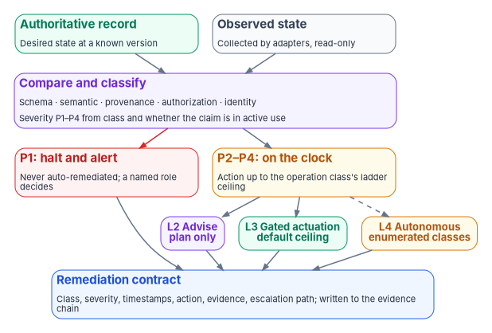

# Module 10: Find drift and file the evidence {.unnumbered}

*Part of the [Non-Person Identity learning path](index.md). Gate G6 Lifecycle. Workbook [Chapter 10](../../project-plans/developer-workbooks/non-person-identity/10-drift-and-evidence.md). About 75 minutes.*

**Watch:** the narrated deck for this module: [Deck](https://github.com/WhalerMike/modernization-workbook/releases/download/edition-2026.11.5/Training_NPI_Module_10.pptx) · [▶ Watch](../../presentations/watch.html?v=Training_NPI_Module_10_Narrated) (about 16 minutes, captions) · [MP4](https://github.com/WhalerMike/modernization-workbook/releases/download/videos-2026-10-23/Training_NPI_Module_10_Narrated.mp4) · [Script](https://github.com/WhalerMike/modernization-workbook/blob/main/presentations/training-npi-module-10/Training_NPI_Module_10_Narration_Script.md) · [Captions](https://github.com/WhalerMike/modernization-workbook/blob/main/presentations/training-npi-module-10/Training_NPI_Module_10_Narrated.vtt).

**Also:** the chapter's narrated tour, about 11 minutes: [▶ Watch](../../presentations/watch.html?v=DW_NPI_10_Drift_Evidence_Narrated).

## Introduction (3 minutes)

Every gate before this one ends in a state: an owner, a target, a credential, a scope. This module keeps that state true. A credential added by hand, a new consent grant, an app nobody has used in 90 days or an owner who left all show up as drift against a baseline someone approved.

Then the evidence has to reach the ISSO in a form they can trust without trusting you. Each run is packaged with a SHA-256 for every file and chained to the one before. The ISSO checks a package with `sha256sum` alone, and a period summary shows whether the checks ran every day with no gap.

**The federal requirement.** The guide's [Validate (G6 Lifecycle)](../../books/guides/non-person-identity-implementation.md#step-6-run-the-lifecycle) step names AC-2(3), AC-6(7), AU-6 and CA-7, with KSIs KSI-IAM-AAM, KSI-MLA-RVL and KSI-MLA-EVC. The workbook chapter's [Federal requirements and evidence](../../project-plans/developer-workbooks/non-person-identity/10-drift-and-evidence.md#federal-requirements-and-evidence) table has a row for every lab step.

| Requirement | KSI | Evidence |
|---|---|---|
| CM-2 Baseline Configuration; CM-3 | KSI-CMT-RMV, KSI-MLA-EVC, KSI-SVC-ACM (CM-2); KSI-CMT-RVP (CM-3) | `drift/baseline-candidate.json` and the approved SHA-256 |
| CA-7 Continuous Monitoring; AC-2 | KSI-MLA-EVC (CA-7); KSI-IAM-SNU (AC-2) | `drift/findings.json`, NPI-DRF-01 to -06 |
| AC-2(4); AU-6; SI-4 System Monitoring | KSI-MLA-LET, KSI-MLA-RVL; KSI-IAM-SUS (SI-4) | `drift/events.json`; NPI-DRF-07 and -08 |
| AC-2(3) Disable Accounts | KSI-IAM-AAM | `drift/signin-activity.json`; NPI-DRF-04 |
| AC-6(7) Review of User Privileges | KSI-IAM-AAM, KSI-IAM-JIT | `drift/review-cycle.json`; NPI-REV-01 to -04 |
| AU-9; SI-7 | KSI-MLA-OSM (AU-9); KSI-SVC-VRI (SI-7) | `EVIDENCE-MANIFEST.json`, `SHA256SUMS`, `summary.md`; `PERIOD-MANIFEST.json` |

KSIs are FedRAMP 20x indicators for cloud service providers. The agency lines this evidence up with what its providers report against them; it doesn't report KSIs itself. Which file supports which indicator is the program's mapping *(design guidance)*. The guide's [Evidence](../../books/guides/non-person-identity-implementation.md#evidence) section explains both.

## Learning objectives (1 minute)

After this module, you'll be able to:

- explain why the drift run compares with a baseline only when a reviewer approved its SHA-256;
- read the drift findings, and say when a credential counts as added inside the pipeline;
- compare two AI use-case inventory vintages against the register;
- package two runs, chained, verify a package with `sha256sum`, and assemble a period for the ISSO;
- show that an edited file and a package chained out of order are both refused.

## Prerequisites (1 minute)

- [Module 1](01-inventory.md) and [Module 2](02-owners-and-the-orphan-rule.md): the drift run runs Chapters 01 and 02 unchanged.
- [Module 4](04-credential-rules.md): the rotation pipeline's credential log decides what counts as inside the pipeline.
- [Module 9](09-ai-agent-identities.md), for the sponsor attestations and the vintage comparison.

## Unit 1: The gate and the evidence (8 minutes)

Read the guide's [Step 6](../../books/guides/non-person-identity-implementation.md#step-6-run-the-lifecycle): owner change, orphans, access reviews of owners, and disable first, then delete. Then read the guide's [Evidence](../../books/guides/non-person-identity-implementation.md#evidence) section: run the checks on the continuous monitoring cadence and file their output with the date, the tenant and the check version.

## Unit 2: Drift against an approved baseline (12 minutes)

Read the workbook chapter in this order:

- [What the evidence has to show](../../project-plans/developer-workbooks/non-person-identity/10-drift-and-evidence.md#what-the-evidence-has-to-show): state, events and drift.
- [The approved baseline](../../project-plans/developer-workbooks/non-person-identity/10-drift-and-evidence.md#the-approved-baseline): a fingerprint over 20 governance columns.
- [The register drift findings](../../project-plans/developer-workbooks/non-person-identity/10-drift-and-evidence.md#the-register-drift-findings): NPI-DRF-01 to -09, and what "inside the pipeline" means.
- [The review cycle](../../project-plans/developer-workbooks/non-person-identity/10-drift-and-evidence.md#the-review-cycle) and [the annual vintage comparison](../../project-plans/developer-workbooks/non-person-identity/10-drift-and-evidence.md#the-annual-vintage-comparison).

{#fig-ch06-drift-pipeline fig-alt="At the top, a green authoritative record card, desired state at a known version, and a slate observed state card, collected by adapters, read-only, both feed a violet compare and classify card: schema, semantic, provenance, authorization or identity, with severity P1 to P4 from the class and whether the claim is in active use. From it a red arrow leads to a red card, P1 halt and alert, never auto-remediated, a named role decides; and another arrow leads to an amber card, P2 to P4 on the clock, action up to the operation class's ladder ceiling. The amber card branches to three pills: L2 Advise, plan only; L3 Gated actuation, the default ceiling; and with a dashed arrow L4 Autonomous, enumerated classes only. The P1 card and all three pills lead to a blue remediation contract card: class, severity, timestamps, action, evidence and escalation path, written to the evidence chain."}

## Unit 3: What the ISSO receives (8 minutes)

- [The package and the chain](../../project-plans/developer-workbooks/non-person-identity/10-drift-and-evidence.md#the-package-and-the-chain): what the packager checks before it writes, and why it doesn't sign.
- [What the ISSO receives](../../project-plans/developer-workbooks/non-person-identity/10-drift-and-evidence.md#what-the-isso-receives): the period, the controls table and the Gate 7 table.

## Exercise: Lab 1, fixtures, no tenant (30 minutes)

This is the workbook's [Chapter 10, Lab 1](../../project-plans/developer-workbooks/non-person-identity/10-drift-and-evidence.md#lab-1-fixtures-no-tenant), which explains each result. Steps 1 to 6 run in the kit's folder, steps 7 to 10 in the `drift-pipeline` folder beside it, and step 11 in both, all in PowerShell 7. The tenant is fictional.

<!-- labs:begin lab-1-commands (generated by scripts/generate_labs.py; not part of the reviewed page) -->

::: {.callout-note #lab-1-commands collapse="false" title="Every command in Lab 1"}
Every command in this lab, in order. Each step below says what it does and what to look for.

```powershell
Set-Location C:\FMWLabs\non-person-identity-code\non-person-identity

$Run = "C:\FMWLabs\results\non-person-identity-10-drift-and-evidence\lab1\$(Get-Date -AsUTC -Format 'yyyy-MM-ddTHHmmssZ')"
New-Item -ItemType Directory -Path $Run -Force | Out-Null
$Run

# Step 1: Run Microsoft's rule over the fixture
Invoke-Pester -Path tests/NpiDrift.Tests.ps1 -FullNameFilter '*as published*' -Output None -PassThru |
    Select-Object PassedCount, FailedCount, NotRunCount

# Step 2: List what the run needs
Import-Module ./powershell/NpiDrift/NpiDrift.psm1
(Get-NpiDriftPermission -Task drift-run).GraphPermissions -join ', '

# Step 3: Run the first day, with no baseline
$lab = @{ Cloud = 'gcc'; TenantId = 'c0ffee00-0000-4000-8000-000000000001'; OutputPath = "$Run\runs"; InputPath = 'tests/fixtures/inputs'
    AuditFixturePath = 'tests/fixtures/ch10/audit.json'; SignInFixturePath = 'tests/fixtures/ch10/signin-activity.json'
    ContractPath = 'tests/fixtures/ch10/contract'; PipelineIdentitiesPath = 'tests/fixtures/ch10/inputs/pipeline-identities.csv' }
./Invoke-NpiDriftRun.ps1 @lab -FixturePath tests/fixtures/ch10/estate-day1.json -AsOf 2026-10-29T06:00:00Z

# Step 4: Approve the baseline and run the second day
$base = "$Run\runs\2026-10-29T0600Z-fixture\drift\baseline-candidate.json"
$sha = (Get-FileHash $base -Algorithm SHA256).Hash.ToLower()
./Invoke-NpiDriftRun.ps1 @lab -FixturePath tests/fixtures/ch10/estate-day2.json -AsOf 2026-10-30T06:00:00Z -BaselinePath $base -ApprovedBaselineSha256 $sha

# Step 5: Read the drift
Get-Content "$Run\runs\2026-10-30T0600Z-fixture\drift\findings.json" -Raw | ConvertFrom-Json | Group-Object Rule, Severity | Sort-Object Name | Format-Table Name, Count

# Step 6: Compare the AI use-case inventory vintages
./Invoke-NpiVintage.ps1 -RegisterRun "$Run\runs\2026-10-30T0600Z-fixture\inventory" -Vintage 2026 `
    -CurrentPath tests/fixtures/ch10/vintage/ai-inventory-2026.csv -PriorPath tests/fixtures/ch10/vintage/ai-inventory-2025.csv `
    -UseCaseMapPath tests/fixtures/ch10/vintage/ai-use-cases.csv -ServiceRecordsPath tests/fixtures/inputs/service-records.csv -OutputPath "$Run\vintage"

# Step 7: Package both days, chained
Set-Location C:\FMWLabs\non-person-identity-code\drift-pipeline
$env:PYTHONDONTWRITEBYTECODE = '1'
$day1 = 'tests/fixtures/npi-runs/2026-10-29T0600Z-fixture'
$day2 = 'tests/fixtures/npi-runs/2026-10-30T0600Z-fixture'
python python/npi_evidence.py package --run $day1 --out "$Run\evidence"
python python/npi_evidence.py package --run $day2 --previous-manifest "$Run\evidence\2026-10-29T0600Z-fixture\EVIDENCE-MANIFEST.json" --out "$Run\evidence"

# Step 8: Verify the second package
$pkg = "$Run\evidence\2026-10-30T0600Z-fixture"
python python/npi_evidence.py verify $pkg
Get-Content "$pkg\SHA256SUMS" | Where-Object { $_ } | ForEach-Object { $hash, $file = $_ -split '\s+\*?', 2
    if ((Get-FileHash (Join-Path $pkg $file) -Algorithm SHA256).Hash.ToLower() -ne $hash) { "FAILED: $file" } }
"SHA256SUMS checked: $((Get-Content "$pkg\SHA256SUMS" | Where-Object { $_ }).Count) file(s)"
(Select-String -Path "$pkg\summary.md" -Pattern contoso).Count

# Step 9: Assemble the period for the ISSO, with the vintage
python python/npi_evidence.py period --evidence "$Run\evidence" --since 2026-10-28T06:00:00Z --until 2026-10-30T06:00:00Z --vintage tests/fixtures/npi-vintage/vintage-2026 --out "$Run\periods"
"Exit code: $LASTEXITCODE"
Get-Content "$Run\periods\period-2026-10-28_2026-10-30\period-summary.md"

# Step 10: Break it on purpose
Add-Content "$pkg\summary.md" 'edited'
python python/npi_evidence.py verify $pkg 2>&1
"Exit code: $LASTEXITCODE"
python python/npi_evidence.py package --run $day1 --previous-manifest "$pkg\EVIDENCE-MANIFEST.json" --out "$Run\swap" 2>&1
"Exit code: $LASTEXITCODE"
python python/workflow_lint.py workflow/npi-evidence.yml

# Step 11: Run the tests
Set-Location C:\FMWLabs\non-person-identity-code\non-person-identity
Invoke-Pester -Path tests
Set-Location C:\FMWLabs\non-person-identity-code\drift-pipeline
python -m pytest tests -q -p no:cacheprovider --ignore=tests/test_hr_evidence.py

# After the steps
Get-ChildItem C:\FMWLabs\results\non-person-identity-10-drift-and-evidence\lab1 -Name
```

:::

<!-- labs:end -->

Every step runs in PowerShell 7, so you can follow it top to bottom in one window. Open **PowerShell 7** from the Start menu, then go to the kit's folder, where you unzipped it under [Get the code](index.md#get-the-code):

```powershell
Set-Location C:\FMWLabs\non-person-identity-code\non-person-identity
```

Then make this run's results folder. Its name is the date and time you start, in UTC, so each run keeps its own results and running the lab again never overwrites them:

```powershell
$Run = "C:\FMWLabs\results\non-person-identity-10-drift-and-evidence\lab1\$(Get-Date -AsUTC -Format 'yyyy-MM-ddTHHmmssZ')"
New-Item -ItemType Directory -Path $Run -Force | Out-Null
$Run
```

Expected output, where `<run>` is your start time, such as `2026-11-25T143005Z`:

```text
C:\FMWLabs\results\non-person-identity-10-drift-and-evidence\lab1\<run>
```

The run's date is only the folder's name. The data's dates are the fixtures' own, which stay the same, so every run's results match this page. The results folder sits outside the kit, so unzipping a newer copy of the kit never touches it.

Prefer Git Bash? Every step is PowerShell 7: type `pwsh` to start it, then run the two blocks above. In a clone of the repository, use the `examples` folders of the same names.

1. **Run Microsoft's rule over the fixture:**

    ```powershell
    Invoke-Pester -Path tests/NpiDrift.Tests.ps1 -FullNameFilter '*as published*' -Output None -PassThru |
        Select-Object PassedCount, FailedCount, NotRunCount
    ```

    Expected output:

    ```text
    PassedCount FailedCount NotRunCount
    ----------- ----------- -----------
             11           0          40
    ```

2. **List what the run needs:**

    ```powershell
    Import-Module ./powershell/NpiDrift/NpiDrift.psm1
    (Get-NpiDriftPermission -Task drift-run).GraphPermissions -join ', '
    ```

    Expected output:

    ```text
    Application.Read.All, AuditLog.Read.All, Directory.Read.All, User.Read.All
    ```

    Nothing ends in `ReadWrite`.

3. **Run the first day, with no baseline:**

    ```powershell
    $lab = @{ Cloud = 'gcc'; TenantId = 'c0ffee00-0000-4000-8000-000000000001'; OutputPath = "$Run\runs"; InputPath = 'tests/fixtures/inputs'
        AuditFixturePath = 'tests/fixtures/ch10/audit.json'; SignInFixturePath = 'tests/fixtures/ch10/signin-activity.json'
        ContractPath = 'tests/fixtures/ch10/contract'; PipelineIdentitiesPath = 'tests/fixtures/ch10/inputs/pipeline-identities.csv' }
    ./Invoke-NpiDriftRun.ps1 @lab -FixturePath tests/fixtures/ch10/estate-day1.json -AsOf 2026-10-29T06:00:00Z
    ```

    Expected output:

    ```text
    Run 2026-10-29T0600Z-fixture (Fixture, gcc): inventory OK, ownership OK, drift OK
    Audit window 2026-10-28T06:00:00Z to 2026-10-29T06:00:00Z; baseline none: this run is a baseline candidate
    Drift findings: 14 Finding, 4 Warn, 5 Info; baseline candidate SHA-256 604ee088ae43a964072671234833aeb71bccd082fa9ce4032a55d2fc4b146cc8
    Written to C:\FMWLabs\results\non-person-identity-10-drift-and-evidence\lab1\<run>\runs\2026-10-29T0600Z-fixture (run.json lists each task's manifest hash)
    ```

    The run folder's name, `2026-10-29T0600Z-fixture`, is the data's date, from `-AsOf`.

4. **Approve the baseline and run the second day:**

    ```powershell
    $base = "$Run\runs\2026-10-29T0600Z-fixture\drift\baseline-candidate.json"
    $sha = (Get-FileHash $base -Algorithm SHA256).Hash.ToLower()
    ./Invoke-NpiDriftRun.ps1 @lab -FixturePath tests/fixtures/ch10/estate-day2.json -AsOf 2026-10-30T06:00:00Z -BaselinePath $base -ApprovedBaselineSha256 $sha
    ```

    Expected output:

    ```text
    Run 2026-10-30T0600Z-fixture (Fixture, gcc): inventory OK, ownership OK, drift OK
    Audit window 2026-10-29T06:00:00Z to 2026-10-30T06:00:00Z; baseline 2026-10-29T0600Z-fixture (604ee088ae43…)
    Drift findings: 18 Finding, 11 Warn, 5 Info; baseline candidate SHA-256 fbe346457c070d6bb7de0fbb43f35d54315b42d46e6ba26b245d33efa6dc840c
    Written to C:\FMWLabs\results\non-person-identity-10-drift-and-evidence\lab1\<run>\runs\2026-10-30T0600Z-fixture (run.json lists each task's manifest hash)
    ```

    In a real run, a second person reviews the candidate and passes you its hash.

5. **Read the drift:**

    ```powershell
    Get-Content "$Run\runs\2026-10-30T0600Z-fixture\drift\findings.json" -Raw | ConvertFrom-Json | Group-Object Rule, Severity | Sort-Object Name | Format-Table Name, Count
    ```

    Expected output, twelve rows:

    ```text
    Name                Count
    ----                -----
    NPI-DRF-01, Warn        2
    NPI-DRF-02, Warn        6
    NPI-DRF-03, Finding     7
    NPI-DRF-04, Warn        2
    NPI-DRF-06, Finding     3
    NPI-DRF-07, Finding     3
    NPI-DRF-08, Finding     1
    NPI-DRF-09, Info        5
    NPI-DRF-09, Warn        1
    NPI-REV-01, Finding     2
    NPI-REV-02, Finding     1
    NPI-REV-03, Finding     1
    ```

    `NPI-DRF-07, Finding 3` holds the three credentials added outside the pipeline. The pipeline's two certificate rotations aren't there: both are by a listed identity and in the credential log. `NPI-DRF-08, Finding 1` is Mail Automation's new grant for all users.

6. **Compare the AI use-case inventory vintages:**

    ```powershell
    ./Invoke-NpiVintage.ps1 -RegisterRun "$Run\runs\2026-10-30T0600Z-fixture\inventory" -Vintage 2026 `
        -CurrentPath tests/fixtures/ch10/vintage/ai-inventory-2026.csv -PriorPath tests/fixtures/ch10/vintage/ai-inventory-2025.csv `
        -UseCaseMapPath tests/fixtures/ch10/vintage/ai-use-cases.csv -ServiceRecordsPath tests/fixtures/inputs/service-records.csv -OutputPath "$Run\vintage"
    ```

    Expected output:

    ```text
    Vintage 2026: 5 changes (1 AuthorizationChanged, 1 Left, 2 New, 1 Retired); findings 3 Finding, 2 Warn, 1 Info
    Written to C:\FMWLabs\results\non-person-identity-10-drift-and-evidence\lab1\<run>\vintage\vintage-2026 (manifest.json: tenant c0ffee00-0000-4000-8000-000000000001, the register's and each input's SHA-256)
    ```

7. **Package both days, chained.** Steps 7 to 10 run in the `drift-pipeline` folder beside the kit, in the same window. `PYTHONDONTWRITEBYTECODE` stops Python writing cache files into the kit's folder. The runs are the kit's copies of the two you just made:

    ```powershell
    Set-Location C:\FMWLabs\non-person-identity-code\drift-pipeline
    $env:PYTHONDONTWRITEBYTECODE = '1'
    $day1 = 'tests/fixtures/npi-runs/2026-10-29T0600Z-fixture'
    $day2 = 'tests/fixtures/npi-runs/2026-10-30T0600Z-fixture'
    python python/npi_evidence.py package --run $day1 --out "$Run\evidence"
    python python/npi_evidence.py package --run $day2 --previous-manifest "$Run\evidence\2026-10-29T0600Z-fixture\EVIDENCE-MANIFEST.json" --out "$Run\evidence"
    ```

    Expected output, two lines of JSON:

    ```text
    {"evidence_manifest_sha256": "12532bfb598dc4303f1d60aa7dba1c401b055d36aa666b5893890a2666f09e32", "new": 62, "open": 62, "package": "2026-10-29T0600Z-fixture", "resolved": 0}
    {"evidence_manifest_sha256": "7676170f011129acd75a888fe8625acdc32297cf87c49ffbbd6a4e558375fc80", "new": 19, "open": 80, "package": "2026-10-30T0600Z-fixture", "resolved": 1}
    ```

8. **Verify the second package.** The second command checks every line of `SHA256SUMS` against the file it names and prints any that fail; the last counts the user principal names in the summary:

    ```powershell
    $pkg = "$Run\evidence\2026-10-30T0600Z-fixture"
    python python/npi_evidence.py verify $pkg
    Get-Content "$pkg\SHA256SUMS" | Where-Object { $_ } | ForEach-Object { $hash, $file = $_ -split '\s+\*?', 2
        if ((Get-FileHash (Join-Path $pkg $file) -Algorithm SHA256).Hash.ToLower() -ne $hash) { "FAILED: $file" } }
    "SHA256SUMS checked: $((Get-Content "$pkg\SHA256SUMS" | Where-Object { $_ }).Count) file(s)"
    (Select-String -Path "$pkg\summary.md" -Pattern contoso).Count
    ```

    Expected output:

    ```text
    {"evidence_manifest_sha256": "7676170f011129acd75a888fe8625acdc32297cf87c49ffbbd6a4e558375fc80", "files": 21, "run_id": "2026-10-30T0600Z-fixture"}
    SHA256SUMS checked: 21 file(s)
    0
    ```

    No `FAILED` line, and `0`: no user principal name in the summary.

9. **Assemble the period for the ISSO, with the vintage:**

    ```powershell
    python python/npi_evidence.py period --evidence "$Run\evidence" --since 2026-10-28T06:00:00Z --until 2026-10-30T06:00:00Z --vintage tests/fixtures/npi-vintage/vintage-2026 --out "$Run\periods"
    "Exit code: $LASTEXITCODE"
    Get-Content "$Run\periods\period-2026-10-28_2026-10-30\period-summary.md"
    ```

    Expected output:

    ```text
    {"chain_breaks": 0, "closed": 1, "complete": false, "coverage_gaps": 0, "opened": 19, "packages": 2, "period": "period-2026-10-28_2026-10-30"}
    Exit code: 2
    # Non-person identity evidence for the period

    Period 2026-10-28T06:00:00Z to 2026-10-30T06:00:00Z; tenant c0ffee00-0000-4000-8000-000000000001 (gcc, Fixture); 2 package(s), chain breaks 0, coverage gaps 0, unverified task runs 0. Findings opened 19, closed 1, open at the end 85.

    | Control | Open findings | Open warnings | Status |
    |---|---|---|---|
    | AC-2 Account Management | 20 | 15 | evidence incomplete: Chapter 03 |
    | AC-6(5) Least Privilege, Privileged Accounts | 12 | 2 | evidence present; the assessor decides |
    | IA-4 Identifier Management | 11 | 3 | evidence present; the assessor decides |
    | IA-5 Authenticator Management | 6 | 8 | evidence incomplete: Chapter 04, Chapter 06 |
    | IA-9 Service Identification and Authentication | 3 | 0 | evidence incomplete: Chapter 05, Chapter 08 |
    | M-25-21 AI use-case inventory and governance (OMB) | 5 | 3 | evidence present; the assessor decides |

    | Gate 7 criterion | From this code | Status |
    |---|---|---|
    | Every service account and service principal has an owner and sponsor, a reason and a target | ownerless 7 (NPI-DRF-03); agents without a sponsor attestation 1; Chapter 03 decisions not received | not decided by this code (Chapter 03) |
    | None holds a password that never expires | 3 enabled AD account(s) (NPI-DRF-06) | not met |
    | None is orphaned | 7 orphan candidate(s) (NPI-DRF-03) | not met |
    | Drift checks and review cycles running | 2 package(s), coverage gaps 0, chain breaks 0, unverified task runs 0; review records missing 0, review findings 4 | not met |
    | Every remaining gMSA and dMSA moved or in the dated Kerberos island | Chapter 06 findings not received | not decided by this code (Chapter 06) |

    | Package | Audit window | EVIDENCE-MANIFEST.json SHA-256 |
    |---|---|---|
    | 2026-10-29T0600Z-fixture | 2026-10-28T06:00:00Z to 2026-10-29T06:00:00Z | `12532bfb598dc4303f1d60aa7dba1c401b055d36aa666b5893890a2666f09e32` |
    | 2026-10-30T0600Z-fixture | 2026-10-29T06:00:00Z to 2026-10-30T06:00:00Z | `7676170f011129acd75a888fe8625acdc32297cf87c49ffbbd6a4e558375fc80` |

    AI use-case inventory vintage 2026: 5 open finding(s); manifest SHA-256 `4146b751be8a8c96fcacac4bb4ad131f878f70f16fc6f12313b8cf09bfb08a96`.

    Object keys and fingerprints only. The packages hold the names, under the evidence store's access control. The control mapping is the program's (design guidance); the assessor and the authorizing official decide each control.
    ```

    It exits `2`: the period isn't complete. The summary shows AC-2 incomplete without Chapter 03's findings.

10. **Break it on purpose.** `2>&1` prints each error in order, before its exit code:

    ```powershell
    Add-Content "$pkg\summary.md" 'edited'
    python python/npi_evidence.py verify $pkg 2>&1
    "Exit code: $LASTEXITCODE"
    python python/npi_evidence.py package --run $day1 --previous-manifest "$pkg\EVIDENCE-MANIFEST.json" --out "$Run\swap" 2>&1
    "Exit code: $LASTEXITCODE"
    python python/workflow_lint.py workflow/npi-evidence.yml
    ```

    Expected output:

    ```text
    error: C:\FMWLabs\results\non-person-identity-10-drift-and-evidence\lab1\<run>\evidence\2026-10-30T0600Z-fixture: summary.md doesn't match its SHA-256
    Exit code: 1
    error: this run (2026-10-29T06:00:00Z) isn't later than the previous package (2026-10-30T06:00:00Z)
    Exit code: 1
    workflow\npi-evidence.yml: 0 finding(s), 0 warning(s)
    ```

    The edited summary fails `verify`, and the older run can't follow the newer package. The workflow lints clean.

11. **Run the tests.** The kit's Pester tests run in the kit's folder; the pipeline's pytest tests run in `drift-pipeline`. `--ignore` skips `test_hr_evidence.py`, which tests the HR-driven identity kit, not in this zip:

    ```powershell
    Set-Location C:\FMWLabs\non-person-identity-code\non-person-identity
    Invoke-Pester -Path tests
    Set-Location C:\FMWLabs\non-person-identity-code\drift-pipeline
    python -m pytest tests -q -p no:cacheprovider --ignore=tests/test_hr_evidence.py
    ```

    Pester prints a line for each test file, with the time it took, then this line:

    ```text
    Tests Passed: 555, Failed: 0, Skipped: 0, Inconclusive: 0, NotRun: 0
    ```

    pytest prints a row of dots, then a last line of `133 passed` and the time it took.

Nothing to clean up: the kit's folders are as you unzipped them, and this run's results stay in `$Run`. List every run you've made of this lab:

```powershell
Get-ChildItem C:\FMWLabs\results\non-person-identity-10-drift-and-evidence\lab1 -Name
```

Expected output: one line per run, oldest first, the last one this run:

```text
<run>
```

## Exercise: Lab 2, your test tenant (5 minutes to read)

*Not run by the authors.* Follow the workbook's [Chapter 10, Lab 2](../../project-plans/developer-workbooks/non-person-identity/10-drift-and-evidence.md#lab-2-test-tenant). It has the exact commands.

- **You need:** a test tenant in the worldwide or GCC cloud with Microsoft Entra ID P1 or P2, never production, with fictional people; Chapter 01's test host; and Chapter 02's Lab 2 inputs.
- **What you do:** register a reader app with a certificate and the four read permissions, run a baseline and have it approved, make three changes by hand (two secrets and one consent grant), run the drift run, check the activity names against the admin center's audit log, then package and verify the test runs.
- **Back-out:** step 7 removes both secrets and the consent grant, removes the four permissions and the Reader assignment, deletes the reader app and its certificate, and deletes `out/runs-test` and the packages.

## Knowledge check (5 minutes)

1. When does the drift run compare with a baseline?
    a. Always, with the last run
    b. Only when it's passed a baseline whose SHA-256 a reviewer approved, for this tenant and cloud
    c. Only on the first of the month
    d. Never; it reports the state only
2. A certificate rotation appears in the audit log. When does it count as inside the pipeline?
    a. When a person made it during business hours
    b. When the initiator is a listed pipeline identity and the target and key ID are in the rotation pipeline's credential log
    c. When it's a certificate, not a secret
    d. Always, if it's on Deploy Bot
3. An app hasn't signed in for 120 days. What does the drift run do?
    a. Deletes it
    b. Disables it
    c. Raises NPI-DRF-04 as a Warn; nothing here writes, and retirement is the decommission process
    d. Nothing
4. You append a line to a packaged `summary.md` and run `verify`. What happens?
    a. It passes, because the summary isn't evidence
    b. It exits 1: `summary.md doesn't match its SHA-256`
    c. It rewrites the hash
    d. It warns and exits 0
5. Why does the period exit 2 on the fixtures?
    a. The chain is broken
    b. The evidence is incomplete: some chapters haven't sent their findings, so a control such as AC-2 is "evidence incomplete"
    c. There's a coverage gap
    d. The vintage failed

::: {.callout-tip collapse="true"}
## Check your answers
1. **b.** Taught in [The approved baseline](../../project-plans/developer-workbooks/non-person-identity/10-drift-and-evidence.md#the-approved-baseline).
2. **b.** Two independent records must agree. Taught in [The register drift findings](../../project-plans/developer-workbooks/non-person-identity/10-drift-and-evidence.md#the-register-drift-findings).
3. **c.** Taught in [The register drift findings](../../project-plans/developer-workbooks/non-person-identity/10-drift-and-evidence.md#the-register-drift-findings) and the chapter's [Dangers](../../project-plans/developer-workbooks/non-person-identity/10-drift-and-evidence.md#dangers).
4. **b.** Taught in [The package and the chain](../../project-plans/developer-workbooks/non-person-identity/10-drift-and-evidence.md#the-package-and-the-chain) and the chapter's [Lab 1](../../project-plans/developer-workbooks/non-person-identity/10-drift-and-evidence.md#lab-1-fixtures-no-tenant).
5. **b.** Taught in [What the ISSO receives](../../project-plans/developer-workbooks/non-person-identity/10-drift-and-evidence.md#what-the-isso-receives) and the chapter's [Lab 1](../../project-plans/developer-workbooks/non-person-identity/10-drift-and-evidence.md#lab-1-fixtures-no-tenant).
:::

## Summary (2 minutes)

You ran two days of drift against an approved baseline, found three credentials added outside the pipeline, compared two AI inventory vintages, packaged and chained both days, assembled a period for the ISSO, and saw an edited file and a swapped package refused.

**The evidence an ISSO keeps** for G6: each day's package (`EVIDENCE-MANIFEST.json`, `SHA256SUMS`, `summary.md` and the run), the approved baseline's SHA-256, the vintage comparison, and the period's `PERIOD-MANIFEST.json` and `period-summary.md`, signed by the identity governance officer. Before shipping, work through the chapter's [Checklist](../../project-plans/developer-workbooks/non-person-identity/10-drift-and-evidence.md#checklist).

**Next:** [Module 11: Deploy to test, then production](11-deploying-to-test-and-production.md).
