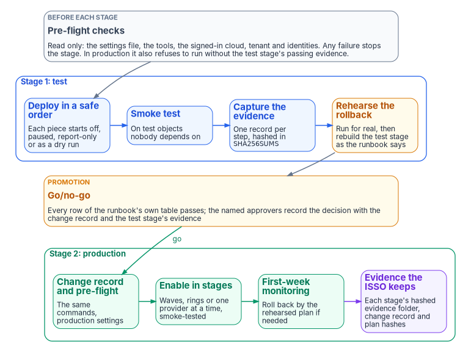

# Module 11: Deploy to test, then production {.unnumbered}

*Part of the [Non-Person Identity learning path](index.md). Every gate: each step of the runbook names its own. Workbook [Chapter 11](../../project-plans/developer-workbooks/non-person-identity/11-deploying-to-test-and-production.md). About 60 minutes.*

**Watch:** the narrated deck for this module: [Deck](https://github.com/WhalerMike/modernization-workbook/releases/download/edition-2026.11.5/Training_NPI_Module_11.pptx) · [▶ Watch](../../presentations/watch.html?v=Training_NPI_Module_11_Narrated) (about 14 minutes, captions) · [MP4](https://github.com/WhalerMike/modernization-workbook/releases/download/videos-2026-10-23/Training_NPI_Module_11_Narrated.mp4) · [Script](https://github.com/WhalerMike/modernization-workbook/blob/main/presentations/training-npi-module-11/Training_NPI_Module_11_Narration_Script.md) · [Captions](https://github.com/WhalerMike/modernization-workbook/blob/main/presentations/training-npi-module-11/Training_NPI_Module_11_Narrated.vtt).

**Also:** the chapter's narrated tour, about 12 minutes: [▶ Watch](../../presentations/watch.html?v=DW_NPI_11_Deploy_Test_Production_Narrated).

::: {.callout-important}
## Chapter 11 is approved, not run against a live tenant
Chapter 11 is approved, but **nobody has run its runbook against a live tenant, subscription or forest** ([status](../../project-plans/developer-workbooks/non-person-identity/11-deploying-to-test-and-production.md#status-a-runbook-nobody-has-run-against-a-live-tenant)). Its deploy scripts are tested against fictional tenants served by a fake, and their dry-run output is real. Every live result in the chapter is labeled **Expected**. This module's Lab 1 runs only the dry run.
:::

## Introduction (3 minutes)

Each chapter's Lab 2 proves one piece in a test tenant, by hand, and backs it out. A deployment proves them together, in an order that can be undone, against an environment someone depends on. The runbook is one set of commands, run twice: against an Entra test tenant, an Azure test subscription and an Active Directory test forest, then unchanged against production. Only the settings file changes.

The order puts what can block a sign-in last: inventory and owners, the app management policy scoped to a pilot and a synthetic app, a federated credential and a managed identity beside the old secret, a gMSA on a test host, and Conditional Access for workload identities in report-only mode. In this module you dry-run the scripts that guard that order.

**The federal requirement.** Every runbook step ends with a requirements table, and the kit writes an evidence record for each row. From the chapter's [Requirements, KSIs and evidence](../../project-plans/developer-workbooks/non-person-identity/11-deploying-to-test-and-production.md#requirements-ksis-and-evidence) and its step tables:

| Requirement | KSI | Evidence |
|---|---|---|
| CM-3 Configuration Change Control; CM-5; AC-5 | KSI-CMT-LMC (CM-3); KSI-IAM-JIT (CM-5, AC-5) | `S0-change-record-approvals-and-settings-file.json`: the change record and the settings file's SHA-256 |
| IA-5, IA-5(2), IA-9; AC-6, AC-6(5) | KSI-IAM-SNU; KSI-IAM-ELP (none cites IA-9) | `PRE-preflight.json`, PF-02 and PF-05: the deployment identity with no secret, the reader app with reads only |
| CA-7, CM-2; CM-3(2), CM-4(2) | KSI-MLA-EVC; KSI-CMT-VTD | `PRE-preflight.json`, PF-09 and PF-08: the VK-NPI baseline before the change, workload policies not enforced |
| AC-2, CM-8, IA-4; IA-5, IA-9; AC-3, AC-6; AU-2, AU-12 | KSI-PIY-GIV, KSI-IAM-SNU, KSI-IAM-ELP, KSI-MLA-LET, KSI-MLA-EVC (none cites IA-9) | `SMOKE-smoke-test.json`: ST-01 to ST-07 on the synthetic objects |
| AU-9 Protection of Audit Information | KSI-MLA-OSM | `SHA256SUMS`, checked by `Test-NpiDeployEvidence.ps1` |
| CM-3; CP-10 System Recovery and Reconstitution | KSI-CMT-RMV, KSI-RPL-ABO | `ROLLBACK-rollback.json`, written by an applied rollback; a dry run records `DryRun`, which the go/no-go doesn't accept |

KSIs are FedRAMP 20x indicators for cloud service providers. The agency lines this evidence up with what its providers report against them; it doesn't report KSIs itself. Every alignment is the program's reading *(design guidance)*, and the assessor and the authorizing official decide each control. The guide's [Evidence](../../books/guides/non-person-identity-implementation.md#evidence) section explains both.

## Learning objectives (1 minute)

After this module, you'll be able to:

- explain what the runbook adds to each chapter's Lab 2, and why the policies that can block a sign-in come last;
- describe the settings file's rules: no secret, no placeholder, and the stage it says it is;
- run the preflight, the smoke test and the rollback plan on fixtures, and read their checks;
- show that a rollback plan whose SHA-256 nobody approved sends nothing;
- explain why a fixture stage can never pass the evidence check, and what production's preflight needs from the test stage.

## Prerequisites (1 minute)

- Modules 1 to 10, or at least their Lab 1s: this module doesn't teach the kit's chapters again. The runbook runs Chapters 01, 02, 04, 05, 08 and 10 in order, and creates its smoke-test gMSA through a one-account Chapter 06 plan, which the pipeline applies.
- [Module 10](10-drift-and-evidence.md), for the evidence package and the first-week drift runs that production ends with.

## Unit 1: What the runbook adds (10 minutes)

Read the workbook chapter in this order:

- [What the runbook depends on](../../project-plans/developer-workbooks/non-person-identity/11-deploying-to-test-and-production.md#what-the-runbook-depends-on): the guide's gates, the two environments and the safe order.
- [Before you start](../../project-plans/developer-workbooks/non-person-identity/11-deploying-to-test-and-production.md#before-you-start): the roles activated through PIM, the approvals and the change record.
- [The environment settings file](../../project-plans/developer-workbooks/non-person-identity/11-deploying-to-test-and-production.md#the-environment-settings-file): the four rules and the placeholders.
- [The code this chapter adds](../../project-plans/developer-workbooks/non-person-identity/11-deploying-to-test-and-production.md#the-code-this-chapter-adds): six scripts, each with a fixture mode, and what each may write.

## Unit 2: The stages and the promotion (10 minutes)

The live test stage prepares synthetic objects, runs the preflight, deploys in the safe order, runs the smoke test, captures the evidence and rehearses the rollback, then deploys again. Production starts only when every go/no-go criterion is signed, and enables Conditional Access one ring at a time. Read:

- [Prepare the stage](../../project-plans/developer-workbooks/non-person-identity/11-deploying-to-test-and-production.md#prepare-the-stage) and [Pre-flight checks](../../project-plans/developer-workbooks/non-person-identity/11-deploying-to-test-and-production.md#pre-flight-checks): PF-01 to PF-11 and the KDS root key.
- [Stage 1: live test](../../project-plans/developer-workbooks/non-person-identity/11-deploying-to-test-and-production.md#stage-1-live-test), Steps 1.1 to 1.8, with the [smoke test](../../project-plans/developer-workbooks/non-person-identity/11-deploying-to-test-and-production.md#step-1.6-smoke-test) and the [rollback](../../project-plans/developer-workbooks/non-person-identity/11-deploying-to-test-and-production.md#step-1.8-roll-back-the-test-stage).
- [Promotion go/no-go criteria](../../project-plans/developer-workbooks/non-person-identity/11-deploying-to-test-and-production.md#promotion-gono-go-criteria): nine rows, each signed.
- [Stage 2: production](../../project-plans/developer-workbooks/non-person-identity/11-deploying-to-test-and-production.md#stage-2-production) and [Evidence the ISSO keeps](../../project-plans/developer-workbooks/non-person-identity/11-deploying-to-test-and-production.md#evidence-the-isso-keeps).

{#fig-deploy-test-to-production fig-alt="Flow diagram. At the top, a slate card, Pre-flight checks, run before each stage: read only, it checks the settings file, the tools, and the signed-in cloud, tenant and identities. Any failure stops the stage, and in production it also refuses to run without the test stage's passing evidence. An arrow leads into a blue box, Stage 1: test, holding four cards left to right joined by arrows: deploy in a safe order, where each piece starts off, paused, report-only or as a dry run; smoke test, on test objects nobody depends on; capture the evidence, one record per step hashed in SHA256SUMS; and, in amber, rehearse the rollback, run for real and then rebuild the test stage as the runbook says. An arrow leads to an amber card, Promotion: go/no-go. Every row of the runbook's own table passes, and the named approvers record the decision with the change record and the test stage's evidence. A green arrow labeled go leads into a green box, Stage 2: production, holding four cards left to right: change record and pre-flight, with the same commands and production settings; enable in stages, by waves, rings or one provider at a time, each smoke-tested; first-week monitoring, rolling back by the rehearsed plan if needed; and, in violet, evidence the ISSO keeps: each stage's hashed evidence folder, the change record and the plan hashes."}

## Exercise: Lab 1, fixtures, no tenant (25 minutes)

This is the workbook's [Chapter 11 dry run on the kit's fixtures](../../project-plans/developer-workbooks/non-person-identity/11-deploying-to-test-and-production.md#dry-run-on-the-kits-fixtures), which shows the full output. The test and production tenants are fictional and served by a fake: nothing signs in, and nothing is sent.

<!-- labs:begin lab-1-commands (generated by scripts/generate_labs.py; not part of the reviewed page) -->

::: {.callout-note #lab-1-commands collapse="false" title="Every command in Lab 1"}
Every command in this lab, in order. Each step below says what it does and what to look for.

```powershell
Set-Location C:\FMWLabs\non-person-identity-code\non-person-identity

$Run = "C:\FMWLabs\results\non-person-identity-11-deploying-to-test-and-production\lab1\$(Get-Date -AsUTC -Format 'yyyy-MM-ddTHHmmssZ')"
New-Item -ItemType Directory -Path $Run -Force | Out-Null
$Run

# Step 1: Load the deploy module and check the template
Import-Module ./deploy/NpiDeploy.psm1 -Force
try { Read-NpiDeploySettings -Path deploy/settings.template.json -Stage test } catch { $_.Exception.Message }

# Step 2: Run the test stage's preflight
./deploy/Test-NpiDeployPreflight.ps1 -SettingsPath tests/fixtures/deploy/settings.test.json -Stage test -BaselinePath tests/fixtures/deploy/vk-baseline.json -FixturePath tests/fixtures/deploy/tenant-test.json -OutputPath "$Run\test-preflight"

# Step 3: Plan the smoke-test gMSA
./deploy/New-NpiDeploySmokeGmsaPlan.ps1 -SettingsPath tests/fixtures/deploy/settings.test.json -Stage test -OutputPath "$Run\test-gmsa-plan" -AsOf '2026-11-02T12:00:00Z'

# Step 4: Run the smoke test
./deploy/Invoke-NpiDeploySmokeTest.ps1 -SettingsPath tests/fixtures/deploy/settings.test.json -Stage test -RegisterRun tests/fixtures/deploy/register-run -ExpectCaState ReportOnly -FixturePath tests/fixtures/deploy/tenant-test.json -OutputPath "$Run\test-smoke"

# Step 5: Plan the rollback
./deploy/Invoke-NpiDeployRollback.ps1 -Mode Plan -SettingsPath tests/fixtures/deploy/settings.test.json -Stage test -SnapshotPath "$Run\test-preflight\snapshot.json" -To Disabled -IncludeSmokeCleanup -FixturePath tests/fixtures/deploy/tenant-test.json -OutputPath "$Run\test-rollback"

# Step 6: Apply the plan with a hash nobody approved
try { ./deploy/Invoke-NpiDeployRollback.ps1 -Mode Apply -SettingsPath tests/fixtures/deploy/settings.test.json -Stage test -PlanPath "$Run\test-rollback\rollback-plan.json" -ApprovedSha256 ('0' * 64) -FixturePath tests/fixtures/deploy/tenant-test.json -OutputPath "$Run\test-rollback-refused" } catch { $_.Exception.Message }

# Step 7: Dry-run the rollback with the approved hash
$sha = (Get-FileHash "$Run\test-rollback\rollback-plan.json" -Algorithm SHA256).Hash.ToLower()
./deploy/Invoke-NpiDeployRollback.ps1 -Mode Apply -SettingsPath tests/fixtures/deploy/settings.test.json -Stage test -PlanPath "$Run\test-rollback\rollback-plan.json" -ApprovedSha256 $sha -FixturePath tests/fixtures/deploy/tenant-test.json -OutputPath "$Run\test-rollback-dry"

# Step 8: Run production's preflight
./deploy/Test-NpiDeployPreflight.ps1 -SettingsPath tests/fixtures/deploy/settings.production.json -Stage production -BaselinePath tests/fixtures/deploy/vk-baseline.json -PromotionEvidencePath "$Run\test-smoke" -FixturePath tests/fixtures/deploy/tenant-production.json -OutputPath "$Run\prod-preflight" -EvidencePath "$Run\evidence-production"

# Step 9: Check the test stage's evidence
./deploy/Test-NpiDeployEvidence.ps1 -SettingsPath tests/fixtures/deploy/settings.test.json -Stage test -EvidencePath "$Run\evidence"
"Exit code: $LASTEXITCODE"

# Step 10: Read the evidence records
Get-ChildItem "$Run\evidence" -Filter *.json | ForEach-Object { $r = Get-Content $_.FullName -Raw | ConvertFrom-Json; '{0}: {1}; KSIs {2}' -f $_.Name, $r.result, ($r.ksis -join ', ') }

# Step 11: Run the deploy scripts' tests
Invoke-Pester -Path deploy/tests -Output None -PassThru | Select-Object PassedCount, FailedCount, NotRunCount

# After the steps
Get-ChildItem C:\FMWLabs\results\non-person-identity-11-deploying-to-test-and-production\lab1 -Name
```

:::

<!-- labs:end -->

Every step runs in PowerShell 7, so you can follow it top to bottom in one window. Open **PowerShell 7** from the Start menu, then go to the kit's folder, where you unzipped it under [Get the code](index.md#get-the-code):

```powershell
Set-Location C:\FMWLabs\non-person-identity-code\non-person-identity
```

Then make this run's results folder. Its name is the date and time you start, in UTC, so each run keeps its own results and running the lab again never overwrites them:

```powershell
$Run = "C:\FMWLabs\results\non-person-identity-11-deploying-to-test-and-production\lab1\$(Get-Date -AsUTC -Format 'yyyy-MM-ddTHHmmssZ')"
New-Item -ItemType Directory -Path $Run -Force | Out-Null
$Run
```

Expected output, where `<run>` is your start time, such as `2026-11-25T143005Z`:

```text
C:\FMWLabs\results\non-person-identity-11-deploying-to-test-and-production\lab1\<run>
```

The run's date is only the folder's name. The data's dates are the fixtures' own, which stay the same, so every run's results match this page. The results folder sits outside the kit, so unzipping a newer copy of the kit never touches it.

Prefer Git Bash? Every step is PowerShell 7: type `pwsh` to start it, then run the two blocks above. In a clone of the repository, use the `examples` folder of the same name.

1. **Load the deploy module and check the template.** The template is refused with an error; `try` and `catch` print its message and keep the window going:

    ```powershell
    Import-Module ./deploy/NpiDeploy.psm1 -Force
    try { Read-NpiDeploySettings -Path deploy/settings.template.json -Stage test } catch { $_.Exception.Message }
    ```

    Expected output, every problem at once:

    ```text
    The settings file deploy/settings.template.json isn't usable:
      environment: placeholder <test-or-production> not replaced
      tenantId: placeholder <tenant-id> not replaced
      initialDomain: placeholder <initial-domain> not replaced
      changeRecord: placeholder <change-record> not replaced
      deployIdentity.clientId: placeholder <deploy-app-client-id> not replaced
      deployIdentity.certificateThumbprint: placeholder <deploy-cert-thumbprint> not replaced
      deployIdentity.certificatePemPath: placeholder <deploy-cert-pem-path> not replaced
      readerIdentity.clientId: placeholder <reader-app-client-id> not replaced
      readerIdentity.certificateThumbprint: placeholder <reader-cert-thumbprint> not replaced
      operators[0].upn: placeholder <engineer-upn> not replaced
      operators[0].objectId: placeholder <engineer-object-id> not replaced
      operators[1].upn: placeholder <ca-admin-upn> not replaced
      operators[1].objectId: placeholder <ca-admin-object-id> not replaced
      azure.subscriptionId: placeholder <subscription-id> not replaced
      azure.resourceGroup: placeholder <resource-group> not replaced
      azure.location: placeholder <location> not replaced
      ad.domain: placeholder <ad-domain> not replaced
      ad.server: placeholder <domain-controller> not replaced
      ad.gmsaName: placeholder <gmsa-name> not replaced
      ad.gmsaTestHost: placeholder <gmsa-host> not replaced
      ad.gmsaRetrieverGroup: placeholder <gmsa-host-group> not replaced
      ad.gmsaRetrieverGroupPath: placeholder <gmsa-host-group-ou> not replaced
      ad.gmsaService: placeholder <gmsa-service> not replaced
      ad.gmsaRequestId: placeholder <sailpoint-request-id> not replaced
      ad.kerberosInputs: placeholder <kerberos-inputs-folder> not replaced
      pilot.name: placeholder <pilot-app-name> not replaced
      pilot.ownerUpn: placeholder <pilot-owner-upn> not replaced
      pilot.appObjectId: placeholder <pilot-app-object-id> not replaced
      pilot.appClientId: placeholder <pilot-app-client-id> not replaced
      pilot.spObjectId: placeholder <pilot-sp-object-id> not replaced
      pilot.managedIdentityName: placeholder <pilot-identity-name> not replaced
      pilot.repository: placeholder <pilot-repository> not replaced
      pilot.federatedSubject: placeholder <pilot-federated-subject> not replaced
      pilot.conversionsPath: placeholder <conversions-file> not replaced
      pilot.cutoverLogPath: placeholder <cutover-log> not replaced
      pilot.legacyAdAccounts[0]: placeholder <legacy-account> not replaced
      smoke.repository: placeholder <smoke-repository> not replaced
      appManagementPolicy.configPath: placeholder <app-policy-config> not replaced
      conditionalAccess.scopePath: placeholder <wca-scope-file> not replaced
      rings[0].servicePrincipals[0]: placeholder <pilot-sp-object-id> not replaced
      rings[1].servicePrincipals[0]: placeholder <ring2-sp-object-id> not replaced
      inputs.ownership: placeholder <ownership-inputs-folder> not replaced
      inputs.pipelineIdentities: placeholder <pipeline-identities-file> not replaced
      outputRoot: placeholder <output-folder> not replaced
      environment: the file is for '<test-or-production>', not 'test'
      environment: '<test-or-production>' isn't test or production
      tenantId: '<tenant-id>' isn't a GUID
      deployIdentity.clientId: '<deploy-app-client-id>' isn't a GUID
      readerIdentity.clientId: '<reader-app-client-id>' isn't a GUID
      pilot.appObjectId: '<pilot-app-object-id>' isn't a GUID
      pilot.ownerUpn: '<pilot-owner-upn>' isn't a user principal name
      ad.gmsaName: '<gmsa-name>' isn't gmsa-<app> in lowercase, 15 characters or fewer (WD-159)
      ad.gmsaRetrieverGroup: '<gmsa-host-group>' isn't a DL-gMSA-<app>-Hosts domain local group (WD-160)
      ad.gmsaRetrieverGroupPath: '<gmsa-host-group-ou>' isn't an OU's distinguished name
    ```

    A filled-in file prints one line instead.

2. **Run the test stage's preflight:**

    ```powershell
    ./deploy/Test-NpiDeployPreflight.ps1 -SettingsPath tests/fixtures/deploy/settings.test.json -Stage test -BaselinePath tests/fixtures/deploy/vk-baseline.json -FixturePath tests/fixtures/deploy/tenant-test.json -OutputPath "$Run\test-preflight"
    ```

    Expected output:

    ```text
    Preflight (Fixture, test, CHG-2026-1102-T): 12 Pass, 1 Warn
      PF-01 Pass   All       Settings file: no secret, no placeholder, this stage: test, gcc, sha256 e8ba832db418
      PF-02 Pass   G3        Deployment identity uses a certificate or federated credential, no secret: 0 secret(s), 1 certificate(s)
      PF-03 Pass   G4        Workload ID Premium, to create or change workload Conditional Access: Workload_Identities_P2, 5 enabled unit(s)
      PF-04 Pass   G6        Entra ID P1 or P2, for the service principal sign-in logs: SPE_E5
      PF-05 Pass   G4        Reader identity holds Graph read permissions only: Application.Read.All, AuditLog.Read.All, Directory.Read.All, Policy.Read.All, User.Read.All
      PF-06 Pass   G4        Operator Identity engineer: roles for app management policy, federated credentials, smoke test: Cloud Application Administrator eligible; Security Administrator eligible
      PF-06 Warn   G4        Operator Conditional Access administrator: roles for workload Conditional Access, rollback: Conditional Access Administrator active
      PF-07 Pass   G1        The pilot app registration exists, single-tenant: Payroll Export, AzureADMyOrg, 1 secret(s)
      PF-07 Pass   G1        The synthetic app registration exists, single-tenant: npi-smoke-test, AzureADMyOrg, 0 secret(s)
      PF-08 Pass   G4        Workload policy CA015-ServiceAccounts-LocationRestriction-Ring1: enabledForReportingButNotEnforced
      PF-08 Pass   G4        Workload policy CA037-WorkloadIdentities-HighRisk-Block-Ring1: enabledForReportingButNotEnforced
      PF-09 Pass   G1-G6     VK-NPI baseline recorded before the change: 01 Fail 4; 02 Fail 2; 03 Fail 1; 04 Fail 3; 05 Warn 3; 06 Fail 2; 07 Warn 1; 08 Fail 1
      PF-10 Pass   G5        gMSA test host and retriever group exist: app-test-01.corp-test.contoso.example; DL-gMSA-npismoke-Hosts
    Evidence: PRE-preflight.json (Warn)
    Evidence: S0-change-record-approvals-and-settings-file.json (Pass)
    Result: GO for this stage. File results.json, snapshot.json and manifest.json with the change record.
    ```

    The Warn is `PF-06`: the fixture's Conditional Access administrator holds a standing assignment, not a PIM-eligible one, which the preflight reports but doesn't block. The evidence records go to `$Run\evidence`, beside the run's folder.

3. **Plan the smoke-test gMSA** as a one-account Chapter 06 plan, the way every production write for a managed service account goes:

    ```powershell
    ./deploy/New-NpiDeploySmokeGmsaPlan.ps1 -SettingsPath tests/fixtures/deploy/settings.test.json -Stage test -OutputPath "$Run\test-gmsa-plan" -AsOf '2026-11-02T12:00:00Z'
    ```

    Expected output:

    ```text
    Plan: CreateGmsa gmsa-npismoke$ in OU=Service Accounts,DC=corp-test,DC=contoso,DC=example, retriever CN=DL-gMSA-npismoke-Hosts,OU=Groups,DC=corp-test,DC=contoso,DC=example; runBy pipeline; request SP-REQ-0002001, change CHG-2026-1102-T
    Outbound-only: yes
    Plan SHA-256: 923aa50754993d543c39c342ccbf441373fe3d0ad89a04a16cd7118fc7c15bfe
    ```

    The plan is the pipeline's: in a live stage a reviewer approves its hash and the pipeline's gMSA applies it with Chapter 06's write path. It writes nothing here.

4. **Run the smoke test** against the synthetic service principal and service account:

    ```powershell
    ./deploy/Invoke-NpiDeploySmokeTest.ps1 -SettingsPath tests/fixtures/deploy/settings.test.json -Stage test -RegisterRun tests/fixtures/deploy/register-run -ExpectCaState ReportOnly -FixturePath tests/fixtures/deploy/tenant-test.json -OutputPath "$Run\test-smoke"
    ```

    Expected output:

    ```text
    Smoke test (Fixture, test, Conditional Access expected ReportOnly): 8 Pass
      ST-01 Pass   G1        Synthetic app is in the register with two owners and no secret: OwnerCount 2, Secrets 0, CredentialKind Federated
      ST-02 Pass   G1        Synthetic service account is detected and rated HIGH: Risk HIGH: password never expires
      ST-03 Pass   G3        App management policy refuses a new secret on the synthetic app: refused: Graph returned 400 (BadRequest): (fixture) Refused by the app management policy (real code unverified).
      ST-04 Pass   G5        Synthetic app's federated credential matches the settings exactly: 1 credential(s), 1 exact match(es)
      ST-05 Pass   G4        Workload policy CA015-ServiceAccounts-LocationRestriction-Ring1 assigns the synthetic service principal directly: state enabledForReportingButNotEnforced; assigned directly: True
      ST-05 Pass   G4        Workload policy CA037-WorkloadIdentities-HighRisk-Block-Ring1 assigns the synthetic service principal directly: state enabledForReportingButNotEnforced; assigned directly: True
      ST-06 Pass   G4        Synthetic sign-ins show the workload policies' result (Graph beta): 2 sign-in(s) since 2026-11-01T12:00:00Z; results: reportOnlyFailure, reportOnlyNotApplied
      ST-07 Pass   G5        gMSA test host can retrieve the gMSA's password: Test-ADServiceAccount True; svc-npi-smoke enabled True
    Evidence: SMOKE-smoke-test.json (Pass)
    Result: PASS. File results.json and manifest.json with the change record.
    ```

    ST-03's refusal says `(fixture) ... (real code unverified)`: Learn doesn't give the error an app management policy returns.

5. **Plan the rollback** from the preflight's snapshot, with the synthetic objects' cleanup:

    ```powershell
    ./deploy/Invoke-NpiDeployRollback.ps1 -Mode Plan -SettingsPath tests/fixtures/deploy/settings.test.json -Stage test -SnapshotPath "$Run\test-preflight\snapshot.json" -To Disabled -IncludeSmokeCleanup -FixturePath tests/fixtures/deploy/tenant-test.json -OutputPath "$Run\test-rollback"
    ```

    Expected output:

    ```text
    Rollback plan (test, to Disabled): 7 action(s)
      RB-01 G4      ConditionalAccessState CA015-ServiceAccounts-LocationRestriction-Ring1
      RB-02 G4      ConditionalAccessState CA037-WorkloadIdentities-HighRisk-Block-Ring1
      RB-03 G3      TenantAppPolicyRestore defaultAppManagementPolicy
      RB-04 G3      AppPolicyOff           npi-pilot-block-secrets
      RB-05 G5      AdEnable               svc-payexport
      RB-06 Cleanup SpDisable              synthetic service principal
      RB-07 Cleanup AdDisable              svc-npi-smoke
    Plan SHA-256 for the reviewer: ec3fb73c41e06d40fd7c5a484564579884dd0fac6f9255a02f2e787d6d940afa
    ```

    No action is a delete.

6. **Apply the plan with a hash nobody approved.** The refusal is an error; `try` and `catch` print its message:

    ```powershell
    try { ./deploy/Invoke-NpiDeployRollback.ps1 -Mode Apply -SettingsPath tests/fixtures/deploy/settings.test.json -Stage test -PlanPath "$Run\test-rollback\rollback-plan.json" -ApprovedSha256 ('0' * 64) -FixturePath tests/fixtures/deploy/tenant-test.json -OutputPath "$Run\test-rollback-refused" } catch { $_.Exception.Message }
    ```

    Expected output:

    ```text
    The plan's SHA-256 is ec3fb73c41e06d40fd7c5a484564579884dd0fac6f9255a02f2e787d6d940afa, not the approved 0000000000000000000000000000000000000000000000000000000000000000. Nothing was sent.
    ```

7. **Dry-run the rollback with the approved hash:**

    ```powershell
    $sha = (Get-FileHash "$Run\test-rollback\rollback-plan.json" -Algorithm SHA256).Hash.ToLower()
    ./deploy/Invoke-NpiDeployRollback.ps1 -Mode Apply -SettingsPath tests/fixtures/deploy/settings.test.json -Stage test -PlanPath "$Run\test-rollback\rollback-plan.json" -ApprovedSha256 $sha -FixturePath tests/fixtures/deploy/tenant-test.json -OutputPath "$Run\test-rollback-dry"
    ```

    Expected output:

    ```text
    Rollback DryRun (Fixture, test): 7 WouldApply
      RB-01 WouldApply  ConditionalAccessState CA015-ServiceAccounts-LocationRestriction-Ring1 enabledForReportingButNotEnforced -> disabled
      RB-02 WouldApply  ConditionalAccessState CA037-WorkloadIdentities-HighRisk-Block-Ring1 enabledForReportingButNotEnforced -> disabled
      RB-03 WouldApply  TenantAppPolicyRestore defaultAppManagementPolicy
      RB-04 WouldApply  AppPolicyOff npi-pilot-block-secrets
      RB-05 WouldApply  AdEnable svc-payexport
      RB-06 WouldApply  SpDisable synthetic service principal
      RB-07 WouldApply  AdDisable svc-npi-smoke
    Evidence: ROLLBACK-rollback.json (DryRun)
    ```

    Without `-Apply` it sends nothing. In a real stage, a reviewer who isn't the operator passes you the hash.

8. **Run production's preflight** with the test smoke test as its promotion evidence:

    ```powershell
    ./deploy/Test-NpiDeployPreflight.ps1 -SettingsPath tests/fixtures/deploy/settings.production.json -Stage production -BaselinePath tests/fixtures/deploy/vk-baseline.json -PromotionEvidencePath "$Run\test-smoke" -FixturePath tests/fixtures/deploy/tenant-production.json -OutputPath "$Run\prod-preflight" -EvidencePath "$Run\evidence-production"
    ```

    Expected output:

    ```text
    Preflight (Fixture, production, CHG-2026-1116-P): 14 Pass
      PF-01 Pass   All       Settings file: no secret, no placeholder, this stage: production, gcc, sha256 7cf7da50dd45
      PF-02 Pass   G3        Deployment identity uses a certificate or federated credential, no secret: 0 secret(s), 1 certificate(s)
      PF-03 Pass   G4        Workload ID Premium, to create or change workload Conditional Access: Workload_Identities_P2, 5 enabled unit(s)
      PF-04 Pass   G6        Entra ID P1 or P2, for the service principal sign-in logs: SPE_E5
      PF-05 Pass   G4        Reader identity holds Graph read permissions only: Application.Read.All, AuditLog.Read.All, Directory.Read.All, Policy.Read.All, User.Read.All
      PF-06 Pass   G4        Operator Identity engineer: roles for app management policy, federated credentials, smoke test: Cloud Application Administrator eligible; Security Administrator eligible
      PF-06 Pass   G4        Operator Conditional Access administrator: roles for workload Conditional Access, rollback: Conditional Access Administrator eligible
      PF-07 Pass   G1        The pilot app registration exists, single-tenant: Payroll Export, AzureADMyOrg, 1 secret(s)
      PF-07 Pass   G1        The synthetic app registration exists, single-tenant: npi-smoke-production, AzureADMyOrg, 0 secret(s)
      PF-08 Pass   G4        Workload policy CA015-ServiceAccounts-LocationRestriction-Ring1: enabledForReportingButNotEnforced
      PF-08 Pass   G4        Workload policy CA037-WorkloadIdentities-HighRisk-Block-Ring1: enabledForReportingButNotEnforced
      PF-09 Pass   G1-G6     VK-NPI baseline recorded before the change: 01 Fail 4; 02 Fail 2; 03 Fail 1; 04 Fail 3; 05 Warn 3; 06 Fail 2; 07 Warn 1; 08 Fail 1
      PF-10 Pass   G5        gMSA test host and retriever group exist: app-prd-01.corp.contoso.example; DL-gMSA-npismoke-Hosts
      PF-11 Pass   Promotion Test stage smoke test passed, in another tenant: test, tenant c0ffee00-0000-4000-8000-0000000000e1, 8/8 Pass
    Evidence: PRE-preflight.json (Pass)
    Evidence: S0-change-record-approvals-and-settings-file.json (Pass)
    Result: GO for this stage. File results.json, snapshot.json and manifest.json with the change record.
    ```

    PF-11 runs in production only.

9. **Check the test stage's evidence.** `$LASTEXITCODE` holds the script's exit code:

    ```powershell
    ./deploy/Test-NpiDeployEvidence.ps1 -SettingsPath tests/fixtures/deploy/settings.test.json -Stage test -EvidencePath "$Run\evidence"
    "Exit code: $LASTEXITCODE"
    ```

    Expected output:

    ```text
    Evidence for the test stage (CHG-2026-1102-T): 4 of 9 requirement rows present and passing
      PRE       Present          Warn   KSI-CMT-LMC, KSI-CMT-VTD, KSI-IAM-ELP, KSI-IAM-JIT, KSI-IAM-SNU, KSI-MLA-EVC, KSI-MLA-LET, KSI-PIY-GIV
      S0        Present          Pass   KSI-CMT-LMC, KSI-IAM-JIT
      S1.1      Missing
      S1.2      Missing
      S1.3      Missing
      S1.5      Missing
      SMOKE     Present          Pass   KSI-IAM-ELP, KSI-IAM-SNU, KSI-MLA-EVC, KSI-MLA-LET, KSI-PIY-GIV
      ROLLBACK  Failing          DryRun KSI-CMT-RMV, KSI-RPL-ABO
      EVIDENCE  Present          Pass   KSI-MLA-OSM
      Gap: S1.1: no S1.1 record: Chapter 01's and Chapter 02's run folders
      Gap: S1.2: no S1.2 record: Chapter 04's policy plan (test) or apply (production) run folder
      Gap: S1.3: no S1.3 record: Chapter 05's plan and apply run folders
      Gap: S1.5: no S1.5 record: Chapter 08's plan and apply run folders
      Gap: ROLLBACK: ROLLBACK-rollback.json
    Result: NO-GO on evidence.
    Exit code: 1
    ```

    `S1.1`, `S1.2`, `S1.3` and `S1.5` are missing because those steps record their evidence only when they run against a tenant; `ROLLBACK` fails on `DryRun`. That's right for a dry run.

10. **Read the evidence records** and the KSIs each one names:

    ```powershell
    Get-ChildItem "$Run\evidence" -Filter *.json | ForEach-Object { $r = Get-Content $_.FullName -Raw | ConvertFrom-Json; '{0}: {1}; KSIs {2}' -f $_.Name, $r.result, ($r.ksis -join ', ') }
    ```

    Expected output:

    ```text
    PRE-preflight.json: Warn; KSIs KSI-CMT-LMC, KSI-CMT-VTD, KSI-IAM-ELP, KSI-IAM-JIT, KSI-IAM-SNU, KSI-MLA-EVC, KSI-MLA-LET, KSI-PIY-GIV
    ROLLBACK-rollback.json: DryRun; KSIs KSI-CMT-RMV, KSI-RPL-ABO
    S0-change-record-approvals-and-settings-file.json: Pass; KSIs KSI-CMT-LMC, KSI-IAM-JIT
    SMOKE-smoke-test.json: Pass; KSIs KSI-IAM-ELP, KSI-IAM-SNU, KSI-MLA-EVC, KSI-MLA-LET, KSI-PIY-GIV
    ```

11. **Run the deploy scripts' tests:**

    ```powershell
    Invoke-Pester -Path deploy/tests -Output None -PassThru | Select-Object PassedCount, FailedCount, NotRunCount
    ```

    Expected output:

    ```text
    PassedCount FailedCount NotRunCount
    ----------- ----------- -----------
             60           0           0
    ```

    The tests sit outside `tests/`, so the 567 every other module's Lab 1 counts doesn't change.

Nothing to clean up: the kit's folder is as you unzipped it, and this run's results stay in `$Run`. List every run you've made of this lab:

```powershell
Get-ChildItem C:\FMWLabs\results\non-person-identity-11-deploying-to-test-and-production\lab1 -Name
```

Expected output: one line per run, oldest first, the last one this run:

```text
<run>
```

## Exercise: Lab 2, the live test stage, then production (5 minutes to read)

*Not run by anyone yet.* Follow the workbook's [Stage 1: live test](../../project-plans/developer-workbooks/non-person-identity/11-deploying-to-test-and-production.md#stage-1-live-test), after [Prepare the stage](../../project-plans/developer-workbooks/non-person-identity/11-deploying-to-test-and-production.md#prepare-the-stage) and the [Pre-flight checks](../../project-plans/developer-workbooks/non-person-identity/11-deploying-to-test-and-production.md#pre-flight-checks). It has the exact commands. Then, only when every [go/no-go criterion](../../project-plans/developer-workbooks/non-person-identity/11-deploying-to-test-and-production.md#promotion-gono-go-criteria) is signed, [Stage 2: production](../../project-plans/developer-workbooks/non-person-identity/11-deploying-to-test-and-production.md#stage-2-production).

- **You need:** an Entra test tenant with Workload ID Premium and Entra ID P1 or P2, an Azure test subscription and an Active Directory test forest, never production; an approved change record; the reader app and the deployment identity, each with a certificate; operators eligible for their roles through PIM; and the second labs of Chapters 01, 04, 05, 06 and 08 already run.
- **What you do:** fill in and check the settings file, create the synthetic objects, the gMSA's domain local retriever group and the pilot policy, run the preflight, deploy Steps 1.1 to 1.5 (the gMSA through its approved Chapter 06 plan), run the smoke test, capture the evidence, rehearse the rollback, deploy again and check the evidence.
- **Back-out:** [Step 1.8](../../project-plans/developer-workbooks/non-person-identity/11-deploying-to-test-and-production.md#step-1.8-roll-back-the-test-stage) applies the approved rollback (workload policies disabled, the tenant default app management policy restored, the pilot policy off, the legacy account re-enabled), uninstalls the gMSA on the host, and checks the tenant against the baseline. The kit never deletes.

## Knowledge check (5 minutes)

1. Why does the runbook enable Conditional Access for workload identities last, and only in report-only mode in test?
    a. Workload ID Premium is licensed last
    b. It's the control that can block a sign-in; Learn lets it run report-only to estimate its effect, and production enables it ring by ring after a reviewed sign-in summary
    c. It depends on the gMSA
    d. Graph creates it only in production
2. Learn documents no report-only mode for app management policies. What keeps the pilot policy safe?
    a. Nothing; it waits for production
    b. The scope: two applications, the pilot and the synthetic, and a policy blocks only the create or update that breaks it, so existing secrets keep working
    c. It's created turned on
    d. The smoke test turns it off
3. The rollback's plan SHA-256 isn't the one the reviewer approved. What does `-Mode Apply` do?
    a. Applies the plan and warns
    b. Stops before it sends anything: `Nothing was sent.`
    c. Asks for the hash again
    d. Rewrites the plan
4. In the dry run, why does `Test-NpiDeployEvidence.ps1` end `NO-GO on evidence`?
    a. The smoke test failed
    b. Steps 1.1 to 1.5 record evidence only against a tenant, and a dry-run rollback records `DryRun`, which the go/no-go doesn't accept
    c. A hash in `SHA256SUMS` changed
    d. The preflight had a Warn
5. What does production's preflight need from the test stage before PF-11 passes?
    a. Nothing; it reads the production tenant only
    b. The test smoke test, passing every check, in another tenant
    c. The CISO's approval
    d. The test evidence folder's `SHA256SUMS`

::: {.callout-tip collapse="true"}
## Check your answers
1. **b.** Taught in [What the runbook depends on](../../project-plans/developer-workbooks/non-person-identity/11-deploying-to-test-and-production.md#what-the-runbook-depends-on), the safe order.
2. **b.** Taught in [What the runbook depends on](../../project-plans/developer-workbooks/non-person-identity/11-deploying-to-test-and-production.md#what-the-runbook-depends-on) and the chapter's [Dangers](../../project-plans/developer-workbooks/non-person-identity/11-deploying-to-test-and-production.md#dangers).
3. **b.** Taught in the chapter's [dry run](../../project-plans/developer-workbooks/non-person-identity/11-deploying-to-test-and-production.md#dry-run-on-the-kits-fixtures) and step 6 of the lab.
4. **b.** Taught in the chapter's [dry run](../../project-plans/developer-workbooks/non-person-identity/11-deploying-to-test-and-production.md#dry-run-on-the-kits-fixtures) and step 9 of the lab.
5. **b.** Taught in [Pre-flight checks](../../project-plans/developer-workbooks/non-person-identity/11-deploying-to-test-and-production.md#pre-flight-checks), PF-11, and the [go/no-go criteria](../../project-plans/developer-workbooks/non-person-identity/11-deploying-to-test-and-production.md#promotion-gono-go-criteria).
:::

## Summary (2 minutes)

You dry-ran the runbook's own scripts: a settings file refused for its placeholders, a preflight that says go with one Warn, a smoke test on synthetic objects, a rollback plan refused without its approved hash and dry-run with it, a production preflight that checks the test stage's smoke test, and an evidence check that says no-go on a fixture stage.

**The evidence an ISSO keeps** for each stage: the evidence folder with one record per requirement row (`PRE`, `S0`, `S1.1`, `S1.2`, `S1.3`, `S1.5`, `SMOKE` and `ROLLBACK` in test; `S2.3` and `S2.5` as well in production), the run folders they cover, the operator's input files, and `SHA256SUMS`, which the ISSO checks with `sha256sum -c`. The full table is [Evidence the ISSO keeps](../../project-plans/developer-workbooks/non-person-identity/11-deploying-to-test-and-production.md#evidence-the-isso-keeps). Before you run a stage, work through the chapter's [Checklist](../../project-plans/developer-workbooks/non-person-identity/11-deploying-to-test-and-production.md#checklist).

**Next:** you've finished the path. Go back to the [learning path](index.md), or the [Labs](../labs.md#npi) page for every lab in the workbook.
