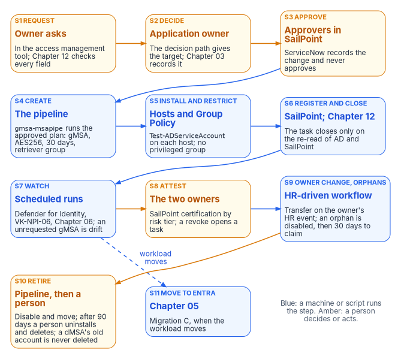

# Module 13: Run the managed service account standard {.unnumbered}

*Part of the [Non-Person Identity learning path](index.md). The companion guide's [managed service account standard](../../books/guides/service-account-migration.md#msa-standard), with workbook [Chapter 12](../../project-plans/developer-workbooks/non-person-identity/12-the-managed-service-account-standard.md). About 55 minutes.*

**Watch:** the narrated deck for this module: [Deck](https://github.com/WhalerMike/modernization-workbook/tree/main/presentations/training-npi-module-13) · [▶ Watch](../../presentations/watch.html?v=Training_NPI_Module_13_Narrated) (about 15 minutes, captions) · [MP4](https://github.com/WhalerMike/modernization-workbook/releases/download/videos-2026-10-23/Training_NPI_Module_13_Narrated.mp4) · [Script](https://github.com/WhalerMike/modernization-workbook/blob/main/presentations/training-npi-module-13/Training_NPI_Module_13_Narration_Script.md) · [Captions](https://github.com/WhalerMike/modernization-workbook/blob/main/presentations/training-npi-module-13/Training_NPI_Module_13_Narrated.vtt).

**Also:** the chapter's narrated tour, about 12 minutes: [▶ Watch](../../presentations/watch.html?v=DW_NPI_12_MSA_Standard_Narrated).

## Introduction (3 minutes)

Module 12 moved one account by hand. This module is about every account after that: how a gMSA is asked for, approved, created, watched, attested and retired the same way each time, with the same evidence. The standard splits the work three ways. SailPoint approves, reached through the agency's system access management tool. ServiceNow records the change and the findings. Microsoft's tools create and enforce: Active Directory PowerShell through Chapter 06's approved plan, Group Policy, Defender for Identity and, when the workload moves, Microsoft Entra.

Take it after Modules 8 and 12.

**The federal requirement.** The standard's [steps](../../books/guides/service-account-migration.md#msa-standard-steps) each name what they support; these are the rows this module's lab produces evidence for:

| Step | Requirement it supports | KSIs | Evidence the ISSO keeps |
|---|---|---|---|
| S1 Request | AC-2 Account Management; IA-4 Identifier Management | KSI-IAM-SNU; KSI-IAM-ELP, IAM-JIT | `request-check.json`, the SailPoint approval, the ServiceNow change |
| S6 Register | CM-8 System Component Inventory; AC-6 Least Privilege | KSI-PIY-GIV; KSI-IAM-ELP, IAM-JIT | `reconciliation.json` |
| S8 Attest | AC-2; AC-6(7) Review of User Privileges | KSI-IAM-SNU; KSI-IAM-AAM, IAM-JIT | `certification.json`, `servicenow-findings.json` |
| S10 Retire | AC-2(3) Disable Accounts | KSI-IAM-AAM, IAM-JIT, IAM-SUS | `retirement-list.csv`, the decommission ticket |

: The rows this module practices {.striped .hover}

## Learning objectives (1 minute)

By the end of this module you can:

- name who does what in the standard: the access management tool, SailPoint, ServiceNow, the pipeline and a person;
- give the standard's settings: name, OU, retriever group, encryption, interval, outbound-only, owners, cadence and the 90-day window;
- explain why machines run every step they can, and where people still must;
- run Chapter 12's checks on fixtures and read the findings, the Chapter 06 inputs, the certifications, the ServiceNow findings and the retirement list.

## Prerequisites (1 minute)

Modules 8 and 12, and PowerShell 7.1 or later with Pester 5. No tenant or domain.

## Unit 1: Who does what, and the settings (8 minutes)

Read the standard's [Who does what](../../books/guides/service-account-migration.md#msa-standard-roles) and [settings](../../books/guides/service-account-migration.md#msa-standard-settings) tables. Notice three things. SailPoint approves every request, whatever the risk tier, and never writes a gMSA. ServiceNow never approves the account. The pipeline, as `gmsa-msapipe`, holds only the delegated rights it needs, and a person still runs the dMSA steps, the uninstall and every delete.

## Unit 2: Machines run the steps (6 minutes)

Read the callout [Machines run the steps; people decide](../../books/guides/service-account-migration.md#msa-standard). Automation lines up with the federal requirements better than the same work done by hand in a console or portal: NIST SP 800-53 has AC-2(1), AC-2(3) and AC-2(4) for automated account management, disabling and auditing, FedRAMP's KSI-IAM-AAM is *Automating Account Management*, and CISA's Zero Trust Maturity Model makes automation and orchestration a cross-cutting capability. It still has limits: designated people approve, separation of duties keeps the approver, the pipeline's owner and the person who deletes apart, the authorizing official accepts the pipeline, and the pipeline's own identity is governed.

## Unit 3: The steps from request to retirement (8 minutes)

Read the standard's [steps](../../books/guides/service-account-migration.md#msa-standard-steps), S1 to S11. Follow one gMSA through them: requested and checked (S1), decided (S2), approved and recorded (S3), created by the plan (S4), installed and restricted (S5), aggregated and closed on a re-read (S6), watched (S7), certified (S8), handed over when an owner leaves (S9), and retired (S10).

{#fig-msa-standard-lifecycle fig-alt="Eleven step cards in four rows of three, read left to right, colored by who acts: amber where a person decides or acts, blue where a machine or script runs the step. Row 1: S1 Request, amber, the owner asks in the access management tool and Chapter 12 checks every field; S2 Decide, amber, the application owner, where the decision path gives the target and Chapter 03 records it; S3 Approve, amber, approvers in SailPoint, while ServiceNow records the change and never approves. Row 2: S4 Create, blue, the pipeline, where gmsa-msapipe runs the approved plan: the gMSA, AES256, 30 days and its retriever group; S5 Install and restrict, blue, hosts and Group Policy, with Test-ADServiceAccount on each host and no privileged group; S6 Register and close, blue, SailPoint and Chapter 12, where the task closes only on the re-read of AD and SailPoint. Row 3: S7 Watch, blue, scheduled runs of Defender for Identity, VK-NPI-06 and Chapter 06, where an unrequested gMSA is drift; S8 Attest, amber, the two owners, through SailPoint certification by risk tier, where a revoke opens a task; S9 Owner change and orphans, blue, the HR-driven workflow, a transfer on the owner's HR event, and an orphan disabled first, then 30 days to claim. Row 4: S10 Retire, amber, the pipeline then a person: disable and move, after 90 days a person uninstalls and deletes, and a dMSA's old account is never deleted; S11 Move to Entra, blue, Chapter 05, Migration C, reached by a dashed arrow from S7 labeled workload moves. A note says blue means a machine or script runs the step and amber means a person decides or acts."}

## Exercise: Lab 1, fixtures, no tenant (20 minutes)

These are Chapter 12's [Lab 1](../../project-plans/developer-workbooks/non-person-identity/12-the-managed-service-account-standard.md#lab-1-fixtures-no-domain) steps; the chapter shows each one's expected output.

<!-- labs:begin lab-1-commands (generated by scripts/generate_labs.py; not part of the reviewed page) -->

::: {.callout-note #lab-1-commands collapse="false" title="Every command in Lab 1"}
Every command in this lab, in order. Each step below says what it does and what to look for.

```powershell
Set-Location C:\FMWLabs\non-person-identity-code\non-person-identity

$Run = "C:\FMWLabs\results\non-person-identity-13-the-managed-service-account-standard\lab1\$(Get-Date -AsUTC -Format 'yyyy-MM-ddTHHmmssZ')"
New-Item -ItemType Directory -Path $Run -Force | Out-Null
$Run

# Step 1: Run the standard's checks
./Invoke-NpiGmsaStandard.ps1 -InputPath tests/fixtures/ch12/inputs -StandardPath tests/fixtures/ch12/standard.json -OutputPath "$Run\msa-standard" -AsOf 2026-11-20

# Step 2: Read the findings
Get-Content "$Run\msa-standard\findings.json" -Raw | ConvertFrom-Json | Sort-Object Rule | Format-Table Rule, Severity, ObjectKey

# Step 3: Read what goes to Chapter 06
Get-Content "$Run\msa-standard\kerberos-replatform.csv"
Get-Content "$Run\msa-standard\password-retrievers.json"

# Step 4: Read the certifications and the ServiceNow findings
Get-Content "$Run\msa-standard\certification.json" -Raw | ConvertFrom-Json | Format-Table Account, RiskTier, LastCertifiedOn, DueOn, Status
Get-Content "$Run\msa-standard\servicenow-findings.json" -Raw | ConvertFrom-Json | Format-Table drift_class, severity, account_name, attribute, observed_value

# Step 5: Read the retirement list
Import-Csv "$Run\msa-standard\retirement-list.csv" | Format-Table SamAccountName, DisabledOn, LastLogon, DaysDisabled, Status

# After the steps
Get-ChildItem C:\FMWLabs\results\non-person-identity-13-the-managed-service-account-standard\lab1 -Name
```

:::

<!-- labs:end -->

Every step runs in PowerShell 7, so you can follow it top to bottom in one window. Open **PowerShell 7** from the Start menu, then go to the kit's folder, where you unzipped it under [Get the code](index.md#get-the-code):

```powershell
Set-Location C:\FMWLabs\non-person-identity-code\non-person-identity
```

Then make this run's results folder. Its name is the date and time you start, in UTC, so each run keeps its own results and running the lab again never overwrites them:

```powershell
$Run = "C:\FMWLabs\results\non-person-identity-13-the-managed-service-account-standard\lab1\$(Get-Date -AsUTC -Format 'yyyy-MM-ddTHHmmssZ')"
New-Item -ItemType Directory -Path $Run -Force | Out-Null
$Run
```

Expected output, where `<run>` is your start time, such as `2026-11-25T143005Z`:

```text
C:\FMWLabs\results\non-person-identity-13-the-managed-service-account-standard\lab1\<run>
```

The run's date is only the folder's name. The data's dates are the fixtures' own, which stay the same, so every run's results match this page. The results folder sits outside the kit, so unzipping a newer copy of the kit never touches it.

Prefer Git Bash? Every step is PowerShell 7: type `pwsh` to start it, then run the two blocks above. In a clone of the repository, use the `examples` folder of the same name.

1. **Run the standard's checks:**

    ```powershell
    ./Invoke-NpiGmsaStandard.ps1 -InputPath tests/fixtures/ch12/inputs -StandardPath tests/fixtures/ch12/standard.json -OutputPath "$Run\msa-standard" -AsOf 2026-11-20
    ```

    Expected output:

    ```text
    As of 2026-11-20; 5 request(s), 9 AD managed account(s), 8 register row(s)
    Findings: 25 Finding, 4 Warn, 3 Info
    Requests: 2 passed (REQ-2026-0201, REQ-2026-0202); 3 held
    Chapter 06 inputs: 2 kerberos-replatform.csv row(s), 1 password-retrievers.json gMSA(s)
    Certification: 1 Current, 2 DueSoon, 1 Overdue; 2 ServiceNow finding(s)
    Retirement: 1 DeleteCandidate, 1 EnabledInAd, 1 SignInSinceDisable, 1 Wait; nothing deleted
      NPI-STD-01  REQ-2026-0203
      NPI-STD-02  REQ-2026-0203
      NPI-STD-03  REQ-2026-0204
      NPI-STD-04  REQ-2026-0204
      NPI-STD-05  REQ-2026-0204
      NPI-STD-06  REQ-2026-0204
      NPI-STD-07  REQ-2026-0205
      NPI-STD-08  REQ-2026-0205
      NPI-STD-09  REQ-2026-0205
      NPI-STD-10  gmsa-ops$
      NPI-STD-11  gmsa-web$
      NPI-STD-12  gmsa-print$
      NPI-STD-13  gmsa-web$
      NPI-STD-14  gmsa-web$
      NPI-STD-15  gmsa-print$
      NPI-STD-16  gmsa-ops$
      NPI-STD-17  gmsa-web$
      NPI-STD-18  gmsa-ops$
      NPI-STD-19  gmsa-sql$
      NPI-STD-20  gmsa-print$
      NPI-STD-21  dmsa-hrsync$, gmsa-intranet$
      NPI-STD-22  gmsa-print$|CAMP-2026-ANNUAL-R3
      NPI-STD-23  gmsa-web$|CAMP-2026-Q4-R1|comms.sponsor@contoso.example
      NPI-STD-24  svc-backup
      NPI-STD-25  msa-print01$
      NPI-STD-26  gmsa-ops$, msa-print01$, svc-backup
      NPI-STD-27  gmsa-legacy$
      NPI-STD-28  gmsa-batch$
      NPI-STD-29  gmsa-report$
    Manifest SHA-256: 39aae5247108f57fd6aba9bdc56491b63a29370fc94dcf45aa5ada6da1dd53f2
    ```

2. **Read the findings:**

    ```powershell
    Get-Content "$Run\msa-standard\findings.json" -Raw | ConvertFrom-Json | Sort-Object Rule | Format-Table Rule, Severity, ObjectKey
    ```

    Expected output:

    ```text
    Rule       Severity ObjectKey
    ----       -------- ---------
    NPI-STD-01 Finding  REQ-2026-0203
    NPI-STD-02 Finding  REQ-2026-0203
    NPI-STD-03 Finding  REQ-2026-0204
    NPI-STD-04 Finding  REQ-2026-0204
    NPI-STD-05 Finding  REQ-2026-0204
    NPI-STD-06 Finding  REQ-2026-0204
    NPI-STD-07 Finding  REQ-2026-0205
    NPI-STD-08 Finding  REQ-2026-0205
    NPI-STD-09 Finding  REQ-2026-0205
    NPI-STD-10 Finding  gmsa-ops$
    NPI-STD-11 Finding  gmsa-web$
    NPI-STD-12 Finding  gmsa-print$
    NPI-STD-13 Warn     gmsa-web$
    NPI-STD-14 Finding  gmsa-web$
    NPI-STD-15 Finding  gmsa-print$
    NPI-STD-16 Finding  gmsa-ops$
    NPI-STD-17 Finding  gmsa-web$
    NPI-STD-18 Finding  gmsa-ops$
    NPI-STD-19 Warn     gmsa-sql$
    NPI-STD-20 Finding  gmsa-print$
    NPI-STD-21 Info     dmsa-hrsync$
    NPI-STD-21 Info     gmsa-intranet$
    NPI-STD-22 Finding  gmsa-print$|CAMP-2026-ANNUAL-R3
    NPI-STD-23 Warn     gmsa-web$|CAMP-2026-Q4-R1|comms.sponsor@contoso.example
    NPI-STD-24 Finding  svc-backup
    NPI-STD-25 Warn     msa-print01$
    NPI-STD-26 Finding  gmsa-ops$
    NPI-STD-26 Finding  msa-print01$
    NPI-STD-26 Finding  svc-backup
    NPI-STD-27 Info     gmsa-legacy$
    NPI-STD-28 Finding  gmsa-batch$
    NPI-STD-29 Finding  gmsa-report$
    ```

    Find the three findings on `gmsa-ops$`: what does each one mean?

3. **Read what goes to Chapter 06:**

    ```powershell
    Get-Content "$Run\msa-standard\kerberos-replatform.csv"
    Get-Content "$Run\msa-standard\password-retrievers.json"
    ```

    Expected output:

    ```text
    "SamAccountName","NewAccount","Workload","Hosts","SpnOwnerUpn","EndDate","Reference","HostChangedOn","MigrationStartedOn","OutboundOnlyReason","RequestId","ChangeRecord","Tags"
    "svc-billing","dmsa-billing$","ScheduledTask","BILL01","","2027-09-30","","","","","REQ-2026-0202","CHG0041202","SystemId=SYS-0533; Owner1=billing.owner@contoso.example; Owner2=billing.backup@contoso.example; Sponsor=revenue.sponsor@contoso.example; Environment=prod; Tier=R1; EntraTarget=Undecided; Request=REQ-2026-0202; Change=CHG0041202"
    "svc-payroll","gmsa-payroll$","Service","PAY01;PAY02","payroll.owner@contoso.example","2028-12-31","","","","","REQ-2026-0201","CHG0041201","SystemId=SYS-0412; Owner1=payroll.owner@contoso.example; Owner2=payroll.backup@contoso.example; Sponsor=finance.sponsor@contoso.example; Environment=prod; Tier=R2; EntraTarget=AppRegistrationFederated; Request=REQ-2026-0201; Change=CHG0041201"
    {
      "_comment": "Generated by Chapter 12 from approved requests (the kit's import format), for review before Chapter 06's plan reads it: each gMSA's retriever is its DL-gMSA-<app>-Hosts group (WD-160), and 'requests' names the SailPoint request and ServiceNow change that approved it; a dMSA learns its hosts during its migration and gets no entry. Merge into Chapter 06's reviewed password-retrievers.json in a reviewed pull request.",
      "accounts": {
        "gmsa-payroll$": [
          "CN=DL-gMSA-payroll-Hosts,OU=Groups,DC=corp,DC=contoso,DC=example"
        ]
      },
      "requests": {
        "gmsa-payroll$": {
          "requestId": "REQ-2026-0201",
          "changeRecord": "CHG0041201"
        }
      }
    }
    ```

    Both rows carry a `RequestId`, a `ChangeRecord` and their `Tags` (the request's tags, which Chapter 06 writes as the new account's AD description, [WD-175](../../about/decision-register.md#wd-175)), and only the gMSA has a retriever group.

4. **Read the certifications and the ServiceNow findings:**

    ```powershell
    Get-Content "$Run\msa-standard\certification.json" -Raw | ConvertFrom-Json | Format-Table Account, RiskTier, LastCertifiedOn, DueOn, Status
    Get-Content "$Run\msa-standard\servicenow-findings.json" -Raw | ConvertFrom-Json | Format-Table drift_class, severity, account_name, attribute, observed_value
    ```

    Expected output:

    ```text
    Account        RiskTier LastCertifiedOn DueOn      Status
    -------        -------- --------------- -----      ------
    dmsa-hrsync$   R1                       2026-12-18 DueSoon
    gmsa-intranet$ R2       2026-06-01      2026-12-01 DueSoon
    gmsa-print$    R3       2025-10-15      2026-10-15 Overdue
    gmsa-web$      R1       2026-10-01      2027-01-01 Current


    drift_class    severity account_name attribute             observed_value
    -----------    -------- ------------ ---------             --------------
    stale_access   P2       gmsa-print$  certificationDecision REVOKE
    orphan_account P2       gmsa-web$
    ```

5. **Read the retirement list:**

    ```powershell
    Import-Csv "$Run\msa-standard\retirement-list.csv" | Format-Table SamAccountName, DisabledOn, LastLogon, DaysDisabled, Status
    ```

    Expected output:

    ```text
    SamAccountName DisabledOn LastLogon  DaysDisabled Status
    -------------- ---------- ---------  ------------ ------
    gmsa-batch$    2026-07-01 2026-09-15 142          SignInSinceDisable
    gmsa-legacy$   2026-08-01 2026-07-30 111          DeleteCandidate
    gmsa-oldfax$   2026-10-01 2026-09-28 50           Wait
    gmsa-report$   2026-06-01 2026-11-19 172          EnabledInAd
    ```

    Only one account is a `DeleteCandidate`. Who deletes it, and through what?

Nothing to clean up: the kit's folder is as you unzipped it, and this run's results stay in `$Run`. List every run you've made of this lab:

```powershell
Get-ChildItem C:\FMWLabs\results\non-person-identity-13-the-managed-service-account-standard\lab1 -Name
```

Expected output: one line per run, oldest first, the last one this run:

```text
<run>
```

## Exercise: Lab 2, your test domain (5 minutes to read)

Read Chapter 12's [Lab 2](../../project-plans/developer-workbooks/non-person-identity/12-the-managed-service-account-standard.md#lab-2-test-domain-and-exports). It runs the same checks on a test domain's exports from SailPoint and Defender for Identity, with a live read of the gMSAs. Run it only in a test domain, after Chapter 06's Lab 2.

<!-- labs:begin module-lab-2-commands (generated by scripts/generate_labs.py; not part of the reviewed page) -->

::: {.callout-note #module-lab-2-commands collapse="false" title="The Lab 2 commands, against your test environment"}
Every command in [Lab 2](../../project-plans/developer-workbooks/non-person-identity/12-the-managed-service-account-standard.md#lab-2-test-domain-and-exports), in order, against your test environment, never production.

Replace each `<placeholder>` with your test environment's value.

The chapter's steps say what each command does and what to look for.

```powershell
New-Item -ItemType Directory -Force <exports>, <exports>/requests | Out-Null
@{ domain = '<test-domain>'; serviceAccountOu = '<service-account-ou>'; groupOu = '<groups-ou>' } | ConvertTo-Json | Set-Content <exports>/standard.json

foreach ($f in 'sailpoint-accounts', 'msa-register', 'certification-decisions', 'mdi-service-accounts') { Get-Content tests/fixtures/ch12/inputs/$f.csv -TotalCount 1 | Set-Content <exports>/$f.csv }
Copy-Item tests/fixtures/ch12/inputs/requests/REQ-2026-0201.json <exports>/requests/<request-id>.json
code <exports>

./Invoke-NpiGmsaStandard.ps1 -InputPath <exports> -StandardPath <exports>/standard.json -OutputPath out/msa-standard-test -Server <dc>

Get-Content out/msa-standard-test/findings.json -Raw | ConvertFrom-Json | Sort-Object Rule | Format-Table Rule, Severity, ObjectKey
(Get-Content out/msa-standard-test/manifest.json -Raw | ConvertFrom-Json).requests | Format-Table call, method, target

Remove-Item -Recurse -Force out
```
:::

<!-- labs:end -->

To run this read-only assessment for real, outside the lab, see [Assessments you can run against production](../../reference/permissions-by-run.md#production-assessments).

## Knowledge check (5 minutes)

1. Which system approves a request for a new gMSA?
    a. ServiceNow, for low-risk requests
    b. SailPoint, for every request, reached through the agency's system access management tool
    c. The pipeline, once the plan's hash matches
    d. Domain Admins
2. Who creates a gMSA in production under the standard?
    a. A Domain Admin, by hand
    b. The pipeline, as `gmsa-msapipe`, running Chapter 06's approved plan with only the delegated rights
    c. SailPoint's Active Directory connector
    d. ServiceNow's Active Directory spoke
3. A gMSA's retrievers are `HOST01$` and `HOST02$`. What does the standard say?
    a. That's fine for two hosts
    b. Retrievers are always one domain local group, `DL-gMSA-<app>-Hosts`
    c. Add Domain Computers instead
    d. Retrievers don't matter once the gMSA exists
4. Why does the standard have machines run every step they can?
    a. Because people may not approve accounts
    b. Because automated account management, disabling and auditing are what NIST's AC-2 enhancements and FedRAMP's KSI-IAM-AAM describe, and a script leaves a complete record; people still decide, approve and accept risk
    c. Because the portals are retired
    d. Because automation is enough for an assessor on its own
5. An R2 gMSA was last certified seven months ago. What does Chapter 12 report?
    a. Nothing: R2 is certified once a year
    b. NPI-STD-20, certification overdue: R2 is certified every six months
    c. A delete candidate
    d. A drift finding

::: {.callout-tip collapse="true"}
## Check your answers
1. **b.** Taught in [Who does what](../../books/guides/service-account-migration.md#msa-standard-roles) ([WD-162](../../about/decision-register.md#wd-162)).
2. **b.** Taught in [Who does what](../../books/guides/service-account-migration.md#msa-standard-roles) ([WD-163](../../about/decision-register.md#wd-163)); SailPoint never writes a gMSA, and ServiceNow's Active Directory spoke isn't used.
3. **b.** Taught in [the settings](../../books/guides/service-account-migration.md#msa-standard-settings) ([WD-160](../../about/decision-register.md#wd-160)).
4. **b.** Automation supports the requirements and provides evidence for them; the assessor decides. Taught in [Machines run the steps; people decide](../../books/guides/service-account-migration.md#msa-standard).
5. **b.** Taught in [the settings](../../books/guides/service-account-migration.md#msa-standard-settings) ([WD-166](../../about/decision-register.md#wd-166)) and Chapter 12's [checks](../../project-plans/developer-workbooks/non-person-identity/12-the-managed-service-account-standard.md#the-code-what-examplesnon-person-identity-adds).
:::

## Summary (2 minutes)

The standard makes every managed service account the same: asked for in the agency's system access management tool, approved in SailPoint, recorded in ServiceNow, created by the pipeline, restricted with Group Policy, watched with Defender for Identity, certified by its two owners on its risk tier's cadence, and retired after 90 days disabled by a person. Chapter 12 checks each of those steps on every run and writes the evidence. Next: [the learning path's index](index.md).
