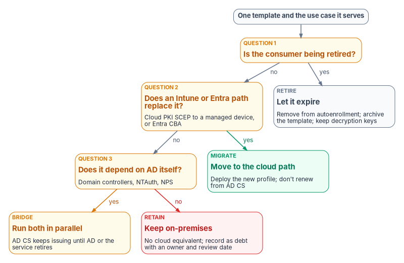

# Module 1: What AD CS holds up: the inventory {.unnumbered}

*Part of the [PKI and Certificates learning path](index.md). Book 07, [Chapter 01](../../books/b07-pki/01-why-certificates-outlive-every-migration.md), [Chapter 02](../../books/b07-pki/02-what-ad-cs-holds-up.md) and [Appendix B](../../books/b07-pki/appendix-b-template-migration-matrix.md). About 50 minutes.*

## Introduction (3 minutes)

A certificate is a signed statement that has already been handed out. It sits in device stores, on smart cards, in load balancers and in trust stores, and it keeps working until it expires or is revoked. AD CS isn't one server: it's a hierarchy, a set of forest-wide objects and a Group Policy channel, and every published template is a promise that some system depends on. Before any certificate moves, the program establishes what that estate is. In this module you read the inventory Book 07 asks for, run the Start Kit's AD CS assessment on a fictional snapshot, and give every template a starting class for its owner to confirm.

**The federal requirement.** The inventory supports NIST SP 800-53 CM-8 (system component inventory) for the CAs and templates, and SC-17 (public key infrastructure certificates) for the record of which CAs issue and who trusts them.

| Requirement | KSI | Evidence |
|---|---|---|
| CM-8: every CA and template recorded, published or not | KSI-PIY-GIV | `PKIInventory.json` and each CA's `.cer`, from a dated run |
| SC-17: certificates issued under a known hierarchy, its issuers and trust anchors recorded | KSI-SVC-ASM | The CA record: issuer, expiry, key size, signature algorithm; the AIA and CDP objects |
| CM-8: every template has a class and a named owner | KSI-PIY-GIV | `TemplateClassification.csv`, with each owner's decision |
| AC-6: the inventory runs with read rights only | KSI-IAM-ELP | The run account's group memberships; `Test-FMPReadAccess`'s output in Lab 2 |

KSIs are FedRAMP 20x indicators for cloud service providers. The agency lines its own evidence up with them; it doesn't report KSIs itself ([Book 00, Appendix B](../../books/b00-orientation/appendix-b-engagement-archetype.md)). The pairs above are the ones in [Book 13, Appendix A](../../books/b13-governance/appendix-a-requirements-mapping.md).

## Learning objectives (1 minute)

After this module, you'll be able to:

- explain why a certificate fails on its own clock, not when the directory is cut over;
- name the Public Key Services objects AD CS keeps in the forest, and what each holds;
- read a CA inventory record and a template's EKUs, publication and enrollment rights;
- name the four layers of the certificate inventory and what the Start Kit collects of them;
- classify a template as MIGRATE, BRIDGE, RETAIN or RETIRE, in the order Chapter 02 asks the questions.

## Prerequisites (1 minute)

- [Book 07, Chapter 01](../../books/b07-pki/01-why-certificates-outlive-every-migration.md). Read it in Unit 1.
- Windows PowerShell 5.1 and the Start Kit's folder, as [Get the code](index.md#get-the-code) sets it up.

## Unit 1: Why certificates outlive every migration (6 minutes)

Read Book 07, [Chapter 01](../../books/b07-pki/01-why-certificates-outlive-every-migration.md), sections *A certificate is a naming claim*, *What leans on certificates* and *The rules are moving under certificates already issued*. Three points to take away:

- **A certificate doesn't move with the directory.** An account is a record you move; a certificate is a statement already handed out, and a missing replacement shows up weeks or months after the cutover, when the old certificate expires.
- **The rules are moving under certificates already issued.** Public TLS lifetimes are shrinking on a fixed schedule, strong certificate mapping changed what a logon certificate must carry, and the algorithms themselves are on a clock.
- **Manual lifecycle management breaks.** That's why the move off AD CS is its own program, with its own inventory, and why [Chapter 08](../../books/b07-pki/08-lifecycle-monitoring-and-decommissioning.md) ends with a lifecycle platform.

## Unit 2: The topology and what AD CS keeps in the forest (8 minutes)

Read [Chapter 02](../../books/b07-pki/02-what-ad-cs-holds-up.md), sections *The typical topology*, *What AD CS keeps in the forest* and *The CA inventory record*. Most enterprise deployments are two-tier: an offline root signs the enterprise issuing CAs, which issue from templates stored in Active Directory. Each enterprise CA is also a set of objects in the Public Key Services branch of the configuration partition: its `pKIEnrollmentService` object under Enrollment Services, its `certificateAuthority` object under AIA, its `crlDistributionPoint` object under CDP, and its certificate in NTAuthCertificates. Those objects are forest-wide, so a change to any of them reaches clients far beyond the CA in view.

The CA inventory record has the same rows for every CA. Two of them matter for the target: the key storage provider, because AD CS post-quantum support needs CNG providers, and the CRL size, because Entra certificate-based authentication downloads each trusted CA's CRL and enforces size limits.

## Unit 3: Templates and autoenrollment (8 minutes)

Read [Chapter 02](../../books/b07-pki/02-what-ad-cs-holds-up.md), sections *Template categories* and *Autoenrollment*. A template's extended key usages (EKUs) say what its certificates may be used for, but not everything it allows: who can enroll, whether the requester supplies the subject, and whether the key can be exported matter as much, and they are what [Module 2](02-hardening-what-stays.md) checks. Autoenrollment needs three things: the Group Policy setting, Read, Enroll and Autoenroll on the template, and the template published on a CA. It runs every eight hours and renews a certificate past 80 percent of its validity. Entra-joined, Intune-managed devices don't process Group Policy, so for them the autoenrollment channel ends at the join.

## Unit 4: The four layers of the inventory (6 minutes)

Read [Chapter 02](../../books/b07-pki/02-what-ad-cs-holds-up.md), section *What the certificate inventory collects*. The inventory has four layers, and the Start Kit's `Get-FMPPKIAssessment` collects part of two of them:

| Layer | What Chapter 02 asks for | What the kit collects |
|---|---|---|
| CA | The CA record, plus whether each CRL and AIA URL in issued certificates is reachable, and each CRL's size and next update | Each enterprise CA's certificate (issuer, validity, key size, signature algorithm), its published templates, its audit filter, and the directory's AIA and CDP objects. Not the URLs or CRLs |
| Template | Every template, published or not: names, EKUs, subject name settings, enrollment settings, key settings, validity and renewal, the security descriptor, which CAs publish it | Names, schema version, EKUs and application policies, the name and enrollment flags, authorized signatures, publication, and the security descriptor for the ESC checks. Not key settings or validity periods |
| Issued certificate | From each CA database: active certificates per template, subjects, requesters, expiry and revocation | Nothing. Lab 2 reads it with `certutil -view` as the CA administrator, the administrator-run export the kit's README names |
| Relying party | For each chain, who trusts it and how | Nothing. This layer comes from the teams that run RADIUS, VPN, web applications and the Entra trust store |

: The four inventory layers and the Start Kit {.striped .hover}

Store every inventory run as a dated record so drift is visible between runs. [Module 2](02-hardening-what-stays.md) compares two runs.

## Unit 5: Classifying every template (8 minutes)

Read [Chapter 02](../../books/b07-pki/02-what-ad-cs-holds-up.md), sections *Classifying every use case* and *The use-case map*, then skim [Appendix B](../../books/b07-pki/appendix-b-template-migration-matrix.md)'s matrix. Three questions, in order: is the consumer being retired (RETIRE)? Does an Intune or Entra path replace it (MIGRATE)? Does it depend on Active Directory itself (BRIDGE)? Anything left is RETAIN, a short list with a name next to every entry.

{#fig-ch02-classification fig-alt="Top to bottom. A slate pill: one template and the use case it serves. Question 1, amber: is the consumer being retired? Yes leads to RETIRE, slate: let it expire; remove from autoenrollment; archive the template; keep decryption keys. No leads to question 2, amber: does an Intune or Entra path replace it, meaning Cloud PKI SCEP to a managed device or Entra CBA? Yes, in green, leads to MIGRATE: deploy the new profile; don't renew from AD CS. No leads to question 3, amber: does it depend on AD itself, such as domain controllers, NTAuth or NPS? Yes leads to BRIDGE, amber: AD CS keeps issuing until AD or the service retires. No, in red, leads to RETAIN: no cloud equivalent; record as debt with an owner and review date."}

Three facts drive most of Appendix B's rows. Cloud PKI issues only through SCEP, only to Intune-enrolled devices; Intune doesn't manage Windows Server, so every server certificate is BRIDGE or RETAIN; and PKCS profiles move *delivery* to Intune, not *issuance* off AD CS. The kit's `Get-FMPTemplateClassification` matches each template's name against Appendix B's rows for the AD CS default templates and copies the row's class and target as a starting point. An EKU or a name can suggest a class, but the template's owner makes the call, so every row says who acts next: **Owner confirms** for a default template, **Owner classifies** for a custom one.

## Exercise: Lab 1, a fictional PKI snapshot (15 minutes) {#pki-lab-1}
You inventory a fictional Contoso PKI with the Start Kit, and give each template its starting class. Work in `examples/start-kit`, with Windows PowerShell 5.1. The snapshot is `tests\fixtures\pki-contoso.json`: two issuing CAs under an offline root, fifteen templates, and each CA's `certutil -getreg` output, in the shape `Get-FMPPKIAssessment` reads from a directory.

<!-- labs:begin lab-1-commands (generated by scripts/generate_labs.py; not part of the reviewed page) -->

::: {.callout-note #lab-1-commands collapse="false" title="Every command in Lab 1"}
Every command in this lab, in order, from `examples/start-kit`. Each step below says what it does and what to look for.

```powershell
# Step 1: Load the kit
Import-Module .\powershell\FMPADAssessment -Force
(Get-Module FMPADAssessment).Version.ToString()

# Step 2: Run the PKI assessment on the snapshot
Get-FMPPKIAssessment -OutputPath $HOME\fmp-labs\pki\run1 -PkiDataPath .\tests\fixtures\pki-contoso.json
Get-ChildItem $HOME\fmp-labs\pki\run1\contoso.example\PKI | Format-Table Name

# Step 3: Read the CA records
$inv = Get-Content -Raw $HOME\fmp-labs\pki\run1\contoso.example\PKI\PKIInventory.json | ConvertFrom-Json
$inv.CertificationAuthorities | Format-List CAName, CertIssuer, NotAfter, KeySize, SignatureAlgorithm, @{ n = 'Templates'; e = { @($_.PublishedTemplates).Count } }

# Step 4: List every template, published or not
$inv.CertificateTemplates | Sort-Object Name | Format-Table Name, DisplayName, Published, @{ n = 'EKUs'; e = { @($_.EKU).Count } } -AutoSize
($inv.CertificateTemplates | Where-Object Name -eq 'User').EKU

# Step 5: List the forest's AIA and CDP objects
'AIA: ' + ($inv.AIAObjects.Name -join ', ')
'CDP: ' + ($inv.CDPObjects.Name -join ', ')

# Step 6: Give every template its starting class
Get-FMPTemplateClassification -OutputPath $HOME\fmp-labs\pki\run1 -Domain contoso.example | Format-Table Template, Published, StartingClass, Status -AutoSize

# Step 7: List the templates only an owner can classify
Import-Csv $HOME\fmp-labs\pki\run1\contoso.example\PKI\TemplateClassification.csv | Where-Object Status -eq 'Owner classifies' | Format-Table Template, DisplayName, Published -AutoSize
```

:::

<!-- labs:end -->

1. **Load the kit.**

    ```powershell
    Import-Module .\powershell\FMPADAssessment -Force
    (Get-Module FMPADAssessment).Version.ToString()
    ```

    Expected output:

    ```text
    1.5.0
    ```

2. **Run the PKI assessment on the snapshot.** `-PkiDataPath` reads the snapshot instead of a directory and a CA; everything else is the code that runs against a forest.

    ```powershell
    Get-FMPPKIAssessment -OutputPath $HOME\fmp-labs\pki\run1 -PkiDataPath .\tests\fixtures\pki-contoso.json
    Get-ChildItem $HOME\fmp-labs\pki\run1\contoso.example\PKI | Format-Table Name
    ```

    Expected output:

    ```text
    Name
    ----
    Contoso_Issuing_CA_1.cer
    Contoso_Issuing_CA_2.cer
    PKIInventory.json
    PKISecurityReport.json
    ```

    Each `.cer` is the CA's certificate, taken from its Enrollment Services object, not from `certutil -ca.cert`, which writes a file on the CA.

3. **Read the CA records.**

    ```powershell
    $inv = Get-Content -Raw $HOME\fmp-labs\pki\run1\contoso.example\PKI\PKIInventory.json | ConvertFrom-Json
    $inv.CertificationAuthorities | Format-List CAName, CertIssuer, NotAfter, KeySize, SignatureAlgorithm, @{ n = 'Templates'; e = { @($_.PublishedTemplates).Count } }
    ```

    Expected output:

    ```text
    CAName             : Contoso Issuing CA 1
    CertIssuer         : CN=Contoso Root CA, O=Contoso (fictional), C=US
    NotAfter           : 2027-03-01T00:00:00.0000000Z
    KeySize            : 2048
    SignatureAlgorithm : sha256RSA
    Templates          : 8

    CAName             : Contoso Issuing CA 2
    CertIssuer         : CN=Contoso Root CA, O=Contoso (fictional), C=US
    NotAfter           : 2029-06-01T00:00:00.0000000Z
    KeySize            : 2048
    SignatureAlgorithm : sha256RSA
    Templates          : 5
    ```

    Issuing CA 1's own certificate expires in March 2027. Every certificate it issued has to be renewed from somewhere before then, which puts a date on the migration whatever the plan says.

4. **List every template, published or not.**

    ```powershell
    $inv.CertificateTemplates | Sort-Object Name | Format-Table Name, DisplayName, Published, @{ n = 'EKUs'; e = { @($_.EKU).Count } } -AutoSize
    ($inv.CertificateTemplates | Where-Object Name -eq 'User').EKU
    ```

    Expected output:

    ```text
    Name                   DisplayName                         Published EKUs
    ----                   -----------                         --------- ----
    CodeSigning            Code Signing                             True    1
    ContosoSCEP            Contoso SCEP (NDES)                      True    1
    ContosoVPNUser         Contoso VPN User                         True    1
    DomainController       Domain Controller                       False    2
    EFS                    Basic EFS                                True    1
    EFSRecovery            EFS Recovery Agent                      False    1
    ExchangeUser           Exchange User                            True    1
    KerberosAuthentication Kerberos Authentication                  True    4
    LegacyAnyPurpose       Legacy Any Purpose                       True    1
    Machine                Computer                                 True    2
    RASAndIASServer        RAS and IAS Server                       True    2
    SubCA                  Subordinate Certification Authority     False    0
    User                   User                                     True    3
    WebServer              Web Server                               True    1
    WebServerLegacy        Web Server Legacy                        True    2

    1.3.6.1.4.1.311.10.3.4
    1.3.6.1.5.5.7.3.4
    1.3.6.1.5.5.7.3.2
    ```

    The default User template carries EFS, secure email and client authentication. A classifier that read only one of those EKUs would get it wrong, which is the weakness Chapter 02 found in the source guide's code. The three unpublished templates can't be requested, but they stay in the inventory: Domain Controller was superseded by Kerberos Authentication.

5. **List the forest's AIA and CDP objects.**

    ```powershell
    'AIA: ' + ($inv.AIAObjects.Name -join ', ')
    'CDP: ' + ($inv.CDPObjects.Name -join ', ')
    ```

    Expected output:

    ```text
    AIA: Contoso Root CA, Contoso Issuing CA 1, Contoso Issuing CA 2
    CDP: Contoso Issuing CA 1, Contoso Issuing CA 2, Contoso Root CA
    ```

    These are the directory's copies only. The HTTP locations each certificate carries, and whether a relying party can reach them, are the part of the CA layer the kit doesn't collect.

6. **Give every template its starting class.**

    ```powershell
    Get-FMPTemplateClassification -OutputPath $HOME\fmp-labs\pki\run1 -Domain contoso.example | Format-Table Template, Published, StartingClass, Status -AutoSize
    ```

    Expected output:

    ```text
    Template               Published StartingClass                                           Status
    --------               --------- -------------                                           ------
    CodeSigning                 True RETAIN                                                  Owner confirms
    ContosoSCEP                 True                                                         Owner classifies
    ContosoVPNUser              True                                                         Owner classifies
    DomainController           False BRIDGE, then superseded                                 Owner confirms
    EFS                         True RETIRE                                                  Owner confirms
    EFSRecovery                False RETIRE, last                                            Owner confirms
    ExchangeUser                True MIGRATE (delivery); RETAIN (issuer)                     Owner confirms
    KerberosAuthentication      True BRIDGE                                                  Owner confirms
    LegacyAnyPurpose            True                                                         Owner classifies
    Machine                     True MIGRATE (Intune-managed workstations); BRIDGE (servers) Owner confirms
    RASAndIASServer             True BRIDGE                                                  Owner confirms
    SubCA                      False RETAIN on the root                                      Owner confirms
    User                        True MIGRATE                                                 Owner confirms
    WebServer                   True RETAIN                                                  Owner confirms
    WebServerLegacy             True                                                         Owner classifies
    ```

    It also wrote `TemplateClassification.csv` beside the inventory, with an empty `Owner` column. Machine carries two verdicts: Intune-managed workstations move to Cloud PKI, and servers stay on AD CS.

7. **List the templates only an owner can classify.**

    ```powershell
    Import-Csv $HOME\fmp-labs\pki\run1\contoso.example\PKI\TemplateClassification.csv | Where-Object Status -eq 'Owner classifies' | Format-Table Template, DisplayName, Published -AutoSize
    ```

    Expected output:

    ```text
    Template         DisplayName         Published
    --------         -----------         ---------
    ContosoSCEP      Contoso SCEP (NDES) True
    ContosoVPNUser   Contoso VPN User    True
    LegacyAnyPurpose Legacy Any Purpose  True
    WebServerLegacy  Web Server Legacy   True
    ```

    Appendix B has rows for custom templates of these kinds, a custom NDES SCEP template is BRIDGE until Cloud PKI SCEP replaces it, and a VPN client certificate is MIGRATE, but only the owner knows what each one serves. Three of the four also turn up in [Module 2](02-hardening-what-stays.md)'s findings.

Keep `$HOME\fmp-labs\pki\run1`: Module 2 reads it.

## Exercise: Lab 2, a test forest {#pki-lab-2}
*Not timed. Not run by the authors. Never production.*

<!-- labs:begin lab-2-commands (generated by scripts/generate_labs.py; not part of the reviewed page) -->

::: {.callout-note #lab-2-commands collapse="false" title="Every command in Lab 2"}
Every command in this lab, in order. Each step below says what it does and what to look for.

```powershell
# Step 1: Check what the account can read
Import-Module .\powershell\FMPADAssessment -Force
Test-FMPPrerequisites -OutputPath $HOME\fmp-labs\pki\test1 | Format-Table Check, Status, Detail -AutoSize
Test-FMPReadAccess -OutputPath $HOME\fmp-labs\pki\test1 -Domain <test-domain> | Where-Object Area -eq 'AD CS' | Format-Table Item, Status -AutoSize

# Step 2: Inventory the forest's PKI
Get-FMPPKIAssessment -OutputPath $HOME\fmp-labs\pki\test1 -Domain <test-domain>
$inv = Get-Content -Raw $HOME\fmp-labs\pki\test1\<test-domain>\PKI\PKIInventory.json | ConvertFrom-Json
$inv.CertificationAuthorities | Format-List CAName, ConfigString, CertIssuer, NotAfter, KeySize, AuditFilter

# Step 3: Give every template its starting class
Get-FMPTemplateClassification -OutputPath $HOME\fmp-labs\pki\test1 -Domain <test-domain> | Format-Table Template, Published, StartingClass, Status -AutoSize

# Step 4: Read the issued-certificate layer
certutil -config "<ca-host>\<ca-name>" -view -restrict "Disposition=20" -out "RequestID,RequesterName,CertificateTemplate,NotAfter" csv > $HOME\fmp-labs\pki\test1\IssuedCertificates.csv
Get-Content $HOME\fmp-labs\pki\test1\IssuedCertificates.csv -TotalCount 5

# Step 5: Back it out
Remove-Item -Recurse -Force $HOME\fmp-labs\pki\test1
```

:::

<!-- labs:end -->

You run the same inventory against a test forest's AD CS, as a standard account with read rights, then read the issued-certificate layer as the CA administrator.

- **You need:** a test forest, never production, with an enterprise issuing CA; a domain-joined Windows host with Windows PowerShell 5.1 and the RSAT Active Directory module; a standard domain account with no added rights to run the kit; the test CA's administrator for step 4.
- **You'll replace:** `<test-domain>` (the test forest root domain, for example `lab.example`), `<ca-host>` and `<ca-name>` (the issuing CA's host name and CA name, as `Get-FMPPKIAssessment` printed them in `ConfigString`).

1. **Check what the account can read.** Run as the standard account, from the kit's folder:

    ```powershell
    Import-Module .\powershell\FMPADAssessment -Force
    Test-FMPPrerequisites -OutputPath $HOME\fmp-labs\pki\test1 | Format-Table Check, Status, Detail -AutoSize
    Test-FMPReadAccess -OutputPath $HOME\fmp-labs\pki\test1 -Domain <test-domain> | Where-Object Area -eq 'AD CS' | Format-Table Item, Status -AutoSize
    ```

    The templates are readable by default. `CA policy settings` reads **Denied** unless the account can read the CA's configuration: that's the Tier B request in `Preflight\DelegationRequest.md`, never the CA administrator role.

2. **Inventory the forest's PKI.**

    ```powershell
    Get-FMPPKIAssessment -OutputPath $HOME\fmp-labs\pki\test1 -Domain <test-domain>
    $inv = Get-Content -Raw $HOME\fmp-labs\pki\test1\<test-domain>\PKI\PKIInventory.json | ConvertFrom-Json
    $inv.CertificationAuthorities | Format-List CAName, ConfigString, CertIssuer, NotAfter, KeySize, AuditFilter
    ```

    `AuditFilter` is empty if the account couldn't read the CA's registry.

3. **Give every template its starting class.**

    ```powershell
    Get-FMPTemplateClassification -OutputPath $HOME\fmp-labs\pki\test1 -Domain <test-domain> | Format-Table Template, Published, StartingClass, Status -AutoSize
    ```

    A test forest that has only the defaults shows **Owner confirms** on every published row. Add the owner's name to each row of `TemplateClassification.csv` as you would in the program.

4. **Read the issued-certificate layer**, as the CA administrator, on the CA or a host with the CA's management tools. This reads the CA database and changes nothing:

    ```powershell
    certutil -config "<ca-host>\<ca-name>" -view -restrict "Disposition=20" -out "RequestID,RequesterName,CertificateTemplate,NotAfter" csv > $HOME\fmp-labs\pki\test1\IssuedCertificates.csv
    Get-Content $HOME\fmp-labs\pki\test1\IssuedCertificates.csv -TotalCount 5
    ```

    Disposition 20 is an issued certificate. The header row names the columns in the CA's display language. Sorted by template and expiry date, this export is where the expiry waves of Chapter 01 become dates on a calendar.

5. **Back it out.** The lab changed nothing in the forest. Delete the output, which lists the forest's PKI weaknesses:

    ```powershell
    Remove-Item -Recurse -Force $HOME\fmp-labs\pki\test1
    ```

## Knowledge check (5 minutes)

1. Why does a missing certificate replacement usually show up weeks or months after a directory cutover?
    a. Because the cutover deletes certificates from device stores.
    b. Because a certificate keeps working, unchanged, until it expires or is revoked.
    c. Because Entra ID re-issues every certificate after the cutover.

2. Where does an enterprise CA record which templates it can issue?
    a. In its `pKIEnrollmentService` object under Enrollment Services in the configuration partition.
    b. In the NTAuthCertificates object.
    c. Only in the CA's registry.

3. Which question does Chapter 02 ask first when classifying a template?
    a. Does an Intune or Entra path replace it?
    b. Does it depend on Active Directory itself?
    c. Is the consumer being retired?

4. A template issues TLS certificates to internal web servers. What is its starting class, and why?
    a. MIGRATE, because Cloud PKI can issue server certificates through PKCS.
    b. RETAIN, because Cloud PKI issues only to Intune-managed devices through SCEP, and Intune doesn't manage Windows Server.
    c. RETIRE, because web servers will move to the cloud.

5. `Get-FMPTemplateClassification` marks a template **Owner confirms**. What does that mean?
    a. The template matched one of Appendix B's default rows, and its owner still confirms the class.
    b. The template is safe to migrate.
    c. The owner has already approved the class.

6. Which inventory layer does the Start Kit not collect at all?
    a. The template layer.
    b. The issued-certificate layer.
    c. The CA layer.

::: {.callout-tip collapse="true"}
## Check your answers
1. **b.** See Unit 1 and [Chapter 01](../../books/b07-pki/01-why-certificates-outlive-every-migration.md#a-certificate-is-a-naming-claim).
2. **a.** See Unit 2 and [Chapter 02](../../books/b07-pki/02-what-ad-cs-holds-up.md#what-ad-cs-keeps-in-the-forest).
3. **c.** Migrating a certificate for a service that's going away is wasted work. See Unit 5.
4. **b.** See Unit 5 and [Appendix B](../../books/b07-pki/appendix-b-template-migration-matrix.md#the-matrix)'s Web Server row.
5. **a.** The kit suggests; the owner decides. See Unit 5 and Lab 1, step 6.
6. **b.** It also collects only part of the CA layer, and none of the relying-party layer. See Unit 4.
:::

## Summary (2 minutes)

You read what AD CS keeps in the forest, inventoried a PKI's CAs and templates with the Start Kit, and gave every template a starting class for its owner to confirm. **Evidence an ISSO keeps from this module:** the dated run folder with `PKIInventory.json` and each CA's `.cer`, `TemplateClassification.csv` with each owner's name and decision, and, from the CA administrator, the issued-certificate export.

::: {.callout-tip}
## Continue the path
[Learning path](index.md) · [Next: Module 2, Hardening what stays →](02-hardening-what-stays.md)
:::
