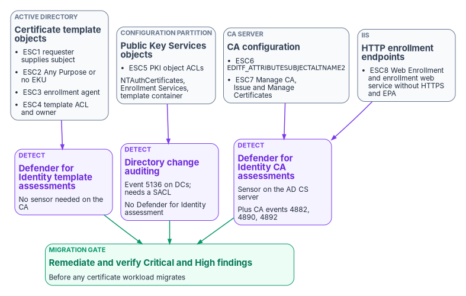
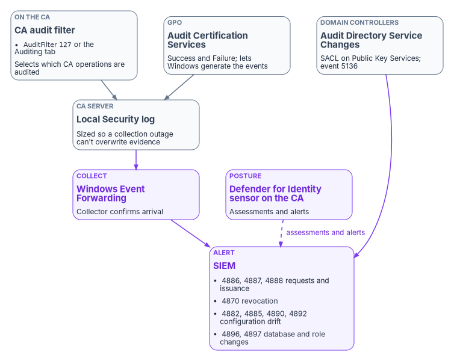

# Module 2: Hardening what stays {.unnumbered}

*Part of the [PKI and Certificates learning path](index.md). Book 07, [Chapter 03](../../books/b07-pki/03-hardening-what-stays.md). About 55 minutes.*

## Introduction (3 minutes)

A migration off AD CS takes months, and for some workloads it never finishes. Throughout that time the enterprise CA keeps issuing certificates that domain controllers, VPN gateways, RADIUS servers and Entra ID accept as proof of identity, so one misconfigured setting on it can undo every other identity control. Under the bring-your-own-CA model Book 07 recommends, the new Cloud PKI issuing CA chains to the existing hierarchy and inherits its weaknesses. That makes hardening the first technical workstream. In this module you find the misconfigurations the Start Kit checks, read each CA's audit filter, fix a copy of the fictional snapshot and prove the fix with a second run.

**The federal requirement.** The full control states and evidence checklists are in [Chapter 03](../../books/b07-pki/03-hardening-what-stays.md#the-risk-scoring-matrix).

| Requirement | KSI | Evidence |
|---|---|---|
| CM-6: template and CA settings checked against the hardening baseline | KSI-SVC-ACM, KSI-MLA-EVC | `PKISecurityReport.json` from a dated run |
| CM-3: each remediation under a change record, tested first | KSI-CMT-LMC, KSI-CMT-VTD | The change record, the backup, the configuration before and after |
| CA-7: the fix proven by a second run | KSI-MLA-EVC | The comparison of the two runs, naming each finding closed |
| AU-2 and AU-12: CA auditing on every CA that stays | No indicator pairing in this repository's verified mappings | Each CA's audit filter, the audit policy, and each baseline event seen in a test |

KSIs are FedRAMP 20x indicators for cloud service providers. The agency lines its own evidence up with them; it doesn't report KSIs itself. The pairs above are the ones in [Book 13, Appendix A](../../books/b13-governance/appendix-a-requirements-mapping.md).

## Learning objectives (1 minute)

After this module, you'll be able to:

- state the migration gate, and say why hardening comes before any workload moves;
- name the eight ESC classes, where each one lives, and which four the Start Kit checks;
- read a template's subject name flag, enrollment flag and ACL, and say why they add up to ESC1;
- explain why CA auditing needs two settings, and read a CA's audit filter;
- remediate under the safety rules for a Tier 0 system, and prove the fix with a finding-by-finding comparison.

## Prerequisites (1 minute)

- [Module 1](01-what-ad-cs-holds-up.md), and its Lab 1 output in `$HOME\fmp-labs\pki\run1`.
- [Book 04, Chapter 04](../../books/b04-access/04-privileged-roles-and-tiers.md)'s Tier 0 model, for why the CA is administered like a domain controller. Skim it.

## Unit 1: The migration gate (4 minutes)

Read [Chapter 03](../../books/b07-pki/03-hardening-what-stays.md), sections *The migration gate* and *The ESC taxonomy*. One rule: misconfigurations rated Critical or High in the chapter's risk-scoring matrix are remediated and verified before any certificate workload migrates. Migrating from a CA that can be made to issue arbitrary credentials carries that weakness into whatever trusts the hierarchy next. The ESC1 to ESC8 names come from SpecterOps's 2021 research; Microsoft Defender for Identity uses the same labels in its certificate assessments, so they're the shared vocabulary between assessors, vendors and Microsoft's documentation. Book 07 uses them only as labels for defensive checks.

## Unit 2: The eight classes, and what the kit checks (12 minutes)

Read [Chapter 03](../../books/b07-pki/03-hardening-what-stays.md), sections *ESC1* to *ESC8*. Each class lives at one of four control points, and each has its own detection source.

{#fig-ch03-esc-control-points fig-alt="Four slate cards in a row represent the four AD CS control points. Certificate template objects in Active Directory hold ESC1 requester-supplied subject, ESC2 Any Purpose or no EKU, ESC3 enrollment agent templates, and ESC4 template ACL and owner. Public Key Services objects in the configuration partition hold ESC5, PKI object ACLs including NTAuthCertificates and Enrollment Services. CA configuration on the CA server holds ESC6, the EDITF_ATTRIBUTESUBJECTALTNAME2 flag, and ESC7, CA permissions Manage CA and Issue and Manage Certificates. HTTP enrollment endpoints in IIS hold ESC8, Web Enrollment and Certificate Enrollment Web Service without HTTPS and Extended Protection. Below them, violet cards show the detection sources: Defender for Identity template assessments for ESC1 to ESC4; directory service change auditing event 5136 on domain controllers for ESC5, which has no Defender for Identity assessment; and Defender for Identity CA assessments, which need a sensor on the AD CS server, plus CA audit events 4882, 4890 and 4892 for ESC6 to ESC8. A green card at the bottom reads remediate Critical and High before any workload migrates."}

The Start Kit's `Get-FMPPKIAssessment` checks four of the eight, read-only:

| Class | What the kit flags | What it doesn't check |
|---|---|---|
| ESC1 | A published template whose name flag lets the requester supply the subject, with an authentication EKU (or none), no manager approval, no authorized signatures, and Enroll for Authenticated Users, Domain Users, Domain Computers or Everyone | Enroll granted to other large groups the agency treats as broad |
| ESC2 | A published template with Any Purpose or no EKU, enrollable by those groups | — |
| ESC4 | Write-type rights (Full Control, Write, Write DACL, Write Owner, Write Property) on a template for those groups | The template's owner, which Chapter 03 also checks |
| ESC6 | `EDITF_ATTRIBUTESUBJECTALTNAME2` in a CA's policy EditFlags, read with `certutil -getreg` | — |

: The ESC classes the Start Kit checks {.striped .hover}

ESC3 (enrollment agent templates), ESC5 (Public Key Services object ACLs), ESC7 (CA permissions) and ESC8 (HTTP enrollment endpoints) come from Defender for Identity's assessments and the manual reviews Chapter 03 describes. ESC5 has no Defender for Identity assessment at all: it's a review of the container's ACLs, `certutil -viewstore -enterprise NTAuth`, and event 5136. In GCC, two of Defender for Identity's assessments (ESC1 and ESC6) are still labeled preview, so confirm they appear in your tenant and run the manual checks meanwhile.

## Unit 3: Turn on CA auditing (8 minutes)

Read [Chapter 03](../../books/b07-pki/03-hardening-what-stays.md), section *Turn on CA auditing*. AD CS produces no audit evidence by default, and two settings are needed, neither of which works without the other: the CA's audit filter, which selects the CA operations to audit (`127` is every category), and the **Audit Certification Services** advanced audit subcategory, set by Group Policy, which lets Windows generate the events.

{#fig-ch03-ca-audit-path fig-alt="A left-to-right flow. Two slate cards on the left feed a single CA card: the CA audit filter, AuditFilter 127, selects which CA operations are audited, and the Audit Certification Services advanced audit subcategory, set by GPO to Success and Failure, lets Windows generate the events. The CA card shows the local Security log, sized so collection outages don't overwrite evidence. An arrow leads to a violet card for Windows Event Forwarding to a collector, which forwards to a violet SIEM card that alerts on the baseline events 4870, 4882, 4885, 4886, 4887, 4888, 4890, 4892, 4896 and 4897. A separate slate card for domain controllers, with Audit Directory Service Changes and a SACL on Public Key Services producing event 5136, also feeds the SIEM card. A dashed violet line from the Defender for Identity sensor on the CA reads posture assessments and alerts."}

The Start Kit records each CA's audit filter in the inventory, as `AuditFilter`. It can't see the operating system's audit policy, so a CA showing `127` still needs the GPO export as evidence. A CA left unaudited is a finding, not an exception. Microsoft recommends generating each baseline event in a nonproduction test before writing the collection rule, so an assumed event doesn't become a blind spot.

## Unit 4: Scoring, and changing a Tier 0 system safely (8 minutes)

Read [Chapter 03](../../books/b07-pki/03-hardening-what-stays.md), sections *The risk-scoring matrix* and *Hardening the AD CS that remains*. The matrix gives each class a risk level and a remediation priority; they are the program's own scoring, not a vendor classification, and every row is a migration blocker until it's verified closed. Every remediation is a change to a Tier 0 system, so it follows the same rules whichever class it fixes:

- **Rings.** A test CA or a duplicated template first. A fix that might break a workload is first checked against the requests that used the template in the last 90 days, from events 4886 and 4887.
- **Change window and backout.** A change record, and a `Backup-CARoleService` backup taken first. The backout trigger is a workload whose requests are now denied (event 4888) that wasn't on the impact list.
- **Post-change validation.** The assessment for the class clears, and a legitimate request from the workload still succeeds.

For the templates that stay, remove every template no BRIDGE or RETAIN workload needs from each CA's issuance list. That is also Microsoft's usual first rollback step, so it's reversible.

## Exercise: Lab 1, findings on a fictional snapshot (15 minutes) {#pki-lab-1}
You read the kit's findings on the fictional Contoso PKI, see why one template is ESC1, fix a copy of the snapshot, and prove the fix with a second run. Do it after [Module 1's Lab 1](01-what-ad-cs-holds-up.md#pki-lab-1), whose first run this lab reads.

<!-- labs:begin lab-1-commands (generated by scripts/generate_labs.py; not part of the reviewed page) -->

::: {.callout-note #lab-1-commands collapse="false" title="Every command in Lab 1"}
Every command in this lab, in order. Each step below says what it does and what to look for.

```powershell
Set-Location C:\FMWLabs\start-kit

# Step 1: Read the findings
Import-Module .\powershell\FMPADAssessment -Force
$f = Get-Content -Raw $HOME\fmp-labs\pki\run1\contoso.example\PKI\PKISecurityReport.json | ConvertFrom-Json
$f | Format-Table Finding, Severity, Template -AutoSize

# Step 2: Read what a finding asks for
$esc1 = $f | Where-Object Finding -eq 'ESC1'
$esc1.Description
$esc1.Remediation

# Step 3: See why the template is ESC1
$s = Get-Content -Raw .\tests\fixtures\pki-contoso.json | ConvertFrom-Json
$t = $s.templates | Where-Object cn -eq 'WebServerLegacy'
'Supply in the request: {0}' -f (($t.'msPKI-Certificate-Name-Flag' -band 1) -eq 1)
'Manager approval:      {0}' -f (($t.'msPKI-Enrollment-Flag' -band 2) -eq 2)
'Authorized signatures: {0}' -f $t.'msPKI-RA-Signature'
$t.nTSecurityDescriptor.Access | Format-Table IdentityReference, ActiveDirectoryRights, ObjectType -AutoSize

# Step 4: Read each CA's audit filter
$inv = Get-Content -Raw $HOME\fmp-labs\pki\run1\contoso.example\PKI\PKIInventory.json | ConvertFrom-Json
$inv.CertificationAuthorities | Format-Table CAName, AuditFilter -AutoSize

# Step 5: Fix a copy of the snapshot
$s = Get-Content -Raw .\tests\fixtures\pki-contoso.json | ConvertFrom-Json
($s.templates | Where-Object cn -eq 'WebServerLegacy').'msPKI-Certificate-Name-Flag' = 0
$s.cas[0].editFlags = $s.cas[0].editFlags -replace '(?m)^ +EDITF_ATTRIBUTESUBJECTALTNAME2.*\n', '' -replace '15014e \(1376590\)', '11014e (1114446)'
$s | ConvertTo-Json -Depth 10 | Set-Content -Encoding UTF8 -Path $HOME\fmp-labs\pki\pki-contoso-fixed.json

# Step 6: Run the assessment again
Get-FMPPKIAssessment -OutputPath $HOME\fmp-labs\pki\run2 -PkiDataPath $HOME\fmp-labs\pki\pki-contoso-fixed.json
Get-Content -Raw $HOME\fmp-labs\pki\run2\contoso.example\PKI\PKISecurityReport.json | ConvertFrom-Json | Format-Table Finding, Severity, Template -AutoSize

# Step 7: Compare the two runs, finding by finding
Compare-FMPAssessments -BaselinePath $HOME\fmp-labs\pki\run1\contoso.example -CurrentPath $HOME\fmp-labs\pki\run2\contoso.example | Where-Object File -like 'PKI*' | Format-List File, Status, Added, Removed

# Step 7: Compare the two runs, finding by finding
Remove-Item -Recurse -Force $HOME\fmp-labs\pki\run1, $HOME\fmp-labs\pki\run2, $HOME\fmp-labs\pki\pki-contoso-fixed.json
```

:::

<!-- labs:end -->

Every step runs in Windows PowerShell 5.1 or PowerShell 7, and prints the output shown here in either, so you can follow it top to bottom in one window. Open **Windows PowerShell** (or **PowerShell 7**) from the Start menu, then go to the kit's folder, where you unzipped it under [Get the code](index.md#get-the-code):

```powershell
Set-Location C:\FMWLabs\start-kit
```

In Git Bash, `cd /c/FMWLabs/start-kit` reaches the same folder, but every step is a PowerShell command (type `powershell` or `pwsh` to start one there). In a clone of the repository, use the `examples` folder of the same name.

1. **Read the findings.** Module 1's run wrote them beside the inventory.

    ```powershell
    Import-Module .\powershell\FMPADAssessment -Force
    $f = Get-Content -Raw $HOME\fmp-labs\pki\run1\contoso.example\PKI\PKISecurityReport.json | ConvertFrom-Json
    $f | Format-Table Finding, Severity, Template -AutoSize
    ```

    Expected output:

    ```text
    Finding Severity Template
    ------- -------- --------
    ESC1    Critical Web Server Legacy
    ESC2    Critical Legacy Any Purpose
    ESC4    High     Contoso SCEP (NDES)
    ESC6    Critical N/A (ca01.contoso.example\Contoso Issuing CA 1)
    ```

    `Severity` is the risk level in Chapter 03's [risk-scoring matrix](../../books/b07-pki/03-hardening-what-stays.md#the-risk-scoring-matrix), which also gives each class its remediation priority: Immediate for the three Critical rows, within two weeks for ESC4. Every row is a migration blocker until it's verified closed.

2. **Read what a finding asks for.**

    ```powershell
    $esc1 = $f | Where-Object Finding -eq 'ESC1'
    $esc1.Description
    $esc1.Remediation
    ```

    Expected output, the description and then the remediation:

    ```text
    Published template lets broad groups enroll, supply the subject, and obtain an authentication certificate without approval.
    Turn off Supply in the request, remove authentication EKUs, restrict enrollment, require manager approval, or unpublish.
    ```

    Any one of the five closes the exposure; do as many as the use case allows.

3. **See why the template is ESC1.** Read its settings from the snapshot, the attributes the kit tested.

    ```powershell
    $s = Get-Content -Raw .\tests\fixtures\pki-contoso.json | ConvertFrom-Json
    $t = $s.templates | Where-Object cn -eq 'WebServerLegacy'
    'Supply in the request: {0}' -f (($t.'msPKI-Certificate-Name-Flag' -band 1) -eq 1)
    'Manager approval:      {0}' -f (($t.'msPKI-Enrollment-Flag' -band 2) -eq 2)
    'Authorized signatures: {0}' -f $t.'msPKI-RA-Signature'
    $t.nTSecurityDescriptor.Access | Format-Table IdentityReference, ActiveDirectoryRights, ObjectType -AutoSize
    ```

    Expected output:

    ```text
    Supply in the request: True
    Manager approval:      False
    Authorized signatures: 0

    IdentityReference    ActiveDirectoryRights       ObjectType
    -----------------    ---------------------       ----------
    CONTOSO\Domain Users ReadProperty, ExtendedRight 0e10c968-78fb-11d2-90d4-00c04f79dc55
    ```

    Bit `0x1` of `msPKI-Certificate-Name-Flag` is **Supply in the request**; the GUID is the Enroll extended right. Domain Users can enroll and name anyone, and the template carries Client Authentication. Contoso SCEP also supplies the subject, as an NDES template must, but only its service account can enroll, so it isn't ESC1: its finding is ESC4, for the write right Authenticated Users hold on it.

4. **Read each CA's audit filter.**

    ```powershell
    $inv = Get-Content -Raw $HOME\fmp-labs\pki\run1\contoso.example\PKI\PKIInventory.json | ConvertFrom-Json
    $inv.CertificationAuthorities | Format-Table CAName, AuditFilter -AutoSize
    ```

    Expected output:

    ```text
    CAName               AuditFilter
    ------               -----------
    Contoso Issuing CA 1           0
    Contoso Issuing CA 2         127
    ```

    Issuing CA 1 audits nothing, so none of its findings would have left a trace in the log. It goes on the plan of action beside its ESC6 finding.

5. **Fix a copy of the snapshot.** In the program, this is the change on the test CA, then production, under a change record. Here you turn off **Supply in the request** on Web Server Legacy and clear the flag on Issuing CA 1, in a copy:

    ```powershell
    $s = Get-Content -Raw .\tests\fixtures\pki-contoso.json | ConvertFrom-Json
    ($s.templates | Where-Object cn -eq 'WebServerLegacy').'msPKI-Certificate-Name-Flag' = 0
    $s.cas[0].editFlags = $s.cas[0].editFlags -replace '(?m)^ +EDITF_ATTRIBUTESUBJECTALTNAME2.*\n', '' -replace '15014e \(1376590\)', '11014e (1114446)'
    $s | ConvertTo-Json -Depth 10 | Set-Content -Encoding UTF8 -Path $HOME\fmp-labs\pki\pki-contoso-fixed.json
    ```

    It prints nothing. The second line is what `certutil -setreg policy\EditFlags -EDITF_ATTRIBUTESUBJECTALTNAME2` does to the value `certutil -getreg` prints.

6. **Run the assessment again.**

    ```powershell
    Get-FMPPKIAssessment -OutputPath $HOME\fmp-labs\pki\run2 -PkiDataPath $HOME\fmp-labs\pki\pki-contoso-fixed.json
    Get-Content -Raw $HOME\fmp-labs\pki\run2\contoso.example\PKI\PKISecurityReport.json | ConvertFrom-Json | Format-Table Finding, Severity, Template -AutoSize
    ```

    Expected output:

    ```text
    Finding Severity Template
    ------- -------- --------
    ESC2    Critical Legacy Any Purpose
    ESC4    High     Contoso SCEP (NDES)
    ```

    Both still block the migration: the gate covers Critical and High.

7. **Compare the two runs, finding by finding.**

    ```powershell
    Compare-FMPAssessments -BaselinePath $HOME\fmp-labs\pki\run1\contoso.example -CurrentPath $HOME\fmp-labs\pki\run2\contoso.example | Where-Object File -like 'PKI*' | Format-List File, Status, Added, Removed
    ```

    Expected output:

    ```text
    File    : PKI\PKISecurityReport.json
    Status  : Changed
    Added   : {}
    Removed : {ESC1 | Web Server Legacy, ESC6 | N/A (ca01.contoso.example\Contoso Issuing CA 1)}
    ```

    `Removed` names each finding the change closed, and `Added` would name any it introduced. With the change record and the before-and-after runs, this is the closing evidence for the wave 1 gate record. The other files show as missing in one run because the snapshot run writes only the PKI folder.

    Then delete what both labs wrote, so the next run starts clean:

    ```powershell
    Remove-Item -Recurse -Force $HOME\fmp-labs\pki\run1, $HOME\fmp-labs\pki\run2, $HOME\fmp-labs\pki\pki-contoso-fixed.json
    ```

## Exercise: Lab 2, a test CA {#pki-lab-2}
*Not timed. Not run by the authors. Never production.*

<!-- labs:begin lab-2-commands (generated by scripts/generate_labs.py; not part of the reviewed page) -->

::: {.callout-note #lab-2-commands collapse="false" title="Every command in Lab 2"}
Every command in this lab, in order. Each step below says what it does and what to look for.

```powershell
# Step 1: Back up the CA and record its settings
Backup-CARoleService -Path <backup-folder> -Password (Read-Host -AsSecureString -Prompt 'Backup password')
certutil -getreg policy\EditFlags
certutil -getreg CA\AuditFilter

# Step 2: Turn on CA auditing
auditpol /set /subcategory:"Certification Services" /success:enable /failure:enable
certutil -setreg CA\AuditFilter 127
Restart-Service -Name certsvc

# Step 3: Set the ESC6 flag, on the test CA only
certutil -setreg policy\EditFlags +EDITF_ATTRIBUTESUBJECTALTNAME2
Restart-Service -Name certsvc

# Step 4: Find it with the kit
Import-Module .\powershell\FMPADAssessment -Force
Get-FMPPKIAssessment -OutputPath $HOME\fmp-labs\pki\test-before -Domain <test-domain>
Get-Content -Raw $HOME\fmp-labs\pki\test-before\<test-domain>\PKI\PKISecurityReport.json | ConvertFrom-Json | Format-Table Finding, Template -AutoSize

# Step 5: Clear the flag
certutil -setreg policy\EditFlags -EDITF_ATTRIBUTESUBJECTALTNAME2
Restart-Service -Name certsvc

# Step 6: Run it again and compare
Get-FMPPKIAssessment -OutputPath $HOME\fmp-labs\pki\test-after -Domain <test-domain>
Compare-FMPAssessments -BaselinePath $HOME\fmp-labs\pki\test-before\<test-domain> -CurrentPath $HOME\fmp-labs\pki\test-after\<test-domain> | Where-Object File -like 'PKI*' | Format-List File, Status, Added, Removed

# Step 7: Read the audit evidence, then back it out
Get-WinEvent -FilterHashtable @{ LogName = 'Security'; Id = 4885, 4892 } -MaxEvents 10 | Format-Table TimeCreated, Id -AutoSize
certutil -setreg CA\AuditFilter <previous-filter>
Restart-Service -Name certsvc
Remove-Item -Recurse -Force <backup-folder>
```

:::

<!-- labs:end -->

You turn on auditing on a test CA, set the ESC6 flag on purpose, find it with the kit, clear it, and prove the fix with a second run and the CA's own audit events.

- **You need:** Module 1's Lab 2 forest; an elevated session on the test enterprise CA as its administrator, for steps 1 to 3, 5 and 7; the kit's account from Module 1's Lab 2, with read access to the CA for `certutil -getreg`, for steps 4 and 6; a change record for the test CA, as you'd keep for production.
- **You'll replace:** `<test-domain>` (the test forest root domain), `<backup-folder>` (an empty folder on the CA for its backup, for example `C:\CABackup\pki-lab`), and `<previous-filter>` (the `AuditFilter` value step 1 prints).

1. **Back up the CA and record its settings**, on the CA, elevated:

    ```powershell
    Backup-CARoleService -Path <backup-folder> -Password (Read-Host -AsSecureString -Prompt 'Backup password')
    certutil -getreg policy\EditFlags
    certutil -getreg CA\AuditFilter
    ```

    The backup holds the CA's private key: protect it as recovery material. Note the `AuditFilter` value for step 7.

2. **Turn on CA auditing.** The program sets the audit subcategory by GPO; on a test CA, `auditpol` sets it locally.

    ```powershell
    auditpol /set /subcategory:"Certification Services" /success:enable /failure:enable
    certutil -setreg CA\AuditFilter 127
    Restart-Service -Name certsvc
    ```

    Restarting Certificate Services interrupts issuance; on a production CA it waits for the change window.

3. **Set the ESC6 flag, on the test CA only.**

    ```powershell
    certutil -setreg policy\EditFlags +EDITF_ATTRIBUTESUBJECTALTNAME2
    Restart-Service -Name certsvc
    ```

4. **Find it with the kit**, from the domain-joined host, as the kit's account:

    ```powershell
    Import-Module .\powershell\FMPADAssessment -Force
    Get-FMPPKIAssessment -OutputPath $HOME\fmp-labs\pki\test-before -Domain <test-domain>
    Get-Content -Raw $HOME\fmp-labs\pki\test-before\<test-domain>\PKI\PKISecurityReport.json | ConvertFrom-Json | Format-Table Finding, Template -AutoSize
    ```

    An `ESC6` row names the test CA. A `CA-UNREADABLE` row instead means the account can't read the CA's registry: see Module 1's Lab 2, step 1.

5. **Clear the flag**, on the CA:

    ```powershell
    certutil -setreg policy\EditFlags -EDITF_ATTRIBUTESUBJECTALTNAME2
    Restart-Service -Name certsvc
    ```

6. **Run it again and compare**, from the domain-joined host:

    ```powershell
    Get-FMPPKIAssessment -OutputPath $HOME\fmp-labs\pki\test-after -Domain <test-domain>
    Compare-FMPAssessments -BaselinePath $HOME\fmp-labs\pki\test-before\<test-domain> -CurrentPath $HOME\fmp-labs\pki\test-after\<test-domain> | Where-Object File -like 'PKI*' | Format-List File, Status, Added, Removed
    ```

    `Removed` names the ESC6 finding. Any other row in it, or anything in `Added`, is a change you didn't make: find out who did.

7. **Read the audit evidence, then back it out**, on the CA. Events 4885 and 4892 are the audit filter and the EditFlags changes you made:

    ```powershell
    Get-WinEvent -FilterHashtable @{ LogName = 'Security'; Id = 4885, 4892 } -MaxEvents 10 | Format-Table TimeCreated, Id -AutoSize
    certutil -setreg CA\AuditFilter <previous-filter>
    Restart-Service -Name certsvc
    Remove-Item -Recurse -Force <backup-folder>
    ```

    Leave auditing on if the test CA stays in use: a CA without it is a finding. If step 1 showed the subcategory off before, turn it off with `auditpol /set /subcategory:"Certification Services" /success:disable /failure:disable`. On the domain-joined host, delete the two output folders with `Remove-Item -Recurse -Force $HOME\fmp-labs\pki\test-before, $HOME\fmp-labs\pki\test-after`.

## Knowledge check (5 minutes)

1. What does the migration gate require?
    a. Every ESC class is remediated before Cloud PKI is licensed.
    b. Misconfigurations rated Critical or High in Chapter 03's matrix are remediated and verified before any certificate workload migrates.
    c. Defender for Identity shows a Secure Score above a threshold.

2. Which ESC class has no Defender for Identity assessment?
    a. ESC1.
    b. ESC5, the Public Key Services object ACLs.
    c. ESC6.

3. A template lets the requester supply the subject and carries Client Authentication, but only the NDES service account can enroll. Does the kit flag it as ESC1?
    a. Yes: supplying the subject is always ESC1.
    b. No: ESC1 also needs enrollment by a broad group, without approval or authorized signatures.
    c. Only if the template is unpublished.

4. A CA's `AuditFilter` reads `127`. Is CA auditing on?
    a. Yes, nothing else is needed.
    b. Only if the Audit Certification Services subcategory is also enabled; the kit can't see that, so keep the GPO export too.
    c. No, `127` turns auditing off.

5. In Lab 1, how do you know the change closed ESC1 and ESC6 and introduced nothing?
    a. The second run has fewer findings.
    b. `Compare-FMPAssessments` lists both under `Removed`, and `Added` is empty.
    c. The snapshot file is smaller.

6. Before narrowing a template's EKUs, what does Chapter 03 check first?
    a. The requests that used the template in the last 90 days, from events 4886 and 4887.
    b. The template's schema version.
    c. Nothing: removing EKUs is always safe.

::: {.callout-tip collapse="true"}
## Check your answers
1. **b.** See Unit 1 and [Chapter 03](../../books/b07-pki/03-hardening-what-stays.md#the-migration-gate).
2. **b.** See Unit 2 and Chapter 03's [ESC taxonomy](../../books/b07-pki/03-hardening-what-stays.md#the-esc-taxonomy), section *ESC5*.
3. **b.** See Unit 2 and Lab 1, step 3.
4. **b.** See Unit 3 and [Turn on CA auditing](../../books/b07-pki/03-hardening-what-stays.md#turn-on-ca-auditing).
5. **b.** A smaller count could hide a new finding behind two closed ones. See Lab 1, step 7.
6. **a.** See Unit 4.
:::

## Summary (2 minutes)

You read the kit's four checks against Chapter 03's eight classes, saw why a template is ESC1, read each CA's audit filter, fixed a copy of the snapshot and proved the fix with a finding-by-finding comparison. **Evidence an ISSO keeps from this module:** the findings from each dated run, the comparison naming each finding closed, the change record and backup for each remediation, each CA's audit filter and the audit GPO export, and the baseline events seen in a test.

::: {.callout-tip}
## Continue the path
[← Previous: Module 1](01-what-ad-cs-holds-up.md) · [Learning path](index.md)
:::
