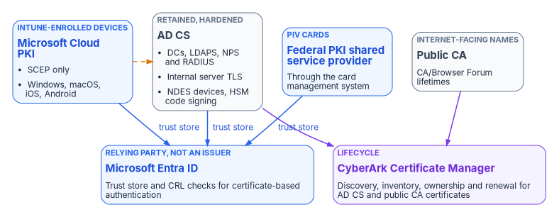
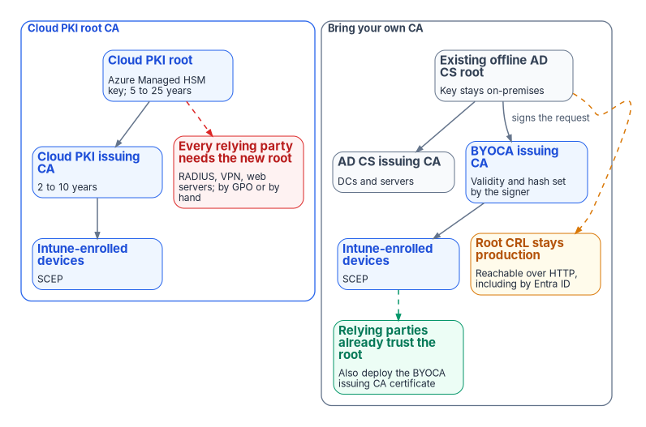
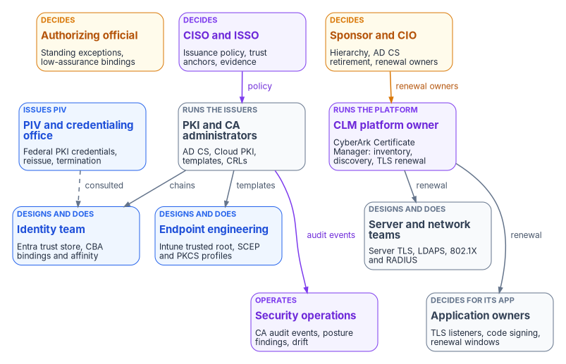
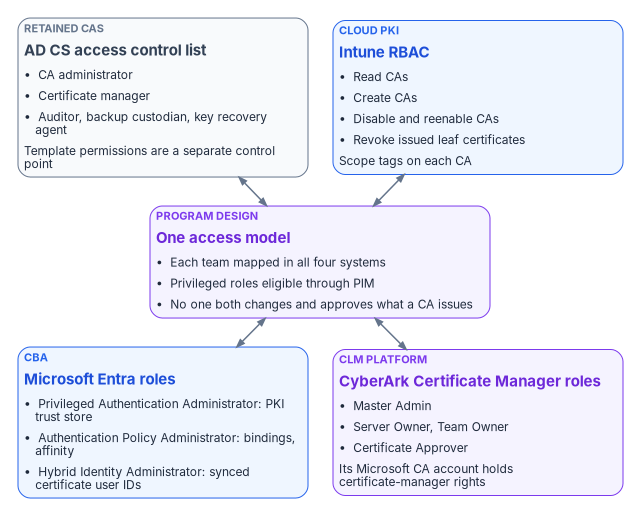

# Module 3: The target PKI and who owns it {.unnumbered}

*Part of the [PKI and Certificates learning path](index.md). Book 07, [Chapter 04](../../books/b07-pki/04-the-target-pki.md) and [Chapter 05](../../books/b07-pki/05-who-owns-the-certificate-estate.md). About 55 minutes.*

## Introduction (3 minutes)

Nothing replaces AD CS one for one. Microsoft Cloud PKI issues only to devices enrolled in Intune, so domain controllers, servers, network equipment, code-signing keys and PIV cards all need another issuer. The target is four issuers, each chosen for the subjects only it can serve, held together by one root of trust decision and one lifecycle platform. Each certificate class also needs one named owner, because an expired certificate is almost always an ownership failure first. In this module you map each template to its target issuer, check whether each CA publishes what Entra certificate-based authentication (CBA) and a bring-your-own-CA (BYOCA) issuing CA need from it, and start the sheet the owners fill in.

**The federal requirement.** The control states and evidence for each decision are in [Chapter 04](../../books/b07-pki/04-the-target-pki.md) and [Chapter 05](../../books/b07-pki/05-who-owns-the-certificate-estate.md).

| Requirement | KSI | Evidence |
|---|---|---|
| SC-17: certificates issued under a defined policy, from an approved issuer, with only approved trust anchors | KSI-SVC-ASM | The issuer for each template, from `TemplateClassification.csv`; the CRL and AIA locations each CA puts in its certificates, from `CAPublication.json` |
| CM-6: CA publication settings checked against the target before a CA signs a BYOCA request or joins the Entra trust store | KSI-SVC-ACM, KSI-MLA-EVC | `CAPublication.json` from a dated run, and the run after the change |
| AC-5: no one person can both change and approve what a CA issues | KSI-IAM-JIT, KSI-PIY-RIS, KSI-PIY-RSD | The signed responsibility matrix, and each team's roles in the four permission systems. The kit doesn't produce these |

KSIs are FedRAMP 20x indicators for cloud service providers. The agency lines its own evidence up with them; it doesn't report KSIs itself. The pairs above are the ones in [Book 13, Appendix A](../../books/b13-governance/appendix-a-requirements-mapping.md).

## Learning objectives (1 minute)

After this module, you'll be able to:

- name the four issuers in the target and the subjects each one serves;
- say what Cloud PKI can't issue, and why that keeps AD CS in service;
- compare a Cloud PKI root with BYOCA, and give the program's three rules for BYOCA;
- check whether a CA's certificates carry an HTTP CRL and AIA location, and say why Entra CBA and a BYOCA issuing CA depend on them;
- read the responsibility matrix, name the renewal owner for each certificate class, and name the four permission systems a certificate role spans.

## Prerequisites (1 minute)

- [Module 1](01-what-ad-cs-holds-up.md) and [Module 2](02-hardening-what-stays.md). This lab runs Module 1's inventory and classification again in its own run folder, so you don't need their output.
- The Start Kit unzipped as the path's [Get the code](index.md#get-the-code) says, version 1.8.0 or later of `FMPADAssessment`.

## Unit 1: Four issuers, not one replacement (8 minutes)

Read [Chapter 04](../../books/b07-pki/04-the-target-pki.md), from the opening to *Cloud availability*. Cloud PKI hosts the root and issuing CAs, a SCEP registration authority, the CRL distribution point and the AIA endpoint, and it replaces the on-premises CA, NDES server and Certificate Connector for device certificates. It issues only to Intune MDM-enrolled devices, only through SCEP, and it can't issue the TLS server certificates that RADIUS servers, Wi-Fi infrastructure and VPN gateways present. A tenant holds at most three CAs, counting root, issuing and BYOCA issuing CAs together, and a CA's EKUs can't be edited after it's created, so count the CAs before creating any.

{#fig-ch04-issuer-map fig-alt="Top row, four issuer cards. Blue: Microsoft Cloud PKI, issuing through SCEP to Intune-enrolled Windows, macOS, iOS and Android devices. Slate: AD CS, retained, a hardened enterprise CA for domain controllers, LDAPS, NPS and RADIUS servers, internal server TLS, NDES for network devices, and HSM code signing. Blue: Federal PKI shared service provider, issuing PIV certificates through the card management system. Slate: public CA, for names the internet must trust. A dashed amber line joins Cloud PKI and AD CS: the one root decision, where a BYOCA issuing CA chains to the AD CS root. On the bottom row, a violet card for CyberArk Certificate Manager receives arrows from AD CS and the public CA, for discovery, inventory, ownership and renewal. Beside it, a blue card for Microsoft Entra ID, a relying party not an issuer, receives arrows labeled trust store from Cloud PKI, AD CS and Federal PKI, for certificate-based authentication."}

A GCC tenant uses the commercial Intune service, so Cloud PKI's availability follows it. Licensing is the question to settle: confirm the Cloud PKI entitlement on the agency's current SKU rather than assume the commercial Microsoft 365 E5 change applies to government plans.

## Unit 2: A cloud root or your own (10 minutes)

Read [Chapter 04](../../books/b07-pki/04-the-target-pki.md), sections *Two deployment models* to *The program's recommendation*. A Cloud PKI root creates a new chain that every relying party has to learn. BYOCA adds a cloud issuing CA under the root relying parties already trust, with its validity and hash set by the CA that signs it.

{#fig-ch04-cloud-root-vs-byoca fig-alt="Two side-by-side groups. The left group, Cloud PKI root CA, shows a blue Cloud PKI root card, key in Azure Managed HSM, validity 5 to 25 years, above a blue Cloud PKI issuing CA card, 2 to 10 years, which issues through SCEP to a blue card for Intune-enrolled devices. A red card beside it reads every relying party needs the new root: RADIUS, VPN, web servers, deployed by GPO or by hand. The right group, BYOCA, shows a slate card for the existing offline AD CS root, key on-premises, above two cards side by side: a slate AD CS issuing CA serving domain controllers and servers, and a blue Cloud PKI BYOCA issuing CA, whose validity and hash are set by the signing CA, which issues through SCEP to Intune-enrolled devices. A green card reads relying parties already trust the root; deploy the BYOCA issuing CA certificate as best practice. An amber card under the root reads the root CRL must stay reachable over HTTP, including from Entra ID."}

For an established AD CS hierarchy with an offline root, the program recommends BYOCA, with three rules: the hierarchy passes Module 2's gate before it signs; the offline root signs the cloud issuing CA, so the cloud issuer is a peer of the AD CS issuing CAs; and the root's CRL is treated as production. Two details from the chapter decide whether a CA is ready:

- **The AIA comes from the signing CA.** A BYOCA issuing CA's AIA is whatever the signing CA's AIA configuration says, and AD CS defaults to an LDAP location. Configure an HTTP AIA location before signing.
- **Every CRL has to be reachable over HTTP.** Entra CBA accepts one CRL distribution point per CA, over HTTP, and fails sign-in when it can't fetch the CRL. An LDAP-only CRL breaks the cloud issuer as surely as the on-premises one.

The kit's `Get-FMPCAPublicationReview` reads each CA's `CRLPublicationURLs` and `CACertPublicationURLs` with `certutil -getreg`, and flags a CA whose issued certificates carry no HTTP CRL or AIA location, an HTTP location that is only the CA server itself (`%1`), a key shorter than 2048 bits, or a SHA-1 signature, which Cloud PKI doesn't support. It reads the issuing CAs the forest publishes. The offline root isn't one of them: run `certutil -getreg` on it at its next ceremony and keep the output with the run.

## Unit 3: What AD CS keeps (6 minutes)

Read [Chapter 04](../../books/b07-pki/04-the-target-pki.md), sections *AD CS, retained for what only it can do* to *Certificate lifecycle management*. AD CS stays for domain controller and KDC certificates, LDAPS, NPS and RADIUS server certificates, internal server TLS, network devices through NDES, HSM-held code signing, and S/MIME key history. Each use has an end condition in the chapter's table. The issuer decision for internal server certificates, which Module 1's classification left as BRIDGE, is the retained AD CS hierarchy for internal names and a public CA for internet-facing names. Both are requested and renewed through CyberArk Certificate Manager, deployed self-hosted inside the agency's authorization boundary, because its SaaS edition had no FedRAMP authorization when Chapter 04 was verified. Domain controller certificates stay on autoenrollment. PIV certificates keep their Federal PKI issuer; what the target does for them is trust: distribute the federal root, keep NTAuth right while the domain exists, and upload the chain to Entra ID.

The `Target` column of Module 1's classification is where each template lands in this design. Lab 1 lists it by issuer.

## Unit 4: Decision rights and renewal owners (8 minutes)

Read [Chapter 05](../../books/b07-pki/05-who-owns-the-certificate-estate.md), from the opening to *Renewal ownership per certificate class*. Deciding and doing are different things: the sponsor decides the CA hierarchy and the renewal owners, the CISO and ISSO decide trust anchors and issuance policy, and the PKI administrators do most of the work. Read the five rows the chapter comments on: routine revocation is the certificate owner's decision, compromise revocation is the CISO's, template retirement is the one place the PKI administrators both decide and do, and the two exception rows split on time.

{#fig-ch05-certificate-estate-owners fig-alt="Four rows of cards. Top row, decision makers: the sponsor and CIO in amber, who own the CA hierarchy decision, the AD CS retirement schedule and renewal ownership; the authorizing official in amber, who accepts standing exceptions and low-assurance bindings; and the CISO and ISSO in violet, who set issuance policy, trust anchors and evidence. Second row, the certificate authorities: PKI and CA administrators in slate, who run AD CS and Cloud PKI and own templates and CRLs; the CLM platform owner in violet, who runs CyberArk Certificate Manager for inventory, discovery and server and public TLS renewal; and the PIV and credentialing office in blue, which issues PIV through the Federal PKI. Third row, the consumers who design and do: the identity team in blue, which owns the Entra trust store and CBA bindings; endpoint engineering in blue, which owns Intune certificate profiles; and server and network teams in slate, which own server TLS and 802.1X and RADIUS. Bottom row: application owners in slate, who decide for TLS and code-signing certificates on their applications, and security operations in violet, which monitors CA audit events, posture findings and drift. Arrows run from the CISO and ISSO to the PKI administrators labeled policy, from the sponsor to the CLM platform owner labeled renewal owners, from the PKI administrators to the identity team and endpoint engineering labeled chains and templates, from the CLM owner to the server and network teams and application owners labeled renewal, and from the PKI administrators to security operations labeled audit events. A dashed arrow labeled consulted runs from the PIV office to the identity team."}

Every certificate class has one renewal owner, who answers for an expiry even when automation renews it: endpoint engineering for Intune-delivered certificates, the PIV office for PIV, the PKI administrators for domain controller certificates and the CA certificates and CRLs, the network team for RADIUS, the server team or the named application owner for internal server TLS, and the application owner for public TLS and code signing. Lab 1 writes the sheet those owners fill in.

## Unit 5: Four permission systems, one access model (6 minutes)

Read [Chapter 05](../../books/b07-pki/05-who-owns-the-certificate-estate.md), sections *Four permission systems, one access model* and *What changes from "whoever installed the CA"*. Certificate roles are granted in four separate places: the AD CS access control list, Intune RBAC for Cloud PKI, Microsoft Entra roles for CBA, and CyberArk Certificate Manager's roles. The program maps each team in all four, keeps privileged roles eligible through PIM, and keeps anyone from both changing and approving what a CA issues.

{#fig-ch05-four-permission-planes fig-alt="Four cards, two above and two below, each connected by a two-way arrow to one violet card in the middle. The first card, in slate, is the AD CS access control list, with CA administrator, certificate manager, auditor, backup custodian and key recovery agent, and template permissions as a separate control point. The second card, in blue, is Intune RBAC for Cloud PKI, with the permissions read CAs, create CAs, disable and reenable CAs, and revoke issued leaf certificates, scoped by scope tags. The third card, in blue, is Microsoft Entra roles for CBA, with Privileged Authentication Administrator for the PKI-based trust store, Authentication Policy Administrator for bindings and affinity, and Hybrid Identity Administrator for synchronized certificate user IDs. The fourth card, in violet, is CyberArk Certificate Manager roles, with Master Admin, Server Owner, Certificate Approver and Team Owner, and a Microsoft CA account that holds certificate-manager rights. The violet card in the middle, labeled Program design, One access model, reads: each team mapped in all four systems, privileged roles eligible through PIM, and no single person who can both change and approve what a CA issues."}

One consequence to remember: the CLM platform's CA account holds **Issue and Manage Certificates**, the AD CS certificate-manager right, for every template it can reach. Its administrators hold that power indirectly, so the program scopes the account to the CLM's templates, treats its Master Admins as privileged, and tests an allowed and a denied request in the quarterly ESC7 review. The Start Kit doesn't check CA permissions (ESC7), so that review stays manual, as Module 2 says.

## Exercise: Lab 1, the target on a fictional snapshot (15 minutes) {#pki-lab-1}

You map each published template in the fictional Contoso PKI to its target issuer, check both issuing CAs for an HTTP CRL and AIA location, fix a copy of the snapshot, prove the fix with a second check, and write the renewal-owner sheet.

<!-- labs:begin lab-1-commands (generated by scripts/generate_labs.py; not part of the reviewed page) -->

::: {.callout-note #lab-1-commands collapse="false" title="Every command in Lab 1"}
Every command in this lab, in order. Each step below says what it does and what to look for.

```powershell
Set-Location C:\FMWLabs\start-kit

$Run = "C:\FMWLabs\results\pki-03-the-target-pki-and-who-owns-it\lab1\$((Get-Date).ToUniversalTime().ToString('yyyy-MM-ddTHHmmssZ'))"
New-Item -ItemType Directory -Path $Run -Force | Out-Null
$Run

# Step 1: Load the kit
Import-Module .\powershell\FMPADAssessment -Force
(Get-Module FMPADAssessment).Version.ToString()

# Step 2: Map each published template to its target issuer
Get-FMPPKIAssessment -OutputPath "$Run\inventory" -PkiDataPath .\tests\fixtures\pki-contoso.json
$c = Get-FMPTemplateClassification -OutputPath "$Run\inventory" -Domain contoso.example
$c | Where-Object Published | Sort-Object Target, Template | ForEach-Object { '{0,-24} {1}' -f $_.Template, $(if ($_.Target) { $_.Target } else { '(the owner classifies)' }) }

# Step 3: Check each CA for what Entra CBA and a BYOCA issuing CA need
Get-FMPCAPublicationReview -OutputPath "$Run\publication" -PkiDataPath .\tests\fixtures\pki-contoso.json
$p = Get-Content -Raw "$Run\publication\contoso.example\PKI\CAPublication.json" | ConvertFrom-Json
$p.CertificationAuthorities | Format-Table CAName, KeySize, SignatureAlgorithm -AutoSize
$p.Findings | Format-Table Finding, CAName -AutoSize

# Step 4: See why
Import-Csv "$Run\publication\contoso.example\PKI\CAPublicationUrls.csv" | Where-Object CAName -eq 'Contoso Issuing CA 1' | ForEach-Object { '{0} {1,2} {2,-5} {3}' -f $_.Kind, $_.Flags, $_.InIssuedCertificates, $_.Url }

# Step 5: Fix a copy of the snapshot, and check it again
$s = Get-Content -Raw .\tests\fixtures\pki-contoso.json | ConvertFrom-Json
$s.cas[0].crlPublicationUrls = $s.cas[0].crlPublicationUrls -replace '2: 0:http://%1/CertEnroll/', '2: 6:http://pki.contoso.example/crl/'
$s.cas[0].caCertPublicationUrls = $s.cas[0].caCertPublicationUrls -replace '2: 0:http://%1/CertEnroll/', '2: 2:http://pki.contoso.example/aia/'
$s | ConvertTo-Json -Depth 10 | Set-Content -Encoding UTF8 -Path "$Run\pki-contoso-http.json"
Get-FMPCAPublicationReview -OutputPath "$Run\publication-fixed" -PkiDataPath "$Run\pki-contoso-http.json"
$q = Get-Content -Raw "$Run\publication-fixed\contoso.example\PKI\CAPublication.json" | ConvertFrom-Json
'Findings: {0}' -f @($q.Findings).Count
($q.CertificationAuthorities | Where-Object CAName -eq 'Contoso Issuing CA 1').CdpInCertificates

# Step 6: Write the renewal-owner sheet
$c | Where-Object Published | Select-Object Template, StartingClass, Target, Owner | Export-Csv -NoTypeInformation -Path "$Run\renewal-owners.csv"
Get-Content "$Run\renewal-owners.csv" -TotalCount 3

# Step 7: List this lab's runs
Get-ChildItem C:\FMWLabs\results\pki-03-the-target-pki-and-who-owns-it\lab1 -Name
```

:::

<!-- labs:end -->

Every step runs in Windows PowerShell 5.1 or PowerShell 7, and prints the output shown here in either, so you can follow it top to bottom in one window. Open **Windows PowerShell** (or **PowerShell 7**) from the Start menu, then go to the kit's folder, where you unzipped it under [Get the code](index.md#get-the-code):

```powershell
Set-Location C:\FMWLabs\start-kit
```

Then make this run's results folder. Its name is the date and time you start, in UTC, so each run keeps its own results and running the lab again never overwrites them:

```powershell
$Run = "C:\FMWLabs\results\pki-03-the-target-pki-and-who-owns-it\lab1\$((Get-Date).ToUniversalTime().ToString('yyyy-MM-ddTHHmmssZ'))"
New-Item -ItemType Directory -Path $Run -Force | Out-Null
$Run
```

Expected output, where `<run>` is your start time, such as `2026-11-25T143005Z`:

```text
C:\FMWLabs\results\pki-03-the-target-pki-and-who-owns-it\lab1\<run>
```

The run's date is only the folder's name. The snapshot is the data, and it doesn't change, so every run's results match this page. The results folder sits outside the kit, so unzipping a newer copy of the kit never touches it.

Prefer Git Bash? Go to the folder with `cd /c/FMWLabs/start-kit` and make the run folder with `Run=/c/FMWLabs/results/pki-03-the-target-pki-and-who-owns-it/lab1/$(date -u +%Y-%m-%dT%H%M%SZ); mkdir -p "$Run"`, but every step is a PowerShell command (type `powershell` or `pwsh` to start one there). In a clone of the repository, use the `examples` folder of the same name.

1. **Load the kit.**

    ```powershell
    Import-Module .\powershell\FMPADAssessment -Force
    (Get-Module FMPADAssessment).Version.ToString()
    ```

    Expected output:

    ```text
    1.8.0
    ```

2. **Map each published template to its target issuer.** Inventory the snapshot and classify its templates, as in Module 1, then list the published ones by target:

    ```powershell
    Get-FMPPKIAssessment -OutputPath "$Run\inventory" -PkiDataPath .\tests\fixtures\pki-contoso.json
    $c = Get-FMPTemplateClassification -OutputPath "$Run\inventory" -Domain contoso.example
    $c | Where-Object Published | Sort-Object Target, Template | ForEach-Object { '{0,-24} {1}' -f $_.Template, $(if ($_.Target) { $_.Target } else { '(the owner classifies)' }) }
    ```

    Expected output:

    ```text
    ContosoSCEP              (the owner classifies)
    ContosoVPNUser           (the owner classifies)
    LegacyAnyPurpose         (the owner classifies)
    WebServerLegacy          (the owner classifies)
    CodeSigning              A CA with HSM-protected signing keys, outside Intune
    KerberosAuthentication   AD CS autoenrollment until the last domain controller retires
    RASAndIASServer          AD CS while NPS runs, through CyberArk Certificate Manager
    Machine                  Cloud PKI, Intune SCEP device certificate; servers stay on AD CS
    User                     Cloud PKI, Intune SCEP user certificate with Client Authentication
    ExchangeUser             Intune imported PKCS profile; the existing CA keeps issuing
    EFS                      None
    WebServer                Retained AD CS for internal names, a public CA for internet-facing names, through CyberArk Certificate Manager
    ```

    Three of the four issuers appear: Cloud PKI for the Intune device and user certificates, the retained AD CS for domain controllers, RADIUS and server TLS, and a public CA beside it for internet-facing names. PIV doesn't appear because no AD CS template issues it. The four custom templates have no target until their owners classify them; two of them, Web Server Legacy and Legacy Any Purpose, are Module 2's ESC findings.

3. **Check each CA for what Entra CBA and a BYOCA issuing CA need.**

    ```powershell
    Get-FMPCAPublicationReview -OutputPath "$Run\publication" -PkiDataPath .\tests\fixtures\pki-contoso.json
    $p = Get-Content -Raw "$Run\publication\contoso.example\PKI\CAPublication.json" | ConvertFrom-Json
    $p.CertificationAuthorities | Format-Table CAName, KeySize, SignatureAlgorithm -AutoSize
    $p.Findings | Format-Table Finding, CAName -AutoSize
    ```

    Expected output, the two CAs and then the findings:

    ```text
    CAName               KeySize SignatureAlgorithm
    ------               ------- ------------------
    Contoso Issuing CA 1    2048 sha256RSA
    Contoso Issuing CA 2    2048 sha256RSA
    ```

    ```text
    Finding     CAName
    -------     ------
    NO-HTTP-CDP Contoso Issuing CA 1
    NO-HTTP-AIA Contoso Issuing CA 1
    ```

    Both keys and hashes are ones Cloud PKI supports. Issuing CA 1's certificates carry no HTTP CRL location, so Entra CBA couldn't check their revocation, and no HTTP AIA location, so it isn't ready to sign anything. Issuing CA 2 has no findings.

4. **See why.** List every location Issuing CA 1 publishes to, with its flags and whether it goes into the certificates the CA issues:

    ```powershell
    Import-Csv "$Run\publication\contoso.example\PKI\CAPublicationUrls.csv" | Where-Object CAName -eq 'Contoso Issuing CA 1' | ForEach-Object { '{0} {1,2} {2,-5} {3}' -f $_.Kind, $_.Flags, $_.InIssuedCertificates, $_.Url }
    ```

    Expected output:

    ```text
    CDP 65 False C:\Windows\system32\CertSrv\CertEnroll\%3%8%9.crl
    CDP 79 True  ldap:///CN=%7%8,CN=%2,CN=CDP,CN=Public Key Services,CN=Services,%6%10
    CDP  0 False http://%1/CertEnroll/%3%8%9.crl
    AIA  1 False C:\Windows\system32\CertSrv\CertEnroll\%1_%3%4.crt
    AIA  3 True  ldap:///CN=%7,CN=AIA,CN=Public Key Services,CN=Services,%6%11
    AIA  0 False http://%1/CertEnroll/%1_%3%4.crt
    ```

    The flags are the bits `certutil -getreg` prints beside each location: `1` means the CA publishes there, and `2` means the location goes into the CRL distribution point or AIA extension of every certificate the CA issues. Both HTTP locations exist, with flags `0`: they do nothing. Only the LDAP locations reach the certificates, and only clients that can query the directory can follow those. The `%` variables are AD CS's own; `%1` is the CA server's DNS name.

5. **Fix a copy of the snapshot, and check it again.** In the program, this is a `certutil -setreg CA\CRLPublicationURLs` and `CA\CACertPublicationURLs` change on the CA under a change record, with the HTTP locations pointed at a web server Entra ID can reach. Here you make the same change in a copy:

    ```powershell
    $s = Get-Content -Raw .\tests\fixtures\pki-contoso.json | ConvertFrom-Json
    $s.cas[0].crlPublicationUrls = $s.cas[0].crlPublicationUrls -replace '2: 0:http://%1/CertEnroll/', '2: 6:http://pki.contoso.example/crl/'
    $s.cas[0].caCertPublicationUrls = $s.cas[0].caCertPublicationUrls -replace '2: 0:http://%1/CertEnroll/', '2: 2:http://pki.contoso.example/aia/'
    $s | ConvertTo-Json -Depth 10 | Set-Content -Encoding UTF8 -Path "$Run\pki-contoso-http.json"
    Get-FMPCAPublicationReview -OutputPath "$Run\publication-fixed" -PkiDataPath "$Run\pki-contoso-http.json"
    $q = Get-Content -Raw "$Run\publication-fixed\contoso.example\PKI\CAPublication.json" | ConvertFrom-Json
    'Findings: {0}' -f @($q.Findings).Count
    ($q.CertificationAuthorities | Where-Object CAName -eq 'Contoso Issuing CA 1').CdpInCertificates
    ```

    Expected output:

    ```text
    Findings: 0
    ldap:///CN=%7%8,CN=%2,CN=CDP,CN=Public Key Services,CN=Services,%6%10
    http://pki.contoso.example/crl/%3%8%9.crl
    ```

    Flag `6` puts the HTTP CRL location into issued certificates and the freshest-CRL extension; flag `2` puts the HTTP AIA location into issued certificates. The change only affects certificates issued after it, so certificates already issued keep the old locations until they renew. The two runs, before and after, are the CM-6 evidence.

6. **Write the renewal-owner sheet.** One row for each published template, with its starting class and target, and an empty `Owner` column for the meeting Chapter 05 describes:

    ```powershell
    $c | Where-Object Published | Select-Object Template, StartingClass, Target, Owner | Export-Csv -NoTypeInformation -Path "$Run\renewal-owners.csv"
    Get-Content "$Run\renewal-owners.csv" -TotalCount 3
    ```

    Expected output, the header and the first two rows:

    ```text
    "Template","StartingClass","Target","Owner"
    "CodeSigning","RETAIN","A CA with HSM-protected signing keys, outside Intune",""
    "ContosoSCEP","","",""
    ```

    Each row gets the renewal owner of its certificate class from Chapter 05's table: endpoint engineering for the Intune rows, the network team for RASAndIASServer, the PKI administrators for KerberosAuthentication, an application owner for CodeSigning. The custom templates' owners classify them first. The sponsor signs the sheet.

7. **List this lab's runs.**

    ```powershell
    Get-ChildItem C:\FMWLabs\results\pki-03-the-target-pki-and-who-owns-it\lab1 -Name
    ```

    Expected output: one line per run, oldest first, the last one this run:

    ```text
    <run>
    ```

## Exercise: Lab 2, a test forest {#pki-lab-2}

*Not timed. Not run by the authors. Never production.*

<!-- labs:begin lab-2-commands (generated by scripts/generate_labs.py; not part of the reviewed page) -->

::: {.callout-note #lab-2-commands collapse="false" title="Every command in Lab 2"}
Every command in this lab, in order. Each step below says what it does and what to look for.

```powershell
# Step 1: Check every enterprise CA
Set-Location C:\FMWLabs\start-kit
Import-Module .\powershell\FMPADAssessment -Force
$Run = "C:\FMWLabs\results\pki-03-the-target-pki-and-who-owns-it\lab2\$((Get-Date).ToUniversalTime().ToString('yyyy-MM-ddTHHmmssZ'))"
Get-FMPCAPublicationReview -OutputPath $Run -Domain <test-domain>
$p = Get-Content -Raw "$Run\<test-domain>\PKI\CAPublication.json" | ConvertFrom-Json
$p.CertificationAuthorities | Format-Table CAName, ComputerName, KeySize, SignatureAlgorithm, Readable -AutoSize
$p.Findings | Format-Table Finding, CAName -AutoSize

# Step 2: Read one CA's locations as certutil prints them
certutil -config "<ca-config>" -getreg CA\CRLPublicationURLs
certutil -config "<ca-config>" -getreg CA\CACertPublicationURLs
Import-Csv "$Run\<test-domain>\PKI\CAPublicationUrls.csv" | Format-Table CAName, Kind, Flags, InIssuedCertificates, Url -AutoSize

# Step 3: Read the offline root
certutil -getreg CA\CRLPublicationURLs
certutil -getreg CA\CACertPublicationURLs
certutil -getreg CA\CRLPeriodUnits
certutil -getreg CA\CRLPeriod

# Step 4: Fetch a CRL from outside the network
$r = Invoke-WebRequest -Uri '<crl-url>' -UseBasicParsing
'{0} {1} bytes' -f $r.StatusCode, $r.RawContentLength

# Step 5: Back out
Remove-Item -Recurse -Force $Run
```

:::

<!-- labs:end -->

You run the same check against the test forest's enterprise CAs, read the offline root's settings yourself, and confirm each HTTP CRL location answers from outside the network. Nothing in this lab changes a CA.

- **You need:** Module 1's Lab 2 forest and the kit's account from it, with read access to each CA for `certutil -getreg`; for step 3, the offline root's `certutil -getreg` output from its last ceremony, or access to the root; for step 4, a computer outside the test network, such as a laptop on a home connection.
- **You'll replace:** `<test-domain>` (the test forest root domain), `<ca-config>` (one CA's config string, `<host>\<CA name>`, from step 1's output), and `<crl-url>` (one HTTP CRL location from step 2, with its `%` variables filled in as the CA's CRL file name).

1. **Check every enterprise CA**, from the domain-joined host, as the kit's account:

    ```powershell
    Set-Location C:\FMWLabs\start-kit
    Import-Module .\powershell\FMPADAssessment -Force
    $Run = "C:\FMWLabs\results\pki-03-the-target-pki-and-who-owns-it\lab2\$((Get-Date).ToUniversalTime().ToString('yyyy-MM-ddTHHmmssZ'))"
    Get-FMPCAPublicationReview -OutputPath $Run -Domain <test-domain>
    $p = Get-Content -Raw "$Run\<test-domain>\PKI\CAPublication.json" | ConvertFrom-Json
    $p.CertificationAuthorities | Format-Table CAName, ComputerName, KeySize, SignatureAlgorithm, Readable -AutoSize
    $p.Findings | Format-Table Finding, CAName -AutoSize
    ```

    A CA left at the AD CS defaults usually shows `HTTP-ON-CA-HOST`: the default HTTP locations point at the CA server itself. A `CA-UNREADABLE` row means the account can't read the CA's registry: see Module 1's Lab 2, step 1.

2. **Read one CA's locations as certutil prints them**, to compare with the kit's list:

    ```powershell
    certutil -config "<ca-config>" -getreg CA\CRLPublicationURLs
    certutil -config "<ca-config>" -getreg CA\CACertPublicationURLs
    Import-Csv "$Run\<test-domain>\PKI\CAPublicationUrls.csv" | Format-Table CAName, Kind, Flags, InIssuedCertificates, Url -AutoSize
    ```

3. **Read the offline root.** The forest doesn't publish the root as an enrollment service, so the kit doesn't read it. On the root, at its next ceremony, or from the output kept from the last one:

    ```powershell
    certutil -getreg CA\CRLPublicationURLs
    certutil -getreg CA\CACertPublicationURLs
    certutil -getreg CA\CRLPeriodUnits
    certutil -getreg CA\CRLPeriod
    ```

    The root's CRL needs an HTTP location in the issuing CAs' certificates and a publication period with margin: under BYOCA it's a production dependency for the life of the cloud issuing CA. Keep the output with the run.

4. **Fetch a CRL from outside the network**, on the outside computer:

    ```powershell
    $r = Invoke-WebRequest -Uri '<crl-url>' -UseBasicParsing
    '{0} {1} bytes' -f $r.StatusCode, $r.RawContentLength
    ```

    A `200` and a size is what Entra ID will see. A timeout or a `404` is a location Entra CBA can't use. Entra ID also limits the size of a CRL it downloads; Module 4 points to the lab that measures it against the cloud's limit.

5. **Back out.** Nothing on the CAs changed. The run folder holds the test forest's CA names and URLs: delete it when you're done.

    ```powershell
    Remove-Item -Recurse -Force $Run
    ```

## Knowledge check (5 minutes)

1. Why can't Cloud PKI replace AD CS on its own?
    a. It has no CRL.
    b. It issues only to Intune MDM-enrolled devices, through SCEP, so domain controllers, servers, network devices and code signing need another issuer.
    c. It isn't available to GCC tenants.

2. Under BYOCA, what sets the cloud issuing CA's validity period and hash?
    a. The admin center, at creation.
    b. The CA that signs its request.
    c. Intune's default policy.

3. In Lab 1, Issuing CA 1 publishes an HTTP CRL location. Why is it still `NO-HTTP-CDP`?
    a. The location's flags are `0`, so it isn't put into issued certificates, and a relying party never learns it.
    b. HTTP locations are always ignored.
    c. The CA's key is too short.

4. Who decides routine revocation of a superseded server certificate?
    a. The CA administrators.
    b. The certificate's owner; the certificate manager executes it.
    c. The CISO.

5. Who is the renewal owner of a domain controller certificate that AD CS renews by autoenrollment?
    a. Nobody: automation renews it.
    b. The PKI/CA administrators.
    c. The CLM platform owner.

6. Why does the program treat CLM Master Admins as privileged?
    a. The CLM's CA account holds Issue and Manage Certificates, the certificate-manager right, for every template it can reach.
    b. They can install CAs.
    c. They hold Global Administrator in Entra ID.

::: {.callout-tip collapse="true"}
## Check your answers
1. **b.** See Unit 1 and Chapter 04's [What it can and can't issue](../../books/b07-pki/04-the-target-pki.md#what-it-can-and-cant-issue).
2. **b.** See Unit 2 and [What BYOCA actually requires](../../books/b07-pki/04-the-target-pki.md#what-byoca-actually-requires).
3. **a.** See Lab 1, step 4.
4. **b.** See Unit 4 and [The responsibility matrix](../../books/b07-pki/05-who-owns-the-certificate-estate.md#the-responsibility-matrix).
5. **b.** The owner answers for an expiry even when automation renews. See Unit 4.
6. **a.** See Unit 5.
:::

## Summary (2 minutes)

You mapped each template to its issuer in the target, checked both issuing CAs for the HTTP CRL and AIA locations Entra CBA and a BYOCA issuing CA depend on, fixed a copy and checked it again, and wrote the sheet the renewal owners fill in. **Evidence an ISSO keeps from this module:** the classification with each template's target, `CAPublication.json` from each dated run before and after a change, the offline root's `certutil -getreg` output from its ceremony, the signed renewal-owner sheet, the signed responsibility matrix, and each team's roles in the four permission systems.

::: {.callout-tip}
## Continue the path
[← Previous: Module 2](02-hardening-what-stays.md) · [Learning path](index.md) · [Next: Module 4 →](04-device-and-user-certificates.md)
:::
