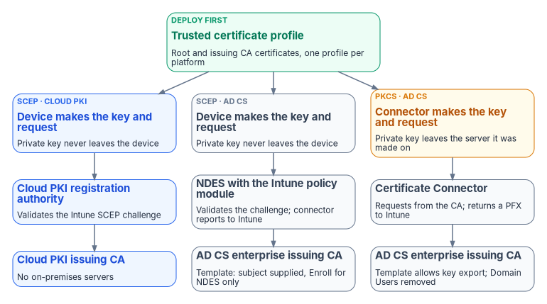

# Module 4: Device and user certificates {.unnumbered}

*Part of the [PKI and Certificates learning path](index.md). Book 07, [Chapter 06](../../books/b07-pki/06-device-and-user-certificates.md) and [Appendix A](../../books/b07-pki/appendix-a-deployment-checklists.md). About 60 minutes.*

## Introduction (3 minutes)

Two jobs meet in this module, and they fail in opposite ways. Intune delivers certificates: when delivery fails, a device has no certificate and Wi-Fi or VPN refuses it, a failure that is local and visible. Entra certificate-based authentication (CBA) is a relying party: when it goes wrong, a certificate that should fail might pass, because the trust store holds too much, revocation isn't checked or a binding is weak. Between them sits the domain controller, which since KB5014754 rejects any certificate it can't map to an account in a strong way. In this module you read the strong-mapping evidence the migration needs before any new issuer goes live: which accounts carry only weak mappings, which certificates the KDC has already rejected, and which CAs the forest trusts for logon.

**The federal requirement.** The control states and evidence are in [Chapter 06](../../books/b07-pki/06-device-and-user-certificates.md#finding-weak-certificates) and its [Assessment mapping](../../books/b07-pki/06-device-and-user-certificates.md#assessment-mapping).

| Requirement | KSI | Evidence |
|---|---|---|
| IA-5(2): map the authenticated identity to the account, from an accepted trust anchor | KSI-IAM-APM, KSI-IAM-ELP, KSI-IAM-SNU, KSI-SVC-ASM | `CertificateMapping.json` and `AccountMappings.csv`: each account's mappings, strong or weak |
| SC-17: only approved trust anchors | KSI-SVC-ASM | The NTAuth store's CAs, from `CertificateMapping.json`, against the CAs approved to issue logon certificates |
| AU-6: the KDC's strong-mapping failures reviewed | KSI-MLA-RVL | `KdcMappingEvents.csv` from a dated run, or the log workspace query, with what was done about each |

KSIs are FedRAMP 20x indicators for cloud service providers. The agency lines its own evidence up with them; it doesn't report KSIs itself. The pairs above are the ones in [Book 13, Appendix A](../../books/b13-governance/appendix-a-requirements-mapping.md).

## Learning objectives (1 minute)

After this module, you'll be able to:

- say why the trusted certificate profile comes first, and name Intune's three delivery paths;
- choose SCEP or PKCS for a use case, and say what PKCS trades for not needing NDES;
- name the strong and weak `altSecurityIdentities` forms, and say what Full Enforcement does to a certificate with neither a strong mapping nor the SID extension;
- read KDC events 39, 40 and 41, and say how Windows Server 2008 and 2008 R2 log them differently;
- say what an Intune SCEP or PKCS profile needs to produce strongly mapped certificates;
- explain the CBA trust store, username bindings and affinity, and why staged rollout is temporary.

## Prerequisites (1 minute)

- [Module 3](03-the-target-pki-and-who-owns-it.md). This lab runs Module 1's inventory and classification again in its own run folder, so you don't need earlier output.
- The Start Kit unzipped as the path's [Get the code](index.md#get-the-code) says, version 1.8.0 or later of `FMPADAssessment`.

## Unit 1: Delivery paths, and the profile that comes first (8 minutes)

Read [Chapter 06](../../books/b07-pki/06-device-and-user-certificates.md), from the opening to *Keep the connector current*. Intune delivers certificates by three paths: SCEP from Cloud PKI, SCEP from AD CS through NDES and the Certificate Connector, and PKCS from AD CS through the connector. Every path needs the trusted certificate profile first, because a device that doesn't trust the root can't use what it's issued. With a BYOCA issuing CA, that means a trusted certificate profile for every CA certificate in the private hierarchy as well as the Cloud PKI issuing CA, on every platform.

{#fig-ch06-delivery-paths fig-alt="A trusted certificate profile at the top, labeled 'deploy first: root and issuing CA certificates', feeds three paths. Path one, blue, SCEP with Microsoft Cloud PKI: the device creates the key pair and certificate request, the Cloud PKI registration authority validates the Intune SCEP challenge, and the Cloud PKI issuing CA signs. No on-premises servers. Path two, slate, SCEP with AD CS: the device creates the key pair, NDES with the Intune policy module validates the challenge, the Certificate Connector reports to Intune, and the AD CS enterprise issuing CA signs; its template supplies the subject in the request and grants Enroll only to NDES. Path three, slate, PKCS with AD CS: the Certificate Connector generates the key pair on the connector server, requests the certificate from the AD CS enterprise CA, whose template allows key export and has Domain Users removed, and Intune delivers the certificate and key to the device as a PFX. An amber note on path three reads 'private key leaves the server it was made on'."}

With SCEP the device makes its own key pair, and Intune's signed challenge lets the registration authority reject any request whose subject Intune didn't expect. That challenge is why an NDES template can let the requester supply the subject and still not be ESC1: only the NDES service account can enroll, as Module 2's ContosoSCEP showed.

## Unit 2: PKCS, attestation, and which profile for which use (8 minutes)

Read [Chapter 06](../../books/b07-pki/06-device-and-user-certificates.md), sections *PKCS and imported PKCS profiles* to *Which profile for which use*. A PKCS profile generates the key pair on the connector server and delivers it as a PFX, so the private key exists somewhere other than the device that uses it. That's why the program prefers SCEP wherever a use case allows either, and why a PKCS template with Domain Users still enrolled is an ESC1 finding. Imported PKCS profiles deliver S/MIME encryption certificates whose archived keys keep old mail readable. TPM key attestation is the CA proving the key sits in a TPM it trusts, which is a stronger claim than the device choosing the TPM provider.

The chapter's use-case table is the design: Cloud PKI SCEP for Wi-Fi, wired 802.1X on workstations, VPN and mTLS; PKCS from AD CS for S/MIME signing; imported PKCS for S/MIME encryption; and SCEP or PKCS with the SID added for a user certificate used for certificate logon to AD. Server certificates aren't on it: Intune doesn't manage Windows Server, so they stay with Module 3's issuer decision. Lab 1, step 2 lists the fictional estate's templates whose target is an Intune profile.

## Unit 3: Strong certificate mapping (12 minutes)

Read [Chapter 06](../../books/b07-pki/06-device-and-user-certificates.md#strong-certificate-mapping-kb5014754), section *Strong certificate mapping (KB5014754)*, all four parts. Before May 2022 a domain controller mapped a certificate to an account by name, so anyone who could get a certificate with someone else's name in it could sign in as that account. A strong mapping is one of three things:

- **the SID extension**, OID `1.3.6.1.4.1.311.25.2`, which AD CS adds to certificates from online templates;
- **the SID in a SAN URL**, the form Intune writes when the profile asks for it;
- **an explicit strong mapping** in the account's `altSecurityIdentities`: `X509IssuerSerialNumber`, `X509SKI` or `X509SHA1PublicKey`. The `X509IssuerSubject`, `X509SubjectOnly` and `X509RFC822` forms are weak.

Since the September 2025 update, every domain controller on a current update is in Full Enforcement, with no supported way back. A certificate that still authenticates to AD has already passed the test, and one that fails it fails now. What the migration has to watch is every *new* issuer: Cloud PKI, a third-party CA or a new template must produce strongly mapped certificates from day one if they'll ever be used against a domain controller, and a CA that issues logon certificates has to be in the forest's NTAuth store. PIV certificates come from the Federal PKI and don't carry the SID extension, so they need an explicit mapping or the government-specific name-based policy the chapter describes.

For Intune: a SCEP profile adds a SAN of type URI with the value `{{OnPremisesSecurityIdentifier}}`, and a PKCS connector sets `EnableSidSecurityExtension` to 1. Pilot either with a new profile assigned to a pilot group, not by editing the production profile: on Windows, iOS/iPadOS and macOS, changing a SCEP profile revokes the certificates it already issued.

The KDC logs the failures in the System log:

| Event ID | Meaning | On Windows Server 2008 and 2008 R2 |
|---|---|---|
| 39 | No strong mapping found | Logged as 41 |
| 40 | The certificate predates the account and has no strong mapping | Logged as 48 |
| 41 | The certificate's SID extension doesn't match the account's SID | Logged as 49 |

: KDC strong-mapping events, from Chapter 06 {.striped .hover}

The kit's `Get-FMPCertificateMappingReport` reads every user and computer with `altSecurityIdentities`, names each value's form and strength, reads those events from each domain controller with its operating system version so event 41 is read correctly, and lists the CAs in the NTAuth store. It can't see the certificates themselves, so an account with only weak mappings is a finding to check, not proof of a failure: a certificate that carries the account's SID still signs in.

## Unit 4: Entra certificate-based authentication (12 minutes)

Read [Chapter 06](../../books/b07-pki/06-device-and-user-certificates.md#entra-certificate-based-authentication), section *Entra certificate-based authentication*, to *Staged rollout*, and skim [Appendix A](../../books/b07-pki/appendix-a-deployment-checklists.md), A.1 and A.2.

{#fig-ch06-cba-sign-in fig-alt="A sequence diagram with three participants: the user's device, Microsoft Entra ID sign-in, and the certificate authentication endpoint certauth.login.microsoftonline.com. Step 1: the user enters a username and Entra ID performs home realm discovery. Step 2: the user selects Use a certificate or smart card. Step 3: the client is redirected to the certificate authentication endpoint, which requests the client certificate in the TLS handshake. Step 4: the user picks a certificate. Step 5: Entra ID builds the chain against the trust store and checks the CRL of each CA. Step 6: username bindings, in priority order, find exactly one user. Step 7: authentication binding rules set single-factor or multifactor. A green frame: if the certificate is multifactor and Conditional Access requires MFA, sign-in completes and a primary refresh token is returned. An amber frame: if the certificate is single-factor, a second factor such as a passkey or passwordless phone sign-in is required. A red note: TLS inspection of the certificate authentication endpoint breaks the handshake."}

Four points carry the design:

- **The trust store is a blast radius.** Every CA in it can issue a certificate that authenticates any user it can be bound to. Give each CA its HTTP CRL URL (Module 3's check) and turn on **Require CRL validation**, so a CA without a CRL fails closed. Entra ID doesn't use OCSP.
- **Bindings are only as strong as the weakest one.** `IssuerAndSerialNumber`, `SKI` and `SHA1PublicKey` are high affinity; `PrincipalName`, `RFC822Name`, `Subject` and `IssuerAndSubject` are low. Production tenants require high affinity.
- **A certificate is multifactor only if a PIN or biometric protects it.** A PIV card qualifies; a software certificate doesn't. Use policy OIDs to tell them apart.
- **Staged rollout is a test, not a state.** It moves synchronized users off AD FS one group at a time, then the domain cuts over.

This path doesn't repeat the tenant check. [HR-Driven Identity, Module 5](../hr-driven-identity/05-certificate-based-authentication.md) measures every CRL against the cloud's limit and checks the trust store, the multifactor mapping, CRL validation and the phishing-resistant strength, with a fixtures lab and a test tenant lab. Binding coverage and affinity per user are the validation kit's VK-PIV-01. Take that module after this one.

## Exercise: Lab 1, strong mapping on a fictional snapshot (15 minutes) {#pki-lab-1}

You list the templates whose target is an Intune profile, then read the strong-mapping evidence for the fictional Contoso forest: each account's `altSecurityIdentities`, the KDC's events on two domain controllers, and the NTAuth store. The snapshot, `tests\fixtures\cert-mapping-contoso.json`, holds six accounts, two domain controllers, three KDC events and the two issuing CA certificates from Module 1's snapshot.

<!-- labs:begin lab-1-commands (generated by scripts/generate_labs.py; not part of the reviewed page) -->

::: {.callout-note #lab-1-commands collapse="false" title="Every command in Lab 1"}
Every command in this lab, in order. Each step below says what it does and what to look for.

```powershell
Set-Location C:\FMWLabs\start-kit

$Run = "C:\FMWLabs\results\pki-04-device-and-user-certificates\lab1\$((Get-Date).ToUniversalTime().ToString('yyyy-MM-ddTHHmmssZ'))"
New-Item -ItemType Directory -Path $Run -Force | Out-Null
$Run

# Step 1: Load the kit
Import-Module .\powershell\FMPADAssessment -Force
(Get-Module FMPADAssessment).Version.ToString()

# Step 2: List the templates whose target is an Intune profile
Get-FMPPKIAssessment -OutputPath "$Run\inventory" -PkiDataPath .\tests\fixtures\pki-contoso.json
$c = Get-FMPTemplateClassification -OutputPath "$Run\inventory" -Domain contoso.example
$c | Where-Object { $_.Target -match 'Intune (SCEP|imported PKCS|PKCS)' } | ForEach-Object { '{0,-14} {1}' -f $_.Template, $_.Target }

# Step 3: Read the strong-mapping evidence
Get-FMPCertificateMappingReport -OutputPath "$Run\mapping" -MappingDataPath .\tests\fixtures\cert-mapping-contoso.json
$m = Get-Content -Raw "$Run\mapping\contoso.example\PKI\CertificateMapping.json" | ConvertFrom-Json
$m.Summary

# Step 4: See which accounts have only weak mappings
$m.Accounts | Format-Table Account, StrongMapping, Forms -AutoSize

# Step 5: Read one weak value
Import-Csv "$Run\mapping\contoso.example\PKI\AccountMappings.csv" | Where-Object Account -eq 'bob' | ForEach-Object { $_.Value }

# Step 6: Read the KDC's events
Import-Csv "$Run\mapping\contoso.example\PKI\KdcMappingEvents.csv" | Format-Table EventId, Meaning, User -AutoSize

# Step 7: List the CAs the forest trusts for logon
$m.NTAuth | ForEach-Object { '{0}  {1}' -f $_.Thumbprint, $_.Subject }

# Step 8: List this lab's runs
Get-ChildItem C:\FMWLabs\results\pki-04-device-and-user-certificates\lab1 -Name
```

:::

<!-- labs:end -->

Every step runs in Windows PowerShell 5.1 or PowerShell 7, and prints the output shown here in either, so you can follow it top to bottom in one window. Open **Windows PowerShell** (or **PowerShell 7**) from the Start menu, then go to the kit's folder, where you unzipped it under [Get the code](index.md#get-the-code):

```powershell
Set-Location C:\FMWLabs\start-kit
```

Then make this run's results folder. Its name is the date and time you start, in UTC, so each run keeps its own results and running the lab again never overwrites them:

```powershell
$Run = "C:\FMWLabs\results\pki-04-device-and-user-certificates\lab1\$((Get-Date).ToUniversalTime().ToString('yyyy-MM-ddTHHmmssZ'))"
New-Item -ItemType Directory -Path $Run -Force | Out-Null
$Run
```

Expected output, where `<run>` is your start time, such as `2026-11-25T143005Z`:

```text
C:\FMWLabs\results\pki-04-device-and-user-certificates\lab1\<run>
```

The run's date is only the folder's name. The snapshots are the data, and they don't change, so every run's results match this page. The results folder sits outside the kit, so unzipping a newer copy of the kit never touches it.

Prefer Git Bash? Go to the folder with `cd /c/FMWLabs/start-kit` and make the run folder with `Run=/c/FMWLabs/results/pki-04-device-and-user-certificates/lab1/$(date -u +%Y-%m-%dT%H%M%SZ); mkdir -p "$Run"`, but every step is a PowerShell command (type `powershell` or `pwsh` to start one there). In a clone of the repository, use the `examples` folder of the same name.

1. **Load the kit.**

    ```powershell
    Import-Module .\powershell\FMPADAssessment -Force
    (Get-Module FMPADAssessment).Version.ToString()
    ```

    Expected output:

    ```text
    1.9.0
    ```

2. **List the templates whose target is an Intune profile.**

    ```powershell
    Get-FMPPKIAssessment -OutputPath "$Run\inventory" -PkiDataPath .\tests\fixtures\pki-contoso.json
    $c = Get-FMPTemplateClassification -OutputPath "$Run\inventory" -Domain contoso.example
    $c | Where-Object { $_.Target -match 'Intune (SCEP|imported PKCS|PKCS)' } | ForEach-Object { '{0,-14} {1}' -f $_.Template, $_.Target }
    ```

    Expected output:

    ```text
    ExchangeUser   Intune imported PKCS profile; the existing CA keeps issuing
    Machine        Cloud PKI, Intune SCEP device certificate; servers stay on AD CS
    User           Cloud PKI, Intune SCEP user certificate with Client Authentication
    ```

    Machine and User move to Cloud PKI through SCEP. If a User certificate will ever sign in to AD, its SCEP profile needs the `{{OnPremisesSecurityIdentifier}}` SAN URI, and the Cloud PKI or BYOCA issuing CA has to be added to NTAuth. ExchangeUser keeps its issuer and its archived keys; only delivery moves.

3. **Read the strong-mapping evidence.**

    ```powershell
    Get-FMPCertificateMappingReport -OutputPath "$Run\mapping" -MappingDataPath .\tests\fixtures\cert-mapping-contoso.json
    $m = Get-Content -Raw "$Run\mapping\contoso.example\PKI\CertificateMapping.json" | ConvertFrom-Json
    $m.Summary
    ```

    Expected output:

    ```text
    AccountsWithCertificateMappings : 5
    StrongMapping                   : 2
    WeakOnly                        : 3
    KdcEvents                       : 3
    NTAuthCertificates              : 2
    ```

    Six accounts have `altSecurityIdentities`, but one of them, `svc-legacy`, holds a `Kerberos:` mapping, which isn't a certificate mapping, so five count.

4. **See which accounts have only weak mappings.**

    ```powershell
    $m.Accounts | Format-Table Account, StrongMapping, Forms -AutoSize
    ```

    Expected output:

    ```text
    Account  StrongMapping Forms
    -------  ------------- -----
    alice             True X509IssuerSerialNumber
    bob              False X509IssuerSubject
    carol            False X509RFC822
    dave              True X509SKI, X509SubjectOnly
    KIOSK01$         False X509SubjectOnly
    ```

    One strong form is enough: dave's `X509SKI` maps him strongly whatever his `X509SubjectOnly` value says. Bob, carol and the KIOSK01 computer account rely on weak forms. Under Full Enforcement their certificates sign in only if they carry the account's SID.

5. **Read one weak value.**

    ```powershell
    Import-Csv "$Run\mapping\contoso.example\PKI\AccountMappings.csv" | Where-Object Account -eq 'bob' | ForEach-Object { $_.Value }
    ```

    Expected output:

    ```text
    X509:<I>DC=example,DC=contoso,CN=Contoso Issuing CA 1<S>DC=example,DC=contoso,CN=Users,CN=Bob
    ```

    `<I>` is the issuer and `<S>` the subject: any certificate Issuing CA 1 issues with that subject matches. The strong replacement is `X509IssuerSerialNumber`, `<I>` followed by `<SR>` and the certificate's serial number in reversed byte order, as alice has.

6. **Read the KDC's events.**

    ```powershell
    Import-Csv "$Run\mapping\contoso.example\PKI\KdcMappingEvents.csv" | Format-Table EventId, Meaning, User -AutoSize
    ```

    Expected output:

    ```text
    EventId Meaning                                  User
    ------- -------                                  ----
    39      No strong mapping                        CONTOSO\bob
    40      Certificate predates the account         CONTOSO\erin
    41      SID extension does not match the account CONTOSO\frank
    ```

    Each line is a certificate a domain controller has already rejected. Bob's event matches his weak mapping. Erin and frank have no `altSecurityIdentities` at all: their certificates were rejected on the certificate side, erin's because it predates her account and frank's because it carries another account's SID. Each one is a certificate to reissue or map, with a change record. The CSV also keeps each domain controller, the time in UTC and the certificate's thumbprint.

7. **List the CAs the forest trusts for logon.**

    ```powershell
    $m.NTAuth | ForEach-Object { '{0}  {1}' -f $_.Thumbprint, $_.Subject }
    ```

    Expected output:

    ```text
    9580BFBD6826DFC2713DDD343B6B53FBA09533E2  CN=Contoso Issuing CA 1, DC=contoso, DC=example
    BCB06846FD27F038FD871CAF733F0E5AEF56FC5E  CN=Contoso Issuing CA 2, DC=contoso, DC=example
    ```

    Both enterprise CAs published themselves there. A Cloud PKI or BYOCA issuing CA would appear only if someone added it, and nothing else should: NTAuth membership is one of the objects Module 2's ESC5 review watches.

8. **List this lab's runs.**

    ```powershell
    Get-ChildItem C:\FMWLabs\results\pki-04-device-and-user-certificates\lab1 -Name
    ```

    Expected output: one line per run, oldest first, the last one this run:

    ```text
    <run>
    ```

## Exercise: Lab 2, a test forest {#pki-lab-2}

*Not timed. Not run by the authors. Never production.*

<!-- labs:begin lab-2-commands (generated by scripts/generate_labs.py; not part of the reviewed page) -->

::: {.callout-note #lab-2-commands collapse="false" title="Every command in Lab 2"}
Every command in this lab, in order. Each step below says what it does and what to look for.

```powershell
# Step 1: Run the report
Set-Location C:\FMWLabs\start-kit
Import-Module .\powershell\FMPADAssessment -Force
$Run = "C:\FMWLabs\results\pki-04-device-and-user-certificates\lab2\$((Get-Date).ToUniversalTime().ToString('yyyy-MM-ddTHHmmssZ'))"
Get-FMPCertificateMappingReport -OutputPath $Run -Domain <test-domain> -Days 30
$m = Get-Content -Raw "$Run\<test-domain>\PKI\CertificateMapping.json" | ConvertFrom-Json
$m.Summary
$m.DomainControllers | Format-Table HostName, OperatingSystem, Readable -AutoSize
$m.Findings | Format-Table Finding, Subject -AutoSize

# Step 2: Read the NTAuth store with certutil
certutil -viewstore -enterprise NTAuth
$m.NTAuth | Format-Table Thumbprint, Subject -AutoSize

# Step 3: Sweep one domain controller's log
Get-WinEvent -FilterHashtable @{ LogName = 'System'; Id = 39, 40, 41 } -ErrorAction SilentlyContinue |
    Where-Object { $_.ProviderName -match 'Kdc|Key-Distribution-Center' } |
    Select-Object TimeCreated, Id, ProviderName, Message |
    Sort-Object TimeCreated -Descending

# Step 4: Back out
Remove-Item -Recurse -Force $Run
```

:::

<!-- labs:end -->

You read the same evidence in the test forest, sweep one domain controller's log yourself, and compare. Nothing in this lab changes the forest. For the tenant side, do [HR-Driven Identity, Module 5](../hr-driven-identity/05-certificate-based-authentication.md)'s Lab 2 in a test tenant.

- **You need:** Module 1's Lab 2 forest and the kit's account from it, with Event Log Readers on the domain controllers for the events; an elevated session on one domain controller for step 3.
- **You'll replace:** `<test-domain>` (the test forest root domain).

1. **Run the report**, from the domain-joined host, as the kit's account. It reads 30 days of events by default:

    ```powershell
    Set-Location C:\FMWLabs\start-kit
    Import-Module .\powershell\FMPADAssessment -Force
    $Run = "C:\FMWLabs\results\pki-04-device-and-user-certificates\lab2\$((Get-Date).ToUniversalTime().ToString('yyyy-MM-ddTHHmmssZ'))"
    Get-FMPCertificateMappingReport -OutputPath $Run -Domain <test-domain> -Days 30
    $m = Get-Content -Raw "$Run\<test-domain>\PKI\CertificateMapping.json" | ConvertFrom-Json
    $m.Summary
    $m.DomainControllers | Format-Table HostName, OperatingSystem, Readable -AutoSize
    $m.Findings | Format-Table Finding, Subject -AutoSize
    ```

    A `DC-UNREADABLE` finding names a domain controller whose System log the account can't read: add it to Event Log Readers on the domain controllers and run it again. A test forest with no certificate logon usually shows no events and few mappings; that's a result, not an error.

2. **Read the NTAuth store with certutil**, to compare with the report:

    ```powershell
    certutil -viewstore -enterprise NTAuth
    $m.NTAuth | Format-Table Thumbprint, Subject -AutoSize
    ```

    `-viewstore` opens a window listing the certificates; close it when you've compared. Every CA there should be one approved to issue logon certificates for the forest.

3. **Sweep one domain controller's log**, on the domain controller, elevated. This is Chapter 06's read-only sweep, and the kit's report should match it for that domain controller. Like the kit, it matches `Kdc` or `Key-Distribution-Center`, because the KDC's provider can appear by its full name, Microsoft-Windows-Kerberos-Key-Distribution-Center, rather than as Kdcsvc. Which name a current domain controller reports hasn't been checked against a real one:

    ```powershell
    Get-WinEvent -FilterHashtable @{ LogName = 'System'; Id = 39, 40, 41 } -ErrorAction SilentlyContinue |
        Where-Object { $_.ProviderName -match 'Kdc|Key-Distribution-Center' } |
        Select-Object TimeCreated, Id, ProviderName, Message |
        Sort-Object TimeCreated -Descending
    ```

    In the program, forward these events to the log workspace and alert on them ([Chapter 08](../../books/b07-pki/08-lifecycle-monitoring-and-decommissioning.md)) rather than sweeping each domain controller by hand.

4. **Back out.** Nothing in the forest changed. The run folder holds the test forest's account names and mappings: delete it when you're done.

    ```powershell
    Remove-Item -Recurse -Force $Run
    ```

## Knowledge check (5 minutes)

1. Why does every Intune certificate deployment start with a trusted certificate profile?
    a. It carries the device's private key.
    b. The device has to trust the root and issuing CAs to build the chain to the certificates it's issued.
    c. Intune refuses SCEP profiles without one.

2. What does a PKCS profile trade for not needing NDES?
    a. The private key is generated on the connector server and delivered as a PFX, so it exists somewhere other than the device.
    b. It can't renew certificates.
    c. It works only on Windows.

3. Which `altSecurityIdentities` form is strong?
    a. `X509:<I>issuer<S>subject`
    b. `X509:<RFC822>user@contoso.example`
    c. `X509:<I>issuer<SR>serial`

4. A Windows Server 2008 R2 domain controller logs event 41. What does it mean?
    a. The certificate's SID doesn't match the account.
    b. No strong mapping was found: on 2008 and 2008 R2, 41 is the event later versions log as 39.
    c. The certificate predates the account.

5. In Lab 1, bob has only a weak mapping. Will his certificate fail at a domain controller under Full Enforcement?
    a. Always.
    b. Unless it carries his SID in the SID extension or a SAN URL; the report can't see the certificate, so it's a finding to check.
    c. Never: weak mappings are still allowed.

6. What does an Intune SCEP profile need so the certificates it delivers are strongly mapped?
    a. Nothing: Cloud PKI adds the SID automatically.
    b. A SAN of type URI with the value `{{OnPremisesSecurityIdentifier}}`, piloted with a new profile.
    c. `EnableSidSecurityExtension` set on the device.

7. Why does the program require high affinity bindings in production CBA?
    a. Low affinity bindings are slower.
    b. CBA is only as secure as the lowest-affinity binding, and a low affinity value lets any certificate with the same name sign in.
    c. Entra ID P1 requires it.

::: {.callout-tip collapse="true"}
## Check your answers
1. **b.** See Unit 1 and [The trusted certificate profile comes first](../../books/b07-pki/06-device-and-user-certificates.md#the-trusted-certificate-profile-comes-first).
2. **a.** See Unit 2.
3. **c.** See Unit 3 and Lab 1, step 5.
4. **b.** See Unit 3's table.
5. **b.** See Unit 3 and Lab 1, step 4.
6. **b.** Microsoft's SCEP profile instructions say to add the variable, so add it, and on Windows, iOS/iPadOS and macOS editing the production profile revokes what it issued. See [What Intune profiles need](../../books/b07-pki/06-device-and-user-certificates.md#what-intune-profiles-need).
7. **b.** See Unit 4 and [Username bindings and affinity](../../books/b07-pki/06-device-and-user-certificates.md#username-bindings-and-affinity).
:::

## Summary (2 minutes)

You listed the templates moving to Intune delivery, then read the strong-mapping evidence: the accounts with only weak mappings, the certificates the KDC has already rejected, read by each domain controller's version, and the CAs the forest trusts for logon. **Evidence an ISSO keeps from this module:** `CertificateMapping.json`, `AccountMappings.csv` and `KdcMappingEvents.csv` from each dated run; the change record for each reissued certificate or new strong mapping; the NTAuth list against the approved logon CAs; the Intune profile exports showing the SID SAN URI or the PKCS connector setting; and, from HR-Driven Identity Module 5, the CBA check of the tenant.

::: {.callout-tip}
## Continue the path
[← Previous: Module 3](03-the-target-pki-and-who-owns-it.md) · [Learning path](index.md) · [Next: Module 5 →](05-coexistence-and-migration.md)
:::
