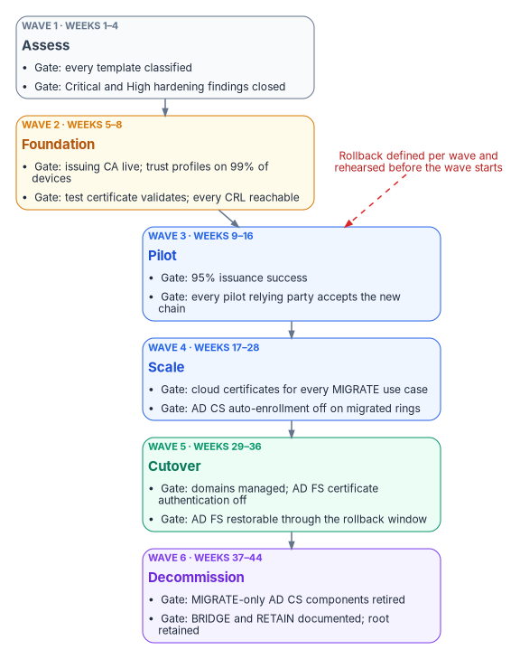

# Module 5: Coexistence and migration {.unnumbered}

*Part of the [PKI and Certificates learning path](index.md). Book 07, [Chapter 07](../../books/b07-pki/07-coexistence-and-migration.md). About 55 minutes.*

## Introduction (3 minutes)

Coexistence isn't a phase at the end of the project. It's the condition the project runs in. From the day the first Cloud PKI certificate is issued until the last AD CS workload retires, devices carry certificates from both issuers, relying parties trust both chains, and two sets of CRLs have to stay reachable. Most coexistence outages are revocation outages, and most rollbacks fail because something they depended on was already gone. In this module you check what has to stay on AD CS, follow trust in both directions, read the CRLs the estate depends on, and learn the six waves and their gates.

**The federal requirement.** The waves' gates and evidence are in [Chapter 07](../../books/b07-pki/07-coexistence-and-migration.md#the-migration-playbook).

| Requirement | KSI | Evidence |
|---|---|---|
| IA-5(2): validate each certificate to an accepted trust anchor, including its revocation status | KSI-IAM-APM, KSI-IAM-ELP, KSI-IAM-SNU, KSI-SVC-ASM | `CrlReport.json` from a dated run: each CRL's next update and size, wherever relying parties fetch it |
| SC-17: only approved trust anchors, in both directions | KSI-SVC-ASM | The Entra trust store export, the Intune trusted certificate profiles and the Group Policy-published roots, against the approved list |
| CM-3: each wave a controlled change, with a rehearsed rollback | KSI-CMT-LMC, KSI-CMT-VTD | Each wave's gate record and its rollback rehearsal. The kit doesn't produce these |

KSIs are FedRAMP 20x indicators for cloud service providers. The agency lines its own evidence up with them; it doesn't report KSIs itself. The pairs above are the ones in [Book 13, Appendix A](../../books/b13-governance/appendix-a-requirements-mapping.md).

## Learning objectives (1 minute)

After this module, you'll be able to:

- state the five coexistence rules;
- say what a domain controller certificate needs, and why an Entra-joined device needs its CRL over HTTP;
- say which way trust has to go for each kind of relying party, and when a CA belongs in NTAuth;
- read a CRL's next update and size, and say where each CA's CRL has to be reachable from;
- explain how a population moves at renewal without a gap, and why removing a SCEP profile isn't an undo;
- name the six waves, their exit gates, and the rollback rules that hold across them.

## Prerequisites (1 minute)

- [Module 3](03-the-target-pki-and-who-owns-it.md) and [Module 4](04-device-and-user-certificates.md). This lab runs the inventory and the CA publication review again in its own run folder.
- The Start Kit unzipped as the path's [Get the code](index.md#get-the-code) says, version 1.9.0 or later of `FMPADAssessment`.

## Unit 1: Two PKIs, one estate (6 minutes)

Read [Chapter 07](../../books/b07-pki/07-coexistence-and-migration.md), section *Two PKIs, one estate*. Five rules carry the whole chapter: one issuer at a time per use case and population; trust goes up before issuance moves; revocation reachable wherever validation happens; nothing revoked to force a move; and every move has a tested rollback that doesn't depend on something the move retired.

{#fig-ch07-trust-directions fig-alt="Two clusters side by side. Left, slate, the on-premises Active Directory forest: AD CS with its offline root and enterprise issuing CAs; domain-joined relying parties such as RADIUS, VPN and mutual-TLS web servers; and, in amber, the NTAuth store of CAs allowed to issue logon certificates. Right, blue, the Microsoft cloud: Cloud PKI with a root and issuing CA or a BYOCA issuing CA; the Entra ID CBA trust store holding every CA in the user-certificate chain; and Intune-managed devices with trusted certificate profiles for both chains. Arrows: AD CS to the Entra ID trust store, labeled upload with internet CRL URLs. Cloud PKI to the domain-joined relying parties, labeled Group Policy or -dspublish RootCA. Cloud PKI to NTAuth, dashed amber, labeled only if it issues logon certificates. AD CS and Cloud PKI each to the Intune-managed devices, labeled trusted certificate profile. A red note pointing at AD CS: LDAP-only CRL locations fail for Entra ID and Entra-joined devices."}

## Unit 2: What stays on AD CS (8 minutes)

Read [Chapter 07](../../books/b07-pki/07-coexistence-and-migration.md), section *What stays on AD CS until Active Directory retires*. Domain controller certificates stay on AD CS for as long as there are domain controllers: Cloud PKI issues only to Intune-enrolled devices, and Intune doesn't manage Windows Server. Three things make them ready for coexistence:

- **The Kerberos Authentication template, or a copy of it.** It carries Client Authentication, Server Authentication and KDC Authentication (`1.3.6.1.5.2.3.5`). The older Domain Controller and Domain Controller Authentication templates don't carry KDC Authentication; the copy supersedes them, so autoenrollment replaces their certificates.
- **An HTTP CRL location, listed first.** Entra-joined devices can't read the CRL from Active Directory before they've authenticated, so an LDAP-only distribution point breaks their sign-in on premises.
- **The root on Entra-joined devices**, through an Intune trusted certificate profile.

LDAPS uses the same domain controller certificate, so test a bind on port 636 with `ldp.exe` before unpublishing the superseded templates. NPS, gateways, web servers, SQL Server and appliances keep their AD CS certificates and move to the CLM platform's renewal, as Module 3 decided. Lab 1, steps 2 and 3 check the template and the CA that issues it.

## Unit 3: Trust in both directions, and CRL availability (10 minutes)

Read [Chapter 07](../../books/b07-pki/07-coexistence-and-migration.md), sections *Trust in both directions* and *CRL availability*. The AD CS chain goes up into the Entra trust store, each CA with an internet-facing CRL URL. The Cloud PKI chain goes down to the domain-joined relying parties that validate cloud certificates, by Group Policy or `certutil -dspublish ... RootCA`. NTAuth is only for logon certificates: publish a Cloud PKI or BYOCA issuing CA there only if it issues logon certificates, as Module 4's strong-mapping lab showed.

Each CA's CRL has to be reachable from three places: inside the network, on the internet, and from Entra ID, which downloads it anonymously within 10 seconds, up to 20 MB at interactive sign-in in the commercial cloud (GCC included), and doesn't use OCSP. Entra ID uses the CRL URL set on the CA in its trust store, so it works as soon as that's right. Other relying parties read the URL inside each certificate and keep failing until the certificate renews.

The kit's `Get-FMPCrlReport` reads CRL files you've downloaded and reports each one's issuer, next update, the hours left at a fixed time, its revoked entries and its size, flagging an expired CRL, one near its next update (24 hours by default) and one over 20 MB. It never fetches anything itself; Lab 2 downloads the files first.

## Unit 4: Renewal while two issuers overlap (6 minutes)

Read [Chapter 07](../../books/b07-pki/07-coexistence-and-migration.md), section *Renewal while two issuers overlap*. A population moves at the profile assignment, and the old certificate leaves at its renewal. AD CS autoenrollment stays on until the population holds valid Cloud PKI certificates and the relying parties have accepted them. Two facts make that rule necessary: removing a SCEP profile assignment, or a device leaving the assigned group, revokes and removes the SCEP certificate on Windows, iOS/iPadOS and macOS; and a rollback that falls back to AD CS certificates only works if they still exist. Intune SCEP and PKCS lifetimes shouldn't go below five days.

## Unit 5: The six waves (8 minutes)

Read [Chapter 07](../../books/b07-pki/07-coexistence-and-migration.md), sections *The migration playbook* and *Rollback rules that hold across waves*. Each wave's exit gate is the next wave's entry gate, and each has its own rollback.

{#fig-ch07-migration-waves fig-alt="Six cards from top to bottom. Wave 1, slate, Assess, weeks 1 to 4: gate, every template classified and Critical and High hardening findings closed. Wave 2, amber, Foundation, weeks 5 to 8: gate, issuing CA live, trust profiles at 99 percent of managed devices, test certificate validates. Wave 3, blue, Pilot, weeks 9 to 16: gate, 95 percent issuance success and every pilot relying party accepts the new chain. Wave 4, blue, Scale, weeks 17 to 28: gate, every managed device holds cloud certificates for MIGRATE use cases. Wave 5, green, Cutover, weeks 29 to 36: gate, domains managed, AD FS certificate authentication off, no AD CS certificates left for MIGRATE use cases. Wave 6, violet, Decommission, weeks 37 to 44: gate, MIGRATE-only AD CS components retired, BRIDGE and RETAIN documented. A red text note beside the waves: rollback is defined per wave and is tested before the wave starts."}

Modules 1 and 2 are wave 1: every template classified, and Critical and High findings remediated and re-tested. Module 3's publication check and this module's CRL report belong to wave 2's gate: the issuing CA live, trust deployed, and a test certificate that validates everywhere. Four rules hold across waves: a wave doesn't start until its rollback has been rehearsed, no rollback depends on something its own wave retires, a profile change or unassignment revokes, and staged rollout changes can take 24 hours.

## Exercise: Lab 1, coexistence checks on a fictional snapshot (15 minutes) {#pki-lab-1}

You check the fictional Contoso forest's domain controller template and the CA that issues it, then read three CRLs, two issuing CAs' and the offline root's, at a fixed time.

<!-- labs:begin lab-1-commands (generated by scripts/generate_labs.py; not part of the reviewed page) -->

::: {.callout-note #lab-1-commands collapse="false" title="Every command in Lab 1"}
Every command in this lab, in order. Each step below says what it does and what to look for.

```powershell
Set-Location C:\FMWLabs\start-kit

$Run = "C:\FMWLabs\results\pki-05-coexistence-and-migration\lab1\$((Get-Date).ToUniversalTime().ToString('yyyy-MM-ddTHHmmssZ'))"
New-Item -ItemType Directory -Path $Run -Force | Out-Null
$Run

# Step 1: Load the kit
Import-Module .\powershell\FMPADAssessment -Force
(Get-Module FMPADAssessment).Version.ToString()

# Step 2: Check the domain controller templates
Get-FMPPKIAssessment -OutputPath "$Run\inventory" -PkiDataPath .\tests\fixtures\pki-contoso.json
$inv = Get-Content -Raw "$Run\inventory\contoso.example\PKI\PKIInventory.json" | ConvertFrom-Json
$inv.CertificateTemplates | Where-Object Name -in 'DomainController', 'DomainControllerAuthentication', 'KerberosAuthentication' | ForEach-Object { '{0,-24} Published: {1,-5}  KDC Authentication: {2}' -f $_.Name, $_.Published, (@($_.EKU) -contains '1.3.6.1.5.2.3.5') }

# Step 3: Check the CA that issues it
$inv.CertificationAuthorities | Where-Object { @($_.PublishedTemplates) -contains 'KerberosAuthentication' } | ForEach-Object CAName
Get-FMPCAPublicationReview -OutputPath "$Run\publication" -PkiDataPath .\tests\fixtures\pki-contoso.json
(Get-Content -Raw "$Run\publication\contoso.example\PKI\CAPublication.json" | ConvertFrom-Json).Findings | Where-Object CAName -eq 'Contoso Issuing CA 1' | ForEach-Object Finding

# Step 4: Read the CRLs at a fixed time
Get-FMPCrlReport -OutputPath "$Run\crl" -Path .\tests\fixtures\crl\*.crl -AsOf '2026-11-20T12:00:00Z'
$r = Get-Content -Raw "$Run\crl\CRL\CrlReport.json" | ConvertFrom-Json
$r.Crls | Format-Table File, HoursToNextUpdate, RevokedCount, SizeBytes -AutoSize
$r.Findings | ForEach-Object { '{0}: {1}' -f $_.Finding, $_.Detail }

# Step 5: Check whose CRL each file is
$r.Crls | ForEach-Object { '{0,-24} {1}' -f $_.File, $_.Issuer }

# Step 6: List this lab's runs
Get-ChildItem C:\FMWLabs\results\pki-05-coexistence-and-migration\lab1 -Name
```

:::

<!-- labs:end -->

Every step runs in Windows PowerShell 5.1 or PowerShell 7, and prints the output shown here in either, so you can follow it top to bottom in one window. Open **Windows PowerShell** (or **PowerShell 7**) from the Start menu, then go to the kit's folder, where you unzipped it under [Get the code](index.md#get-the-code):

```powershell
Set-Location C:\FMWLabs\start-kit
```

Then make this run's results folder. Its name is the date and time you start, in UTC, so each run keeps its own results and running the lab again never overwrites them:

```powershell
$Run = "C:\FMWLabs\results\pki-05-coexistence-and-migration\lab1\$((Get-Date).ToUniversalTime().ToString('yyyy-MM-ddTHHmmssZ'))"
New-Item -ItemType Directory -Path $Run -Force | Out-Null
$Run
```

Expected output, where `<run>` is your start time, such as `2026-11-25T143005Z`:

```text
C:\FMWLabs\results\pki-05-coexistence-and-migration\lab1\<run>
```

The run's date is only the folder's name. The data's date is `-AsOf`, which stays the same, so every run's results match this page. The results folder sits outside the kit, so unzipping a newer copy of the kit never touches it.

Prefer Git Bash? Go to the folder with `cd /c/FMWLabs/start-kit` and make the run folder with `Run=/c/FMWLabs/results/pki-05-coexistence-and-migration/lab1/$(date -u +%Y-%m-%dT%H%M%SZ); mkdir -p "$Run"`, but every step is a PowerShell command (type `powershell` or `pwsh` to start one there). In a clone of the repository, use the `examples` folder of the same name.

1. **Load the kit.**

    ```powershell
    Import-Module .\powershell\FMPADAssessment -Force
    (Get-Module FMPADAssessment).Version.ToString()
    ```

    Expected output:

    ```text
    1.9.0
    ```

2. **Check the domain controller templates.** Inventory the snapshot, then list the three templates a domain controller certificate can come from, whether each is published, and whether it carries KDC Authentication:

    ```powershell
    Get-FMPPKIAssessment -OutputPath "$Run\inventory" -PkiDataPath .\tests\fixtures\pki-contoso.json
    $inv = Get-Content -Raw "$Run\inventory\contoso.example\PKI\PKIInventory.json" | ConvertFrom-Json
    $inv.CertificateTemplates | Where-Object Name -in 'DomainController', 'DomainControllerAuthentication', 'KerberosAuthentication' | ForEach-Object { '{0,-24} Published: {1,-5}  KDC Authentication: {2}' -f $_.Name, $_.Published, (@($_.EKU) -contains '1.3.6.1.5.2.3.5') }
    ```

    Expected output:

    ```text
    KerberosAuthentication   Published: True   KDC Authentication: True
    DomainController         Published: False  KDC Authentication: False
    ```

    Contoso already did the template part: Kerberos Authentication is published and carries KDC Authentication, and the old Domain Controller template isn't published. Domain Controller Authentication doesn't appear because the snapshot doesn't have it.

3. **Check the CA that issues it.** Find the CA that publishes Kerberos Authentication, then its findings from Module 3's publication check:

    ```powershell
    $inv.CertificationAuthorities | Where-Object { @($_.PublishedTemplates) -contains 'KerberosAuthentication' } | ForEach-Object CAName
    Get-FMPCAPublicationReview -OutputPath "$Run\publication" -PkiDataPath .\tests\fixtures\pki-contoso.json
    (Get-Content -Raw "$Run\publication\contoso.example\PKI\CAPublication.json" | ConvertFrom-Json).Findings | Where-Object CAName -eq 'Contoso Issuing CA 1' | ForEach-Object Finding
    ```

    Expected output, the CA and then its findings:

    ```text
    Contoso Issuing CA 1
    NO-HTTP-CDP
    NO-HTTP-AIA
    ```

    The template is right, but the CA behind it puts no HTTP CRL location into the certificates it issues. Every domain controller certificate from Issuing CA 1 points only at LDAP, so an Entra-joined device can't check it before it signs in, and on-premises sign-in from those devices fails. The fix is Module 3's: an HTTP location, listed first. Domain controllers then pick it up at their next renewal.

4. **Read the CRLs at a fixed time.** The three files are the two issuing CAs' CRLs and the offline root's, as you'd download them from each HTTP location:

    ```powershell
    Get-FMPCrlReport -OutputPath "$Run\crl" -Path .\tests\fixtures\crl\*.crl -AsOf '2026-11-20T12:00:00Z'
    $r = Get-Content -Raw "$Run\crl\CRL\CrlReport.json" | ConvertFrom-Json
    $r.Crls | Format-Table File, HoursToNextUpdate, RevokedCount, SizeBytes -AutoSize
    $r.Findings | ForEach-Object { '{0}: {1}' -f $_.Finding, $_.Detail }
    ```

    Expected output, the CRLs and then the findings:

    ```text
    File                     HoursToNextUpdate RevokedCount SizeBytes
    ----                     ----------------- ------------ ---------
    Contoso Issuing CA 1.crl                12            2       546
    Contoso Issuing CA 2.crl               120            1       505
    Contoso Root CA.crl                   4620            0       451
    ```

    ```text
    CRL-NEAR-NEXT: 12 hours left before the CRL's next update.
    ```

    Issuing CA 1's CRL goes stale in 12 hours. If the CA doesn't publish a new one before then, every relying party that checks it fails, Entra ID included. The root's CRL has months left, as an offline root's should, but its next update is a date the program records before the ceremony, because a BYOCA issuing CA depends on it. All three are far under Entra ID's 20 MB limit.

5. **Check whose CRL each file is.** The file name is only what you saved it as; the issuer inside it is what a relying party checks:

    ```powershell
    $r.Crls | ForEach-Object { '{0,-24} {1}' -f $_.File, $_.Issuer }
    ```

    Expected output:

    ```text
    Contoso Issuing CA 1.crl CN=Contoso Issuing CA 1, DC=contoso, DC=example
    Contoso Issuing CA 2.crl CN=Contoso Issuing CA 2, DC=contoso, DC=example
    Contoso Root CA.crl      CN=Contoso Root CA, O=Contoso (fictional), C=US
    ```

    The kit doesn't check a CRL's signature. In Lab 2, `certutil -verify` does, against the CA's certificate.

6. **List this lab's runs.**

    ```powershell
    Get-ChildItem C:\FMWLabs\results\pki-05-coexistence-and-migration\lab1 -Name
    ```

    Expected output: one line per run, oldest first, the last one this run:

    ```text
    <run>
    ```

## Exercise: Lab 2, a test forest {#pki-lab-2}

*Not timed. Not run by the authors. Never production.*

<!-- labs:begin lab-2-commands (generated by scripts/generate_labs.py; not part of the reviewed page) -->

::: {.callout-note #lab-2-commands collapse="false" title="Every command in Lab 2"}
Every command in this lab, in order. Each step below says what it does and what to look for.

```powershell
# Step 1: Check the domain controller templates and their CA
Set-Location C:\FMWLabs\start-kit
Import-Module .\powershell\FMPADAssessment -Force
$Run = "C:\FMWLabs\results\pki-05-coexistence-and-migration\lab2\$((Get-Date).ToUniversalTime().ToString('yyyy-MM-ddTHHmmssZ'))"
Get-FMPPKIAssessment -OutputPath "$Run\inventory" -Domain <test-domain>
$inv = Get-Content -Raw "$Run\inventory\<test-domain>\PKI\PKIInventory.json" | ConvertFrom-Json
$inv.CertificateTemplates | Where-Object Name -in 'DomainController', 'DomainControllerAuthentication', 'KerberosAuthentication' | ForEach-Object { '{0,-24} Published: {1,-5}  KDC Authentication: {2}' -f $_.Name, $_.Published, (@($_.EKU) -contains '1.3.6.1.5.2.3.5') }
$inv.CertificationAuthorities | Format-Table CAName, PublishedTemplates -AutoSize

# Step 2: Download each CRL
New-Item -ItemType Directory -Path $HOME\fmp-labs\pki\crl -Force | Out-Null
Invoke-WebRequest -Uri '<crl-url-1>' -OutFile $HOME\fmp-labs\pki\crl\ca1.crl -UseBasicParsing
Invoke-WebRequest -Uri '<crl-url-2>' -OutFile $HOME\fmp-labs\pki\crl\ca2.crl -UseBasicParsing

# Step 3: Read them
Get-FMPCrlReport -OutputPath "$Run\crl" -Path $HOME\fmp-labs\pki\crl\*.crl
$r = Get-Content -Raw "$Run\crl\CRL\CrlReport.json" | ConvertFrom-Json
$r.Crls | Format-Table File, Issuer, NextUpdate, HoursToNextUpdate, SizeBytes -AutoSize
$r.Findings | Format-Table Finding, File, Detail -AutoSize

# Step 4: Verify one CRL's signature
certutil -verify $HOME\fmp-labs\pki\crl\ca1.crl "$Run\inventory\<test-domain>\PKI\<ca-certificate>.cer"

# Step 5: Back out
Remove-Item -Recurse -Force $Run, $HOME\fmp-labs\pki\crl
```

:::

<!-- labs:end -->

You check the test forest's domain controller templates, download each CA's CRL from its HTTP location, and read them. Nothing in this lab changes a CA or the forest.

- **You need:** Module 1's Lab 2 forest and the kit's account from it; a computer outside the test network for step 2, as in Module 3's Lab 2.
- **You'll replace:** `<test-domain>` (the test forest root domain), and `<crl-url-1>`, `<crl-url-2>` (each CA's HTTP CRL location, from Module 3's Lab 2, with its `%` variables filled in as the CRL's file name).

1. **Check the domain controller templates and their CA**, from the domain-joined host, as the kit's account:

    ```powershell
    Set-Location C:\FMWLabs\start-kit
    Import-Module .\powershell\FMPADAssessment -Force
    $Run = "C:\FMWLabs\results\pki-05-coexistence-and-migration\lab2\$((Get-Date).ToUniversalTime().ToString('yyyy-MM-ddTHHmmssZ'))"
    Get-FMPPKIAssessment -OutputPath "$Run\inventory" -Domain <test-domain>
    $inv = Get-Content -Raw "$Run\inventory\<test-domain>\PKI\PKIInventory.json" | ConvertFrom-Json
    $inv.CertificateTemplates | Where-Object Name -in 'DomainController', 'DomainControllerAuthentication', 'KerberosAuthentication' | ForEach-Object { '{0,-24} Published: {1,-5}  KDC Authentication: {2}' -f $_.Name, $_.Published, (@($_.EKU) -contains '1.3.6.1.5.2.3.5') }
    $inv.CertificationAuthorities | Format-Table CAName, PublishedTemplates -AutoSize
    ```

    A test forest left at the defaults often publishes Domain Controller or Domain Controller Authentication and not Kerberos Authentication. That's the change Chapter 07 describes, for the PKI administrators' change record, not for this lab.

2. **Download each CRL**, on the outside computer, into one folder:

    ```powershell
    New-Item -ItemType Directory -Path $HOME\fmp-labs\pki\crl -Force | Out-Null
    Invoke-WebRequest -Uri '<crl-url-1>' -OutFile $HOME\fmp-labs\pki\crl\ca1.crl -UseBasicParsing
    Invoke-WebRequest -Uri '<crl-url-2>' -OutFile $HOME\fmp-labs\pki\crl\ca2.crl -UseBasicParsing
    ```

    Copy the folder to the domain-joined host's `$HOME\fmp-labs\pki\crl`. A download that fails is itself the finding: a relying party outside the network can't fetch that CRL either.

3. **Read them**, on the domain-joined host:

    ```powershell
    Get-FMPCrlReport -OutputPath "$Run\crl" -Path $HOME\fmp-labs\pki\crl\*.crl
    $r = Get-Content -Raw "$Run\crl\CRL\CrlReport.json" | ConvertFrom-Json
    $r.Crls | Format-Table File, Issuer, NextUpdate, HoursToNextUpdate, SizeBytes -AutoSize
    $r.Findings | Format-Table Finding, File, Detail -AutoSize
    ```

    Without `-AsOf`, the report judges each CRL against the time you run it.

4. **Verify one CRL's signature** against its CA's certificate, which Module 1's run saved beside the inventory:

    ```powershell
    certutil -verify $HOME\fmp-labs\pki\crl\ca1.crl "$Run\inventory\<test-domain>\PKI\<ca-certificate>.cer"
    ```

    Replace `<ca-certificate>` with the `.cer` file named for that CA. certutil reports whether the CRL's signature verifies against the certificate.

5. **Back out.** Nothing on the CAs changed. Delete the run folder and the downloaded CRLs when you're done:

    ```powershell
    Remove-Item -Recurse -Force $Run, $HOME\fmp-labs\pki\crl
    ```

## Knowledge check (5 minutes)

1. Which coexistence rule stops the program from revoking AD CS certificates to speed a move?
    a. One issuer at a time per population.
    b. Nothing is revoked to force a move: an AD CS certificate is replaced at renewal or expiry.
    c. Trust goes up before issuance moves.

2. Why does a domain controller certificate need an HTTP CRL location listed first?
    a. LDAP is slower.
    b. Entra-joined devices can't read the CRL from Active Directory before they've authenticated.
    c. Cloud PKI requires it.

3. When does a Cloud PKI or BYOCA issuing CA belong in the forest's NTAuth store?
    a. Always, so domain-joined machines trust it.
    b. Only if it will issue logon certificates for that forest, from profiles that produce strongly mapped certificates.
    c. Never.

4. In Lab 1, Issuing CA 1's CRL has 12 hours left. What happens if the CA doesn't publish a new one in time?
    a. Nothing: relying parties use the old CRL until a new one appears.
    b. Every relying party that checks it fails, Entra ID included.
    c. Entra ID switches to OCSP.

5. A SCEP profile assignment is removed from a pilot group to roll back. What happens to the certificates it issued on Windows?
    a. They stay until they expire.
    b. Intune revokes and removes them, so the rollback only works if the AD CS certificates still exist.
    c. They're converted to AD CS certificates.

6. What is wave 1's exit gate?
    a. The cloud issuing CA is live.
    b. Every template classified, and Critical and High hardening findings remediated and re-tested.
    c. AD FS certificate authentication is off.

::: {.callout-tip collapse="true"}
## Check your answers
1. **b.** See Unit 1.
2. **b.** See Unit 2 and Lab 1, step 3.
3. **b.** See Unit 3 and [NTAuth: only for logon certificates](../../books/b07-pki/07-coexistence-and-migration.md#ntauth-only-for-logon-certificates).
4. **b.** See Lab 1, step 4.
5. **b.** See Unit 4 and [Renewal while two issuers overlap](../../books/b07-pki/07-coexistence-and-migration.md#renewal-while-two-issuers-overlap).
6. **b.** See Unit 5.
:::

## Summary (2 minutes)

You checked the domain controller template and found the CA behind it couldn't serve Entra-joined devices, then read three CRLs at a fixed time and found one about to go stale. **Evidence an ISSO keeps from this module:** the inventory and publication review for the CA that issues domain controller certificates, `CrlReport.json` from each dated run with the CRLs it read, each wave's gate record and rollback rehearsal, and the trust store, Intune trusted certificate profile and Group Policy root exports against the approved list.

::: {.callout-tip}
## Continue the path
[← Previous: Module 4](04-device-and-user-certificates.md) · [Learning path](index.md) · [Next: Module 6 →](06-lifecycle-monitoring-and-decommissioning.md)
:::
