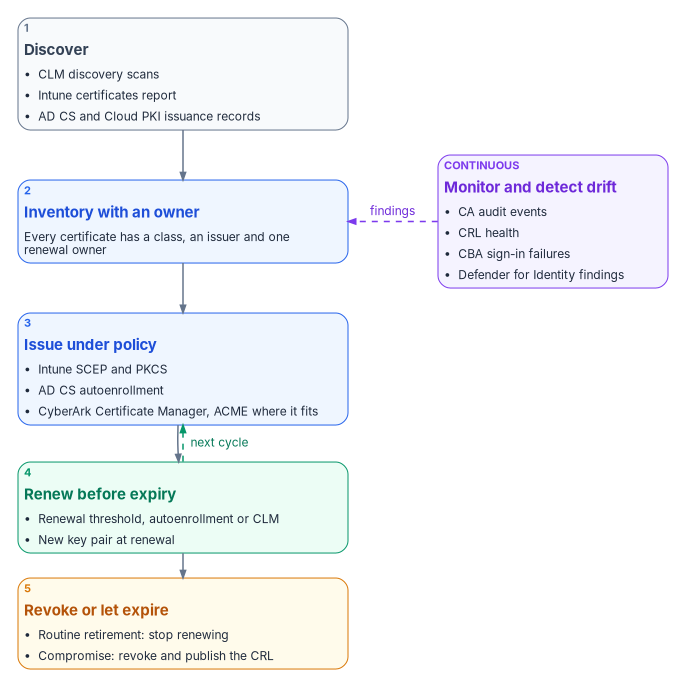
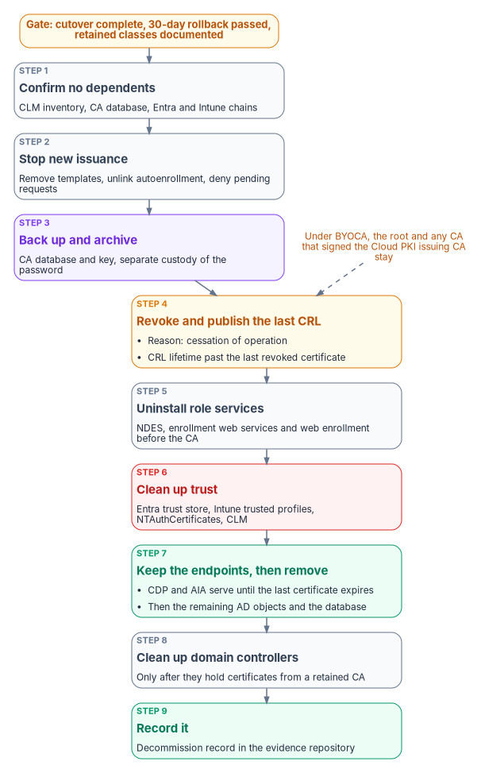

# Module 6: Lifecycle, monitoring and decommissioning {.unnumbered}

*Part of the [PKI and Certificates learning path](index.md). Book 07, [Chapter 08](../../books/b07-pki/08-lifecycle-monitoring-and-decommissioning.md) and [Appendix C](../../books/b07-pki/appendix-c-anatomy-of-the-clm-platform.md), with the guide [Certificate Lifecycle on CyberArk Certificate Manager](../../books/guides/cyberark-certificate-lifecycle.md). About 55 minutes.*

## Introduction (3 minutes)

Public TLS certificates are on their way to a 47-day maximum, and an estate that depends on someone remembering a date will fail on schedule. This module covers the three engines that renew everything automated, the CRLs that keep revocation honest, what to watch and what drift looks like, and the last wave: retiring an AD CS CA without stranding a certificate that still depends on it. In the lab you read what two CAs' databases still hold, find what keeps one of them from retiring, and check whether its final CRL would outlive its last certificate.

**The federal requirement.** The full control table is in Chapter 08's [The evidence an assessor reads](../../books/b07-pki/08-lifecycle-monitoring-and-decommissioning.md#the-evidence-an-assessor-reads).

| Requirement | KSI | Evidence |
|---|---|---|
| SC-17: certificates issued under policy, and only approved trust anchors after a CA retires | KSI-SVC-ASM | `IssuedCertificates.json` and the by-template list for each CA, before the retirement decision; the trust stores after cleanup |
| SC-12: CA keys managed under the key management requirements, through the archive | KSI-SVC-ASM | The `Backup-CARoleService` record, its custody, and the records officer's disposition. The kit doesn't produce these |
| CM-6: drift from the certificate baseline detected | KSI-SVC-ACM, KSI-MLA-EVC | The scheduled CRL and issued-certificate reports, kept by date, and the drift findings they raise |
| CA-7: the estate monitored continuously | KSI-MLA-EVC | The dated runs over time: an assessor asks how long a finding stayed open |

KSIs are FedRAMP 20x indicators for cloud service providers. The agency lines its own evidence up with them; it doesn't report KSIs itself. The pairs above are the ones in [Book 13, Appendix A](../../books/b13-governance/appendix-a-requirements-mapping.md).

## Learning objectives (1 minute)

After this module, you'll be able to:

- name the three renewal engines and the classes each covers, and say where ACME fits;
- operate a CRL as a production service: publish before expiry, never strand an old distribution point, use the right reason code;
- name the monitoring source for each part of the estate, and recognize the drift patterns;
- name the parts of a CLM platform and what the program's platform does with each;
- state the decommissioning gate and the order of its nine steps, and say which steps wait for the last certificate to expire;
- read a CA database export for what still depends on a CA, and check a final CRL against the last expiry.

## Prerequisites (1 minute)

- [Module 5](05-coexistence-and-migration.md). This lab reads its own fixtures and the CRLs Module 5 read.
- The Start Kit unzipped as the path's [Get the code](index.md#get-the-code) says, version 1.9.0 or later of `FMPADAssessment`.

## Unit 1: Renewal at scale (8 minutes)

Read [Chapter 08](../../books/b07-pki/08-lifecycle-monitoring-and-decommissioning.md), section *Renewal at scale as lifetimes shrink*. The CA/Browser Forum's schedule takes publicly trusted TLS certificates from 398 days to 200 days in March 2026, 100 days in March 2027 and 47 days in March 2029. The rule that follows is that no certificate class may depend on a person remembering a date. Three engines do the renewing:

{#fig-ch08-lifecycle-loop fig-alt="A vertical flow of five cards with a monitoring card beside it. Discover, in slate: CLM discovery scans, the Intune certificates report, and AD CS and Cloud PKI issuance records. Inventory with an owner, in blue: every certificate has a class, an issuer and one renewal owner. Issue under policy, in blue: Intune SCEP and PKCS, AD CS autoenrollment, and CyberArk Certificate Manager with ACME where the endpoint supports it. Renew before expiry, in green: the Intune renewal threshold, autoenrollment and CLM renewal, each with a new key pair. Revoke or let expire, in amber: routine retirement by non-renewal, and revocation published to the CRL for compromise. A violet monitoring card, listing CA audit events, CRL health, CBA sign-in failures, Defender for Identity findings and drift, has dashed arrows back to the inventory card. An arrow also loops from renew back to issue."}

- **Intune certificate profiles** renew user and device certificates on managed devices at the profile's threshold.
- **AD CS autoenrollment** renews domain controller certificates, which also serve LDAPS.
- **CyberArk Certificate Manager** renews server TLS from the retained AD CS hierarchy, appliances, network devices and public TLS, and provides ACME for listeners with a resolvable name and a client. Neither Microsoft issuer offers ACME.

PIV, code signing and CA certificates run on controlled, scheduled processes instead: the card lifecycle, an approved request, and the key ceremony.

## Unit 2: Revocation, monitoring and drift (10 minutes)

Read [Chapter 08](../../books/b07-pki/08-lifecycle-monitoring-and-decommissioning.md), sections *Revocation and CRL availability* to *Compliance and drift detection*. For each CA that stays, CRL publication is a production service: publish before expiry with an overlap measured, not copied; treat the offline root's CRL as a witnessed ceremony; monitor the endpoint, not just the CA; never strand an old distribution point while an unexpired certificate still names it; and use the right reason code. One Cloud PKI trap goes in every runbook: revoke a certificate while its SCEP profile is still assigned, and the device gets a new one at its next check-in.

Read the monitoring table, then the drift patterns. Two of them are what the kit's reports in Modules 5 and 6 look for: a CRL near its next update, and a certificate expiring with no renewal path. The others come from the Intune certificates report, the CA's audit events, the Entra audit and sign-in logs, Defender for Identity and the CLM platform. In the program, the checks run at least weekly and each run is kept, because history is what an assessor reads.

## Unit 3: The CLM platform (5 minutes)

Read [Appendix C](../../books/b07-pki/appendix-c-anatomy-of-the-clm-platform.md), *What every CLM platform is made of* and *Key takeaways*. Every CLM platform does the same jobs: an inventory and policy store, a lifecycle engine, discovery, CA and provisioning connectors, enrollment services, monitoring, consoles and an API, audit, and key protection. The program's platform, CyberArk Certificate Manager, Self-Hosted, is a cluster of Windows servers on one SQL Server database, with ACME on separate servers that aren't in FIPS mode. The build, phase by phase, is the guide [Certificate Lifecycle on CyberArk Certificate Manager](../../books/guides/cyberark-certificate-lifecycle.md); this path doesn't repeat it.

## Unit 4: Decommissioning AD CS (12 minutes)

Read [Chapter 08](../../books/b07-pki/08-lifecycle-monitoring-and-decommissioning.md), section *Decommissioning AD CS*. Decommissioning is wave 6, and it applies only to the CAs and role services that no longer serve a retained certificate class. Domain controller, LDAPS and RADIUS certificates usually keep at least one AD CS issuing CA alive for as long as domain controllers exist.

{#fig-ch08-adcs-decommission fig-alt="A vertical sequence that starts with an amber gate pill: cutover complete, 30-day rollback window passed, and retained classes documented. Step 1, in slate: confirm no dependents, using the CLM inventory, the CA database and the Entra and Intune chains. Step 2, in slate: stop new issuance by removing templates from the CA, unlinking autoenrollment and denying pending requests. Step 3, in violet: back up and archive the CA database and key. Step 4, in amber: revoke outstanding certificates for cessation of operation, set the CRL lifetime past the last revoked certificate's expiry, and publish the final CRL. Step 5, in slate: uninstall the role services, with NDES, enrollment web services and web enrollment before the CA. Step 6, in red: clean up trust by removing the CA from the Entra trust store, Intune trusted certificate profiles, NTAuthCertificates and the CLM platform. Step 7, in green: keep the CDP and AIA endpoints serving until the last certificate expires, then remove the remaining Active Directory objects and the database. Step 8, in slate: clean up domain controllers, only after they hold certificates from a retained CA. Step 9, in green: record the decommission in the evidence repository. A side note in amber says that under BYOCA, the root and any CA that signed the Cloud PKI issuing CA stay."}

The gate: cutover complete, 30 days of rollback with no incidents, and every retained class documented and running on the CAs that remain. Three of the nine steps are what Lab 1 reads:

- **Step 1, confirm nothing depends on the CA,** from the CLM inventory and the CA database. Domain controllers must already hold certificates from a retained CA.
- **Step 4, revoke and publish the last CRL,** with a publication interval long enough that the final CRL outlives the revoked certificates.
- **Step 7, keep the endpoints until the last certificate expires.** The AIA, CDP and CA objects stay in AD, and the HTTP endpoints keep serving the final CRL, until then.

The kit's `Get-FMPIssuedCertificateReport` reads one `certutil -view` export per CA, the same export Module 1's Lab 2 made, and reports the unexpired certificates per template, those expiring within 60 days, and the last expiry. Given a CA's final CRL with `-FinalCrlPath`, it checks that CRL's next update against that last expiry. Pass only the final CRL of a CA you're retiring: a working CA's regular CRL is always shorter than its certificates.

## Exercise: Lab 1, decommission readiness on fictional exports (15 minutes) {#pki-lab-1}

Contoso plans to retire Issuing CA 1, the CA with Module 2's ESC findings and Module 3's missing HTTP locations. You read what both CAs' databases still hold, find what keeps Issuing CA 1 from retiring, and check the CRL it would publish against its last certificate. The exports are in `tests\fixtures\issued-certificates`, one per CA, in the form `certutil -view ... csv` writes, and the CRL is Module 5's.

<!-- labs:begin lab-1-commands (generated by scripts/generate_labs.py; not part of the reviewed page) -->

::: {.callout-note #lab-1-commands collapse="false" title="Every command in Lab 1"}
Every command in this lab, in order. Each step below says what it does and what to look for.

```powershell
Set-Location C:\FMWLabs\start-kit

$Run = "C:\FMWLabs\results\pki-06-lifecycle-monitoring-and-decommissioning\lab1\$((Get-Date).ToUniversalTime().ToString('yyyy-MM-ddTHHmmssZ'))"
New-Item -ItemType Directory -Path $Run -Force | Out-Null
$Run

# Step 1: Load the kit
Import-Module .\powershell\FMPADAssessment -Force
(Get-Module FMPADAssessment).Version.ToString()

# Step 2: Read what each CA's database still holds
Get-FMPIssuedCertificateReport -OutputPath $Run -Domain contoso.example -ExportFolder .\tests\fixtures\issued-certificates -AsOf '2026-11-20T12:00:00Z' -FinalCrlPath '.\tests\fixtures\crl\Contoso Issuing CA 1.crl'
$i = Get-Content -Raw "$Run\contoso.example\PKI\IssuedCertificates.json" | ConvertFrom-Json
$i.CertificationAuthorities | ForEach-Object { '{0}: {1} issued, {2} unexpired, {3} within 60 days, last expires {4:yyyy-MM-dd}' -f $_.CAName, $_.Issued, $_.Unexpired, $_.ExpiringWithinWindow, ([datetime]$_.LastExpiry).ToUniversalTime() }

# Step 3: See what depends on Issuing CA 1
Import-Csv "$Run\contoso.example\PKI\IssuedCertificatesByTemplate.csv" | Where-Object CAName -eq 'Contoso Issuing CA 1' | Format-Table Template, Unexpired, ExpiringWithinWindow -AutoSize

# Step 4: Read the findings for Issuing CA 1
$i.Findings | Where-Object CAName -eq 'Contoso Issuing CA 1' | ForEach-Object { '{0}: {1}' -f $_.Finding, $_.Detail }

# Step 5: List what the run wrote
Get-ChildItem "$Run\contoso.example\PKI" -Name

# Step 6: List this lab's runs
Get-ChildItem C:\FMWLabs\results\pki-06-lifecycle-monitoring-and-decommissioning\lab1 -Name
```

:::

<!-- labs:end -->

Every step runs in Windows PowerShell 5.1 or PowerShell 7, and prints the output shown here in either, so you can follow it top to bottom in one window. Open **Windows PowerShell** (or **PowerShell 7**) from the Start menu, then go to the kit's folder, where you unzipped it under [Get the code](index.md#get-the-code):

```powershell
Set-Location C:\FMWLabs\start-kit
```

Then make this run's results folder. Its name is the date and time you start, in UTC, so each run keeps its own results and running the lab again never overwrites them:

```powershell
$Run = "C:\FMWLabs\results\pki-06-lifecycle-monitoring-and-decommissioning\lab1\$((Get-Date).ToUniversalTime().ToString('yyyy-MM-ddTHHmmssZ'))"
New-Item -ItemType Directory -Path $Run -Force | Out-Null
$Run
```

Expected output, where `<run>` is your start time, such as `2026-11-25T143005Z`:

```text
C:\FMWLabs\results\pki-06-lifecycle-monitoring-and-decommissioning\lab1\<run>
```

The run's date is only the folder's name. The data's date is `-AsOf`, which stays the same, so every run's results match this page. The results folder sits outside the kit, so unzipping a newer copy of the kit never touches it.

Prefer Git Bash? Go to the folder with `cd /c/FMWLabs/start-kit` and make the run folder with `Run=/c/FMWLabs/results/pki-06-lifecycle-monitoring-and-decommissioning/lab1/$(date -u +%Y-%m-%dT%H%M%SZ); mkdir -p "$Run"`, but every step is a PowerShell command (type `powershell` or `pwsh` to start one there). In a clone of the repository, use the `examples` folder of the same name.

1. **Load the kit.**

    ```powershell
    Import-Module .\powershell\FMPADAssessment -Force
    (Get-Module FMPADAssessment).Version.ToString()
    ```

    Expected output:

    ```text
    1.9.0
    ```

2. **Read what each CA's database still holds.** Issuing CA 1's CRL goes in as the final CRL it would publish if it retired today:

    ```powershell
    Get-FMPIssuedCertificateReport -OutputPath $Run -Domain contoso.example -ExportFolder .\tests\fixtures\issued-certificates -AsOf '2026-11-20T12:00:00Z' -FinalCrlPath '.\tests\fixtures\crl\Contoso Issuing CA 1.crl'
    $i = Get-Content -Raw "$Run\contoso.example\PKI\IssuedCertificates.json" | ConvertFrom-Json
    $i.CertificationAuthorities | ForEach-Object { '{0}: {1} issued, {2} unexpired, {3} within 60 days, last expires {4:yyyy-MM-dd}' -f $_.CAName, $_.Issued, $_.Unexpired, $_.ExpiringWithinWindow, ([datetime]$_.LastExpiry).ToUniversalTime() }
    ```

    Expected output:

    ```text
    Contoso Issuing CA 1: 6 issued, 5 unexpired, 2 within 60 days, last expires 2027-11-02
    Contoso Issuing CA 2: 4 issued, 3 unexpired, 1 within 60 days, last expires 2028-09-30
    ```

    Each export lists every certificate the CA issued, expired ones included; the report counts the unexpired ones at `-AsOf`. The export's dates are the CA's local time, so the report converts them to UTC.

3. **See what depends on Issuing CA 1.**

    ```powershell
    Import-Csv "$Run\contoso.example\PKI\IssuedCertificatesByTemplate.csv" | Where-Object CAName -eq 'Contoso Issuing CA 1' | Format-Table Template, Unexpired, ExpiringWithinWindow -AutoSize
    ```

    Expected output:

    ```text
    Template               Unexpired ExpiringWithinWindow
    --------               --------- --------------------
    KerberosAuthentication 1         0
    Machine                2         0
    User                   1         1
    WebServerLegacy        1         1
    ```

    The KerberosAuthentication row stops the retirement. It's a domain controller certificate, and domain controllers must hold certificates from a retained CA before this one goes (steps 1 and 8). Publish Kerberos Authentication on Issuing CA 2 and let autoenrollment replace it first. Machine and User are MIGRATE classes moving to Cloud PKI, so they leave at renewal, not by revocation. Web Server Legacy is Module 2's ESC1 template; its owner decides whether it renews anywhere at all.

4. **Read the findings for Issuing CA 1.**

    ```powershell
    $i.Findings | Where-Object CAName -eq 'Contoso Issuing CA 1' | ForEach-Object { '{0}: {1}' -f $_.Finding, $_.Detail }
    ```

    Expected output:

    ```text
    UNEXPIRED: 5 unexpired certificates; the last expires 2027-11-02.
    EXPIRING: 2 certificates expire within 60 days.
    FINAL-CRL-SHORT: The CRL's next update, 2026-11-21, comes before the last certificate expires, 2027-11-02.
    ```

    `UNEXPIRED` is the step 1 answer: not yet. `EXPIRING` lists the certificates that need a renewal path now, on whichever issuer their class moves to. `FINAL-CRL-SHORT` is the step 4 rule: Issuing CA 1 publishes a CRL valid for about a week, so a final CRL on that schedule would expire within days and leave nearly a year of revoked certificates unverifiable. Before the final publication, set the CRL period to outlast 2027-11-02. The same date is step 7's: until then, the CDP and AIA endpoints keep serving.

5. **List what the run wrote.**

    ```powershell
    Get-ChildItem "$Run\contoso.example\PKI" -Name
    ```

    Expected output:

    ```text
    IssuedCertificates.json
    IssuedCertificatesByTemplate.csv
    ```

    Kept by date, these are the step 1 evidence for the sponsor's retirement decision, and the history an assessor reads.

6. **List this lab's runs.**

    ```powershell
    Get-ChildItem C:\FMWLabs\results\pki-06-lifecycle-monitoring-and-decommissioning\lab1 -Name
    ```

    Expected output: one line per run, oldest first, the last one this run:

    ```text
    <run>
    ```

## Exercise: Lab 2, a test CA {#pki-lab-2}

*Not timed. Not run by the authors. Never production.*

<!-- labs:begin lab-2-commands (generated by scripts/generate_labs.py; not part of the reviewed page) -->

::: {.callout-note #lab-2-commands collapse="false" title="Every command in Lab 2"}
Every command in this lab, in order. Each step below says what it does and what to look for.

```powershell
# Step 1: Export the CA's issued certificates
New-Item -ItemType Directory -Path C:\FMWLabs\results\pki-06-export -Force | Out-Null
certutil -config "<ca-host>\<ca-name>" -view -restrict "Disposition=20" -out "RequestID,RequesterName,CertificateTemplate,NotAfter" csv > "C:\FMWLabs\results\pki-06-export\<ca-name>.csv"

# Step 2: Read the CRL period
certutil -getreg CA\CRLPeriodUnits
certutil -getreg CA\CRLPeriod
certutil -getreg CA\CRLOverlapUnits
certutil -getreg CA\CRLOverlapPeriod

# Step 3: Read it with the kit
Set-Location C:\FMWLabs\start-kit
Import-Module .\powershell\FMPADAssessment -Force
$Run = "C:\FMWLabs\results\pki-06-lifecycle-monitoring-and-decommissioning\lab2\$((Get-Date).ToUniversalTime().ToString('yyyy-MM-ddTHHmmssZ'))"
Get-FMPIssuedCertificateReport -OutputPath $Run -Domain <test-domain> -ExportFolder C:\FMWLabs\results\pki-06-export -FinalCrlPath C:\FMWLabs\results\pki-06-export\*.crl
$i = Get-Content -Raw "$Run\<test-domain>\PKI\IssuedCertificates.json" | ConvertFrom-Json
$i.CertificationAuthorities | Format-Table CAName, Issued, Unexpired, ExpiringWithinWindow, LastExpiry, CrlNextUpdate -AutoSize
$i.Findings | Format-Table Finding, CAName, Detail -AutoSize -Wrap
Import-Csv "$Run\<test-domain>\PKI\IssuedCertificatesByTemplate.csv" | Format-Table -AutoSize

# Step 4: Back out
Remove-Item -Recurse -Force $Run, C:\FMWLabs\results\pki-06-export
```

:::

<!-- labs:end -->

You export a test CA's database, read what it still holds, and check its CRL period against its last certificate. Nothing in this lab changes the CA.

- **You need:** Module 1's Lab 2 forest; an elevated session on the test enterprise CA as its administrator for steps 1 and 2, the same rights Module 1's Lab 2 used for `certutil -view`; the domain-joined host with the kit for step 3.
- **You'll replace:** `<ca-name>` (the test CA's name, which also names its export file), `<ca-host>` (the CA server's DNS name) and `<test-domain>` (the test forest root domain).

1. **Export the CA's issued certificates**, on the CA, elevated. This is Module 1's Lab 2 export, saved under the CA's name:

    ```powershell
    New-Item -ItemType Directory -Path C:\FMWLabs\results\pki-06-export -Force | Out-Null
    certutil -config "<ca-host>\<ca-name>" -view -restrict "Disposition=20" -out "RequestID,RequesterName,CertificateTemplate,NotAfter" csv > "C:\FMWLabs\results\pki-06-export\<ca-name>.csv"
    ```

2. **Read the CRL period**, on the CA:

    ```powershell
    certutil -getreg CA\CRLPeriodUnits
    certutil -getreg CA\CRLPeriod
    certutil -getreg CA\CRLOverlapUnits
    certutil -getreg CA\CRLOverlapPeriod
    ```

    Copy the export folder to the domain-joined host, and the CA's current CRL from `C:\Windows\System32\CertSrv\CertEnroll` into the same folder.

3. **Read it with the kit**, on the domain-joined host:

    ```powershell
    Set-Location C:\FMWLabs\start-kit
    Import-Module .\powershell\FMPADAssessment -Force
    $Run = "C:\FMWLabs\results\pki-06-lifecycle-monitoring-and-decommissioning\lab2\$((Get-Date).ToUniversalTime().ToString('yyyy-MM-ddTHHmmssZ'))"
    Get-FMPIssuedCertificateReport -OutputPath $Run -Domain <test-domain> -ExportFolder C:\FMWLabs\results\pki-06-export -FinalCrlPath C:\FMWLabs\results\pki-06-export\*.crl
    $i = Get-Content -Raw "$Run\<test-domain>\PKI\IssuedCertificates.json" | ConvertFrom-Json
    $i.CertificationAuthorities | Format-Table CAName, Issued, Unexpired, ExpiringWithinWindow, LastExpiry, CrlNextUpdate -AutoSize
    $i.Findings | Format-Table Finding, CAName, Detail -AutoSize -Wrap
    Import-Csv "$Run\<test-domain>\PKI\IssuedCertificatesByTemplate.csv" | Format-Table -AutoSize
    ```

    A test CA almost always shows `FINAL-CRL-SHORT`: its CRL is on the default weekly period. That's right for a working CA. The finding only matters for the CRL you'd publish last.

4. **Back out.** Nothing on the CA changed. The export holds the test CA's requester names: delete it and the run folder when you're done.

    ```powershell
    Remove-Item -Recurse -Force $Run, C:\FMWLabs\results\pki-06-export
    ```

## Knowledge check (5 minutes)

1. Which certificates does CyberArk Certificate Manager renew in the target?
    a. Every certificate, including Intune device certificates.
    b. Server TLS from the retained AD CS hierarchy, appliances, network devices and public TLS.
    c. Only public TLS.

2. A CA's CDP URL changes. What happens to the old endpoint?
    a. It can be removed at once.
    b. It keeps its current CRL available until no unexpired certificate references it.
    c. Entra ID redirects to the new one.

3. A Cloud PKI certificate is revoked by hand while its SCEP profile is still assigned. What happens?
    a. The device stays without a certificate.
    b. The device requests and gets a new certificate at its next check-in, so remove the assignment first.
    c. Intune reinstates the old certificate.

4. What is the decommissioning gate?
    a. The CA has no unexpired certificates.
    b. Cutover complete, 30 days of rollback with no incidents, and every retained class documented and running on the CAs that remain.
    c. The sponsor's approval alone.

5. In Lab 1, why can't Issuing CA 1 retire yet, apart from its unexpired client certificates?
    a. Its CRL is too large.
    b. It issued a domain controller certificate, and domain controllers must hold certificates from a retained CA first.
    c. Its key is too short.

6. What does `FINAL-CRL-SHORT` mean for a CA being retired?
    a. Its CRL is about to expire, so publish now.
    b. The final CRL's next update comes before the last certificate expires, so revoked certificates would become unverifiable; set the CRL period to outlast the last expiry first.
    c. The CRL has no entries.

::: {.callout-tip collapse="true"}
## Check your answers
1. **b.** See Unit 1.
2. **b.** See Unit 2 and [Operating the CRLs that stay](../../books/b07-pki/08-lifecycle-monitoring-and-decommissioning.md#operating-the-crls-that-stay).
3. **b.** See Unit 2.
4. **b.** See Unit 4 and [Decommissioning AD CS](../../books/b07-pki/08-lifecycle-monitoring-and-decommissioning.md#decommissioning-ad-cs).
5. **b.** See Lab 1, step 3.
6. **b.** See Unit 4 and Lab 1, step 4.
:::

## Summary (2 minutes)

You read what two CAs' databases still hold, found the domain controller certificate that keeps Issuing CA 1 in service, and checked its final CRL against its last certificate. **Evidence an ISSO keeps from this module:** the dated issued-certificate and CRL reports over time; for each retired CA, the step 1 report behind the sponsor's decision, the backup and its custody record, the final CRL and its next update, the trust stores after cleanup, the endpoint checks until the last expiry, and the decommission record with the records officer's disposition.

::: {.callout-tip}
## Continue the path
[← Previous: Module 5](05-coexistence-and-migration.md) · [Learning path](index.md) · [Next: Module 7 →](07-piv-and-derived-piv.md)
:::
