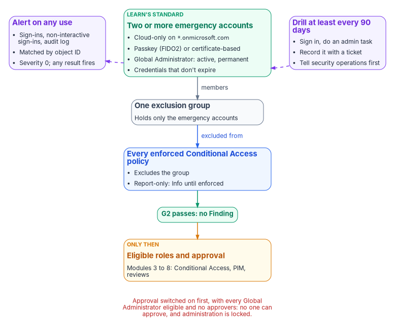

# Module 2: Emergency access first {.unnumbered}

*Part of the [Privileged Access learning path](index.md). Plan Phase 0, task A0.4, and Phase 1, task A1.1. Workbook [Chapter 02](../../project-plans/developer-workbooks/privileged-access/02-emergency-access-as-code.md). About 55 minutes.*

**Watch:** the narrated deck for this module: [Deck](https://github.com/WhalerMike/modernization-workbook/releases/download/edition-2026.11.5/Training_PA_Module_2.pptx) · [▶ Watch](../../presentations/watch.html?v=Training_PA_Module_2_Narrated) (about 14 minutes, captions) · [MP4](https://github.com/WhalerMike/modernization-workbook/releases/download/videos-2026-10-23/Training_PA_Module_2_Narrated.mp4) · [Script](https://github.com/WhalerMike/modernization-workbook/blob/main/presentations/training-pa-module-2/Training_PA_Module_2_Narration_Script.md) · [Captions](https://github.com/WhalerMike/modernization-workbook/blob/main/presentations/training-pa-module-2/Training_PA_Module_2_Narrated.vtt).

## Introduction (3 minutes)

This is the one step that can't move. Book 04, Chapter 08's Step 0 is the emergency access accounts, and the plan's critical path says the same: approval switched on before the emergency accounts exist is the one sequence that locks the agency out. Learn names the case. Every Global Administrator and Privileged Role Administrator is eligible, approval is required, and no approvers are selected, so no one can approve and administration is locked.

The emergency accounts are also the program's main exception to "zero permanently active assignments." Module 1 reported `ea01` as Info only because the exceptions list names it. In this module you make sure the exception is what it claims to be: you check each account against the standard, and you build the alert that watches them between drills.

::: {.callout-important}
## Do this before Modules 3 to 8 change anything
Every later module that writes leans on this one. Module 3 keeps the emergency group excluded from every policy file. Module 4 refuses any PIM change until the emergency accounts hold Global Administrator, active, permanent and direct. Module 7 refuses a review that would remove them. Read the chapter's [Why this comes first](../../project-plans/developer-workbooks/privileged-access/02-emergency-access-as-code.md#why-this-comes-first) and [Book 04, Chapter 08's Step 0](../../books/b04-access/08-pim-self-request-with-approval.md#step-0-establish-emergency-access-accounts-first) now.
:::

**The federal requirement.** The check is the plan's [Gate 1](../../project-plans/privileged-access.md#gates) test, "emergency access accounts tested," and the alert watches the accounts between drills. It supports NIST SP 800-53 AC-2 (emergency accounts as a defined account type), IA-2(1) (multifactor authentication to privileged accounts), AC-2(4), AU-6 and SI-4 for the alert, and BOD 25-01's MS.AAD.7.3v1 (cloud-only privileged accounts) and MS.AAD.3.6v1 (phishing-resistant MFA for highly privileged roles). The full table is the chapter's [Federal requirements and evidence](../../project-plans/developer-workbooks/privileged-access/02-emergency-access-as-code.md#federal-requirements-and-evidence).

| Requirement | KSI | Evidence |
|---|---|---|
| AC-2; MS.AAD.7.3v1; MS.AAD.7.4v1's exception for emergency accounts | KSI-IAM-JIT | PA-EA-01 to 05, 07, 08 and 10 in `findings.json` |
| IA-2(1); MS.AAD.3.6v1, phishing-resistant MFA | KSI-IAM-APM | PA-EA-06 in `findings.json`: no phone, app, OATH, email or Temporary Access Pass method |
| AC-2(2), the drills as compensating controls (design guidance) | KSI-IAM-AAM, KSI-IAM-JIT | PA-EA-09, read from `emergency-validations.csv` |
| AC-2(4), AU-6 and SI-4, an alert on any use | KSI-MLA-RVL, KSI-MLA-LET, KSI-IAM-SUS | `emergency-alert.json`: severity 0, any result fires, every 5 minutes |
| AC-6, least privilege for the identity that checks | KSI-IAM-ELP | Six read permissions, nothing that writes |

KSIs are FedRAMP 20x indicators for cloud service providers. The agency authorizes its own system and lines this evidence up with what its providers report against them; it doesn't report KSIs itself ([Book 00, Appendix B](../../books/b00-orientation/appendix-b-engagement-archetype.md)).

## Learning objectives (1 minute)

After this module, you'll be able to:

- explain the documented lockout, and why the emergency accounts come before any approval is switched on;
- name what Learn's standard asks of each emergency account, and the rule that checks each item;
- explain why the alert reads three tables, not one, and why it matches object IDs, not names;
- run the check and read its findings;
- say why every enforced Conditional Access policy must exclude the accounts, and why a report-only one needn't.

## Prerequisites (1 minute)

- [Module 1](01-privileged-inventory.md): the module and the fictional tenant this lab uses again.
- Reading KQL helps for Unit 2, but isn't required.

## Unit 1: The standard and the check (10 minutes)

Read the chapter's [What Microsoft gives you](../../project-plans/developer-workbooks/privileged-access/02-emergency-access-as-code.md#what-microsoft-gives-you). Learn's standard asks for two or more cloud-only accounts on `*.onmicrosoft.com`; passkey (FIDO2) or certificate-based authentication; Global Administrator active and permanent in PIM; exclusion from Conditional Access policies that block or restrict sign-in, through one group; and validation at least every 90 days. [Book 04, Chapter 04](../../books/b04-access/04-privileged-roles-and-tiers.md#emergency-access-accounts) adopts it and adds a post-use review; dual custody is in [Book 04, Chapter 06](../../books/b04-access/06-who-decides-access.md#emergency-access)'s emergency access procedure.

Then read [The check](../../project-plans/developer-workbooks/privileged-access/02-emergency-access-as-code.md#the-check). For each rule, PA-EA-01 to PA-EA-10, note whether it's Learn's or the program's. Pay attention to PA-EA-08:

- The code checks every *enforced* policy, rather than judging which ones "block or restrict." *Design guidance.*
- A report-only policy that doesn't exclude the group is Info, not a Finding. Learn and Book 04, Chapter 04 say report-only policies need no exclusion. Book 04, Chapter 10's pre-merge check is stricter ([Book 04, Chapter 10](../../books/b04-access/10-access-as-code-and-evidence.md#a-pre-merge-check-for-the-emergency-access-exclusion)). Module 3 comes back to this.

## Unit 2: The alert (8 minutes)

Read [What it leaves to you](../../project-plans/developer-workbooks/privileged-access/02-emergency-access-as-code.md#what-it-leaves-to-you) and [The alert](../../project-plans/developer-workbooks/privileged-access/02-emergency-access-as-code.md#the-alert). Learn's three sample queries all read `SigninLogs`. The example adds two more tables:

- `AADNonInteractiveUserSignInLogs`: a refreshed token in a stolen session is a non-interactive sign-in, and Learn says new sign-ins that obtain a refresh token with FIDO2 keys are logged as non-interactive.
- `AuditLogs`: a role change made by an emergency account, and a security method registered on one, which is the start of a takeover.

The query matches object IDs only, so a rename can't hide a sign-in, and it refuses a user principal name. `New-PaEmergencyAlertRule` wraps it in an ARM template with Learn's severity 0 and a threshold of greater than 0. It deploys nothing: deployment is the reviewed pipeline's job.

{#fig-pa-emergency-access fig-alt="At the top centre, a green box labelled Learn's standard: two or more emergency accounts, cloud-only on *.onmicrosoft.com, passkey (FIDO2) or certificate-based authentication, Global Administrator active and permanent, and credentials that don't expire. A dashed arrow runs from it to a box on the left, Alert on any use: sign-ins, non-interactive sign-ins and the audit log, matched by object ID, severity 0, any result fires. A dashed arrow runs from a box on the right, Drill at least every 90 days (sign in and do an admin task, record it with a ticket, tell security operations first), to the accounts. An arrow labelled members runs from the accounts down to One exclusion group, which holds only the emergency accounts. An arrow labelled excluded from runs to Every enforced Conditional Access policy, which excludes the group, with report-only policies reported as Info until enforced. That leads to a pill, G2 passes: no Finding, then to an amber box, Only then: eligible roles and approval, Modules 3 to 8, Conditional Access, PIM and reviews. A red note at the bottom says that switching approval on first, with every Global Administrator eligible and no approvers, means no one can approve and administration is locked."}

## Exercise: Lab 1, fixtures, no tenant (25 minutes)

This is the workbook's [Lab 1](../../project-plans/developer-workbooks/privileged-access/02-emergency-access-as-code.md#lab-1-fixtures-no-tenant).

<!-- labs:begin lab-1-commands (generated by scripts/generate_labs.py; not part of the reviewed page) -->

::: {.callout-note #lab-1-commands collapse="false" title="Every command in Lab 1"}
Every command in this lab, in order. Each step below says what it does and what to look for.

```powershell
Set-Location C:\FMWLabs\privileged-access-code\privileged-access

$Run = "C:\FMWLabs\results\privileged-access-02-emergency-access-first\lab1\$(Get-Date -AsUTC -Format 'yyyy-MM-ddTHHmmssZ')"
New-Item -ItemType Directory -Path $Run -Force | Out-Null
$Run

# Step 1: Run Learn's queries over the export
Invoke-Pester -Path tests/MicrosoftSamples.Tests.ps1 -FullNameFilter '*Chapter 02*' -Output None -PassThru |
    Select-Object PassedCount, FailedCount

# Step 2: List the permissions the check needs
Import-Module ./powershell/PrivilegedAccess/PrivilegedAccess.psm1
(Get-PaRequiredPermission -Task emergency-access).GraphPermissions -join ', '

# Step 3: Check the fictional tenant's accounts and write the alert template
./Invoke-PaEmergencyCheck.ps1 -FixturePath tests/fixtures/tenant.json -ConfigPath tests/fixtures/inputs/emergency-access.json `
    -ValidationsPath tests/fixtures/inputs/emergency-validations.csv -AsOf 2026-10-30 -OutputPath "$Run\emergency" `
    -WorkspaceResourceId /subscriptions/22222222-2222-4222-8222-222222222222/resourceGroups/rg-logs/providers/Microsoft.OperationalInsights/workspaces/law-identity `
    -ActionGroupResourceId /subscriptions/22222222-2222-4222-8222-222222222222/resourceGroups/rg-logs/providers/Microsoft.Insights/actionGroups/ag-soc -Location eastus

# Step 4: Read the findings
Get-Content "$Run\emergency\findings.json" -Raw | ConvertFrom-Json | Format-Table Rule, Severity, Object

# Step 5: Match the same export with the example's rule
$rows = (Get-Content tests/fixtures/signin-export.json -Raw | ConvertFrom-Json).rows
Find-PaEmergencyActivity -Rows $rows -AccountId 0e000000-0000-4000-8000-000000000001, 0e000000-0000-4000-8000-000000000002 |
    Format-Table Source, AccountId, OperationName

# Step 6: See the guards
try { Get-PaEmergencyQuery -AccountId ea01@contosoexample.onmicrosoft.com } catch { $_.Exception.Message }
$t = Get-Content "$Run\emergency\emergency-alert.json" -Raw | ConvertFrom-Json
$t.resources[0].type, $t.resources[0].apiVersion, $t.resources[0].properties.severity -join ' | '

# Step 7: Run the tests, then list your runs
Invoke-Pester -Path tests

# Step 7: Run the tests, then list your runs
Get-ChildItem C:\FMWLabs\results\privileged-access-02-emergency-access-first\lab1 -Name
```

:::

<!-- labs:end -->

Every step runs in PowerShell 7, in one window, top to bottom. Open **PowerShell 7** from the Start menu, then go to the kit's folder, where you unzipped it under [Get the code](index.md#get-the-code):

```powershell
Set-Location C:\FMWLabs\privileged-access-code\privileged-access
```

Then make this run's results folder. Its name is the date and time you start, in UTC, so each run keeps its own results and running the lab again never overwrites them:

```powershell
$Run = "C:\FMWLabs\results\privileged-access-02-emergency-access-first\lab1\$(Get-Date -AsUTC -Format 'yyyy-MM-ddTHHmmssZ')"
New-Item -ItemType Directory -Path $Run -Force | Out-Null
$Run
```

Expected output, where `<run>` is your start time, such as `2026-11-25T143005Z`:

```text
C:\FMWLabs\results\privileged-access-02-emergency-access-first\lab1\<run>
```

The run's date is only the folder's name. The data's dates are the fixtures' own, and `-AsOf` where a step passes it; they stay the same, so every run's findings match this page. The results folder sits outside the kit, so unzipping a newer copy of the kit never touches it.

Prefer Git Bash? Type `pwsh` to start PowerShell 7 there, where every step runs, and run the two blocks above in it. In a clone of the repository, use the `examples` folder of the same name.

1. **Run Learn's queries over the export:**

    ```powershell
    Invoke-Pester -Path tests/MicrosoftSamples.Tests.ps1 -FullNameFilter '*Chapter 02*' -Output None -PassThru |
        Select-Object PassedCount, FailedCount
    ```

    Expected output:

    ```text
    PassedCount FailedCount
    ----------- -----------
              7           0
    ```

    Of five emergency events in the export, Learn's two-ID query finds the two interactive sign-ins.

2. **List the permissions the check needs:**

    ```powershell
    Import-Module ./powershell/PrivilegedAccess/PrivilegedAccess.psm1
    (Get-PaRequiredPermission -Task emergency-access).GraphPermissions -join ', '
    ```

    Expected output:

    ```text
    GroupMember.ReadBasic.All, Policy.Read.All, RoleAssignmentSchedule.Read.Directory, User.Read.All, User.ReadBasic.All, UserAuthenticationMethod.Read.All
    ```

3. **Check the fictional tenant's accounts and write the alert template:**

    ```powershell
    ./Invoke-PaEmergencyCheck.ps1 -FixturePath tests/fixtures/tenant.json -ConfigPath tests/fixtures/inputs/emergency-access.json `
        -ValidationsPath tests/fixtures/inputs/emergency-validations.csv -AsOf 2026-10-30 -OutputPath "$Run\emergency" `
        -WorkspaceResourceId /subscriptions/22222222-2222-4222-8222-222222222222/resourceGroups/rg-logs/providers/Microsoft.OperationalInsights/workspaces/law-identity `
        -ActionGroupResourceId /subscriptions/22222222-2222-4222-8222-222222222222/resourceGroups/rg-logs/providers/Microsoft.Insights/actionGroups/ag-soc -Location eastus
    ```

    Expected output:

    ```text
    Emergency access: 9 Finding, 0 Warn, 1 Info
    Alert rule written to emergency-alert.json for review; deploy it with your reviewed pipeline
    Written to C:\FMWLabs\results\privileged-access-02-emergency-access-first\lab1\<run>\emergency (manifest.json lists every request and file hash)
    ```

4. **Read the findings:**

    ```powershell
    Get-Content "$Run\emergency\findings.json" -Raw | ConvertFrom-Json | Format-Table Rule, Severity, Object
    ```

    Expected output:

    ```text
    Rule     Severity Object
    ----     -------- ------
    PA-EA-02 Finding  ea02@contoso.example
    PA-EA-05 Finding  ea02@contoso.example
    PA-EA-06 Finding  ea02@contoso.example
    PA-EA-07 Finding  ea02@contoso.example
    PA-EA-09 Finding  ea02@contoso.example
    PA-EA-08 Finding  CA001-AllUsers-BlockLegacyAuth
    PA-EA-08 Finding  CA004-Admins-RequireCompliantDevice
    PA-EA-08 Info     CA090-AllUsers-ReportOnly-CoverageProbe
    PA-EA-08 Finding  PIM-Activation-c1
    PA-EA-10 Finding  carl.ops@contoso.example
    ```

    `ea01` passes. `ea02` fails five ways: it's on `contoso.example`, its Global Administrator assignment ends, it has a phone method, it isn't in the exclusion group, and its last drill is too old. Three enforced policies don't exclude the accounts; the report-only one is Info. `carl.ops` is in the exclusion group and shouldn't be.

5. **Match the same export with the example's rule:**

    ```powershell
    $rows = (Get-Content tests/fixtures/signin-export.json -Raw | ConvertFrom-Json).rows
    Find-PaEmergencyActivity -Rows $rows -AccountId 0e000000-0000-4000-8000-000000000001, 0e000000-0000-4000-8000-000000000002 |
        Format-Table Source, AccountId, OperationName
    ```

    Expected output:

    ```text
    Source                          AccountId                            OperationName
    ------                          ---------                            -------------
    SigninLogs                      0e000000-0000-4000-8000-000000000001 Sign-in activity
    AADNonInteractiveUserSignInLogs 0e000000-0000-4000-8000-000000000001 Sign-in activity
    AuditLogs                       0e000000-0000-4000-8000-000000000002 Add member to role
    AuditLogs                       0e000000-0000-4000-8000-000000000001 User registered security info
    SigninLogs                      0e000000-0000-4000-8000-000000000002 Sign-in activity
    ```

    Five rows, where Learn's query found two.

6. **See the guards:**

    ```powershell
    try { Get-PaEmergencyQuery -AccountId ea01@contosoexample.onmicrosoft.com } catch { $_.Exception.Message }
    $t = Get-Content "$Run\emergency\emergency-alert.json" -Raw | ConvertFrom-Json
    $t.resources[0].type, $t.resources[0].apiVersion, $t.resources[0].properties.severity -join ' | '
    ```

    Expected output:

    ```text
    'ea01@contosoexample.onmicrosoft.com' isn't an object ID
    Microsoft.Insights/scheduledQueryRules | 2023-12-01 | 0
    ```

7. **Run the tests, then list your runs:**

    ```powershell
    Invoke-Pester -Path tests
    ```

    Expected output: a line for each of the nine test files with its run time, then `Tests completed in` and the time the run took, and last:

    ```text
    Tests Passed: 330, Failed: 0, Skipped: 0, Inconclusive: 0, NotRun: 0
    ```

    Nothing to clean up: the kit's folder is as you unzipped it, and this run's results stay in `$Run`. List every run you've made of this lab:

    ```powershell
    Get-ChildItem C:\FMWLabs\results\privileged-access-02-emergency-access-first\lab1 -Name
    ```

    Expected output: one line per run, oldest first, the last one this run:

    ```text
    <run>
    ```

## Exercise: Lab 2, your test tenant (5 minutes to read)

*Not run by this path's authors.* Follow the workbook's [Lab 2](../../project-plans/developer-workbooks/privileged-access/02-emergency-access-as-code.md#lab-2-test-tenant) in a test tenant in the worldwide or GCC cloud with a test Azure subscription, never production. If the test tenant's emergency accounts are real, treat the drill as Learn's validation drill: tell security operations first, and record it.

<!-- labs:begin module-lab-2-commands (generated by scripts/generate_labs.py; not part of the reviewed page) -->

::: {.callout-note #module-lab-2-commands collapse="false" title="The Lab 2 commands, against your test environment"}
Every command in [Lab 2](../../project-plans/developer-workbooks/privileged-access/02-emergency-access-as-code.md#lab-2-test-tenant), in order, against your test environment, never production.

Replace each `<placeholder>` with your test environment's value.

The chapter's steps say what each command does and what to look for.

```powershell
# Step 1: Send the logs
Connect-AzAccount -Environment AzureCloud -Tenant <tenant-id>
$body = @{ properties = @{ workspaceId = '<workspace-resource-id>'; logs = @(foreach ($c in 'AuditLogs', 'SignInLogs', 'NonInteractiveUserSignInLogs') { @{ category = $c; enabled = $true } }) } }
Invoke-AzRestMethod -Method PUT -Path '/providers/microsoft.aadiam/diagnosticSettings/pa-lab-entra-logs?api-version=2017-04-01' -Payload ($body | ConvertTo-Json -Depth 5) | Format-List StatusCode

# Step 1: Send the logs
$ws = (Get-AzResource -ResourceId '<workspace-resource-id>').Properties.customerId
(Invoke-AzOperationalInsightsQuery -WorkspaceId $ws -Query 'union isfuzzy=true withsource=Table AuditLogs, SigninLogs, AADNonInteractiveUserSignInLogs | summarize Rows = count() by Table' -Timespan (New-TimeSpan -Days 1)).Results | Format-Table Table, Rows

# Step 2: Register the reader app
Connect-MgGraph -Environment Global -TenantId <tenant-id> -Scopes 'Application.ReadWrite.All', 'AppRoleAssignment.ReadWrite.All' -NoWelcome
$cert = New-SelfSignedCertificate -Subject 'CN=pa-lab-emergency-reader' -CertStoreLocation Cert:\CurrentUser\My -KeyExportPolicy NonExportable -KeySpec Signature -NotAfter (Get-Date).AddDays(30)
$app = New-MgApplication -DisplayName 'pa-lab-emergency-reader' -SignInAudience AzureADMyOrg -KeyCredentials @(@{ Type = 'AsymmetricX509Cert'; Usage = 'Verify'; Key = $cert.RawData })
$sp = New-MgServicePrincipal -AppId $app.AppId
Start-Sleep -Seconds 15
$graph = Get-MgServicePrincipal -Filter "appId eq '00000003-0000-0000-c000-000000000000'"
foreach ($p in 'GroupMember.ReadBasic.All', 'Policy.Read.All', 'RoleAssignmentSchedule.Read.Directory', 'User.Read.All', 'User.ReadBasic.All', 'UserAuthenticationMethod.Read.All') {
    $role = $graph.AppRoles | Where-Object { $_.Value -eq $p -and $_.AllowedMemberTypes -contains 'Application' }
    New-MgServicePrincipalAppRoleAssignment -ServicePrincipalId $sp.Id -PrincipalId $sp.Id -ResourceId $graph.Id -AppRoleId $role.Id | Format-Table AppRoleId, ResourceDisplayName
}
[pscustomobject]@{ AppId = $app.AppId; Thumbprint = $cert.Thumbprint; ServicePrincipalId = $sp.Id } | Format-List

# Step 3: Run the check
$ea = Get-Content tests/fixtures/inputs/emergency-access.json -Raw | ConvertFrom-Json
$ea.accounts[0].id = '<ea1-object-id>'; $ea.accounts[0].userPrincipalName = '<ea1-upn>'
$ea.accounts[1].id = '<ea2-object-id>'; $ea.accounts[1].userPrincipalName = '<ea2-upn>'
$ea.exclusionGroupId = '<exclusion-group-id>'
$ea | ConvertTo-Json -Depth 5 | Set-Content emergency-access.json
'AccountId,Date,Result,Ticket', '<ea1-object-id>,<ea1-last-validated>,Pass,<ticket>', '<ea2-object-id>,<ea2-last-validated>,Pass,<ticket>' |
    Set-Content emergency-validations.csv

# Step 3: Run the check
Connect-MgGraph -Environment Global -TenantId <tenant-id> -ClientId <app-id> -CertificateThumbprint <thumbprint>
./Invoke-PaEmergencyCheck.ps1 -Cloud gcc -ConfigPath emergency-access.json -ValidationsPath emergency-validations.csv -OutputPath out/emergency-test `
    -WorkspaceResourceId <workspace-resource-id> -ActionGroupResourceId <action-group-resource-id> -Location <region> -TenantId <tenant-id>

# Step 4: Run the query by hand
(Get-Content out/emergency-test/emergency-alert.json -Raw | ConvertFrom-Json).resources[0].properties.criteria.allOf[0].query

# Step 5: Deploy the alert and drill
Connect-AzAccount -Environment AzureCloud -Tenant <tenant-id>
New-AzResourceGroupDeployment -ResourceGroupName <test-rg> -TemplateFile out/emergency-test/emergency-alert.json

# Step 5: Deploy the alert and drill
'<ea1-object-id>,<drill-date>,Pass,<ticket>' | Add-Content emergency-validations.csv
./Invoke-PaEmergencyCheck.ps1 -Cloud gcc -ConfigPath emergency-access.json -ValidationsPath emergency-validations.csv -OutputPath out/emergency-test `
    -WorkspaceResourceId <workspace-resource-id> -ActionGroupResourceId <action-group-resource-id> -Location <region> -TenantId <tenant-id>

# Step 6: Back it out
Remove-Item -Recurse -Force out/emergency-test
```
:::

<!-- labs:end -->

- **What you do:** send `AuditLogs`, `SignInLogs` and `NonInteractiveUserSignInLogs` to a test workspace, register a reader app, run the check with your own accounts, run the query by hand in the workspace, deploy the alert from the reviewed template, and run a drill that fires it.
- **Permissions:** at least Security Administrator for the diagnostic setting; the six read permissions from step 2 for the reader app; at least Monitoring Contributor to deploy the alert.
- **Back-out:** step 6 deletes the alert rule and the action group, removes the six permissions, deletes the reader app and its certificate, removes the diagnostic setting if the lab created it, and deletes `out/emergency-test`.

## Knowledge check (5 minutes)

1. What is the lockout Learn documents?
    a. A Conditional Access policy that blocks every country.
    b. Every Global Administrator and Privileged Role Administrator eligible, approval required, and no approvers selected.
    c. An emergency account whose password expires.
    d. A PIM activation longer than eight hours.
2. Why does the alert read `AADNonInteractiveUserSignInLogs` and `AuditLogs` as well as `SigninLogs`?
    a. `SigninLogs` isn't available in GCC.
    b. A refreshed token in a stolen session, FIDO2 sign-ins that obtain a refresh token, role changes and new security methods don't appear in `SigninLogs`.
    c. Learn's queries require all three.
    d. To lower the alert's cost.
3. A report-only Conditional Access policy doesn't exclude the emergency access exclusion group. What does PA-EA-08 report?
    a. A Finding, like an enforced policy.
    b. Info: Learn says report-only policies need no exclusion.
    c. Nothing; report-only policies aren't read.
    d. A Warn, and the run stops.
4. Why does the query refuse `ea01@contosoexample.onmicrosoft.com`?
    a. User principal names are too long for KQL.
    b. A name query misses the account after a rename; the alert matches object IDs only.
    c. The account is on the wrong domain.
    d. The account isn't in the exclusion group.

::: {.callout-tip collapse="true"}
## Check your answers
1. **b.** Taught in [Why this comes first](../../project-plans/developer-workbooks/privileged-access/02-emergency-access-as-code.md#why-this-comes-first).
2. **b.** Taught in [What it leaves to you](../../project-plans/developer-workbooks/privileged-access/02-emergency-access-as-code.md#what-it-leaves-to-you).
3. **b.** Taught in [The check](../../project-plans/developer-workbooks/privileged-access/02-emergency-access-as-code.md#the-check) (PA-EA-08), and seen in Lab 1, step 4.
4. **b.** Taught in [What it leaves to you](../../project-plans/developer-workbooks/privileged-access/02-emergency-access-as-code.md#what-it-leaves-to-you) (the rename row) and [The alert](../../project-plans/developer-workbooks/privileged-access/02-emergency-access-as-code.md#the-alert).
:::

## Summary (2 minutes)

You checked two emergency accounts against Learn's standard and found one that fails five ways, three enforced policies that would lock them out, and a stranger in their exclusion group. You built an alert that sees five events where Learn's sample sees two.

**The evidence an ISSO keeps** for Gate 1: `findings.json` with no Finding from the test tenant's run; the drill tickets and `emergency-validations.csv`; the reviewed alert template and its deployment record; and `manifest.json`. The full list is in the chapter's [Federal requirements and evidence](../../project-plans/developer-workbooks/privileged-access/02-emergency-access-as-code.md#federal-requirements-and-evidence); before the code ships, work through its [checklist](../../project-plans/developer-workbooks/privileged-access/02-emergency-access-as-code.md#checklist).

**Next:** [Module 3: Conditional Access for administrators and the activation gate](03-conditional-access-and-the-activation-gate.md).
