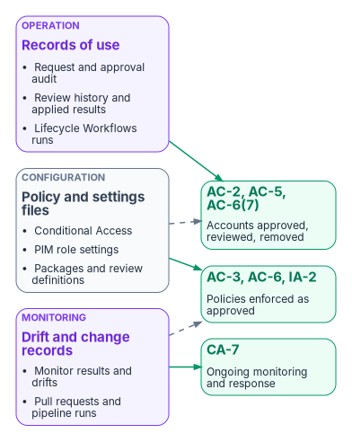

# Module 8: Evidence and drift for the ISSO {.unnumbered}

*Part of the [Privileged Access learning path](index.md). Plan Phase 3, task A3.6, and Phase 4, task A4.3, for Gate 4. Workbook [Chapter 08](../../project-plans/developer-workbooks/privileged-access/08-evidence-and-drift.md). About 65 minutes.*

**Watch:** the narrated deck for this module: [Deck](https://github.com/WhalerMike/modernization-workbook/releases/download/edition-2026.11.5/Training_PA_Module_8.pptx) · [▶ Watch](../../presentations/watch.html?v=Training_PA_Module_8_Narrated) (about 16 minutes, captions) · [MP4](https://github.com/WhalerMike/modernization-workbook/releases/download/videos-2026-10-23/Training_PA_Module_8_Narrated.mp4) · [Script](https://github.com/WhalerMike/modernization-workbook/blob/main/presentations/training-pa-module-8/Training_PA_Module_8_Narration_Script.md) · [Captions](https://github.com/WhalerMike/modernization-workbook/blob/main/presentations/training-pa-module-8/Training_PA_Module_8_Narrated.vtt).

## Introduction (3 minutes)

The plan's last gate asks for "evidence for every elevation in the period." Two facts from Learn shape how you get it. Microsoft Entra audit logs are kept for 30 days with Microsoft Entra ID P1 or P2. And PIM can log one activation under several correlation IDs, while its request ID stays the same.

In this module you run the privileged reads on a schedule, say what changed since the last run without putting anyone's name in the issue tracker, show every PIM activation in a window with its approval, and hand the ISSO a package and a period summary they can check with `sha256sum` alone.

::: {.callout-important}
## Emergency access in every run
Every run repeats Module 2's emergency access check beside Module 1's inventory. The comparison treats the emergency access rules, the Global Administrator count and root-scope elevation as Tier 0 whatever the row says, and any new or changed Tier 0 Finding is an incident. Book 04, Chapter 10 makes a drift on a Tier 0 object a security incident ([Book 04, Chapter 10](../../books/b04-access/10-access-as-code-and-evidence.md#drift-detection-and-closure)).
:::

**The federal requirement.** The runs, the packages and the period are the evidence for the plan's tasks A3.6 and A4.3, and for [Gate 4](../../project-plans/privileged-access.md#gates)'s "evidence for every elevation in the period." They support NIST SP 800-53 CA-7 (continuous monitoring), AC-6(9) (log use of privileged functions), AU-6, AU-9 and AU-11, and BOD 25-01's MS.AAD.7.5v1 and 7.6v1. The full table is the chapter's [Federal requirements and evidence](../../project-plans/developer-workbooks/privileged-access/08-evidence-and-drift.md#federal-requirements-and-evidence).

| Requirement | KSI | Evidence |
|---|---|---|
| CA-7: one folder per run, each task's manifest hashed | KSI-MLA-EVC | `out/runs/<run-id>/` and `run.json` |
| AC-6(9), AC-2(4) and AU-11: every PIM request, approval, activation and assignment in the window, read before the 30-day retention closes | KSI-MLA-LET, KSI-IAM-JIT, KSI-MLA-OSM | `pim-audit/events.json`, `requests.json` and `summary.json` |
| AU-6; MS.AAD.7.5v1 and 7.6v1: roles assigned outside PIM, and Tier 0 or Tier 1 activations with no approval | KSI-MLA-RVL | PA-AUD-01 and PA-AUD-02 in `pim-audit/findings.json` |
| CA-7, SI-4 and IR-4: what changed, with Tier 0 drift as an incident | KSI-MLA-EVC, KSI-IAM-SUS | `pa-drift-summary.md` |
| AU-9: each package hashed, chained and verified | KSI-MLA-OSM | `EVIDENCE-MANIFEST.json`, `SHA256SUMS` and `pa_evidence.py verify` |
| CA-7, AU-6 and AC-6(9); the plan's Gate 4 | KSI-MLA-EVC, KSI-MLA-RVL | `PERIOD-MANIFEST.json` and `period-summary.md` |

KSIs are FedRAMP 20x indicators for cloud service providers. The agency authorizes its own system and lines this evidence up with what its providers report against them; it doesn't report KSIs itself ([Book 00, Appendix B](../../books/b00-orientation/appendix-b-engagement-archetype.md)).

## Learning objectives (1 minute)

After this module, you'll be able to:

- explain why the run reads the tenant's state and the PIM audit events, and why the audit windows must leave no gap;
- read the audit findings, PA-AUD-01 to PA-AUD-04;
- explain how the comparison works, by fingerprint, and what counts as an incident;
- explain why issue drafts carry no names;
- package, chain and verify runs, and assemble a period for the Gate 4 review.

## Prerequisites (1 minute)

- [Module 1](01-privileged-inventory.md) and [Module 2](02-emergency-access-first.md): the run repeats their two reads unchanged.
- Book 19, [Chapter 09](../../books/b19-developer-workbook/09-drift-pipelines-and-evidence.md), which the comparison and the package build on. Skim it.

## Unit 1: What the evidence has to show (8 minutes)

Read the chapter's [What the evidence has to show](../../project-plans/developer-workbooks/privileged-access/08-evidence-and-drift.md#what-the-evidence-has-to-show). It points to three pages: the plan's Gates 3 and 4, [Book 04, Chapter 10's drift rule](../../books/b04-access/10-access-as-code-and-evidence.md#drift-detection-and-closure), and [Book 04, Chapter 08's Step 9](../../books/b04-access/08-pim-self-request-with-approval.md#step-9-export-audit-records-for-retention), which says to export the PIM audit records before the service's retention closes.

The run has three parts. The inventory and the emergency check describe the tenant's *state*. The PIM audit read describes the *events* in a window. A chain of windows with no gap between them is what "every elevation in the period" means in code. *Design guidance.*

Then read [The run](../../project-plans/developer-workbooks/privileged-access/08-evidence-and-drift.md#the-run), [The audit read](../../project-plans/developer-workbooks/privileged-access/08-evidence-and-drift.md#the-audit-read) and [The audit findings](../../project-plans/developer-workbooks/privileged-access/08-evidence-and-drift.md#the-audit-findings). The audit read refuses a window that starts more than 30 days before the run, and keeps each event as IDs, not names.

{#fig-ch10-control-evidence-map fig-alt="Three boxes on the left feed three green boxes on the right. A slate box, configuration: policy and settings files for Conditional Access, PIM role settings, packages and review definitions, feeds AC-3, AC-6 and IA-2, policies enforced as approved, and by a dashed line AC-2, AC-5 and AC-6(7). A violet box, operation: request and approval audit, review history and applied results, Lifecycle Workflows runs, feeds AC-2, AC-5 and AC-6(7), accounts approved, reviewed and removed. A violet box, monitoring: monitor results and drifts, pull requests and pipeline runs, feeds CA-7, ongoing monitoring and response, and by a dashed line AC-3, AC-6 and IA-2."}

## Unit 2: Compare, package and the period (10 minutes)

Read four sections:

- [Compare, by fingerprint](../../project-plans/developer-workbooks/privileged-access/08-evidence-and-drift.md#compare-by-fingerprint): the result kinds, and the incident rule. A task that didn't read the tenant this run is *unverified*: its findings stay open, never resolved.
- [Findings without names](../../project-plans/developer-workbooks/privileged-access/08-evidence-and-drift.md#findings-without-names): titles come from a fixed catalog; names stay in the drift report, which goes to the evidence store.
- [The package and the chain](../../project-plans/developer-workbooks/privileged-access/08-evidence-and-drift.md#the-package-and-the-chain): each package records the previous package's manifest hash, so a replaced package or a missing day shows up as a break.
- [What the ISSO receives](../../project-plans/developer-workbooks/privileged-access/08-evidence-and-drift.md#what-the-isso-receives): the period summary and the Gate 4 criteria it speaks to, and the ones it leaves to people.

## Exercise: Lab 1, fixtures, no tenant (35 minutes)

This is the workbook's [Lab 1](../../project-plans/developer-workbooks/privileged-access/08-evidence-and-drift.md#lab-1-fixtures-no-tenant).

<!-- labs:begin lab-1-commands (generated by scripts/generate_labs.py; not part of the reviewed page) -->

::: {.callout-note #lab-1-commands collapse="false" title="Every command in Lab 1"}
Every command in this lab, in order. Each step below says what it does and what to look for.

```powershell
Set-Location C:\FMWLabs\privileged-access-code\privileged-access

$Run = "C:\FMWLabs\results\privileged-access-08-evidence-and-drift\lab1\$(Get-Date -AsUTC -Format 'yyyy-MM-ddTHHmmssZ')"
New-Item -ItemType Directory -Path $Run -Force | Out-Null
$Run

# Step 1: Run Learn's queries over the fixture
Invoke-Pester -Path tests/EvidenceDrift.Tests.ps1 -FullNameFilter '*as published*' -Output None -PassThru |
    Select-Object PassedCount, FailedCount, NotRunCount

# Step 2: List the permissions the run needs
Import-Module ./powershell/PaEvidence/PaEvidence.psm1
(Get-PaEvidencePermission -Task evidence-run).GraphPermissions -join ', '

# Step 3: Run two days against the fictional tenant
$lab = @{ Cloud = 'gcc'; TenantId = '11111111-1111-4111-8111-111111111111'; OutputPath = "$Run\runs"
    AuditFixturePath = 'tests/fixtures/ch08/audit.json'; EmergencyConfigPath = 'tests/fixtures/inputs/emergency-access.json'
    ValidationsPath = 'tests/fixtures/inputs/emergency-validations.csv'; ExceptionsPath = 'tests/fixtures/inputs/exceptions.csv'
    AzureScope = '/subscriptions/11111111-1111-4111-8111-111111111111', '/providers/Microsoft.Management/managementGroups/contoso-root', '/subscriptions/22222222-2222-4222-8222-222222222222'
    ControlPlaneSubscriptionId = '22222222-2222-4222-8222-222222222222' }
./Invoke-PaEvidenceRun.ps1 @lab -FixturePath tests/fixtures/tenant.json -AsOf 2026-10-29T06:00:00Z
./Invoke-PaEvidenceRun.ps1 @lab -FixturePath tests/fixtures/ch08/tenant-day2.json -AsOf 2026-10-30T06:00:00Z

# Step 4: Read the second day's audit findings
Get-Content "$Run\runs\2026-10-30T0600Z-fixture\pim-audit\findings.json" -Raw | ConvertFrom-Json | Format-Table Rule, Severity, Tier, ObjectId

# Step 5: Record a baseline and package it
Set-Location C:\FMWLabs\privileged-access-code\drift-pipeline
$DAY1 = 'tests/fixtures/pa-runs/2026-10-29T0600Z-fixture'
$DAY2 = 'tests/fixtures/pa-runs/2026-10-30T0600Z-fixture'
python python/pa_evidence.py compare --current $DAY1 --out "$Run\day1"
python python/pa_evidence.py package --run $DAY1 --diff "$Run\day1\pa-drift-report.json" --out "$Run\evidence"

# Step 6: Compare the next day
python python/pa_evidence.py compare --previous $DAY1 --current $DAY2 --out "$Run\day2"
Get-Content "$Run\day2\pa-drift-summary.md"

# Step 7: Draft the findings
python python/pa_evidence.py issues --diff "$Run\day2\pa-drift-report.json" --out "$Run\day2\issues.json"
(Select-String -Path "$Run\day2\issues.json" -Pattern contoso).Count

# Step 8: Package and verify the second day, chained to the first
python python/pa_evidence.py package --run $DAY2 --diff "$Run\day2\pa-drift-report.json" `
    --previous-manifest "$Run\evidence\2026-10-29T0600Z-fixture\EVIDENCE-MANIFEST.json" --out "$Run\evidence"
python python/pa_evidence.py verify "$Run\evidence\2026-10-30T0600Z-fixture"
Get-Content "$Run\evidence\2026-10-30T0600Z-fixture\SHA256SUMS" | Where-Object {
    $hash, $file = $_ -split ' +\*?', 2
    (Get-FileHash "$Run\evidence\2026-10-30T0600Z-fixture\$file").Hash -ne $hash
}

# Step 9: Assemble the period for the ISSO
python python/pa_evidence.py period --evidence "$Run\evidence" --since 2026-10-28T06:00:00Z --until 2026-10-30T06:00:00Z --out "$Run\periods"
Get-Content "$Run\periods\period-2026-10-28_2026-10-30\period-summary.md"

# Step 10: Break it on purpose
Add-Content -Path "$Run\evidence\2026-10-30T0600Z-fixture\drift\pa-drift-summary.md" -Value edited
python python/pa_evidence.py verify "$Run\evidence\2026-10-30T0600Z-fixture"

# Step 10: Break it on purpose
python python/pa_evidence.py compare --previous $DAY2 --current $DAY1 --out "$Run\swap"

# Step 10: Break it on purpose
python python/workflow_lint.py workflow/pa-evidence.yml

# Step 11: Run the tests, then list your runs
Set-Location C:\FMWLabs\privileged-access-code\privileged-access
Invoke-Pester -Path tests/EvidenceDrift.Tests.ps1

# Step 11: Run the tests, then list your runs
Invoke-Pester -Path tests

# Step 11: Run the tests, then list your runs
Set-Location C:\FMWLabs\privileged-access-code\drift-pipeline
python -m pytest tests -q -p no:cacheprovider --ignore tests/test_hr_evidence.py

# Step 11: Run the tests, then list your runs
Get-ChildItem C:\FMWLabs\results\privileged-access-08-evidence-and-drift\lab1 -Name
```

:::

<!-- labs:end -->

Every step runs in PowerShell 7.1 or later, with Pester 5, in one window, top to bottom: later steps use variables set in earlier ones. Steps 1 to 4 run in the kit's `privileged-access` folder; steps 5 to 10 run in the `drift-pipeline` folder beside it, with Python 3.10 or later, pytest and PyYAML; step 11 runs in both. Open **PowerShell 7** from the Start menu, then go to the kit's folder, where you unzipped it under [Get the code](index.md#get-the-code):

```powershell
Set-Location C:\FMWLabs\privileged-access-code\privileged-access
```

Then make this run's results folder. Its name is the date and time you start, in UTC, so each run keeps its own results and running the lab again never overwrites them:

```powershell
$Run = "C:\FMWLabs\results\privileged-access-08-evidence-and-drift\lab1\$(Get-Date -AsUTC -Format 'yyyy-MM-ddTHHmmssZ')"
New-Item -ItemType Directory -Path $Run -Force | Out-Null
$Run
```

Expected output, where `<run>` is your start time, such as `2026-11-25T143005Z`:

```text
C:\FMWLabs\results\privileged-access-08-evidence-and-drift\lab1\<run>
```

The run's date is only the folder's name. The data's dates are the fixtures' own, and `-AsOf` where a step passes it; they stay the same, so every run's findings match this page. The results folder sits outside the kit, so unzipping a newer copy of the kit never touches it.

Prefer Git Bash? Type `pwsh` to start PowerShell 7 there, where every step runs, and run the two blocks above in it. In a clone of the repository, use the `examples` folders of the same names.

1. **Run Learn's queries over the fixture:**

    ```powershell
    Invoke-Pester -Path tests/EvidenceDrift.Tests.ps1 -FullNameFilter '*as published*' -Output None -PassThru |
        Select-Object PassedCount, FailedCount, NotRunCount
    ```

    Expected output:

    ```text
    PassedCount FailedCount NotRunCount
    ----------- ----------- -----------
              8           0          24
    ```

    The third test shows two of the 13 rows the first query returns are role assignments made outside PIM.

2. **List the permissions the run needs:**

    ```powershell
    Import-Module ./powershell/PaEvidence/PaEvidence.psm1
    (Get-PaEvidencePermission -Task evidence-run).GraphPermissions -join ', '
    ```

    Expected output:

    ```text
    AuditLog.Read.All, GroupMember.ReadBasic.All, Policy.Read.All, RoleAssignmentSchedule.Read.Directory, RoleEligibilitySchedule.Read.Directory, RoleManagement.Read.Directory, User.Read.All, User.ReadBasic.All, UserAuthenticationMethod.Read.All
    ```

    Nine permissions, none ending in `ReadWrite`.

3. **Run two days against the fictional tenant:**

    ```powershell
    $lab = @{ Cloud = 'gcc'; TenantId = '11111111-1111-4111-8111-111111111111'; OutputPath = "$Run\runs"
        AuditFixturePath = 'tests/fixtures/ch08/audit.json'; EmergencyConfigPath = 'tests/fixtures/inputs/emergency-access.json'
        ValidationsPath = 'tests/fixtures/inputs/emergency-validations.csv'; ExceptionsPath = 'tests/fixtures/inputs/exceptions.csv'
        AzureScope = '/subscriptions/11111111-1111-4111-8111-111111111111', '/providers/Microsoft.Management/managementGroups/contoso-root', '/subscriptions/22222222-2222-4222-8222-222222222222'
        ControlPlaneSubscriptionId = '22222222-2222-4222-8222-222222222222' }
    ./Invoke-PaEvidenceRun.ps1 @lab -FixturePath tests/fixtures/tenant.json -AsOf 2026-10-29T06:00:00Z
    ./Invoke-PaEvidenceRun.ps1 @lab -FixturePath tests/fixtures/ch08/tenant-day2.json -AsOf 2026-10-30T06:00:00Z
    ```

    Expected output:

    ```text
    Run 2026-10-29T0600Z-fixture (Fixture, gcc): inventory OK, emergency-access OK, pim-audit OK
    Audit window 2026-10-28T06:00:00Z to 2026-10-29T06:00:00Z
    Written to C:\FMWLabs\results\privileged-access-08-evidence-and-drift\lab1\<run>\runs\2026-10-29T0600Z-fixture (run.json lists each task's manifest hash)
    Run 2026-10-30T0600Z-fixture (Fixture, gcc): inventory OK, emergency-access OK, pim-audit OK
    Audit window 2026-10-29T06:00:00Z to 2026-10-30T06:00:00Z
    Written to C:\FMWLabs\results\privileged-access-08-evidence-and-drift\lab1\<run>\runs\2026-10-30T0600Z-fixture (run.json lists each task's manifest hash)
    ```

    The second window starts where the first ended.

4. **Read the second day's audit findings:**

    ```powershell
    Get-Content "$Run\runs\2026-10-30T0600Z-fixture\pim-audit\findings.json" -Raw | ConvertFrom-Json | Format-Table Rule, Severity, Tier, ObjectId
    ```

    Expected output:

    ```text
    Rule      Severity Tier ObjectId
    ----      -------- ---- --------
    PA-AUD-01 Finding  T0   a0000000-0000-4000-8000-000000000020
    PA-AUD-02 Finding  T0   a0000000-0000-4000-8000-000000000013
    PA-AUD-04 Finding  T0   62e90394-69f5-4237-9190-012177145e10
    ```

    A Privileged Role Administrator assigned outside PIM, a Global Administrator activation with no approval, and a Global Administrator role setting change. Open `events.json`: object IDs, no names.

5. **Record a baseline and package it.** Go to the `drift-pipeline` folder beside `privileged-access`:

    ```powershell
    Set-Location C:\FMWLabs\privileged-access-code\drift-pipeline
    $DAY1 = 'tests/fixtures/pa-runs/2026-10-29T0600Z-fixture'
    $DAY2 = 'tests/fixtures/pa-runs/2026-10-30T0600Z-fixture'
    python python/pa_evidence.py compare --current $DAY1 --out "$Run\day1"
    python python/pa_evidence.py package --run $DAY1 --diff "$Run\day1\pa-drift-report.json" --out "$Run\evidence"
    ```

    Expected output:

    ```text
    {"baseline": true, "counts": {"assignments_added": 0, "assignments_changed": 0, "assignments_removed": 0, "audit": 0, "changed": 0, "coverage_gaps": 0, "incidents": 0, "new": 26, "resolved": 0, "unchanged": 0, "unverified": 0}, "drift": true}
    {"evidence_manifest_sha256": "208f4d6f3a6f7cbe0edb9e5a194034b492b1369509ab4ffd875abccbb4809251", "package": "2026-10-29T0600Z-fixture"}
    ```

    The compare exits `2`: a baseline with 26 new findings. The two runs are the repository's copies of the ones you made in step 3; a Pester test checks them against a fresh run.

6. **Compare the next day:**

    ```powershell
    python python/pa_evidence.py compare --previous $DAY1 --current $DAY2 --out "$Run\day2"
    Get-Content "$Run\day2\pa-drift-summary.md"
    ```

    Expected output:

    ```text
    {"baseline": false, "counts": {"assignments_added": 1, "assignments_changed": 0, "assignments_removed": 1, "audit": 3, "changed": 0, "coverage_gaps": 0, "incidents": 6, "new": 2, "resolved": 6, "unchanged": 20, "unverified": 0}, "drift": true}
    # Privileged access drift report

    Current run **2026-10-30T0600Z-fixture** (gcc, Fixture, tenant 11111111-1111-4111-8111-111111111111); previous run **2026-10-29T0600Z-fixture**.
    Audit window 2026-10-29T06:00:00Z to 2026-10-30T06:00:00Z.

    Incidents (Tier 0) 6. Findings: new 2, changed 0, resolved 6, unchanged 20, unverified tasks 0. Assignments: added 1, removed 1, changed 0. Audit findings 3. Coverage gaps 0.

    | Task | Status |
    |---|---|
    | inventory | OK |
    | emergency-access | OK |
    | pim-audit | OK |

    | Incident | Rule or role | Tier | Object ID | Fingerprint |
    |---|---|---|---|---|
    | assignment added | Privileged Role Administrator | T0 | a0000000-0000-4000-8000-000000000020 | 4323bc029b188d13 |
    | assignment removed | Global Administrator | T0 | a0000000-0000-4000-8000-000000000005 | 5928390622b60afd |
    | finding new | PA-INV-01 | T0 | a0000000-0000-4000-8000-000000000020 | 98987fe7faba3739 |
    | audit | PA-AUD-01 | T0 | a0000000-0000-4000-8000-000000000020 | 932d0eec891401bc |
    | audit | PA-AUD-02 | T0 | a0000000-0000-4000-8000-000000000013 | 71b6976b97ac126b |
    | audit | PA-AUD-04 | T0 | 62e90394-69f5-4237-9190-012177145e10 | be47f0e001bbf3b2 |

    Names are in pa-drift-report.json, which goes to the evidence store, not to the issue tracker.
    ```

    The compare exits `2`. Among the six resolved findings are Module 2's PA-EA-07 and two PA-EA-08 for `ea02`, now in the exclusion group.

7. **Draft the findings:**

    ```powershell
    python python/pa_evidence.py issues --diff "$Run\day2\pa-drift-report.json" --out "$Run\day2\issues.json"
    (Select-String -Path "$Run\day2\issues.json" -Pattern contoso).Count
    ```

    Expected output:

    ```text
    {"close": 9, "comment": 0, "open": 7}
    0
    ```

    `Select-String` finds `contoso` nowhere in the drafts, so the count is `0`: no user principal name reaches them.

8. **Package and verify the second day, chained to the first:**

    ```powershell
    python python/pa_evidence.py package --run $DAY2 --diff "$Run\day2\pa-drift-report.json" `
        --previous-manifest "$Run\evidence\2026-10-29T0600Z-fixture\EVIDENCE-MANIFEST.json" --out "$Run\evidence"
    python python/pa_evidence.py verify "$Run\evidence\2026-10-30T0600Z-fixture"
    Get-Content "$Run\evidence\2026-10-30T0600Z-fixture\SHA256SUMS" | Where-Object {
        $hash, $file = $_ -split ' +\*?', 2
        (Get-FileHash "$Run\evidence\2026-10-30T0600Z-fixture\$file").Hash -ne $hash
    }
    ```

    Expected output:

    ```text
    {"evidence_manifest_sha256": "cc2428c804bd7096c0b6befbbbc128a6af5fbdc64929a185b9bce8d876342794", "package": "2026-10-30T0600Z-fixture"}
    {"evidence_manifest_sha256": "cc2428c804bd7096c0b6befbbbc128a6af5fbdc64929a185b9bce8d876342794", "files": 15, "run_id": "2026-10-30T0600Z-fixture"}
    ```

    The last command checks every file against `SHA256SUMS`, as `sha256sum -c` does, and prints only a line that doesn't match: it prints nothing. In `EVIDENCE-MANIFEST.json`, `previous.evidence_manifest_sha256` is the day 1 hash.

9. **Assemble the period for the ISSO:**

    ```powershell
    python python/pa_evidence.py period --evidence "$Run\evidence" --since 2026-10-28T06:00:00Z --until 2026-10-30T06:00:00Z --out "$Run\periods"
    Get-Content "$Run\periods\period-2026-10-28_2026-10-30\period-summary.md"
    ```

    Expected output:

    ```text
    {"chain_breaks": 0, "complete": false, "coverage_gaps": 0, "incidents": 6, "packages": 2, "period": "period-2026-10-28_2026-10-30"}
    # Privileged access evidence for the period

    Period 2026-10-28T06:00:00Z to 2026-10-30T06:00:00Z; tenant 11111111-1111-4111-8111-111111111111 (gcc, Fixture); 2 package(s), chain breaks 0, audit coverage gaps 0, unverified task runs 0.

    Activations 3 (T0 2, T1 1, T2 0); requests 4, approved 2, denied 1; T0 or T1 activations without approval 1; role assignments outside PIM 2 event(s); role setting changes 1; Tier 0 incidents 6.

    | Gate 4 criterion | From this code | Status |
    |---|---|---|
    | Residual standing privilege named with a rationale and accepted by the authorizing official | 1 on the exceptions list with a reason, 8 outside it (PA-INV-01 at period end) | not met: standing privilege outside the exceptions list |
    | Evidence for every elevation in the period | 3 activation(s); audit coverage gaps 0; chain breaks 0; T0 or T1 activations without approval 1 | not met |
    | Exception register current | the exceptions list the inventory read; its currency is the governance office's | not decided by this code |
    | Access-related GPO settings retired | nothing | not decided by this code |

    | Package | Audit window | EVIDENCE-MANIFEST.json SHA-256 |
    |---|---|---|
    | 2026-10-29T0600Z-fixture | 2026-10-28T06:00:00Z to 2026-10-29T06:00:00Z | `208f4d6f3a6f7cbe0edb9e5a194034b492b1369509ab4ffd875abccbb4809251` |
    | 2026-10-30T0600Z-fixture | 2026-10-29T06:00:00Z to 2026-10-30T06:00:00Z | `cc2428c804bd7096c0b6befbbbc128a6af5fbdc64929a185b9bce8d876342794` |

    Object IDs only. The packages hold the names, under the evidence store's access control.
    ```

    The period exits `2`: two Gate 4 criteria aren't met, and two are left to people.

10. **Break it on purpose:**

    ```powershell
    Add-Content -Path "$Run\evidence\2026-10-30T0600Z-fixture\drift\pa-drift-summary.md" -Value edited
    python python/pa_evidence.py verify "$Run\evidence\2026-10-30T0600Z-fixture"
    ```

    Expected output:

    ```text
    error: C:\FMWLabs\results\privileged-access-08-evidence-and-drift\lab1\<run>\evidence\2026-10-30T0600Z-fixture: drift/pa-drift-summary.md doesn't match its SHA-256
    ```

    ```powershell
    python python/pa_evidence.py compare --previous $DAY2 --current $DAY1 --out "$Run\swap"
    ```

    Expected output:

    ```text
    error: the current run (2026-10-29T06:00:00Z) isn't later than the previous one (2026-10-30T06:00:00Z)
    ```

    ```powershell
    python python/workflow_lint.py workflow/pa-evidence.yml
    ```

    Expected output:

    ```text
    workflow\pa-evidence.yml: 0 finding(s), 0 warning(s)
    ```

    The edited package fails verification and the swapped runs are refused, each with exit code `1`. The sample workflow lints clean.

11. **Run the tests, then list your runs.** Go back to `privileged-access` and run its Pester tests:

    ```powershell
    Set-Location C:\FMWLabs\privileged-access-code\privileged-access
    Invoke-Pester -Path tests/EvidenceDrift.Tests.ps1
    ```

    Expected output: `Tests completed in` and the time the run took, and last:

    ```text
    Tests Passed: 32, Failed: 0, Skipped: 0, Inconclusive: 0, NotRun: 0
    ```

    ```powershell
    Invoke-Pester -Path tests
    ```

    Expected output: a line for each of the nine test files with its run time, then `Tests completed in` and the time the run took, and last:

    ```text
    Tests Passed: 330, Failed: 0, Skipped: 0, Inconclusive: 0, NotRun: 0
    ```

    Then run the `drift-pipeline` tests. `tests/test_hr_evidence.py` needs the HR-Driven Identity kit, which isn't in this zip, so leave it out:

    ```powershell
    Set-Location C:\FMWLabs\privileged-access-code\drift-pipeline
    python -m pytest tests -q -p no:cacheprovider --ignore tests/test_hr_evidence.py
    ```

    Expected: the last line is `133 passed` and the time it took.

    Nothing to clean up: the kit's folders are as you unzipped them, and this run's results stay in `$Run`. List every run you've made of this lab:

    ```powershell
    Get-ChildItem C:\FMWLabs\results\privileged-access-08-evidence-and-drift\lab1 -Name
    ```

    Expected output: one line per run, oldest first, the last one this run:

    ```text
    <run>
    ```

## Exercise: Lab 2, your test tenant (5 minutes to read)

*Not run by this path's authors.* Follow the workbook's [Lab 2](../../project-plans/developer-workbooks/privileged-access/08-evidence-and-drift.md#lab-2-test-tenant) in a test tenant in the worldwide or GCC cloud with Microsoft Entra ID P2 or ID Governance and a test Azure subscription, never production, with fictional people. The run only reads. It uses the `emergency-access.json` and `emergency-validations.csv` from Module 2's Lab 2 and the `exceptions.csv` from Module 4's Lab 2.

- **What you do:** register a reader app, make one test activation, run twice (before and after it), check the fields the fixture assumed, cross-check against PIM's resource audit in the admin center, then compare, package and verify the two live runs.
- **Permissions:** the nine read permissions from step 2, with admin consent, and Reader on the test subscription. Nothing else.
- **Back-out:** step 7 ends the test activation and eligibility, removes the permissions, the Reader assignment and the app, and deletes `out/runs-test` and the packages, which hold the tenant's privileged holders.

## Knowledge check (5 minutes)

1. Why does the audit read refuse a window that starts more than 30 days before the run?
    a. Graph's paging stops at 30 days.
    b. Microsoft Entra audit logs are kept for 30 days with P1 or P2, so older events can't be read and the window would look complete when it isn't.
    c. PIM deletes requests after 30 days.
    d. The fingerprint changes after 30 days.
2. A new Tier 0 Finding appears in today's run. How does the comparison treat it?
    a. As a Warn.
    b. As an incident, under Book 04, Chapter 10's rule that a drift on a Tier 0 object is a security incident.
    c. It waits for the next run.
    d. It's resolved automatically.
3. Why do the issue drafts carry no names?
    a. The tracker can't store names.
    b. Titles use a fixed catalog and bodies carry object IDs and fingerprints; names stay in the drift report in the access-controlled evidence store.
    c. Names change too often.
    d. Fingerprints need IDs.
4. What does the hash chain between packages show?
    a. Who signed each package.
    b. A replaced package or a missing day, as a break.
    c. The tenant's licenses.
    d. The order of the audit events.

::: {.callout-tip collapse="true"}
## Check your answers
1. **b.** Taught in [What the evidence has to show](../../project-plans/developer-workbooks/privileged-access/08-evidence-and-drift.md#what-the-evidence-has-to-show) and [The audit read](../../project-plans/developer-workbooks/privileged-access/08-evidence-and-drift.md#the-audit-read).
2. **b.** Taught in [Compare, by fingerprint](../../project-plans/developer-workbooks/privileged-access/08-evidence-and-drift.md#compare-by-fingerprint), and seen in Lab 1, step 6.
3. **b.** Taught in [Findings without names](../../project-plans/developer-workbooks/privileged-access/08-evidence-and-drift.md#findings-without-names), and seen in Lab 1, step 7.
4. **b.** Taught in [The package and the chain](../../project-plans/developer-workbooks/privileged-access/08-evidence-and-drift.md#the-package-and-the-chain), and seen in Lab 1, steps 8 and 10.
:::

## Summary (2 minutes)

You ran two days of privileged reads against a fictional tenant, found a role assigned outside PIM and an unapproved Tier 0 activation, compared the days into six Tier 0 incidents, drafted issues with no names, packaged and chained both runs, assembled a period that shows Gate 4 isn't met yet, and saw an edited package fail verification.

**The evidence an ISSO keeps** for Gate 4: each run's folder and `run.json`; each package's `EVIDENCE-MANIFEST.json` and `SHA256SUMS`, in the evidence store; the period's `PERIOD-MANIFEST.json` and `period-summary.md`; and the incident records each Tier 0 fingerprint matches. The full list is in the chapter's [Federal requirements and evidence](../../project-plans/developer-workbooks/privileged-access/08-evidence-and-drift.md#federal-requirements-and-evidence); before the code ships, work through its [checklist](../../project-plans/developer-workbooks/privileged-access/08-evidence-and-drift.md#checklist).

**You've finished the path.** Go back to the [learning path](index.md), or find every lab in one place on the [Labs page](../labs.md#pa).
