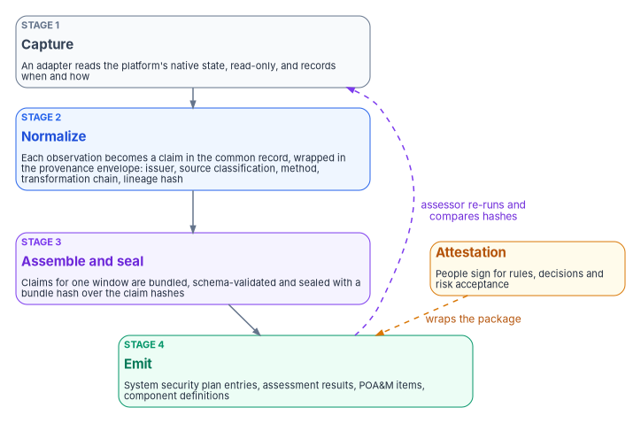

# Module 8: Digest, evidence and go/no-go {.unnumbered}

*Part of the [Provider Notices learning path](index.md). Gate G7 Digest and evidence. Workbook [Chapter 07](../../project-plans/developer-workbooks/provider-notices/07-the-weekly-digest-and-evidence.md). About 60 minutes.*

**Watch:** the narrated deck for this module (about 14 minutes, captions): [▶ Watch](../../presentations/watch.html?v=Training_PN_Module_8_Narrated) · [MP4](https://github.com/WhalerMike/modernization-workbook/releases/download/videos-2026-10-23/Training_PN_Module_8_Narrated.mp4) · [Deck source](https://github.com/WhalerMike/modernization-workbook/tree/main/presentations/training-pn-module-8) · [Script](https://github.com/WhalerMike/modernization-workbook/blob/main/presentations/training-pn-module-8/Training_PN_Module_8_Narration_Script.md) · [Captions](https://github.com/WhalerMike/modernization-workbook/blob/main/presentations/training-pn-module-8/Training_PN_Module_8_Narrated.vtt). The deck files join the next edition.

**Also:** the chapter's narrated tour, about 12 minutes: [▶ Watch](../../presentations/watch.html?v=DW_PN_07_Weekly_Digest_Evidence_Narrated).

## Introduction (3 minutes)

Most notices shouldn't be tasks. The weekly digest is how the owners see the rest, and how they see what needs action and by when. Its natural home is a standing review: the service desk supervisor's weekly look at the queue and the change advisory board's agenda, where the next 30 days of maintenance and changes belong. The evidence is what the ISSO keeps: every run recorded with the controls and KSIs it supports, every file's hash, and the hash of the record before it, so a changed file or a removed week shows.

In this module you write a week's digest, record three runs, check the chain, see a lab stage fail the go/no-go for the steps it never ran, and catch a file edited after it was recorded.

**The federal requirement.** Gate G7 supports SI-5 c, SA-9 c, RA-3 f, CA-7 and AU-9, and the pre-flight's named contacts support SR-8. The gate's output is evidence for these controls; your organization still sets their parameters, policy and procedures, and the assessor decides whether each is satisfied. The guide's [Step 7](../../books/guides/provider-notices-implementation.md#step-7-digest-and-evidence) names them, and the workbook chapter's [Federal requirements and evidence](../../project-plans/developer-workbooks/provider-notices/07-the-weekly-digest-and-evidence.md#federal-requirements-and-evidence) table has a row for every lab step.

| Requirement | KSI | Evidence |
|---|---|---|
| SI-5 c; SA-9 c; RA-3 (risk assessment), part f | KSI-SCR-MON, KSI-SCR-MIT | `digest.md`, `digest.csv`, each week |
| CA-7; AU-9 (protection of audit information) | KSI-MLA-EVC, KSI-MLA-OSM | `records/`, `records.csv`: each run with its steps, controls and KSIs, every file's hash and the previous record's hash |
| AU-9 | KSI-MLA-OSM | `SHA256SUMS` and `-Check`: the folder unchanged since it was recorded, and a change caught |
| CA-7 | KSI-MLA-EVC | `-Check -Stage`: each of the stage's steps has a passing record, or the gap is named |
| SA-9; SR-8 (notification agreements) | KSI-SCR-MON | The pre-flight's `results.json`, PF-05: who receives each provider's notices is named (Module 9) |

KSIs are FedRAMP 20x indicators for cloud service providers. The agency lines this evidence up with what its providers report against them; it doesn't report KSIs itself. Each evidence record carries that sentence as its claim. Which file supports which indicator is the program's mapping *(design guidance)*. The guide's [Evidence](../../books/guides/provider-notices-implementation.md#evidence) section explains both.

## Learning objectives (1 minute)

After this module, you'll be able to:

- write the weekly digest and read its five sections as an owner would;
- record a collection, a routing run and a digest as evidence, and say which steps, controls and KSIs each record names;
- check the evidence chain and `SHA256SUMS`, and show that an edit after recording fails both;
- check a stage's coverage, and name the steps a test stage and a production stage need;
- read the runbook's promotion go/no-go criteria, and say which ones the evidence check answers.

## Prerequisites (1 minute)

- [Module 7](07-routing-to-owners.md): this lab repeats its two collections and routings.

## Unit 1: The digest and its readers (8 minutes)

Read:

- Book 15's [The weekly digest](../../books/b15-day2-operations/14-provider-notices.md#the-weekly-digest): who reads it, where it belongs, and the two numbers worth watching over time.
- The guide's [Step 7](../../books/guides/provider-notices-implementation.md#step-7-digest-and-evidence), and its [Evidence](../../books/guides/provider-notices-implementation.md#evidence) table, gate by gate.
- The workbook's [The digest](../../project-plans/developer-workbooks/provider-notices/07-the-weekly-digest-and-evidence.md#the-digest): the five sections and their windows.

## Unit 2: The evidence chain and the go/no-go (12 minutes)

Read:

- The workbook's [What it leaves to you](../../project-plans/developer-workbooks/provider-notices/07-the-weekly-digest-and-evidence.md#what-it-leaves-to-you) and [The evidence record](../../project-plans/developer-workbooks/provider-notices/07-the-weekly-digest-and-evidence.md#the-evidence-record): what each record holds, the steps each kind of run covers, and what `-Check -Stage` needs (test: `PRE`, `RUN`, `ROUTE`, `DIGEST`; production adds `ALERTS`).
- The runbook's [Promotion go/no-go criteria](../../project-plans/developer-workbooks/provider-notices/08-deploying-to-test-and-production.md#promotion-gono-go-criteria): seven rows, from the stage's evidence to the known gaps recorded with the ISSO.
- The workbook's [Dangers](../../project-plans/developer-workbooks/provider-notices/07-the-weekly-digest-and-evidence.md#dangers): a run that stops silently, a file edited later, a record removed, and a pass read as a control decision.

{#fig-ch07-evidence-chain fig-alt="Four numbered cards from top to bottom. Stage 1, slate, capture: an adapter reads a platform's native state, read-only, and records when and how. Stage 2, blue, normalize: each observation becomes a claim in the common record, wrapped in the provenance envelope with issuer, source classification, method, transformation chain and lineage hash. Stage 3, violet, assemble and seal: claims for one window are bundled, validated against the schema and sealed with a bundle hash computed over the claim hashes. Stage 4, green, emit: the sealed bundle produces the package artifacts, the system security plan entries, assessment results, plan of action and milestones items and component definitions. Beside the chain, an amber card labeled attestation, people sign for rules, decisions and risk acceptance, points with a dashed arrow to the package. A dashed violet arrow labeled assessor re-runs and compares hashes runs from the emit stage back up to the capture stage."}

## Exercise: Lab 1, fixtures, no tenant (25 minutes)

This is the workbook's [Chapter 07, Lab 1](../../project-plans/developer-workbooks/provider-notices/07-the-weekly-digest-and-evidence.md#lab-1-fixtures-no-tenant), which explains each result.

<!-- labs:begin lab-1-commands (generated by scripts/generate_labs.py; not part of the reviewed page) -->

::: {.callout-note #lab-1-commands collapse="false" title="Every command in Lab 1"}
Every command in this lab, in order. Each step below says what it does and what to look for.

```powershell
Set-Location C:\FMWLabs\provider-notices-code\provider-notices

$Run = "C:\FMWLabs\results\provider-notices-08-digest-evidence-and-go-no-go\lab1\$(Get-Date -AsUTC -Format 'yyyy-MM-ddTHHmmssZ')"
New-Item -ItemType Directory -Path $Run -Force | Out-Null
$Run

# Step 1: Make a week of runs
./Invoke-PnCollect.ps1 -SettingsPath tests/fixtures/settings.lab.json -FixturePath tests/fixtures/day1 -AsOf 2026-11-09T12:00:00Z -OutputPath "$Run\day1"
./Invoke-PnRoute.ps1 -NoticesPath "$Run\day1\notices.json" -RoutingPath config/routing.json -StatePath "$Run\state.json" -OutputPath "$Run\day1-route" -AsOf 2026-11-09T12:00:00Z
./Invoke-PnCollect.ps1 -SettingsPath tests/fixtures/settings.lab.json -FixturePath tests/fixtures/day2 -AsOf 2026-11-16T12:00:00Z -OutputPath "$Run\day2"
./Invoke-PnRoute.ps1 -NoticesPath "$Run\day2\notices.json" -RoutingPath config/routing.json -StatePath "$Run\state.json" -OutputPath "$Run\day2-route" -AsOf 2026-11-16T12:00:00Z

# Step 2: Write the digest for the second week
./Invoke-PnDigest.ps1 -NoticesPath "$Run\day2\notices.json" -StatePath "$Run\state.json" -OutputPath "$Run\digest" -AsOf 2026-11-16T12:00:00Z

# Step 3: Read it as the owners will
Get-Content "$Run\digest\digest.md"

# Step 4: Record three runs as evidence
./Invoke-PnEvidence.ps1 -EvidencePath "$Run\evidence" -RunPath "$Run\day2" -AsOf 2026-11-16T12:00:00Z
./Invoke-PnEvidence.ps1 -EvidencePath "$Run\evidence" -RunPath "$Run\day2-route" -AsOf 2026-11-16T12:00:00Z
./Invoke-PnEvidence.ps1 -EvidencePath "$Run\evidence" -RunPath "$Run\digest" -AsOf 2026-11-16T12:00:00Z

# Step 5: Check the chain
./Invoke-PnEvidence.ps1 -EvidencePath "$Run\evidence" -Check

# Step 6: Check the test stage's coverage
./Invoke-PnEvidence.ps1 -EvidencePath "$Run\evidence" -Check -Stage test

# Step 7: Read the records' index
Import-Csv "$Run\evidence\records.csv" | Format-Table sequence, task, result, steps

# Step 8: Change a recorded file and check again
Add-Content -Path "$Run\evidence\runs\0003-digest\digest.md" -Value 'edited after it was recorded'
./Invoke-PnEvidence.ps1 -EvidencePath "$Run\evidence" -Check

# Step 9: Run the kit's whole test suite
Invoke-Pester -Path tests -Output None -PassThru | Select-Object PassedCount, FailedCount

# After the steps
Get-ChildItem C:\FMWLabs\results\provider-notices-08-digest-evidence-and-go-no-go\lab1 -Name
```

:::

<!-- labs:end -->

Every step runs in PowerShell 7, so you can follow it top to bottom in one window. Open **PowerShell 7** from the Start menu, then go to the kit's folder, where you unzipped it under [Get the code](index.md#get-the-code):

```powershell
Set-Location C:\FMWLabs\provider-notices-code\provider-notices
```

Then make this run's results folder. Its name is the date and time you start, in UTC, so each run keeps its own results and running the lab again never overwrites them:

```powershell
$Run = "C:\FMWLabs\results\provider-notices-08-digest-evidence-and-go-no-go\lab1\$(Get-Date -AsUTC -Format 'yyyy-MM-ddTHHmmssZ')"
New-Item -ItemType Directory -Path $Run -Force | Out-Null
$Run
```

Expected output, where `<run>` is your start time, such as `2026-11-25T143005Z`:

```text
C:\FMWLabs\results\provider-notices-08-digest-evidence-and-go-no-go\lab1\<run>
```

The run's date is only the folder's name. The data's date is `-AsOf`, which stays the same, so every run's results match this page. The results folder sits outside the kit, so unzipping a newer copy of the kit never touches it.

Prefer Git Bash? Go to the folder with `cd /c/FMWLabs/provider-notices-code/provider-notices`, then type `pwsh` to start PowerShell 7 and make the run folder there, as above: every step is a PowerShell command, and a `$Run` made in Git Bash wouldn't reach PowerShell. In a clone of the repository, use the `examples` folder of the same name.

1. **Make a week of runs.** Module 7's two collections and routings, in one go:

    ```powershell
    ./Invoke-PnCollect.ps1 -SettingsPath tests/fixtures/settings.lab.json -FixturePath tests/fixtures/day1 -AsOf 2026-11-09T12:00:00Z -OutputPath "$Run\day1"
    ./Invoke-PnRoute.ps1 -NoticesPath "$Run\day1\notices.json" -RoutingPath config/routing.json -StatePath "$Run\state.json" -OutputPath "$Run\day1-route" -AsOf 2026-11-09T12:00:00Z
    ./Invoke-PnCollect.ps1 -SettingsPath tests/fixtures/settings.lab.json -FixturePath tests/fixtures/day2 -AsOf 2026-11-16T12:00:00Z -OutputPath "$Run\day2"
    ./Invoke-PnRoute.ps1 -NoticesPath "$Run\day2\notices.json" -RoutingPath config/routing.json -StatePath "$Run\state.json" -OutputPath "$Run\day2-route" -AsOf 2026-11-16T12:00:00Z
    ```

    Expected output:

    ```text
    Collected as of 2026-11-09T12:00:00Z (Fixture mode, environment lab)

    Provider Cloud        Notices   Open   Action  By kind
    azure    AzureCloud         5      5        2  advisory 1, incident 1, maintenance 1, retirement 1, security 1
    m365     gcc                6      5        2  advisory 3, change 1, incident 1, retirement 1
    oci      oc1                4      3        1  advisory 1, change 1, incident 1, maintenance 1
    aws      aws                5      4        3  incident 1, maintenance 1, retirement 2, security 1
    google   global             2      1        0  incident 2

    22 notices, each valid against schema/notice.schema.json. Written to C:\FMWLabs\results\provider-notices-08-digest-evidence-and-go-no-go\lab1\<run>\day1: notices.json, notices.csv, raw/, manifest.json
    Notices: 22 new, 0 changed, 0 unchanged, 0 no longer listed
    Routes:  13 task, 8 digest only, 1 ignored
    Payloads: 13 create, 0 update, 0 close

    create P3 Cloud Platform Engineering (example) aws:..._INSTANCE_RETIREMENT_SCHEDULED_EXAMPLE01
    create P2 Security Operations (example)        aws:.../AWS_IAM_SECURITY_NOTIFICATION_EXAMPLE04
    create P3 Cloud Platform Engineering (example) aws:.../AWS_RDS_MAINTENANCE_SCHEDULED_EXAMPLE02
    create P3 Cloud Platform Engineering (example) aws:...LAMBDA_PLANNED_LIFECYCLE_EVENT_EXAMPLE03
    create P2 Service Desk (example)               azure:AB1C-2DE
    create P3 Cloud Platform Engineering (example) azure:PM3F-4GH
    create P3 Cloud Platform Engineering (example) azure:RT5J-6KL
    create P2 Security Operations (example)        azure:SA7M-8NP
    create P2 Service Desk (example)               m365:EX900101
    create P3 Cloud Platform Engineering (example) m365:MC900001
    create P3 Cloud Operations (example)           m365:MC900003
    create P3 Cloud Platform Engineering (example) oci:chain-example-01
    create P3 Cloud Operations (example)           oci:chain-example-02

    Dry run: 13 payloads written to C:\FMWLabs\results\provider-notices-08-digest-evidence-and-go-no-go\lab1\<run>\day1-route/tasks, nothing sent. State: C:\FMWLabs\results\provider-notices-08-digest-evidence-and-go-no-go\lab1\<run>\state.json
    Collected as of 2026-11-16T12:00:00Z (Fixture mode, environment lab)

    Provider Cloud        Notices   Open   Action  By kind
    azure    AzureCloud         5      5        2  advisory 1, maintenance 2, retirement 1, security 1
    m365     gcc                7      5        3  advisory 3, change 2, incident 1, retirement 1
    oci      oc1                4      3        1  advisory 1, change 1, incident 1, maintenance 1
    aws      aws                5      3        2  incident 1, maintenance 1, retirement 2, security 1
    google   global             2      0        0  incident 2

    23 notices, each valid against schema/notice.schema.json. Written to C:\FMWLabs\results\provider-notices-08-digest-evidence-and-go-no-go\lab1\<run>\day2: notices.json, notices.csv, raw/, manifest.json
    Notices: 2 new, 6 changed, 15 unchanged, 1 no longer listed
    Routes:  12 task, 10 digest only, 1 ignored
    Payloads: 1 create, 4 update, 2 close

    close  P2 Security Operations (example)        aws:.../AWS_IAM_SECURITY_NOTIFICATION_EXAMPLE04
    update P2 Service Desk (example)               azure:AB1C-2DE
    update P3 Cloud Platform Engineering (example) azure:PM3F-4GH
    close  P2 Service Desk (example)               m365:EX900101
    update P3 Cloud Operations (example)           m365:MC900003
    create P3 Cloud Operations (example)           m365:MC900005
    update P3 Cloud Platform Engineering (example) oci:chain-example-01

    Dry run: 7 payloads written to C:\FMWLabs\results\provider-notices-08-digest-evidence-and-go-no-go\lab1\<run>\day2-route/tasks, nothing sent. State: C:\FMWLabs\results\provider-notices-08-digest-evidence-and-go-no-go\lab1\<run>\state.json
    ```

    The same output as Module 7's steps 3, 4 and 7: 22 notices and 13 creates, then 23 notices and `Payloads: 1 create, 4 update, 2 close`.

2. **Write the digest for the second week:**

    ```powershell
    ./Invoke-PnDigest.ps1 -NoticesPath "$Run\day2\notices.json" -StatePath "$Run\state.json" -OutputPath "$Run\digest" -AsOf 2026-11-16T12:00:00Z
    ```

    Expected output:

    ```text
    Digest: 16 open, 8 need action, 5 starting in the next 30 days, 2 new, 4 closed or no longer listed
    Written to C:\FMWLabs\results\provider-notices-08-digest-evidence-and-go-no-go\lab1\<run>\digest: digest.md, digest.csv, manifest.json
    ```

3. **Read it as the owners will:**

    ```powershell
    Get-Content "$Run\digest\digest.md"
    ```

    Expected output:

    ```text
    # Provider notices: weekly digest

    As of 2026-11-16T12:00:00Z. New and closed cover the last 7 days; upcoming covers the next 30 days. Read from `day2/notices.json` (collected 2026-11-16T12:00:00Z, Fixture mode).

    ## Open notices by provider

    | Provider | Open | Action required | Maintenance | Retirement | Advisory | Security | Change | Incident |
    |---|---|---|---|---|---|---|---|---|
    | Azure | 5 | 2 | 2 | 1 | 1 | 1 | 0 | 0 |
    | Microsoft 365 | 5 | 3 | 0 | 1 | 2 | 0 | 2 | 0 |
    | Oracle Cloud Infrastructure | 3 | 1 | 1 | 0 | 1 | 0 | 1 | 0 |
    | AWS | 3 | 2 | 1 | 2 | 0 | 0 | 0 | 0 |
    | Google Cloud | 0 | 0 | 0 | 0 | 0 | 0 | 0 | 0 |

    ## Action required

    | Due | Provider | Kind | Title | Routed to | Notice |
    |---|---|---|---|---|---|
    | 2026-12-01 | AWS | retirement | EC2: Instance retirement scheduled | Cloud Platform Engineering (example) | `aws:arn:aws:health:us-east-1::event/EC2/AWS_EC2_INSTANCE_RETIREMENT_SCHEDULED/AWS_EC2_INSTANCE_RETIREMENT_SCHEDULED_EXAMPLE01` |
    | 2026-12-15 | Oracle Cloud Infrastructure | change | Action required: replace the certificate bundle on load balancers before it expires | Cloud Operations (example) | `oci:chain-example-02` |
    | 2027-01-15 | AWS | retirement | LAMBDA: Planned lifecycle event | Cloud Platform Engineering (example) | `aws:arn:aws:health:us-west-2::event/LAMBDA/AWS_LAMBDA_PLANNED_LIFECYCLE_EVENT/AWS_LAMBDA_PLANNED_LIFECYCLE_EVENT_EXAMPLE03` |
    | 2027-01-31 | Microsoft 365 | retirement | Retirement of Basic authentication for SMTP AUTH client submission | Cloud Platform Engineering (example) | `m365:MC900001` |
    | 2027-02-28 | Microsoft 365 | change | Action required: register your apps for the new mail sender policy | Cloud Operations (example) | `m365:MC900005` |
    | 2027-09-30 | Azure | retirement | Retirement: Basic SKU public IP addresses | Cloud Platform Engineering (example) | `azure:RT5J-6KL` |
    | not stated | Azure | security | Security advisory: action recommended for Azure Kubernetes Service clusters | Security Operations (example) | `azure:SA7M-8NP` |
    | not stated | Microsoft 365 | change | (Updated) Update SharePoint Framework solutions that use a deprecated library | Cloud Operations (example) | `m365:MC900003` |

    ## Maintenance and changes starting in the next 30 days

    | Starts | Ends | Provider | Kind | Title | Regions |
    |---|---|---|---|---|---|
    | 2026-11-23T06:00:00Z | 2026-11-23T07:00:00Z | AWS | maintenance | RDS: Maintenance scheduled | us-east-1 |
    | 2026-11-24T02:00:00Z | 2026-11-25T02:00:00Z | Azure | maintenance | Planned maintenance: Virtual Machines in East US 2 | East US 2 |
    | 2026-11-28T04:00:00Z | 2026-11-28T08:00:00Z | Azure | maintenance | Planned maintenance: Azure SQL Database in Central US | Central US |
    | 2026-11-29T04:00:00Z | 2026-11-29T08:00:00Z | Oracle Cloud Infrastructure | maintenance | Rescheduled: maintenance for Base Database Service in US East (Ashburn) | us-ashburn-1 |
    | 2026-12-01T00:00:00Z |  | AWS | retirement | EC2: Instance retirement scheduled | us-east-1 |

    ## New in the last 7 days

    - Azure maintenance: Planned maintenance: Azure SQL Database in Central US (`azure:NW1T-2UV`)
    - Microsoft 365 change: Action required: register your apps for the new mail sender policy (`m365:MC900005`)

    ## Closed or no longer listed in the last 7 days

    - AWS security: IAM: Security notification, closed by the provider (`aws:arn:aws:health:us-east-1::event/IAM/AWS_IAM_SECURITY_NOTIFICATION/AWS_IAM_SECURITY_NOTIFICATION_EXAMPLE04`)
    - Google Cloud incident: Cloud SQL connection errors in us-east4, closed by the provider (`google:projects/contoso-example-prod/locations/global/events/example-incident-01`)
    - Microsoft 365 incident: Some users may see delays receiving external email, closed by the provider (`m365:EX900101`)
    - Azure incident: Virtual Machines - East US - Connectivity issues, no longer listed by the provider (`azure:AB1C-2DE`)

    Neutral by design: this digest holds what providers published and the routing the agency set. File it with the run's evidence.
    ```

    Five sections. In **Action required**, soonest first: the EC2 instance retirement on `2026-12-01`, the OCI certificate bundle change on `2026-12-15`, and so on to the Azure retirement on `2027-09-30`, each with the group it was routed to; the two with no date sit at the bottom as `not stated`. The Google Cloud row of the first table is all zeros: both its incidents closed.

4. **Record three runs as evidence:**

    ```powershell
    ./Invoke-PnEvidence.ps1 -EvidencePath "$Run\evidence" -RunPath "$Run\day2" -AsOf 2026-11-16T12:00:00Z
    ./Invoke-PnEvidence.ps1 -EvidencePath "$Run\evidence" -RunPath "$Run\day2-route" -AsOf 2026-11-16T12:00:00Z
    ./Invoke-PnEvidence.ps1 -EvidencePath "$Run\evidence" -RunPath "$Run\digest" -AsOf 2026-11-16T12:00:00Z
    ```

    Expected output:

    ```text
    Record 1: Pass (COL-AZURE, COL-M365, COL-OCI, COL-AWS, COL-GOOGLE, NORMALIZE, EVIDENCE)
    Controls: AU-9, CA-7, SA-9, SI-5
    KSIs:     KSI-MLA-EVC, KSI-MLA-OSM, KSI-SCR-MIT, KSI-SCR-MON
    Written to C:\FMWLabs\results\provider-notices-08-digest-evidence-and-go-no-go\lab1\<run>\evidence: records/, runs/, records.csv, SHA256SUMS
    Record 2: Pass (ROUTE, CONTINGENCY, EVIDENCE)
    Controls: AU-9, CA-7, CM-3, CM-4, CP-2, SI-5
    KSIs:     KSI-CMT-LMC, KSI-CMT-RVP, KSI-MLA-EVC, KSI-MLA-OSM, KSI-RPL-ARP, KSI-SCR-MON
    Written to C:\FMWLabs\results\provider-notices-08-digest-evidence-and-go-no-go\lab1\<run>\evidence: records/, runs/, records.csv, SHA256SUMS
    Record 3: Pass (DIGEST, EVIDENCE)
    Controls: AU-9, CA-7, RA-3, SA-9, SI-5
    KSIs:     KSI-MLA-EVC, KSI-MLA-OSM, KSI-SCR-MIT, KSI-SCR-MON
    Written to C:\FMWLabs\results\provider-notices-08-digest-evidence-and-go-no-go\lab1\<run>\evidence: records/, runs/, records.csv, SHA256SUMS
    ```

    Three records, each with its controls and KSIs. The routing run adds CP-2 and KSI-RPL-ARP, because a payload asked for a contingency plan review.

5. **Check the chain:**

    ```powershell
    ./Invoke-PnEvidence.ps1 -EvidencePath "$Run\evidence" -Check
    ```

    Expected output:

    ```text
    SUMS           Pass  26 files match SHA256SUMS
    CHAIN          Pass  3 records, chain unbroken
    ```

6. **Check the test stage's coverage:**

    ```powershell
    ./Invoke-PnEvidence.ps1 -EvidencePath "$Run\evidence" -Check -Stage test
    ```

    Expected output:

    ```text
    SUMS           Pass  26 files match SHA256SUMS
    CHAIN          Pass  3 records, chain unbroken
    STEP-PRE       Fail  no passing record
    STEP-RUN       Fail  no passing record
    STEP-ROUTE     Pass  a passing record covers it
    STEP-DIGEST    Pass  a passing record covers it
    ```

    The command exits 1. A lab has no pre-flight or scheduled run, so the go/no-go's first criterion fails, which is right. Module 9 runs both.

7. **Read the records' index:**

    ```powershell
    Import-Csv "$Run\evidence\records.csv" | Format-Table sequence, task, result, steps
    ```

    Expected output:

    ```text
    sequence task    result steps
    -------- ----    ------ -----
    1        collect Pass   COL-AZURE COL-M365 COL-OCI COL-AWS COL-GOOGLE NORMALIZE EVIDENCE
    2        route   Pass   ROUTE CONTINGENCY EVIDENCE
    3        digest  Pass   DIGEST EVIDENCE
    ```

    Three rows: `collect`, `route` and `digest`, each `Pass`.

8. **Change a recorded file and check again:**

    ```powershell
    Add-Content -Path "$Run\evidence\runs\0003-digest\digest.md" -Value 'edited after it was recorded'
    ./Invoke-PnEvidence.ps1 -EvidencePath "$Run\evidence" -Check
    ```

    Expected output:

    ```text
    SUMS           Fail  runs/0003-digest/digest.md changed
    CHAIN          Fail  runs/0003-digest/digest.md doesn't match 0003-digest.json
    ```

    Both checks fail and name the file, and the command exits 1.

9. **Run the kit's whole test suite:**

    ```powershell
    Invoke-Pester -Path tests -Output None -PassThru | Select-Object PassedCount, FailedCount
    ```

    Expected output:

    ```text
    PassedCount FailedCount
    ----------- -----------
            141           0
    ```

Nothing to clean up: the kit's folder is as you unzipped it, and this run's results stay in `$Run`. List every run you've made of this lab:

```powershell
Get-ChildItem C:\FMWLabs\results\provider-notices-08-digest-evidence-and-go-no-go\lab1 -Name
```

Expected output: one line per run, oldest first, the last one this run:

```text
<run>
```

## Exercise: Lab 2, a test environment's runs (5 minutes to read)

*Not run by the authors.* Follow the workbook's [Chapter 07, Lab 2](../../project-plans/developer-workbooks/provider-notices/07-the-weekly-digest-and-evidence.md#lab-2-a-test-environments-runs). It has the exact commands.

<!-- labs:begin module-lab-2-commands (generated by scripts/generate_labs.py; not part of the reviewed page) -->

::: {.callout-note #module-lab-2-commands collapse="false" title="The Lab 2 commands, against your test environment"}
Every command in [Chapter 07, Lab 2](../../project-plans/developer-workbooks/provider-notices/07-the-weekly-digest-and-evidence.md#lab-2-a-test-environments-runs), in order, against your test environment, never production.

Replace each `<placeholder>` with your test environment's value.

The chapter's steps say what each command does and what to look for.

```powershell
# Step 1: Route and digest the test collection
./Invoke-PnRoute.ps1 -NoticesPath <run-folder>/notices.json -RoutingPath config/routing.json -StatePath <state-file> -OutputPath <run-folder>-route
./Invoke-PnDigest.ps1 -NoticesPath <run-folder>/notices.json -StatePath <state-file> -OutputPath <run-folder>-digest

# Step 2: Record all three, with the change record, and check the chain
./Invoke-PnEvidence.ps1 -EvidencePath <evidence-folder> -RunPath <run-folder> -ChangeRecord <change-record>
./Invoke-PnEvidence.ps1 -EvidencePath <evidence-folder> -RunPath <run-folder>-route -ChangeRecord <change-record>
./Invoke-PnEvidence.ps1 -EvidencePath <evidence-folder> -RunPath <run-folder>-digest -ChangeRecord <change-record>
./Invoke-PnEvidence.ps1 -EvidencePath <evidence-folder> -Check

# Step 3: Back it out
Remove-Item -Recurse -Force <run-folder>-route, <run-folder>-digest
```
:::

<!-- labs:end -->

- **You need:** the run folder of an earlier module's Lab 2 in a test tenant, account, tenancy or project, never production, kept on agency storage; a new evidence folder and state file; and the test change record's number.
- **What you do:** route and digest the test collection with the lab's routing, record all three runs with the change record, check the chain, and give the digest to the test environment's owners to ask whether each action-required row reached the right person.
- **Back-out:** step 3 keeps the evidence with its change record and deletes only the copies outside agency storage.

## Knowledge check (5 minutes)

1. Where does the program say the weekly digest belongs?
    a. A shared mailbox
    b. The owners' standing reviews: the service desk supervisor's weekly queue review and the change advisory board's agenda
    c. A public status page
    d. The ISSO's inbox only
2. What does each evidence record hold that makes a removed week visible?
    a. A timestamp
    b. The SHA-256 of the record before it
    c. The digest
    d. The settings file
3. A lab's evidence passes `-Check` but fails `-Check -Stage test`. Why?
    a. The chain is broken
    b. The test stage needs passing `PRE` and `RUN` records, from the pre-flight and the scheduled run, which a lab doesn't make
    c. The digest is missing
    d. `-Stage` checks production only
4. Someone edits `digest.md` after it was recorded. What does `-Check` show?
    a. Nothing; the digest isn't hashed
    b. `SUMS` and `CHAIN` both fail, naming the file
    c. Only a warning
    d. A new record is written
5. Every row of `-Check -Stage production` passes. What does that tell the agency?
    a. The controls are in place
    b. Every step the production stage needs has a passing, unbroken, matching record; the records support the controls, and the assessor decides them
    c. FedRAMP has approved the system
    d. The KSIs are reported

::: {.callout-tip collapse="true"}
## Check your answers
1. **b.** Taught in Book 15's [The weekly digest](../../books/b15-day2-operations/14-provider-notices.md#the-weekly-digest).
2. **b.** Taught in [The evidence record](../../project-plans/developer-workbooks/provider-notices/07-the-weekly-digest-and-evidence.md#the-evidence-record) and the chapter's [Dangers](../../project-plans/developer-workbooks/provider-notices/07-the-weekly-digest-and-evidence.md#dangers).
3. **b.** Taught in [The evidence record](../../project-plans/developer-workbooks/provider-notices/07-the-weekly-digest-and-evidence.md#the-evidence-record).
4. **b.** Taught in [The evidence record](../../project-plans/developer-workbooks/provider-notices/07-the-weekly-digest-and-evidence.md#the-evidence-record) and the chapter's [Dangers](../../project-plans/developer-workbooks/provider-notices/07-the-weekly-digest-and-evidence.md#dangers).
5. **b.** Taught in the chapter's [Federal requirements and evidence](../../project-plans/developer-workbooks/provider-notices/07-the-weekly-digest-and-evidence.md#federal-requirements-and-evidence) and the guide's [Evidence](../../books/guides/provider-notices-implementation.md#evidence).
:::

## Summary (2 minutes)

You wrote a week's digest, recorded three runs as chained evidence, checked the chain, saw a lab stage fail the go/no-go for the two steps it never ran, and caught a file edited after it was recorded.

**The evidence an ISSO keeps** for G7 from this module: each week's `digest.md` and `digest.csv`; the evidence folder's `records/`, `runs/`, `records.csv` and `SHA256SUMS`; and, at promotion, the `-Check -Stage` output with the go/no-go record. Before shipping, work through the chapter's [Checklist](../../project-plans/developer-workbooks/provider-notices/07-the-weekly-digest-and-evidence.md#checklist).

**Next:** [Module 9: Deploying to test and production (optional)](09-deploying-to-test-and-production.md), or back to the [learning path](index.md).
