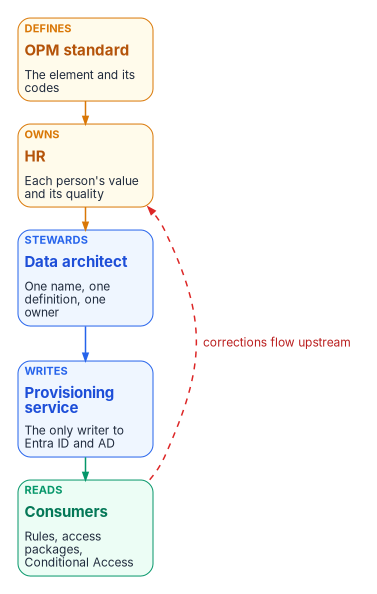

# Ticket-to-Machine, Module 3: One Writer per Attribute {.unnumbered}

**Learning path:** [Ticket-to-Machine on ServiceNow and SailPoint](index.md) · Module 3 of 7 · 40 minutes · Guide [Gate 2](../../books/guides/ttm-servicenow-sailpoint.md#step-2-decide-the-writers-and-the-approvers) · Workbook [Chapter 08](../../project-plans/developer-workbooks/ticket-to-machine/08-one-writer-per-attribute.md)

**Watch:** the narrated deck for this module: [Deck](https://github.com/WhalerMike/modernization-workbook/releases/download/edition-2026.11.5/Training_TTM_Module_3.pptx) · [▶ Watch](../../presentations/watch.html?v=Training_TTM_Module_3_Narrated) (about 14 minutes, captions) · [MP4](https://github.com/WhalerMike/modernization-workbook/releases/download/videos-2026-10-23/Training_TTM_Module_3_Narrated.mp4) · [Script](https://github.com/WhalerMike/modernization-workbook/blob/main/presentations/training-ttm-module-3/Training_TTM_Module_3_Narration_Script.md) · [Captions](https://github.com/WhalerMike/modernization-workbook/blob/main/presentations/training-ttm-module-3/Training_TTM_Module_3_Narrated.vtt).

## Unit 1: Introduction

*3 minutes, with the objectives and prerequisites*

Entra inbound provisioning writes `department` from HR. SailPoint's Entra connector also writes `department`. Each sync overwrites the other, and the drift you'll measure in Module 4 comes back the next day no matter how often someone fixes it. Gate 2 settles this on paper before anything is connected: one writer per attribute, and one approver system per authority class. In this module you learn those decisions and check two provisioning configurations against the first one.

**The federal requirement.** The guide's [Gate 2 requirements and evidence table](../../books/guides/ttm-servicenow-sailpoint.md#step-2-decide-the-writers-and-the-approvers) maps the decisions to NIST SP 800-53 AC-5, CM-3 and AC-2, and Book 13's acceptance of any autonomous class. [Chapter 08's table](../../project-plans/developer-workbooks/ticket-to-machine/08-one-writer-per-attribute.md#federal-requirements-and-evidence) maps the check to CM-6, CM-3, CM-4, CA-7 and SI-4. Each table's KSI column names the FedRAMP 20x Key Security Indicators to line your evidence up with; your cloud providers report against them, the agency doesn't.

### Learning objectives

In this module, you'll:

- Explain the two writer patterns Gate 2 allows, and why it allows only one of them at a time.
- Explain why Gate 2 names one approver system per authority class.
- Run `writer_check.py` over two configuration exports and interpret each Finding, Warn and Info line.
- Verify that the alias list and the directory name are inputs a reviewer checks.

### Prerequisites

- [Module 2](02-boundary-and-least-privilege.md).
- For the Graph export in Lab 2, [Microsoft Automation, Module 1](../ms-automation-foundations.md).

## Unit 2: The writers and the approvers

*10 minutes*

Used as shipped, the two products fall short of the loop in four places. Gate 2 closes two of them on paper: gap 4, two doors into the directory, and gap 2, the catalog app moving access approval into ServiceNow. It also gives each change class a lane and a change-record type. Read:

- The guide's [four gaps](../../books/guides/ttm-servicenow-sailpoint.md#the-loop-at-a-glance), below the loop table.
- The guide's [Gate 2](../../books/guides/ttm-servicenow-sailpoint.md#step-2-decide-the-writers-and-the-approvers): the two writer patterns, the approver-per-class example and the lane table.
- [Book 13, Appendix B: operation classes and their lanes](../../books/b13-governance/appendix-b-ticket-to-machine-reference.md#change-classes-and-their-lanes), for the lanes the table maps onto the products.

{#fig-ch07-attribute-ownership-chain fig-alt="Five cards from left to right joined by arrows. Amber: OPM standard, defines the element and its codes. Amber: HR, owns each person's value and its quality. Blue: data architect, stewards one name, one definition and one owner. Blue: provisioning service, the only writer to Entra ID and AD. Green: consumers, which read the value in rules, access packages and Conditional Access. A red dashed arrow labelled corrections flow upstream runs from the consumers back to HR."}

## Unit 3: Checking for two writers

*8 minutes*

The guide's [Validate (G2)](../../books/guides/ttm-servicenow-sailpoint.md#validate-g2-writers-and-approvers) step names it as the automated check, built in Chapter 08. `writer_check.py` reads Microsoft Graph's synchronization schema for the inbound job and the ISC source's provisioning policies, and reports each attribute both systems write. Read:

- [Chapter 08: why this is a build, and why now](../../project-plans/developer-workbooks/ticket-to-machine/08-one-writer-per-attribute.md#why-this-is-a-build-and-why-now).
- [Chapter 08: what this chapter adds](../../project-plans/developer-workbooks/ticket-to-machine/08-one-writer-per-attribute.md#what-this-chapter-adds), for how flow types and usage types become Finding, Warn and Info, and why the alias list is a reviewed input.

## Unit 4: Exercise: Lab 1 (fixtures, no tenant)

*12 minutes*

<!-- labs:begin lab-1-commands (generated by scripts/generate_labs.py; not part of the reviewed page) -->

::: {.callout-note #lab-1-commands collapse="false" title="Every command in Lab 1"}
Every command in this lab, in order. Each step below says what it does and what to look for.

```powershell
Set-Location C:\FMWLabs\ticket-to-machine-code\servicenow-sailpoint

# Step 1
python -m pytest -q -p no:cacheprovider tests/python/test_writer_check.py

# Step 2
python clients/python/writer_check.py --entra-schema tests/fixtures/writers/entra_inbound_schema.json --isc-policies tests/fixtures/writers/isc_entra_source_policies.json

# Step 3
python clients/python/writer_check.py --entra-schema tests/fixtures/writers/entra_inbound_schema.json --isc-policies tests/fixtures/writers/isc_entra_source_policies.json --alias title=jobTitle

# Step 4
python clients/python/writer_check.py --entra-schema tests/fixtures/writers/entra_inbound_schema.json --isc-policies tests/fixtures/writers/isc_entra_source_policies.json --entra-directory "Microsoft Entra ID"

# Step 5
python clients/python/kit_calls.py --task writer-check
```

:::

<!-- labs:end -->

You check two fictional exports, add an alias, and see the guard against a wrong directory name. [Chapter 08, Lab 1](../../project-plans/developer-workbooks/ticket-to-machine/08-one-writer-per-attribute.md#lab-1-fixtures-no-tenant) explains each result.

Every step runs in PowerShell 7, the Python commands included, so you can follow it top to bottom in one window. Open **PowerShell 7** from the Start menu, then go to the kit's folder, where you unzipped it under [Get the code](index.md#get-the-code):

```powershell
Set-Location C:\FMWLabs\ticket-to-machine-code\servicenow-sailpoint
```

Prefer Git Bash? Go to the folder with `cd /c/FMWLabs/ticket-to-machine-code/servicenow-sailpoint`; every step runs the same there. In a clone of the repository, use the `examples` folder of the same name.

1. Run the chapter's tests.

   ```powershell
   python -m pytest -q -p no:cacheprovider tests/python/test_writer_check.py
   ```

   Expected: a line of 6 dots, then `6 passed in` and the time the run took, which differs from run to run.

2. Check the two fictional exports.

   ```powershell
   python clients/python/writer_check.py --entra-schema tests/fixtures/writers/entra_inbound_schema.json --isc-policies tests/fixtures/writers/isc_entra_source_policies.json
   ```

   Expected output (the command exits 1):

   ```text
   Entra inbound writes 8 attributes; SailPoint writes 7; 1 Finding, 1 Warn, 2 Info
     Finding department         Entra update SailPoint update both update it: each overwrites the other, so drift never settles
     Warn    displayName        Entra update SailPoint create one updates it and the other sets it at creation: two sources for its first value
     Info    mailNickname       Entra create SailPoint create both set it only at creation
     Info    userPrincipalName  Entra create SailPoint create both set it only at creation
   ```

3. Map SailPoint's `title` to Entra ID's `jobTitle`, and run it again.

   ```powershell
   python clients/python/writer_check.py --entra-schema tests/fixtures/writers/entra_inbound_schema.json --isc-policies tests/fixtures/writers/isc_entra_source_policies.json --alias title=jobTitle
   ```

   Expected output (the command exits 1):

   ```text
   Entra inbound writes 8 attributes; SailPoint writes 7; 2 Finding, 1 Warn, 2 Info
     Finding department         Entra update SailPoint update both update it: each overwrites the other, so drift never settles
     Warn    displayName        Entra update SailPoint create one updates it and the other sets it at creation: two sources for its first value
     Finding jobTitle           Entra update SailPoint update both update it: each overwrites the other, so drift never settles
     Info    mailNickname       Entra create SailPoint create both set it only at creation
     Info    userPrincipalName  Entra create SailPoint create both set it only at creation
   ```

   The summary becomes `2 Finding, 1 Warn, 2 Info`, with `Finding jobTitle` added.

4. See the directory-name guard.

   ```powershell
   python clients/python/writer_check.py --entra-schema tests/fixtures/writers/entra_inbound_schema.json --isc-policies tests/fixtures/writers/isc_entra_source_policies.json --entra-directory "Microsoft Entra ID"
   ```

   Expected output (the command exits 2):

   ```text
   error: No synchronization rule targets 'Microsoft Entra ID'; the schema's targets are ['Azure Active Directory']
   ```

5. List the reads the two exports need.

   ```powershell
   python clients/python/kit_calls.py --task writer-check
   ```

   Expected output:

   ```text
   Task writer-check: export the two provisioning mappings writer_check.py compares (by hand; writer_check.py reads files only)

   isc
     GET    /v3/sources/{sourceId}/provisioning-policies               idn:provisioning-policy:read
     needs: idn:provisioning-policy:read

   graph
     GET    /v1.0/servicePrincipals/{id}/synchronization/jobs/{jobId}/schema CustomSecAttributeProvisioning.Read.All
     needs: CustomSecAttributeProvisioning.Read.All
   ```

   The ISC export needs `idn:provisioning-policy:read`, and the Graph export needs `CustomSecAttributeProvisioning.Read.All`.

**Check your work:** given two exports and an alias list, you can say which attributes have two writers and who must decide each one.

## Unit 5: Exercise: Lab 2 (your test instance)

*Not timed. Not run by the authors.*

Export the inbound provisioning job's schema from a test Entra tenant and the Entra source's provisioning policies from an ISC sandbox, build the alias list, run the check, and hand each Finding to the data architect. Follow [Chapter 08, Lab 2](../../project-plans/developer-workbooks/ticket-to-machine/08-one-writer-per-attribute.md#lab-2-exports-from-a-test-tenant-and-a-sailpoint-sandbox).

<!-- labs:begin module-lab-2-commands (generated by scripts/generate_labs.py; not part of the reviewed page) -->

::: {.callout-note #module-lab-2-commands collapse="false" title="The Lab 2 commands, against your test environment"}
Every command in [Chapter 08, Lab 2](../../project-plans/developer-workbooks/ticket-to-machine/08-one-writer-per-attribute.md#lab-2-exports-from-a-test-tenant-and-a-sailpoint-sandbox), in order, against your test environment, never production.

Replace each `<placeholder>` with your test environment's value.

The chapter's steps say what each command does and what to look for.

```bash
# Step 1: Export the inbound job's schema
mkdir -p out
export GRAPH_TENANT_ID="<graph-tenant-id>"
export GRAPH_CLIENT_ID="<graph-client-id>"
export GRAPH_CERT_PATH="<graph-cert.pem>"
export GRAPH_CLOUD="<graph-cloud>"
export GRAPH_ACCESS_TOKEN=$(python -c "import sys; sys.path.insert(0, 'clients/python'); import kit_common as kc; print(kc.graph_headers(kc.load_config(), kc.Http())['Authorization'].split()[1])")
export GRAPH_ROOT=$(python -c "import sys; sys.path.insert(0, 'clients/python'); import kit_common as kc; print(kc.graph_endpoints(kc.load_config())[1])")
curl -s -H "Authorization: Bearer $GRAPH_ACCESS_TOKEN" -H "Accept: application/json" "$GRAPH_ROOT/v1.0/servicePrincipals/<service-principal-id>/synchronization/jobs"

# Step 1: Export the inbound job's schema
curl -s -H "Authorization: Bearer $GRAPH_ACCESS_TOKEN" -H "Accept: application/json" -o out/entra_inbound_schema.json "$GRAPH_ROOT/v1.0/servicePrincipals/<service-principal-id>/synchronization/jobs/<job-id>/schema"

# Step 1: Export the inbound job's schema
python -c "import json; s=json.load(open('out/entra_inbound_schema.json')); print(sorted({r.get('targetDirectoryName') for r in s.get('synchronizationRules') or []}))"

# Step 2: Export the ISC source's policies
export SAILPOINT_API_BASE="https://<tenant>.api.identitynow.com"
export SAILPOINT_ACCESS_TOKEN=$(curl -s -X POST "$SAILPOINT_API_BASE/oauth/token" -d grant_type=client_credentials -d client_id="<policy-client-id>" -d client_secret="<policy-client-secret>" | python -c "import json,sys; print(json.load(sys.stdin)['access_token'])")
curl -s -H "Authorization: Bearer $SAILPOINT_ACCESS_TOKEN" -H "Accept: application/json" -o out/isc_entra_source_policies.json "$SAILPOINT_API_BASE/v3/sources/<source-id>/provisioning-policies"

# Step 4: Run the check
python clients/python/writer_check.py --entra-schema out/entra_inbound_schema.json --isc-policies out/isc_entra_source_policies.json --entra-directory "<target-directory-name>" --alias "<sailpoint-field>=<entra-attribute>"

# Step 5: Back it out
rm -f out/entra_inbound_schema.json out/isc_entra_source_policies.json
unset GRAPH_TENANT_ID GRAPH_CLIENT_ID GRAPH_CERT_PATH GRAPH_CLOUD GRAPH_ACCESS_TOKEN GRAPH_ROOT SAILPOINT_API_BASE SAILPOINT_ACCESS_TOKEN
```

Steps with no command, done in the portal or by hand as the chapter's step says:

- **Step 3:** Build the alias list
:::

<!-- labs:end -->

- **You need:** a test Entra tenant with an inbound provisioning job, and a SailPoint sandbox with an Entra source. Both reads are GET only.
- **Back it out:** step 5 deletes the exports if they hold anything beyond mappings, and removes the Graph permission and the ISC API client.

## Unit 6: Knowledge check

*5 minutes*

1. `writer_check.py` reports an attribute as a **Finding**. What does that mean?
   a. Both systems set it only when the account is created.
   b. One system updates it, and the other sets it at creation.
   c. Both systems update it, so each overwrites the other and the drift never settles.

2. Why did adding `--alias title=jobTitle` add a Finding?
   a. SailPoint's field names are the connector's, so without the alias the second writer of `jobTitle` was invisible.
   b. The alias tells Entra ID to stop writing `title`.
   c. The alias turns on a stricter check mode.

3. You run the check with `--entra-directory "Microsoft Entra ID"`, but the schema's rules target `Azure Active Directory`. What happens?
   a. The check reports no overlap and exits 0.
   b. The check stops with an error and exits 2, so a wrong name doesn't pass as "no overlap."
   c. The check guesses the right directory and continues.

4. Gate 2 offers two writer patterns. Which choice does it rule out?
   a. Entra inbound provisioning stays the door, and SailPoint aggregates HR read-only and governs entitlements.
   b. SailPoint becomes the provisioning service and takes on Book 03's middleware duties.
   c. Both Entra inbound provisioning and SailPoint write HR-mastered attributes.

::: {.callout-tip collapse="true"}
## Check your answers
1. **c.** Both update it. See the Finding, Warn and Info rules in [Chapter 08: what this chapter adds](../../project-plans/developer-workbooks/ticket-to-machine/08-one-writer-per-attribute.md#what-this-chapter-adds).
2. **a.** The check doesn't guess name pairs; the alias list is a reviewed input. See step 3 of [Chapter 08, Lab 1](../../project-plans/developer-workbooks/ticket-to-machine/08-one-writer-per-attribute.md#lab-1-fixtures-no-tenant).
3. **b.** See step 4 of [Chapter 08, Lab 1](../../project-plans/developer-workbooks/ticket-to-machine/08-one-writer-per-attribute.md#lab-1-fixtures-no-tenant).
4. **c.** "Not both." See step 1 of the guide's [Gate 2](../../books/guides/ttm-servicenow-sailpoint.md#step-2-decide-the-writers-and-the-approvers).
:::

## Unit 7: Summary

*2 minutes*

You learned Gate 2's decisions and checked two provisioning configurations for attributes with two writers, including the inputs a reviewer has to confirm.

**Evidence an ISSO keeps from this module:** the attribute map with each attribute's writer, the approver-per-class table and the lane table (Gate 2); the check's output and the data architect's decisions, kept with the provisioning configuration (Chapter 08). Before shipping, work through the [Chapter 08 checklist](../../project-plans/developer-workbooks/ticket-to-machine/08-one-writer-per-attribute.md#checklist).

::: {.callout-tip}
## Continue the path
[Previous: Module 2](02-boundary-and-least-privilege.md) · [Learning path](index.md) · [Next: Module 4, Sources and the starting drift →](04-sources-and-starting-drift.md)
:::
