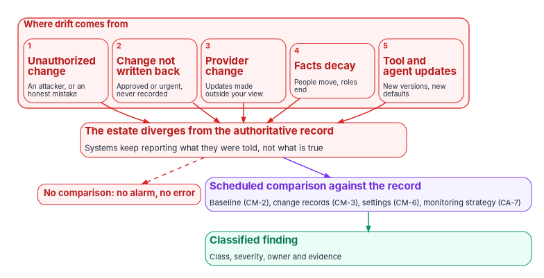

# Ticket-to-Machine, Module 4: Sources and the Starting Drift {.unnumbered}

**Learning path:** [Ticket-to-Machine on ServiceNow and SailPoint](index.md) · Module 4 of 7 · 45 minutes · Guide [Gate 3](../../books/guides/ttm-servicenow-sailpoint.md#step-3-connect-the-sources-and-measure-the-starting-drift) · Workbook [Chapter 06](../../project-plans/developer-workbooks/ticket-to-machine/06-drift-reconciliation.md)

**Watch:** the narrated deck for this module: [Deck](https://github.com/WhalerMike/modernization-workbook/releases/download/edition-2026.11.5/Training_TTM_Module_4.pptx) · [▶ Watch](../../presentations/watch.html?v=Training_TTM_Module_4_Narrated) (about 14 minutes, captions) · [MP4](https://github.com/WhalerMike/modernization-workbook/releases/download/videos-2026-10-23/Training_TTM_Module_4_Narrated.mp4) · [Script](https://github.com/WhalerMike/modernization-workbook/blob/main/presentations/training-ttm-module-4/Training_TTM_Module_4_Narration_Script.md) · [Captions](https://github.com/WhalerMike/modernization-workbook/blob/main/presentations/training-ttm-module-4/Training_TTM_Module_4_Narrated.vtt).

## Unit 1: Introduction

*3 minutes, with the objectives and prerequisites*

Before you fix anything, you need to know how far the directory is from HR. A terminated employee still enabled in Entra ID, an account that matches nobody, a department someone typed by hand: each is drift, and each needs a number before it needs a ticket. Gate 3 connects the sources, correlates them on one key, and files the first measurement as the baseline. In this module you run that measurement twice and compare the days.

**The federal requirement.** The guide's [Gate 3 requirements and evidence table](../../books/guides/ttm-servicenow-sailpoint.md#step-3-connect-the-sources-and-measure-the-starting-drift) maps it to NIST SP 800-53 AC-2, CA-7 and, by inference, CM-8. [Chapter 06's table](../../project-plans/developer-workbooks/ticket-to-machine/06-drift-reconciliation.md#federal-requirements-and-evidence) maps the reconciliation and the comparison to AC-2, CA-7 and SI-4. Each table's KSI column names the FedRAMP 20x Key Security Indicators to line your evidence up with; your cloud providers report against them, the agency doesn't.

### Learning objectives

In this module, you'll:

- Explain what Gate 3 connects, the key it correlates on, and what it files as the baseline.
- Name Book 03's drift classes, and say which ones the kit doesn't compute. The kit carries seven of Book 03's eight classes and has no value for contractor credential drift.
- Run the drift reconciliation over fixtures and compare two runs as new, persisting and resolved.
- Explain why a comparison of runs that computed different classes is refused.

### Prerequisites

- [Module 3](03-one-writer-per-attribute.md).
- For the Graph reads, [Microsoft Automation, Module 1](../ms-automation-foundations.md), especially [four request patterns](../ms-automation-foundations.md#four-request-patterns).

## Unit 2: Connecting the sources

*8 minutes*

SailPoint aggregates HR as the authoritative source, connects Entra ID and Active Directory, correlates on `employeeId`, and turns on Native Change Detection. The kit's reconciliation then joins the HR extract, Microsoft Graph and ISC on the same key, read only. Read:

- The guide's [Gate 3](../../books/guides/ttm-servicenow-sailpoint.md#step-3-connect-the-sources-and-measure-the-starting-drift): its steps, its availability note and its interim path.
- [Book 03, Chapter 11: drift between HR and the directory](../../books/b03-hr-identity/11-drift-metrics-and-evidence.md#drift-between-hr-and-the-directory), for the drift classes and their severities.
- The implementation example's [Build 3](../../books/guides/snow-sailpoint-integration-kit.md#build-3-drift-reconciliation).

{#fig-ch02-drift-sources fig-alt="Five numbered red cards in a row, grouped as where drift comes from: 1, unauthorized change, an attacker or an honest mistake; 2, change not written back, approved or urgent but never recorded; 3, provider change, updates made outside your view; 4, facts decay, people move and roles end; 5, tool and agent updates, new versions and new defaults. All five point to a wide red card: the estate diverges from the authoritative record, and systems keep reporting what they were told, not what is true. From that card a dashed red arrow leads to a red pill reading no comparison: no alarm, no error. A violet arrow leads to a violet card, scheduled comparison against the record, naming the baseline (CM-2), change records (CM-3), settings (CM-6) and the monitoring strategy (CA-7), which leads to a green card, classified finding: class, severity, owner and evidence."}

## Unit 3: Run over run

*10 minutes*

Events catch changes as they happen; the reconciliation catches the state, including drift whose event was missed. A scheduled run should raise only what's new, so `drift_compare.py` compares two runs by their stable finding IDs. It refuses runs that computed different classes, because every finding of a class the second run skipped would look resolved. Read:

- [Chapter 06: what exists](../../project-plans/developer-workbooks/ticket-to-machine/06-drift-reconciliation.md#what-exists) and [what this chapter adds](../../project-plans/developer-workbooks/ticket-to-machine/06-drift-reconciliation.md#what-this-chapter-adds).
- [Chapter 06: dangers](../../project-plans/developer-workbooks/ticket-to-machine/06-drift-reconciliation.md#dangers).

## Unit 4: Exercise: Lab 1 (fixtures, no tenant)

*17 minutes*

<!-- labs:begin lab-1-commands (generated by scripts/generate_labs.py; not part of the reviewed page) -->

::: {.callout-note #lab-1-commands collapse="false" title="Every command in Lab 1"}
Every command in this lab, in order. Each step below says what it does and what to look for.

```powershell
Set-Location C:\FMWLabs\ticket-to-machine-code\servicenow-sailpoint

$Run = "C:\FMWLabs\results\ticket-to-machine-04-sources-and-starting-drift\lab1\$(Get-Date -AsUTC -Format 'yyyy-MM-ddTHHmmssZ')"
New-Item -ItemType Directory -Path $Run -Force | Out-Null
$Run

# Step 1
python -m pytest -q -p no:cacheprovider tests/python/test_identity_drift.py tests/python/test_drift_compare.py

# Step 2
python clients/python/identity_drift.py --hr-csv tests/fixtures/hr_extract.csv --config tests/fixtures/config.fixtures.json --graph-users-json tests/fixtures/graph_users.json --isc-identities-json tests/fixtures/isc_identities.json --isc-accounts-json tests/fixtures/isc_uncorrelated_accounts.json --entra-audit-json tests/fixtures/entra_audit.json --out-json "$Run\day1.json" --out-csv "$Run\day1.csv"

# Step 2
python -c "import csv, json, sys; [print(r['drift_class'], r['system'], r['employee_id'], r['attribute'], r['expected'], '->', r['observed'], json.loads(r['evidence']).get('initiated_by', '')) for r in csv.DictReader(open(sys.argv[1], encoding='utf-8')) if r['employee_id'] in ('E1002', 'E1004')]" "$Run\day1.csv"

# Step 3
python clients/python/identity_drift.py --hr-csv tests/fixtures/hr_extract_day2.csv --config tests/fixtures/config.fixtures.json --graph-users-json tests/fixtures/graph_users.json --isc-identities-json tests/fixtures/isc_identities.json --isc-accounts-json tests/fixtures/isc_uncorrelated_accounts.json --entra-audit-json tests/fixtures/entra_audit.json --out-json "$Run\day2.json" --out-csv "$Run\day2.csv"

# Step 4
python clients/python/drift_compare.py --previous "$Run\day1.json" --current "$Run\day2.json"

# Step 5
python clients/python/identity_drift.py --hr-csv tests/fixtures/hr_extract_day2.csv --config tests/fixtures/config.fixtures.json --graph-users-json tests/fixtures/graph_users.json --isc-identities-json tests/fixtures/isc_identities.json --isc-accounts-json tests/fixtures/isc_uncorrelated_accounts.json --out-json "$Run\day2-noaudit.json" --out-csv "$Run\day2-noaudit.csv"
python clients/python/drift_compare.py --previous "$Run\day1.json" --current "$Run\day2-noaudit.json"

# Step 6
Get-ChildItem C:\FMWLabs\results\ticket-to-machine-04-sources-and-starting-drift\lab1 -Name
```

:::

<!-- labs:end -->

You run a two-day story: day one, HR's correction on day two, and a day two that skipped the audit. [Chapter 06, Lab 1](../../project-plans/developer-workbooks/ticket-to-machine/06-drift-reconciliation.md#lab-1-fixtures-no-tenant) explains each result.

Every step runs in PowerShell 7, the Python commands included, so you can follow it top to bottom in one window. Open **PowerShell 7** from the Start menu, then go to the kit's folder, where you unzipped it under [Get the code](index.md#get-the-code):

```powershell
Set-Location C:\FMWLabs\ticket-to-machine-code\servicenow-sailpoint
```

Then make this run's results folder. Its name is the date and time you start, in UTC, so each run keeps its own results and running the lab again never overwrites them:

```powershell
$Run = "C:\FMWLabs\results\ticket-to-machine-04-sources-and-starting-drift\lab1\$(Get-Date -AsUTC -Format 'yyyy-MM-ddTHHmmssZ')"
New-Item -ItemType Directory -Path $Run -Force | Out-Null
$Run
```

Expected output, where `<run>` is your start time, such as `2026-11-25T143005Z`:

```text
C:\FMWLabs\results\ticket-to-machine-04-sources-and-starting-drift\lab1\<run>
```

The run's date is only the folder's name. The data's dates are the fixtures' own, which stay the same, so every run's results match this page. The results folder sits outside the kit, so unzipping a newer copy of the kit never touches it.

Prefer Git Bash? Go to the folder with `cd /c/FMWLabs/ticket-to-machine-code/servicenow-sailpoint`, make the run folder with `Run=/c/FMWLabs/results/ticket-to-machine-04-sources-and-starting-drift/lab1/$(date -u +%Y-%m-%dT%H%M%SZ); mkdir -p "$Run"`, and Steps 1 to 5 run the same there, with `/` in place of `\` after `$Run`; list the runs with `ls`. In a clone of the repository, use the `examples` folder of the same name.

1. Run the drift tests.

   ```powershell
   python -m pytest -q -p no:cacheprovider tests/python/test_identity_drift.py tests/python/test_drift_compare.py
   ```

   Expected: a line of 17 dots, then `17 passed in` and the time the run took, which differs from run to run.

2. Run day one.

   ```powershell
   python clients/python/identity_drift.py --hr-csv tests/fixtures/hr_extract.csv --config tests/fixtures/config.fixtures.json --graph-users-json tests/fixtures/graph_users.json --isc-identities-json tests/fixtures/isc_identities.json --isc-accounts-json tests/fixtures/isc_uncorrelated_accounts.json --entra-audit-json tests/fixtures/entra_audit.json --out-json "$Run\day1.json" --out-csv "$Run\day1.csv"
   ```

   Expected output:

   ```text
   {
     "counts": {
       "attribute_drift": 4,
       "missing_identity": 2,
       "orphan_account": 3,
       "stale_access": 2,
       "unauthorized_write": 1
     },
     "not_computed": {
       "credential_drift": "needs the card management system and Intune certificate reports",
       "schema_drift": "needs the provisioning middleware's validation output"
     },
     "out_json": "C:\\FMWLabs\\results\\ticket-to-machine-04-sources-and-starting-drift\\lab1\\<run>\\day1.json",
     "out_csv": "C:\\FMWLabs\\results\\ticket-to-machine-04-sources-and-starting-drift\\lab1\\<run>\\day1.csv"
   }
   ```

   Print Erin's (`E1004`) and Carol's (`E1002`) rows from `day1.csv`, to find Erin's department and Carol's enabled accounts:

   ```powershell
   python -c "import csv, json, sys; [print(r['drift_class'], r['system'], r['employee_id'], r['attribute'], r['expected'], '->', r['observed'], json.loads(r['evidence']).get('initiated_by', '')) for r in csv.DictReader(open(sys.argv[1], encoding='utf-8')) if r['employee_id'] in ('E1002', 'E1004')]" "$Run\day1.csv"
   ```

   Expected output:

   ```text
   attribute_drift entra E1004 department HR -> Finance
   attribute_drift entra E1004 manager E1000 -> E1001
   attribute_drift isc E1004 manager E1000 -> E1001
   stale_access entra E1002 accountEnabled false -> true
   stale_access isc E1002 disabled true -> false
   unauthorized_write entra E1004 Department ["HR"] -> ["Finance"] helpdesk.admin@contoso.example
   ```

3. Run day two, after HR's correction.

   ```powershell
   python clients/python/identity_drift.py --hr-csv tests/fixtures/hr_extract_day2.csv --config tests/fixtures/config.fixtures.json --graph-users-json tests/fixtures/graph_users.json --isc-identities-json tests/fixtures/isc_identities.json --isc-accounts-json tests/fixtures/isc_uncorrelated_accounts.json --entra-audit-json tests/fixtures/entra_audit.json --out-json "$Run\day2.json" --out-csv "$Run\day2.csv"
   ```

   Expected output:

   ```text
   {
     "counts": {
       "attribute_drift": 4,
       "missing_identity": 2,
       "orphan_account": 3,
       "stale_access": 2,
       "unauthorized_write": 1
     },
     "not_computed": {
       "credential_drift": "needs the card management system and Intune certificate reports",
       "schema_drift": "needs the provisioning middleware's validation output"
     },
     "out_json": "C:\\FMWLabs\\results\\ticket-to-machine-04-sources-and-starting-drift\\lab1\\<run>\\day2.json",
     "out_csv": "C:\\FMWLabs\\results\\ticket-to-machine-04-sources-and-starting-drift\\lab1\\<run>\\day2.csv"
   }
   ```

   The same counts. The totals hide what moved.

4. Compare the two days.

   ```powershell
   python clients/python/drift_compare.py --previous "$Run\day1.json" --current "$Run\day2.json"
   ```

   Expected output:

   ```text
   1 new, 11 persisting, 1 resolved
     new       6456e1f12a60e6be attribute_drift isc E1004 department: expected 'Finance', observed 'HR'
     resolved  1f0e34ebf049f163 attribute_drift entra E1004 department: expected 'HR', observed 'Finance'
   Resolved findings are leads for the re-read; their records close only on reread_verification.py.
   ```

5. Run day two without the audit, then compare.

   ```powershell
   python clients/python/identity_drift.py --hr-csv tests/fixtures/hr_extract_day2.csv --config tests/fixtures/config.fixtures.json --graph-users-json tests/fixtures/graph_users.json --isc-identities-json tests/fixtures/isc_identities.json --isc-accounts-json tests/fixtures/isc_uncorrelated_accounts.json --out-json "$Run\day2-noaudit.json" --out-csv "$Run\day2-noaudit.csv"
   python clients/python/drift_compare.py --previous "$Run\day1.json" --current "$Run\day2-noaudit.json"
   ```

   Expected output of the first command:

   ```text
   {
     "counts": {
       "attribute_drift": 4,
       "missing_identity": 2,
       "orphan_account": 3,
       "stale_access": 2
     },
     "not_computed": {
       "credential_drift": "needs the card management system and Intune certificate reports",
       "schema_drift": "needs the provisioning middleware's validation output",
       "unauthorized_write": "no Entra audit extract supplied (--entra-audit-json or --include-audit)"
     },
     "out_json": "C:\\FMWLabs\\results\\ticket-to-machine-04-sources-and-starting-drift\\lab1\\<run>\\day2-noaudit.json",
     "out_csv": "C:\\FMWLabs\\results\\ticket-to-machine-04-sources-and-starting-drift\\lab1\\<run>\\day2-noaudit.csv"
   }
   ```

   Expected output of the second command (it exits 2):

   ```text
   error: The runs computed different drift classes (previous: attribute_drift, missing_identity, orphan_account, stale_access, unauthorized_write; current: attribute_drift, missing_identity, orphan_account, stale_access). A class one run didn't compute would look resolved; rerun with the same inputs.
   ```

   The first command lists `unauthorized_write` under `not_computed`, so the second refuses to compare the runs.

6. Nothing to clean up: the kit's folder is as you unzipped it, and this run's results stay in `$Run`. List every run you've made of this lab:

   ```powershell
   Get-ChildItem C:\FMWLabs\results\ticket-to-machine-04-sources-and-starting-drift\lab1 -Name
   ```

   Expected output: one line per run, oldest first, the last one this run:

   ```text
   <run>
   ```

**Check your work:** you can say what changed between two runs, and why a run that skipped a class can't be compared with one that didn't.

## Unit 5: Exercise: Lab 2 (your test instance)

*Not timed. Not run by the authors.*

Grant the read permissions from Module 2, write a synthetic HR extract that matches test users, run the client live on two days, and compare the runs. Push nothing to ServiceNow. Follow [Chapter 06, Lab 2](../../project-plans/developer-workbooks/ticket-to-machine/06-drift-reconciliation.md#lab-2-a-test-tenant-and-a-sailpoint-sandbox).

<!-- labs:begin module-lab-2-commands (generated by scripts/generate_labs.py; not part of the reviewed page) -->

::: {.callout-note #module-lab-2-commands collapse="false" title="The Lab 2 commands, against your test environment"}
Every command in [Chapter 06, Lab 2](../../project-plans/developer-workbooks/ticket-to-machine/06-drift-reconciliation.md#lab-2-a-test-tenant-and-a-sailpoint-sandbox), in order, against your test environment, never production.

Replace each `<placeholder>` with your test environment's value.

The chapter's steps say what each command does and what to look for.

```bash
# Step 1: Grant the reads
python clients/python/kit_calls.py --task drift --system graph --granted "<graph-permissions>"
python clients/python/kit_calls.py --task drift --system isc --granted "<isc-scopes>"

# Step 2: Write a synthetic HR extract
cat > hr_synthetic.csv <<'EOF'
employeeId,status,department,managerEmployeeId,displayName,email
<active-employee-id>,Active,<active-user-department>,,Test User One,
<terminated-employee-id>,Terminated,<terminated-user-department>,,Test User Two,
<mover-employee-id>,Active,<department-not-in-entra>,,Test User Three,
EOF

# Step 3: Run the client live
export SAILPOINT_API_BASE="https://<tenant>.api.identitynow.com"
export SAILPOINT_CLIENT_ID="<reader-client-id>"
export SAILPOINT_CLIENT_SECRET="<reader-client-secret>"
export GRAPH_TENANT_ID="<graph-tenant-id>"
export GRAPH_CLIENT_ID="<graph-client-id>"
export GRAPH_CERT_PATH="<graph-cert.pem>"
export GRAPH_CLOUD="Global"
export ISC_EMPLOYEE_ID_ATTRIBUTE="<employee-id-attribute>"
export ISC_AUTHORITATIVE_SOURCES="<hr-source-name>"
export ALLOWED_WRITER_APP_IDS="<provisioning-app-id>"
python clients/python/identity_drift.py --hr-csv hr_synthetic.csv --config config/config.example.json --include-audit "<since-day1>" --out-json out/day1.json --out-csv out/day1.csv

# Step 4: Run it again the next day
sed -i 's/^<mover-employee-id>,Active,[^,]*,/<mover-employee-id>,Active,<new-department>,/' hr_synthetic.csv
python clients/python/identity_drift.py --hr-csv hr_synthetic.csv --config config/config.example.json --include-audit "<since-day2>" --out-json out/day2.json --out-csv out/day2.csv
python clients/python/drift_compare.py --previous out/day1.json --current out/day2.json

# Step 5: Back it out
rm -rf out hr_synthetic.csv
unset SAILPOINT_API_BASE SAILPOINT_CLIENT_ID SAILPOINT_CLIENT_SECRET GRAPH_TENANT_ID GRAPH_CLIENT_ID GRAPH_CERT_PATH GRAPH_CLOUD ISC_EMPLOYEE_ID_ATTRIBUTE ISC_AUTHORITATIVE_SOURCES ALLOWED_WRITER_APP_IDS
```
:::

<!-- labs:end -->

- **You need:** a test Entra tenant in the worldwide or GCC cloud, a SailPoint sandbox, and synthetic HR data like the fixtures.
- **Back it out:** step 5 deletes `out`, the synthetic extract, the app registration's permissions and certificate, and the sandbox API client.

## Unit 6: Knowledge check

*5 minutes*

1. Which key does the reconciliation join the HR extract, Microsoft Graph and ISC on?
   a. `userPrincipalName`
   b. `employeeId`
   c. `mail`

2. On day two, Entra ID matches HR for Erin's department. How does `drift_compare.py` report the day-one Entra finding?
   a. As resolved, a lead for the re-read; its record still closes only on `reread_verification.py`.
   b. As closed, and it closes the ServiceNow record.
   c. As persisting, until ISC is re-aggregated.

3. Why does `drift_compare.py` refuse to compare day one (with the audit) and day two (without it)?
   a. The two runs have different file names.
   b. Every unauthorized-write finding would look resolved, because the second run didn't compute that class.
   c. The comparison needs the audit on both days to compute finding IDs.

4. Your first reconciliation run shows a burst of High findings. What does Gate 3 tell you to do?
   a. Suppress the uncorrelated accounts until the data is clean.
   b. Expect it, since Book 03 calls that the measurement working, and file the first run as the baseline.
   c. Disconnect the sources and start again.

::: {.callout-tip collapse="true"}
## Check your answers
1. **b.** See [Chapter 06: in this chapter](../../project-plans/developer-workbooks/ticket-to-machine/06-drift-reconciliation.md#in-this-chapter) and step 3 of the guide's [Gate 3](../../books/guides/ttm-servicenow-sailpoint.md#step-3-connect-the-sources-and-measure-the-starting-drift).
2. **a.** A resolved finding is a lead, not a closure. See step 4 of [Chapter 06, Lab 1](../../project-plans/developer-workbooks/ticket-to-machine/06-drift-reconciliation.md#lab-1-fixtures-no-tenant).
3. **b.** See [Chapter 06: what this chapter adds](../../project-plans/developer-workbooks/ticket-to-machine/06-drift-reconciliation.md#what-this-chapter-adds) and step 5 of its Lab 1.
4. **b.** See steps 5 and 6 of the guide's [Gate 3](../../books/guides/ttm-servicenow-sailpoint.md#step-3-connect-the-sources-and-measure-the-starting-drift).
:::

## Unit 7: Summary

*2 minutes*

You learned how Gate 3 connects and correlates the sources, measured drift over two days, and saw why a comparison refuses runs that measured different things.

**Evidence an ISSO keeps from this module:** the baseline drift report with its date and checker version, the correlation rate and the uncorrelated-account list (Gate 3); each run's JSON and CSV, with `not_computed`, and the comparison output kept with each run (Chapter 06). Before shipping, work through the [Chapter 06 checklist](../../project-plans/developer-workbooks/ticket-to-machine/06-drift-reconciliation.md#checklist).

::: {.callout-tip}
## Continue the path
[Previous: Module 3](03-one-writer-per-attribute.md) · [Learning path](index.md) · [Next: Module 5, Drift to a typed task →](05-drift-to-a-typed-task.md)
:::
