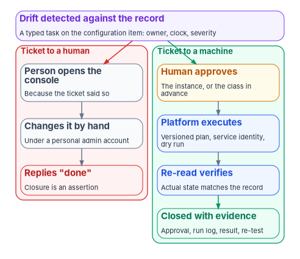

# Ticket-to-Machine, Module 6: Actuation and the Re-read Rule {.unnumbered}

**Learning path:** [Ticket-to-Machine on ServiceNow and SailPoint](index.md) · Module 6 of 7 · 55 minutes · Guide [Gate 5](../../books/guides/ttm-servicenow-sailpoint.md#step-5-actuate-on-the-native-surface) and [Gate 6](../../books/guides/ttm-servicenow-sailpoint.md#step-6-close-only-on-a-re-read) · Workbook [Chapter 05](../../project-plans/developer-workbooks/ticket-to-machine/05-the-re-read-rule.md)

**Watch:** the narrated deck for this module: [Deck](https://github.com/WhalerMike/modernization-workbook/releases/download/edition-2026.11.5/Training_TTM_Module_6.pptx) · [▶ Watch](../../presentations/watch.html?v=Training_TTM_Module_6_Narrated) (about 14 minutes, captions) · [MP4](https://github.com/WhalerMike/modernization-workbook/releases/download/videos-2026-10-23/Training_TTM_Module_6_Narrated.mp4) · [Script](https://github.com/WhalerMike/modernization-workbook/blob/main/presentations/training-ttm-module-6/Training_TTM_Module_6_Narration_Script.md) · [Captions](https://github.com/WhalerMike/modernization-workbook/blob/main/presentations/training-ttm-module-6/Training_TTM_Module_6_Narrated.vtt).

## Unit 1: Introduction

*3 minutes, with the objectives and prerequisites*

SailPoint's Service Desk integration treats a provisioning task as complete when the mapped ServiceNow status says so. A technician sets a ticket to Closed, and nothing was checked. Book 13's rule is that a success response isn't closure: a finding closes only when a re-read of the target shows the intended state. In this module you see where the fix runs, and then you enforce the rule and watch the re-read client decide six findings.

**The federal requirement.** The guide's [Gate 5](../../books/guides/ttm-servicenow-sailpoint.md#step-5-actuate-on-the-native-surface) table maps actuation to NIST SP 800-53 CM-5, AC-3, AC-6, CM-3, AU-14, CA-5 and NIST SP 800-63B-4; the [Gate 6](../../books/guides/ttm-servicenow-sailpoint.md#step-6-close-only-on-a-re-read) table maps the re-read to CM-3, CM-4(2), CA-7 and AU-12. [Chapter 05's table](../../project-plans/developer-workbooks/ticket-to-machine/05-the-re-read-rule.md#federal-requirements-and-evidence) says what each closure proves and who keeps it. Each table's KSI column names the FedRAMP 20x Key Security Indicators to line your evidence up with; your cloud providers report against them, the agency doesn't.

### Learning objectives

In this module, you'll:

- Explain how Gate 5 actuates by lane, and why the kit has no test for it.
- Describe what the business rule does with a close, and who can close a finding.
- Run the re-read client offline and interpret verified, mismatch, pending and skipped.
- Explain why a stale read waits, and why an empty intended state is never verified.

### Prerequisites

- [Module 5](05-drift-to-a-typed-task.md), and Module 2's [ServiceNow roles](02-boundary-and-least-privilege.md#unit-3-servicenow-roles-split-by-task), for the verifier.

## Unit 2: Actuation by lane

*8 minutes*

The ticket authorizes a machine. SailPoint's connectors provision owner-governed access; ServiceNow's Entra ID spoke handles low-authority tasks where its actions cover them; disconnected applications run as declared exceptions; people act only through a just-in-time activation. The kit's Pass 1 doesn't actuate, so Gate 5 is configuration of the products themselves, with no automated check yet. Read:

- The guide's [Gate 5](../../books/guides/ttm-servicenow-sailpoint.md#step-5-actuate-on-the-native-surface) and its [Validate (G5)](../../books/guides/ttm-servicenow-sailpoint.md#validate-g5-actuation) step.
- [Book 13, Chapter 10: when no machine can reach the surface](../../books/b13-governance/10-ticket-to-machine.md#when-no-machine-can-reach-the-surface), for the declared-exception lane.

{#fig-ch10-ticket-to-machine fig-alt="A violet card at the top: drift detected against the record, raised as a typed task on the configuration item with an owner, a clock and a severity. A red arrow leads into a red-outlined group labeled ticket to a human: a person opens the console because the ticket said so, changes it by hand under a personal admin account, and replies done, so closure is an assertion. A green arrow leads into a green-outlined group labeled ticket to a machine: a human approves, either the instance or the class in advance; the platform executes from a versioned plan under a service identity after a dry run; a re-read verifies that actual state matches the record; and the task is closed with evidence, the approval, run log, result and re-test."}

## Unit 3: The business rule and the verifier

*10 minutes*

The business rule turns any close into *Awaiting verification*, unless the update carries new evidence and comes from the verifier account; a named exception approver can still cancel with a note. The re-read client reads each waiting record, re-reads the target through ISC or Microsoft Graph, and closes with the evidence or reopens with the differences. Read:

- The guide's [Gate 6](../../books/guides/ttm-servicenow-sailpoint.md#step-6-close-only-on-a-re-read) and its [Validate (G6)](../../books/guides/ttm-servicenow-sailpoint.md#validate-g6-re-read) step.
- [Book 13, Appendix B: the five-clause request chain](../../books/b13-governance/appendix-b-ticket-to-machine-reference.md#the-five-clause-request-chain).
- The implementation example's [Build 2](../../books/guides/snow-sailpoint-integration-kit.md#build-2-the-re-read-rule).

## Unit 4: The guard and the offline mode

*10 minutes*

Chapter 05 adds two things. The guard skips any record whose intended state names nothing a re-read can check, because comparing against it always "matches." The offline mode runs the client's decisions over saved records and saved reads, with the clock fixed, so you can test the rule with no tenant. Read:

- [Chapter 05: what this chapter adds](../../project-plans/developer-workbooks/ticket-to-machine/05-the-re-read-rule.md#what-this-chapter-adds), including the six fictional waiting records.
- [Chapter 05: dangers](../../project-plans/developer-workbooks/ticket-to-machine/05-the-re-read-rule.md#dangers).

## Unit 5: Exercise: Lab 1 (fixtures, no tenant)

*17 minutes*

<!-- labs:begin lab-1-commands (generated by scripts/generate_labs.py; not part of the reviewed page) -->

::: {.callout-note #lab-1-commands collapse="false" title="Every command in Lab 1"}
Every command in this lab, in order. Each step below says what it does and what to look for.

```powershell
Set-Location C:\FMWLabs\ticket-to-machine-code\servicenow-sailpoint

$Run = "C:\FMWLabs\results\ticket-to-machine-06-actuation-and-the-re-read\lab1\$(Get-Date -AsUTC -Format 'yyyy-MM-ddTHHmmssZ')"
New-Item -ItemType Directory -Path $Run -Force | Out-Null
$Run

# Step 1
python -m pytest -q -p no:cacheprovider tests/python/test_reread_verification.py tests/python/test_reread_offline.py

# Step 2
python clients/python/reread_verification.py --records-json tests/fixtures/reread/awaiting_records.json --observations-json tests/fixtures/reread/observations.json --now 2026-11-01T12:00:00Z

# Step 3
python clients/python/reread_verification.py --records-json tests/fixtures/reread/awaiting_records.json --observations-json tests/fixtures/reread/observations.json --now 2026-11-02T12:00:00Z --out-json "$Run\reread.json"

# Step 4
node --test --test-name-pattern="redirected|verifier|exception approver|evidence alone|non-closing|SDIM" tests/servicenow/servicenow_scripts.test.js

# Step 5
Get-ChildItem C:\FMWLabs\results\ticket-to-machine-06-actuation-and-the-re-read\lab1 -Name
```

:::

<!-- labs:end -->

You re-read six waiting findings on two days and run the business rule's tests. [Chapter 05, Lab 1](../../project-plans/developer-workbooks/ticket-to-machine/05-the-re-read-rule.md#lab-1-fixtures-no-tenant) explains each result.

Every step runs in PowerShell 7, the Python and Node.js commands included, so you can follow it top to bottom in one window. Open **PowerShell 7** from the Start menu, then go to the kit's folder, where you unzipped it under [Get the code](index.md#get-the-code):

```powershell
Set-Location C:\FMWLabs\ticket-to-machine-code\servicenow-sailpoint
```

Then make this run's results folder. Its name is the date and time you start, in UTC, so each run keeps its own results and running the lab again never overwrites them:

```powershell
$Run = "C:\FMWLabs\results\ticket-to-machine-06-actuation-and-the-re-read\lab1\$(Get-Date -AsUTC -Format 'yyyy-MM-ddTHHmmssZ')"
New-Item -ItemType Directory -Path $Run -Force | Out-Null
$Run
```

Expected output, where `<run>` is your start time, such as `2026-11-25T143005Z`:

```text
C:\FMWLabs\results\ticket-to-machine-06-actuation-and-the-re-read\lab1\<run>
```

The run's date is only the folder's name. The data's date is `--now`, which stays the same, so every run's results match this page. The results folder sits outside the kit, so unzipping a newer copy of the kit never touches it.

Prefer Git Bash? Go to the folder with `cd /c/FMWLabs/ticket-to-machine-code/servicenow-sailpoint`, make the run folder with `Run=/c/FMWLabs/results/ticket-to-machine-06-actuation-and-the-re-read/lab1/$(date -u +%Y-%m-%dT%H%M%SZ); mkdir -p "$Run"`, and Steps 1 to 4 run the same there, with `"$Run/reread.json"` in place of `"$Run\reread.json"`; list the runs with `ls`. In a clone of the repository, use the `examples` folder of the same name.

1. Run the re-read tests.

   ```powershell
   python -m pytest -q -p no:cacheprovider tests/python/test_reread_verification.py tests/python/test_reread_offline.py
   ```

   Expected: a line of 15 dots, then `15 passed in` and the time the run took, which differs from run to run.

2. Re-read six waiting findings at noon on November 1.

   ```powershell
   python clients/python/reread_verification.py --records-json tests/fixtures/reread/awaiting_records.json --observations-json tests/fixtures/reread/observations.json --now 2026-11-01T12:00:00Z
   ```

   Expected output:

   ```text
   [dry-run] IDF0001001: verified; would PATCH state=3
   [dry-run] IDF0001002: mismatch; would PATCH state=1 (accountEnabled: intended False, observed True)
   IDF0001003: pending, the ISC copy predates the change; re-run after the next aggregation
   [dry-run] IDF0001004: verified; would PATCH state=3
   IDF0001005: skipped, the intended state names nothing a re-read can check
   [dry-run] IDF0001006: verified; would PATCH state=3
   1 mismatch, 1 pending, 1 skipped, 3 verified
   ```

3. Run the same records a day later, and keep the results in `reread.json` in this run's folder.

   ```powershell
   python clients/python/reread_verification.py --records-json tests/fixtures/reread/awaiting_records.json --observations-json tests/fixtures/reread/observations.json --now 2026-11-02T12:00:00Z --out-json "$Run\reread.json"
   ```

   Expected output:

   ```text
   [dry-run] IDF0001001: verified; would PATCH state=3
   [dry-run] IDF0001002: mismatch; would PATCH state=1 (accountEnabled: intended False, observed True)
   [dry-run] IDF0001003: mismatch; would PATCH state=1 (disabled: intended True, observed False)
   [dry-run] IDF0001004: verified; would PATCH state=3
   IDF0001005: skipped, the intended state names nothing a re-read can check
   [dry-run] IDF0001006: verified; would PATCH state=3
   2 mismatch, 1 skipped, 3 verified
   ```

   IDF0001003 is now a mismatch. `reread.json` holds each result with its evidence hash.

4. Run the business rule's tests.

   ```powershell
   node --test --test-name-pattern="redirected|verifier|exception approver|evidence alone|non-closing|SDIM" tests/servicenow/servicenow_scripts.test.js
   ```

   Expected: six lines that start with `✔`, one per test, each ending with its run time; then these lines:

   ```text
   ℹ tests 6
   ℹ suites 0
   ℹ pass 6
   ℹ fail 0
   ℹ cancelled 0
   ℹ skipped 0
   ℹ todo 0
   ```

   and a last line, `ℹ duration_ms`, with the run's time.

5. Nothing to clean up: the kit's folder is as you unzipped it, and this run's results stay in `$Run`. List every run you've made of this lab:

   ```powershell
   Get-ChildItem C:\FMWLabs\results\ticket-to-machine-06-actuation-and-the-re-read\lab1 -Name
   ```

   Expected output: one line per run, oldest first, the last one this run:

   ```text
   <run>
   ```

**Check your work:** for any waiting finding, you can say whether the client verifies it, reopens it, waits or skips it, and why.

## Unit 6: Exercise: Lab 2 (your test instance)

*Not timed. Not run by the authors.*

Configure the business rule and its system properties, close a finding as a person and watch it land in *Awaiting verification*, confirm which user ServiceNow records for the verifier's OAuth client, then close a finding with evidence from a Graph read of a disabled test user. Follow [Chapter 05, Lab 2](../../project-plans/developer-workbooks/ticket-to-machine/05-the-re-read-rule.md#lab-2-a-servicenow-developer-instance).

<!-- labs:begin module-lab-2-commands (generated by scripts/generate_labs.py; not part of the reviewed page) -->

::: {.callout-note #module-lab-2-commands collapse="false" title="The Lab 2 commands, against your test environment"}
Every command in [Chapter 05, Lab 2](../../project-plans/developer-workbooks/ticket-to-machine/05-the-re-read-rule.md#lab-2-a-servicenow-developer-instance), in order, against your test environment, never production.

Replace each `<placeholder>` with your test environment's value.

The chapter's steps say what each command does and what to look for.

```bash
# Step 1: Configure the rule
mkdir -p out
python - servicenow/business-rule-await-verification.js out/lab2-05-rule.js "<verifier-user>" <<'EOF'
import json, sys
template = """// Ticket-to-Machine Lab 2, Chapter 05, step 1. Scripts - Background, scope x_example_idkit, Record for rollback checked.
var RULE_SCRIPT = __RULE__;
var PROPERTIES = __PROPERTIES__;
var br = new GlideRecord('sys_script');
br.addQuery('collection', 'u_identity_finding');
br.addQuery('name', 'Close only on a re-read');
br.query();
if (!br.next()) { br.initialize(); }
br.setValue('name', 'Close only on a re-read');
br.setValue('collection', 'u_identity_finding');
br.setValue('when', 'before');
br.setValue('action_update', 'true');
br.setValue('order', '1000');
br.setValue('advanced', 'true');
br.setValue('condition', 'current.state.changes()');
br.setValue('script', RULE_SCRIPT);
br.setValue('active', 'true');
var id = br.isNewRecord() ? br.insert() : br.update();
gs.info((id ? 'saved   ' : 'FAILED  ') + 'business rule Close only on a re-read');
for (var name in PROPERTIES) {
  var p = new GlideRecord('sys_properties');
  if (!p.get('name', name)) { p.initialize(); p.setValue('name', name); p.setValue('type', 'string'); }
  p.setValue('value', PROPERTIES[name]);
  p.setValue('description', 'Ticket-to-Machine lab');
  gs.info(((p.isNewRecord() ? p.insert() : p.update()) ? 'saved   ' : 'FAILED  ') + 'property ' + name + ' = ' + PROPERTIES[name]);
}
"""
properties = {"x_example_idkit.state.awaiting_verification": "18",
              "x_example_idkit.verifier_user": sys.argv[3],
              "x_example_idkit.exception_role": "x_example_idkit.exception_approver"}
script = (template.replace("__RULE__", json.dumps(open(sys.argv[1], encoding="utf-8").read()))
          .replace("__PROPERTIES__", json.dumps(properties)))
open(sys.argv[2], "w", encoding="utf-8").write(script)
print("wrote", sys.argv[2])
EOF

# Step 1: Configure the rule
curl -s -u "<admin-user>:<admin-password>" -H "Accept: application/json" "https://<instance>.service-now.com/api/now/table/sys_script?sysparm_query=collection=u_identity_finding^name=Close%20only%20on%20a%20re-read&sysparm_fields=name,when,action_update,order,advanced,condition,active"
curl -s -u "<admin-user>:<admin-password>" -H "Accept: application/json" "https://<instance>.service-now.com/api/now/table/sys_properties?sysparm_query=nameSTARTSWITHx_example_idkit.&sysparm_fields=name,value"

# Step 2: Close a finding as a person
curl -s -w "\nHTTP %{http_code}\n" -u "<admin-user>:<admin-password>" -X PATCH -H "Content-Type: application/json" -H "Accept: application/json" --data '{"state": "3"}' "https://<instance>.service-now.com/api/now/table/u_identity_finding/<test-sys_id>?sysparm_fields=number,state"
curl -s -u "<admin-user>:<admin-password>" -H "Accept: application/json" "https://<instance>.service-now.com/api/now/table/sys_journal_field?sysparm_query=element_id=<test-sys_id>^element=work_notes^ORDERBYDESCsys_created_on&sysparm_fields=sys_created_on,sys_created_by,value&sysparm_limit=1"

# Step 3: Confirm who the verifier is
export SN_ACCESS_TOKEN=$(curl -s -X POST "https://<instance>.service-now.com/oauth_token.do" -d grant_type=client_credentials -d client_id="<verifier-client-id>" -d client_secret="<verifier-client-secret>" | python -c "import json,sys; print(json.load(sys.stdin)['access_token'])")
curl -s -w "\nHTTP %{http_code}\n" -X PATCH -H "Authorization: Bearer $SN_ACCESS_TOKEN" -H "Content-Type: application/json" -H "Accept: application/json" --data '{"work_notes": "lab: which user does ServiceNow record for the verifier?"}' "https://<instance>.service-now.com/api/now/table/u_identity_finding/<test-sys_id>"

# Step 4: Close it with evidence
curl -s -w "\nHTTP %{http_code}\n" -X PATCH -H "Authorization: Bearer $SN_ACCESS_TOKEN" -H "Content-Type: application/json" -H "Accept: application/json" --data '{"u_intended_state": "{\"accountEnabled\": false}"}' "https://<instance>.service-now.com/api/now/table/u_identity_finding/<test-sys_id>"

# Step 4: Close it with evidence
unset SN_ACCESS_TOKEN
export SN_INSTANCE="<instance>"
export SN_CLIENT_ID="<verifier-client-id>"
export SN_CLIENT_SECRET="<verifier-client-secret>"
export GRAPH_TENANT_ID="<graph-tenant-id>"
export GRAPH_CLIENT_ID="<graph-client-id>"
export GRAPH_CERT_PATH="<graph-cert.pem>"
python clients/python/reread_verification.py --table u_identity_finding

# Step 4: Close it with evidence
python clients/python/reread_verification.py --apply --table u_identity_finding

# Step 5: Back it out
unset SN_INSTANCE SN_CLIENT_ID SN_CLIENT_SECRET GRAPH_TENANT_ID GRAPH_CLIENT_ID GRAPH_CERT_PATH
```
:::

<!-- labs:end -->

- **You need:** the developer instance from Modules 1 and 2, the verifier user from Module 2's Lab 2, and a test user in a test Entra tenant.
- **Back it out:** step 5 deletes the test findings and their attachments, deactivates the business rule if you built it for the lab, and deletes the system properties.

## Unit 7: Knowledge check

*5 minutes*

1. At noon on November 1, IDF0001003 is *pending*. Why?
   a. The ISC copy of the account predates the change, so the client waits for the next aggregation.
   b. The verifier account isn't configured.
   c. The intended state names nothing a re-read can check.

2. Under the business rule, which update can close a finding?
   a. A person setting the state to Closed Complete.
   b. Any update that carries new evidence.
   c. An update from the verifier account that carries new evidence.

3. In offline mode, a waiting record's subject has no saved read. What happens?
   a. The record is verified, because nothing disagrees with the intended state.
   b. It's an error, because a missing read isn't a match.
   c. The record is reopened.

4. Why does the kit have no test for Gate 5?
   a. Gate 5 is optional at FedRAMP Moderate.
   b. Pass 1 doesn't actuate, so Gate 5 is configuration of the products themselves.
   c. The business rule covers it.

::: {.callout-tip collapse="true"}
## Check your answers
1. **a.** A read that predates the change waits; after the grace period it becomes a mismatch. See steps 2 and 3 of [Chapter 05, Lab 1](../../project-plans/developer-workbooks/ticket-to-machine/05-the-re-read-rule.md#lab-1-fixtures-no-tenant).
2. **c.** Evidence alone, or the verifier alone, isn't enough. See step 1 of the guide's [Gate 6](../../books/guides/ttm-servicenow-sailpoint.md#step-6-close-only-on-a-re-read) and step 4 of [Chapter 05, Lab 1](../../project-plans/developer-workbooks/ticket-to-machine/05-the-re-read-rule.md#lab-1-fixtures-no-tenant).
3. **b.** See the offline mode in [Chapter 05: what this chapter adds](../../project-plans/developer-workbooks/ticket-to-machine/05-the-re-read-rule.md#what-this-chapter-adds).
4. **b.** See the guide's [Validate (G5)](../../books/guides/ttm-servicenow-sailpoint.md#validate-g5-actuation) step.
:::

## Unit 8: Summary

*2 minutes*

You learned where actuation runs on these products, how the business rule and the re-read client keep a ticket status from closing a finding, and how the client treats stale reads and empty intended states.

**Evidence an ISSO keeps from this module:** connector and spoke identities with their permissions, provisioning events, activation records and change records (Gate 5); the evidence attachment and hash on each closed record, the re-read result and time, and the verifier account's audit trail (Gate 6 and Chapter 05). Before shipping, work through the [Chapter 05 checklist](../../project-plans/developer-workbooks/ticket-to-machine/05-the-re-read-rule.md#checklist).

::: {.callout-tip}
## Continue the path
[Previous: Module 5](05-drift-to-a-typed-task.md) · [Learning path](index.md) · [Next: Module 7, Evidence for the ISSO →](07-evidence-for-the-isso.md)
:::
