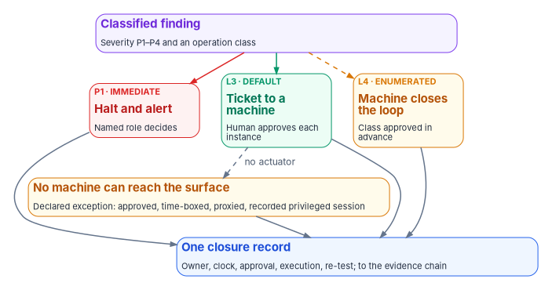

# Ticket-to-Machine, Module 7: Evidence for the ISSO {.unnumbered}

**Learning path:** [Ticket-to-Machine on ServiceNow and SailPoint](index.md) · Module 7 of 7 · 45 minutes · Guide [Gate 7](../../books/guides/ttm-servicenow-sailpoint.md#step-7-operate-the-tempo) · Workbook [Chapter 07](../../project-plans/developer-workbooks/ticket-to-machine/07-evidence-records.md)

**Watch:** the narrated deck for this module: [Deck](https://github.com/WhalerMike/modernization-workbook/releases/download/edition-2026.11.5/Training_TTM_Module_7.pptx) · [▶ Watch](../../presentations/watch.html?v=Training_TTM_Module_7_Narrated) (about 14 minutes, captions) · [MP4](https://github.com/WhalerMike/modernization-workbook/releases/download/videos-2026-10-23/Training_TTM_Module_7_Narrated.mp4) · [Script](https://github.com/WhalerMike/modernization-workbook/blob/main/presentations/training-ttm-module-7/Training_TTM_Module_7_Narration_Script.md) · [Captions](https://github.com/WhalerMike/modernization-workbook/blob/main/presentations/training-ttm-module-7/Training_TTM_Module_7_Narrated.vtt).

## Unit 1: Introduction

*3 minutes, with the objectives and prerequisites*

At the end of the month, your ISSO needs to show an assessor that every identity finding was owned, clocked, re-read and closed, that nothing was edited after it closed, and that nothing was quietly dropped. Ticket history and screenshots don't prove that. In this module you learn what Gate 7 runs and reports, then build and verify the evidence package for a period.

**The federal requirement.** The guide's [Gate 7 requirements and evidence table](../../books/guides/ttm-servicenow-sailpoint.md#step-7-operate-the-tempo) maps the tempo to NIST SP 800-53 CA-7, RA-7, CA-5 and AU-6. [Chapter 07's table](../../project-plans/developer-workbooks/ticket-to-machine/07-evidence-records.md#federal-requirements-and-evidence) maps the records and the package to CM-3, CA-7 and AU-9, and says what isn't evidenced yet. Each table's KSI column names the FedRAMP 20x Key Security Indicators to line your evidence up with; your cloud providers report against them, the agency doesn't.

### Learning objectives

In this module, you'll:

- Explain what Gate 7 schedules and reports to the governance board.
- Describe Book 13's evidence record, and which of its fields Pass 1 leaves empty, and why.
- Produce an evidence package for a period and continue its hash chain into the next.
- Verify a package, and explain how the verifier catches an edited or removed record.

### Prerequisites

- [Module 6](06-actuation-and-the-re-read.md).
- If you're an ISSO reviewer working only this module, read Module 1's [Unit 3](01-the-loop-and-the-typed-task.md#unit-3-the-identity-finding-and-its-contract) first.

## Unit 2: Operating the tempo

*8 minutes*

Once the loop runs, it runs on Book 13's tempo. Gate 7 schedules the reconciliation and the re-read client, reports five measures to the governance board, routes the identity fixes through the loop, exports the evidence and reviews each declared exception at its end date. Read:

- The guide's [Gate 7](../../books/guides/ttm-servicenow-sailpoint.md#step-7-operate-the-tempo) and its [evidence](../../books/guides/ttm-servicenow-sailpoint.md#evidence) section, for where each evidence-record field comes from on these products.
- [Book 13, Chapter 10: what the tempo shows leadership](../../books/b13-governance/10-ticket-to-machine.md#what-the-tempo-shows-leadership), for the five measures.

The guide's [Validate (G7)](../../books/guides/ttm-servicenow-sailpoint.md#validate-g7-tempo-and-evidence) step names the export as its automated check; Chapter 07 builds its ServiceNow half.

{#fig-ch10-tempo-paths fig-alt="A violet card at the top: a classified finding with a severity from P1 to P4 and an operation class. Three arrows lead to a row of three cards. A red arrow leads to a red card, P1 immediate, halt and alert, where a named role decides. A green arrow leads to a green card, L3 default, ticket to a machine, where a human approves each instance. A dashed amber arrow leads to an amber card, L4 enumerated, where the machine closes the loop for a class approved in advance. A dashed arrow labeled no actuator leads from the L3 card to an amber card below: no machine can reach the surface, so the fallback is a declared exception through an approved, time-boxed, proxied, recorded privileged session. All four paths lead to a blue card at the bottom: one closure record with the owner, clock, approval, execution and re-test, written to the evidence chain."}

## Unit 3: Evidence records and the package

*10 minutes*

`evidence_export.py` writes one record per closed or cancelled finding in Book 13's shape, runs four checks on each, and packages the period with a SHA-256 per file and a hash chain across records and periods. A verifier recomputes it all. Read:

- [Book 13, Appendix B: the evidence record](../../books/b13-governance/appendix-b-ticket-to-machine-reference.md#the-evidence-record).
- [Chapter 07: what this chapter adds](../../project-plans/developer-workbooks/ticket-to-machine/07-evidence-records.md#what-this-chapter-adds), for the four checks, the package, the verifier and how window adherence is measured.
- [Chapter 07: dangers](../../project-plans/developer-workbooks/ticket-to-machine/07-evidence-records.md#dangers).

## Unit 4: Exercise: Lab 1 (fixtures, no tenant)

*17 minutes*

<!-- labs:begin lab-1-commands (generated by scripts/generate_labs.py; not part of the reviewed page) -->

::: {.callout-note #lab-1-commands collapse="false" title="Every command in Lab 1"}
Every command in this lab, in order. Each step below says what it does and what to look for.

```powershell
Set-Location C:\FMWLabs\ticket-to-machine-code\servicenow-sailpoint

$Run = "C:\FMWLabs\results\ticket-to-machine-07-evidence-for-the-isso\lab1\$(Get-Date -AsUTC -Format 'yyyy-MM-ddTHHmmssZ')"
New-Item -ItemType Directory -Path $Run -Force | Out-Null
$Run

# Step 1
python -m pytest -q -p no:cacheprovider tests/python/test_evidence_export.py

# Step 2
python clients/python/evidence_export.py --records-json tests/fixtures/evidence/closed_records.json --out-dir "$Run\evidence" --period 2026-10 --generated-at 2026-11-01T12:00:00Z

# Step 2
python -c "import json, sys; r=json.loads(open(sys.argv[1], encoding='utf-8').readline()); [print(k, json.dumps(r[k])) for k in ('approval', 'executing_identity', 'what_ran')]" "$Run\evidence\records.jsonl"

# Step 3
python clients/python/evidence_export.py --verify-dir "$Run\evidence"

# Step 4
python clients/python/evidence_export.py --records-json tests/fixtures/evidence/closed_records.json --out-dir "$Run\evidence-2026-11" --period 2026-11 --previous-manifest "$Run\evidence\manifest.json" --generated-at 2026-12-01T12:00:00Z

# Step 4
python -m json.tool "$Run\evidence-2026-11\manifest.json"

# Step 5
python -c "import sys; p=sys.argv[1]; l=open(p).readlines(); del l[1]; open(p,'w').writelines(l)" "$Run\evidence\records.jsonl"
python clients/python/evidence_export.py --verify-dir "$Run\evidence"

# Step 6
Get-ChildItem C:\FMWLabs\results\ticket-to-machine-07-evidence-for-the-isso\lab1 -Name
```

:::

<!-- labs:end -->

You export October's closed findings, verify the package, chain November to it, then remove a record and verify again. [Chapter 07, Lab 1](../../project-plans/developer-workbooks/ticket-to-machine/07-evidence-records.md#lab-1-fixtures-no-tenant) explains each result.

Every step runs in PowerShell 7, the Python commands included, so you can follow it top to bottom in one window. Open **PowerShell 7** from the Start menu, then go to the kit's folder, where you unzipped it under [Get the code](index.md#get-the-code):

```powershell
Set-Location C:\FMWLabs\ticket-to-machine-code\servicenow-sailpoint
```

Then make this run's results folder. Its name is the date and time you start, in UTC, so each run keeps its own results and running the lab again never overwrites them:

```powershell
$Run = "C:\FMWLabs\results\ticket-to-machine-07-evidence-for-the-isso\lab1\$(Get-Date -AsUTC -Format 'yyyy-MM-ddTHHmmssZ')"
New-Item -ItemType Directory -Path $Run -Force | Out-Null
$Run
```

Expected output, where `<run>` is your start time, such as `2026-11-25T143005Z`:

```text
C:\FMWLabs\results\ticket-to-machine-07-evidence-for-the-isso\lab1\<run>
```

The run's date is only the folder's name. The data's dates are `--period` and `--generated-at`, which stay the same, so every run's results match this page. The results folder sits outside the kit, so unzipping a newer copy of the kit never touches it.

Prefer Git Bash? Go to the folder with `cd /c/FMWLabs/ticket-to-machine-code/servicenow-sailpoint`, make the run folder with `Run=/c/FMWLabs/results/ticket-to-machine-07-evidence-for-the-isso/lab1/$(date -u +%Y-%m-%dT%H%M%SZ); mkdir -p "$Run"`, and Steps 1 to 5 run the same there, with `/` in place of `\` after `$Run`; list the runs with `ls`. In a clone of the repository, use the `examples` folder of the same name.

1. Run the chapter's tests.

   ```powershell
   python -m pytest -q -p no:cacheprovider tests/python/test_evidence_export.py
   ```

   Expected: a line of 8 dots, then `8 passed in` and the time the run took, which differs from run to run.

2. Export October's closed findings.

   ```powershell
   python clients/python/evidence_export.py --records-json tests/fixtures/evidence/closed_records.json --out-dir "$Run\evidence" --period 2026-10 --generated-at 2026-11-01T12:00:00Z
   ```

   Expected output (the command exits 1, because three records have problems):

   ```text
   5 evidence records: 4 closed, 1 declared exception
   Window adherence: 2 of 3 closed inside the window
     IDF0000902: closed after its response window
     IDF0000903: evidence doesn't hash to u_evidence_hash: edited after closure, or cut short
     IDF0000905: closed without re-read evidence
   Chain head 144f5e8494281f83598d2fae5eacac12b9b271c90372c0e503aafc2bd4cf0623; written to C:\FMWLabs\results\ticket-to-machine-07-evidence-for-the-isso\lab1\<run>\evidence
   ```

   Print `approval`, `executing_identity` and `what_ran` from the first line of the package's `records.jsonl`:

   ```powershell
   python -c "import json, sys; r=json.loads(open(sys.argv[1], encoding='utf-8').readline()); [print(k, json.dumps(r[k])) for k in ('approval', 'executing_identity', 'what_ran')]" "$Run\evidence\records.jsonl"
   ```

   Expected output:

   ```text
   approval {"reason": "not recorded in Pass 1: the change or catalog record that authorizes and runs the fix is a later pass", "value": null}
   executing_identity {"reason": "not recorded in Pass 1: the change or catalog record that authorizes and runs the fix is a later pass", "value": null}
   what_ran {"reason": "not recorded in Pass 1: the change or catalog record that authorizes and runs the fix is a later pass", "value": null}
   ```

3. Verify the package as the ISSO would.

   ```powershell
   python clients/python/evidence_export.py --verify-dir "$Run\evidence"
   ```

   Expected output:

   ```text
   Package holds: every file matches the manifest and the chain is unbroken.
   ```

4. Start November's chain from October's head.

   ```powershell
   python clients/python/evidence_export.py --records-json tests/fixtures/evidence/closed_records.json --out-dir "$Run\evidence-2026-11" --period 2026-11 --previous-manifest "$Run\evidence\manifest.json" --generated-at 2026-12-01T12:00:00Z
   ```

   Expected output (the command exits 1, for the same three records):

   ```text
   5 evidence records: 4 closed, 1 declared exception
   Window adherence: 2 of 3 closed inside the window
     IDF0000902: closed after its response window
     IDF0000903: evidence doesn't hash to u_evidence_hash: edited after closure, or cut short
     IDF0000905: closed without re-read evidence
   Chain head afa59e0f3038613ba36eb4a748da38bb3e76e8427d04038162d08fbdcc167bd1; written to C:\FMWLabs\results\ticket-to-machine-07-evidence-for-the-isso\lab1\<run>\evidence-2026-11
   ```

   Print November's manifest:

   ```powershell
   python -m json.tool "$Run\evidence-2026-11\manifest.json"
   ```

   Expected output:

   ```text
   {
       "chain_head": "afa59e0f3038613ba36eb4a748da38bb3e76e8427d04038162d08fbdcc167bd1",
       "chain_previous": "144f5e8494281f83598d2fae5eacac12b9b271c90372c0e503aafc2bd4cf0623",
       "files": {
           "records.jsonl": "4d5faffc59d3493b16f2545472833c8c0e808f13a99e32cf296fa57293f14676",
           "summary.json": "b6ebca4686cbd991cc197571db2f987724eb583c627e66197c4b31b0de270396"
       },
       "generated_at": "2026-12-01T12:00:00Z",
       "generator": "evidence_export.py/0.1.0-pass1",
       "period": "2026-11",
       "schema": "book13-evidence-record/identity-finding/v1"
   }
   ```

   `chain_previous` is October's head, `144f5e84...`.

5. Remove one record from October's package, and verify again.

   ```powershell
   python -c "import sys; p=sys.argv[1]; l=open(p).readlines(); del l[1]; open(p,'w').writelines(l)" "$Run\evidence\records.jsonl"
   python clients/python/evidence_export.py --verify-dir "$Run\evidence"
   ```

   Expected output (the second command exits 1):

   ```text
     records.jsonl: SHA-256 doesn't match the manifest
     line 2 (IDF0000903): prev_sha256 doesn't match the line before
   Package does not hold: 2 problem(s).
   ```

6. Nothing to clean up: the kit's folder is as you unzipped it, and this run's results stay in `$Run`. List every run you've made of this lab:

   ```powershell
   Get-ChildItem C:\FMWLabs\results\ticket-to-machine-07-evidence-for-the-isso\lab1 -Name
   ```

   Expected output: one line per run, oldest first, the last one this run:

   ```text
   <run>
   ```

**Check your work:** you can produce a package for a period, say what its problems are, and show whether a package you received still holds.

## Unit 5: Exercise: Lab 2 (your test instance)

*Not timed. Not run by the authors.*

Create the evidence reader and check its role against the kit's call list, export live from your developer instance, check the date format of `due` and `finished`, and verify the package. Follow [Chapter 07, Lab 2](../../project-plans/developer-workbooks/ticket-to-machine/07-evidence-records.md#lab-2-a-servicenow-developer-instance).

- **You need:** the developer instance from the earlier modules, with at least one finding closed in Module 6's Lab 2.
- **Back it out:** step 5 deletes `out/evidence-live` and the evidence reader's OAuth client, user and role.

## Unit 6: Knowledge check

*5 minutes*

1. The export over the fixtures exits 1. Why?
   a. The fixtures are malformed.
   b. Three records have problems, and the run says so instead of producing a clean-looking package.
   c. The period has no closed findings.

2. In each record, `approval`, `executing_identity` and `what_ran` are `null`. Why?
   a. Pass 1 doesn't actuate, so the record that would hold them is a later pass; each null carries its reason.
   b. The evidence reader can't read those fields.
   c. Book 13's evidence record doesn't include them.

3. How does the verifier catch a record removed from `records.jsonl`?
   a. It compares the record count with the ServiceNow instance.
   b. The file's SHA-256 no longer matches the manifest, and the next line's `prev_sha256` no longer matches the line before it.
   c. It can't; a removed record is only found by an assessor.

4. How does Chapter 07 measure window adherence?
   a. Open findings inside their window over all open findings.
   b. Closures inside the window over closures judged.
   c. The share of findings with a due date.

::: {.callout-tip collapse="true"}
## Check your answers
1. **b.** IDF0000902 closed late, IDF0000903's evidence was edited, and IDF0000905 closed without evidence. See step 2 of [Chapter 07, Lab 1](../../project-plans/developer-workbooks/ticket-to-machine/07-evidence-records.md#lab-1-fixtures-no-tenant).
2. **a.** The record says so rather than leaving the fields out or filling them. See [Chapter 07: what this chapter adds](../../project-plans/developer-workbooks/ticket-to-machine/07-evidence-records.md#what-this-chapter-adds).
3. **b.** See step 5 of [Chapter 07, Lab 1](../../project-plans/developer-workbooks/ticket-to-machine/07-evidence-records.md#lab-1-fixtures-no-tenant).
4. **b.** Not a ratio of open findings that improves as new ones arrive. See [Chapter 07: what this chapter adds](../../project-plans/developer-workbooks/ticket-to-machine/07-evidence-records.md#what-this-chapter-adds).
:::

## Unit 7: Summary

*2 minutes*

You learned what Gate 7 runs and reports, exported a period's closed findings as Book 13 evidence records, chained one period to the next, and verified a package the way an ISSO does.

**Evidence an ISSO keeps from this module:** the scheduled run outputs and the five measures, the window adherence and overdue list, the exception register and the monthly package and its review (Gate 7); the records, the manifest and the chain, verified with `--verify-dir`, and `summary.json` (Chapter 07). Before shipping, work through the [Chapter 07 checklist](../../project-plans/developer-workbooks/ticket-to-machine/07-evidence-records.md#checklist).

**You've finished the path.** What the workbook doesn't build yet, and why, is at the end of its [chapters table](../../project-plans/developer-workbooks/ticket-to-machine/index.md#chapters-table).

::: {.callout-tip}
## Continue the path
[Previous: Module 6](06-actuation-and-the-re-read.md) · [Back to the learning path](index.md)
:::
