# Table of contents {#table-of-contents .TOC-Heading}

# Modernization Journey

## Executive Summary

Federal agency IT architecture has evolved through four historical eras
--- stark mainframe centralization, distributed decentralization,
security-driven complexity, and cloud-forced fragmentation --- without
ever replacing the single source of truth the mainframe originally
provided. The result: regional identity domains that never reconciled,
duplicate payments, records that cannot be traced to an authoritative
source, and a session-based authentication model (Kerberos/Active
Directory) that breaks under the physics of distance and the security
architecture layered on top of it.

This is not a technology gap. It is an architecture gap, and it is well
understood: commercial industries --- banking, healthcare, manufacturing
--- hit and solved this same problem between roughly 2014 and 2022. The
physics is fixed: bandwidth does not reduce latency, and no amount of
infrastructure spend changes the propagation floor of light through
fiber. What changes the outcome is architecture --- separating the
system of record from the in-path enforcer, making the network
application-aware rather than packet-aware, replacing session-based
identity with token-based identity, governing infrastructure actively
rather than assessing it periodically, and reducing the number of
synchronous round-trips an application makes to its data, including at
the mainframe boundary itself.

FedRAMP's 20x Consolidated Rules, phasing in through 2026 and mandatory
January 1, 2027, convert this from an architectural preference into a
compliance deadline: continuous, machine-readable evidence replaces
periodic assessment, and agencies that have not made this transition
will not be able to produce it. The path forward is five principles,
each traced to a specific NIST, OMB, CISA, or FedRAMP requirement ---
this is vendor-neutral, product-neutral guidance, not a pitch for any
specific platform. Concrete next steps are laid out in the **Call to
Action** at the end of this document.

+-----------------------------------------------------------------------+
| 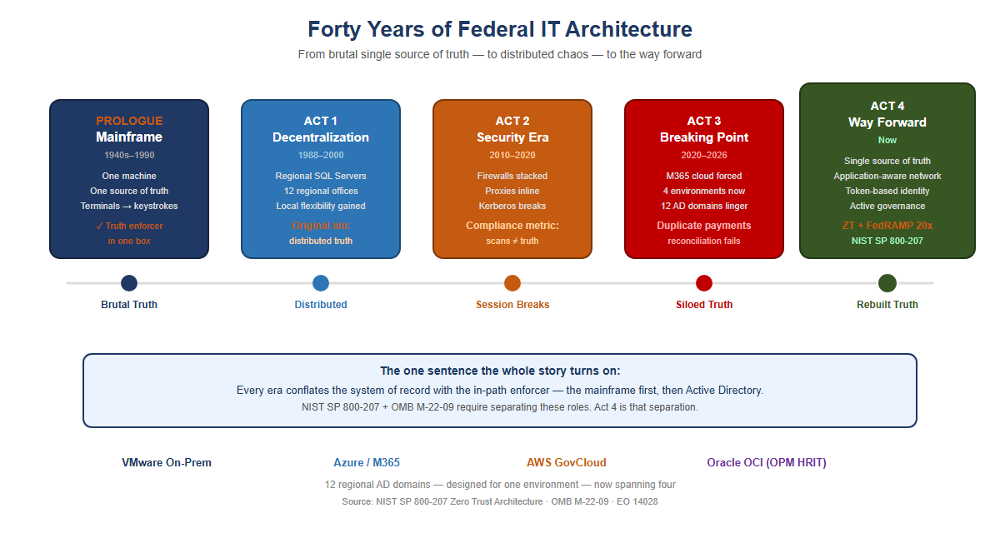{width="5.833333333333333in" |
| height="3.111111111111111in"} |
| |
| Figure 1: Forty years of federal IT architecture in one view --- from |
| the mainframe's stark single source of truth, through |
| decentralization, the security era, and the breaking point, to the |
| way forward |
+-----------------------------------------------------------------------+

## Prologue --- The Mainframe Era (1940s--1990s)

Your agency's entire operation ran on mainframes. IBM systems, mostly.
One massive computer in a locked room. Everything happened there: all
the data, all the logic, all the state.

Users didn't have computers. They had **terminals** --- green screens,
keyboards. A terminal was a dumb device that sent keystrokes to the
mainframe and received screen refreshes back. Text-based, synchronous,
simple.

The model was starkly elegant: **one source of truth.** The mainframe
*was* the truth. When you asked "how many people received benefits this
month," there was one answer, and it came from one place. No ambiguity.
No regional variations. No hidden discrepancies.

Security was implicit. If you weren't sitting at a terminal physically
connected to that mainframe room, you couldn't access anything. **The
network was the security perimeter.** Control physical access, and you
controlled everything.

And crucially: the machine that *held* the truth was the same machine
that *enforced* access to it. Truth and enforcement lived in one box.
Remember that; it is the seed of everything that follows.

+-----------------------------------------------------------------------+
| 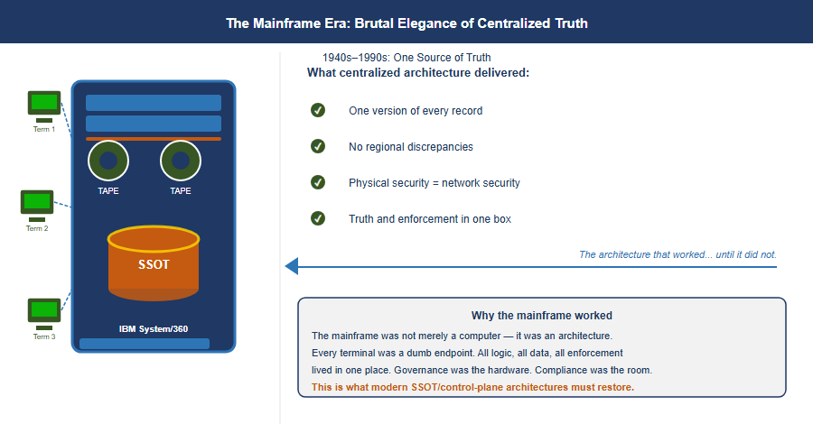{width="5.833333333333333in" |
| height="3.111111111111111in"} |
| |
| Figure 2: The Mainframe Era: stark elegance of centralized truth --- |
| an IBM System/360 with three terminals wired to a single SSOT |
| database cylinder, plus the four benefits centralized architecture |
| delivered |
+-----------------------------------------------------------------------+

## Act 1 --- The Great Decentralization (Late 1980s--2000)

By the late 1980s, the entire world was rejecting the mainframe model
--- not because mainframes stopped working, but because the economics
broke and the technology changed.

Minicomputers had already proven you didn't need one godlike machine.
Then PCs arrived. Networks got faster. The vision became irresistible:
put a SQL Server in every region. Put applications in every office.
Spread programming expertise to the edges. Let local teams build
solutions for their local problems --- because they understood those
problems better than Washington ever could.

For your agency, this was revolutionary. Twelve regional offices could
each have their own database administrators, their own application
developers, their own tools tailored to how their states and territories
worked.

**But here is where the architecture broke.**

With the mainframe, there was one source of truth. One database. One
version of the record. The moment you put SQL Servers in twelve regions,
you lost that. Now California had its own database. Massachusetts had
its own. New York had its own. And they didn't always talk to each other
--- or they did, but inconsistently. Regional systems evolved their own
schemas, their own business logic, their own definitions of what a
"benefit" even meant.

+-----------------------------------------------------------------------+
| 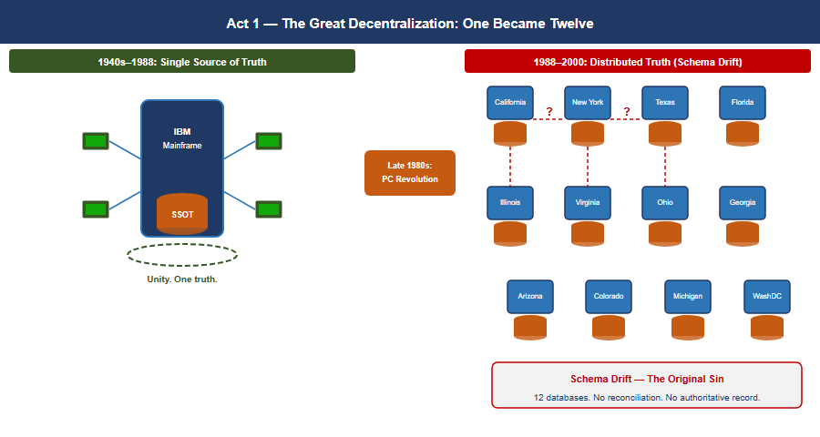{width="5.833333333333333in" |
| height="3.111111111111111in"} |
| |
| Figure 3: Act 1 --- The Great Decentralization: one mainframe became |
| twelve regional databases, with schema drift appearing between |
| adjacent silos and the original sin of distributed truth called out |
| below |
+-----------------------------------------------------------------------+

The vision of distributed intelligence was real and good. But it came at
a cost: **distributed truth.** And nobody replaced the single source of
truth that the mainframe had given you.

That became the original sin --- the moment the architecture started to
drift. The regional variations that seemed like flexibility in 1993
would calcify into incompatible silos by 2020.

## Act 2 --- When Security Ate the Architecture (2010--2020)

Around 2010, your agency started consolidating compute. Simultaneously
--- and this is the critical inflection --- **cybersecurity became a
board-level imperative.** Not just "have a firewall." Defense-in-depth.
Layered security. Multiple inspection points.

**But here is the problem:** the tools chosen to enforce security were
fundamentally incompatible with the session-based client-server model
your entire infrastructure depended on.

Load balancers became inline proxies. Intrusion detection systems were
inserted into the traffic path. Multiple NAT sessions. Firewalls stacked
on firewalls. Every packet from a field office to a regional data center
had to traverse security devices designed to *break* sessions --- to
inspect, decrypt, re-encrypt, verify, block.

+-----------------------------------------------------------------------+
| 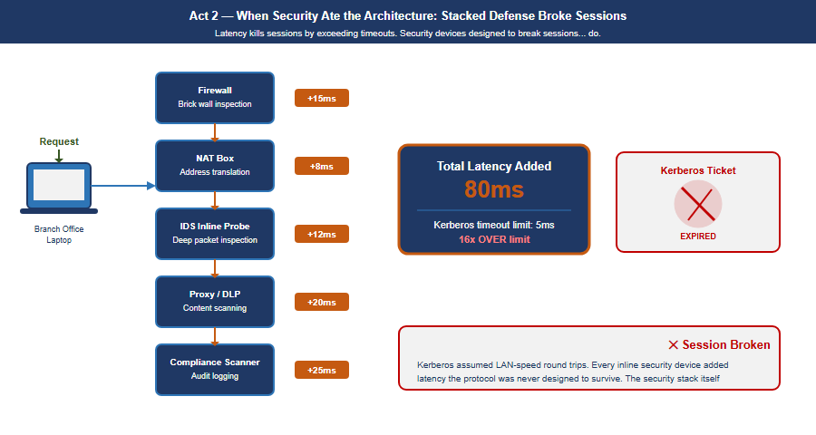{width="5.833333333333333in" |
| height="3.111111111111111in"} |
| |
| Figure 4: Act 2 --- When Security Ate the Architecture: a |
| branch-office request traverses five stacked security devices |
| (firewall, NAT, IDS, proxy/DLP, compliance scanner), each adding |
| latency, arriving at 80ms total against a 5ms Kerberos timeout, with |
| the expired ticket and broken session called out on the right |
+-----------------------------------------------------------------------+

Active Directory Kerberos tickets have a lifespan --- a default TGT
lives ten hours with seven-day renewal, and service tickets 600 minutes.
They are **not** bound to a network path. Windows KILE ships
`ClientIpAddresses = 0`, so client addresses are not written into the
ticket at all, and Microsoft's stated reason is verbatim *"because of
Dynamic Host Configuration Protocol and network address translation
issues"* --- tolerating a changed source address is a design property of
the deployed protocol. Where RFC 4120's optional `caddr` field *is*
populated, it carries addresses the **client** supplies in the AS-REQ
rather than the source IP the KDC observes, and the check is performed
by the **application server** (`KRB_AP_ERR_BADADDR`), not by the KDC on
a TGS-REQ. SNAT at a PoP writes nothing into a ticket, and Kerberos FAST
(RFC 6113) is pre-authentication armouring, unrelated to source-IP
binding.

What distance actually costs is narrower, and the argument is stronger
for being stated correctly: the **DC-dependent operations**. Initial TGT
acquisition at logon, SYSVOL/GPO retrieval, password changes, and hybrid
Entra join registration all require reaching a domain controller, and
Microsoft documents the last of these as needing line-of-sight to an
on-premises DC. Stack enough inline latency in front of those and logons
crawl, GPO processing stalls, and the estate feels exactly the pain this
paper describes --- without any ticket being invalidated by NAT.

> **The physics that cannot be negotiated:** Portland to Washington is
> approximately 4,500 km in a straight line. Actual fiber routing adds
> roughly 20%, bringing the real fiber distance to approximately 5,400
> km. At 200,000 km/second --- the speed of light through glass fiber
> --- that distance sets an unavoidable propagation floor of 27 ms
> one-way, 54 ms round-trip minimum, before any queue delay, security
> inspection, or application processing. Active Directory has **no
> millisecond latency requirement** --- the widely-quoted five-minute
> Kerberos figure is clock-skew tolerance, not a latency budget --- but
> the DC-dependent operations are the ones that feel this distance:
> initial TGT acquisition at logon, SYSVOL/GPO retrieval, password
> changes, and hybrid Entra join registration, each of which Microsoft
> documents as requiring line-of-sight to an on-premises domain
> controller. **No amount of bandwidth changes this. Bandwidth is
> volume. Latency is distance. You cannot buy your way out of
> geography.**

### Asymmetric routing: the second session killer

Latency kills sessions by exceeding protocol timeouts. A second
mechanism, equally destructive and entirely independent of latency,
operated simultaneously: **asymmetric routing.** It occurs when the
outbound path of a session and the return path traverse different
physical or logical routes through stateful network devices. A stateful
firewall maintains a session table keyed on the five-tuple. When a SYN
packet arrives, the device creates an entry expecting the SYN-ACK to
return through it. When the SYN-ACK returns via a different path, that
second device sees a SYN-ACK with no corresponding session entry --- it
drops it as unsolicited. The TCP three-way handshake never completes.

**Asymmetric routing vs. latency: independent killers that compound.**
Latency kills sessions by exceeding protocol timeouts. Asymmetric
routing kills sessions by preventing TCP from completing its three-way
handshake at all --- even with perfect, sub-millisecond latency on both
paths. In environments where both conditions exist simultaneously ---
the federal standard --- they compound.

**How SD-WAN overlay eliminates asymmetric routing:** The SD-WAN overlay
tunnel is established between two edge devices as a single logical
connection. Inside the tunnel, individual packets may physically
traverse any available path. But at the application layer, both
directions of every session enter and exit the same SD-WAN edge device.
The stateful inspection happens at the tunnel endpoint, which sees both
directions. Asymmetric physical routing below the tunnel is structurally
removed.

## Act 3 --- The Breaking Point (2020--2026)

Then M365 happened. Microsoft forced the issue. Your agency migrated to
Microsoft 365 --- Exchange Online, Teams, SharePoint. Suddenly your
email and collaboration lived in Azure, managed by Microsoft,
unreachable by your session-based authentication model.

And here is the critical moment: the agency still had **twelve regional
Active Directory domains.** Still had the OU tree structure designed for
when compute lived regionally. Still had MPLS circuits connecting field
offices to regional data centers that were increasingly just logical
boundaries, not physical anchors.

+-----------------------------------------------------------------------+
| 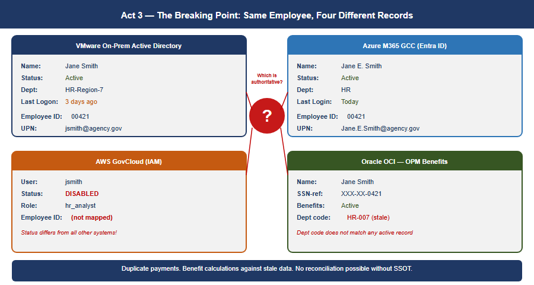{width="5.833333333333333in" |
| height="3.111111111111111in"} |
| |
| Figure 5: Act 3 --- The Breaking Point: the same employee, Jane |
| Smith, shows four contradictory records across VMware on-prem AD, |
| Azure M365 GCC, AWS GovCloud IAM, and Oracle OCI OPM Benefits, |
| converging on a red question mark asking which is authoritative |
+-----------------------------------------------------------------------+

Now a field office in Portland authenticates to a regional DC physically
in Washington. An application running on VMware queries a service in
AWS. Email lives in Azure. The session-based contract --- the assumption
that client and server are talking synchronously over a trusted link ---
is fracturing across three environments and an upcoming fourth.

> **The hard realization.** The bulk of mission compute still runs on
> VMware on-premises. Red Hat workloads are moving to AWS GovCloud.
> Email and collaboration are in Azure. OPM HRIT on Oracle OCI is the
> next boundary arriving. Identity is still in twelve regional AD
> domains designed for a world where all four of those environments were
> the same room. The infrastructure could *do* things but could not
> *verify* them across that boundary. With program integrity now a
> national imperative, that is no longer acceptable.

Meanwhile, the regional variations that started in Act 1 had calcified
into institutional silos. California's benefit calculation differed from
Massachusetts's. Regional databases had evolved incompatible schemas.
And because single source of truth had never been restored, **nobody
could see the discrepancies.** The fragmentation that made the system
agile in 1995 had become the hiding place for systemic error ---
duplicate payments across states, records that should have been closed
years ago, reconciliations nobody could complete.

## The Physics Argument Decision Makers Have Not Heard

When a decision maker hears "the MPLS hairpin is causing latency
problems," the response is almost always: "add a Direct Internet Access
circuit at the branch." DIA eliminates the geographic hairpin. That
improvement is real.

And then leadership will conclude that the network problem is solved.
**It is not.** DIA is a pipe. It is a better-positioned pipe than the
MPLS circuit it supplements, but it is still a single, unintelligent
pipe with no visibility into what is happening on it, no ability to
respond when it degrades, and no way to know whether it is actually the
best available path to your destination.

+-----------------------------------------------------------------------+
| {width="5.833333333333333in" |
| height="3.013888888888889in"} |
| |
| Figure 6: Physics the network cannot escape: terrestrial fiber at |
| 200,000 km/s and 27ms one-way propagation versus LEO satellite at the |
| vacuum speed of light, with a one-way latency comparison bar chart |
| across MPLS, DIA, 5G MEC, and Starlink paths, and the 5G |
| architectural advantage explained on the right |
+-----------------------------------------------------------------------+

### Why satellite latency is no longer what you remember

The satellite internet that federal IT professionals evaluated and
rejected for decades was geostationary (GEO) --- satellites parked at
35,786 km altitude. The physics are unforgiving: approximately 238 ms of
one-way propagation delay. No enterprise application tolerates this
gracefully. That ruling does not apply to LEO.

Starlink and similar Low Earth Orbit constellations operate at
approximately 550 km altitude. Current practical end-to-end latency:
**20--40 ms and improving.** That places LEO satellite in the same
competitive range as broadband DIA circuits.

**The vacuum advantage:** Light travels through optical fiber at
approximately 200,000 km/second --- two-thirds the speed of light in
vacuum, due to the refractive index of glass. Light travels through the
vacuum of space at 299,792 km/second. For the same physical path length,
a signal through space arrives **50% sooner** than a signal through
fiber. This is not a technology gap that better fiber will close. It is
physics.

For the longest domestic paths --- Pacific Northwest to mid-Atlantic ---
the terrestrial fiber route may traverse 4,000 km or more of physical
cable. The LEO vacuum path traverses 550 km up, geometrically direct
inter-satellite laser link hops through space, and 550 km down at
propagation speed 50% higher than fiber. **Under the right conditions
the satellite path is not a compromise --- it is the physics-optimal
path.**

### 5G: lower latency through architecture, not just physics

5G reduces latency through two distinct mechanisms.

**The radio mechanism:** 5G's shorter radio frame duration (0.125 ms
slot time versus 1 ms in LTE) reduces the fundamental waiting time.
Practical mid-band sub-6 GHz 5G achieves 5--10 ms across the air
interface.

**The architectural mechanism:** 5G's Control and User Plane Separation
(CUPS) and Multi-access Edge Computing (MEC) allow traffic to break out
of the carrier's network locally --- at the cell tower or a nearby edge
node --- rather than backhauling to a central core. This is particularly
significant for federal field offices in locations where broadband ISP
options are limited.

## What Application-Aware Networking Actually Means

The phrase "application-aware networking" appears in policy documents
and vendor briefings without ever being explained in plain terms. Here
is the plain version.

**Your current network sees a packet.** Specifically, it sees: source IP
address, destination IP address, source port, destination port,
protocol. It has no idea who sent the packet, what application it
belongs to, whether the user is who they claim to be, whether the device
is managed and compliant, or whether the data being accessed is the data
policy says they should access. It sees a packet. It checks a rule. It
allows or denies.

**Application-aware networking sees a transaction.** Specifically, it
sees: a specific employee, on a managed government laptop that passed
compliance check this morning, running Microsoft Teams, requesting a
SharePoint document classified as internal, from an office location that
is consistent with their normal work pattern, at a time of day that is
expected, to access a file that their role and organizational attributes
authorize them to access. The network enforces policy against the full
context of the transaction --- not against a packet.

+-----------------------------------------------------------------------+
| 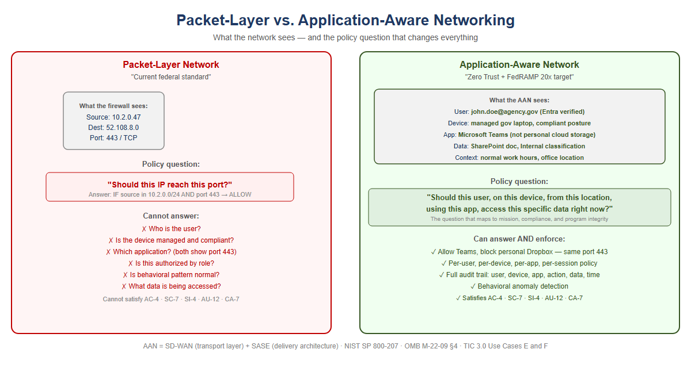{width="5.833333333333333in" |
| height="3.111111111111111in"} |
| |
| Figure 7: Packet-layer network versus application-aware network: the |
| packet-layer side can only answer 'should this IP reach this port?' |
| and lists six questions it cannot answer, while the application-aware |
| side answers the full transaction-context policy question and lists |
| what it can enforce |
+-----------------------------------------------------------------------+

### What SD-WAN overlay does with new transports

The overlay treats 5G and LEO satellite exactly the same way it treats
MPLS and broadband DIA: as transports to probe continuously, measure
precisely, and steer traffic across based on what is performing best for
each application class at each moment. The agency does not need to
decide in advance that Starlink is better than DIA for Teams calls. The
overlay makes that determination empirically, in real time, and changes
it when conditions change.

## SD-WAN Active-Active Multipath

An SD-WAN overlay runs continuous, simultaneous probes on every
available transport using sub-second probe intervals. The probes measure
three things on each path independently: **latency**, **jitter**, and
**packet loss**. When a path degrades, the overlay knows within seconds.

+-----------------------------------------------------------------------+
| 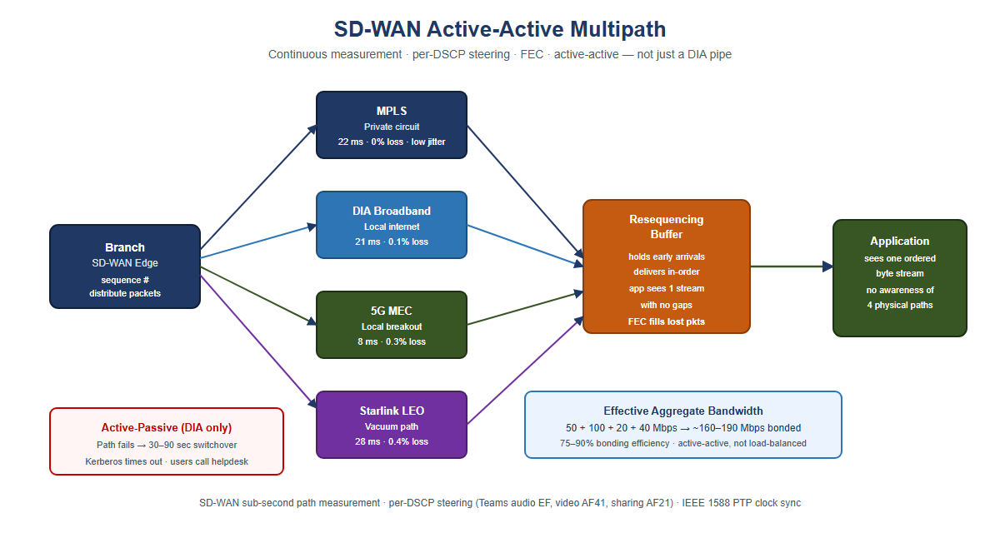{width="5.833333333333333in" |
| height="3.111111111111111in"} |
| |
| Figure 8: SD-WAN active-active multipath: a branch edge distributes |
| sequenced packets across MPLS, DIA broadband, 5G MEC, and Starlink |
| LEO simultaneously into a resequencing buffer with FEC, delivering |
| one ordered byte stream to the application, versus an active-passive |
| DIA-only fallback with a 30-90 second switchover |
+-----------------------------------------------------------------------+

### Forward Error Correction: recovering toward the physics floor

**Forward Error Correction (FEC)** sends redundant data alongside the
primary transmission. The receiver can reconstruct a lost packet from
the redundant data without any retransmission. The application
experiences only the propagation delay --- the physics floor --- with no
retransmission penalty. FEC does not make the signal travel faster. It
removes the latency tax that lossy paths impose on top of the physics
minimum.

### Active-active vs. active-passive: the failover that is not a failover

Traditional WAN design is **active-passive**: MPLS is the primary
circuit, DIA broadband is the standby. During switchover --- typically
30--90 seconds --- authentication sessions time out. VPN tunnels drop.
Users re-authenticate.

**Active-active multipath** carries traffic on all available paths
simultaneously, all the time. When a path fails or degrades, the
remaining paths absorb its load within milliseconds. A Kerberos ticket
exchange that is mid-flight when a path fails is retransmitted
automatically. Under active-passive failover, the client times out after
several seconds --- this is the "logon takes 45 seconds" symptom field
offices report. Under active-active multipath, the request was already
distributed across multiple paths. The user experiences a 50 ms pause
rather than a 30-second timeout.

### Why "DIA to M365 will solve it" is half the answer

 -----------------------------------------------------------------------
 Capability DIA Circuit Only SD-WAN Intelligent
 Overlay
 ----------------------- ----------------------- -----------------------
 Eliminates MPLS Yes Yes
 geographic hairpin to 
 cloud 

 Visibility into path None Continuous,
 quality (latency, per-transport
 jitter, loss) 

 Responds to path None Sub-second reweighting
 degradation before 
 users notice 

 Splits a single One path only Active-active multipath
 conversation across with resequencing
 multiple paths 
 simultaneously 

 Aggregates bandwidth One path only Bonded capacity = sum
 from all transports of all paths

 Routes audio, video, None Per-stream application
 and data streams of one steering
 call to different paths 

 Fails over within 30--90 second Seamless --- all paths
 milliseconds without switchover already active
 dropping sessions 

 Uses 5G local breakout None Measured and included
 when faster than in multipath pool
 wireline 

 Uses LEO satellite None Measured and included
 vacuum path when faster in multipath pool
 than fiber 

 Applies FEC to recover None Per-transport FEC
 toward physics minimum 
 on lossy paths 

 Provides audit trail of None Every decision is a
 path decisions (TIC 3.0 logged event
 / AU-12) 
 -----------------------------------------------------------------------

### What the commercial world figured out --- and when

 -------------------------------------------------------------------------
 Current Federal When Commercial What Replaced It Why
 Practice Moved On 
 ----------------- ----------------- ------------------- -----------------
 MPLS for all 2014--2018 SD-WAN on Cost,
 branch broadband + LTE flexibility,
 connectivity local breakout

 Central internet 2016--2019 Local internet Cloud apps do not
 breakout through breakout at branch need to go
 DC through DC

 VPN as primary 2019--2021 ZTNA / SASE overlay Per-app access
 remote access replaces
 per-network trust

 Windows DNS / 2017--2020 Unified DDI DNS became a
 per-site DNS (InfoBlox, BlueCat) security control
 servers surface

 DHCP as invisible 2017--2020 IPAM as inventory Zero Trust
 per-site utility and compliance requires
 evidence authoritative
 device inventory

 Network-layer 2018--2022 Application-layer Packets carry no
 firewall as enforcement (SASE, useful identity
 primary security ZTNA) or intent

 Session-based 2015--2019 Token-based (OAuth Sessions break
 application 2.0 / OIDC) across WAN;
 authentication tokens are
 stateless
 -------------------------------------------------------------------------

> **This is not a forecast.** Every item in this table is a completed
> transition in the commercial sector. The federal government is
> executing these transitions now, under compliance mandates --- Zero
> Trust Executive Order, TIC 3.0, FedRAMP 20x --- that commercial
> enterprises were not subject to. That makes the federal transition
> harder, not easier. The path is known. The delay has a cost.

## Why Direct Internet Access Alone Does Not Satisfy NIST Controls

When agencies present DIA as a modernization achievement, they have
solved a connectivity problem. They have not solved a compliance
problem. DIA is a transit service --- a pipe to the internet. It
satisfies exactly one federal requirement: it provides network
connectivity to internet-hosted services. Every security control
governing what traverses that connectivity must be applied by a separate
control stack. The pipe itself contributes nothing to compliance.

 -----------------------------------------------------------------------
 NIST Control What It Requires What Provides It
 ----------------------- ----------------------- -----------------------
 AC-4 Information Flow Application-layer CASB in SASE stack
 Enforcement enforcement identifying 
 the destination 
 application, not just 
 the destination IP 

 SC-7 Boundary Application-layer SWG / FWaaS in SASE
 Protection inspection; detect C2 stack
 on port 443, 
 exfiltration in DNS 

 SC-8 Transmission Network-layer SD-WAN IPsec tunnel ---
 Confidentiality and encryption DIA alone encrypts
 Integrity nothing

 SI-3 Malware Protection Inline malware SWG with SSL inspection
 inspection at in SASE stack
 appropriate locations 

 SI-4 System Monitoring Application-layer AAN application
 telemetry --- user, telemetry
 device, app, data, 
 behavioral pattern 

 AU-2 / AU-12 Audit User Z on device D Application-layer
 Events / Audit Record accessed application A, logging via AAN
 Generation performed action V on 
 data type C --- not 
 just IP flows 

 CA-7 Continuous Per-session: identity AAN and SASE stack
 Monitoring verified, device 
 posture, access 
 consistent with policy 
 --- machine-readable 
 -----------------------------------------------------------------------

> **The precise relationship: DIA enables compliance; AAN and SASE
> achieve it.** DIA provides the connectivity that makes cloud-hosted
> services reachable without the MPLS hairpin. It is necessary. It is
> not sufficient. When an agency presents "we have DIA" as a compliance
> achievement, the correct technical response is: **you have the pipe.
> Where is the control stack?**

## Act 4 --- The Way Forward: Application-Aware Modernization

You can't fix this by patching the old model. You can't bolt Zero Trust
onto a Kerberos-in-MPLS architecture. You can't add more proxies. The
only way forward is to rebuild the foundation around one structural move
and five principles that follow from it.

The structural move is the one sentence this whole story turns on.
Active Directory conflated **the directory (truth)** with **the domain
controller (the in-path enforcer)**. NIST SP 800-207 and OMB M-22-09
require the modern architecture to keep these separate: the governance
layer holds and reconciles authoritative state, while identity
providers, enforcement points, and data platforms remain the runtime
data planes.

+-----------------------------------------------------------------------+
| 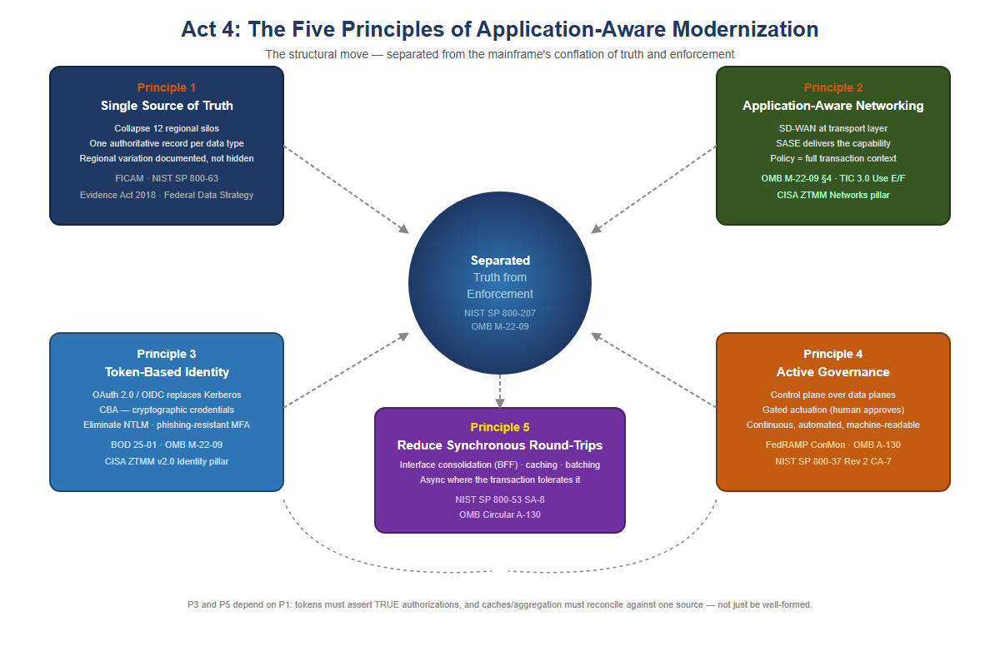{width="5.833333333333333in" |
| height="3.888888888888889in"} |
| |
| Figure 9: Act 4: the five principles of application-aware |
| modernization, arranged around a central hub reading 'Separated: |
| Truth from Enforcement' --- Single Source of Truth, Application-Aware |
| Networking, Token-Based Identity, Active Governance, and Reduce |
| Synchronous Round-Trips |
+-----------------------------------------------------------------------+

### Principle 1 --- Restore a Single Source of Truth

Every data type the federal government manages must have **one
authoritative source.** Not twelve regional databases with eventual
consistency. Not caches that drift. One source, cryptographically
verifiable, auditable: you must know where every piece of data came
from, who accessed it, when, and why.

For your agency, that means collapsing the twelve regional silos into a
unified model --- not by erasing regional autonomy, but by making it
**transparent.** If California's benefit calculation differs from
Massachusetts's, that difference is documented, auditable, and traceable
back to policy, not hidden in schema variation.

The **Federal Identity, Credential, and Access Management (FICAM)
Architecture** and NIST SP 800-63 require that every governed object
carry a complete, authoritative set of identity attributes derived from
authoritative sources such as HR systems and device management
platforms. The **Evidence Act (2018)** and the **Federal Data Strategy**
mandate that those attributes trace back to a single authoritative
system of record for each data type, with a documented data lineage from
source to decision.

+-----------------------------------------------------------------------+
| 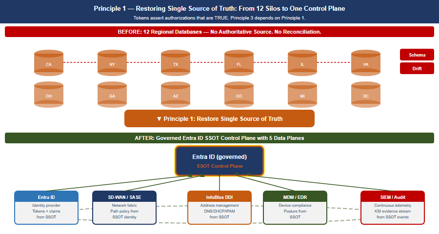{width="5.833333333333333in" |
| height="3.111111111111111in"} |
| |
| Figure 10: Principle 1 --- SSOT Restoration: twelve regional silos |
| with schema drift and duplicate/name-collision arrows collapse into a |
| governed Entra ID SSOT control plane with five data planes (identity, |
| network, DDI, device, SIEM) |
+-----------------------------------------------------------------------+

### Principle 2 --- Application-Aware Networking and Cybersecurity

You can't enforce security at the network layer anymore. The network is
the Internet now. The only way to know whether a transaction is
legitimate is to understand what the application is doing: *Is this user
authorized to access this data? Is the data being accessed the data
policy says they should access? Is the request from a compliant device,
from a location that makes sense?*

That is application-aware networking. **NIST SP 800-207's** seven zero
trust tenets require exactly this: all communication secured regardless
of network location; access determined per-session with least privilege;
integrity and behavior monitored continuously. **OMB M-22-09** §4
requires agencies to implement network visibility and traffic inspection
that operates at the application layer, not the IP/port layer. **TIC
3.0** publishes four use cases --- Traditional TIC, Branch Office (v1.0,
April 2021), Remote User (v2.2, July 2025) and Cloud (v1.2, July 2025).
The Branch Office and Remote User cases describe application-layer
visibility at the policy enforcement point, but TIC 3.0 is guidance
rather than a mandate and prescribes no specific product class.

**Application-Aware Networking framework alignment:**

- **SD-WAN is AAN at the transport layer.** SD-WAN achieves
 application awareness through DPI or FQDN/signature-based
 identification, then applies per-application path selection
 dynamically based on real-time path quality measurement. SD-WAN
 alone does not enforce access control based on user identity or
 device posture. That requires SASE.
- **SASE is the delivery architecture that completes AAN.** SASE
 converges SD-WAN with cloud-delivered security services --- CASB,
 FWaaS, ZTNA, SWG --- at the network edge. It brings user identity
 (from the IdP via SAML/OIDC), device posture (from MDM/EDR),
 application identity (from DPI), and data classification (from CASB)
 into a single enforcement point distributed geographically near the
 user.
- **CISA ZTMM maps AAN to the Networks pillar maturity progression.**
 Traditional: all decisions at IP/port layer, no application
 visibility. Initial: basic application identification. Advanced:
 application-aware routing and enforcement --- the FedRAMP ConMon
 standard posture. Optimal: fully dynamic, identity-driven,
 application-aware policy with continuous behavioral monitoring.

### Principle 3 --- Move From Session-Based to Token-Based Identity

Active Directory Kerberos assumes clients and servers are in the same
room. Tokens assume they are strangers on the Internet.

A token is a cryptographically signed assertion: *this user is who they
claim to be; this device is compliant; this request is authorized;
timestamp now; signature here.* The server doesn't need to trust the
network or call back to a domain controller --- it just verifies the
signature.

+-----------------------------------------------------------------------+
| 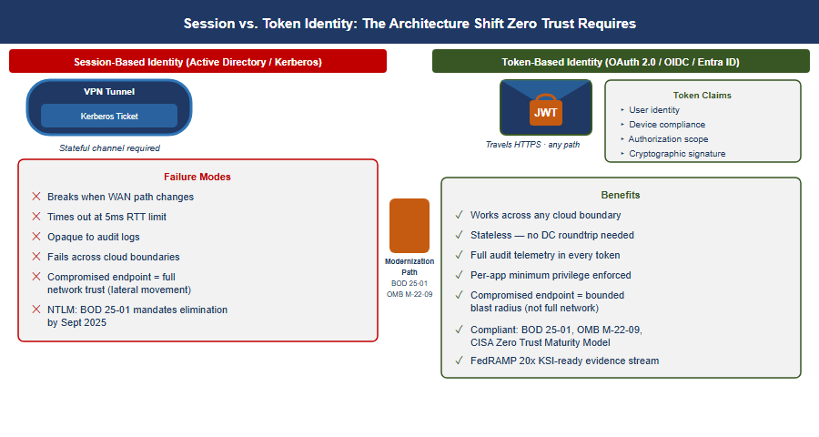{width="5.833333333333333in" |
| height="3.111111111111111in"} |
| |
| Figure 11: Principle 3 --- Token vs Session: session-based Kerberos |
| requires a stateful channel and lists six failure modes, while OAuth |
| 2.0/OIDC token-based identity travels HTTPS over any path and lists |
| seven benefits, joined by a Modernization Path arrow |
+-----------------------------------------------------------------------+

Entra ID, Conditional Access, and device-compliance policies are the
token-based equivalents of what AD used to do. **BOD 25-01** mandates
SCuBA secure configuration baselines for Microsoft 365 that require
modern authentication throughout. **OMB M-22-09** requires
phishing-resistant MFA government-wide. The **CISA Zero Trust Maturity
Model v2.0** Identity pillar at Advanced and Optimal levels requires
Certificate-Based Authentication (CBA) as the primary mechanism. NTLM
has no zero-trust story: every NTLM event is opaque to telemetry,
invisible to audit logs, and must be eliminated.

> **Tokens only work if the authoritative identity model is correct.**
> If you don't know what a user is actually authorized to do --- if that
> is still encoded in twelve regional OU trees with no authoritative
> HR-derived source --- tokens won't save you. You will just be signing
> broken authorizations very efficiently. **That is why Principle 3
> depends on Principle 1: the token must assert an authorization that is
> *true* rather than merely *well-formed*.**

## FedRAMP 20x Consolidated Rules --- What Modernization Must Achieve

FedRAMP published its **Consolidated Rules for 2026** on June 25, 2026,
establishing the most significant shift in federal cloud authorization
since FedRAMP's inception. The core change: **periodic evidence assembly
is replaced by continuously-verified, machine-readable Key Security
Indicators (KSIs) enforced by infrastructure-as-code.**

For agencies on the mainframe-to-AAN modernization path, this is not a
compliance burden --- it is the confirmation that the architectural
direction is correct.

 -----------------------------------------------------------------------
 FedRAMP 20x Requirement What the Modern Architecture
 Provides
 ----------------------------------- -----------------------------------
 Continuous, automated KSI SD-WAN probes every transport every
 verification second; SASE logs every session;
 DDI logs every DNS query

 Machine-readable evidence format SD-WAN telemetry APIs, SIEM
 (JSON) structured exports, InfoBlox WAPI
 --- all native JSON

 Infrastructure-as-code guardrails Terraform for DDI, IaC for SASE
 policy, GitOps for network config
 --- guardrails enforced at commit

 No manual evidence assembly for The control plane's continuous
 assessments observation IS the evidence --- not
 a report prepared for an assessor

 Automated KSI: all DNS encrypted or DNSSEC on all zones; DoH/DoT on
 integrity-protected Grid Members

 Automated KSI: no CIDR overlap Terraform InfoBlox provider blocks
 between environments overlapping allocation at request
 time

 Automated KSI: every workload has SCEP/EST auto-enrollment triggered
 machine identity at IP provisioning
 -----------------------------------------------------------------------

**Key dates all agencies must track:**

- **July 28, 2026:** FedRAMP Ready submissions cease --- no new Ready
 pathway submissions accepted
- **August 3, 2026:** Class A pipeline opens
- **August 31, 2026:** Class B and C pipelines open
- **January 1, 2027:** Consolidated Rules mandatory for all certified
 systems --- all ConMon evidence must meet machine-readable KSI
 format
- **June 11, 2027:** No new Rev5 certifications accepted

+-----------------------------------------------------------------------+
| 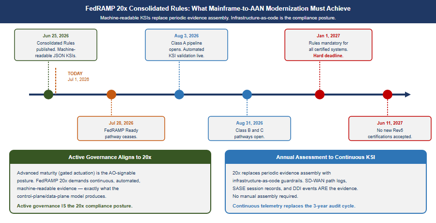{width="5.833333333333333in" |
| height="2.9814807524059495in"} |
| |
| Figure 12: FedRAMP 20x timeline from Consolidated Rules publication |
| through the Class A/B/C pipeline openings to the January 2027 |
| mandatory deadline, alongside how active governance already aligns to |
| continuous, machine-readable evidence |
+-----------------------------------------------------------------------+

### Principle 4 --- Govern Actively: The Control Plane Over the Data Plane

A governance substrate that embodies these principles is not a passive
registry that records desired state and reports divergence. It is an
**active reconciliation control plane**: it holds desired state,
observes actual state, classifies drift, and reconciles toward intent
--- while identity providers, network fabrics, endpoint management
platforms, DDI systems, and SIEM platforms remain the **data planes**
that authenticate, route, resolve, and store at runtime.

 -----------------------------------------------------------------------
 CISA ZT Stage Governance Posture What This Means in
 Practice
 ----------------------- ----------------------- -----------------------
 Traditional Record and observe only Desired state
 documented; actual
 state collected
 manually. No automated
 detection or
 correction.

 Initial Observe and advise Automated detection of
 drift from policy.
 Corrective actions
 generated and surfaced
 to operators. No
 automated writes.

 **Advanced** **Gated actuation** **Governance framework
 generates a corrective
 action; a human
 approves before it
 executes. Dry-run
 required before
 production. Federal
 ConMon standard
 posture.**

 Optimal Autonomous within Governance framework
 guardrails closes the loop without
 human intervention for
 enumerated
 low-blast-radius
 operation classes.
 High-blast-radius
 operations remain gated
 permanently.
 -----------------------------------------------------------------------

+-----------------------------------------------------------------------+
| 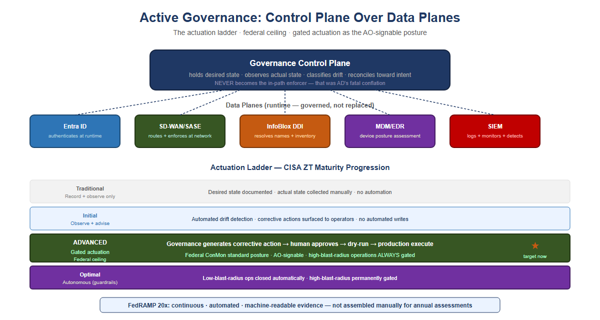{width="5.833333333333333in" |
| height="3.111111111111111in"} |
| |
| Figure 13: Active Governance: control plane and actuation ladder --- |
| a governance control plane over five data planes (Entra ID, |
| SD-WAN/SASE, InfoBlox DDI, MDM/EDR, SIEM), plus the CISA ZT maturity |
| progression from Traditional through Optimal with the federal L3 |
| gated-actuation ceiling marked as the target now |
+-----------------------------------------------------------------------+

> **What this means for authorizing officials:** FedRAMP continuous
> monitoring and OMB M-22-09 expect agencies to operate at Advanced
> maturity as the production standard. Advanced maturity --- gated
> actuation, where the governance framework generates a corrective
> action and a human approves before it executes --- is the posture an
> Authorizing Official can sign. High-blast-radius operations ---
> tenant-wide role changes, network policy updates that touch thousands
> of endpoints --- remain gated permanently regardless of overall
> maturity level.

### Principle 5 --- Reduce Synchronous Round-Trip Count at the Application Layer

Every application that depends on frequent synchronous communication
with an authoritative data store must reduce the number of network round
trips a single business transaction requires, before that application is
separated from its data across a distance that imposes a meaningful
propagation floor. Where round-trip reduction has not been demonstrated
through transaction profiling and performance validation, the
application's compute should remain co-located with its authoritative
data.

Principles 1 through 4 govern truth, transport, session survival, and
identity. None of them touch application design. A well-architected
SD-WAN overlay carrying token-authenticated traffic over active-active
multipath still incurs the physics floor once per synchronous call. Only
reducing the number of calls --- or converting them to a pattern that
tolerates distance --- actually shrinks the latency budget a transaction
consumes.

Round-trip reduction is an application and integration-architecture
discipline, not a network purchase:

 -----------------------------------------------------------------------
 Technique Mechanism Effect on Latency
 Exposure
 ----------------------- ----------------------- -----------------------
 Interface consolidation One aggregated call Reduces round-trip
 (BFF) replaces N fine-grained count from N× floor to
 calls 1× floor per
 transaction

 Async / event-driven Producer does not block Removes floor exposure
 processing on a synchronous reply from the user-facing
 critical path

 Edge caching Serve repeat reads from Eliminates the round
 (read-through) a local cache trip entirely for cache
 hits

 Batching Multiple operations Amortizes the floor
 travel in one exchange across many logical
 operations

 Connection pooling Handshake cost paid Removes repeated setup
 once, reused many times latency, not the data
 round trip

 Stateless transaction Pseudo-conversational Removes multi-step
 conversion sessions become atomic server affinity that
 calls forces sequential round
 trips
 -----------------------------------------------------------------------

Principle 5 depends on Principle 1 the same way Principle 3 does: a
cache or aggregation layer is only safe to build once there is one
authoritative source to cache from and reconcile against. Principle 2's
application-layer visibility (DPI, SASE telemetry) is the natural place
to measure round-trip count and transaction chattiness in production,
giving Principle 5 an evidence base rather than a guess. Principle 4's
gated actuation should treat "has this workload's round-trip count been
profiled and reduced" as a required check before approving separation of
an application from its authoritative data store.

## Mainframe Access Modernization: A Token-Based Implementation Path

This section describes an implementation pattern that is already mature
and productized --- not an open feasibility question. It does not assume
knowledge of a specific z/OS estate's current subsystem versions or RACF
configuration; validating configuration against the actual environment
is the first implementation step, not an afterthought.

### Current state

Mainframe access is natively governed by RACF (Resource Access Control
Facility) through the System Authorization Facility (SAF) interface.
Interactive access is typically session-bound --- 3270 terminal
emulation, or z/OS's own Kerberos implementation (Network Authentication
Service) --- and CICS/IMS transactions execute within a region that
expects a resolved RACF identity for the duration of the unit of work.
None of this is token-based in the OAuth/OIDC sense: it is credential-
or ticket-based, and tied to an active session in the same way Kerberos
in Principle 3 is tied to a domain controller.

### How the gateway bridges to RACF

Token-based access to mainframe transactions is not a hypothetical ---
IBM has shipped it for a decade. z/OS Connect (Enterprise Edition) has
validated OAuth 2.0 / OIDC tokens against CICS, IMS, and batch assets
since the mid-2010s, and RACF PassTicket itself dates to the 1990s.
Commercial banks --- exactly the customer base with the least tolerance
for standing still --- adopted this pattern years ago under PSD2 and
open-banking mandates that required OAuth-fronted core banking APIs. The
federal gap here is not a technology gap; it is the same adoption lag
documented throughout this whitepaper.

+-----------------------------------------------------------------------+
| 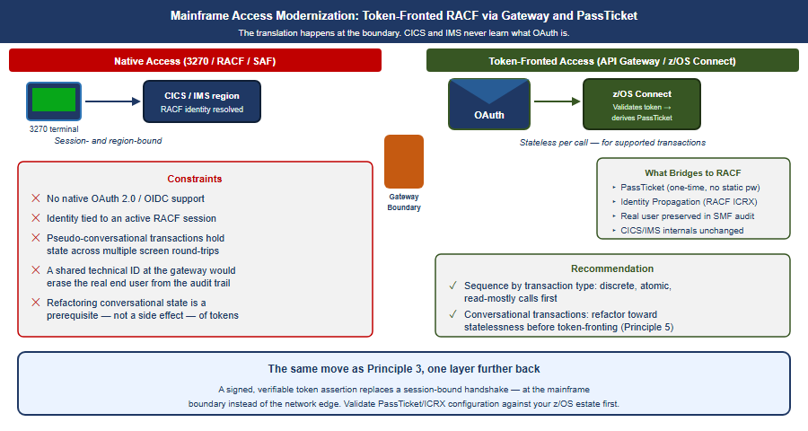{width="5.833333333333333in" |
| height="3.111111111111111in"} |
| |
| Figure 14: Mainframe access modernization: native 3270/RACF/SAF |
| access on the left versus token-fronted access through an API |
| gateway/z/OS Connect on the right, bridging to RACF via PassTicket |
| and Identity Propagation |
+-----------------------------------------------------------------------+

The established pattern: an API gateway or z/OS Connect (EE) layer
exposes CICS, IMS, or batch assets as REST/JSON services and terminates
an OAuth 2.0 / OIDC token issued by the enterprise identity provider
(e.g., Entra ID). The gateway validates the token's signature and
claims, then derives a RACF PassTicket --- a one-time, algorithmically
generated credential (from a shared secret, user ID, application ID, and
timestamp) --- to authenticate to RACF without storing or transmitting a
static password. z/OS Identity Propagation (RACF distributed identity
filters / ICRX) maps the external token's subject into the RACF audit
and authorization context, so the transaction is authorized and logged
against the real end user rather than a shared technical service ID.
This is architecturally the same move as Principle 3 --- a signed,
verifiable assertion replaces a session-bound handshake --- applied one
layer further back, at the mainframe boundary instead of the network
edge.

### What does not change internally

CICS and IMS do not natively understand OAuth tokens, and the underlying
transaction engine remains region- and session-bound. Token-based access
is a translation at the boundary, not a replacement of the mainframe's
internal security model. Pseudo-conversational transactions that hold
state across multiple screen interactions are the harder case: they were
designed around a persistent session, and converting them to a
stateless, per-request token model is itself a round-trip-reduction and
refactoring exercise --- the same work Principle 5 already calls for. In
practice, token-based mainframe access and round-trip reduction are not
two separate modernization tracks; they are the same gateway and the
same refactoring effort viewed from two angles.

### Recommendation

Treat mainframe token-based access as a byproduct of Principle 5's
interface-consolidation work, not a separate initiative. The same
API/gateway layer built to aggregate chatty synchronous calls is the
natural point to terminate tokens and bridge to RACF via PassTicket and
Identity Propagation. Sequence the work by transaction type: discrete,
atomic, read-mostly transactions are the near-term candidates for
token-fronted access; pseudo-conversational, multi-step transactions
should be refactored toward statelessness first, which is exactly the
round-trip reduction Principle 5 already requires. Validate PassTicket
and Identity Propagation configuration against the specific z/OS estate
before committing a modernization timeline --- this assessment is
general; the environment's current CICS/IMS versions, RACF class
configuration, and API gateway posture will determine the actual
sequencing.

## Federal Framework Alignment

The following table maps each concept in this narrative to the federal
mandate, standard, or policy that requires or validates it.

 -----------------------------------------------------------------------
 Concept / Narrative Federal Mandate Standard / Reference
 Claim 
 ----------------------- ----------------------- -----------------------
 Separate truth from EO 14028 (May 2021), NIST SP 800-207 §2
 runtime enforcement OMB M-22-09 (Zero Trust tenets)

 Single source of truth Evidence Act (2018), NIST SP 800-53 Rev 5
 for identity and data Federal Data Strategy CM-8, SI-12

 Authoritative identity FICAM Architecture, OMB NIST SP 800-63 Rev 4
 attributes from HR / M-22-09 Digital Identity
 authoritative sources Guidelines (31 Jul
 2025)

 Application-aware OMB M-22-09 §4, EO NIST SP 800-207, TIC
 networking; 14028 3.0 Branch Office and
 per-transaction policy Remote User use cases
 enforcement 

 Phishing-resistant MFA BOD 25-01, OMB M-22-09 CISA ZTMM v2.0 Identity
 / Certificate-Based pillar
 Authentication (Advanced/Optimal)

 Eliminate NTLM; move to BOD 25-01 (M365 SCuBA CISA ZTMM v2.0 Identity
 token-based identity baselines) pillar

 Device compliance as OMB M-22-09 §3 CISA ZTMM v2.0 Devices
 input to access pillar
 decisions 

 SD-WAN local internet TIC 3.0 (Trusted CISA ZTMM v2.0 Networks
 breakout; eliminate Internet Connections) pillar
 MPLS hairpin 

 SASE / ZTNA as access OMB M-22-09 §4, TIC 3.0 NIST SP 800-207, CISA
 model replacing VPN ZTMM Networks pillar

 Unified DNS as security FedRAMP Moderate NIST SP 800-53 Rev 5
 control (DNSSEC, RPZ, SC-20/21 SC-20, SC-21
 threat blocking) 

 IP address inventory as FedRAMP Moderate NIST SP 800-53 Rev 5
 compliance evidence CM-8
 (CM-8) 

 Audit provenance: every FedRAMP Moderate NIST SP 800-53 Rev 5
 transaction traceable AU-2/12 AU-2, AU-12
 to authorized source 

 Continuous monitoring; FedRAMP 20x NIST SP 800-37 Rev 2
 automated KSI Consolidated Rules (Jun CA-7; FedRAMP 20x KSIs;
 enforcement 25, 2026); OMB Circular mandatory Jan 1, 2027
 A-130 

 Gated actuation as FedRAMP ConMon, OMB CISA ZTMM v2.0
 standard governance M-22-09 Automation and
 posture (Advanced Orchestration pillar
 maturity) 

 Machine-readable KSI FedRAMP 20x FedRAMP 20x JSON
 evidence; no manual Consolidated Rules --- evidence format;
 evidence assembly Class A/B/C pipelines GitHub-published
 open Aug 3/31, 2026 structured rules

 Reduce synchronous OMB Circular A-130 NIST SP 800-53 Rev 5
 round-trip count before (sound engineering SA-8 (Security and
 separating an practice); EO 14028 Privacy Engineering
 application from Principles)
 authoritative data 

 Bridge mainframe OMB M-22-09 (modern NIST SP 800-207; CISA
 RACF/SAF access to authentication); BOD ZTMM v2.0 Identity
 token-based identity 25-01 pillar
 via API gateway and 
 PassTicket 
 -----------------------------------------------------------------------

## Call to Action

This whitepaper describes a well-worn commercial transition your agency
has not yet completed, under a federal compliance deadline that is no
longer negotiable. The following steps convert the five principles into
an execution plan.

None of this requires a specific vendor decision on day one. It requires
an inventory, an owner, and a date. The architecture described in this
whitepaper is not aspirational --- it is what the commercial sector
already runs, and what federal compliance now requires.

## Appendix --- Narrative provenance: this arc mapped to UIAO canon

**Everything above this appendix is vendor- and product-neutral** --- it
cites only NIST, OMB, CISA and FedRAMP, and the argument stands without
anything below. This appendix is separable: it exists for readers who
want to know where Act 4's claims come from in the UIAO substrate, and
it can be dropped when the paper is handed to an audience that is not
evaluating a platform.

The same arc also circulates as the compliance series Vol I Book
05,
which carries the federal control-closure framing (NIST 800-53, FedRAMP
20x KSI, TIC 3.0) and the SD-WAN / INR implementation appendix. That
book names no automation engine at all --- the the compliance series series is
adoptable on its own --- so **this appendix is the canonical home of the
mapping below.** The modernization pillar's curated entry points for the
arc are collected at the OrgMod hub.

Acts 1--3 are the agency's lived history and are not canon claims. Act 4
is anchored --- here is the line-by-line provenance, including where
earlier framings were corrected to match canon.

 ----------------------------------------------------------------------------------------------------------------------------------------------------------
 Narrative claim Canon anchor Reconciliation note
 ----------------------- ---------------------------------------------------------------------------------------------------------- -----------------------
 Separate truth from the program decision §1 Verbatim doctrine; the
 runtime enforcement; AD spine of Act 4.
 conflated directory + 
 DC 

 the organizational-attribute model restores UIAO_151, [the program decision **Corrected:** the organizational-attribute model
 addressable truth §2](../../../src/uiao/canon/adr/adr-092-active-governance.md) is an *addressing
 attribute every object
 carries*, not a
 "governance primitive,"
 and **not** "every
 token includes an
 the organizational-attribute model." Decisions
 *compose against* it.

 Application-aware the program decision Proposed (amended by
 networking; token-bound the program decision); generalized
 per-call transport by accepted the program decision.
 "Session is no longer a
 canonical concept."

 Vendor products (SD-WAN the program decision §2, **Softened:** canon
 platform, cloud [Book_17](../orgpath-narrative/Book_17.md) names a neutral
 on-ramp) `sdwan-fabric` slot,
 Azure Policy,
 ISE/ClearPass/Entra
 RADIUS. Specific
 platforms are
 illustrative,
 incorporated as
 providers.

 Session→token identity; the program decision, Canonical. NTLM
 CBA replaces Kerberos the program decision elimination + CBA +
 Cloud Kerberos trust.

 Active Governance; the program decision §3--4 Verbatim; the keystone
 L0--L4 ladder; federal of the way forward.
 L3 ceiling 

 Restore single source the program decision, Canonical, framed as
 of truth / provenance the program decision **governance /
 accountability /
 integrity**.
 Program-integrity
 stakes are the agency's
 real-world motivation,
 not a UIAO canon claim.
 ----------------------------------------------------------------------------------------------------------------------------------------------------------

